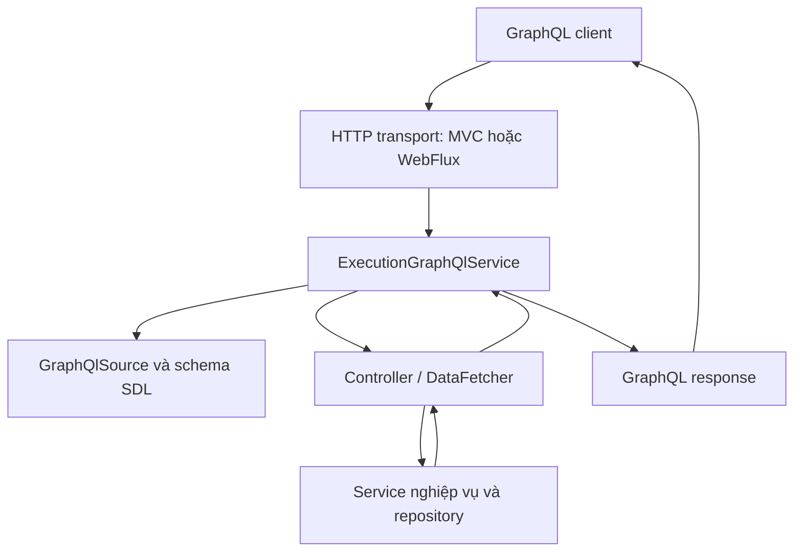

# spring-boot-starter-graphql

`spring-boot-starter-graphql` là dependency khởi đầu để tích hợp Spring for GraphQL vào một ứng dụng Spring Boot. Starter đưa các thư viện cần thiết vào classpath và cho phép Spring Boot tự cấu hình những thành phần nền tảng như nguồn schema, bộ thực thi GraphQL và các tích hợp transport khi ứng dụng có dependency tương ứng.

Chỉ thêm starter chưa đủ để có một HTTP API hoàn chỉnh. Ứng dụng vẫn cần schema GraphQL, các controller hoặc resolver xử lý field, và một transport như Spring MVC hoặc WebFlux để nhận request từ client. Hiểu rõ vai trò của từng phần giúp tránh cấu hình thừa và dễ tìm lỗi khi ứng dụng khởi động.

## 1. Starter cung cấp những gì?

Spring for GraphQL kết nối GraphQL Java với mô hình lập trình của Spring. Thay vì tự tạo `GraphQL` instance, tự phân tích request và tự ánh xạ từng resolver, ứng dụng khai báo schema SDL và sử dụng các thành phần Spring để xử lý field.

Khi thêm `spring-boot-starter-graphql`, Spring Boot có thể tự cấu hình các thành phần chính sau, tùy theo classpath và cấu hình ứng dụng:

- Tạo `GraphQlSource` từ các file schema SDL trong classpath.
- Tạo `ExecutionGraphQlService` để thực thi GraphQL document trên schema.
- Đăng ký các controller có annotation của Spring for GraphQL và kết nối method với field trong schema.
- Tích hợp transport HTTP khi ứng dụng có Spring MVC hoặc Spring WebFlux phù hợp.
- Cung cấp các điểm mở rộng cho interceptor, exception resolver, runtime wiring và các thành phần tùy biến.

Starter không tự sinh schema nghiệp vụ, không tự tạo truy vấn database và không quyết định quy tắc phân quyền. Những phần đó thuộc thiết kế và code của ứng dụng.

Có thể hình dung luồng xử lý ở mức tổng quát như sau:



Schema mô tả API mà client được phép gọi. Controller hoặc `DataFetcher` cung cấp cách thực thi field. Service và repository xử lý nghiệp vụ, truy cập dữ liệu. Transport chịu trách nhiệm nhận và trả dữ liệu qua giao thức cụ thể.

## 2. Thêm dependency vào dự án

### 2.1. Maven

Nếu dự án sử dụng `spring-boot-starter-parent` hoặc import Spring Boot dependency management, không cần khai báo version riêng cho starter:

```xml
<dependencies>
    <dependency>
        <groupId>org.springframework.boot</groupId>
        <artifactId>spring-boot-starter-graphql</artifactId>
    </dependency>

    <!-- Chọn Spring MVC làm HTTP transport -->
    <dependency>
        <groupId>org.springframework.boot</groupId>
        <artifactId>spring-boot-starter-web</artifactId>
    </dependency>
</dependencies>
```

Nếu dự án đã dùng Spring WebFlux, có thể dùng `spring-boot-starter-webflux` thay cho `spring-boot-starter-web`:

```xml
<dependency>
    <groupId>org.springframework.boot</groupId>
    <artifactId>spring-boot-starter-webflux</artifactId>
</dependency>
```

Thông thường, hãy chọn một stack HTTP chính cho ứng dụng. Thêm đồng thời MVC và WebFlux có thể khiến Spring Boot phải xử lý nhiều lựa chọn trên classpath; chỉ làm vậy khi kiến trúc thực sự cần và bạn đã hiểu cách Boot chọn application type.

### 2.2. Gradle

Với Gradle và Spring Boot dependency management:

```groovy
dependencies {
    implementation 'org.springframework.boot:spring-boot-starter-graphql'
    implementation 'org.springframework.boot:spring-boot-starter-web'
}
```

Nếu dùng Kotlin DSL:

```kotlin
dependencies {
    implementation("org.springframework.boot:spring-boot-starter-graphql")
    implementation("org.springframework.boot:spring-boot-starter-web")
}
```

Khi dùng WebFlux, thay dependency Web MVC bằng `spring-boot-starter-webflux`.

### 2.3. Để Spring Boot quản lý phiên bản

Spring Boot dependency management kiểm soát các phiên bản Spring for GraphQL, GraphQL Java và những thư viện liên quan đã được kiểm thử tương thích với nhau. Trong dự án Boot chuẩn, nên để parent hoặc BOM quản lý version thay vì tự nâng riêng `spring-graphql` hay `graphql-java`.

Nếu dự án không dùng Spring Boot parent, hãy import BOM tương ứng hoặc khai báo bộ version tương thích theo hướng dẫn của phiên bản Spring Boot đang sử dụng. Trộn các version độc lập có thể gây lỗi class loading, lỗi method không tồn tại hoặc hành vi khác với auto-configuration mà Boot mong đợi.

## 3. Tạo schema SDL

Spring Boot tìm schema theo cấu hình `spring.graphql.schema.locations`. Vị trí mặc định phổ biến là `classpath:graphql/**/`, tức thư mục `graphql` bên trong resources và các thư mục con của nó. File schema thường dùng phần mở rộng `.graphqls` hoặc `.gqls`.

Tạo file:

```text
src/main/resources/
└── graphql/
    └── schema.graphqls
```

Nội dung `schema.graphqls`:

```graphql
type Query {
    greeting(name: String = "Spring"): String!
}
```

Schema khai báo một root field tên `greeting`, nhận argument `name` và trả về chuỗi không null. Giá trị mặc định giúp query không truyền argument vẫn có kết quả.

Schema là hợp đồng công khai của GraphQL API. Tên field, argument, kiểu dữ liệu và nullability phải nhất quán với dữ liệu mà resolver thực sự có thể trả về.

## 4. Viết controller xử lý field

Tạo controller trong package được Spring Boot component scan:

```java
package com.example.graphql;

import org.springframework.graphql.data.method.annotation.Argument;
import org.springframework.graphql.data.method.annotation.QueryMapping;
import org.springframework.stereotype.Controller;

@Controller
public class GreetingController {

    @QueryMapping
    public String greeting(@Argument String name) {
        return "Hello, " + name + "!";
    }
}
```

`@Controller` đăng ký class như một Spring bean. `@QueryMapping` ánh xạ method vào field cùng tên trên root type `Query`; `@Argument` lấy giá trị argument từ GraphQL environment. Vì method tên `greeting`, annotation không cần khai báo lại tên field.

Nếu muốn tên method khác tên field, có thể chỉ định tên tường minh:

```java
@QueryMapping(name = "greeting")
public String buildGreeting(@Argument String name) {
    return "Hello, " + name + "!";
}
```

Khi ứng dụng khởi động, Spring for GraphQL kết nối mapping này với schema. Một field được khai báo trong SDL nhưng không có cách resolve phù hợp có thể dẫn đến lỗi thực thi hoặc kết quả không như mong muốn; vì vậy schema và controller cần được phát triển đồng bộ.

## 5. Chạy ứng dụng và gửi query

Với Spring MVC hoặc WebFlux đã được cấu hình, GraphQL HTTP endpoint mặc định là `/graphql`. Có thể thay đổi bằng thuộc tính `spring.graphql.path`.

Ví dụ gửi request HTTP POST:

```bash
curl -X POST http://localhost:8080/graphql \
  -H "Content-Type: application/json" \
  -d '{"query":"query { greeting(name: \"Lan\") }"}'
```

Response có dạng:

```json
{
  "data": {
    "greeting": "Hello, Lan!"
  }
}
```

Có thể gửi query không truyền argument:

```graphql
query {
    greeting
}
```

Kết quả dùng giá trị mặc định `Spring` trong schema. Đây là request GraphQL được gửi qua HTTP; bản thân GraphQL không bắt buộc mọi ứng dụng phải dùng HTTP, nhưng HTTP là transport thông dụng cho web và mobile API.

## 6. Cấu hình những thuộc tính thường dùng

Các thuộc tính dưới đây giúp điều chỉnh endpoint và vị trí schema mà không cần tự viết toàn bộ cấu hình Java:

```yaml
spring:
  graphql:
    path: /graphql
    schema:
      locations: classpath:graphql/**/
      file-extensions: .graphqls,.gqls
    graphiql:
      enabled: true
```

Ý nghĩa:

| Thuộc tính | Mục đích |
| --- | --- |
| `spring.graphql.path` | Đường dẫn HTTP GraphQL endpoint |
| `spring.graphql.schema.locations` | Các vị trí tìm file SDL trên classpath |
| `spring.graphql.schema.file-extensions` | Phần mở rộng file schema được tìm kiếm |
| `spring.graphql.graphiql.enabled` | Bật giao diện GraphiQL khi runtime và tài nguyên giao diện được hỗ trợ |

`GraphiQL` là giao diện hỗ trợ thử query và xem response trong lúc phát triển. Chỉ bật giao diện này ở môi trường phù hợp; trước khi bật ở môi trường dùng chung hoặc production, cần đánh giá quyền truy cập và chính sách bảo mật của hệ thống.

Không cần khai báo lại các giá trị mặc định nếu chúng đã phù hợp. Khi đổi vị trí schema, hãy bảo đảm file SDL vẫn được đóng gói vào classpath của artifact chạy thực tế.

## 7. Auto-configuration hoạt động như thế nào?

Spring Boot sử dụng classpath, bean hiện có và các thuộc tính cấu hình để quyết định những thành phần nào cần được tạo. Vì vậy, cùng một starter có thể hoạt động với cấu hình khác nhau tùy ứng dụng.

Ở mức khái quát:

1. Dependency GraphQL cung cấp các lớp Spring for GraphQL và GraphQL Java.
2. Schema resource được tìm thấy và dùng để tạo `GraphQlSource`.
3. Các controller và resolver được phát hiện, sau đó được kết nối với field trong schema.
4. Nếu có stack web phù hợp, transport HTTP được cấu hình để nhận GraphQL request.
5. Request được chuyển tới execution service, thực thi trên schema và trả response về transport.

Auto-configuration được thiết kế để có thể thay thế hoặc mở rộng. Khi ứng dụng tự khai báo một số bean nền tảng, cấu hình tự động tương ứng có thể lùi lại theo điều kiện của nó. Do đó, trước khi tự tạo `GraphQlSource` hoặc transport handler, hãy kiểm tra xem Boot đã cung cấp bean nào và lý do cấu hình mặc định chưa đáp ứng.

Không nên sao chép toàn bộ auto-configuration vào ứng dụng chỉ để đổi một hành vi nhỏ. Ưu tiên thuộc tính cấu hình, customizer hoặc extension point được Spring for GraphQL cung cấp.

## 8. Kiểm thử controller với GraphQlTester

Spring for GraphQL cung cấp `GraphQlTester` để kiểm thử operation mà không cần kiểm tra thủ công toàn bộ JSON response. Với slice test, `@GraphQlTest` giúp tập trung vào thành phần GraphQL và controller được chọn.

Ví dụ:

```java
package com.example.graphql;

import org.junit.jupiter.api.Test;
import org.springframework.beans.factory.annotation.Autowired;
import org.springframework.boot.test.autoconfigure.graphql.GraphQlTest;
import org.springframework.graphql.test.tester.GraphQlTester;

@GraphQlTest(GreetingController.class)
class GreetingControllerTest {

    @Autowired
    GraphQlTester graphQlTester;

    @Test
    void greetingReturnsExpectedMessage() {
        graphQlTester.document("""
                query {
                    greeting(name: "Lan")
                }
                """)
            .execute()
            .path("greeting")
            .entity(String.class)
            .isEqualTo("Hello, Lan!");
    }
}
```

`GraphQlTester` tập trung vào kết quả GraphQL, nên test không phụ thuộc vào cách JSON được định dạng hoặc thứ tự field trong response. Với kiểm thử qua HTTP thực tế, có thể dùng `HttpGraphQlTester` kết hợp `WebTestClient` để xác minh cả transport, endpoint và quá trình thực thi.

Khi controller phụ thuộc service, hãy cung cấp mock hoặc test bean phù hợp cho slice test. Khi cần xác minh database, security filter, serialization và cấu hình ứng dụng cùng hoạt động, hãy bổ sung integration test với context đầy đủ.

Test classpath cần có Spring Boot test support và module spring-graphql-test để cung cấp GraphQlTester. Trong dự án Maven, có thể khai báo spring-boot-starter-test và org.springframework.graphql:spring-graphql-test với scope test; để Spring Boot BOM quản lý phiên bản tương thích.

## 9. Những lỗi thường gặp khi tích hợp starter

### 9.1. Ứng dụng chạy nhưng không truy cập được `/graphql`

Kiểm tra ứng dụng đã có HTTP transport hay chưa. `spring-boot-starter-graphql` cung cấp phần GraphQL; ứng dụng web cần Spring MVC hoặc WebFlux tương ứng. Đồng thời kiểm tra `spring.graphql.path`, port và cấu hình security hoặc reverse proxy.

### 9.2. Không tìm thấy schema hoặc schema không hợp lệ

Kiểm tra file nằm trong `src/main/resources/graphql/`, phần mở rộng có được hỗ trợ và nội dung SDL hợp lệ. Nếu thay đổi `spring.graphql.schema.locations`, kiểm tra giá trị classpath có trỏ tới đúng thư mục sau khi build hay không.

### 9.3. Query trả về lỗi field không được resolve

So sánh tên root field trong schema với tên method `@QueryMapping`, `@MutationMapping` hoặc `@SchemaMapping`. Kiểm tra controller có được component scan, method có được đăng ký và dữ liệu trả về có phù hợp với kiểu khai báo trong SDL hay không.

### 9.4. Lỗi tương thích thư viện

Nếu tự khai báo version `spring-graphql` hoặc `graphql-java`, kiểm tra chúng có tương thích với Spring Boot đang dùng không. Ưu tiên dependency management của Boot để tránh lệch version giữa auto-configuration và thư viện runtime.

### 9.5. Giao diện GraphiQL không xuất hiện

Kiểm tra `spring.graphql.graphiql.enabled`, môi trường đang chạy và việc tài nguyên giao diện GraphiQL có sẵn trong classpath hay không. Bật thuộc tính không thể thay thế cho các tài nguyên hoặc điều kiện runtime còn thiếu.

## 10. Ranh giới giữa starter và phần nghiệp vụ GraphQL

Starter giúp ứng dụng có nền tảng chạy Spring for GraphQL. Từ đó, các phần tiếp theo được xây dựng theo nhu cầu của API:

- SDL định nghĩa Query, Mutation, Subscription, object type, input và scalar.
- `@QueryMapping` và `@MutationMapping` xử lý các field ở root operation.
- `@SchemaMapping` ánh xạ field của object type sang method Java.
- `@BatchMapping` hoặc `DataLoader` gom việc tải dữ liệu để giảm N+1.
- Exception resolver chuẩn hóa lỗi; Spring Security và các cơ chế kiểm tra quyền bảo vệ dữ liệu ở cấp field hoặc nghiệp vụ.
- `GraphQlTester` và các công cụ quan sát hỗ trợ kiểm thử, chẩn đoán và tối ưu query.

Không phải tất cả tính năng này đều được tự động bật chỉ bằng cách thêm starter. Starter cung cấp tích hợp và cấu hình nền; ứng dụng vẫn phải khai báo schema, viết resolver, kết nối service, xác định chính sách bảo mật và lựa chọn transport phù hợp.

Khi bắt đầu một dự án, hãy thêm `spring-boot-starter-graphql` cùng đúng HTTP transport, tạo một schema SDL nhỏ, ánh xạ một query bằng `@QueryMapping` và kiểm thử bằng `GraphQlTester`. Khi luồng tối thiểu hoạt động, mở rộng từng phần theo yêu cầu thực tế như mutation, field mapping, batch loading, security và subscription. Cách này giúp xác định rõ thành phần nào do Spring Boot tự cấu hình và thành phần nào thuộc trách nhiệm của ứng dụng.
