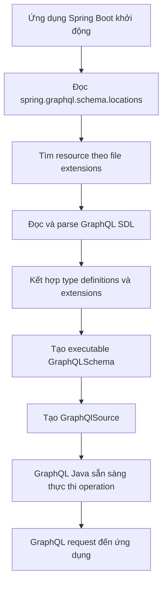

# Classpath schema locations

Spring Boot có thể tự tìm và nạp các file GraphQL SDL khi khởi tạo ứng dụng. Nhờ cơ chế này, bạn đặt schema trong thư mục tài nguyên của dự án, còn Spring for GraphQL kết hợp các định nghĩa đó để tạo schema có thể thực thi cho GraphQL Java. Thuộc tính `spring.graphql.schema.locations` cho biết Spring Boot cần tìm schema ở đâu trên resource path; thuộc tính `spring.graphql.schema.file-extensions` xác định những phần mở rộng file được chấp nhận.

Đây là cấu hình thuộc phần tích hợp Spring Boot của Spring for GraphQL. Nó quyết định nơi lấy định nghĩa schema, không quyết định URL endpoint và cũng không đăng ký các phương thức resolver trong controller.

## 1. Classpath là gì trong một ứng dụng Spring Boot?

Classpath là tập hợp thư mục và file JAR mà JVM dùng để tìm class và resource khi chạy ứng dụng. Trong một dự án Spring Boot thông thường, thư mục `src/main/resources` được build tool sao chép vào classpath:

| Nơi đặt trong dự án | Vị trí sau khi build thường gặp |
| --- | --- |
| Maven: `src/main/resources/graphql/` | `target/classes/graphql/` |
| Gradle: `src/main/resources/graphql/` | `build/resources/main/graphql/` |
| Bên trong executable JAR của Spring Boot | `BOOT-INF/classes/graphql/` |

Vì vậy, khi cấu hình `classpath:graphql/`, bạn đang tham chiếu tới thư mục `graphql` ở gốc resource classpath, chứ không phải đường dẫn tuyệt đối trên máy phát triển. Khi ứng dụng chạy từ JAR, Spring vẫn có thể đọc resource đã được đóng gói bên trong JAR.

Đặt schema trong `src/main/resources/graphql` là cách tổ chức phổ biến:

```text
src/
└── main/
    └── resources/
        └── graphql/
            ├── schema.graphqls
            ├── book.graphqls
            └── author.graphqls
```

Các file trong thư mục này chứa GraphQL SDL, ví dụ khai báo `type Query`, `type Mutation`, object type, input type, enum, scalar hoặc interface. Bạn có thể chia schema thành nhiều file để mỗi phần dễ đọc và dễ bảo trì hơn.

## 2. Vị trí schema mặc định

Với cấu hình Spring Boot mặc định cho Spring for GraphQL, schema được tìm trong vị trí:

```text
classpath:graphql/**/
```

Mẫu `**/` cho phép tìm trong thư mục `graphql` và các thư mục con của nó. Ví dụ, cả hai cấu trúc sau đều có thể được tổ chức dưới cùng resource root:

```text
src/main/resources/graphql/
├── schema.graphqls
├── book.graphqls
└── catalog/
    └── catalog.graphqls
```

```text
src/main/resources/graphql/
├── common/
│   └── scalars.graphqls
└── domain/
    ├── book.graphqls
    └── author.graphqls
```

Spring Boot cũng mặc định nhận các phần mở rộng schema phổ biến:

| Phần mở rộng | Mục đích |
| --- | --- |
| `.graphqls` | Phần mở rộng thường dùng cho GraphQL schema SDL |
| `.gqls` | Phần mở rộng khác được hỗ trợ cho schema SDL |

Ví dụ `book.graphqls` và `author.gqls` đều có thể được nhận diện theo cấu hình mặc định. Một file đặt đúng thư mục nhưng dùng phần mở rộng không nằm trong danh sách cấu hình sẽ không được tính là schema resource cần nạp.

## 3. Tùy chỉnh schema locations

Khi muốn đặt schema ở thư mục khác hoặc kết hợp schema từ nhiều resource root, cấu hình `spring.graphql.schema.locations`. Ví dụ dùng YAML:

```yaml
spring:
  graphql:
    schema:
      locations:
        - classpath:graphql/**/
        - classpath:shared-graphql/**/
```

Hoặc dùng `application.properties`:

```properties
spring.graphql.schema.locations=classpath:graphql/**/,classpath:shared-graphql/**/
```

Trong ví dụ, Spring Boot tìm schema trong cả hai vị trí. Khi đặt giá trị cho `locations`, hãy liệt kê đầy đủ các resource root mà ứng dụng cần dùng; đừng mặc định rằng vị trí mặc định sẽ tự động được cộng thêm vào danh sách đã cấu hình.

Đường dẫn resource có thể dùng wildcard để tìm trong các thư mục con. Nếu schema được tổ chức sâu theo domain, mẫu `classpath:graphql/**/` giúp tránh phải liệt kê từng thư mục con. Nếu dùng một vị trí cụ thể, hãy kiểm tra mẫu đó có bao phủ đúng thư mục chứa file hay không.

### Phân biệt `classpath:` và `classpath*:`

`classpath:` tham chiếu resource trên classpath. Khi cần thu thập resource khớp với một mẫu từ nhiều vị trí classpath, chẳng hạn schema được cung cấp bởi nhiều dependency JAR, có thể cân nhắc prefix `classpath*:`:

```yaml
spring:
  graphql:
    schema:
      locations:
        - classpath*:graphql/**/
```

`classpath*:` hữu ích khi chủ động thiết kế các module hoặc thư viện dùng chung để đóng góp schema. Cần quản lý tên type và field giữa các module cẩn thận: tất cả resource được tìm thấy vẫn được dùng để tạo một schema GraphQL thống nhất, nên định nghĩa xung đột hoặc lặp lại không hợp lệ có thể làm ứng dụng không khởi động được.

Chỉ dùng cách tìm kiếm trên toàn classpath khi có nhu cầu đó. Với một ứng dụng có schema nằm trong resource của chính nó, `classpath:graphql/**/` thường đơn giản và dễ kiểm soát hơn.

## 4. Tùy chỉnh phần mở rộng file

Thuộc tính `spring.graphql.schema.file-extensions` cho biết những đuôi file nào được xem là schema resource. Ví dụ, nếu dự án cần giữ thêm một quy ước phần mở rộng riêng, có thể khai báo:

```yaml
spring:
  graphql:
    schema:
      file-extensions:
        - .graphqls
        - .gqls
        - .graphql
```

Khi thay đổi danh sách này, hãy khai báo tất cả phần mở rộng mà ứng dụng muốn tiếp tục sử dụng. Ví dụ trên giữ lại cả `.graphqls` và `.gqls`, đồng thời bổ sung `.graphql`.

Phần mở rộng chỉ giúp bộ tìm kiếm nhận diện file. Nội dung file vẫn phải là GraphQL SDL hợp lệ. Đổi tên file sang `.graphqls` không thể sửa lỗi cú pháp, type chưa khai báo hoặc field không hợp lệ trong schema.

## 5. Nhiều file SDL tạo thành một schema

Việc chia schema thành nhiều file là cách tổ chức source code. Khi ứng dụng khởi động, Spring Boot tìm các resource theo locations và extensions đã cấu hình, sau đó Spring for GraphQL dùng chúng để xây dựng một schema cho GraphQL Java. Client vẫn gửi operation tới cùng GraphQL API; client không cần biết định nghĩa `Book` nằm trong file nào.

Ví dụ chia một schema sách thành ba file:

`schema.graphqls` khai báo root query:

```graphql
type Query {
    bookById(id: ID!): Book
}
```

`book.graphqls` khai báo object type:

```graphql
type Book {
    id: ID!
    title: String!
    author: Author
}
```

`author.graphqls` khai báo kiểu tác giả:

```graphql
type Author {
    id: ID!
    name: String!
}
```

Các định nghĩa tham chiếu lẫn nhau vẫn thuộc cùng một schema. Nếu cần bổ sung field cho một type đã khai báo ở file khác, dùng type extension theo SDL. Ví dụ, file `book-search.graphqls` có thể viết:

```graphql
extend type Query {
    booksByAuthor(authorId: ID!): [Book!]!
}
```

`extend type Query` bổ sung field vào `Query` đã tồn tại. Cách này phù hợp khi mỗi domain quản lý phần mở rộng của root type. Tránh khai báo lại một `type Query` độc lập ở nhiều file như thể mỗi file là một schema riêng; các file được kết hợp thành một schema, và những định nghĩa type trùng lặp có thể gây lỗi khi parse hoặc xây dựng schema.

Việc chia file không thay đổi cách viết resolver. Với `Query.bookById`, bạn vẫn có thể dùng `@QueryMapping`; với field `Book.author`, có thể dùng `@SchemaMapping` hoặc `@BatchMapping` tùy cách lấy dữ liệu:

```java
@Controller
public class BookController {

    private final BookService bookService;

    public BookController(BookService bookService) {
        this.bookService = bookService;
    }

    @QueryMapping
    public Book bookById(@Argument String id) {
        return bookService.findById(id);
    }
}
```

Schema locations quyết định file SDL được nạp. Component scanning và cơ chế mapping của Spring quyết định controller bean nào được phát hiện. Đây là hai quá trình cấu hình khác nhau.

## 6. Từ schema resource đến GraphQlSource

Trong quá trình auto-configuration, Spring Boot dùng cấu hình schema để tìm các resource, rồi tạo cấu hình nguồn GraphQL cho Spring for GraphQL. `GraphQlSource` chứa schema đã được xây dựng cùng cấu hình runtime liên quan. GraphQL Java sử dụng schema này để kiểm tra operation và thực thi các field khi request đến.

Có thể hình dung trình tự khởi động như sau:



Các lỗi tìm resource hoặc lỗi SDL thường xuất hiện trong lúc khởi tạo application context. Vì vậy, nếu schema sai cú pháp hoặc không tìm thấy type được tham chiếu, ứng dụng có thể thất bại ngay khi startup thay vì đợi đến khi client gọi query.

Các phương thức `@QueryMapping`, `@SchemaMapping`, `@MutationMapping` và những cấu hình runtime khác được kết nối vào quá trình tạo executable schema. Nếu schema khai báo `Query.bookById` nhưng ứng dụng không có mapping tương ứng và cũng không có cơ chế fetch mặc định phù hợp, operation có thể không trả được dữ liệu mong muốn. Ngược lại, khai báo controller không tự tạo ra type hoặc field còn thiếu trong SDL.

## 7. Kiểm tra resource sau khi build

Một schema có thể đọc được khi chạy trong IDE nhưng bị thiếu khi chạy executable JAR nếu resource không được đặt hoặc đóng gói đúng cách. Khi gặp tình huống này, hãy kiểm tra artifact sau build.

Với Maven, resource mặc định thường được sao chép vào `target/classes/graphql`. Với Gradle, resource thường nằm trong `build/resources/main/graphql`. Trong executable JAR của Spring Boot, resource ứng dụng thường nằm dưới `BOOT-INF/classes/graphql/`.

Có thể liệt kê nội dung JAR bằng lệnh:

```bash
jar tf build/libs/application.jar
```

Với Maven, thay bằng đường dẫn JAR được tạo trong `target/`. Tìm các entry như:

```text
BOOT-INF/classes/graphql/schema.graphqls
BOOT-INF/classes/graphql/book.graphqls
```

Nếu không có các entry tương ứng, hãy kiểm tra cấu hình resource của build tool và vị trí file trong dự án. Thư mục `src/test/resources` chỉ dành cho test classpath; schema chỉ đặt ở đó thường không được đóng gói vào artifact chạy production.

## 8. Chẩn đoán lỗi thường gặp

| Triệu chứng | Nguyên nhân có thể | Cách kiểm tra |
| --- | --- | --- |
| Không tìm thấy schema khi khởi động | File nằm ngoài resource root đã cấu hình | Kiểm tra `src/main/resources/graphql` và `spring.graphql.schema.locations` |
| File tồn tại nhưng không được nạp | Phần mở rộng không có trong `file-extensions` | Kiểm tra `.graphqls`, `.gqls` hoặc cấu hình phần mở rộng riêng |
| Schema trong thư mục con bị bỏ sót | Resource pattern không bao phủ thư mục con | Dùng mẫu phù hợp như `classpath:graphql/**/` |
| Chạy trong IDE được nhưng chạy JAR lỗi | Resource không được đóng gói vào artifact | Kiểm tra nội dung JAR và cấu hình resources của Maven hoặc Gradle |
| Lỗi duplicate type hoặc type extension | Nhiều file khai báo trùng type hoặc extension không đúng type gốc | Tìm các khai báo `type` và `extend type` liên quan |
| Query báo lỗi field không tồn tại | Field chưa được khai báo trong SDL hoặc sai tên | Kiểm tra type và field trong schema đã nạp |
| Field có trong SDL nhưng không lấy được dữ liệu | Resolver hoặc property fetcher không cung cấp giá trị phù hợp | Kiểm tra `@QueryMapping`, `@SchemaMapping`, `@BatchMapping` và source object |

Khi chẩn đoán, nên tách ba lớp nguyên nhân. Lỗi resource location nghĩa là Spring không tìm được file. Lỗi parse hoặc validation nghĩa là đã đọc được SDL nhưng định nghĩa schema không hợp lệ. Lỗi mapping nghĩa là schema đã có field nhưng quá trình phân giải dữ liệu của field chưa đúng. Xác định đúng lớp giúp tránh sửa controller khi nguyên nhân thực tế nằm ở đường dẫn resource.

## 9. Lưu ý khi cấu hình theo môi trường

Nếu các profile Spring Boot dùng những thư mục schema khác nhau, có thể đặt `spring.graphql.schema.locations` trong file cấu hình tương ứng của từng profile. Cần bảo đảm mỗi profile liệt kê đủ các vị trí cần thiết, bởi danh sách được cấu hình sẽ là danh sách locations được dùng cho môi trường đó.

Trong ứng dụng nhiều module, nên thống nhất quy ước resource root và cách đặt tên type giữa các module. Nếu một thư viện đóng góp schema qua JAR, hãy thiết kế rõ cách ứng dụng chính thu thập resource đó, cân nhắc `classpath*:` khi thực sự cần quét nhiều classpath location và kiểm tra xung đột trước khi tích hợp.

Không nhầm `spring.graphql.schema.locations` với `spring.graphql.path`. Thuộc tính thứ nhất xác định nơi Spring Boot tìm file SDL khi khởi tạo schema; thuộc tính thứ hai cấu hình đường dẫn HTTP của GraphQL endpoint. Thay đổi một thuộc tính không tự thay đổi thuộc tính còn lại.

Với một ứng dụng Spring for GraphQL thông thường, giữ schema trong `src/main/resources/graphql`, dùng phần mở rộng `.graphqls`, và chỉ tùy chỉnh locations khi có lý do rõ ràng như tách schema theo domain hoặc nhận schema từ module dùng chung. Khi cấu hình resource root, hãy xác minh cả lúc chạy trong môi trường phát triển lẫn nội dung executable JAR để bảo đảm schema được tìm thấy ở mọi môi trường triển khai.
