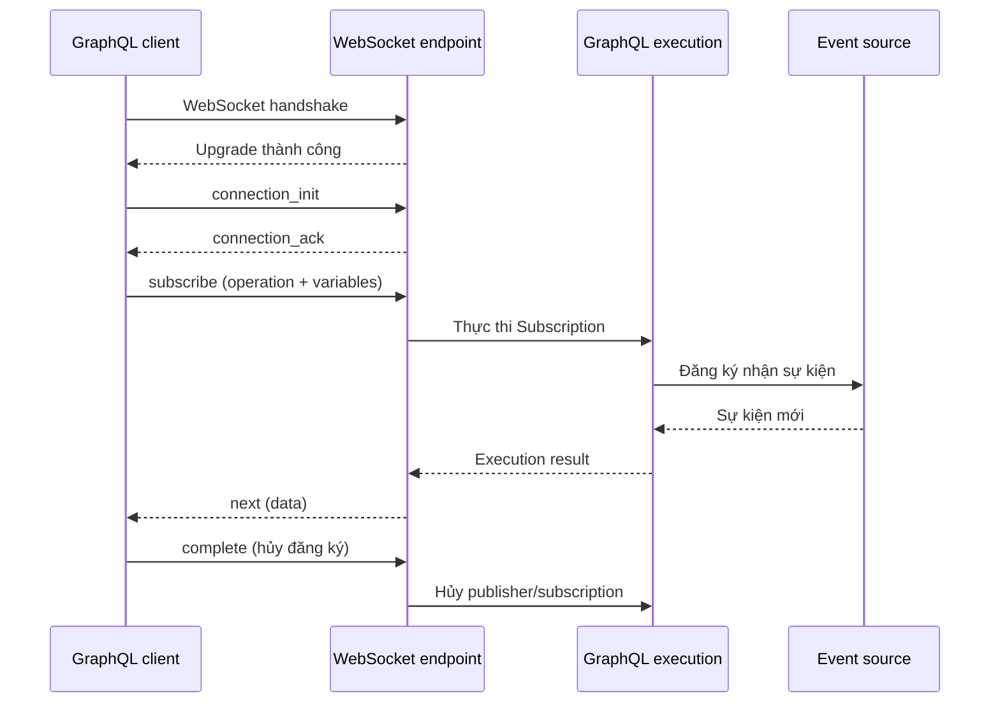

# GraphQL WebSocket endpoint

Trong Spring for GraphQL, WebSocket là một phương thức truyền tải để client duy trì kết nối hai chiều với GraphQL server. Cách này thường được dùng cho **Subscription**, khi client cần nhận các sự kiện mới như trạng thái đơn hàng, giá sản phẩm hoặc thông báo mà không phải gửi request liên tục.

Spring Boot có thể tự cấu hình WebSocket endpoint cho ứng dụng Spring for GraphQL. Ứng dụng khai báo đường dẫn endpoint, cung cấp một field thuộc root type `Subscription` và trả về một luồng sự kiện. Client kết nối bằng giao thức GraphQL over WebSocket, gửi operation subscription rồi nhận từng kết quả được server phát ra.

## WebSocket endpoint giải quyết vấn đề gì?

Với Query và Mutation thông thường, client gửi một HTTP request và nhận một HTTP response. Mô hình request/response phù hợp khi client chủ động hỏi dữ liệu hoặc thực hiện một thao tác rồi chờ kết quả.

Subscription có nhu cầu khác: server cần gửi dữ liệu cho client mỗi khi một sự kiện xảy ra. Ví dụ, trang theo dõi đơn hàng cần cập nhật trạng thái từ `CONFIRMED` sang `PACKING`, rồi `SHIPPED`. Nếu chỉ dùng polling, client phải gửi request lặp lại theo một khoảng thời gian. Cách này có thể tạo nhiều request không cần thiết và dữ liệu chỉ được cập nhật khi lượt polling tiếp theo diễn ra.

WebSocket tạo một kết nối hai chiều tồn tại lâu hơn một request HTTP. Sau khi kết nối được thiết lập, client và server có thể trao đổi nhiều message trên cùng kết nối. Server có thể gửi sự kiện ngay khi có dữ liệu mới, còn client có thể gửi message để bắt đầu hoặc hủy một subscription.

| Thành phần | Vai trò |
| --- | --- |
| GraphQL Subscription | Mô tả dữ liệu hoặc sự kiện client muốn theo dõi. |
| WebSocket | Kênh truyền thông hai chiều và duy trì kết nối. |
| GraphQL WebSocket protocol | Quy định các message dùng để khởi tạo kết nối, đăng ký operation, gửi kết quả và kết thúc operation. |
| Spring for GraphQL | Thực thi operation và chuyển các giá trị được phát ra thành kết quả GraphQL. |

Subscription là ngữ nghĩa của operation GraphQL; WebSocket là một transport có thể dùng để truyền operation đó. Hai khái niệm liên quan chặt chẽ nhưng không đồng nghĩa. Một ứng dụng có thể dùng GraphQL Query và Mutation qua HTTP, đồng thời dùng WebSocket cho Subscription.

## Bật WebSocket endpoint trong Spring Boot

Spring Boot cấu hình GraphQL HTTP endpoint qua `spring.graphql.path`. WebSocket endpoint có thuộc tính cấu hình riêng là `spring.graphql.websocket.path`. Khi thuộc tính WebSocket được khai báo và ứng dụng có hạ tầng WebSocket tương ứng, Spring Boot có thể đăng ký handler cho endpoint đó.

Ví dụ dưới đây dùng Spring MVC:

```kotlin
dependencies {
    implementation("org.springframework.boot:spring-boot-starter-graphql")
    implementation("org.springframework.boot:spring-boot-starter-web")
    implementation("org.springframework.boot:spring-boot-starter-websocket")
}
```

Với ứng dụng dùng Spring WebFlux, dùng `spring-boot-starter-webflux` làm web stack thay cho `spring-boot-starter-web`. Không nên đưa cả hai web starter vào cùng ứng dụng nếu chưa có chủ đích rõ ràng về loại web application cần khởi tạo.

Khai báo endpoint trong `application.yml`:

```yaml
spring:
  graphql:
    path: /graphql
    websocket:
      path: /graphql-ws
      connection-init-timeout: 60s
```

Trong cấu hình này:

- `/graphql` là HTTP endpoint để gửi các operation được phục vụ qua HTTP.
- `/graphql-ws` là WebSocket endpoint dành cho GraphQL over WebSocket.
- `connection-init-timeout` quy định khoảng thời gian server chờ message khởi tạo kết nối sau khi WebSocket được mở. Client nên gửi message này sớm sau khi kết nối thành công.

Thuộc tính `spring.graphql.websocket.path` là điểm bật endpoint trong cấu hình Spring Boot. Nếu không khai báo path, WebSocket transport có thể chưa được đăng ký dù ứng dụng đã có GraphQL HTTP endpoint. Đường dẫn thực tế phải khớp với URL mà client sử dụng và cấu hình reverse proxy nếu ứng dụng chạy phía sau proxy.

Trong môi trường local, client có thể kết nối tới `ws://localhost:8080/graphql-ws`. Khi triển khai qua HTTPS, client cần dùng `wss://` để mã hóa kết nối WebSocket.

## Khai báo Subscription trong schema

GraphQL schema cần có root type `Subscription` và field mà client muốn theo dõi. Ví dụ sau mô tả sự kiện thay đổi trạng thái đơn hàng:

```graphql
type OrderStatusUpdate {
  orderId: ID!
  status: String!
  changedAt: String!
}

type Subscription {
  orderStatusChanged(orderId: ID!): OrderStatusUpdate!
}
```

Field `orderStatusChanged` nhận `orderId` để xác định đơn hàng cần theo dõi. Mỗi sự kiện được phát ra có một object `OrderStatusUpdate` chứa mã đơn, trạng thái mới và thời điểm thay đổi.

Root type `Subscription` chỉ mô tả hợp đồng GraphQL. Để phát dữ liệu, server cần có logic xử lý field này và trả về một publisher hoặc kiểu reactive tương đương.

## Ánh xạ Subscription bằng Spring for GraphQL

Trong Spring for GraphQL, `@SubscriptionMapping` liên kết một phương thức controller với field thuộc root type `Subscription`. Phương thức thường trả về `Publisher` hoặc `Flux` để biểu diễn chuỗi giá trị được phát theo thời gian.

Ví dụ dưới đây giả định ứng dụng dùng Reactor và service có phương thức `eventsFor` trả về `Flux<OrderStatusUpdate>`:

```java
import org.springframework.graphql.data.method.annotation.Argument;
import org.springframework.graphql.data.method.annotation.SubscriptionMapping;
import org.springframework.stereotype.Controller;
import reactor.core.publisher.Flux;

@Controller
public class OrderSubscriptionController {

    private final OrderEventService orderEventService;

    public OrderSubscriptionController(OrderEventService orderEventService) {
        this.orderEventService = orderEventService;
    }

    @SubscriptionMapping
    public Flux<OrderStatusUpdate> orderStatusChanged(@Argument String orderId) {
        return orderEventService.eventsFor(orderId);
    }
}
```

Khi client đăng ký field `orderStatusChanged`, Spring for GraphQL gọi phương thức mapping và sử dụng publisher được trả về để nhận các giá trị tiếp theo. Mỗi giá trị phát ra được xử lý như một kết quả thực thi GraphQL và gửi tới client trên WebSocket.

`@Argument` lấy giá trị `orderId` từ operation. `@SubscriptionMapping` dành cho field gốc của Subscription; các field lồng bên trong object được phát ra vẫn có thể được xử lý bằng cơ chế mapping thông thường như `@SchemaMapping` khi cần.

Service phát sự kiện có thể lấy dữ liệu từ message broker, event bus, luồng thay đổi trong hệ thống hoặc một publisher nội bộ. Controller nên tập trung ánh xạ operation và ủy quyền việc quản lý nguồn sự kiện cho service.

## Vòng đời kết nối và GraphQL over WebSocket protocol

WebSocket handshake ban đầu vẫn bắt đầu bằng HTTP. Client gửi yêu cầu nâng cấp kết nối; nếu server chấp nhận, kết nối chuyển sang WebSocket và hai bên bắt đầu trao đổi message. Trên kết nối này, GraphQL sử dụng subprotocol `graphql-transport-ws` để quy định cách trao đổi operation.

Luồng cơ bản có thể hình dung như sau:



Các message chính của protocol gồm:

| Message | Hướng truyền | Ý nghĩa |
| --- | --- | --- |
| `connection_init` | Client → Server | Khởi tạo phiên GraphQL trên kết nối; có thể mang payload như thông tin xác thực. |
| `connection_ack` | Server → Client | Xác nhận server chấp nhận khởi tạo kết nối. |
| `subscribe` | Client → Server | Bắt đầu một operation với query, operation name và variables. |
| `next` | Server → Client | Gửi một kết quả thực thi của operation. Subscription có thể nhận nhiều message này. |
| `error` | Server → Client | Báo lỗi kết thúc operation theo protocol. |
| `complete` | Hai chiều | Kết thúc operation; client có thể gửi để hủy subscription. |
| `ping`, `pong` | Hai chiều | Message kiểm tra hoặc duy trì trạng thái kết nối. |

Khi gửi `subscribe`, client cung cấp một ID để phân biệt operation trên cùng kết nối. Một kết nối WebSocket có thể mang nhiều subscription đồng thời; mỗi operation có ID và vòng đời riêng. Client có thể gửi `complete` cho một ID để hủy operation đó mà không cần đóng toàn bộ socket.

Ví dụ rút gọn về các message:

```json
{
  "type": "connection_init",
  "payload": {
    "Authorization": "Bearer <access-token>"
  }
}
```

```json
{
  "id": "order-status-1",
  "type": "subscribe",
  "payload": {
    "query": "subscription WatchOrder($id: ID!) { orderStatusChanged(orderId: $id) { orderId status changedAt } }",
    "variables": {
      "id": "ORD-1001"
    }
  }
}
```

```json
{
  "id": "order-status-1",
  "type": "next",
  "payload": {
    "data": {
      "orderStatusChanged": {
        "orderId": "ORD-1001",
        "status": "SHIPPED",
        "changedAt": "2026-11-20T09:30:00Z"
      }
    }
  }
}
```

Đây là các message minh họa cho protocol; trong ứng dụng thực tế, thư viện client sẽ tạo và xử lý message thay cho việc tự ghép JSON.

## Kết nối từ JavaScript client

Có thể dùng thư viện `graphql-ws` ở phía JavaScript để kết nối tới endpoint. Thư viện này triển khai protocol hiện đại `graphql-transport-ws`; tên package `graphql-ws` là tên thư viện, còn subprotocol trên kết nối là `graphql-transport-ws`.

```javascript
import { createClient } from "graphql-ws";

const client = createClient({
  url: "ws://localhost:8080/graphql-ws",
  connectionParams: async () => ({
    Authorization: `Bearer ${accessToken}`
  })
});

const stop = client.subscribe(
  {
    query: `
      subscription WatchOrder($id: ID!) {
        orderStatusChanged(orderId: $id) {
          orderId
          status
          changedAt
        }
      }
    `,
    variables: { id: "ORD-1001" }
  },
  {
    next: (result) => {
      console.log("Order update:", result.data);
    },
    error: (error) => {
      console.error("Subscription error:", error);
    },
    complete: () => {
      console.log("Subscription completed");
    }
  }
);

// Khi rời màn hình hoặc không cần theo dõi nữa:
// stop();
```

`connectionParams` cung cấp payload cho message `connection_init`; nó không tự biến thành HTTP header của WebSocket handshake. Server và client phải thống nhất cấu trúc payload, cách gửi token và cách kiểm tra token.

Client cần dừng subscription khi người dùng rời màn hình hoặc không còn cần nhận sự kiện. Việc hủy subscription giúp server giải phóng publisher, listener và tài nguyên liên quan. Nếu client chỉ đóng tab hoặc mất mạng, server cũng cần xử lý việc đóng kết nối và hủy các operation còn hoạt động.

## Xác thực và phân quyền cho WebSocket

WebSocket thường tồn tại lâu hơn một HTTP request nên cần thiết kế vòng đời xác thực cẩn thận. Có thể xác thực khi handshake hoặc xử lý payload `connection_init`; trong Spring for GraphQL, `WebSocketGraphQlInterceptor` là một điểm mở rộng dành cho các sự kiện của kết nối WebSocket, bao gồm bước khởi tạo kết nối.

Một quy trình thường gồm:

1. Client mở kết nối WebSocket tới endpoint đã cấu hình.
2. Client gửi token hoặc thông tin xác thực trong payload `connection_init` theo quy ước của ứng dụng.
3. Server xác minh token, thời hạn và danh tính người dùng. Nếu không hợp lệ, server từ chối khởi tạo kết nối hoặc đóng kết nối theo protocol.
4. Khi client gửi từng operation, server tiếp tục kiểm tra quyền truy cập vào tài nguyên mà operation yêu cầu.
5. Khi token hết hạn, người dùng bị thu hồi quyền hoặc kết nối không còn hợp lệ, ứng dụng cần có chính sách đóng kết nối hoặc yêu cầu client xác thực lại.

Chỉ xác thực lúc mở socket là chưa đủ để bảo vệ mọi dữ liệu. Ví dụ, người dùng có quyền xem đơn hàng của chính họ nhưng không được theo dõi đơn hàng của người khác. Resolver hoặc service phải kiểm tra quyền trên từng `orderId` trước khi tạo publisher. Có thể kết hợp Spring Security, method security và logic phân quyền theo field hoặc theo tài nguyên.

Các điểm cần chú ý khi triển khai:

- **Mã hóa:** dùng `wss://` trên môi trường thật để bảo vệ token và dữ liệu truyền tải.
- **Origin:** giới hạn origin được phép mở WebSocket, đặc biệt khi client chạy trên trình duyệt. Cấu hình CORS cho HTTP không nên được xem là cơ chế thay thế cho kiểm soát origin của WebSocket handshake.
- **Token:** tránh ghi token vào log; kiểm tra thời hạn và khả năng thu hồi trong suốt vòng đời kết nối.
- **Phân quyền:** xác thực người dùng ở cấp kết nối nhưng vẫn phân quyền cho từng operation và từng tài nguyên.
- **Giới hạn tài nguyên:** giới hạn số kết nối, số subscription đồng thời, tốc độ tạo operation và thời gian chạy nếu phù hợp với hệ thống.
- **Đa tenant:** luôn ràng buộc subscription với tenant hoặc phạm vi dữ liệu của principal hiện tại để tránh phát tán sự kiện chéo tenant.

## Xử lý lỗi, ngắt kết nối và tài nguyên

Lỗi trong quá trình sử dụng WebSocket có thể xuất hiện ở nhiều tầng:

| Tình huống | Cách xử lý cần có |
| --- | --- |
| Handshake thất bại | Kiểm tra URL, proxy, TLS, origin và cấu hình WebSocket server. |
| Không nhận được `connection_ack` | Kiểm tra message `connection_init`, timeout và logic xác thực kết nối. |
| Query hoặc variables không hợp lệ | Trả lỗi GraphQL phù hợp để client sửa operation hoặc dữ liệu đầu vào. |
| Resolver hoặc nguồn sự kiện lỗi | Ghi nhận lỗi có ngữ cảnh, phát kết quả lỗi phù hợp và kết thúc operation khi cần. |
| Client gửi `complete` | Hủy publisher và giải phóng listener của subscription tương ứng. |
| Mạng bị ngắt | Dọn các operation thuộc kết nối đã đóng; client quyết định có kết nối lại hay không. |
| Server triển khai lại | Client kết nối lại và đăng ký lại những subscription còn cần thiết. |

Khi một Subscription trả về publisher, việc hủy subscription ở tầng Reactive Streams cần truyền ngược về nguồn sự kiện nếu nguồn hỗ trợ cancellation. Nếu nguồn là message broker hoặc listener tự quản lý, service phải gỡ listener khi publisher bị hủy hoặc kết nối kết thúc. Nếu không, ứng dụng có thể tích lũy listener và tiếp tục xử lý sự kiện cho client đã rời đi.

Với luồng có tốc độ phát sự kiện cao, cần xem xét backpressure, buffer và chính sách bỏ hoặc gộp sự kiện. Không nên giữ một hàng đợi không giới hạn cho mỗi client. Nếu client không theo kịp tốc độ phát, server cần có giới hạn rõ ràng để tránh tăng bộ nhớ không kiểm soát.

Kết nối lại cũng cần được thiết kế ở cấp ứng dụng. WebSocket không tự đảm bảo client sẽ nhận lại mọi sự kiện bị bỏ lỡ trong thời gian mất mạng. Nếu cần đảm bảo không mất sự kiện, payload nên có sequence number hoặc event ID và service cần hỗ trợ đọc tiếp từ một vị trí đã xác nhận.

## Kiểm thử WebSocket Subscription

Kiểm thử Subscription cần xác nhận cả nội dung GraphQL lẫn vòng đời kết nối. Ngoài kiểm thử logic service và resolver, Spring for GraphQL cung cấp `WebSocketGraphQlTester` để kiểm thử operation qua WebSocket trong môi trường phù hợp.

Các trường hợp nên kiểm tra:

- Kết nối tới đúng WebSocket path và hoàn tất bước khởi tạo.
- Subscription hợp lệ nhận được event có đúng cấu trúc và giá trị.
- Variables được truyền tới `@Argument` chính xác.
- Người dùng thiếu token hoặc không đủ quyền bị từ chối.
- Người dùng không thể đăng ký theo dõi tài nguyên thuộc user hoặc tenant khác.
- Khi client hủy subscription, publisher và listener tương ứng được giải phóng.
- Khi nguồn sự kiện phát lỗi hoặc socket đóng, client nhận trạng thái kết thúc phù hợp.
- Nhiều subscription trên cùng một socket có thể hoạt động và được hủy độc lập.
- Kết nối lại không tạo listener trùng hoặc subscription mồ côi.

Với kiểm thử tích hợp, nên chạy server trên cổng ngẫu nhiên hoặc môi trường test tương đương production, tạo WebSocket client, đăng ký subscription, phát sự kiện qua nguồn test và xác minh message nhận được. Cần kiểm tra cả trường hợp timeout và đóng kết nối để phát hiện rò rỉ tài nguyên.

## Những lỗi cấu hình thường gặp

| Hiện tượng | Nguyên nhân nên kiểm tra |
| --- | --- |
| HTTP `/graphql` hoạt động nhưng WebSocket không kết nối được | Chưa cấu hình `spring.graphql.websocket.path`, thiếu WebSocket support hoặc URL path sai. |
| Handshake thành công nhưng không có event | Schema thiếu field Subscription, mapping chưa được đăng ký hoặc publisher không phát giá trị. |
| Client báo không hỗ trợ protocol | Client và server không thống nhất subprotocol `graphql-transport-ws`. |
| Kết nối bị đóng trước khi đăng ký operation | Client không gửi `connection_init` trong thời hạn hoặc server từ chối xác thực. |
| Chỉ nhận event đầu tiên | Nguồn publisher hoàn tất sau event đầu tiên hoặc service chỉ phát một giá trị. |
| Vẫn có event sau khi người dùng rời trang | Subscription chưa được hủy hoặc nguồn sự kiện chưa xử lý cancellation. |
| Một client nhận dữ liệu của client khác | Thiếu kiểm tra quyền theo tài nguyên hoặc tenant trong quá trình tạo subscription. |

Khi debug, nên kiểm tra lần lượt URL và handshake, subprotocol, `connection_init`/`connection_ack`, message `subscribe`, sau đó mới kiểm tra resolver và nguồn sự kiện. Cách này giúp xác định lỗi thuộc tầng kết nối, protocol, GraphQL hay nghiệp vụ.

## Khi nào nên dùng GraphQL WebSocket endpoint?

WebSocket phù hợp khi client cần nhận cập nhật chủ động, liên tục và có độ trễ thấp, ví dụ:

- Theo dõi trạng thái đơn hàng hoặc tiến trình xử lý.
- Bảng điều khiển cần cập nhật số liệu khi có sự kiện mới.
- Ứng dụng chat, thông báo hoặc cộng tác thời gian thực.
- Theo dõi giá, tồn kho hoặc trạng thái thiết bị.

Với dữ liệu ít thay đổi hoặc màn hình chỉ cần làm mới theo thao tác người dùng, Query qua HTTP có thể đơn giản hơn. Polling cũng có thể đủ cho trường hợp chấp nhận độ trễ và không cần giữ kết nối dài. WebSocket làm tăng yêu cầu vận hành về kết nối đồng thời, xác thực, giám sát và dọn dẹp tài nguyên; vì vậy chỉ nên bật cho luồng có nhu cầu nhận dữ liệu liên tục.

## Ghi nhớ

GraphQL WebSocket endpoint cung cấp kênh truyền hai chiều để client đăng ký Subscription và nhận nhiều kết quả trên một kết nối. Trong Spring Boot, cấu hình `spring.graphql.websocket.path` để bật endpoint; trong schema khai báo field thuộc `Subscription`; trong controller dùng `@SubscriptionMapping` để trả về `Publisher` hoặc `Flux` từ nguồn sự kiện.

Protocol `graphql-transport-ws` quản lý việc khởi tạo kết nối, đăng ký operation, gửi kết quả và hủy subscription. Khi triển khai thực tế, cần xác thực kết nối, phân quyền theo từng tài nguyên, kiểm soát origin, giới hạn tài nguyên và bảo đảm publisher được hủy khi client rời đi. Những yếu tố này giúp luồng cập nhật thời gian thực hoạt động ổn định và an toàn trong ứng dụng Spring for GraphQL.
