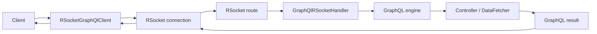

# GraphQL RSocket transport

## Mục tiêu

Sau bài học này, bạn có thể:

- Giải thích RSocket transport và cách Spring for GraphQL chuyển GraphQL operation qua RSocket.
- Cấu hình một GraphQL endpoint RSocket bằng Spring Boot.
- Phân biệt route RSocket với URL path của HTTP.
- Gửi Query và Mutation bằng `RSocketGraphQlClient`.
- Nhận dữ liệu Subscription dưới dạng luồng reactive.
- Nhận biết các yêu cầu về bảo mật, backpressure, vòng đời kết nối và quan sát hệ thống khi vận hành RSocket.

## 1. RSocket transport là gì?

GraphQL mô tả cách client yêu cầu dữ liệu và cách server trả kết quả. Để trao đổi request và response, GraphQL cần một transport. Spring for GraphQL hỗ trợ nhiều transport, trong đó có HTTP, WebSocket và RSocket.

RSocket là một giao thức ứng dụng hỗ trợ giao tiếp hai chiều, bất đồng bộ và có cơ chế backpressure. Nó có thể chạy trên các phương tiện truyền tải như TCP hoặc WebSocket. RSocket định nghĩa các kiểu tương tác (interaction models) như:

- **Request-response:** client gửi một request và nhận một response.
- **Request-stream:** client gửi request và nhận một luồng nhiều response.
- **Fire-and-forget:** client gửi dữ liệu mà không chờ response.
- **Request-channel:** hai phía trao đổi các luồng dữ liệu hai chiều.

Trong GraphQL, Query và Mutation thường phù hợp với request-response. Subscription phù hợp với request-stream vì server có thể phát nhiều kết quả theo thời gian cho cùng một operation.

RSocket transport không thay đổi ý nghĩa của GraphQL schema, Query, Mutation hoặc Subscription. Nó thay đổi cách request và response được truyền giữa client và server.

## 2. Khi nào nên dùng GraphQL qua RSocket?

RSocket có thể phù hợp khi ứng dụng cần giao tiếp liên tục giữa các service hoặc client, đặc biệt khi cần luồng dữ liệu và khả năng điều tiết tốc độ truyền.

Một số đặc điểm đáng chú ý:

- **Giao tiếp hai chiều:** hai phía có thể chủ động gửi dữ liệu qua kết nối RSocket.
- **Multiplexing:** nhiều luồng tương tác có thể dùng chung một kết nối.
- **Backpressure:** consumer có thể kiểm soát lượng dữ liệu muốn nhận, tránh để producer đẩy dữ liệu nhanh hơn khả năng xử lý.
- **Reactive:** mô hình request-stream phù hợp với `Mono` và `Flux` trong Spring.
- **Nhiều transport nền:** có thể triển khai trên TCP hoặc WebSocket tùy môi trường.

RSocket không tự làm cho API nhanh hơn trong mọi trường hợp. Với request đơn giản, ít dữ liệu và không cần stream, HTTP thường dễ triển khai, quan sát và tích hợp hơn. Hãy chọn RSocket khi mô hình tương tác của ứng dụng có lợi từ kết nối và luồng dữ liệu của nó.

## 3. Các thành phần Spring for GraphQL liên quan

Spring for GraphQL cung cấp các thành phần chính sau:

| Thành phần | Vai trò |
|---|---|
| `GraphQlRSocketHandler` | Xử lý GraphQL request được gửi qua RSocket ở phía server |
| `RSocketGraphQlClient` | Gửi GraphQL operation qua RSocket ở phía client |
| `RSocketRequester` | Tạo và quản lý tương tác RSocket trong Spring Messaging |
| `GraphQlSource` | Cung cấp GraphQL schema và engine dùng để thực thi operation |
| Annotated controllers | Triển khai logic Query, Mutation, Subscription và field mapping |

Ở phía server, GraphQL vẫn dùng schema SDL và các resolver đã được cấu hình. Transport handler nhận payload, chuyển nó vào quá trình thực thi GraphQL, rồi chuyển kết quả thành response phù hợp với kiểu tương tác RSocket.

Ở phía client, `RSocketGraphQlClient` triển khai API `GraphQlClient`, nên cách khai báo document, variables và lấy kết quả gần giống các GraphQL client khác trong Spring.



## 4. Thêm dependency cho ứng dụng Spring Boot

Ứng dụng server cần Spring for GraphQL và hỗ trợ RSocket. Với Maven, có thể khai báo các starter:

```xml
<dependencies>
    <dependency>
        <groupId>org.springframework.boot</groupId>
        <artifactId>spring-boot-starter-graphql</artifactId>
    </dependency>

    <dependency>
        <groupId>org.springframework.boot</groupId>
        <artifactId>spring-boot-starter-rsocket</artifactId>
    </dependency>
</dependencies>
```

Dùng dependency management của Spring Boot để quản lý phiên bản tương thích. Không nên tự chọn phiên bản Spring for GraphQL và Spring Messaging độc lập nếu dự án đã dùng Spring Boot dependency management.

Nếu ứng dụng chỉ là client, cần các thư viện Spring GraphQL client và RSocket phù hợp với nền tảng đang dùng. `RSocketGraphQlClient` là client dành cho giao tiếp GraphQL qua RSocket.

## 5. Cấu hình RSocket server và GraphQL route

Spring Boot có thể cấu hình RSocket server bằng các thuộc tính `spring.rsocket.server.*`. Thuộc tính `spring.graphql.rsocket.mapping` xác định route RSocket dành cho GraphQL.

Ví dụ dùng TCP:

```yaml
spring:
  rsocket:
    server:
      transport: tcp
      port: 7000
  graphql:
    rsocket:
      mapping: graphql
```

Trong ví dụ này:

- `transport: tcp` chọn TCP làm transport nền cho RSocket server.
- `port: 7000` là cổng server lắng nghe.
- `mapping: graphql` là route mà client dùng để gửi GraphQL operation.

Route RSocket là metadata định tuyến trong giao thức RSocket. Nó không phải URL path như `/graphql` của HTTP. Vì vậy, client và server phải thống nhất route, ví dụ `graphql`.

Spring Boot GraphQL auto-configuration kết hợp với RSocket support để kết nối RSocket transport tới GraphQL execution. Các controller GraphQL hiện có vẫn được sử dụng. Bạn không cần viết một bộ resolver riêng chỉ vì thay đổi transport.

Schema SDL vẫn được đặt trong vị trí mặc định:

```text
src/main/resources/graphql/
```

Ví dụ schema tối giản:

```graphql
type Query {
  book(id: ID!): Book
}

type Mutation {
  renameBook(id: ID!, title: String!): Book
}

type Subscription {
  bookEvents: BookEvent!
}

type Book {
  id: ID!
  title: String!
}

type BookEvent {
  bookId: ID!
  title: String!
}
```

Controller vẫn khai báo các mapping GraphQL như bình thường:

```java
@Controller
public class BookController {

    private final BookService bookService;

    public BookController(BookService bookService) {
        this.bookService = bookService;
    }

    @QueryMapping
    public Mono<Book> book(@Argument String id) {
        return bookService.findById(id);
    }

    @MutationMapping
    public Mono<Book> renameBook(
            @Argument String id,
            @Argument String title) {
        return bookService.rename(id, title);
    }

    @SubscriptionMapping
    public Flux<BookEvent> bookEvents() {
        return bookService.bookEvents();
    }
}
```

Đây là các ví dụ reactive để minh họa luồng dữ liệu. Kiểu trả về cụ thể phụ thuộc vào service và cách ứng dụng truy cập dữ liệu. Nếu dùng kiểu đồng bộ, controller vẫn có thể trả về object thông thường cho Query hoặc Mutation; Subscription cần một publisher để phát nhiều sự kiện.

## 6. Tạo RSocketGraphQlClient

Phía client dùng `RSocketRequester` để tạo kết nối và truyền requester vào `RSocketGraphQlClient`.

Ví dụ kết nối TCP đến server ở cổng 7000:

```java
import org.springframework.graphql.client.RSocketGraphQlClient;
import org.springframework.messaging.rsocket.RSocketRequester;

RSocketRequester requester = RSocketRequester.builder()
        .tcp("localhost", 7000);

RSocketGraphQlClient graphQlClient =
        RSocketGraphQlClient.builder(requester)
                .route("graphql")
                .build();
```

Các điểm cần lưu ý:

- `RSocketRequester.builder().tcp(...)` tạo requester kết nối tới RSocket server.
- `RSocketGraphQlClient.builder(requester)` tạo GraphQL client dựa trên kết nối đó.
- `route("graphql")` chọn route tương ứng với `spring.graphql.rsocket.mapping` ở server.

Client có thể được đăng ký như một bean để tái sử dụng trong các service. Trong ứng dụng thực tế, nên quản lý vòng đời kết nối theo vòng đời ứng dụng, xử lý lỗi kết nối và cấu hình timeout phù hợp.

## 7. Gửi Query qua RSocket

Sau khi tạo client, cách gửi GraphQL document tương tự các client API khác của Spring for GraphQL.

Ví dụ lấy thông tin một quyển sách:

```java
public Mono<Book> findBook(
        RSocketGraphQlClient graphQlClient,
        String id) {

    return graphQlClient.document("""
            query BookById($id: ID!) {
                book(id: $id) {
                    id
                    title
                }
            }
            """)
            .variable("id", id)
            .retrieve("book")
            .toEntity(Book.class);
}
```

Giải thích:

1. `document(...)` khai báo GraphQL operation.
2. `variable("id", id)` truyền biến cho operation.
3. `retrieve("book")` chọn field `book` trong phần `data` của GraphQL response.
4. `toEntity(Book.class)` ánh xạ kết quả thành kiểu Java.

Client trả về `Mono<Book>`, phù hợp với mô hình bất đồng bộ và reactive. Nếu server trả về GraphQL errors hoặc transport xảy ra lỗi, client cần xử lý theo loại lỗi tương ứng.

## 8. Gửi Mutation qua RSocket

Mutation cũng là một GraphQL operation. Điểm khác biệt nằm ở ý nghĩa nghiệp vụ: mutation thường thay đổi trạng thái hệ thống.

Ví dụ đổi tên sách:

```java
public Mono<Book> renameBook(
        RSocketGraphQlClient graphQlClient,
        String id,
        String title) {

    return graphQlClient.document("""
            mutation RenameBook($id: ID!, $title: String!) {
                renameBook(id: $id, title: $title) {
                    id
                    title
                }
            }
            """)
            .variable("id", id)
            .variable("title", title)
            .retrieve("renameBook")
            .toEntity(Book.class);
}
```

RSocket transport không làm thay đổi quy tắc nghiệp vụ của Mutation. Server vẫn cần xác thực, kiểm tra quyền, validate dữ liệu đầu vào và thực hiện transaction phù hợp. Client cũng cần cân nhắc tính idempotent khi retry mutation, bởi một lần retry có thể làm nghiệp vụ được thực hiện nhiều lần nếu server đã xử lý request trước đó nhưng response bị mất.

## 9. Nhận Subscription dưới dạng stream

Subscription phù hợp với các tình huống server cần gửi sự kiện khi dữ liệu thay đổi, ví dụ trạng thái đơn hàng, giá cổ phiếu hoặc cập nhật nội dung.

Với RSocket, Subscription được biểu diễn dưới dạng request-stream. Client gửi operation một lần và nhận nhiều kết quả theo thời gian.

Ví dụ:

```java
public Flux<BookEvent> subscribeBookEvents(
        RSocketGraphQlClient graphQlClient) {

    return graphQlClient.document("""
            subscription BookEvents {
                bookEvents {
                    bookId
                    title
                }
            }
            """)
            .retrieveSubscription("bookEvents")
            .toEntity(BookEvent.class);
}
```

`retrieveSubscription(...)` trả về luồng dữ liệu reactive. Client có thể xử lý từng sự kiện bằng các toán tử Reactor:

```java
subscribeBookEvents(graphQlClient)
        .doOnNext(event ->
                log.info("Book {} changed: {}",
                        event.bookId(), event.title()))
        .doOnError(error ->
                log.error("Subscription failed", error))
        .subscribe();
```

Trong ứng dụng thực tế, cần giữ và quản lý `Disposable` được trả về từ `subscribe()` để hủy subscription khi màn hình, phiên làm việc hoặc thành phần sở hữu không còn cần nhận sự kiện.

Không nên tạo subscription mới mỗi lần render giao diện hoặc mỗi lần gọi một phương thức mà không có cơ chế quản lý. Điều đó có thể làm tăng số luồng đang hoạt động và khiến client nhận sự kiện trùng lặp.

## 10. GraphQL operation và RSocket interaction model

Việc lựa chọn interaction model phụ thuộc vào loại GraphQL operation:

| GraphQL operation | RSocket interaction thường dùng | Kết quả ở client |
|---|---|---|
| Query | Request-response | Một kết quả |
| Mutation | Request-response | Một kết quả |
| Subscription | Request-stream | Nhiều kết quả theo thời gian |

Fire-and-forget không phù hợp với cách dùng GraphQL thông thường vì client cần nhận kết quả và lỗi của operation. Request-channel có thể hữu ích cho các giao thức ứng dụng hai chiều chuyên biệt, nhưng không phải cách trao đổi mặc định của GraphQL client.

RSocket request-stream hỗ trợ backpressure. Consumer có thể điều tiết nhu cầu nhận sự kiện thông qua reactive subscription. Tuy nhiên, backpressure không thay thế giới hạn nghiệp vụ: server vẫn cần kiểm soát kích thước dữ liệu, tốc độ phát sự kiện, bộ đệm và tài nguyên cho mỗi subscription.

## 11. Xử lý lỗi ở hai tầng

Khi dùng GraphQL qua RSocket, cần phân biệt lỗi thực thi GraphQL và lỗi transport.

### Lỗi GraphQL

Ví dụ:

- Query không hợp lệ theo schema.
- Người dùng không đủ quyền đọc một field.
- Resolver phát sinh lỗi nghiệp vụ.
- Dữ liệu trả về vi phạm nullability.

GraphQL có thể trả response chứa `data` và `errors`. Một phần dữ liệu vẫn có thể được trả về nếu một field gặp lỗi nhưng các field khác thực thi thành công.

### Lỗi RSocket transport

Ví dụ:

- Không kết nối được tới server.
- Kết nối bị đóng.
- Timeout hoặc lỗi truyền dữ liệu.
- Route không tồn tại hoặc không được chấp nhận.

Đây là lỗi ở tầng giao tiếp, có thể khiến client không nhận được GraphQL response hoàn chỉnh.

Client nên xử lý riêng hai nhóm lỗi. Với lỗi GraphQL, cần đọc thông tin lỗi và quyết định theo nghiệp vụ. Với lỗi transport, có thể cân nhắc reconnect hoặc retry có giới hạn. Không nên retry mọi mutation một cách mù quáng vì operation có thể đã được thực thi thành công trước khi kết nối bị ngắt.

## 12. Bảo mật cho RSocket GraphQL

RSocket không tự động kế thừa toàn bộ cơ chế bảo mật của HTTP endpoint. Nếu ứng dụng đồng thời cung cấp GraphQL qua HTTP và RSocket, cần xác định rõ chính sách xác thực và phân quyền cho từng transport.

Một số điểm cần triển khai:

- **Xác thực kết nối:** xác định danh tính client bằng cơ chế authentication phù hợp với RSocket.
- **Metadata:** truyền thông tin xác thực qua metadata theo cơ chế mà server và client đã thống nhất.
- **Phân quyền route:** giới hạn client nào được phép truy cập route GraphQL.
- **Phân quyền field:** kiểm tra quyền ở resolver hoặc service, đặc biệt với dữ liệu nhạy cảm.
- **Bảo vệ dữ liệu truyền:** dùng transport và cấu hình bảo mật phù hợp với môi trường triển khai.
- **Giới hạn tài nguyên:** giới hạn số kết nối, số subscription, tốc độ request và kích thước payload.

Spring Security có hỗ trợ bảo mật RSocket. Cấu hình bảo mật cần được tích hợp với mô hình xác thực của ứng dụng, chẳng hạn xác thực theo payload hoặc metadata. Không nên giả định rằng chỉ cần cấu hình HTTP Security là mọi request RSocket đã được bảo vệ tương ứng.

## 13. Backpressure, kết nối và khả năng phục hồi

RSocket đặc biệt hữu ích khi server phát stream, nhưng ứng dụng vẫn phải thiết kế vòng đời và tài nguyên cẩn thận.

**Backpressure:** consumer yêu cầu lượng dữ liệu phù hợp với khả năng xử lý. Server nên tôn trọng nhu cầu đó và tránh tạo bộ đệm không giới hạn.

**Connection lifecycle:** kết nối có thể bị ngắt do mạng, server restart hoặc client đóng ứng dụng. Client cần xử lý trạng thái kết nối, timeout và reconnect theo chính sách rõ ràng.

**Subscription lifecycle:** mỗi subscription tiêu thụ tài nguyên ở server. Cần hủy subscription khi client không còn nhu cầu, đồng thời dọn dẹp publisher và tài nguyên liên quan.

**Retry:** chỉ retry operation có ngữ nghĩa phù hợp. Query thường có thể retry nếu không có side effect; Mutation cần idempotency key hoặc cơ chế bảo đảm nghiệp vụ khi cần retry an toàn.

**Observability:** theo dõi số kết nối, số request, số subscription đang hoạt động, lỗi theo route, độ trễ và lượng dữ liệu truyền. Với GraphQL, nên quan sát thêm operation name và thời gian thực thi resolver để tìm nguyên nhân chậm.

## 14. So sánh HTTP, WebSocket và RSocket

| Tiêu chí | HTTP | WebSocket | RSocket |
|---|---|---|---|
| Mô hình giao tiếp | Request-response | Kết nối hai chiều liên tục | Request-response, stream và channel |
| Query / Mutation | Phù hợp | Có thể hỗ trợ qua giao thức ứng dụng | Phù hợp |
| Subscription | Cần cơ chế bổ sung hoặc transport stream | Phù hợp với luồng sự kiện | Phù hợp với request-stream |
| Backpressure | Không có mô hình Reactive Streams tích hợp trực tiếp ở giao thức HTTP thông thường | Ứng dụng phải tự quản lý | Có cơ chế backpressure |
| Multiplexing | Thường dựa vào kết nối HTTP và cơ chế của phiên bản giao thức | Có thể tự xây dựng ở tầng ứng dụng | Hỗ trợ nhiều luồng trên kết nối |
| Tích hợp trình duyệt | Rất phổ biến | Được hỗ trợ trực tiếp | Phụ thuộc transport và thư viện client |
| Độ phức tạp vận hành | Thường thấp | Trung bình | Cần hiểu thêm route, kết nối và interaction model |

Không có transport nào phù hợp cho mọi hệ thống. HTTP thường là lựa chọn dễ tiếp cận cho API công khai và client trình duyệt. WebSocket phù hợp với ứng dụng cần kênh hai chiều liên tục. RSocket phù hợp với giao tiếp reactive giữa các service hoặc client có nhu cầu stream và backpressure.

## 15. Checklist khi triển khai

Trước khi đưa GraphQL RSocket vào môi trường chạy thật, hãy kiểm tra:

- [ ] Đã thêm dependency GraphQL và RSocket tương thích với phiên bản Spring Boot.
- [ ] RSocket server sử dụng transport và port đúng với môi trường triển khai.
- [ ] Route trong `spring.graphql.rsocket.mapping` khớp route ở client.
- [ ] Schema SDL có Query, Mutation hoặc Subscription cần thiết.
- [ ] Controller và resolver trả về kiểu dữ liệu phù hợp với operation.
- [ ] Query và Mutation trả kết quả đúng qua request-response.
- [ ] Subscription phát sự kiện và có thể hủy đúng vòng đời.
- [ ] Xác thực, phân quyền route và phân quyền field đã được kiểm tra.
- [ ] Có timeout, retry policy và giới hạn tài nguyên hợp lý.
- [ ] Có metrics và logging để quan sát kết nối, operation và subscription.

## Kết luận

GraphQL RSocket transport cho phép Spring for GraphQL trao đổi operation qua giao thức RSocket. Query và Mutation thường dùng request-response; Subscription dùng request-stream để gửi nhiều kết quả theo thời gian. Spring Boot có thể cấu hình route RSocket bằng `spring.graphql.rsocket.mapping`, còn client sử dụng `RSocketGraphQlClient` kết hợp với `RSocketRequester`.

Việc chọn RSocket nên dựa trên nhu cầu giao tiếp hai chiều, stream, backpressure và mô hình kết nối của hệ thống. Khi triển khai, cần quản lý route, bảo mật, vòng đời subscription, retry, timeout và khả năng quan sát để API vận hành ổn định.

## Tài liệu tham khảo

- [Spring for GraphQL — Transports](https://docs.spring.io/spring-graphql/reference/transports.html)
- [Spring for GraphQL — RSocket](https://docs.spring.io/spring-graphql/reference/transports.html#server.rsocket)
- [Spring Boot — Spring for GraphQL](https://docs.spring.io/spring-boot/reference/web/spring-graphql.html)
- [Spring Framework — RSocket](https://docs.spring.io/spring-framework/reference/rsocket.html)
