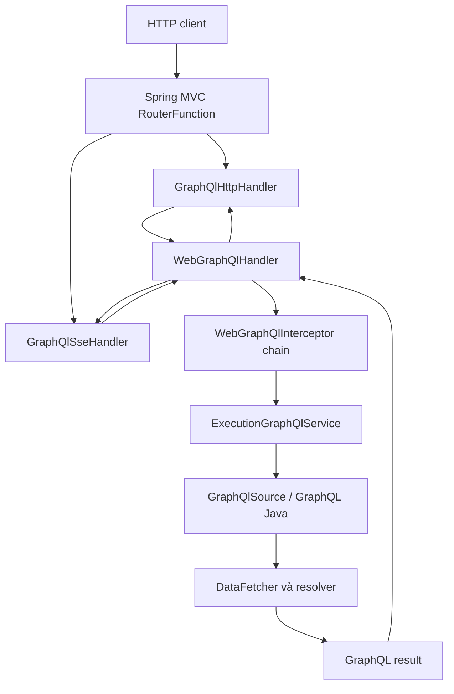

# GraphQlWebMvcAutoConfiguration

Khi thêm Spring for GraphQL vào một ứng dụng Spring Boot dùng Spring MVC, bạn thường chỉ cần khai báo starter và viết schema cùng các resolver. Spring Boot sẽ tự tạo phần kết nối HTTP cho GraphQL. Lớp đứng sau cơ chế này là `GraphQlWebMvcAutoConfiguration`.

Lớp auto-configuration này phát hiện ứng dụng Servlet có đủ thành phần GraphQL, kết nối dịch vụ thực thi GraphQL với HTTP handler và đăng ký route để client gửi request. Nó còn tích hợp interceptor, Server-Sent Events (SSE), CORS và một số endpoint hỗ trợ phát triển tùy theo phiên bản Spring Boot và cấu hình.

Bài học tập trung vào cách auto-configuration được kích hoạt, các bean quan trọng, đường đi của request, cấu hình endpoint, cách tùy biến và cách tìm nguyên nhân khi endpoint GraphQL không xuất hiện.

## 1. Vị trí của GraphQlWebMvcAutoConfiguration

Spring for GraphQL tách phần thực thi GraphQL khỏi giao thức truyền tải. GraphQL engine xử lý document, validate schema, gọi data fetcher và tạo kết quả. Lớp transport nhận request từ HTTP, chuyển request cho engine và ghi response về HTTP.

Trong Spring MVC, `GraphQlWebMvcAutoConfiguration` cấu hình lớp transport HTTP dựa trên Spring MVC. Có thể hình dung kiến trúc như sau:



Các thành phần có trách nhiệm riêng:

| Thành phần | Trách nhiệm |
| --- | --- |
| `RouterFunction` | Nhận diện request phù hợp với endpoint GraphQL và chuyển request đến handler |
| `GraphQlHttpHandler` | Xử lý GraphQL qua HTTP request/response thông thường |
| `GraphQlSseHandler` | Xử lý GraphQL qua Server-Sent Events, chủ yếu để gửi stream kết quả subscription |
| `WebGraphQlHandler` | Tạo chuỗi interceptor và chuyển tiếp request đến dịch vụ thực thi |
| `WebGraphQlInterceptor` | Can thiệp trước/sau khi GraphQL engine chạy, ví dụ đưa HTTP header vào GraphQL context |
| `ExecutionGraphQlService` | Điều phối việc thực thi một GraphQL request |
| `GraphQlSource` | Cung cấp schema và cấu hình GraphQL Java |

`GraphQlWebMvcAutoConfiguration` không phải nơi viết nghiệp vụ truy vấn sách, người dùng hay đơn hàng. Các resolver như `@QueryMapping` và `@SchemaMapping` vẫn nằm trong controller hoặc thành phần data fetcher của ứng dụng. Auto-configuration lo phần vận chuyển request đến pipeline GraphQL.

## 2. Điều kiện để auto-configuration được kích hoạt

Trong Spring Boot 3.x, lớp này nằm trong package:

```java
org.springframework.boot.autoconfigure.graphql.servlet
```

Ở Spring Boot 4.x, package được chuyển thành:

```java
org.springframework.boot.graphql.autoconfigure.servlet
```

Tên lớp giữ nguyên nhưng package thay đổi do cách tổ chức module auto-configuration của Spring Boot 4. Khi đọc stack trace, xem `@SpringBootApplication(exclude = ...)` hoặc tìm class bằng IDE, cần dùng đúng package của phiên bản dependency trong dự án.

Với Spring Boot 3.5, các điều kiện chính được khai báo trên lớp như sau:

```java
@AutoConfiguration(after = GraphQlAutoConfiguration.class)
@ConditionalOnWebApplication(type = ConditionalOnWebApplication.Type.SERVLET)
@ConditionalOnClass({ GraphQL.class, GraphQlHttpHandler.class })
@ConditionalOnBean(ExecutionGraphQlService.class)
@EnableConfigurationProperties(GraphQlCorsProperties.class)
public class GraphQlWebMvcAutoConfiguration {
    // Các @Bean phục vụ GraphQL qua Spring MVC
}
```

Ý nghĩa của từng điều kiện:

| Annotation | Ý nghĩa |
| --- | --- |
| `@AutoConfiguration(after = GraphQlAutoConfiguration.class)` | Cấu hình MVC được xử lý sau cấu hình GraphQL lõi, để dịch vụ thực thi đã có cơ hội được tạo |
| `@ConditionalOnWebApplication(type = SERVLET)` | Chỉ áp dụng khi ứng dụng đang chạy theo mô hình Servlet, thường là Spring MVC |
| `@ConditionalOnClass(...)` | Các class GraphQL Java và HTTP handler dành cho Spring MVC phải có trên classpath |
| `@ConditionalOnBean(ExecutionGraphQlService.class)` | Context phải có dịch vụ thực thi GraphQL |
| `@EnableConfigurationProperties(GraphQlCorsProperties.class)` | Đăng ký các thuộc tính cấu hình CORS dành cho endpoint GraphQL |

Như vậy, chỉ thêm `spring-boot-starter-graphql` chưa chắc đã tạo endpoint MVC. Ứng dụng cần thêm starter web MVC và có GraphQL execution service hợp lệ. Nếu dự án dùng WebFlux, Spring Boot chọn `GraphQlWebFluxAutoConfiguration` theo loại ứng dụng reactive thay vì cấu hình MVC.

### Vì sao phải chạy sau GraphQlAutoConfiguration?

`GraphQlAutoConfiguration` chịu trách nhiệm cho phần GraphQL lõi, bao gồm `GraphQlSource` và `ExecutionGraphQlService` cùng các thành phần hỗ trợ controller. `GraphQlWebMvcAutoConfiguration` cần `ExecutionGraphQlService` để tạo `WebGraphQlHandler`.

Thứ tự này thể hiện quan hệ phụ thuộc: trước tiên ứng dụng phải có schema và dịch vụ thực thi GraphQL, sau đó mới có thể bọc dịch vụ đó bằng HTTP transport.

## 3. Những bean quan trọng được tạo

Ở Spring Boot 3.5, lớp cấu hình công khai các bean chính dưới đây. Một số chi tiết nội bộ có thể thay đổi giữa các bản Spring Boot; hãy đối chiếu Javadoc/source đúng với phiên bản dự án khi cần kiểm tra sâu.

### WebGraphQlHandler

Bean này kết nối `ExecutionGraphQlService` với danh sách `WebGraphQlInterceptor`:

```java
@Bean
@ConditionalOnMissingBean
public WebGraphQlHandler webGraphQlHandler(
        ExecutionGraphQlService service,
        ObjectProvider<WebGraphQlInterceptor> interceptorsProvider) {

    return WebGraphQlHandler.builder(service)
            .interceptors(interceptorsProvider.orderedStream().toList())
            .build();
}
```

`ObjectProvider` cho phép Spring lấy các interceptor đã đăng ký mà không bắt buộc ứng dụng phải khai báo ít nhất một interceptor. `orderedStream()` lấy các bean theo thứ tự Spring đã xác định, vì vậy có thể điều khiển thứ tự bằng `@Order` hoặc `Ordered`.

`WebGraphQlHandler` là lớp trung gian quan trọng. Nó giữ cho HTTP handler không phải tự biết cách thực thi schema hoặc cách gọi resolver. Handler chỉ cần chuyển request đến chuỗi xử lý GraphQL ở tầng trên.

### GraphQlHttpHandler

Bean này xử lý request GraphQL qua HTTP thông thường:

```java
@Bean
@ConditionalOnMissingBean
public GraphQlHttpHandler graphQlHttpHandler(
        WebGraphQlHandler webGraphQlHandler) {

    return new GraphQlHttpHandler(webGraphQlHandler);
}
```

Handler đọc GraphQL request từ payload HTTP, chuyển tiếp đến `WebGraphQlHandler` và chuyển kết quả thành HTTP response. Với Spring MVC, việc đọc/ghi JSON sử dụng cơ chế `HttpMessageConverter` được cấu hình cho MVC.

### GraphQlSseHandler

Trong các phiên bản Spring Boot mới có hỗ trợ SSE, auto-configuration tạo thêm `GraphQlSseHandler`:

```java
@Bean
@ConditionalOnMissingBean
public GraphQlSseHandler graphQlSseHandler(
        WebGraphQlHandler webGraphQlHandler,
        GraphQlProperties properties) {

    return new GraphQlSseHandler(
            webGraphQlHandler,
            properties.getHttp().getSse().getTimeout(),
            properties.getHttp().getSse().getKeepAlive());
}
```

Handler này dùng cùng `WebGraphQlHandler`, nhưng ghi kết quả theo giao thức Server-Sent Events. Nó hữu ích khi client muốn nhận các sự kiện subscription qua HTTP stream. Các thuộc tính timeout và keep-alive kiểm soát vòng đời kết nối stream.

### RouterFunction

Bean `RouterFunction<ServerResponse>` đăng ký route cho GraphQL. Đây là phần làm cho handler có thể được truy cập qua URL HTTP:

```java
@Bean
@Order(0)
public RouterFunction<ServerResponse> graphQlRouterFunction(
        GraphQlHttpHandler httpHandler,
        GraphQlSseHandler sseHandler,
        ObjectProvider<GraphQlSource> graphQlSourceProvider,
        GraphQlProperties properties) {

    String path = properties.getPath();

    return RouterFunctions.route()
            .route(GraphQlRequestPredicates.graphQlHttp(path),
                    httpHandler::handleRequest)
            .route(GraphQlRequestPredicates.graphQlSse(path),
                    sseHandler::handleRequest)
            .build();
}
```

Đây là ví dụ rút gọn để thể hiện vai trò của router. Implementation thực tế theo phiên bản có thể bổ sung route xử lý method không hỗ trợ, GraphiQL hoặc schema printer.

`@Order(0)` có ý nghĩa khi ứng dụng có nhiều `RouterFunction`. Router GraphQL được ưu tiên theo thứ tự này. Nếu tự khai báo route khác trùng `/graphql`, cần kiểm tra thứ tự và predicate để request không bị route khác bắt trước.

Các bean `WebGraphQlHandler`, `GraphQlHttpHandler` và `GraphQlSseHandler` thường có `@ConditionalOnMissingBean`. Nếu ứng dụng tự cung cấp bean cùng loại, Spring Boot có thể bỏ qua bean mặc định tương ứng. Đây là điểm mở rộng để tùy biến, đồng thời cũng là nguyên nhân phổ biến khiến behavior mặc định thay đổi.

## 4. Luồng xử lý một HTTP GraphQL request

Giả sử client gửi query lấy lời chào:

```graphql
type Query {
  greeting(name: String!): String!
}
```

Controller xử lý field:

```java
@Controller
public class GreetingController {

    @QueryMapping
    public String greeting(@Argument String name) {
        return "Xin chào, " + name;
    }
}
```

Client gửi request:

```http
POST /graphql
Content-Type: application/json
Accept: application/json

{
  "query": "query Greeting($name: String!) { greeting(name: $name) }",
  "variables": {
    "name": "An"
  }
}
```

Request đi qua các bước:

1. Spring MVC nhận HTTP request và tìm `RouterFunction` có predicate phù hợp.
2. Route GraphQL chuyển request cho `GraphQlHttpHandler`.
3. `GraphQlHttpHandler` chuyển GraphQL request đến `WebGraphQlHandler`.
4. `WebGraphQlHandler` chạy lần lượt các `WebGraphQlInterceptor` đã đăng ký.
5. `ExecutionGraphQlService` chuyển document và variables đến GraphQL engine thông qua `GraphQlSource`.
6. GraphQL engine kiểm tra document với schema, sau đó gọi resolver `greeting`.
7. Kết quả được trả ngược qua handler và serialize thành HTTP response.

Response thành công có dạng:

```json
{
  "data": {
    "greeting": "Xin chào, An"
  }
}
```

Điểm cần nhớ là `GraphQlWebMvcAutoConfiguration` chỉ xây dựng đường đi từ HTTP đến GraphQL execution. Việc `greeting` trả về gì do controller quyết định; schema định nghĩa field và kiểu dữ liệu; GraphQL engine kiểm tra và thực thi operation.

## 5. Endpoint mặc định và cách thay đổi

Với cấu hình Spring Boot mặc định, GraphQL HTTP endpoint là `POST /graphql`. Có thể thay đổi path bằng `spring.graphql.path`:

```properties
spring.graphql.path=/api/graphql
```

Sau thay đổi, client gửi request đến `POST /api/graphql`.

Ví dụ dùng `curl`:

```bash
curl -X POST http://localhost:8080/api/graphql \
  -H "Content-Type: application/json" \
  -H "Accept: application/json" \
  -d '{"query":"query Greeting($name: String!) { greeting(name: $name) }","variables":{"name":"An"}}'
```

Trong thực tế, nên dùng JSON hợp lệ do HTTP client tạo ra thay vì tự ghép chuỗi query và variables từ dữ liệu người dùng.

### HTTP method và content type

HTTP handler mặc định nhận `POST` với `Content-Type: application/json`; nội dung body chứa GraphQL document và các thuộc tính như `variables`, `operationName` hoặc `extensions` nếu có.

Không nên mặc định rằng `GET /graphql` sẽ chạy query. Hỗ trợ GET bị tắt theo mặc định trong GraphQlHttpHandler. Việc bật GET cần cấu hình cả handler lẫn request predicate tương ứng; đồng thời GET không được dùng để chạy mutation.

### Phân biệt lỗi HTTP và lỗi GraphQL

Một HTTP request có thể thành công ở tầng transport nhưng operation GraphQL vẫn có lỗi. Ví dụ:

- Body không phải JSON hợp lệ, thiếu thông tin xác thực hoặc server không sẵn sàng có thể dẫn đến HTTP 4xx/5xx.
- GraphQL document sai cú pháp hoặc không hợp lệ có cách ánh xạ status phụ thuộc media type response và phiên bản giao thức.
- Khi request đã được parse và validate thành công, lỗi trong lúc thực thi resolver thường được biểu diễn trong mảng `errors` của GraphQL response; HTTP status thường vẫn là `200 OK`.

Vì vậy, khi debug client, hãy kiểm tra cả HTTP status, response body và `errors`. Không nên chỉ nhìn status `200` rồi kết luận mọi resolver đều chạy thành công.

## 6. Cấu hình GraphiQL và Schema Printer

GraphiQL là giao diện trình duyệt giúp thử query và xem schema. Trong Spring Boot, giao diện này thường bị tắt mặc định và có thể bật trong môi trường phát triển:

```properties
spring.graphql.graphiql.enabled=true
```

Đường dẫn mặc định thường là `/graphiql`; có thể tùy chỉnh bằng `spring.graphql.graphiql.path`.

Schema Printer cho phép xuất schema ở dạng văn bản qua endpoint hỗ trợ. Có thể bật bằng:

```properties
spring.graphql.schema.printer.enabled=true
```

Với endpoint mặc định `/graphql`, schema printer có thể được truy cập ở `/graphql/schema`. Đây là công cụ hữu ích khi phát triển và kiểm tra schema. Trước khi bật trong production, cần cân nhắc việc công khai cấu trúc API và bảo vệ endpoint theo chính sách của hệ thống.

Ví dụ cấu hình chỉ dành cho profile phát triển:

```properties
# application-dev.properties
spring.graphql.graphiql.enabled=true
spring.graphql.schema.printer.enabled=true
```

Không nên đưa các tùy chọn hỗ trợ phát triển vào cấu hình chung nếu môi trường production không có nhu cầu sử dụng.

## 7. CORS cho GraphQL endpoint

Nếu frontend chạy ở origin khác backend, trình duyệt có thể gửi CORS preflight trước khi gửi GraphQL request. `GraphQlWebMvcAutoConfiguration` bật cấu hình thuộc tính CORS cho GraphQL endpoint thông qua `GraphQlCorsProperties`.

Ví dụ:

```yaml
spring:
  graphql:
    cors:
      allowed-origins: "https://app.example.com"
      allowed-methods: POST, OPTIONS
      allowed-headers: Content-Type, Authorization
      max-age: 1800s
```

Chỉ liệt kê origin, method và header mà client thực sự cần. Nếu ứng dụng dùng cookie hoặc credential, cần cấu hình CORS credentials và origin cụ thể theo quy tắc của Spring; không kết hợp `allowCredentials=true` với wildcard origin `*`.

CORS chỉ là cơ chế kiểm soát việc trình duyệt cho phép JavaScript đọc response cross-origin. Nó không thay thế authentication, authorization hoặc CSRF protection. API vẫn phải xác thực và phân quyền request ở server.

## 8. Interceptor: mở rộng request pipeline

Một ứng dụng thường cần đọc thông tin HTTP như correlation ID, tenant ID hoặc header xác thực và đưa chúng vào GraphQL context. `WebGraphQlInterceptor` cho phép làm việc đó trước và sau khi GraphQL engine xử lý request.

Spring GraphQL cung cấp `HttpRequestHeaderInterceptor` để sao chép các HTTP header được chọn vào GraphQL context. Ví dụ đăng ký header `X-Request-Id`:

```java
@Configuration
public class RequestHeaderInterceptorConfig {

    @Bean
    HttpRequestHeaderInterceptor requestIdHeaderInterceptor() {
        return HttpRequestHeaderInterceptor.builder()
                .mapHeader("X-Request-Id")
                .build();
    }
}
```

Resolver có thể đọc giá trị đã được đưa vào context bằng `@ContextValue`, hoặc truy cập `GraphQLContext` khi cần. Cách này hữu ích cho correlation ID và tenant metadata. Tránh đưa token bí mật vào log hoặc response.

Spring Boot tự tìm các bean `WebGraphQlInterceptor` và đưa chúng vào `WebGraphQlHandler` mặc định. Có thể khai báo nhiều interceptor và điều khiển thứ tự bằng `@Order`:

```java
@Component
@Order(10)
public class TenantInterceptor implements WebGraphQlInterceptor {
    // Xác định tenant và thêm thông tin vào GraphQL context
}
```

Interceptor phù hợp cho xử lý xuyên suốt request như tracing, truyền context, header hoặc điều chỉnh execution input/result. Logic phân quyền cụ thể của từng field vẫn cần được thực hiện ở tầng bảo mật/resolver phù hợp.

## 9. SSE và WebSocket cho Subscription

Query và mutation thường trả về một response. Subscription cần một kênh có thể gửi nhiều kết quả theo thời gian. Spring for GraphQL hỗ trợ nhiều transport cho trường hợp này.

### Server-Sent Events

Trong các phiên bản Spring Boot hỗ trợ SSE, `GraphQlWebMvcAutoConfiguration` tạo `GraphQlSseHandler` và đăng ký predicate SSE tại cùng endpoint path. Client gửi request với `Accept: text/event-stream`; response được truyền thành một hoặc nhiều event.

SSE phù hợp với luồng dữ liệu server gửi về client. Nó không cung cấp kênh hai chiều như WebSocket. Spring for GraphQL dùng SSE chủ yếu cho subscription; query và mutation thông thường tiếp tục dùng HTTP JSON.

### WebSocket

WebSocket endpoint không được bật mặc định. Với ứng dụng Servlet, cần thêm `spring-boot-starter-websocket` và đặt `spring.graphql.websocket.path`. Ví dụ:

```gradle
dependencies {
    implementation("org.springframework.boot:spring-boot-starter-graphql")
    implementation("org.springframework.boot:spring-boot-starter-web")
    implementation("org.springframework.boot:spring-boot-starter-websocket")
}
```

```properties
spring.graphql.websocket.path=/graphql
```

Sau khi bật, client phải dùng GraphQL over WebSocket protocol tương thích, thường là `graphql-transport-ws` của thư viện `graphql-ws`. Chỉ khai báo `type Subscription` trong schema chưa đủ để tạo kết nối WebSocket; server phải có transport và resolver phát sự kiện.

WebSocket giữ kết nối lâu dài, do đó cần giới hạn tài nguyên, số kết nối và số subscription đồng thời theo quy mô triển khai. Với MVC, handler WebSocket dựa vào hạ tầng Servlet WebSocket; cách cấu hình cụ thể phụ thuộc phiên bản Spring Boot và container.

## 10. Tùy biến bean và khi nào auto-configuration lùi lại

Spring Boot dùng `@ConditionalOnMissingBean` cho các bean mặc định như `WebGraphQlHandler`, `GraphQlHttpHandler` và `GraphQlSseHandler` trong phiên bản có hỗ trợ SSE. Nếu ứng dụng khai báo bean tương ứng trước khi auto-configuration đánh giá điều kiện, bean mặc định cùng loại sẽ không được tạo.

Ví dụ, khi muốn tự cấu hình interceptor chain, có thể cung cấp `WebGraphQlHandler` riêng:

```java
@Configuration
public class CustomGraphQlWebConfiguration {

    @Bean
    WebGraphQlHandler webGraphQlHandler(
            ExecutionGraphQlService service,
            List<WebGraphQlInterceptor> interceptors) {

        return WebGraphQlHandler.builder(service)
                .interceptors(interceptors)
                .build();
    }
}
```

Khi bean này tồn tại, auto-configuration sẽ lùi khỏi việc tạo `WebGraphQlHandler` mặc định. `GraphQlHttpHandler` mặc định vẫn có thể được tạo và nhận bean `WebGraphQlHandler` tùy biến đó.

Không nên tạo lại tất cả bean chỉ để thay đổi một hành vi nhỏ. Nếu chỉ cần đọc header hoặc thêm context, khai báo `WebGraphQlInterceptor` thường đơn giản hơn. Nếu chỉ muốn thay URL, dùng `spring.graphql.path`. Nếu chỉ muốn điều chỉnh CORS, dùng `spring.graphql.cors.*`.

`RouterFunction` mặc định được đăng ký riêng với `@Order(0)`. Khi tự khai báo route trùng path, cần xem xét thứ tự route và predicate. Tạo thêm `RouterFunction` không tự động thay thế bean route mặc định; có thể dẫn đến request bị route khác xử lý trước hoặc route trùng nhau.

## 11. Kiểm thử endpoint MVC thật

`GraphQlTester` hữu ích để kiểm tra execution GraphQL. Để kiểm tra cả transport Spring MVC và route `/graphql`, có thể dùng `MockMvc` với `@SpringBootTest` và `@AutoConfigureMockMvc`.

```java
@SpringBootTest
@AutoConfigureMockMvc
class GraphQlHttpEndpointTests {

    @Autowired
    MockMvc mockMvc;

    @Test
    void servesGraphQlQueryOverHttp() throws Exception {
        mockMvc.perform(post("/graphql")
                .contentType(MediaType.APPLICATION_JSON)
                .accept(MediaType.APPLICATION_JSON)
                .content("""
                        {
                          "query": "query Greeting($name: String!) { greeting(name: $name) }",
                          "variables": { "name": "An" }
                        }
                        """))
                .andExpect(status().isOk())
                .andExpect(jsonPath("$.data.greeting")
                        .value("Xin chào, An"));
    }
}
```

Test này giả định schema và `GreetingController` đã được nạp trong application context. Khi dùng `MockMvc`, hãy kiểm tra rằng cấu hình test thực sự tạo Spring MVC context và có route GraphQL. Nếu chỉ dùng `@GraphQlTest`, test có thể kiểm tra controller và execution nhưng không nhất thiết bao phủ đầy đủ HTTP router như test với `@SpringBootTest`.

Ngoài request thành công, nên kiểm tra:

- POST sai `Content-Type` bị từ chối phù hợp.
- GET `/graphql` không được chấp nhận khi chưa bật GET support.
- Request sai JSON hoặc thiếu payload được xử lý ở tầng HTTP.
- Query hợp lệ nhưng resolver lỗi trả về GraphQL `errors`.
- CORS preflight có header phản hồi phù hợp với cấu hình.
- Endpoint đổi path hoạt động ở URL mới và client cũ nhận kết quả đúng dự kiến.

## 12. Chẩn đoán khi `/graphql` không hoạt động

Khi endpoint không xuất hiện, nên kiểm tra điều kiện kích hoạt theo thứ tự từ ngoài vào trong:

1. Ứng dụng có phải Servlet application không? Nếu là WebFlux, hãy kiểm tra `GraphQlWebFluxAutoConfiguration`.
2. Có `spring-boot-starter-graphql` và `spring-boot-starter-web` trên runtime classpath không?
3. Các class `graphql.GraphQL` và `org.springframework.graphql.server.webmvc.GraphQlHttpHandler` có trên classpath không?
4. `GraphQlAutoConfiguration` có tạo được `ExecutionGraphQlService` không? Kiểm tra schema có được tìm thấy và parse thành công không.
5. Có bean tùy biến hoặc cấu hình exclude làm auto-configuration lùi lại không?
6. `spring.graphql.path` có được đổi sang giá trị khác `/graphql` không?
7. Có `RouterFunction` tự khai báo bắt cùng path với order ưu tiên hơn không?

Có thể bật condition evaluation report bằng tham số `--debug` khi khởi động Spring Boot. Log sẽ cho biết auto-configuration nào match hoặc không match và điều kiện nào thất bại. Nếu đã thêm Spring Boot Actuator và expose endpoint conditions, có thể kiểm tra `/actuator/conditions` để xem kết quả đánh giá điều kiện auto-configuration.

| Triệu chứng | Nguyên nhân có thể | Cách kiểm tra |
| --- | --- | --- |
| Không có route `/graphql` | MVC auto-configuration không match điều kiện | Xem condition report, servlet application type và classpath |
| `ExecutionGraphQlService` không có bean | GraphQL core auto-configuration chưa tạo được service | Kiểm tra schema, `GraphQlSource` và các bean bị thay thế/exclude |
| HTTP 404 | Sai path hoặc router chưa đăng ký | Kiểm tra `spring.graphql.path` và route function |
| HTTP 405 với GET | GET không được bật theo mặc định | Dùng POST hoặc chủ động cấu hình GET cả handler lẫn predicate |
| HTTP 415 | Content-Type không được hỗ trợ | Gửi `application/json` với GraphQL request JSON |
| Response có `errors` nhưng HTTP 200 | GraphQL execution đã chạy nhưng resolver hoặc field gặp lỗi | Đọc `errors`, `path`, `locations` và log resolver |
| GraphiQL không truy cập được | GraphiQL đang tắt hoặc sai path | Kiểm tra `spring.graphql.graphiql.enabled` và path |
| Subscription không stream | Chưa bật SSE/WebSocket hoặc resolver không trả publisher | Kiểm tra transport, `Accept` header và subscription resolver |
| CORS bị trình duyệt chặn | Origin/method/header không được cho phép | Kiểm tra `spring.graphql.cors.*` và response preflight |

## 13. Những điểm dễ nhầm

| Nhầm lẫn | Cách hiểu đúng |
| --- | --- |
| Có starter GraphQL là có HTTP endpoint | Cần transport phù hợp. Với MVC, cần web MVC và các điều kiện của `GraphQlWebMvcAutoConfiguration` |
| `GraphQlWebMvcAutoConfiguration` tạo resolver nghiệp vụ | Resolver được đăng ký bởi GraphQL controller/data fetcher; auto-configuration chủ yếu thiết lập transport |
| `/graphql` là `@RestController` | Boot dùng `RouterFunction` để route request đến `GraphQlHttpHandler` |
| HTTP 200 nghĩa là query không có lỗi | GraphQL execution errors có thể nằm trong `errors` dù HTTP status là 200 |
| Có `type Subscription` là dùng được WebSocket | Cần bật transport, cấu hình path và có resolver phát sự kiện |
| Tự khai báo `WebGraphQlInterceptor` sẽ thay thế handler mặc định | Interceptor được thêm vào chain mặc định; chỉ cần custom `WebGraphQlHandler` khi thực sự muốn kiểm soát toàn bộ chain |
| MVC và WebFlux dùng cùng auto-configuration | Chúng có handler và auto-configuration riêng theo loại ứng dụng |

## 14. Bài tập thực hành

Tạo một ứng dụng Spring Boot nhỏ có GraphQL endpoint qua Spring MVC:

1. Thêm `spring-boot-starter-graphql` và `spring-boot-starter-web`.
2. Tạo `src/main/resources/graphql/schema.graphqls` với field `Query.greeting(name: String!): String!`.
3. Tạo `GreetingController` có method `@QueryMapping` trả về lời chào.
4. Chạy ứng dụng và gửi POST request đến `/graphql` bằng `curl` hoặc Postman.
5. Đổi endpoint thành `/api/graphql` bằng `spring.graphql.path` và cập nhật client.
6. Đăng ký một `WebGraphQlInterceptor` để đưa `X-Request-Id` vào GraphQL context.
7. Bật GraphiQL trong profile dev và xác minh nó không bật trong profile production.
8. Viết test MockMvc kiểm tra request thành công, method GET và content type không hợp lệ.

Sau bài tập, hãy trả lời các câu hỏi: điều kiện nào khiến `GraphQlWebMvcAutoConfiguration` không được kích hoạt? `WebGraphQlHandler` khác `GraphQlHttpHandler` ở điểm nào? Vì sao route GraphQL được tạo bằng `RouterFunction`? Khi thay đổi endpoint path, những thành phần nào cần được cập nhật? Khi cần thêm thông tin request vào GraphQL context, nên bắt đầu từ interceptor hay thay toàn bộ handler?

## 15. Tài liệu tham khảo

- [Javadoc GraphQlWebMvcAutoConfiguration – Spring Boot 3.5](https://docs.spring.io/spring-boot/3.5/api/java/org/springframework/boot/autoconfigure/graphql/servlet/GraphQlWebMvcAutoConfiguration.html)
- [Javadoc GraphQlWebMvcAutoConfiguration – Spring Boot 4.x](https://docs.spring.io/spring-boot/4.0-SNAPSHOT/api/java/org/springframework/boot/graphql/autoconfigure/servlet/GraphQlWebMvcAutoConfiguration.html)
- [Spring GraphQL – Server Transports](https://docs.spring.io/spring-graphql/reference/transports.html)
- [Spring Boot – Spring for GraphQL](https://docs.spring.io/spring-boot/3.4/reference/web/spring-graphql.html)

Khi đọc source code hoặc viết cấu hình loại trừ auto-configuration, luôn kiểm tra phiên bản Spring Boot thực tế. Package, bean phụ trợ và các transport được cấu hình có thể thay đổi giữa các nhánh phát hành, dù vai trò chính của `GraphQlWebMvcAutoConfiguration` vẫn là bật Spring GraphQL trên Spring MVC.
