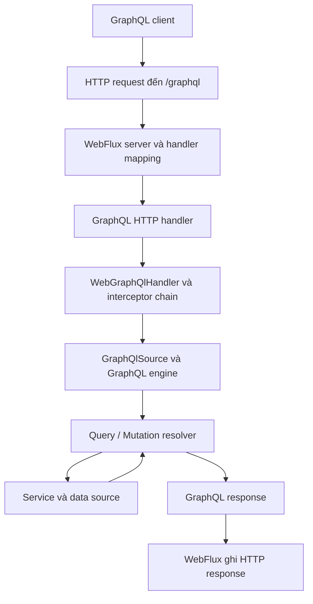

# GraphQlWebFluxAutoConfiguration

## Mục tiêu

Sau bài học này, bạn có thể:

- Giải thích vai trò của `GraphQlWebFluxAutoConfiguration` trong ứng dụng Spring Boot dùng Spring for GraphQL và Spring WebFlux.
- Phân biệt cấu hình GraphQL dùng chung với phần tích hợp HTTP reactive của WebFlux.
- Hiểu cách Boot tự đăng ký endpoint GraphQL và các điểm cấu hình thường gặp.
- Nhận biết điều kiện để auto-configuration WebFlux được áp dụng và cách xử lý khi ứng dụng đồng thời có MVC và WebFlux.
- Tùy chỉnh handler, interceptor, bảo mật, CORS và kiểm thử endpoint GraphQL trên WebFlux.

## Vị trí của GraphQlWebFluxAutoConfiguration

Spring for GraphQL cung cấp API GraphQL độc lập với web stack. Spring Boot ghép các thành phần này với môi trường chạy của ứng dụng thông qua auto-configuration. `GraphQlWebFluxAutoConfiguration` là phần tích hợp dành cho ứng dụng web reactive dựa trên Spring WebFlux.

Khi ứng dụng có GraphQL schema và dùng WebFlux, client gửi HTTP request đến một đường dẫn GraphQL. Phần auto-configuration WebFlux kết nối request của WebFlux với bộ xử lý GraphQL, để operation được thực thi theo schema và các resolver đã đăng ký.

Có thể hình dung vai trò của các lớp cấu hình theo ba tầng:

| Tầng | Trách nhiệm | Thành phần tiêu biểu |
| --- | --- | --- |
| GraphQL dùng chung | Đọc schema, tạo `GraphQlSource`, đăng ký runtime wiring và các thành phần thực thi | `GraphQlAutoConfiguration`, `GraphQlSource` |
| Tích hợp WebFlux | Kết nối GraphQL handler với HTTP reactive và các transport WebFlux được cấu hình | `GraphQlWebFluxAutoConfiguration` |
| Nghiệp vụ ứng dụng | Cung cấp dữ liệu và quy tắc xử lý cho từng field | `@Controller`, `@QueryMapping`, `@SchemaMapping`, service |

Điểm quan trọng là `GraphQlWebFluxAutoConfiguration` không thay thế schema hoặc resolver. Nó đưa GraphQL vào web stack reactive. Schema vẫn mô tả API, còn controller và các `DataFetcher` cung cấp dữ liệu.

## Điều kiện để auto-configuration được kích hoạt

Auto-configuration WebFlux chỉ phù hợp khi ứng dụng thực sự chạy theo mô hình reactive và các thư viện cần thiết có mặt trên classpath. Trong thực tế, cần có:

- Spring Boot GraphQL starter để tích hợp Spring for GraphQL với Boot.
- Spring WebFlux để cung cấp reactive web runtime.
- GraphQL schema và `GraphQlSource` được tạo từ cấu hình GraphQL dùng chung.
- Ứng dụng được Boot nhận diện là reactive web application.

Hai dependency thường được khai báo riêng trong Gradle:

```groovy
dependencies {
    implementation 'org.springframework.boot:spring-boot-starter-graphql'
    implementation 'org.springframework.boot:spring-boot-starter-webflux'
}
```

Hoặc với Maven:

```xml
<dependencies>
    <dependency>
        <groupId>org.springframework.boot</groupId>
        <artifactId>spring-boot-starter-graphql</artifactId>
    </dependency>
    <dependency>
        <groupId>org.springframework.boot</groupId>
        <artifactId>spring-boot-starter-webflux</artifactId>
    </dependency>
</dependencies>
```

Spring Boot quản lý phiên bản tương thích thông qua dependency management của phiên bản Boot đang dùng. Không nên tự chọn các phiên bản Spring for GraphQL, Spring Framework và GraphQL Java rời rạc nếu dự án đã sử dụng Spring Boot dependency management.

### WebFlux và MVC khi cùng xuất hiện

Một dự án có thể vô tình hoặc có chủ đích đưa cả `spring-boot-starter-web` và `spring-boot-starter-webflux` vào classpath. Khi cả hai cùng có mặt, Spring Boot thường chọn Spring MVC làm web application type theo cơ chế nhận diện mặc định. Chỉ thêm dependency WebFlux không có nghĩa ứng dụng sẽ chạy reactive.

Nếu chủ đích của ứng dụng là WebFlux, hãy kiểm tra dependency tree và loại bỏ starter MVC nếu không cần. Khi cần giữ cả hai thư viện, có thể chỉ định rõ loại ứng dụng:

```properties
spring.main.web-application-type=reactive
```

Việc lựa chọn web application type ảnh hưởng đến auto-configuration được áp dụng. Một controller trả về `Mono` hoặc `Flux` không tự biến ứng dụng MVC thành WebFlux.

## Luồng xử lý request GraphQL trên WebFlux

Với HTTP, luồng xử lý ở mức khái niệm như sau:



WebFlux tiếp nhận request theo mô hình reactive. GraphQL handler chuyển request HTTP thành lời gọi thực thi GraphQL, sau đó trả response về cho WebFlux. GraphQL engine phân tích operation, kiểm tra schema và gọi các resolver cần thiết.

Các bước này giúp phân biệt hai loại lỗi thường gặp:

- Lỗi ở tầng HTTP/WebFlux: sai đường dẫn, method không được hỗ trợ, CORS, xác thực hoặc request body không đọc được.
- Lỗi ở tầng GraphQL: cú pháp operation sai, field không tồn tại, argument không hợp lệ hoặc resolver phát sinh lỗi.

Một request có thể đến đúng endpoint nhưng vẫn thất bại khi GraphQL validation hoặc thực thi resolver. Vì vậy, khi debug cần xem cả HTTP status, response body GraphQL và log phía server.

## Endpoint mặc định và cấu hình đường dẫn

Spring Boot cung cấp cấu hình để điều chỉnh đường dẫn HTTP GraphQL. Đường dẫn mặc định phổ biến là `/graphql`:

```properties
spring.graphql.path=/graphql
```

Client gửi query hoặc mutation đến đường dẫn này, thường bằng HTTP `POST` với `Content-Type: application/json`:

```http
POST /graphql
Content-Type: application/json
```

```json
{
  "query": "query BookById($id: ID!) { bookById(id: $id) { id title } }",
  "operationName": "BookById",
  "variables": {
    "id": "book-101"
  }
}
```

Nếu đổi `spring.graphql.path` thành `/api/graphql`, client phải gọi đường dẫn mới. Việc đổi endpoint không làm thay đổi tên field hoặc schema GraphQL. Đây là cấu hình ở tầng HTTP.

Đường dẫn có thể khác nhau giữa các ứng dụng và phiên bản Boot. Khi vận hành, hãy kiểm tra cấu hình đã bind trong môi trường đang chạy thay vì giả định endpoint luôn là `/graphql`.

## Schema và runtime wiring vẫn do cấu hình GraphQL dùng chung quản lý

Schema SDL thường được đặt trong `src/main/resources/graphql/`. Ví dụ:

```graphql
type Query {
  bookById(id: ID!): Book
}

type Book {
  id: ID!
  title: String!
}
```

Spring Boot GraphQL auto-configuration tìm schema ở vị trí mặc định, tạo `GraphQlSource` và kết hợp các `RuntimeWiringConfigurer` cùng những customizer được ứng dụng đăng ký. `GraphQlWebFluxAutoConfiguration` sử dụng hạ tầng GraphQL này khi kết nối với WebFlux.

Nếu cần mở rộng runtime wiring, có thể khai báo bean `RuntimeWiringConfigurer`:

```java
@Configuration
public class GraphQlRuntimeConfiguration {

    @Bean
    RuntimeWiringConfigurer runtimeWiringConfigurer() {
        return wiringBuilder -> wiringBuilder.scalar(MyScalars.DATE);
    }
}
```

Ví dụ trên minh họa vị trí đăng ký custom scalar; `MyScalars.DATE` là scalar do ứng dụng tự định nghĩa. Không cần tự tạo lại toàn bộ `GraphQlSource` chỉ để thêm một scalar hoặc một runtime wiring nhỏ. Nên bổ sung customizer hoặc configurer theo extension point mà Boot và Spring for GraphQL cung cấp.

## Kết hợp với annotated controller reactive

Controller GraphQL vẫn dùng các annotation quen thuộc. Khác biệt nằm ở kiểu trả về và cách service truy cập dữ liệu.

Ví dụ schema:

```graphql
type Query {
  bookById(id: ID!): Book
}

type Book {
  id: ID!
  title: String!
}
```

Controller có thể trả về `Mono<Book>`:

```java
@Controller
public class BookController {

    private final BookService bookService;

    public BookController(BookService bookService) {
        this.bookService = bookService;
    }

    @QueryMapping
    public Mono<Book> bookById(@Argument("id") String id) {
        return bookService.findById(id);
    }
}
```

Trong ví dụ này, `BookService.findById` trả về `Mono<Book>`. Khi dùng WebFlux cùng reactive data access như R2DBC hoặc reactive MongoDB, pipeline có thể tiếp tục bất đồng bộ đến data source. Nếu service bên dưới vẫn dùng JDBC blocking, việc bọc kết quả vào `Mono` không biến thao tác blocking thành non-blocking. Cần xử lý scheduler phù hợp hoặc chọn driver reactive nếu mục tiêu là giữ luồng xử lý non-blocking.

Với field lồng nhau, có thể dùng `@SchemaMapping` và trả về `Mono<Author>` hoặc kiểu phù hợp. Với collection hoặc quan hệ cần tải theo lô, `@BatchMapping` và DataLoader giúp hạn chế N+1. WebFlux không tự giải quyết N+1; batching là trách nhiệm của thiết kế resolver và data access.

## WebSocket và Subscription

GraphQL Subscription cần một transport có thể duy trì kết nối để server gửi nhiều kết quả. Với WebFlux, Spring for GraphQL có thể tích hợp WebSocket khi ứng dụng bật và cấu hình endpoint tương ứng.

Ví dụ cấu hình:

```properties
spring.graphql.websocket.path=/graphql
```

Khi cấu hình WebSocket path, client subscription kết nối đến endpoint WebSocket được chỉ định. Đường dẫn WebSocket có thể trùng với HTTP GraphQL path nếu cấu hình và server hỗ trợ cách triển khai đó. Không nên giả định subscription tự hoạt động chỉ vì đã khai báo `@SubscriptionMapping`; transport, handshake và nguồn phát sự kiện đều phải được thiết lập.

Một mapping subscription có thể trả về `Flux`:

```java
@Controller
public class BookSubscriptionController {

    private final BookEventService eventService;

    public BookSubscriptionController(BookEventService eventService) {
        this.eventService = eventService;
    }

    @SubscriptionMapping
    public Flux<Book> bookAdded() {
        return eventService.bookAdded();
    }
}
```

`Flux` biểu diễn chuỗi sự kiện. Cần thiết kế việc hủy subscription, giới hạn tài nguyên và xác thực kết nối. Khi client ngắt kết nối, pipeline phía server nên giải phóng tài nguyên đăng ký sự kiện tương ứng.

## Tùy chỉnh handler và interceptor

Spring for GraphQL cung cấp `WebGraphQlInterceptor` để can thiệp vào request/response ở tầng WebGraphQL. Interceptor hữu ích cho các mối quan tâm dùng chung như ghi log, correlation ID, gắn thông tin request vào context hoặc chuẩn hóa metadata.

Ví dụ một interceptor đơn giản:

```java
@Component
public class RequestIdInterceptor implements WebGraphQlInterceptor {

    @Override
    public Mono<WebGraphQlResponse> intercept(
            WebGraphQlRequest request, Chain chain) {

        String requestId = request.getHeaders().getFirst("X-Request-Id");
        request.configureExecutionInput((input, builder) ->
                builder.graphQLContext(context ->
                        context.put("requestId", requestId)).build());
        return chain.next(request);
    }
}
```

Đây là ví dụ khái niệm; cần kiểm tra API interceptor của phiên bản Spring for GraphQL đang dùng khi triển khai. Không nên tin tưởng giá trị header do client gửi như một danh tính đã xác thực. Correlation ID có thể được chấp nhận hoặc sinh mới ở server, còn user identity phải đến từ cơ chế xác thực.

Các interceptor có thể được đăng ký thành bean để tham gia chuỗi xử lý. Khi cần thêm logic gắn với từng resolver hoặc kiểm tra quyền trên từng field, hãy chọn extension point tương ứng thay vì dồn mọi nghiệp vụ vào interceptor HTTP.

## CORS và bảo mật endpoint

GraphQL thường tập trung nhiều thao tác vào một endpoint. Vì vậy, cấu hình bảo mật ở endpoint cần đi cùng kiểm soát quyền trong từng operation và field.

Với CORS, hãy chỉ cho phép origin, method và header cần thiết. Ví dụ cấu hình minh họa:

```properties
spring.graphql.cors.allowed-origins=https://app.example.com
spring.graphql.cors.allowed-methods=GET,POST
spring.graphql.cors.allowed-headers=Authorization,Content-Type,X-Request-Id
```

Các thuộc tính CORS khả dụng và cách biểu diễn danh sách có thể thay đổi theo phiên bản Boot; hãy đối chiếu metadata cấu hình của phiên bản dự án. CORS là chính sách của trình duyệt, không thay thế xác thực hoặc phân quyền server.

Nếu ứng dụng dùng Spring Security WebFlux, quy tắc bảo vệ endpoint được cấu hình bằng `SecurityWebFilterChain`. Ví dụ minh họa:

```java
@Bean
SecurityWebFilterChain springSecurityFilterChain(ServerHttpSecurity http) {
    return http
        .authorizeExchange(exchanges -> exchanges
            .pathMatchers("/graphql").authenticated()
            .anyExchange().permitAll())
        .build();
}
```

Đường dẫn trong `pathMatchers` phải khớp với `spring.graphql.path` thực tế. Với xác thực dựa trên cookie, cần xem xét CSRF theo mô hình bảo mật của ứng dụng. Với token bearer, cần cấu hình resource server và xác minh token đúng cách.

Xác thực tại endpoint chỉ trả lời câu hỏi ai đang gọi. Ứng dụng còn cần phân quyền theo operation và field. Ví dụ, một người dùng đã đăng nhập vẫn có thể không được xem thông tin nội bộ của sách hoặc thực hiện mutation quản trị. Có thể đặt kiểm tra ở service, method security hoặc resolver sao cho mọi đường truy cập đều được bảo vệ.

## Kiểm thử GraphQL trên WebFlux

Có thể kiểm thử GraphQL ở nhiều cấp:

- `GraphQlTester` kiểm thử thực thi GraphQL mà không phụ thuộc vào một HTTP client cụ thể.
- `WebGraphQlTester` kiểm thử tầng WebGraphQL và interceptor.
- `HttpGraphQlTester` kết hợp với `WebTestClient` để kiểm thử HTTP endpoint.
- Công cụ kiểm thử WebSocket GraphQL được dùng khi cần xác minh subscription qua transport thực tế.

Ví dụ tạo HTTP tester từ `WebTestClient`:

```java
WebTestClient webTestClient = WebTestClient
    .bindToApplicationContext(context)
    .configureClient()
    .baseUrl("/graphql")
    .build();

HttpGraphQlTester graphQlTester = HttpGraphQlTester.create(webTestClient);
```

Sau đó gửi operation:

```java
graphQlTester.document("""
        query BookById($id: ID!) {
            bookById(id: $id) {
                id
                title
            }
        }
        """)
    .variable("id", "book-101")
    .execute()
    .path("bookById.title")
    .entity(String.class)
    .isEqualTo("Spring in Practice");
```

Trong test slice hoặc integration test, hãy bảo đảm context đã nạp schema, controller và các bean cần thiết. Ngoài kết quả GraphQL, kiểm tra cả HTTP status, CORS, security filter và interceptor nếu chúng thuộc phạm vi cần xác minh.

## Tùy biến auto-configuration đúng cách

Spring Boot auto-configuration được thiết kế để có thể thay thế hoặc bổ sung theo nhu cầu. Khi ứng dụng khai báo bean tùy chỉnh, điều kiện `@ConditionalOnMissingBean` của một số cấu hình mặc định có thể khiến bean mặc định tương ứng không được tạo. Đây là cơ chế back-off phổ biến của Boot.

Trước khi override handler hoặc cấu hình WebFlux, hãy xác định chính xác bean mặc định nào đang được tạo và extension point nào được hỗ trợ. Ưu tiên:

1. Dùng application properties cho các thay đổi có sẵn thuộc tính cấu hình.
2. Đăng ký `WebGraphQlInterceptor` cho xử lý request/response dùng chung.
3. Đăng ký `RuntimeWiringConfigurer` hoặc `GraphQlSourceBuilderCustomizer` cho phần schema/runtime wiring.
4. Chỉ tự cấu hình handler hoặc mapping khi cần thay đổi hành vi mà extension point cấp cao hơn không đáp ứng.

Khi tự khai báo bean thay thế, cần kiểm tra điều kiện auto-configuration và bảo đảm không tạo hai handler cùng nhận một path. Có thể bật báo cáo điều kiện auto-configuration của Boot khi cần tìm hiểu vì sao cấu hình được áp dụng hoặc bị bỏ qua.

## Lỗi thường gặp và cách chẩn đoán

| Hiện tượng | Nguyên nhân có thể | Cách kiểm tra |
| --- | --- | --- |
| Không có endpoint `/graphql` | Thiếu GraphQL/WebFlux starter, ứng dụng đang chạy MVC hoặc auto-configuration bị loại trừ | Kiểm tra dependency, web application type và condition report |
| HTTP 404 tại endpoint | Path đã được đổi hoặc request đi sai context path | Kiểm tra `spring.graphql.path`, context path và URL client |
| Request đến endpoint nhưng GraphQL trả lỗi | Operation sai schema, argument không hợp lệ hoặc resolver phát sinh exception | Kiểm tra response GraphQL, schema và log resolver |
| Ứng dụng chọn MVC ngoài dự kiến | Cả MVC và WebFlux cùng có mặt trên classpath | Kiểm tra dependency tree và `spring.main.web-application-type` |
| Resolver reactive nhưng request vẫn chậm | Có lời gọi blocking bên trong pipeline | Kiểm tra JDBC, HTTP client blocking và scheduler |
| Subscription không kết nối | Chưa cấu hình WebSocket path hoặc transport/handshake không khớp | Kiểm tra cấu hình WebSocket và log handshake |
| Browser báo lỗi CORS | Origin, method hoặc header chưa được cho phép | Kiểm tra CORS policy và preflight request |
| GraphQL bị từ chối dù endpoint truy cập được | Security filter hoặc field-level authorization từ chối request | Kiểm tra principal, security chain và quyền tại service/resolver |

Khi cần biết auto-configuration nào được áp dụng, chạy ứng dụng với chế độ debug của Spring Boot hoặc xem condition evaluation report trong log khởi động. Báo cáo này giúp xác định điều kiện classpath, web application type và bean nào khiến một cấu hình được bật hoặc back-off.

## Thực hành tổng hợp

Tạo một ứng dụng Spring Boot dùng GraphQL và WebFlux với API thư viện:

1. Thêm `spring-boot-starter-graphql` và `spring-boot-starter-webflux`.
2. Khai báo schema có `Query.bookById(id: ID!): Book`.
3. Viết controller trả `Mono<Book>` và service sử dụng reactive repository.
4. Chạy ứng dụng, gửi HTTP POST đến đường dẫn GraphQL và xác minh response.
5. Đổi `spring.graphql.path` rồi kiểm tra client phải gọi path mới.
6. Thêm security rule cho endpoint và kiểm tra quyền truy cập field nhạy cảm.
7. Nếu cần subscription, bật WebSocket path, phát `Flux<Book>` và kiểm thử kết nối cũng như việc hủy subscription.
8. Thử thêm MVC starter để quan sát web application type mà Boot lựa chọn, sau đó cấu hình rõ loại ứng dụng và so sánh kết quả.

Trong quá trình thực hành, quan sát log khởi động và condition report để nhận diện thời điểm `GraphQlWebFluxAutoConfiguration` được kích hoạt. Điều này giúp hiểu auto-configuration từ hành vi thực tế của ứng dụng.

## Ghi nhớ

`GraphQlWebFluxAutoConfiguration` tích hợp Spring for GraphQL với web runtime reactive của Spring WebFlux. Nó sử dụng hạ tầng GraphQL dùng chung như schema và `GraphQlSource`, sau đó kết nối GraphQL handler với request/response WebFlux và transport được cấu hình. Muốn auto-configuration này hoạt động, ứng dụng phải có các dependency cần thiết và được nhận diện là reactive web application. Endpoint, WebSocket, CORS, security, interceptor và kiểm thử đều cần được cấu hình theo nhu cầu thực tế. WebFlux hỗ trợ xử lý reactive, nhưng không tự biến mã blocking thành non-blocking và cũng không tự loại bỏ vấn đề N+1.
