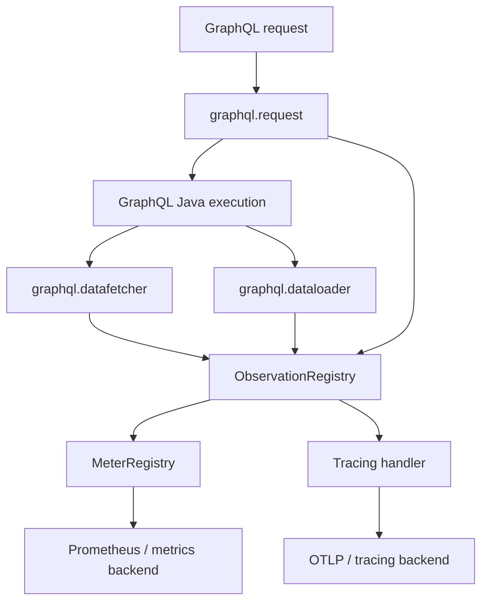

# Micrometer trong Spring GraphQL

## 1. Vì sao GraphQL API cần observability?

Một GraphQL request có thể gọi nhiều resolver trong cùng một operation. Client chỉ gửi một request nhưng server có thể thực hiện nhiều truy vấn database, gọi dịch vụ bên ngoài, chạy DataLoader và phân giải các field lồng nhau. Nếu chỉ đo thời gian HTTP tổng thể, đội vận hành khó biết phần nào của GraphQL execution đang chậm hoặc gây lỗi.

Observability giúp quan sát trạng thái bên trong của ứng dụng từ dữ liệu mà hệ thống phát ra. Ba trụ cột thường được nhắc đến là:

- **Metrics:** số liệu tổng hợp theo thời gian như request count, error rate, latency và phân vị P95/P99.
- **Traces:** dấu vết của một request qua nhiều thành phần, thể hiện các span con và quan hệ thời gian giữa chúng.
- **Logs:** sự kiện và thông tin chi tiết phục vụ chẩn đoán một tình huống cụ thể.

Spring Boot dùng Micrometer Observation làm abstraction chung cho metrics và traces. Spring for GraphQL tích hợp Micrometer để đo toàn bộ GraphQL request, các DataFetcher không tầm thường và hoạt động DataLoader. Nhờ đó, ứng dụng có thể theo dõi hiệu năng ở cả cấp operation lẫn field/batch.

## 2. Micrometer Observation là gì?

Micrometer cung cấp một facade để ứng dụng phát số liệu mà không phải phụ thuộc trực tiếp vào một hệ thống monitoring cụ thể. Micrometer Observation là lớp abstraction cao hơn, mô tả một hoạt động cần quan sát và cung cấp metadata đi kèm.

Các thành phần chính:

| Thành phần | Vai trò |
| --- | --- |
| `Observation` | Đại diện cho một hoạt động được đo, có thời điểm bắt đầu/kết thúc, trạng thái lỗi và metadata |
| `ObservationRegistry` | Registry quản lý vòng đời và các handler của Observation |
| `ObservationConvention` | Định nghĩa tên observation, contextual name và các KeyValue mặc định |
| `ObservationHandler` | Nhận sự kiện bắt đầu/kết thúc để tạo metrics, spans hoặc log |
| `MeterRegistry` | Nơi đăng ký và lưu các meter như Timer, Counter, Gauge |
| Tracing bridge/exporter | Chuyển observations thành trace và gửi đến hệ thống tracing |

Một Observation có thể được xử lý bởi nhiều handler. Ví dụ cùng một GraphQL request có thể tạo một Timer trong `MeterRegistry` và một span trong tracing backend. Ứng dụng giữ cách phát Observation thống nhất, còn backend được chọn bằng dependency và cấu hình.

## 3. Spring for GraphQL tạo những Observation nào?

Spring for GraphQL cung cấp `GraphQlObservationInstrumentation` trong package `org.springframework.graphql.observation`. Instrumentation này gắn vào GraphQL Java execution để tạo ba nhóm Observation:

| Observation name | Phạm vi đo | Khi nào được tạo |
| --- | --- | --- |
| `graphql.request` | Toàn bộ GraphQL execution request | Mỗi Query, Mutation hoặc Subscription operation được thực thi |
| `graphql.datafetcher` | Một hoạt động lấy dữ liệu của field | Với DataFetcher được xem là không tầm thường |
| `graphql.dataloader` | Một lần batch load dữ liệu | Với `@BatchMapping` và DataLoader đăng ký thủ công |

Một request có thể tạo một Observation `graphql.request`, nhiều Observation `graphql.datafetcher` và nhiều Observation `graphql.dataloader`. Các Observation con được liên kết với request để trace có thể hiển thị cây hoạt động.



Lưu ý: một field chỉ đọc trực tiếp property từ Java object thường là thao tác đơn giản và không tạo `graphql.datafetcher` Observation. Mục tiêu là tập trung vào hoạt động fetch dữ liệu thực sự, tránh tạo quá nhiều Observation cho các phép đọc thuộc tính thông thường.

## 4. `graphql.request`: theo dõi toàn bộ operation

Observation `graphql.request` đo thời gian thực thi một GraphQL request. Nó áp dụng cho ứng dụng imperative và reactive, cũng như các transport được Spring for GraphQL hỗ trợ.

Theo convention mặc định, các low-cardinality KeyValue gồm:

| Key | Ý nghĩa | Ví dụ |
| --- | --- | --- |
| `graphql.operation.type` | Loại operation | `query`, `mutation`, `subscription`, `operation` |
| `graphql.outcome` | Kết quả thực thi | `SUCCESS`, `REQUEST_ERROR`, `INTERNAL_ERROR` |

`graphql.operation.type` nhận tên chuẩn `query`, `mutation` hoặc `subscription`. Nếu document không parse được để xác định loại operation, giá trị là `operation`.

Quy tắc `graphql.outcome`:

- `SUCCESS`: GraphQL tạo response hợp lệ và response không có errors.
- `REQUEST_ERROR`: document không parse được hoặc response có errors, nhưng không có error loại `INTERNAL_ERROR`.
- `INTERNAL_ERROR`: không tạo được GraphQL response hợp lệ hoặc response có ít nhất một error loại `INTERNAL_ERROR`.

Các high-cardinality KeyValue mặc định:

| Key | Ý nghĩa |
| --- | --- |
| `graphql.execution.id` | `ExecutionId` của GraphQL request |
| `graphql.operation.name` | Tên operation do client cung cấp |

Spring for GraphQL cũng ghi nhận các GraphQL errors như Observation Events. Khi tracing handler xử lý event, chúng có thể xuất hiện dưới dạng span event để hỗ trợ chẩn đoán.

## 5. `graphql.datafetcher`: tìm field chậm

Một GraphQL operation có thể có nhiều DataFetcher. Observation `graphql.datafetcher` đo thời gian thực thi của những DataFetcher không tầm thường, ví dụ resolver gọi service hoặc repository để tải dữ liệu.

Các low-cardinality KeyValue mặc định:

| Key | Ý nghĩa |
| --- | --- |
| `graphql.error.type` | Tên class của lỗi xảy ra trong data fetching |
| `graphql.field.name` | Tên field đang được phân giải |
| `graphql.outcome` | Kết quả fetch: `SUCCESS` hoặc `ERROR` |

High-cardinality KeyValue mặc định:

| Key | Ý nghĩa |
| --- | --- |
| `graphql.field.path` | Đường dẫn field trong response, ví dụ `/bookById` |

Nhờ `graphql.field.path`, trace có thể chỉ ra field lồng nhau nào đang chậm. Ví dụ `bookById.author.organization` có thể mất nhiều thời gian hơn field `bookById.title` vì nó phải gọi thêm service hoặc database.

Không phải mọi field đều tạo Observation. Một property fetcher mặc định chỉ đọc `book.title` từ object `Book` được xem là trivial. Resolver `@SchemaMapping` gọi repository hoặc service thường tạo Observation vì có công việc lấy dữ liệu cần đo.

## 6. `graphql.dataloader`: theo dõi batch loading và N+1

Spring for GraphQL từ dòng 1.4 bổ sung DataLoader Observation với tên `graphql.dataloader`. Observation này theo dõi lời gọi đến method `@BatchMapping` và các DataLoader được đăng ký thủ công.

Các low-cardinality KeyValue mặc định:

| Key | Ý nghĩa |
| --- | --- |
| `graphql.error.type` | Tên class của lỗi khi batch load |
| `graphql.loader.name` | Tên DataLoader đang được dùng |
| `graphql.outcome` | Kết quả: `SUCCESS` hoặc `ERROR` |

High-cardinality KeyValue mặc định:

| Key | Ý nghĩa |
| --- | --- |
| `graphql.loader.size` | Kích thước danh sách phần tử được load |

DataLoader Observation giúp trả lời các câu hỏi:

- Batch loader nào được gọi nhiều hoặc thường xuyên lỗi?
- Mỗi lần batch xử lý bao nhiêu key?
- Batch loader có nhận quá ít key, khiến batching chưa hiệu quả?
- Thời gian DataLoader có tăng khi số lượng item trong operation tăng không?

Ví dụ, query tải 50 sách và mỗi sách cần tác giả. Nếu không batching, resolver có thể gọi service tác giả 50 lần. Với `@BatchMapping`, Spring for GraphQL có thể gom các author ID thành một batch. Observation `graphql.dataloader` giúp theo dõi số lần batch và quy mô danh sách được load.

Không nên chỉ dựa vào `graphql.dataloader` để kết luận đã loại bỏ hoàn toàn N+1. Hãy kết hợp số lần DataFetcher, số lần batch, kích thước batch và metrics của database/repository.

## 7. Bật observability trong Spring Boot

Với ứng dụng Spring Boot, cách thông thường là thêm Actuator và một Micrometer registry. Khi `ObservationRegistry` có mặt, Spring Boot cung cấp `GraphQlObservationAutoConfiguration` để tạo `GraphQlObservationInstrumentation` nếu ứng dụng chưa khai báo bean tương ứng.

Ví dụ Gradle Kotlin DSL dùng Prometheus:

```kotlin
dependencies {
    implementation("org.springframework.boot:spring-boot-starter-actuator")
    runtimeOnly("io.micrometer:micrometer-registry-prometheus")
}
```

Spring Boot quản lý phiên bản dependency thông qua BOM. Không tự đặt version riêng cho registry nếu dự án đã dùng dependency management của Spring Boot.

Cấu hình expose các endpoint cần thiết:

```yaml
management:
  endpoints:
    web:
      exposure:
        include: health,metrics,prometheus
```

Trong cấu hình trên:

- `spring-boot-starter-actuator` cung cấp Actuator và hạ tầng Observation/Micrometer của Spring Boot.
- `micrometer-registry-prometheus` cung cấp registry xuất metrics theo định dạng Prometheus.
- `metrics` cho phép xem meter qua `/actuator/metrics`.
- `prometheus` cho phép Prometheus scrape dữ liệu qua `/actuator/prometheus`.

Endpoint chỉ được expose khi được cho phép trong cấu hình. Trong production, cần bảo vệ endpoint management bằng mạng nội bộ hoặc Spring Security phù hợp; không expose metrics cho Internet công khai nếu chưa có chính sách truy cập.

## 8. Spring Boot tự cấu hình `GraphQlObservationInstrumentation` như thế nào?

Spring GraphQL reference mô tả việc đăng ký `GraphQlObservationInstrumentation` vào GraphQL execution. Khi dùng Spring Boot, auto-configuration thực hiện phần này nếu:

- Có `ObservationRegistry` trong application context.
- Có GraphQL Java, Spring GraphQL và Micrometer Observation trên classpath.
- Ứng dụng chưa cung cấp một bean instrumentation thay thế.

Boot 3.x dùng auto-configuration trong package `org.springframework.boot.actuate.autoconfigure.observation.graphql`. Boot 4.x chuyển sang package `org.springframework.boot.graphql.autoconfigure.observation`.

Trong ứng dụng Spring Boot thông thường, không cần tự tạo `GraphQlObservationInstrumentation` nếu Actuator và ObservationRegistry đã được cấu hình. Có thể kiểm tra bean này trong ApplicationContext hoặc quan sát các meter sau khi gửi GraphQL operation.

Nếu không dùng Spring Boot, ứng dụng cần tự tạo instrumentation và gắn vào `GraphQlSource`:

```java
import io.micrometer.observation.ObservationRegistry;
import java.util.List;
import graphql.execution.instrumentation.Instrumentation;
import org.springframework.graphql.execution.GraphQlSource;
import org.springframework.graphql.observation.GraphQlObservationInstrumentation;

ObservationRegistry observationRegistry = ObservationRegistry.create();
Instrumentation instrumentation =
    new GraphQlObservationInstrumentation(observationRegistry);

GraphQlSource graphQlSource = GraphQlSource.schemaResourceBuilder()
    .schemaResources(schemaResource)
    .instrumentation(List.of(instrumentation))
    .build();
```

`schemaResource` là resource SDL của ứng dụng. Ví dụ này minh họa cách gắn instrumentation trong cấu hình không dùng Boot; một ứng dụng thực tế phải dùng `ObservationRegistry` đã được cấu hình với handler/registry phù hợp để Observation được xuất ra metrics hoặc traces.

## 9. Kiểm tra metrics qua Actuator

Sau khi gửi GraphQL operation, có thể kiểm tra danh sách meter:

```text
GET /actuator/metrics
```

Sau đó kiểm tra từng meter:

```text
GET /actuator/metrics/graphql.request
GET /actuator/metrics/graphql.datafetcher
GET /actuator/metrics/graphql.dataloader
```

Tên meter hiển thị có thể được chuẩn hóa theo naming convention của registry. Khi dùng Prometheus, dấu chấm thường được chuyển thành dấu gạch dưới trong metric name, ví dụ `graphql_request`.

Để lọc theo tag, Actuator metrics endpoint hỗ trợ tham số `tag`:

```text
GET /actuator/metrics/graphql.request?tag=graphql.operation.type:query
GET /actuator/metrics/graphql.request?tag=graphql.outcome:INTERNAL_ERROR
GET /actuator/metrics/graphql.datafetcher?tag=graphql.field.name:author
```

Tên và giá trị tag phải khớp chính xác với meter đã được đăng ký. Nếu meter chưa xuất hiện, kiểm tra instrumentation, ObservationRegistry, registry backend và việc request có thực sự gọi đến GraphQL endpoint hay không.

## 10. Metrics và traces khác nhau như thế nào?

Metrics tổng hợp dữ liệu qua nhiều request, phù hợp để theo dõi xu hướng và cảnh báo. Traces giữ thông tin từng lần thực thi, phù hợp để điều tra một request cụ thể.

| Câu hỏi vận hành | Metrics | Traces |
| --- | --- | --- |
| Request GraphQL có đang chậm hơn bình thường? | Rất phù hợp | Có thể xem từng request |
| Tỷ lệ request lỗi trong 5 phút? | Rất phù hợp | Không phù hợp để tính tỷ lệ tổng thể |
| Field nào gây chậm trong một request cụ thể? | Chỉ thấy xu hướng theo field | Rất phù hợp |
| Một request đi qua GraphQL, database và HTTP client như thế nào? | Không thể hiện quan hệ đầy đủ | Rất phù hợp |
| Một DataLoader batch cụ thể nhận bao nhiêu key? | Có thể tổng hợp | Có thể xem theo từng span/trace |

Metrics cần giữ số lượng tag values ở mức kiểm soát. Traces có thể chứa high-cardinality metadata vì dữ liệu được lưu theo từng trace, nhưng vẫn cần lọc dữ liệu nhạy cảm và kiểm soát chi phí lưu trữ.

## 11. Phân biệt low-cardinality và high-cardinality KeyValue

Cardinality là số lượng giá trị khác nhau của một tag. Một metric có nhiều tổ hợp tag sẽ tạo nhiều time series và làm tăng bộ nhớ, dung lượng lưu trữ cũng như chi phí truy vấn.

**Low-cardinality** là giá trị có tập hợp nhỏ, ổn định và hữu hạn, ví dụ:

- Operation type: `query`, `mutation`, `subscription`.
- Outcome: `SUCCESS`, `REQUEST_ERROR`, `INTERNAL_ERROR`.
- Field name từ schema cố định.
- Loader name do ứng dụng định nghĩa.

**High-cardinality** là giá trị có thể thay đổi rất nhiều, ví dụ:

- Execution ID.
- Operation name do client tự đặt.
- Field path chứa index của danh sách.
- User ID, request ID hoặc dữ liệu đầu vào tùy biến.

Spring Boot/Micrometer quy định low-cardinality KeyValue được đưa vào metrics và traces; high-cardinality KeyValue chỉ được đưa vào traces. Vì vậy, không tự chuyển `graphql.execution.id`, `graphql.operation.name` hoặc user ID thành metric tag.

Không đưa raw GraphQL document, variables, email, access token hoặc nội dung cá nhân vào metric tag. Những dữ liệu này vừa có nguy cơ lộ thông tin, vừa gây cardinality tăng không kiểm soát.

## 12. Tùy chỉnh metadata bằng Observation Convention

Spring for GraphQL cung cấp các convention mặc định:

- `DefaultExecutionRequestObservationConvention` cho GraphQL request.
- `DefaultDataFetcherObservationConvention` cho DataFetcher.
- `DefaultDataLoaderObservationConvention` cho DataLoader.

Nếu dùng Spring Boot, cách ưu tiên là khai báo convention tùy chỉnh thành bean. Ví dụ bổ sung một tag cố định để phân biệt phiên bản API:

```java
import io.micrometer.common.KeyValue;
import io.micrometer.common.KeyValues;
import org.springframework.context.annotation.Bean;
import org.springframework.context.annotation.Configuration;
import org.springframework.graphql.observation.DefaultExecutionRequestObservationConvention;
import org.springframework.graphql.observation.ExecutionRequestObservationContext;
import org.springframework.graphql.observation.ExecutionRequestObservationConvention;

@Configuration(proxyBeanMethods = false)
public class GraphQlObservationConfig {

    @Bean
    ExecutionRequestObservationConvention executionRequestObservationConvention() {
        return new DefaultExecutionRequestObservationConvention() {

            @Override
            public KeyValues getLowCardinalityKeyValues(
                    ExecutionRequestObservationContext context) {

                return super.getLowCardinalityKeyValues(context)
                    .and(KeyValue.of("graphql.api.version", "v1"));
            }
        };
    }
}
```

Convention mặc định vẫn cung cấp các tag chuẩn; convention tùy chỉnh chỉ bổ sung `graphql.api.version`. Giá trị `v1` là hằng số có cardinality thấp.

Nếu cần thay đổi metadata DataFetcher hoặc DataLoader, có thể cung cấp bean triển khai `DataFetcherObservationConvention` hoặc `DataLoaderObservationConvention`. Hãy giữ nguyên các KeyValue bắt buộc mà convention mặc định cung cấp, trừ khi có lý do rõ ràng để thay đổi hợp đồng metrics/traces.

Không thêm `userId`, raw query hoặc giá trị argument tùy ý vào low-cardinality KeyValue. Nếu thực sự cần định danh request hoặc user trong trace, dùng high-cardinality KeyValue và vẫn phải tuân thủ chính sách dữ liệu nhạy cảm.

## 13. Tạo Observation tùy chỉnh cho nghiệp vụ

Observation tích hợp của Spring GraphQL tập trung vào request, DataFetcher và DataLoader. Nếu cần đo một thao tác nghiệp vụ cụ thể, có thể inject `ObservationRegistry` và tạo Observation riêng.

Ví dụ đo thời gian gọi dịch vụ tra cứu tác giả:

```java
import io.micrometer.observation.Observation;
import io.micrometer.observation.ObservationRegistry;
import org.springframework.stereotype.Service;

@Service
public class AuthorQueryService {

    private final ObservationRegistry observationRegistry;
    private final AuthorRepository authorRepository;

    public AuthorQueryService(
            ObservationRegistry observationRegistry,
            AuthorRepository authorRepository) {
        this.observationRegistry = observationRegistry;
        this.authorRepository = authorRepository;
    }

    public Author findById(String id) {
        return Observation.createNotStarted(
                "catalog.author.lookup", observationRegistry)
            .lowCardinalityKeyValue("catalog.operation", "find-by-id")
            .observe(() -> authorRepository.findById(id).orElse(null));
    }
}
```

Observation tùy chỉnh hữu ích khi muốn tách thời gian gọi một hệ thống phụ thuộc ra khỏi thời gian tổng của DataFetcher. Ví dụ, trace có thể thể hiện span `graphql.datafetcher` bao quanh span `catalog.author.lookup`.

Không tạo Observation thủ công cho mọi method hoặc mọi getter. Nếu method đã được GraphQL, Spring MVC, Spring Data hoặc HTTP client instrument, thêm một Observation khác cho cùng một khoảng thời gian có thể gây trùng lặp và làm trace khó đọc.

## 14. Context và trace propagation

Một GraphQL request thường nằm bên trong một transport observation, ví dụ HTTP server request. Để GraphQL request trở thành span con, Spring for GraphQL cần parent Observation hiện tại được đặt trong `GraphQLContext` bằng key chuẩn:

```java
"micrometer.observation"
```

`GraphQlObservationInstrumentation` sử dụng context này để liên kết Observation GraphQL với parent observation. Việc truyền trace qua ranh giới mạng vẫn do instrumentation của transport đảm nhiệm. Với HTTP, Spring Framework có instrumentation riêng để truyền trace context.

Vì GraphQL có thể chạy trên HTTP, WebSocket hoặc RSocket, không nên mặc định rằng mọi transport đều có cùng cơ chế propagation. Nếu dùng transport streaming hoặc transport tùy chỉnh, hãy kiểm tra instrumentation tương ứng để đảm bảo trace context được truyền đúng.

Với Spring MVC và WebFlux, Spring for GraphQL cũng hỗ trợ context propagation đến DataFetcher. Tuy nhiên, `ThreadLocal`, Reactor Context và Micrometer Observation Context là các cơ chế khác nhau. Không tự giả định mọi dữ liệu trong một context sẽ tự động có mặt ở context khác nếu chưa cấu hình propagation.

## 15. Kết hợp metrics với Prometheus và Grafana

Một cấu hình thường gặp là Spring Boot xuất metrics qua Prometheus, sau đó Grafana truy vấn dữ liệu để hiển thị dashboard và cảnh báo.

Ví dụ cấu hình histogram cho các meter GraphQL:

```yaml
management:
  metrics:
    distribution:
      percentiles-histogram:
        graphql.request: true
        graphql.datafetcher: true
        graphql.dataloader: true
```

Histogram giúp Prometheus tính các percentile có thể tổng hợp giữa nhiều instance. Nếu chỉ bật percentile tính trong process, kết quả không thể tổng hợp chính xác giữa nhiều instance như histogram buckets.

Một số biểu đồ hữu ích:

- Request rate theo operation type.
- P50, P95 và P99 latency của `graphql.request`.
- Tỷ lệ `REQUEST_ERROR` và `INTERNAL_ERROR`.
- Top field có latency cao theo `graphql.field.name`.
- Tần suất và kích thước batch của DataLoader.
- So sánh số lần DataFetcher với số lần DataLoader để tìm dấu hiệu N+1.

Tên metric và tên tag cuối cùng có thể được chuẩn hóa theo naming convention của registry. Hãy xác nhận bằng `/actuator/metrics` hoặc dữ liệu Prometheus trước khi viết PromQL.

## 16. Kết hợp tracing với OpenTelemetry

Micrometer Observation không gắn chặt với một tracing backend. Khi cần trace phân tán, ứng dụng có thể dùng Micrometer Tracing bridge và exporter phù hợp, ví dụ OpenTelemetry/OTLP.

Một trace GraphQL điển hình có thể gồm:

```text
HTTP server request
└── graphql.request
    ├── graphql.datafetcher: Query.bookById
    ├── graphql.datafetcher: Book.author
    │   └── catalog.author.lookup
    └── graphql.dataloader: AuthorDataLoader
```

Tên span hiển thị thực tế còn phụ thuộc convention, exporter và tracing backend. Mục tiêu là quan sát được quan hệ cha/con và thời gian của từng công đoạn.

Khi truy vết request chậm, bắt đầu từ `graphql.request`, tìm DataFetcher chiếm nhiều thời gian nhất, rồi xem span con như database hoặc HTTP client. Nếu DataFetcher có nhiều lần gọi giống nhau, kiểm tra DataLoader và batch size để xác định có vấn đề N+1 hay không.

Không ghi GraphQL document đầy đủ hoặc variables nhạy cảm vào span attribute. Một trace tốt cần đủ thông tin chẩn đoán nhưng không chứa token, mật khẩu, email hoặc payload cá nhân.

## 17. Đọc số liệu để phát hiện vấn đề thực tế

Một số tình huống thường gặp và cách đọc metrics/traces:

| Dấu hiệu | Khả năng nguyên nhân | Hướng điều tra |
| --- | --- | --- |
| `graphql.request` P95 tăng | Một hoặc nhiều field trong operation chậm | Mở trace request chậm và xem các span DataFetcher |
| `graphql.datafetcher` error rate tăng | Resolver/service/repository phát sinh lỗi | Lọc theo field name, error type và trace ID |
| DataFetcher count tăng theo số item | Có thể có N+1 | Kiểm tra field lồng nhau và DataLoader batch |
| DataLoader size luôn bằng 1 | Batching không gom được nhiều key hoặc query chỉ có một item | Kiểm tra cách gọi DataLoader, dispatch và phạm vi request |
| `graphql.dataloader` error tăng | Batch function hoặc backend batch query lỗi | Kiểm tra loader name, exception và batch function |
| Request `INTERNAL_ERROR` tăng | Lỗi nội bộ hoặc không tạo được response hợp lệ | Xem span events, exception logs và service dependencies |
| HTTP latency cao nhưng GraphQL execution ngắn | Thời gian nằm ở transport, filter, serialization hoặc network | So sánh HTTP server observation với `graphql.request` |
| GraphQL execution dài nhưng DataFetcher ngắn | Có thể tốn thời gian parse/validation, orchestration hoặc chờ async | Xem toàn bộ trace và cấu hình instrumentation |

Không kết luận một metric đơn lẻ là nguyên nhân. Ví dụ request chậm nhưng DataFetcher không chậm có thể do parse, validation, scheduling, serialization hoặc thời gian chờ bất đồng bộ. Hãy kết hợp metrics, trace và logs có correlation ID.

## 18. Kiểm thử và xác minh observability

Sau khi cấu hình instrumentation, cần xác nhận Observation thực sự được tạo và đi đến registry.

Có thể kiểm thử theo các lớp:

1. **Instrumentation được đăng ký:** trong Spring Boot, xác nhận có `GraphQlObservationInstrumentation` bean khi `ObservationRegistry` tồn tại.
2. **Request observation:** thực thi một Query và xác nhận Observation `graphql.request` được ghi nhận.
3. **DataFetcher observation:** chọn field có resolver gọi service và xác nhận `graphql.datafetcher` được tạo.
4. **DataLoader observation:** thực thi query đi qua `@BatchMapping` hoặc DataLoader đăng ký thủ công và xác nhận `graphql.dataloader`.
5. **Error outcome:** tạo request có GraphQL error và kiểm tra outcome phù hợp.
6. **Trace propagation:** kiểm tra GraphQL span có parent phù hợp với transport span.
7. **Export:** xác nhận metrics xuất hiện trong Actuator/Prometheus và trace xuất hiện ở tracing backend.

Trong unit test, có thể dùng `SimpleMeterRegistry` hoặc test Observation handler để kiểm tra meter/Observation. Trong integration test, dùng `@SpringBootTest` với cấu hình Actuator/registry tương ứng. Không chỉ kiểm tra rằng ứng dụng khởi động thành công; hãy gửi operation thật để tạo Observation.

## 19. Lỗi thường gặp khi cấu hình Micrometer

| Hiện tượng | Nguyên nhân có thể | Cách xử lý |
| --- | --- | --- |
| Không thấy `graphql.request` | Chưa có `ObservationRegistry` hoặc instrumentation không được đăng ký | Kiểm tra Actuator, auto-configuration và `GraphQlObservationInstrumentation` |
| Có request metrics nhưng không có DataFetcher metrics | Query chỉ đọc property hoặc resolver không thuộc nhóm non-trivial | Kiểm tra field mapping thực sự gọi service/repository |
| Không thấy `graphql.dataloader` | Spring GraphQL cũ hơn 1.4 hoặc DataLoader instrumentation chưa được cấu hình | Kiểm tra phiên bản và instrumentation hiện hành |
| Observation có nhưng không có metrics | Chưa có `MeterRegistry` hoặc meter handler | Kiểm tra registry backend và Actuator dependencies |
| Metrics có nhưng không xuất hiện trong Prometheus | Thiếu Prometheus registry hoặc endpoint chưa expose | Thêm registry và bật `/actuator/prometheus` |
| Trace không có span GraphQL | Thiếu tracing handler/bridge hoặc parent context chưa được truyền | Kiểm tra Micrometer Tracing và transport propagation |
| GraphQL span không nằm dưới HTTP span | Parent Observation không có trong GraphQLContext hoặc transport không truyền trace | Kiểm tra key `micrometer.observation` và instrumentation transport |
| Metrics tăng số time series rất nhanh | Tag có cardinality cao như user ID, execution ID hoặc raw query | Chuyển dữ liệu định danh sang trace hoặc bỏ tag |
| Trace chứa thông tin nhạy cảm | Convention/logging đưa variables hoặc payload vào metadata | Lọc dữ liệu và chỉ giữ metadata cần thiết |
| Có hai span đo cùng một công việc | Tự tạo Observation trùng với instrumentation sẵn có | Xem lại phạm vi đo và bỏ instrumentation trùng lặp |

## 20. Checklist triển khai observability

- [ ] Thêm Actuator và Micrometer registry phù hợp.
- [ ] Xác nhận `ObservationRegistry` có trong ApplicationContext.
- [ ] Xác nhận `GraphQlObservationInstrumentation` được đăng ký.
- [ ] Theo dõi `graphql.request` cho toàn bộ operation.
- [ ] Theo dõi `graphql.datafetcher` cho resolver không tầm thường.
- [ ] Theo dõi `graphql.dataloader` cho `@BatchMapping` và DataLoader.
- [ ] Hiểu low-cardinality và high-cardinality KeyValue.
- [ ] Không đưa raw query, variables, user ID hoặc execution ID vào metric tag.
- [ ] Dùng Observation Convention để thêm metadata có cardinality thấp.
- [ ] Kiểm tra trace propagation qua HTTP, WebSocket hoặc RSocket theo transport đang dùng.
- [ ] Expose `/actuator/metrics` và `/actuator/prometheus` có kiểm soát.
- [ ] Cấu hình histogram/percentile theo SLO và chi phí lưu trữ.
- [ ] Kết hợp metrics, traces và logs có correlation ID khi điều tra sự cố.
- [ ] Kiểm thử request, DataFetcher, DataLoader, error outcome và export.

## Kết luận

Micrometer trong Spring GraphQL giúp đo hiệu năng và trạng thái của GraphQL API ở ba cấp: toàn bộ request, từng DataFetcher không tầm thường và từng lần batch loading của DataLoader. `GraphQlObservationInstrumentation` tạo các Observation `graphql.request`, `graphql.datafetcher` và `graphql.dataloader`; Spring Boot tự cấu hình instrumentation khi có `ObservationRegistry` và các điều kiện cần thiết.

Để vận hành hiệu quả, hãy kết hợp Actuator với một registry như Prometheus và tracing backend phù hợp. Dùng low-cardinality KeyValue cho metrics, giữ high-cardinality metadata ở traces, không đưa dữ liệu nhạy cảm vào tag và kiểm tra trace propagation theo transport. Khi có đủ request, field và DataLoader observations, đội phát triển có thể tìm request chậm, xác định resolver lỗi, phát hiện dấu hiệu N+1 và theo dõi hiệu quả batch loading bằng dữ liệu thay vì phỏng đoán.

## Tài liệu tham khảo

- [Spring for GraphQL — Observability](https://docs.spring.io/spring-graphql/reference/observability.html)
- [Spring for GraphQL — `GraphQlObservationInstrumentation` API](https://docs.spring.io/spring-graphql/docs/current/api/org/springframework/graphql/observation/GraphQlObservationInstrumentation.html)
- [Spring for GraphQL — Observation Package API](https://docs.spring.io/spring-graphql/docs/current/api/org/springframework/graphql/observation/package-summary.html)
- [Spring Boot — Observability](https://docs.spring.io/spring-boot/reference/actuator/observability.html)
- [Spring Boot — Metrics](https://docs.spring.io/spring-boot/reference/actuator/metrics.html)
- [Spring Boot — GraphQL Auto-configuration](https://docs.spring.io/spring-boot/appendix/auto-configuration-classes/spring-boot-graphql.html)
- [Micrometer Observation](https://docs.micrometer.io/micrometer/reference/observation.html)
