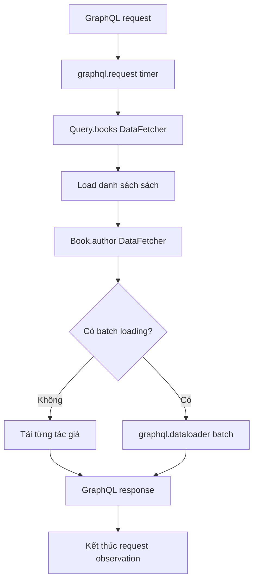

# Metrics cho data fetching trong Spring for GraphQL

GraphQL có thể trả một response đúng nhưng vẫn thực hiện quá nhiều lần gọi resolver hoặc truy vấn dữ liệu. Để tìm điểm nghẽn, cần đo cả thời gian của toàn bộ request và thời gian của từng thao tác data fetching. Spring for GraphQL tích hợp Micrometer Observation để ghi nhận ba nhóm hoạt động: GraphQL request, DataFetcher và DataLoader.

Các metrics này giúp trả lời những câu hỏi thực tế: request nào đang chậm, field nào tốn thời gian, resolver nào thường lỗi, batch loader có được gọi hay không và việc tối ưu N+1 có cải thiện số lần fetch hay không. Metrics cho biết xu hướng tổng hợp; khi cần điều tra một request cụ thể, kết hợp với distributed trace.

## Phân biệt request, DataFetcher và DataLoader

Một GraphQL operation có thể gọi nhiều DataFetcher. Một DataFetcher có thể truy vấn repository trực tiếp hoặc chuyển việc tải quan hệ cho DataLoader. Vì vậy, chỉ đo tổng thời gian HTTP request sẽ không chỉ ra field nào làm request chậm.

| Observation | Đo lường | Khi nào hữu ích? |
| --- | --- | --- |
| `graphql.request` | Toàn bộ quá trình thực thi GraphQL request. | Theo dõi latency và tỷ lệ lỗi ở cấp operation. |
| `graphql.datafetcher` | Thời gian của từng thao tác data fetching không tầm thường. | Tìm resolver/field chậm hoặc phát sinh lỗi. |
| `graphql.dataloader` | Thời gian gọi batch loader hoặc DataLoader. | Theo dõi hoạt động batching và tìm dấu hiệu N+1. |



`graphql.request` đo toàn bộ execution. Các DataFetcher và DataLoader có thể chạy song song, vì vậy không cộng tất cả thời gian field để suy ra request latency. Dùng request timer để theo dõi SLO tổng thể và các timer con để khoanh vùng công việc.

## Observation và Metrics hoạt động như thế nào?

Spring for GraphQL dùng Micrometer Observation. Một Observation mô tả một thao tác có thời điểm bắt đầu, kết thúc và metadata. Khi ứng dụng có `ObservationRegistry` cùng meter handler, các Observation hoàn tất được chuyển thành meters; nếu có tracing handler, chúng cũng có thể tạo span.

Spring for GraphQL cung cấp `GraphQlObservationInstrumentation` để tạo các Observation. Spring Boot tự cấu hình instrumentation này khi có hạ tầng Observation phù hợp. Observation chỉ được ghi nhận khi ứng dụng có `ObservationRegistry` được cấu hình.

Với ứng dụng Spring Boot, cách thiết lập thông thường là thêm Actuator:

```kotlin
dependencies {
    implementation("org.springframework.boot:spring-boot-starter-graphql")
    implementation("org.springframework.boot:spring-boot-starter-actuator")
}
```

Spring Boot cấu hình `ObservationRegistry`, `MeterRegistry` và meter observation handler theo các dependency có mặt. Không cần tự tạo `GraphQlObservationInstrumentation` nếu auto-configuration đã cung cấp nó.

Với ứng dụng không dùng Spring Boot hoặc tự quản lý `GraphQlSource`, cần đăng ký instrumentation thủ công:

Trong ứng dụng standalone, `ObservationRegistry` cũng phải có meter observation handler. Ví dụ, khi đã có `MeterRegistry`:

```java
import io.micrometer.core.instrument.MeterRegistry;
import io.micrometer.core.instrument.observation.DefaultMeterObservationHandler;
import io.micrometer.observation.ObservationRegistry;
import org.springframework.context.annotation.Bean;
import org.springframework.context.annotation.Configuration;

@Configuration(proxyBeanMethods = false)
public class ObservationRegistryConfiguration {

    @Bean
    ObservationRegistry observationRegistry(MeterRegistry meterRegistry) {
        ObservationRegistry registry = ObservationRegistry.create();
        registry.observationConfig().observationHandler(
                new DefaultMeterObservationHandler(meterRegistry));
        return registry;
    }
}
```

Nếu không có meter handler, instrumentation có thể tạo Observation nhưng không xuất meter. Để xuất trace, cần thêm tracing handler và exporter phù hợp; meter handler riêng chỉ tạo metrics.

```java
import io.micrometer.observation.ObservationRegistry;
import org.springframework.context.annotation.Bean;
import org.springframework.context.annotation.Configuration;
import org.springframework.core.io.ClassPathResource;
import org.springframework.graphql.data.method.annotation.support.AnnotatedControllerConfigurer;
import org.springframework.graphql.execution.GraphQlSource;
import org.springframework.graphql.observation.GraphQlObservationInstrumentation;

@Configuration(proxyBeanMethods = false)
public class GraphQlMetricsConfiguration {

    @Bean
    GraphQlSource graphQlSource(
            ObservationRegistry observationRegistry,
            AnnotatedControllerConfigurer controllerConfigurer) {
        return GraphQlSource.schemaResourceBuilder()
                .schemaResources(new ClassPathResource("graphql/schema.graphqls"))
                .configureRuntimeWiring(controllerConfigurer)
                .configureGraphQl(builder -> builder.instrumentation(
                        new GraphQlObservationInstrumentation(observationRegistry)))
                .build();
    }
}
```

Đây là cấu hình minh họa tối thiểu. Ứng dụng thực tế cần giữ lại các `RuntimeWiringConfigurer`, exception resolver và cấu hình schema hiện có. Nếu đã có instrumentation từ Spring Boot, không đăng ký thêm một bản thứ hai vì có thể ghi nhận trùng lặp.

## Các tag mặc định của GraphQL request

Observation `graphql.request` đại diện cho một lần thực thi operation. Các low-cardinality key mặc định gồm:

| Key | Ý nghĩa | Giá trị thường gặp |
| --- | --- | --- |
| `graphql.operation.type` | Loại operation. | `query`, `mutation`, `subscription`; `operation` nếu document không parse được. |
| `graphql.outcome` | Kết quả thực thi request. | `SUCCESS`, `REQUEST_ERROR`, `INTERNAL_ERROR`. |

`SUCCESS` nghĩa là response GraphQL hợp lệ và không chứa error. `REQUEST_ERROR` được dùng khi request không parse được hoặc response có lỗi không thuộc loại internal. `INTERNAL_ERROR` được dùng khi không tạo được GraphQL response hợp lệ hoặc response chứa ít nhất một lỗi có `ErrorType.INTERNAL_ERROR`.

Những tag này giúp dashboard phân biệt request query, mutation, subscription và theo dõi tỷ lệ lỗi ở cấp request. `graphql.execution.id` và `graphql.operation.name` là high-cardinality keys; chúng phù hợp cho trace để tìm đúng lần chạy, không nên dùng làm metric tags.

## Metrics cho DataFetcher

Observation `graphql.datafetcher` đo thời gian thực thi một DataFetcher không tầm thường. Các low-cardinality keys mặc định:

| Key | Ý nghĩa |
| --- | --- |
| `graphql.field.name` | Tên field đang được resolve. |
| `graphql.outcome` | `SUCCESS` hoặc `ERROR`. |
| `graphql.error.type` | Tên lớp lỗi data fetching khi có lỗi. |

`graphql.field.path` là high-cardinality key, được giữ cho trace. Field path cho biết vị trí đầy đủ của field trong cây response; nó có thể chứa alias và index của list nên không phù hợp làm metric tag.

### Thế nào là DataFetcher không tầm thường?

Spring for GraphQL không tạo `graphql.datafetcher` Observation cho mọi field. Việc đọc property đơn giản từ Java object, ví dụ `book.getTitle()`, được xem là trivial và không cần một observation riêng. Các thao tác gọi controller method, service hoặc resolver có công việc thực tế mới thường được đo.

Điều này giúp giảm overhead và tránh tạo quá nhiều metric cho các field chỉ đọc dữ liệu đã có trong object. Vì vậy, số lần `graphql.datafetcher` không phải tổng số field trong response và cũng không phải số lượng SQL query.

### Đọc kết quả DataFetcher metrics

Giả sử query trả về danh sách sách và mỗi sách cần resolve tác giả. Nếu resolver `Book.author` gọi repository riêng cho từng sách, metric theo `graphql.field.name=author` có thể cho thấy số lần fetch và tổng thời gian tăng theo số sách.

Khi xem metric, tập trung vào:

- **Count:** số lần DataFetcher được thực thi trong khoảng thời gian.
- **Total time:** tổng thời gian resolver đã tiêu thụ trong khoảng thời gian.
- **Mean time:** tổng thời gian chia cho số lần thực thi.
- **Max hoặc histogram:** phát hiện lần fetch có độ trễ bất thường và phân vị p95/p99 nếu đã cấu hình histogram.
- **Outcome/error type:** xác định field nào thường thất bại và nhóm exception xuất hiện.

Các lần fetch field có thể chạy song song. Total time của một field là tổng thời gian của các lần thực thi được ghi nhận; nó không nhất thiết bằng phần thời gian tuần tự cộng vào request latency.

Một số tài liệu Spring Boot cũ mô tả metric `graphql.request.datafetch.count` hoặc tag `path` cho DataFetcher. Đó là mô hình metrics trước đây. Với Observation conventions hiện đại của Spring for GraphQL, hãy dựa vào `graphql.datafetcher` cùng các key `graphql.field.name`, `graphql.outcome` và `graphql.error.type`; kiểm tra phiên bản đang chạy trước khi dùng dashboard cũ.

## Metrics cho DataLoader và `@BatchMapping`

Observation `graphql.dataloader` đo các lần gọi method `@BatchMapping` và các DataLoader đăng ký thủ công. Các low-cardinality keys mặc định:

| Key | Ý nghĩa |
| --- | --- |
| `graphql.loader.name` | Tên DataLoader. |
| `graphql.outcome` | `SUCCESS` hoặc `ERROR`. |
| `graphql.error.type` | Tên lớp lỗi khi batch loading thất bại. |

`graphql.loader.size` là high-cardinality key chứa số phần tử được tải trong lần batch. Giá trị này có ích khi xem trace, nhưng không được xuất thành metric tag mặc định.

Observation riêng cho DataLoader được bổ sung từ Spring for GraphQL 1.4. Với các thao tác resolve chuyển việc tải dữ liệu sang DataLoader, instrumentation hiện đại tách thời gian batch loading thành `graphql.dataloader`; không nên kỳ vọng chúng luôn xuất hiện như DataFetcher timer thông thường.

### Ví dụ `@BatchMapping`

Giả sử query lấy nhiều sách, và mỗi sách có một tác giả. Batch mapping gom các sách vào một lần gọi rồi tải quan hệ theo nhóm:

```java
import org.springframework.graphql.data.method.annotation.BatchMapping;
import org.springframework.stereotype.Controller;
import java.util.List;
import java.util.Map;
import java.util.Set;
import java.util.stream.Collectors;

@Controller
public class BookController {

    private final AuthorService authorService;
    private final AuthorBatchMetrics authorBatchMetrics;

    public BookController(
            AuthorService authorService,
            AuthorBatchMetrics authorBatchMetrics) {
        this.authorService = authorService;
        this.authorBatchMetrics = authorBatchMetrics;
    }

    @BatchMapping(typeName = "Book", field = "author")
    public Map<Book, Author> author(List<Book> books) {
        Set<String> authorIds = books.stream()
                .map(Book::authorId)
                .collect(Collectors.toSet());

        authorBatchMetrics.record(authorIds.size());
        Map<String, Author> authors = authorService.findAllByIds(authorIds);
        return books.stream().collect(Collectors.toMap(
                book -> book,
                book -> authors.get(book.authorId())));
    }
}
```

`@BatchMapping` tạo batch loader cho field `Book.author`. Spring for GraphQL ghi nhận thời gian của batch operation dưới `graphql.dataloader`. Tên loader cụ thể phụ thuộc cách đăng ký và cấu hình DataLoader; dùng tag `graphql.loader.name` để phân biệt loader trong dashboard.

## Nhận biết vấn đề N+1 bằng metrics

N+1 thường xuất hiện khi ứng dụng tải danh sách N đối tượng cha rồi thực hiện thêm một truy vấn riêng cho mỗi đối tượng để lấy quan hệ. Ví dụ query lấy 30 sách và resolver `author` gọi repository 30 lần.

Trước khi batch loading, metrics có thể cho thấy:

- Số lần DataFetcher cho field quan hệ tăng theo số phần tử trong danh sách.
- Tổng thời gian DataFetcher quan hệ chiếm tỷ trọng lớn trong request.
- Các truy vấn database lặp lại nhiều lần, dù mỗi lần riêng lẻ có thể nhanh.

Sau khi dùng `@BatchMapping` hoặc DataLoader:

- Thời gian batch xuất hiện dưới `graphql.dataloader`.
- Số lần batch thường nhỏ hơn số parent object được trả về, tùy dispatch cycle và `maxBatchSize`.
- Trace có thể hiển thị `graphql.loader.size` để biết số key trong từng batch.

Không kết luận N+1 chỉ từ một metric. `graphql.datafetcher` đo thao tác resolve, không đếm SQL statement. Một resolver có thể thực hiện nhiều SQL query; ngược lại, một resolver có thể tải dữ liệu qua một truy vấn join. Để xác nhận N+1, đối chiếu DataFetcher/DataLoader observations với JDBC, Hibernate metrics, query log hoặc database tracing.

### Quy trình điều tra

1. Tìm `graphql.request` có latency cao hoặc tỷ lệ lỗi tăng.
2. Nhóm `graphql.datafetcher` theo `graphql.field.name` để tìm field chiếm nhiều thời gian hoặc có nhiều lần gọi.
3. Kiểm tra `graphql.dataloader` theo `graphql.loader.name` để xác định batch loader có thực sự chạy và có lỗi hay không.
4. Mở trace của một request đại diện để xem `graphql.field.path`, operation name và loader size.
5. Đối chiếu số lần gọi database hoặc repository để xác nhận có N+1.
6. Thêm `@BatchMapping`, DataLoader, join fetch hoặc projection phù hợp; sau đó so sánh metrics trước và sau.

Không kỳ vọng tổng thời gian các DataFetcher cộng lại bằng request time vì nhiều field có thể chạy đồng thời. Hãy so sánh cùng loại request, cùng page size và cùng workload để kết quả có ý nghĩa.

## Bật Actuator metrics endpoint

Spring Boot cung cấp endpoint `/actuator/metrics` để xem các meters đã được ghi nhận. Cần expose endpoint trong cấu hình:

```yaml
management:
  endpoints:
    web:
      exposure:
        include: health,info,metrics
```

Sau khi gửi ít nhất một GraphQL request có resolver không tầm thường, có thể xem danh sách meters:

```text
GET /actuator/metrics
GET /actuator/metrics/graphql.request
GET /actuator/metrics/graphql.datafetcher
GET /actuator/metrics/graphql.dataloader
```

Endpoint `metrics` hiển thị tên meter, measurements và các tag. Có thể lọc theo tag, ví dụ:

```text
GET /actuator/metrics/graphql.datafetcher?tag=graphql.field.name:author
GET /actuator/metrics/graphql.dataloader?tag=graphql.loader.name:authorLoader
```

Tên meter ở Actuator dùng tên Micrometer gốc. Registry xuất ra hệ thống bên ngoài có thể chuẩn hóa tên meter và tag theo quy ước riêng. Nếu chưa thấy meter, kiểm tra `ObservationRegistry`, instrumentation, meter registry và việc request đã thực thi field cần đo hay chưa.

Các endpoint Actuator có thể tiết lộ thông tin vận hành. Chỉ expose chúng trên mạng nội bộ hoặc bảo vệ bằng Spring Security; không mở `/actuator/metrics` công khai nếu không có lý do và kiểm soát truy cập.

## Xuất metrics sang Prometheus

Để Prometheus scrape metrics, thêm registry dependency:

```kotlin
dependencies {
    runtimeOnly("io.micrometer:micrometer-registry-prometheus")
}
```

Expose endpoint Prometheus:

```yaml
management:
  endpoints:
    web:
      exposure:
        include: health,info,metrics,prometheus
```

Prometheus scrape config:

```yaml
scrape_configs:
  - job_name: spring-graphql
    metrics_path: /actuator/prometheus
    static_configs:
      - targets: ["localhost:8080"]
```

Prometheus thường biểu diễn timer bằng các series như `_count`, `_sum` và `_max`; nếu bật histogram thì có thêm `_bucket`. Dấu chấm trong meter name và tag key có thể được chuyển thành dấu gạch dưới theo Prometheus naming convention.

Ví dụ truy vấn số lần DataFetcher theo field trong 5 phút gần nhất:

```promql
sum by (graphql_field_name) (
  rate(graphql_datafetcher_seconds_count[5m])
)
```

Ví dụ tính latency trung bình theo field:

```promql
sum by (graphql_field_name) (
  rate(graphql_datafetcher_seconds_sum[5m])
)
/
sum by (graphql_field_name) (
  rate(graphql_datafetcher_seconds_count[5m])
)
```

Ví dụ đếm batch loader theo tên loader:

```promql
sum by (graphql_loader_name) (
  rate(graphql_dataloader_seconds_count[5m])
)
```

Ví dụ theo dõi tỷ lệ DataFetcher error theo field:

```promql
sum by (graphql_field_name) (
  rate(graphql_datafetcher_seconds_count{graphql_outcome="ERROR"}[5m])
)
/
sum by (graphql_field_name) (
  rate(graphql_datafetcher_seconds_count[5m])
)
```

Tên label được chuẩn hóa theo registry; hãy kiểm tra output thực tế tại `/actuator/prometheus` trước khi dùng truy vấn trong dashboard.

## Bật histogram để theo dõi p95/p99

Timer mặc định cung cấp count, total time và max. Nếu cần histogram để tính phân vị ở Prometheus, cấu hình percentiles histogram cho các meter cần theo dõi:

```yaml
management:
  metrics:
    distribution:
      percentiles-histogram:
        "graphql.request": true
        "graphql.datafetcher": true
        "graphql.dataloader": true
```

Sau khi histogram được xuất, có thể dùng `histogram_quantile` để tính p95:

```promql
histogram_quantile(0.95,
  sum by (le, graphql_field_name) (
    rate(graphql_datafetcher_seconds_bucket[5m])
  )
)
```

Histogram làm tăng số series và chi phí lưu trữ. Chỉ bật cho những meter có giá trị vận hành; chọn bucket/SLO phù hợp với latency mục tiêu của hệ thống. Percentile tính trong từng instance và histogram tổng hợp có semantics khác nhau, vì vậy ưu tiên histogram khi cần gộp dữ liệu nhiều instance trên Prometheus.

## Bổ sung parent type vào DataFetcher metrics

Mặc định `graphql.field.name` chỉ chứa tên field. Nếu schema có nhiều object type cùng khai báo field `author`, metrics có thể gộp chúng vào cùng một nhóm. Có thể thêm parent type làm low-cardinality tag bằng custom convention:

```java
import io.micrometer.common.KeyValue;
import io.micrometer.common.KeyValues;
import org.springframework.context.annotation.Bean;
import org.springframework.context.annotation.Configuration;
import org.springframework.graphql.observation.DataFetcherObservationContext;
import org.springframework.graphql.observation.DataFetcherObservationConvention;
import org.springframework.graphql.observation.DefaultDataFetcherObservationConvention;

@Configuration(proxyBeanMethods = false)
public class GraphQlObservationConventionConfiguration {

    @Bean
    DataFetcherObservationConvention dataFetcherObservationConvention() {
        return new DefaultDataFetcherObservationConvention() {
            @Override
            public KeyValues getLowCardinalityKeyValues(
                    DataFetcherObservationContext context) {
                return super.getLowCardinalityKeyValues(context)
                        .and(KeyValue.of(
                                "graphql.parent.type",
                                context.getEnvironment().getParentType().getName()));
            }
        };
    }
}
```

Parent type đến từ schema nên thường có tập giá trị hữu hạn. Không thêm `graphql.field.path`, request ID, user ID hoặc raw argument vào low-cardinality keys. Nếu Spring Boot đã có convention bean tùy chỉnh, hợp nhất logic thay vì đăng ký nhiều convention cùng loại.

## Ghi nhận phân phối batch size bằng meter riêng

`graphql.loader.size` là high-cardinality key mặc định nên không xuất hiện như tag metric. Nếu dashboard cần phân phối batch size, ghi kích thước như sample của `DistributionSummary`, với tag loader có tập giá trị cố định:

```java
import io.micrometer.core.instrument.DistributionSummary;
import io.micrometer.core.instrument.MeterRegistry;
import org.springframework.stereotype.Component;

@Component
public class AuthorBatchMetrics {

    private final DistributionSummary batchSize;

    public AuthorBatchMetrics(MeterRegistry registry) {
        this.batchSize = DistributionSummary.builder("graphql.dataloader.batch.size")
                .description("Số author ID trong mỗi batch load")
                .baseUnit("keys")
                .tag("loader", "authors")
                .register(registry);
    }

    public void record(int size) {
        batchSize.record(size);
    }
}
```

Trong ví dụ `BookController`, `AuthorBatchMetrics` được inject vào controller và gọi bằng `authorBatchMetrics.record(authorIds.size())` bên trong batch loader. DistributionSummary lưu count, total, max và histogram/percentiles nếu cấu hình. Không biến từng giá trị size thành tag vì điều đó tạo thêm time series không cần thiết.

## Phân biệt GraphQL metrics với database metrics

DataFetcher latency bao gồm thời gian xử lý của resolver và các thao tác mà resolver chờ hoàn tất. Nó không cho biết chính xác database mất bao lâu hoặc một resolver phát bao nhiêu SQL statement.

Để phân tích sâu, theo dõi thêm:

- JDBC connection pool metrics để phát hiện cạn connection hoặc chờ pool.
- Hibernate statistics hoặc repository instrumentation để theo dõi truy vấn và thao tác persistence.
- Database slow query log/APM để tìm câu SQL chậm.
- HTTP client metrics nếu resolver gọi service bên ngoài.
- Distributed traces để nối GraphQL request với database và downstream spans.

Khi `graphql.datafetcher` chậm nhưng JDBC nhanh, phần thời gian còn lại có thể nằm ở xử lý Java, chờ executor hoặc downstream service. Khi cả DataFetcher và database span đều chậm, tập trung vào query plan, index, connection pool và số lần gọi DB.

## Lỗi thường gặp

| Triệu chứng | Nguyên nhân | Cách xử lý |
| --- | --- | --- |
| Không thấy `graphql.datafetcher` | Chưa có `ObservationRegistry`/instrumentation hoặc field chỉ đọc property đơn giản. | Kiểm tra Actuator, GraphQL instrumentation và loại DataFetcher. |
| Chỉ thấy request timer, không thấy DataLoader timer | Dùng Spring for GraphQL trước 1.4 hoặc batch loader chưa được gọi. | Kiểm tra phiên bản và `@BatchMapping`/DataLoader registration. |
| Field chậm nhưng metric gộp nhiều object type | Default tag chỉ có `graphql.field.name`. | Thêm parent type qua convention nếu schema có tập type hữu hạn. |
| Không lọc được theo full field path trong metrics | `graphql.field.path` là high cardinality. | Dùng trace để xem path; metric dùng field name. |
| Không thấy p95 trên Prometheus | Timer histogram chưa bật. | Cấu hình `percentiles-histogram` cho meter cần thiết. |
| DataFetcher count lớn nhưng chưa chắc có N+1 | Một resolver có thể gọi nhiều hoặc ít SQL tùy implementation. | Đối chiếu DataLoader observations với JDBC/Hibernate hoặc SQL tracing. |
| Không thấy `/actuator/metrics` | Endpoint chưa được expose hoặc security chặn. | Kiểm tra `management.endpoints.web.exposure.include` và quyền truy cập. |
| Prometheus không scrape được | Chưa thêm Prometheus registry hoặc endpoint chưa expose. | Thêm `micrometer-registry-prometheus`, cấu hình scrape path và network. |
| Metrics tăng cardinality bất thường | Thêm request ID, user ID hoặc full path vào metric tags. | Chỉ dùng low-cardinality tags; chuyển dữ liệu chi tiết sang traces. |

## Ghi nhớ

Spring for GraphQL cung cấp ba nhóm Observation quan trọng cho việc theo dõi data fetching: `graphql.request`, `graphql.datafetcher` và `graphql.dataloader`. Request timer đo toàn operation; DataFetcher timer giúp tìm resolver không tầm thường chậm hoặc lỗi; DataLoader timer cho biết batch loading hoạt động thế nào. Các low-cardinality keys như operation type, field name, loader name và outcome phù hợp cho metrics; execution ID, operation name, field path và loader size phù hợp cho traces.

Bật Actuator và meter registry để xem hoặc xuất metrics. Dùng count, total time, max và histogram để xây dashboard; dùng `@BatchMapping`/DataLoader để giảm N+1 rồi so sánh trước và sau. Metrics không thay thế database query metrics hoặc trace chi tiết: hãy kết hợp chúng để tìm đúng tầng gây chậm và xác nhận hiệu quả tối ưu.

## Tài liệu tham khảo

- [Spring for GraphQL — Observability](https://docs.spring.io/spring-graphql/reference/observability.html)
- [Spring for GraphQL — `GraphQlObservationInstrumentation` API](https://docs.spring.io/spring-graphql/docs/current/api/org/springframework/graphql/observation/GraphQlObservationInstrumentation.html)
- [Spring Boot — Metrics](https://docs.spring.io/spring-boot/reference/actuator/metrics.html)
- [Spring Boot — Observability](https://docs.spring.io/spring-boot/reference/actuator/observability.html)
- [Micrometer — Observation](https://docs.micrometer.io/micrometer/reference/observation.html)
