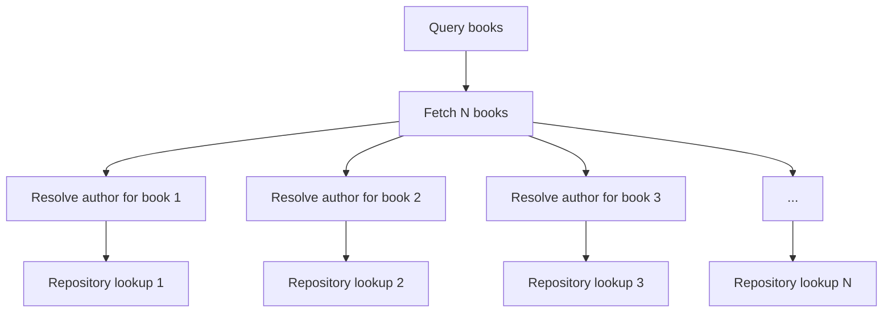

# N+1 và batch loading trong Spring for GraphQL

GraphQL cho phép client chọn các field lồng nhau trong cùng một operation. Cách tổ chức resolver theo từng field giúp API linh hoạt, nhưng có thể tạo ra nhiều truy vấn dữ liệu nhỏ khi một field con được resolve riêng cho từng object cha. Đây là vấn đề N+1: một truy vấn lấy danh sách object cha, sau đó N truy vấn khác lấy dữ liệu liên quan cho từng object.

Spring for GraphQL tích hợp DataLoader của GraphQL Java để gom các lần tải dữ liệu theo key thành batch. `BatchLoaderRegistry` là registry trung tâm để khai báo batch loader; các DataLoader cụ thể được đăng ký theo từng GraphQL request. `@BatchMapping` là cách viết ngắn cho trường hợp phổ biến khi tải một field liên quan từ danh sách parent object. Dùng đúng cơ chế batch giúp giảm số lần truy cập database hoặc service, đồng thời giữ nguyên cấu trúc GraphQL mà client yêu cầu.

Sau bài này, bạn có thể:

- Nhận biết N+1 trong GraphQL nested fields.
- Đo số lần gọi repository hoặc service thay vì chỉ nhìn response.
- Hiểu cách DataLoader gom key, dispatch và cache trong một request.
- Dùng `BatchLoaderRegistry` cùng `DataLoader` trong `@SchemaMapping`.
- Dùng `@BatchMapping` cho quan hệ parent-child phổ biến.
- Chọn mapped batch loader hoặc positional batch loader phù hợp.
- Xử lý key trùng, dữ liệu thiếu, giới hạn kích thước batch và nhiều dispatch wave.
- Giữ đúng tenant, authorization và GraphQL context khi batch loading.
- Kiểm thử cả kết quả lẫn số lần gọi backend.

## 1. N+1 là vấn đề gì?

Giả sử schema có sách và tác giả:

```graphql
type Query {
    books: [Book!]!
}

type Book {
    id: ID!
    title: String!
    author: Author
}

type Author {
    id: ID!
    name: String!
}
```

Client yêu cầu:

```graphql
query {
    books {
        id
        title
        author {
            name
        }
    }
}
```

Giả sử có 100 sách. Resolver `books` thực hiện một truy vấn để lấy danh sách sách. Sau đó resolver `author` được gọi cho từng sách và mỗi lần gọi repository một lần để tìm tác giả.

```java
@Controller
public class BookController {

    private final BookRepository bookRepository;
    private final AuthorRepository authorRepository;

    public BookController(
            BookRepository bookRepository,
            AuthorRepository authorRepository) {
        this.bookRepository = bookRepository;
        this.authorRepository = authorRepository;
    }

    @QueryMapping
    public List<Book> books() {
        return bookRepository.findAll();
    }

    @SchemaMapping(typeName = "Book", field = "author")
    public Author author(Book book) {
        return authorRepository.findById(book.authorId()).orElse(null);
    }
}
```

Với N sách, số lần đọc có thể gần bằng:

\[
Q(N) = 1 + N
\]

Nếu N bằng 100, server có thể thực hiện 101 truy vấn: một truy vấn danh sách sách và 100 truy vấn tác giả. Khi danh sách tăng lên 1.000 phần tử, số round trip cũng tăng theo.

Đây là N+1 select problem. Nó không chỉ xuất hiện với SQL; mỗi resolver gọi REST API, microservice hoặc remote cache riêng lẻ cũng có thể tạo cùng mẫu chi phí.

## 2. Vì sao GraphQL dễ gặp N+1?

GraphQL execution phân giải các field theo selection set. Một field lồng nhau có thể được gọi cho từng parent object:



GraphQL không tự biết rằng 100 lời gọi `author` nên được chuyển thành một câu SQL `WHERE author_id IN (...)`. Nếu resolver tự gọi repository cho từng parent, backend sẽ nhận từng yêu cầu riêng.

N+1 thường khó nhận ra khi dữ liệu phát triển nhỏ. Test với một sách chỉ có hai truy vấn và có thể không gây chú ý. Cần kiểm tra với nhiều parent object, đặc biệt khi field lồng nhau nằm trong list hoặc nhiều cấp quan hệ.

Không phải mọi resolver lồng nhau đều gây N+1. Nếu dữ liệu đã được fetch join, projection hoặc cache hợp lý, resolver có thể chỉ đọc thuộc tính đã có. Vấn đề cần đo là số lần truy cập backend phát sinh trong quá trình resolve, không chỉ số lượng method Java được gọi.

## 3. Đo N+1 bằng số lần gọi backend

Response đúng không chứng minh hiệu năng tốt. Một resolver có thể trả đúng dữ liệu dù đã gọi repository hàng trăm lần. Hãy đo số query SQL, số lần gọi repository hoặc số request tới service phụ thuộc.

Ví dụ test với spy:

```java
@Test
void currentResolverMakesOneLookupPerBook() {
    graphQlTester.document("""
            query {
                books {
                    id
                    author {
                        name
                    }
                }
            }
            """)
        .execute()
        .errors()
        .verify();

    verify(authorRepository, times(3)).findById(anyLong());
}
```

Ví dụ này cố ý minh họa cách phát hiện resolver N+1 khi fixture có ba sách. Sau khi chuyển sang batch loading, assertion cần thay đổi để xác nhận batch service/repository được gọi theo số batch, đồng thời mỗi author vẫn được gắn vào đúng book.

Trong môi trường tích hợp, có thể dùng SQL logging, datasource proxy, Hibernate statistics, tracing hoặc metrics của repository để đếm câu truy vấn. Hãy đo cả số lần gọi lẫn thời gian; giảm query count nhưng tạo một query cực lớn hoặc tải quá nhiều dữ liệu vẫn có thể chậm.

## 4. DataLoader giải quyết N+1 như thế nào?

DataLoader trì hoãn các lần `load(key)` và gom những key được yêu cầu trong cùng dispatch thành một batch. Thay vì thực hiện ngay một truy vấn cho mỗi key, resolver đăng ký nhu cầu tải dữ liệu; khi GraphQL execution dispatch batch, loader gọi batch function một lần với tập key.

```mermaid
flowchart TD
    A[Resolve Book 1] --> L[DataLoader.load(authorId)]
    B[Resolve Book 2] --> L
    C[Resolve Book 3] --> L
    D[Resolve Book N] --> L
    L --> Q[Batch load unique author IDs]
    Q --> R[One bulk repository/service call]
    R --> M[Map author back to each Book]
```

Với một batch chứa toàn bộ N key, số truy vấn có thể giảm từ `1 + N` xuống `1 + 1`. Trong thực tế, số batch có thể lớn hơn một do giới hạn batch size, nhiều dispatch wave, các nhánh execution phụ thuộc nhau hoặc các loại loader khác nhau.

DataLoader còn có cache theo request. Nếu cùng một key được load nhiều lần trong cùng GraphQL request, loader có thể tái sử dụng kết quả đã tải thay vì gọi backend lại. Cache này mặc định có phạm vi request, tránh dùng một cache toàn cục chia sẻ dữ liệu giữa người dùng.

DataLoader không tự viết câu SQL tối ưu. Batch function vẫn phải gọi một API bulk như `findAllById(ids)` hoặc query `WHERE id IN (:ids)`. Nếu batch function lặp qua từng key và gọi repository riêng, N+1 vẫn còn bên trong batch loader.

## 5. Quy tắc quan trọng của batch loading

Một batch loader nhận nhiều key và phải trả kết quả có thể ghép chính xác với từng key. Có hai kiểu phổ biến:

| Kiểu loader | Input | Output | Dùng khi |
| --- | --- | --- | --- |
| Positional batch loader | `List<K>` | `Flux<V>` theo đúng số lượng và thứ tự key | Backend trả kết quả theo thứ tự tương ứng hoặc có thể sắp xếp lại |
| Mapped batch loader | `Set<K>` | `Mono<Map<K,V>>` | Backend trả về các entity theo ID và có thể thiếu một số key |

Mapped batch loader thường thuận tiện khi truy vấn database bằng `IN`, vì kết quả database không đảm bảo thứ tự giống danh sách key đầu vào. Map giúp liên kết từng entity với ID của nó.

Nếu dùng positional loader, batch function phải trả số lượng và thứ tự phần tử tương ứng với key list. Không giả định thứ tự `findAllById` luôn khớp với input list nếu repository contract không cam kết điều đó. Nếu cần xử lý phần tử không tồn tại, mapped loader thường rõ ràng hơn.

## 6. Đăng ký loader bằng BatchLoaderRegistry

Spring for GraphQL cung cấp `BatchLoaderRegistry` để đăng ký batch loader tập trung. Spring Boot starter tự cấu hình bean này và tích hợp nó với `ExecutionGraphQlService`, giúp các DataLoader được đăng ký theo từng GraphQL request.

Ví dụ đăng ký mapped batch loader cho tác giả:

```java
@Configuration
public class GraphQlBatchConfiguration {

    public GraphQlBatchConfiguration(
            BatchLoaderRegistry registry,
            AuthorService authorService) {

        registry.forTypePair(Long.class, Author.class)
                .registerMappedBatchLoader((authorIds, environment) ->
                        authorService.findAllByIds(authorIds)
                                .collectMap(Author::id));
    }
}
```

Giả sử `authorService.findAllByIds(...)` trả `Flux<Author>`. `collectMap(Author::id)` chuyển kết quả thành `Mono<Map<Long, Author>>`, phù hợp với `registerMappedBatchLoader`.

`forTypePair(Long.class, Author.class)` xác định key type và value type. Mặc định tên DataLoader được suy ra từ class value, trong ví dụ là `Author`. Có thể tùy chỉnh tên qua registration builder nếu có nhiều loader cùng kiểu value nhưng khác mục đích hoặc key.

Batch function nhận `Set<Long>` để tránh xử lý lặp key. Nó nên gọi một bulk operation và trả map theo ID. Nếu một ID không có trong map, DataLoader trả kết quả thiếu cho key đó; resolver/field GraphQL xử lý giá trị null theo schema.

## 7. Dùng DataLoader trong @SchemaMapping

Sau khi đăng ký loader, resolver field lồng nhau nhận `DataLoader` làm tham số:

```java
@Controller
public class BookController {

    @QueryMapping
    public List<Book> books() {
        return bookRepository.findAll();
    }

    @SchemaMapping(typeName = "Book", field = "author")
    public CompletableFuture<Author> author(
            Book book,
            DataLoader<Long, Author> authorLoader) {

        return authorLoader.load(book.authorId());
    }
}
```

`load(...)` trả về `CompletableFuture<Author>` ngay, chưa cần tải dữ liệu đồng bộ. GraphQL Java quản lý dispatch để các key được gom lại. Tránh gọi `.join()` hoặc `.get()` trong resolver vì thao tác đó chặn thread và phá vỡ cơ chế deferred loading.

Generic type `DataLoader<Long, Author>` cần khớp với `forTypePair(Long.class, Author.class)` đã đăng ký. Nếu key/value type hoặc loader name không khớp, GraphQL execution có thể không tìm thấy DataLoader tương ứng.

Resolver `@SchemaMapping` vẫn được gọi cho từng parent object, nhưng nó chỉ đăng ký key với DataLoader. Số lần batch function gọi backend mới là phần cần giảm.

## 8. Dùng @BatchMapping cho quan hệ phổ biến

Với trường hợp đơn giản, Spring for GraphQL cung cấp `@BatchMapping` để thay thế phần lớn boilerplate của `BatchLoaderRegistry` cộng với `@SchemaMapping` nhận DataLoader.

```java
@Controller
public class BookController {

    private final BookRepository bookRepository;
    private final AuthorService authorService;

    public BookController(BookRepository bookRepository, AuthorService authorService) {
        this.bookRepository = bookRepository;
        this.authorService = authorService;
    }

    @QueryMapping
    public List<Book> books() {
        return bookRepository.findAll();
    }

    @BatchMapping(typeName = "Book", field = "author")
    public Mono<Map<Book, Author>> author(List<Book> books) {
        Set<Long> authorIds = books.stream()
                .map(Book::authorId)
                .collect(Collectors.toSet());

        return authorService.findAllByIds(authorIds)
                .collectMap(Author::id)
                .map(authorsById -> {
                    Map<Book, Author> result = new HashMap<>();
                    for (Book book : books) {
                        Author author = authorsById.get(book.authorId());
                        if (author != null) {
                            result.put(book, author);
                        }
                    }
                    return result;
                });
    }
}
```

`@BatchMapping` nhận danh sách source/parent object (`List<Book>`). Method trả `Mono<Map<Book, Author>>`, trong đó key là từng `Book` và value là tác giả tương ứng. Spring for GraphQL tự đăng ký batch loader và data fetcher cho field `Book.author`.

Trong ví dụ, map chỉ chứa những tác giả tìm thấy. Nếu một book tham chiếu author không tồn tại, key đó không có trong map và kết quả field tương ứng là null. Điều này phù hợp khi `Book.author` nullable. Nếu schema khai báo `Author!`, dữ liệu thiếu sẽ gây null propagation và cần được xử lý theo domain contract.

Với `@BatchMapping`, class source `Book` được dùng làm key. Vì vậy, `Book` cần triển khai `equals()` và `hashCode()` nhất quán để phân biệt các source object. Dùng record thường đã có equality/hash code theo component; với class mutable, hãy cẩn thận không thay đổi field tham gia hash sau khi object đã được dùng làm key.

## 9. @BatchMapping có thể trả Flux<V>

Ngoài `Mono<Map<K,V>>`, `@BatchMapping` có thể trả `Flux<V>`:

```java
@BatchMapping(typeName = "Book", field = "author")
public Flux<Author> author(List<Book> books) {
    List<Long> authorIds = books.stream()
            .map(Book::authorId)
            .toList();

    return authorService.findAllInOrder(authorIds);
}
```

Trong trường hợp này, các giá trị phát ra phải có cùng số lượng và cùng thứ tự với danh sách source object đầu vào. Nếu input là `[bookA, bookB, bookC]`, output phải tương ứng `[authorA, authorB, authorC]`.

Không trả `Flux` từ một truy vấn `IN` nếu repository không đảm bảo thứ tự. Hãy sắp xếp kết quả theo input keys trước khi phát hoặc dùng `Mono<Map<K,V>>` để ánh xạ theo key. Mapped form thường an toàn hơn khi có key trùng, entity thiếu hoặc backend trả kết quả không theo thứ tự.

## 10. Khi nào dùng BatchLoaderRegistry thay cho @BatchMapping?

`@BatchMapping` phù hợp khi giá trị field chỉ phụ thuộc vào danh sách parent object và context chung. Nếu batch loading cần thêm argument riêng của field, composite key hoặc logic phức tạp theo từng lời gọi, `BatchLoaderRegistry` linh hoạt hơn.

Ví dụ schema có filter:

```graphql
type Person {
    id: ID!
    friends(filter: FriendsFilter): [Person!]!
}

input FriendsFilter {
    favoriteBeverage: String
}
```

Field `friends` phụ thuộc cả `Person` cha lẫn `filter` của từng lần gọi. `@BatchMapping` nhận `List<Person>` nhưng không nhận `@Argument` như một `@SchemaMapping` thông thường. Có thể tạo composite key:

```java
public record FriendFilterKey(Person person, FriendsFilter filter) {
}

public record FriendsResult(List<Person> values) {
}
```

Đăng ký loader:

```java
registry.forTypePair(FriendFilterKey.class, FriendsResult.class)
        .registerMappedBatchLoader((keys, environment) ->
                friendService.loadFriends(keys));
```

Resolver tạo key cho từng parent và filter:

```java
@SchemaMapping(typeName = "Person", field = "friends")
public CompletableFuture<List<Person>> friends(
        Person person,
        @Argument FriendsFilter filter,
        DataLoader<FriendFilterKey, FriendsResult> loader) {

    return loader.load(new FriendFilterKey(person, filter))
            .thenApply(FriendsResult::values);
}
```

Trong ví dụ, `friendService.loadFriends(keys)` trả `Mono<Map<FriendFilterKey, FriendsResult>>`. Wrapper `FriendsResult` giúp value type có class cụ thể để đăng ký loader; resolver chuyển wrapper về `List<Person>` mà schema yêu cầu. Composite key cần equality/hash code ổn định.

Các trường hợp nên chọn `BatchLoaderRegistry`:

- Batch phụ thuộc `@Argument` hoặc filter khác nhau theo từng parent.
- Cần composite key gồm nhiều giá trị.
- Cần dùng một loader ở nhiều `@SchemaMapping`.
- Cần tùy chỉnh `DataLoaderOptions`, tên loader hoặc batch size.
- Cần truy cập `BatchLoaderEnvironment`, local context hoặc GraphQL context.

## 11. Mapped loader và positional loader

Đăng ký mapped loader:

```java
registry.forTypePair(Long.class, Author.class)
        .registerMappedBatchLoader((ids, environment) ->
                authorService.findAllByIds(ids)
                        .collectMap(Author::id));
```

Mapped loader trả map từ key sang value. Không cần trả placeholder cho key không tìm thấy. Đây là lựa chọn phù hợp với truy vấn database `IN` vì thứ tự trả về không quan trọng.

Positional loader:

```java
registry.forTypePair(Long.class, Author.class)
        .registerBatchLoader((ids, environment) ->
                authorService.findAllInOrder(ids));
```

Positional loader trả `Flux<Author>` với số lượng và thứ tự tương ứng input list. Nếu key không tồn tại, loader cần biểu diễn giá trị thiếu theo contract của batch loader; với reactive `Flux`, không thể phát Java `null`, do đó mapped loader là lựa chọn rõ ràng hơn khi kết quả có thể thiếu.

Đừng đổi qua lại hai kiểu chỉ để code ngắn hơn. Hãy chọn theo khả năng giữ thứ tự và cách biểu diễn missing values của backend.

## 12. DataLoader cache có phạm vi request

DataLoader mặc định cache kết quả theo key trong vòng đời một GraphQL request. Nếu hai field cùng gọi `load(42L)` trong cùng request, loader có thể dùng chung kết quả đã tải.

Điều này có hai tác động:

- Giảm tải lặp cho cùng một key trong cùng operation.
- Cache không tự chia sẻ giữa các GraphQL request độc lập.

Không thay DataLoader request-scoped bằng một `Map` static hoặc singleton cache nếu dữ liệu phụ thuộc người dùng, tenant, quyền truy cập hoặc trạng thái giao dịch. Cache toàn cục có thể làm lộ dữ liệu giữa các request nếu key không bao gồm đầy đủ security scope.

Nếu dữ liệu thay đổi trong một mutation và các field sau đó trong cùng request cần thấy trạng thái mới, cân nhắc clear/prime key trong DataLoader hoặc thiết kế lại flow để tránh đọc lại giá trị cũ từ cache của request. Hành vi cache phải phù hợp với semantics mutation.

## 13. Key trùng và batch deduplication

DataLoader có thể cache theo key để tránh tải cùng một entity nhiều lần trong cùng request. Ví dụ 20 sách nhưng chỉ có 5 tác giả; resolver gọi `load(authorId)` 20 lần nhưng loader có thể chỉ cần tải 5 key duy nhất.

Batch function nhận tập key duy nhất đối với mapped loader. Với positional loader, loader có thể giữ nhiều vị trí trong danh sách để ánh xạ từng lần gọi; hãy dựa vào contract của loại loader được chọn.

Khi viết truy vấn bulk, nên dùng tập ID duy nhất để tránh `IN` chứa giá trị lặp. Không tự deduplicate nếu thứ tự/vị trí có ý nghĩa đối với positional result mà không có bước ánh xạ lại.

## 14. Giới hạn kích thước batch

Gom toàn bộ key vào một batch không phải lúc nào cũng tốt. Một query `IN` với hàng chục nghìn ID có thể vượt giới hạn database, tạo SQL quá lớn hoặc làm tăng memory.

Có thể cấu hình `DataLoaderOptions` với `maxBatchSize` khi đăng ký loader. Ví dụ:

```java
registry.forTypePair(Long.class, Author.class)
        .withOptions(options -> options.setMaxBatchSize(500))
        .registerMappedBatchLoader((ids, environment) ->
                authorService.findAllByIds(ids)
                        .collectMap(Author::id));
```

Giới hạn 500 chỉ là giá trị minh họa. Chọn batch size dựa trên database parameter limit, kích thước payload, latency, connection pool và giới hạn downstream service.

Khi vượt `maxBatchSize`, một lần dispatch có thể được chia thành nhiều batch. Do đó, không nên viết test cứng rằng một request bất kể kích thước luôn chỉ tạo đúng một query. Hãy test số batch theo fixture và cấu hình cụ thể.

## 15. Nhiều dispatch wave trong cùng operation

DataLoader gom những lần `load()` được đăng ký trước một dispatch. Tuy nhiên, GraphQL execution có thể cần nhiều wave khi một field con chỉ có thể được resolve sau khi field cha hoàn tất.

Ví dụ:

```graphql
query {
    books {
        author {
            organization {
                name
            }
        }
    }
}
```

Wave đầu có thể tải authors cho toàn bộ books. Sau khi authors có kết quả, wave tiếp theo mới tải organizations. Hai wave là bình thường vì key của organization chỉ có sau khi author đã được resolve.

Không nên kỳ vọng tất cả quan hệ ở mọi độ sâu được gom vào một query duy nhất. Mục tiêu là batch từng nhóm key có thể biết cùng lúc và tránh một query cho từng parent.

## 16. Batch loading với reactive service

Spring for GraphQL hỗ trợ batch loader trả kiểu reactive. Ví dụ service truy vấn tác giả trả `Flux<Author>`:

```java
public Flux<Author> findAllByIds(Set<Long> ids) {
    return authorRepository.findAllById(ids);
}
```

Mapped loader chuyển thành map:

```java
registry.forTypePair(Long.class, Author.class)
        .registerMappedBatchLoader((ids, environment) ->
                authorService.findAllByIds(ids)
                        .collectMap(Author::id));
```

Không gọi `.block()` trong batch function. Trả `Mono<Map<K,V>>` để GraphQL execution phối hợp bất đồng bộ. Nếu service dùng `Mono` đã trả map, đăng ký trực tiếp mà không cần chuyển qua kiểu đồng bộ.

Với nguồn blocking, hãy cô lập công việc blocking trên scheduler phù hợp hoặc dùng API reactive tương ứng. Đừng đưa JDBC blocking vào event-loop chỉ vì method bọc nó trong `Mono`.

## 17. Context, tenant và authorization trong batch loader

Batch loader có thể truy cập `BatchLoaderEnvironment` và `GraphQLContext`. Spring `BatchLoaderRegistry` hỗ trợ cùng context cho batch loading functions và data fetchers, đồng thời hỗ trợ context propagation. Đây là một lý do nên dùng registry do Spring quản lý thay vì tự đăng ký DataLoader trực tiếp vào `DataLoaderRegistry`.

Ví dụ batch loader giới hạn dữ liệu theo tenant:

```java
registry.forTypePair(Long.class, Author.class)
        .registerMappedBatchLoader((authorIds, environment) -> {
            String tenantId = environment.getContext()
                    .get("tenantId");
            return authorService.findVisibleByIds(tenantId, authorIds)
                    .collectMap(Author::id);
        });
```

`tenantId` phải được đưa vào `GraphQLContext` từ authentication/request context đáng tin cậy ở server. Không lấy tenant làm nguồn tin cậy từ GraphQL argument do client tùy ý gửi.

Nếu batch loader dùng `@BatchMapping`, method có thể nhận `Principal`, `@ContextValue`, `GraphQLContext` hoặc `BatchLoaderEnvironment` theo hỗ trợ của Spring for GraphQL. Hãy xác minh quyền trên toàn bộ key trong batch; việc một request có quyền đọc một parent không đồng nghĩa tất cả resource trong batch đều thuộc cùng tenant hoặc cùng phạm vi quyền.

## 18. DataLoader và mutation trong cùng request

DataLoader cache theo request giúp tránh tải lặp, nhưng mutation có thể làm dữ liệu thay đổi trong lúc request đang chạy. Ví dụ operation mutation tạo author rồi truy vấn field phụ thuộc author đó.

Nếu loader đã cache một key trước mutation, kết quả sau mutation có thể cũ. Có thể:

- Gọi `clear(key)` để bỏ giá trị cache cũ.
- Gọi `prime(key, value)` để nạp giá trị mới vào cache.
- Tổ chức operation để không đọc cùng key trước và sau khi thay đổi.

Chỉ clear/prime khi mutation thực sự thay đổi dữ liệu tương ứng. Không xóa toàn bộ cache theo thói quen vì có thể làm tăng truy vấn không cần thiết.

## 19. Batch loading nhiều cấp quan hệ

Với schema:

```graphql
type Book {
    author: Author
}

type Author {
    organization: Organization
}

type Organization {
    name: String!
}
```

Có thể đăng ký loader riêng cho từng quan hệ:

```java
registry.forTypePair(Long.class, Author.class)
        .registerMappedBatchLoader((ids, env) ->
                authorService.findAllByIds(ids).collectMap(Author::id));

registry.forTypePair(Long.class, Organization.class)
        .registerMappedBatchLoader((ids, env) ->
                organizationService.findAllByIds(ids)
                        .collectMap(Organization::id));
```

Resolver:

```java
@SchemaMapping(typeName = "Book", field = "author")
public CompletableFuture<Author> author(
        Book book, DataLoader<Long, Author> loader) {
    return loader.load(book.authorId());
}

@SchemaMapping(typeName = "Author", field = "organization")
public CompletableFuture<Organization> organization(
        Author author, DataLoader<Long, Organization> loader) {
    return loader.load(author.organizationId());
}
```

Mỗi cấp quan hệ có batch riêng. Với N sách thuộc M tác giả và K tổ chức, backend có thể tải tác giả theo nhóm M key và tổ chức theo nhóm K key thay vì phát sinh N truy vấn ở mỗi cấp.

Nếu các quan hệ có thể được lấy bằng một projection hoặc join hiệu quả hơn, cân nhắc tối ưu ở repository. DataLoader không phải lý do để bỏ qua thiết kế truy vấn database phù hợp.

## 20. Kiểm thử @BatchMapping và DataLoader

Test phải xác nhận cả dữ liệu trả về lẫn số lần gọi batch backend. Ví dụ với `@BatchMapping`, dùng GraphQL operation có nhiều sách:

```java
@Test
void loadsAuthorsForManyBooksInOneBatch() {
    graphQlTester.document("""
            query {
                books {
                    id
                    author {
                        id
                        name
                    }
                }
            }
            """)
        .execute()
        .errors()
        .verify()
        .path("books[*].author.name")
        .entityList(String.class)
        .contains("Author A", "Author B", "Author A");

    verify(authorService, times(1)).findAllByIds(anySet());
}
```

Ví dụ giả định ba sách thuộc hai tác giả, service batch được gọi một lần và fixture có thứ tự tương ứng. Nếu cấu hình `maxBatchSize` nhỏ hoặc operation tạo nhiều dispatch wave, số lần gọi có thể lớn hơn một; assertion cần khớp cấu hình test.

Các tình huống cần kiểm thử:

1. Nhiều parent object được batch trong cùng request.
2. Parent dùng chung một foreign key; backend chỉ tải key duy nhất.
3. Backend trả kết quả không theo thứ tự; map vẫn gắn đúng parent.
4. Một số key không có entity tương ứng; field trả null theo schema.
5. Batch size vượt giới hạn; loader chia thành số batch dự kiến.
6. Hai GraphQL request độc lập không dùng chung cache DataLoader.
7. Nhiều field cùng load một key trong request; cache tránh tải lặp.
8. Tenant/authorization được áp dụng cho mọi key.
9. Batch loader trả reactive error; GraphQL error path và partial data đúng.
10. Mutation clear/prime cache khi cần.

Không chỉ assert response có đủ tên tác giả. Một resolver N+1 vẫn có thể trả cùng response; cần verify số lần gọi repository hoặc service.

## 21. Kiểm thử BatchLoaderRegistry trực tiếp

Nếu cần kiểm tra batch function độc lập với GraphQL execution, có thể tạo registry riêng, đăng ký loader, tạo `DataLoaderRegistry` và gọi dispatch:

```java
BatchLoaderRegistry batchLoaderRegistry = new DefaultBatchLoaderRegistry();

batchLoaderRegistry.forTypePair(Long.class, Author.class)
        .registerMappedBatchLoader((ids, environment) ->
                authorService.findAllByIds(ids).collectMap(Author::id));

DataLoaderRegistry dataLoaderRegistry = DataLoaderRegistry.newRegistry().build();
batchLoaderRegistry.registerDataLoaders(
        dataLoaderRegistry, GraphQLContext.newContext().build());

DataLoader<Long, Author> loader =
        dataLoaderRegistry.getDataLoader(Author.class.getName());

CompletableFuture<Author> first = loader.load(10L);
CompletableFuture<Author> second = loader.load(20L);
loader.dispatchAndJoin();

assertThat(first.join().id()).isEqualTo(10L);
assertThat(second.join().id()).isEqualTo(20L);
```

Test trực tiếp phù hợp để xác minh registration và mapping của loader. Cần lưu ý `registerDataLoaders(...)` có thể dùng context được cung cấp để tạo request-scoped loader; mỗi test/request nên tạo registry phù hợp, không chia sẻ loader đã dispatch giữa các test.

Test ở tầng này không xác nhận `@BatchMapping` được đăng ký vào schema hoặc GraphQL execution dispatch đúng. Vẫn cần ít nhất một test GraphQL operation cho wiring thực tế.

## 22. Quan sát N+1 trong môi trường chạy

Để phát hiện hồi quy, có thể theo dõi:

- Số query database trên mỗi GraphQL request.
- Số batch invocation và số key trong từng batch.
- Batch size trung bình, p95 và số lần vượt ngưỡng.
- Thời gian chờ backend và thời gian xử lý batch function.
- Tỷ lệ cache hit của DataLoader nếu instrumentation cung cấp.
- Số lượng request tới service phụ thuộc trên mỗi operation.

Metric nên có tên và tag có kiểm soát. Tránh gắn từng entity ID hoặc user ID vào metric label vì cardinality cao. Dùng trace/log có kiểm soát để liên kết GraphQL operation với các batch call khi cần điều tra.

Khi so sánh trước và sau tối ưu, giữ nguyên dataset, selection set, cache state và concurrency. Đo latency p50/p95 cùng query count; một lần chạy đơn lẻ không đủ để kết luận hiệu năng.

## 23. Những lỗi thường gặp

- **Chỉ đổi resolver sang Mono/Flux:** bất đồng bộ không tự loại bỏ N+1 nếu vẫn gọi backend một lần cho mỗi parent.
- **Dùng DataLoader nhưng batch function vẫn loop gọi repository:** N+1 chỉ bị chuyển vào bên trong loader.
- **Gọi `.join()` hoặc `.block()` trong resolver:** chặn execution và có thể ngăn các load được gom batch.
- **Dùng positional loader nhưng không giữ thứ tự:** entity có thể bị gắn nhầm parent.
- **Dùng `Flux` khi có missing value:** Reactor không phát null; mapped loader thường phù hợp hơn.
- **Quên `equals()`/`hashCode()` cho source key của `@BatchMapping`:** key map có thể không nhận diện đúng parent object.
- **Dùng cache toàn cục:** có thể rò rỉ dữ liệu giữa request hoặc tenant.
- **Không giới hạn batch size:** query quá lớn hoặc vượt giới hạn backend.
- **Giả định một request chỉ có một dispatch:** nested dependency có thể tạo nhiều dispatch wave.
- **Không xét tenant/authorization trong batch:** một batch có thể chứa key thuộc nhiều phạm vi quyền.
- **Dùng `@BatchMapping` cho field phụ thuộc argument riêng:** cần composite key với `BatchLoaderRegistry`.
- **Chỉ test response:** không phát hiện số lần gọi backend tăng theo N.
- **Đo query count với fixture quá nhỏ:** N+1 có thể bị che khuất.
- **Không xử lý cache sau mutation:** DataLoader có thể trả dữ liệu cũ trong cùng request.

## 24. Quy trình xử lý N+1

Khi phát hiện một GraphQL operation chậm do field lồng nhau, hãy thực hiện:

1. Xác định field resolver nào gọi database hoặc service phụ thuộc.
2. Đo số lần gọi backend theo số lượng parent object.
3. Xác định key cần tải và API bulk phù hợp (`IN`, batch endpoint hoặc bulk repository method).
4. Chọn `@BatchMapping` nếu field chỉ phụ thuộc parent list và context chung.
5. Chọn `BatchLoaderRegistry` + `DataLoader` nếu cần argument, composite key hoặc options tùy chỉnh.
6. Dùng mapped loader khi backend không bảo đảm thứ tự hoặc có thể thiếu entity.
7. Giữ DataLoader theo request và áp dụng tenant/authorization trong batch function.
8. Chọn `maxBatchSize` theo giới hạn backend và đo số dispatch wave.
9. Kiểm thử kết quả, mapping parent-child, missing values và số lần gọi backend.
10. Theo dõi query count, batch size và latency để phát hiện hồi quy.

N+1 xuất hiện khi một query lấy danh sách parent rồi mỗi parent lại tạo một lần tải dữ liệu liên quan. DataLoader gom các key được yêu cầu trong cùng dispatch và cache kết quả theo request; `BatchLoaderRegistry` là cơ chế đăng ký được Spring for GraphQL quản lý, còn `@BatchMapping` rút gọn cho quan hệ parent-child phổ biến. Muốn tối ưu bền vững, batch function phải thực sự gọi backend theo lô, ánh xạ kết quả đúng key, giữ phạm vi bảo mật của request và được kiểm thử bằng cả dữ liệu lẫn số lần truy cập backend.

## Tài liệu tham khảo

- [Spring for GraphQL — Request Execution: Batch Loading](https://docs.spring.io/spring-graphql/reference/request-execution.html#execution.batch-loading)
- [Spring for GraphQL — Annotated Controllers: @BatchMapping](https://docs.spring.io/spring-graphql/reference/controllers.html#controllers.batch-mapping)
- [Spring for GraphQL — BatchMapping API](https://docs.spring.io/spring-graphql/docs/current/api/org/springframework/graphql/data/method/annotation/BatchMapping.html)
- [GraphQL Java — DataLoader](https://github.com/graphql-java/java-dataloader)
