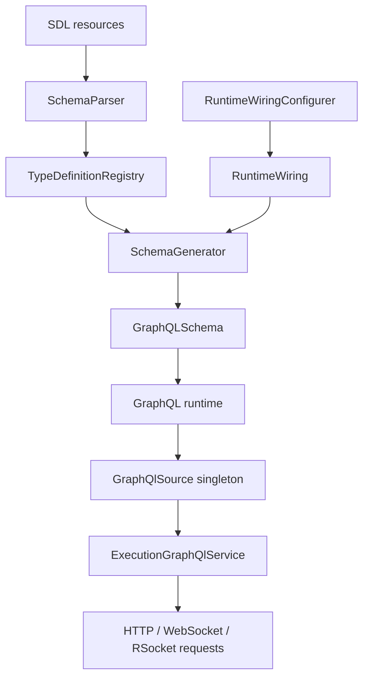

# Cache schema và metadata

## 1. Vì sao cần cache schema và metadata?

Trước khi thực thi GraphQL operation, server phải có một executable schema để biết type, field, argument, scalar, directive và DataFetcher nào được sử dụng. Schema cũng chứa metadata phục vụ introspection, validation và ánh xạ dữ liệu.

Nếu ứng dụng đọc SDL, parse schema, tạo `RuntimeWiring` và dựng `GraphQLSchema` lại cho từng request, chi phí khởi tạo sẽ bị lặp lại và có thể làm tăng latency rất lớn. Spring for GraphQL thiết kế `GraphQlSource` để giữ và cung cấp GraphQL runtime dùng chung. Với cấu hình Spring Boot thông thường, schema được tải và dựng trong quá trình khởi động ứng dụng, sau đó được tái sử dụng cho các request.

Ngoài schema, GraphQL Java còn phải parse và validate document của operation. Nếu client gửi cùng một document nhiều lần, `PreparsedDocumentProvider` có thể cache kết quả parse/validation để tránh làm lại công việc này.

Hai lớp cache này giải quyết hai chi phí khác nhau:

- **Schema và metadata cache:** giữ executable schema cùng metadata type/field dùng chung của API.
- **Operation cache:** giữ document đã parse và validate để giảm chi phí chuẩn bị từng operation.

Không nên nhầm hai lớp trên với response cache. Response cache lưu kết quả dữ liệu trả về, có yêu cầu về user, authorization, variables và tính mới của dữ liệu riêng.

## 2. Phân biệt các đối tượng được cache

| Đối tượng | Nội dung | Thời điểm tạo | Có thể tái sử dụng? |
| --- | --- | --- | --- |
| SDL resources | Nội dung file `.graphqls` hoặc `.gqls` | Khi khởi tạo GraphQL source | Có, thường được nạp một lần khi startup |
| `GraphQLSchema` | Type, field, argument, directive, scalar và code registry | Khi schema được build | Có; schema là immutable |
| `GraphQL` | Runtime thực thi operation trên schema | Khi tạo `GraphQlSource` | Có; dùng chung giữa các request |
| Schema metadata | Thông tin type/field/argument dùng cho introspection và validation | Nằm trong `GraphQLSchema` | Có; không cần tạo bản sao cho từng request |
| Preparsed document | AST và kết quả parse/validation của operation | Lần đầu gặp document | Có, thông qua `PreparsedDocumentProvider` |
| GraphQL response | Data và errors của một lần thực thi | Mỗi request | Chỉ cache riêng nếu chính sách dữ liệu cho phép |

Điểm quan trọng là `GraphQLSchema` và metadata của nó đã nằm trong object schema. Không cần tự tạo thêm một cache toàn cục cho từng `GraphQLObjectType` hoặc `GraphQLFieldDefinition` nếu chỉ đọc metadata từ schema đang dùng.

## 3. Vòng đời schema trong Spring Boot

Ứng dụng Spring for GraphQL cần có schema khi khởi động. Với Spring Boot, mặc định các file `.graphqls` và `.gqls` dưới `src/main/resources/graphql/**` được phát hiện và ghép thành một schema logic.

Quá trình tổng quát:



`GraphQlSource` là abstraction cung cấp `graphql.GraphQL` instance và schema tương ứng. `DefaultExecutionGraphQlService` sử dụng `GraphQlSource` để thực thi operation. Các transport như HTTP hoặc WebSocket gọi vào execution service này.

Do đó, mỗi request không cần đọc lại SDL hay tạo lại executable schema. Việc xây dựng schema tập trung ở giai đoạn application context được tạo.

## 4. `GraphQlSource` giữ schema và GraphQL runtime

`GraphQlSource` có hai phương thức quan trọng:

- `graphQl()` trả về `graphql.GraphQL` instance được dùng để thực thi.
- `schema()` trả về `graphql.schema.GraphQLSchema` đang được sử dụng.

Ví dụ truy cập schema trong một service hoặc component phục vụ kiểm tra metadata:

```java
import graphql.schema.GraphQLFieldDefinition;
import graphql.schema.GraphQLObjectType;
import graphql.schema.GraphQLSchema;
import org.springframework.graphql.execution.GraphQlSource;
import org.springframework.stereotype.Component;

@Component
public class SchemaMetadataReader {

    private final GraphQLSchema schema;

    public SchemaMetadataReader(GraphQlSource graphQlSource) {
        this.schema = graphQlSource.schema();
    }

    public boolean hasBookTitleField() {
        GraphQLObjectType bookType = schema.getObjectType("Book");
        if (bookType == null) {
            return false;
        }

        GraphQLFieldDefinition titleField = bookType.getFieldDefinition("title");
        return titleField != null;
    }
}
```

Ví dụ trên giữ một tham chiếu tới schema do `GraphQlSource` cung cấp. `GraphQLSchema` là immutable sau khi được tạo nên có thể chia sẻ an toàn giữa các request. Không gọi `GraphQlSource.schemaResourceBuilder()` và build schema bên trong controller hoặc resolver.

## 5. Schema là immutable và có thể dùng chung

GraphQL Java mô tả `GraphQLSchema` là một cấu trúc immutable, có quan hệ tham chiếu vòng giữa các type. Sau khi build, không sửa trực tiếp một type hoặc field bên trong schema đang chạy.

Nếu cần thay đổi schema, hãy tạo schema mới bằng builder hoặc `SchemaTransformer`, sau đó tạo GraphQL runtime mới dùng schema mới. Không sửa object schema dùng chung theo kiểu mutable cache vì nhiều request có thể đang đọc nó đồng thời.

Lợi ích của schema immutable:

- Nhiều request có thể đọc cùng metadata mà không cần khóa cho thao tác đọc thông thường.
- Không có trạng thái type/field bị thay đổi giữa chừng trong một request.
- Schema có thể được kiểm tra và warm-up khi startup.
- Có thể giữ một tham chiếu ổn định tới `GraphQLSchema` trong component cần metadata.

Nếu ứng dụng cần reload schema khi chạy, hãy tạo schema mới hoàn chỉnh, validate thành công rồi mới công bố schema mới. Phần reload được trình bày ở mục sau.

## 6. Nạp nhiều SDL resources một lần

Một schema lớn có thể được chia thành nhiều file theo domain:

```text
src/main/resources/graphql/
├── common.graphqls
├── book.graphqls
├── author.graphqls
└── review.graphqls
```

Spring Boot mặc định tìm các file `.graphqls` và `.gqls` dưới `classpath:graphql/**`. Nếu schema nằm trong nhiều module hoặc dependency JAR, có thể dùng pattern `classpath*:graphql/**/` để tìm resources trên toàn bộ classpath.

Cấu hình vị trí schema:

```yaml
spring:
  graphql:
    schema:
      locations: classpath*:graphql/**/
      file-extensions: .graphqls,.gqls
```

Các resource được parse và merge trước khi tạo executable schema. Không cần tự cache nội dung từng file SDL trong controller. Nếu muốn tải SDL từ storage hoặc remote source, có thể cung cấp `Resource` tương ứng cho `GraphQlSource.Builder`; việc tải và build vẫn nên diễn ra trong quy trình khởi tạo hoặc reload có kiểm soát.

## 7. Metadata type và field đã nằm trong `GraphQLSchema`

Schema chứa các metadata như:

- Tên type và loại type: object, interface, union, enum, scalar.
- Field và output type của field.
- Argument, kiểu argument và default value.
- Directive được khai báo hoặc áp dụng.
- Description của type, field và argument.
- Code registry liên kết field coordinates với DataFetcher.

Có thể truy cập metadata trực tiếp từ schema:

```java
import graphql.schema.GraphQLFieldDefinition;
import graphql.schema.GraphQLObjectType;
import graphql.schema.GraphQLSchema;
import graphql.schema.GraphQLTypeUtil;
import org.springframework.graphql.execution.GraphQlSource;

import org.springframework.stereotype.Component;

@Component
public class BookSchemaMetadata {

    private final GraphQLSchema schema;

    public BookSchemaMetadata(GraphQlSource graphQlSource) {
        this.schema = graphQlSource.schema();
    }

    public String booksReturnType() {
        GraphQLObjectType queryType = schema.getQueryType();
        GraphQLFieldDefinition booksField = queryType.getFieldDefinition("books");
        return GraphQLTypeUtil.simplePrint(booksField.getType());
    }
}
```

Nếu cần tạo một danh sách metadata để hiển thị cho trang quản trị hoặc công cụ nội bộ, hãy tạo một snapshot bất biến khi schema được khởi tạo và gắn nó với schema version. Tránh tính lại toàn bộ metadata trên mỗi request và tránh giữ một bản cache khác có thể lệch với schema đang thực thi.

## 8. Introspection là cách client đọc schema metadata

GraphQL có các meta-field `__schema`, `__type` và `__typename`. Introspection query cho phép client khám phá type, field, argument, enum và description của API.

Ví dụ:

```graphql
query BookSchemaMetadata {
    __type(name: "Book") {
        name
        kind
        description
        fields {
            name
            description
            type {
                kind
                name
                ofType {
                    kind
                    name
                }
            }
        }
    }
}
```

Metadata được đọc từ `GraphQLSchema` hiện tại. Introspection không cần đọc lại file SDL mỗi lần. Tuy nhiên, một introspection operation vẫn là một GraphQL request và vẫn đi qua parse, validation, execution và response serialization.

Nếu nhiều công cụ client thường xuyên tải cùng schema metadata, có thể tạo schema snapshot trong pipeline build/release hoặc cache kết quả introspection ở client. Khi cache, cần gắn snapshot với schema version hoặc release ID để client không dùng metadata cũ sau khi API thay đổi.

## 9. Cấu hình introspection và schema printer

Spring Boot cung cấp các property riêng:

```yaml
spring:
  graphql:
    schema:
      introspection:
        enabled: true
      printer:
        enabled: false
```

- `spring.graphql.schema.introspection.enabled` điều khiển khả năng field introspection như `__schema` và `__type`; mặc định bật để hỗ trợ GraphiQL và công cụ phát triển.
- `spring.graphql.schema.printer.enabled` điều khiển endpoint in schema dưới dạng text, mặc định tắt.

Tắt introspection không phải là một kỹ thuật cache. Đây là lựa chọn về mức độ khám phá schema và bảo mật API. Nếu tắt introspection ở production, cần bảo đảm workflow phát triển vẫn có schema snapshot hoặc schema registry để client/code generator sử dụng.

Schema printer là endpoint riêng, không đồng nghĩa với GraphiQL UI. Hãy bảo vệ endpoint này nếu bật trong môi trường có thông tin schema nội bộ.

## 10. Không tạo schema mới cho từng request

Một anti-pattern là build schema trong controller hoặc resolver:

```java
import graphql.schema.GraphQLSchema;
import graphql.schema.idl.RuntimeWiring;
import graphql.schema.idl.SchemaGenerator;
import graphql.schema.idl.SchemaParser;
import graphql.schema.idl.TypeDefinitionRegistry;

// Không nên: lặp lại parse SDL và tạo schema trong mỗi request.
public GraphQLSchema loadSchemaForRequest(String schemaText) {
    TypeDefinitionRegistry registry = new SchemaParser().parse(schemaText);
    RuntimeWiring wiring = buildRuntimeWiring();
    return new SchemaGenerator().makeExecutableSchema(registry, wiring);
}

private RuntimeWiring buildRuntimeWiring() {
    return RuntimeWiring.newRuntimeWiring().build();
}
```

Việc này lặp lại parse, merge, wiring và schema generation. Nó còn có thể tạo ra các GraphQL runtime khác nhau giữa các request nếu wiring thay đổi theo thời gian.

Nên để Spring Boot tạo `GraphQlSource` khi khởi động và inject `GraphQlSource` vào component cần dùng. Nếu không dùng Boot, tạo `GraphQlSource` một lần trong configuration và đăng ký như singleton bean.

## 11. Cache operation đã parse và validate bằng `PreparsedDocumentProvider`

Schema cache giảm chi phí khởi tạo schema. Một chi phí khác xảy ra với từng GraphQL document: GraphQL Java phải parse document thành AST và validate document với schema trước khi execute.

`PreparsedDocumentProvider` cho phép cache và tái sử dụng `PreparsedDocumentEntry`. Entry này chứa document đã parse cùng kết quả validation tương ứng. GraphQL Java gọi provider trước execution; nếu cache miss, provider phải gọi `parseAndValidateFunction` để engine thực hiện parse, validation và các instrumentation liên quan.

Cache này **không lưu kết quả resolver hoặc response data**. Với mỗi request, GraphQL vẫn thực thi DataFetcher và lấy dữ liệu mới theo variables/context hiện tại.

## 12. Tích hợp Caffeine operation cache với Spring Boot

Thêm Caffeine và Spring GraphQL dependencies nếu dự án chưa có:

```kotlin
dependencies {
    implementation("org.springframework.boot:spring-boot-starter-graphql")
    implementation("com.github.ben-manes.caffeine:caffeine")
}
```

Spring Boot quản lý version dependency theo BOM. Không cần tự chỉ định version Caffeine nếu dependency management của dự án đã quản lý nó.

Ví dụ cache document theo query text với giới hạn dung lượng:

```java
import graphql.ExecutionInput;
import graphql.execution.preparsed.PreparsedDocumentEntry;
import graphql.execution.preparsed.PreparsedDocumentProvider;
import java.time.Duration;
import java.util.concurrent.CompletableFuture;
import java.util.function.Function;

import com.github.benmanes.caffeine.cache.Cache;
import com.github.benmanes.caffeine.cache.Caffeine;
import org.springframework.context.annotation.Bean;
import org.springframework.context.annotation.Configuration;

@Configuration(proxyBeanMethods = false)
public class GraphQlOperationCacheConfig {

    @Bean
    PreparsedDocumentProvider preparsedDocumentProvider() {
        Cache<String, PreparsedDocumentEntry> cache = Caffeine.newBuilder()
            .maximumSize(10_000)
            .expireAfterAccess(Duration.ofMinutes(30))
            .recordStats()
            .build();

        return new PreparsedDocumentProvider() {

            @Override
            public CompletableFuture<PreparsedDocumentEntry> getDocumentAsync(
                    ExecutionInput executionInput,
                    Function<ExecutionInput, PreparsedDocumentEntry> parseAndValidateFunction) {

                String query = executionInput.getQuery();
                PreparsedDocumentEntry entry = cache.get(
                    query,
                    key -> parseAndValidateFunction.apply(executionInput)
                );

                return CompletableFuture.completedFuture(entry);
            }
        };
    }
}
```

Cache có giới hạn `maximumSize` để tránh query đa dạng làm bộ nhớ tăng không kiểm soát. `expireAfterAccess` giúp loại dần document ít được dùng. Hãy điều chỉnh hai giá trị dựa trên số operation thực tế, dung lượng AST và tỷ lệ cache hit/miss.

## 13. Gắn provider vào `GraphQlSource` bằng customizer

Với Spring Boot, đăng ký `PreparsedDocumentProvider` là chưa đủ; cần gắn provider vào GraphQL builder khi `GraphQlSource` được tạo.

```java
import org.springframework.context.annotation.Bean;
import org.springframework.context.annotation.Configuration;
import org.springframework.graphql.execution.GraphQlSource;
import graphql.execution.preparsed.PreparsedDocumentProvider;

// Spring Boot 4.x:
import org.springframework.boot.graphql.autoconfigure.GraphQlSourceBuilderCustomizer;

@Configuration(proxyBeanMethods = false)
public class GraphQlSourceCacheConfig {

    @Bean
    GraphQlSourceBuilderCustomizer operationCacheCustomizer(
            PreparsedDocumentProvider preparsedDocumentProvider) {

        return (GraphQlSource.SchemaResourceBuilder builder) ->
            builder.configureGraphQl(graphQlBuilder ->
                graphQlBuilder.preparsedDocumentProvider(preparsedDocumentProvider)
            );
    }
}
```

Trong Spring Boot 3.x, `GraphQlSourceBuilderCustomizer` có package `org.springframework.boot.autoconfigure.graphql`. Từ Spring Boot 4.x, package là `org.springframework.boot.graphql.autoconfigure`. API customizer nhận `GraphQlSource.SchemaResourceBuilder` và cho phép cấu hình `GraphQL.Builder` trước khi source được tạo.

Nếu không dùng Spring Boot, có thể cấu hình tương tự trực tiếp qua `GraphQlSource.Builder.configureGraphQl(...)` khi tạo `GraphQlSource`.

## 14. Chọn cache key và xử lý schema version

Ví dụ Caffeine ở trên dùng query text làm key. Đây là lựa chọn phù hợp khi schema không thay đổi trong vòng đời của application instance và validation không phụ thuộc vào user/request context.

Nếu schema có thể reload trong runtime, cache parsed/validated document cần được làm mới hoặc phân vùng theo schema version. Một document hợp lệ với schema cũ có thể không hợp lệ với schema mới; ngược lại, một document đã bị từ chối có thể trở thành hợp lệ sau khi schema thay đổi.

Có thể dùng key kết hợp:

```text
schemaVersion + ":" + normalizedQuery
```

Hoặc thay toàn bộ cache provider khi schema mới được publish. Không chỉ xóa một vài entry dựa trên suy đoán vì validation có thể phụ thuộc vào toàn bộ schema.

Nếu validation rule tùy chỉnh phụ thuộc vào tenant, role, feature flag hoặc context của request, không cache kết quả validation theo query text đơn thuần. Hãy giữ validation request-specific ngoài cache hoặc phân vùng cache theo mọi yếu tố ảnh hưởng đến kết quả. Tránh đưa dữ liệu cá nhân vào cache key hoặc log cache key.

## 15. Persisted query và operation cache

`PreparsedDocumentProvider` cũng là điểm mở rộng cho persisted query và query allowlisting. GraphQL Java có các lớp như `PersistedQuerySupport` và `ApolloPersistedQuerySupport`, sử dụng `PersistedQueryCache` làm nơi lưu document theo ID/hash.

Persisted query thường có hai lợi ích:

- Client gửi ID/hash thay cho toàn bộ document sau khi query đã được đăng ký.
- Server chỉ chấp nhận những operation nằm trong danh sách được quản lý, nếu chính sách triển khai yêu cầu.

Persisted query khác với cache tự động theo query text. Cache theo query text vẫn cho phép client gửi document tùy ý; nó chỉ giảm parse/validation lặp lại. Persisted query có thể kết hợp cache để tái sử dụng document đã parse.

Nếu dùng Apollo Automatic Persisted Queries, hãy chọn implementation `ApolloPersistedQuerySupport` và cấu hình `PersistedQueryCache` phù hợp. In-memory cache phù hợp với ứng dụng đơn instance hoặc môi trường đơn giản; nhiều instance cần dữ liệu persisted query nhất quán, ví dụ registry dùng chung hoặc artifact được phân phối theo release.

## 16. Cache introspection metadata ở đâu?

Introspection metadata được tạo từ `GraphQLSchema`. Có ba cách phổ biến để tái sử dụng metadata:

1. **Trong server:** giữ `GraphQlSource`/`GraphQLSchema` singleton; metadata type/field đã nằm trong schema.
2. **Trong client/tooling:** lưu introspection result hoặc schema SDL snapshot theo schema version trong quá trình build/release.
3. **Ở HTTP/CDN layer:** chỉ cache response introspection nếu endpoint, method, auth, headers và schema version tạo ra response có thể chia sẻ an toàn.

Không nên cache introspection response theo URL chung nếu schema hoặc quyền truy cập thay đổi theo tenant/user. Cũng không nên cache một response introspection đã được phân quyền rồi dùng lại cho người dùng khác.

GraphQL introspection operation vẫn được execute. `PreparsedDocumentProvider` chỉ cache AST/validation, không cache JSON response của `__schema` hoặc `__type`. Nếu muốn cache response metadata, hãy triển khai ở tầng client hoặc HTTP cache có key và invalidation phù hợp.

## 17. Reload schema an toàn khi ứng dụng cần schema động

Mặc định, schema từ classpath không tự thay đổi khi file SDL thay đổi sau khi ứng dụng đã startup. Để cập nhật schema, cách đơn giản và dễ kiểm soát nhất là deploy phiên bản ứng dụng mới.

Nếu nghiệp vụ yêu cầu reload schema khi chạy, quy trình nên có các bước:

1. Lấy SDL mới và xác định schema version.
2. Parse toàn bộ SDL resources và merge thành registry mới.
3. Tạo RuntimeWiring tương ứng với schema mới.
4. Build `GraphQLSchema` và `GraphQL` runtime mới ở ngoài đường xử lý request.
5. Chạy schema validation, mapping inspection và kiểm tra các custom scalar/directive.
6. Chỉ khi mọi bước thành công mới publish GraphQL runtime mới một cách atomic.
7. Invalidate hoặc phân vùng `PreparsedDocumentProvider` theo schema version mới.
8. Theo dõi request lỗi sau khi chuyển version và giữ khả năng rollback.

`GraphQlSource.graphQl()` được thiết kế để có thể trả về GraphQL instance hiện hành, bao gồm trường hợp schema được reload. `GraphQlSource.schema()` cần trả về schema tương ứng với GraphQL runtime đang được dùng. Nếu tự triển khai source động, phải bảo đảm hai phương thức luôn nhất quán và việc đổi runtime là atomic.

Không sửa `GraphQLSchema` cũ tại chỗ. Schema là immutable; hãy tạo object mới và thay thế tham chiếu dùng chung. Cũng cần tính đến request đang chạy: request đã lấy runtime cũ có thể hoàn tất với schema cũ, trong khi request mới dùng schema mới.

## 18. Schema inspection và metadata mapping

`GraphQlSource.Builder.inspectSchemaMappings(...)` có thể tạo báo cáo đối chiếu schema với controller/DataFetcher mapping. Báo cáo có thể chỉ ra:

- Field chưa có mapping hoặc chưa được giải quyết bởi property fetcher.
- DataFetcher đăng ký cho field không tồn tại.
- Argument trong method không tồn tại trong schema.
- Sai khác nullability giữa SDL và Java mapping.
- Type không đủ metadata để kiểm tra tự động.

Ví dụ cấu hình inspection:

```java
import org.slf4j.Logger;
import org.slf4j.LoggerFactory;
import org.springframework.boot.graphql.autoconfigure.GraphQlSourceBuilderCustomizer;
import org.springframework.context.annotation.Bean;
import org.springframework.context.annotation.Configuration;

@Configuration(proxyBeanMethods = false)
public class GraphQlSchemaInspectionConfig {

    private static final Logger logger = LoggerFactory.getLogger(GraphQlSchemaInspectionConfig.class);

    @Bean
    GraphQlSourceBuilderCustomizer schemaInspectionCustomizer() {
        return builder -> builder.inspectSchemaMappings(report ->
            logger.info("GraphQL schema mapping report:\n{}", report)
        );
    }
}
```

Inspection hữu ích khi khởi động hoặc khi build schema mới. Đây là bước kiểm tra metadata mapping, không phải cache runtime và không nên chạy lại cho từng GraphQL request.

## 19. Theo dõi hiệu quả cache

Một cache chỉ hữu ích nếu giảm chi phí thực tế và không làm bộ nhớ tăng quá mức. Nên theo dõi:

| Chỉ số | Ý nghĩa |
| --- | --- |
| Cache hit rate | Tỷ lệ operation document đã có trong cache |
| Cache miss rate | Tỷ lệ document cần parse/validate mới |
| Eviction count | Số entry bị loại vì giới hạn dung lượng hoặc thời gian |
| Cache size | Số entry hiện có |
| Parse/validation duration | Thời gian chuẩn bị document khi cache miss |
| Schema build duration | Thời gian tạo executable schema khi startup/reload |
| Heap usage | Bộ nhớ được dùng bởi schema, AST và cache entries |

Với Caffeine, có thể bật thống kê và đăng ký cache với Micrometer để quan sát hit/miss/eviction. Không đưa query text hoặc variables vào metric tag. Cache key có thể chứa query nhạy cảm nên cần tránh log key hoặc dump cache ra hệ thống telemetry.

Nếu hit rate thấp vì client liên tục tạo query text khác nhau, hãy xem xét persisted queries hoặc chuẩn hóa operation ở client. Không tăng `maximumSize` vô hạn để che giấu một tập query không ổn định.

## 20. Các lỗi thường gặp

| Hiện tượng | Nguyên nhân có thể | Cách xử lý |
| --- | --- | --- |
| Schema bị build lại thường xuyên | Tự tạo `GraphQlSource` hoặc `SchemaGenerator` trong request path | Đăng ký source singleton và dùng chung |
| Thay SDL nhưng API đang chạy không đổi | Schema classpath chỉ được đọc khi source được khởi tạo | Restart/redeploy hoặc triển khai quy trình reload schema có kiểm soát |
| Cache operation trả lỗi validation cũ | Schema đã thay đổi nhưng cache parsed/validated chưa được invalidate | Clear cache hoặc phân vùng theo schema version |
| Cache size tăng không giới hạn | Client gửi nhiều query text khác nhau | Dùng maximum size, expiry, persisted query hoặc allowlist |
| Cache hit nhưng resolver vẫn chạy | Provider chỉ cache parse/validation | Đây là hành vi đúng; response/data không được cache bởi provider |
| Cache key chứa dữ liệu nhạy cảm | Literal được nhúng trong query text | Dùng variables, tránh log key và bảo vệ memory dump |
| Validation phụ thuộc user nhưng cache chỉ theo query | Kết quả validation bị dùng lại sai context | Không cache request-specific validation hoặc phân vùng đúng context |
| Một instance có schema mới, instance khác vẫn schema cũ | Schema reload không đồng bộ giữa các node | Phân phối cùng schema version và rollout đồng bộ |
| Introspection trả metadata cũ ở client | Client snapshot/cache không có version hoặc invalidation | Gắn schema version/release ID và refresh theo release |
| Tắt introspection làm GraphiQL/codegen lỗi | Tool cần `__schema`/`__type` để khám phá API | Dùng schema artifact trong pipeline hoặc chỉ cho phép introspection ở môi trường phù hợp |
| `GraphQlSourceBuilderCustomizer` không được nhận diện | Import package không khớp Spring Boot major version | Boot 3 dùng `org.springframework.boot.autoconfigure.graphql`; Boot 4 dùng `org.springframework.boot.graphql.autoconfigure` |

## 21. Checklist cache schema và metadata

- [ ] Để Spring Boot tạo `GraphQlSource` một lần trong application context.
- [ ] Không parse SDL hoặc build `GraphQLSchema` trong controller/resolver.
- [ ] Dùng chung `GraphQLSchema` immutable cho các request.
- [ ] Đọc type/field metadata từ `GraphQlSource.schema()` khi cần.
- [ ] Nạp nhiều SDL resources qua schema locations phù hợp.
- [ ] Dùng schema version cho metadata snapshot và client introspection cache.
- [ ] Hiểu `__schema`, `__type` và cấu hình introspection riêng với schema printer.
- [ ] Chỉ dùng `PreparsedDocumentProvider` khi parse/validation là chi phí đáng kể.
- [ ] Giới hạn operation cache bằng maximum size/expiry.
- [ ] Gắn provider vào `GraphQlSource` bằng `GraphQlSourceBuilderCustomizer`.
- [ ] Invalidate operation cache khi schema hoặc validation policy thay đổi.
- [ ] Không cache kết quả authorization/validation phụ thuộc user theo query text đơn thuần.
- [ ] Không nhầm parsed-document cache với response cache.
- [ ] Nếu dùng persisted query, quản lý registry nhất quán giữa các instance.
- [ ] Theo dõi hit/miss/eviction, heap usage và schema build duration.
- [ ] Nếu reload schema, build mới, validate và publish atomic; giữ rollback.

## Kết luận

Spring for GraphQL và GraphQL Java đã có nền tảng để tái sử dụng schema và metadata. `GraphQlSource` cung cấp `GraphQL` runtime cùng `GraphQLSchema`; schema được build từ SDL và runtime wiring khi ứng dụng khởi động, sau đó được dùng chung. Vì `GraphQLSchema` immutable, metadata type/field có thể được đọc trực tiếp từ schema mà không cần tạo một cache mutable riêng cho từng request.

Đối với operation, `PreparsedDocumentProvider` cache document đã parse và validate để tránh lặp lại công việc chuẩn bị query. Cần giới hạn dung lượng, chọn cache key phù hợp và invalidate khi schema version hoặc validation policy thay đổi. Introspection metadata, parsed document và response data là ba loại dữ liệu khác nhau; mỗi loại có vòng đời, chính sách bảo mật và cách cache riêng. Nếu schema cần reload, hãy build schema mới hoàn chỉnh, validate và publish atomic thay vì chỉnh sửa schema đang được request sử dụng.

## Tài liệu tham khảo

- [Spring for GraphQL — Request Execution and GraphQlSource](https://docs.spring.io/spring-graphql/reference/request-execution.html)
- [Spring for GraphQL — `GraphQlSource` API](https://docs.spring.io/spring-graphql/docs/current/api/org/springframework/graphql/execution/GraphQlSource.html)
- [Spring Boot — Spring for GraphQL](https://docs.spring.io/spring-boot/reference/web/spring-graphql.html)
- [Spring Boot — Common Application Properties](https://docs.spring.io/spring-boot/appendix/application-properties/)
- [GraphQL Java — Schema](https://graphql-java.com/documentation/schema/)
- [GraphQL Java — Execution and Query Caching](https://graphql-java.com/documentation/execution/)
- [GraphQL Java — `PreparsedDocumentProvider` API](https://javadoc.io/doc/com.graphql-java/graphql-java/latest/graphql/execution/preparsed/PreparsedDocumentProvider.html)
- [Caffeine Cache](https://github.com/ben-manes/caffeine/wiki)
