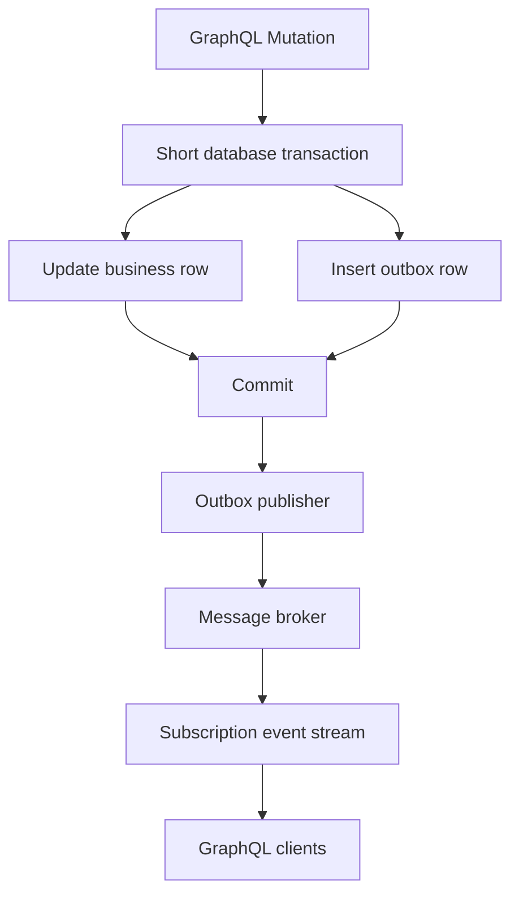

# Subscription không giữ transaction dài

GraphQL Subscription duy trì một luồng response trong thời gian client còn đăng ký nhận sự kiện. Một subscription có thể sống vài giây, vài phút hoặc nhiều giờ; trong thời gian đó không có event nào đến, hoặc event đến với tần suất rất khác nhau. Đây là vòng đời của một stream, không phải một đơn vị công việc database duy nhất.

Nếu mở database transaction khi bắt đầu subscription rồi giữ transaction cho đến khi stream kết thúc, connection và tài nguyên transaction có thể bị giữ trong suốt thời gian client chờ event. Một client mất kết nối hoặc không hủy subscription đúng cách còn có thể khiến transaction tồn tại lâu hơn dự kiến. Cách thiết kế phù hợp là giữ stream độc lập với transaction và chỉ mở transaction ngắn quanh một thao tác nghiệp vụ cụ thể, chẳng hạn ghi dữ liệu trong mutation hoặc đọc snapshot cho từng event.

Spring for GraphQL cho phép handler Subscription trả về `Flux` hoặc một Reactive Streams `Publisher`. GraphQL Java giữ publisher đó để phát response theo từng event. Spring khuyến nghị quản lý transaction ở ranh giới controller/service method có công việc rõ ràng; transaction bao toàn bộ GraphQL execution là một chiến lược nâng cao và có thể giữ tài nguyên lâu hơn cần thiết.

Bài học này trình bày cách tổ chức transaction cho mutation phát event, cách chỉ đọc dữ liệu trong transaction ngắn cho từng event, sự khác nhau giữa transaction imperative và reactive, cách xử lý `AFTER_COMMIT`, outbox, cancellation và kiểm thử để chứng minh stream không giữ transaction trong lúc chờ.

## 1. Vòng đời của Subscription khác transaction

Ví dụ API thư viện cho phép client theo dõi thay đổi của một cuốn sách:

```graphql
type Subscription {
  bookUpdated(bookId: ID!): BookUpdate!
}

type BookUpdate {
  eventId: ID!
  bookId: ID!
  title: String!
  status: String!
  occurredAt: String!
}
```

Client đăng ký một lần:

```graphql
subscription WatchBook($bookId: ID!) {
  bookUpdated(bookId: $bookId) {
    eventId
    bookId
    title
    status
    occurredAt
  }
}
```

Server có thể phát nhiều event trên cùng subscription:

```text
Client subscribe
       |
       v
  Flux<BookUpdate> ------------------------------->
       |                |                 |
       v                v                 v
   event #1         event #2          event #3
       |                |                 |
       +----------------+-----------------+
                        |
             Client cancel / disconnect
```

Transaction database có vòng đời khác:

```text
begin -> read/write -> commit or rollback
```

Transaction được thiết kế để bao quanh một đơn vị công việc có điểm bắt đầu và kết thúc xác định. Subscription là một luồng có thể chưa biết trước khi nào kết thúc. Không nên dùng một transaction làm lớp bao ngoài cho toàn bộ thời gian sống của stream.

| Thành phần | Vòng đời |
| --- | --- |
| GraphQL Subscription | Từ lúc client đăng ký đến khi hoàn tất, lỗi hoặc bị hủy |
| Database transaction | Một thao tác đọc/ghi cần tính nhất quán và atomicity |
| Event | Một thay đổi nghiệp vụ đã xảy ra |
| Event processing | Một lần xử lý event, thường có thể hoàn thành trong một transaction ngắn |

## 2. Vì sao không giữ transaction trong suốt Subscription?

Một transaction mở lâu có thể gây ra nhiều vấn đề:

- Giữ connection trong connection pool dù không có truy vấn đang chạy.
- Giữ lock lâu hơn, làm các transaction ghi khác phải chờ.
- Giữ snapshot/MVCC version lâu, làm database khó thu hồi phiên bản dữ liệu cũ.
- Tăng nguy cơ timeout, deadlock hoặc cạn connection pool.
- Gắn trạng thái transaction với một client connection có thể mất mạng bất kỳ lúc nào.
- Làm việc rollback khi client cancel trở nên khó dự đoán.

Ví dụ, nếu 200 client cùng mở subscription và mỗi subscription giữ một connection, pool 50 connection có thể bị cạn ngay cả khi phần lớn client chỉ đang chờ event.

Transaction dài không làm event stream đáng tin cậy hơn. Nó chỉ kéo dài thời gian giữ tài nguyên database. Độ tin cậy của event cần được giải quyết bằng event ID, durable broker, outbox, retry và cơ chế resume phù hợp.

## 3. Tránh đặt @Transactional trên Subscription handler trả Flux

Spring for GraphQL hỗ trợ `@SubscriptionMapping` trả về `Flux<T>`:

```java
@Controller
public class BookSubscriptionController {

    private final BookEventStream eventStream;

    public BookSubscriptionController(BookEventStream eventStream) {
        this.eventStream = eventStream;
    }

    @SubscriptionMapping
    public Flux<BookUpdate> bookUpdated(@Argument String bookId) {
        return eventStream.forBook(bookId);
    }
}
```

Handler này chỉ tạo luồng event. Không gắn `@Transactional` vào method subscription chỉ để giữ transaction trong khi chờ event.

Tránh đặt `@Transactional` ở cấp class của controller có cả query, mutation và subscription. Annotation ở class có thể áp dụng cho tất cả handler method; hãy đặt transaction ở service hoặc method mutation/read cụ thể để phạm vi được nhìn thấy rõ.

Anti-pattern:

```java
@SubscriptionMapping
@Transactional
public Flux<BookUpdate> bookUpdated(@Argument String bookId) {
    return eventStream.forBook(bookId);
}
```

Khi dùng reactive transaction manager, Spring nhận diện method trả về reactive type và quản lý transaction theo vòng đời của publisher được trả về. Với một `Flux` subscription dài hạn, transaction có thể tồn tại đến khi publisher hoàn tất hoặc bị hủy. Đây là phạm vi quá rộng cho một stream chờ event.

Với `PlatformTransactionManager` imperative, transaction lại gắn với thread và thời điểm method được gọi; nó không tự động bao phủ công việc bất đồng bộ diễn ra sau khi method đã trả về `Flux`. Vì vậy, không dựa vào việc gắn `@Transactional` lên subscription handler để tạo một transaction nhất quán cho các event.

Hãy đặt transaction ở service method thực hiện thao tác database cụ thể. Subscription handler chỉ nối event stream với những thao tác ngắn đó.

## 4. Mutation ghi dữ liệu trong transaction ngắn

Mutation thường là nơi phù hợp để tạo một transaction vì nó thay đổi trạng thái nghiệp vụ. Spring for GraphQL khuyến nghị transaction theo controller method hoặc service method có ranh giới rõ ràng.

Ví dụ schema:

```graphql
type Mutation {
  updateBook(input: UpdateBookInput!): Book!
}

input UpdateBookInput {
  id: ID!
  title: String
  status: String
}
```

Service cập nhật sách và phát một application event:

```java
public record BookChanged(
        String eventId,
        String bookId,
        String title,
        String status,
        Instant occurredAt) {
}

@Service
public class BookService {

    private final BookRepository repository;
    private final ApplicationEventPublisher eventPublisher;

    public BookService(
            BookRepository repository,
            ApplicationEventPublisher eventPublisher) {
        this.repository = repository;
        this.eventPublisher = eventPublisher;
    }

    @Transactional
    public Book update(UpdateBookInput input) {
        Book book = repository.findById(input.id())
                .orElseThrow(() -> new BookNotFoundException(input.id()));

        book.apply(input);
        Book saved = repository.save(book);

        eventPublisher.publishEvent(
                new BookChanged(
                        UUID.randomUUID().toString(),
                        saved.getId(),
                        saved.getTitle(),
                        saved.getStatus(),
                        Instant.now()));

        return saved;
    }
}
```

Controller chỉ điều phối request:

```java
@Controller
public class BookMutationController {

    private final BookService bookService;

    public BookMutationController(BookService bookService) {
        this.bookService = bookService;
    }

    @MutationMapping
    public Book updateBook(@Argument UpdateBookInput input) {
        return bookService.update(input);
    }
}
```

Transaction bắt đầu khi `BookService.update` được gọi qua Spring proxy và kết thúc khi method trả về thành công hoặc ném exception. Nếu thao tác thất bại, transaction có thể rollback theo rollback rules. Subscription stream không tham gia transaction này.

Nếu mutation trả về entity và client chọn thêm nested fields, các field resolver đó có thể chạy sau khi `BookService.update` đã commit. Chúng không tự động thuộc transaction của mutation; mỗi resolver/service cần transaction riêng nếu phải truy cập database. Nếu response cần một snapshot nhất quán, hãy dựng DTO có đủ dữ liệu cần thiết trong service transaction rồi trả DTO đó.

Nếu một GraphQL request chứa nhiều mutation field, không mặc định coi tất cả chúng là một transaction duy nhất. Khi nghiệp vụ yêu cầu atomicity giữa nhiều bước, nên thiết kế một mutation điều phối các bước bên trong cùng service transaction.

## 5. Chỉ phát event sau khi transaction commit

Nếu phát event ngay sau `save()` nhưng trước commit, client có thể nhận thông báo về thay đổi sau đó bị rollback. Điều này xảy ra vì JPA có thể trì hoãn flush đến commit, và ngay cả sau flush transaction vẫn có thể thất bại.

Dùng `@TransactionalEventListener` với phase `AFTER_COMMIT` để chỉ xử lý event sau khi transaction đã commit:

```java
@Component
public class BookChangedListener {

    private final BookEventPublisher publisher;

    public BookChangedListener(BookEventPublisher publisher) {
        this.publisher = publisher;
    }

    @TransactionalEventListener(phase = TransactionPhase.AFTER_COMMIT)
    public void afterBookChanged(BookChanged event) {
        publisher.publish(new BookUpdate(
                event.eventId(),
                event.bookId(),
                event.title(),
                event.status(),
                event.occurredAt()));
    }
}
```

`AFTER_COMMIT` là phase mặc định của `@TransactionalEventListener`. Nếu transaction rollback, listener không được gọi. Nếu không có transaction, listener cũng không chạy trừ khi bật `fallbackExecution = true`; không bật tùy tiện nếu event bắt buộc phải gắn với một lần commit.

Sau khi phase `AFTER_COMMIT` chạy, transaction đã hoàn tất dù một số transactional resource có thể vẫn còn được giữ đến bước cleanup. Nếu listener cần ghi thêm database, không dựa vào transaction vừa commit để lưu thay đổi mới; hãy gọi một service bean khác với propagation `REQUIRES_NEW` để tạo transaction mới. Trong ví dụ trên listener chỉ đẩy event vào publisher nên không cần transaction database thứ hai.

### Event publisher không cần transaction

Ví dụ publisher in-memory dùng Reactor sink:

```java
@Component
public class BookEventPublisher {

    private final Sinks.Many<BookUpdate> sink =
            Sinks.many().multicast().onBackpressureBuffer(256, false);

    public Flux<BookUpdate> forBook(String bookId) {
        return sink.asFlux()
                .filter(event -> event.bookId().equals(bookId));
    }

    public void publish(BookUpdate event) {
        Sinks.EmitResult result = sink.tryEmitNext(event);
        if (result.isFailure()) {
            // Record the failure and apply the application's delivery policy.
        }
    }
}
```

Publisher giữ stream event, không giữ database connection hoặc transaction. Mỗi subscriber nhận event qua Flux. Ví dụ này minh họa luồng trong một process; nó không phải durable message broker và không bảo đảm event được giữ lại cho subscriber đến sau.

Buffer được giới hạn ở 256 phần tử. Tham số `autoCancel = false` giữ sink sẵn sàng nhận subscriber mới sau khi subscriber cuối cùng hủy; nếu dùng giá trị mặc định `true`, multicast sink sẽ tự cancel khi không còn subscriber và không còn phù hợp để tái sử dụng như publisher dùng chung. Khi subscriber chậm làm buffer đầy, `tryEmitNext` có thể trả về `FAIL_OVERFLOW`; publisher cần ghi nhận và áp dụng chính sách như drop, kết thúc stream, retry ở tầng broker hoặc yêu cầu client đồng bộ lại. Con số 256 chỉ là giá trị minh họa, hãy chọn giới hạn dựa trên tốc độ event và bộ nhớ của ứng dụng.

### Lưu ý khi dùng reactive transaction

Từ Spring Framework 6.1, `@TransactionalEventListener` hỗ trợ cả transaction imperative gắn với thread và reactive transaction gắn với Reactor Context. Với reactive transaction, transaction context cần được đưa vào event source bằng `TransactionalEventPublisher`; chỉ gọi `ApplicationEventPublisher` như ví dụ imperative ở trên không tự mang Reactor Context theo.

Nếu ứng dụng dùng R2DBC và reactive transaction, hãy dùng API `TransactionalEventPublisher` theo phiên bản Spring Framework đang quản lý hoặc chọn một cơ chế phát event khác có thể bảo toàn ranh giới commit. Không sao chép nguyên ví dụ imperative rồi giả định nó có cùng semantics với reactive transaction.

## 6. Vì sao AFTER_COMMIT không thay thế Outbox?

`@TransactionalEventListener(AFTER_COMMIT)` ngăn việc phát event trước khi dữ liệu commit, nhưng bản thân listener vẫn là xử lý in-process. Nếu process dừng sau commit nhưng trước khi listener publish event, dữ liệu đã được lưu nhưng subscriber hoặc broker không nhận được thông báo.

Khi cần độ tin cậy cao, dùng Transactional Outbox:

1. Trong cùng transaction, cập nhật bảng nghiệp vụ và insert một bản ghi vào bảng outbox.
2. Commit cả hai thay đổi cùng nhau.
3. Một worker riêng đọc các outbox record chưa gửi.
4. Worker publish event tới broker.
5. Sau khi broker xác nhận, worker đánh dấu record đã gửi.
6. Consumer xử lý event theo hướng idempotent để chịu được trường hợp gửi lặp.

Sơ đồ:



Outbox giúp không có khoảng hở giữa commit dữ liệu và ghi nhận ý định phát event. Việc gửi tới broker thường có thể lặp, do đó event nên có ID ổn định và consumer nên xử lý idempotent.

Với ứng dụng nội bộ đơn giản, in-memory event publisher sau commit có thể đủ. Với thông báo quan trọng như thanh toán, trạng thái đơn hàng hoặc thay đổi quyền, hãy đánh giá outbox và broker thay vì dựa vào một sink trong bộ nhớ.

## 7. Mở transaction ngắn cho từng event

Có trường hợp event chỉ chứa ID, còn subscription cần đọc thêm dữ liệu hiện tại từ database trước khi trả response. Khi đó, mỗi event có thể gọi một service method transactional riêng.

Luồng xử lý:

```text
Event stream
    |
    +--> event A --> short read transaction --> snapshot A --> emit
    |
    +--> event B --> short read transaction --> snapshot B --> emit
    |
    +--> event C --> short read transaction --> snapshot C --> emit
    |
    +--> wait for next event (no transaction is open)
```

Transaction bắt đầu khi xử lý một event và kết thúc sau khi đã đọc xong snapshot. Khoảng thời gian chờ event tiếp theo nằm ngoài transaction.

### Với R2DBC và reactive transaction

Khi dùng Spring Data R2DBC, service có thể trả về `Mono` và dùng `@Transactional(readOnly = true)`:

```java
@Service
public class BookSnapshotService {

    private final BookRepository repository;

    public BookSnapshotService(BookRepository repository) {
        this.repository = repository;
    }

    @Transactional(readOnly = true)
    public Mono<BookSnapshot> load(String bookId) {
        return repository.findById(bookId)
                .map(BookSnapshot::from);
    }
}
```

Subscription handler gọi service cho từng event:

```java
@Controller
public class BookSnapshotSubscriptionController {

    private final BookEventStream eventStream;
    private final BookSnapshotService snapshotService;

    public BookSnapshotSubscriptionController(
            BookEventStream eventStream,
            BookSnapshotService snapshotService) {
        this.eventStream = eventStream;
        this.snapshotService = snapshotService;
    }

    @SubscriptionMapping
    public Flux<BookSnapshot> bookUpdated(@Argument String bookId) {
        return eventStream.forBook(bookId)
                .concatMap(event -> snapshotService.load(event.bookId()));
    }
}
```

Mỗi inner `Mono` được subscribe sẽ mở một reactive transaction cho lần đọc tương ứng. Khi Mono hoàn tất, transaction commit/cleanup; sau đó Flux có thể chờ event tiếp theo mà không giữ transaction. Việc mở transaction diễn ra khi publisher được subscribe, không phải ngay lúc method tạo ra Mono.

`concatMap` xử lý tuần tự và giữ thứ tự event. Nếu muốn xử lý đồng thời, có thể dùng `flatMap(event -> snapshotService.load(event.bookId()), concurrency)`; mỗi inner publisher vẫn có transaction riêng, nhưng thứ tự response có thể khác thứ tự event đầu vào. Chỉ chọn concurrency khi nghiệp vụ cho phép.

Đảm bảo service là một Spring bean riêng và được gọi qua proxy. Tự gọi method transactional từ method khác trong cùng object (self-invocation) sẽ bỏ qua proxy trong cấu hình AOP proxy thông thường.

### Với JPA/JDBC blocking

Nếu subscription chạy trên WebFlux nhưng database dùng JPA/JDBC blocking, không gọi repository blocking trực tiếp trên event-loop thread. Có thể cô lập mỗi lần đọc trên bounded elastic scheduler:

```java
@Service
public class BlockingBookSnapshotService {

    private final BookRepository repository;

    public BlockingBookSnapshotService(BookRepository repository) {
        this.repository = repository;
    }

    @Transactional(readOnly = true)
    public BookSnapshot load(String bookId) {
        Book book = repository.findById(bookId)
                .orElseThrow(() -> new BookNotFoundException(bookId));
        return BookSnapshot.from(book);
    }
}
```

```java
@SubscriptionMapping
public Flux<BookSnapshot> bookUpdated(@Argument String bookId) {
    return eventStream.forBook(bookId)
            .concatMap(event -> Mono.fromCallable(
                            () -> snapshotService.load(event.bookId()))
                    .subscribeOn(Schedulers.boundedElastic()));
}
```

`snapshotService` phải là bean được Spring proxy. Method `load` hoàn tất transaction trước khi callable trả snapshot. `boundedElastic` dành cho tác vụ blocking; không dùng `publishOn` hoặc `subscribeOn` như một cách thay thế cho transaction management.

Nếu ứng dụng dùng Spring MVC và xử lý blocking đồng bộ, service có thể được gọi trực tiếp từ một executor phù hợp. Điểm quan trọng vẫn là transaction nằm trong method đọc dữ liệu và kết thúc trước khi chờ event kế tiếp.

## 8. TransactionalOperator: bọc từng thao tác, không bọc cả stream

Với reactive code không dùng annotation, có thể dùng `TransactionalOperator`. Một operator được cấu hình từ `ReactiveTransactionManager` và có thể dùng lại:

```java
public class BookEventProcessor {

    private final BookRepository repository;
    private final TransactionalOperator transactionalOperator;

    public BookEventProcessor(
            BookRepository repository,
            ReactiveTransactionManager transactionManager) {
        this.repository = repository;
        this.transactionalOperator =
                TransactionalOperator.create(transactionManager);
    }

    public Flux<BookSnapshot> snapshots(Flux<BookChanged> events) {
        return events.concatMap(event ->
                repository.findById(event.bookId())
                        .map(BookSnapshot::from)
                        .as(transactionalOperator::transactional));
    }
}
```

Ở đây `transactionalOperator` chỉ bọc publisher đọc dữ liệu của từng event. Khi inner Mono kết thúc, transaction kết thúc. Flux bên ngoài tiếp tục chờ event mà không nằm trong transaction.

Không làm như sau:

```java
return events
        .concatMap(event -> repository.findById(event.bookId())
                .map(BookSnapshot::from))
        .as(transactionalOperator::transactional);
```

Đoạn code trên bọc toàn bộ Flux. Nếu Flux là stream không hoàn tất trong thời gian dài, transaction có thể kéo dài theo stream.

### Cancellation và rollback

Reactive Streams cho phép subscriber cancel publisher. Spring Framework xử lý cancel signal của transactional publisher như rollback; điều này có nghĩa một Flux transaction có thể bị rollback khi client ngắt kết nối. Transactional publisher nhiều phần tử cần được tiêu thụ đầy đủ để hoàn tất transaction.

Đây là một lý do khác để không gắn một transaction vào stream subscription sống lâu. Khi bọc từng inner Mono, cancellation chỉ ảnh hưởng transaction của event đang xử lý; transaction đó được cleanup, còn các event chưa đến không có transaction nào đang mở.

## 9. Trả event snapshot thay vì query lại nhiều field

Sau khi một subscription event được phát, GraphQL còn phải resolve các field mà client chọn. Nếu event chỉ chứa ID và mỗi nested `@SchemaMapping` lại gọi database, một event có thể tạo nhiều transaction hoặc nhiều query riêng.

Ví dụ một event có thể chứa:

```graphql
type BookUpdate {
  eventId: ID!
  book: Book!
}

type Book {
  id: ID!
  title: String!
  status: String!
  author: Author
}
```

Nếu `Book.author` lại truy vấn database sau khi event đã được phát, response có thể ghép title ở thời điểm event với author ở thời điểm mới hơn. Nếu nghiệp vụ cần một snapshot nhất quán, hãy tải các dữ liệu cần thiết trong một transaction ngắn rồi phát DTO đã hoàn chỉnh:

Một điểm cần phân biệt: transaction ngắn lúc xử lý event chỉ tạo snapshot nhất quán trong lần đọc đó. Nếu event chỉ chứa ID và database đã có thay đổi mới hơn trước khi subscription đọc, truy vấn theo ID có thể trả về trạng thái mới hơn event ban đầu. Nếu client cần đúng trạng thái tại thời điểm commit, hãy đưa snapshot hoặc aggregate version vào event/outbox và đọc theo version tương ứng.

```java
public record BookUpdateSnapshot(
        String eventId,
        String bookId,
        String title,
        String status,
        AuthorSnapshot author,
        Instant occurredAt) {
}
```

Service đọc toàn bộ snapshot trong cùng một transaction:

```java
@Transactional(readOnly = true)
public BookUpdateSnapshot loadSnapshot(BookChanged event) {
    Book book = repository.findById(event.bookId())
            .orElseThrow(() -> new BookNotFoundException(event.bookId()));

    Author author = authorRepository.findById(book.getAuthorId())
            .orElseThrow(() -> new AuthorNotFoundException(book.getAuthorId()));

    return new BookUpdateSnapshot(
            event.eventId(),
            book.getId(),
            book.getTitle(),
            book.getStatus(),
            AuthorSnapshot.from(author),
            event.occurredAt());
}
```

Transaction kết thúc sau khi DTO được dựng xong. Subscription phát snapshot đã được materialize; GraphQL không cần mở transaction để resolve từng field sau đó.

Nếu dữ liệu nested có thể thay đổi độc lập và response không yêu cầu snapshot nhất quán, có thể để field resolver tải riêng theo nhu cầu. Khi đó mỗi resolver nên có transaction ngắn riêng nếu cần, và ứng dụng phải chấp nhận rằng các field có thể phản ánh những thời điểm đọc khác nhau.

## 10. Transaction theo từng event từ message broker

Nếu Subscription lấy event từ Kafka, RabbitMQ hoặc một broker khác, stream consumer cũng không nên giữ một database transaction trong suốt thời gian chờ message.

Một cách tổ chức phổ biến:

1. Nhận một message từ broker.
2. Mở transaction để cập nhật dữ liệu hoặc đọc snapshot cần thiết.
3. Commit transaction.
4. Xác nhận/ack message theo semantics của broker.
5. Chuyển event đã xử lý tới subscription publisher.
6. Quay lại chờ message tiếp theo ngoài transaction.

Thứ tự commit và ack phụ thuộc broker và framework listener. Nếu ack trước commit, process có thể mất message khi transaction rollback. Nếu commit trước ack, message có thể được gửi lại khi process dừng trước khi ack; do đó consumer cần idempotent.

Không giữ database transaction mở trong khi chờ broker message. Broker consumer/session có vòng đời riêng; database transaction chỉ bao quanh phần xử lý message cần atomicity.

## 11. Cancellation, backpressure và giới hạn tài nguyên

Subscription có thể bị client hủy, WebSocket disconnect, HTTP SSE connection đóng hoặc publisher gặp lỗi. Khi stream bị cancel:

- Dừng nhận hoặc xử lý thêm event theo khả năng của source publisher.
- Hủy thao tác event đang chạy nếu operator hỗ trợ cancellation.
- Đảm bảo transaction đang xử lý được commit/rollback và cleanup.
- Giải phóng subscription registration, listener hoặc broker consumer resource nếu nó được tạo riêng cho client.
- Không giữ connection database để chờ reconnect.

### Backpressure và buffering

Nếu producer phát event nhanh hơn client tiêu thụ, queue có thể tăng. Chọn chính sách phù hợp:

| Chính sách | Hành vi | Phù hợp |
| --- | --- | --- |
| Bounded buffer | Giới hạn số event chờ, có xử lý khi đầy | Cần giới hạn memory |
| Drop latest | Bỏ event mới khi quá tải | Chỉ khi event có thể thay thế |
| Drop oldest | Bỏ event cũ để ưu tiên trạng thái mới | Dashboard chỉ cần trạng thái gần nhất |
| Error | Kết thúc stream khi vượt giới hạn | Muốn báo client reconnect/resync |
| Durable broker | Lưu event để consumer đọc lại | Cần replay và độ tin cậy cao |

Không mặc định dùng unbounded buffer cho subscription production. Một client chậm hoặc mất kết nối có thể làm bộ nhớ tăng liên tục. Transaction ngắn không thay thế việc giới hạn queue và xử lý backpressure.

## 12. Những điều cần lưu ý với @Transactional

Spring quản lý transaction bằng proxy trong trường hợp cấu hình proxy thông thường:

- Chỉ lời gọi đi qua proxy mới được transaction interceptor áp dụng.
- Self-invocation trong cùng object không đi qua proxy.
- Imperative transaction dùng `PlatformTransactionManager` và thường gắn với thread.
- Reactive transaction dùng `ReactiveTransactionManager` và gắn với Reactor Context.
- Các thao tác tham gia reactive transaction phải nằm trong cùng reactive pipeline/context.
- Không gọi blocking JDBC/JPA trực tiếp trên WebFlux event-loop thread.

Nếu method trả về `Publisher` hoặc `Flux`, Spring có thể chọn reactive transaction path khi có reactive transaction manager phù hợp. Vì vậy, cần kiểm tra loại transaction manager đang được inject; đừng giả định `@Transactional` trên một method trả Flux luôn có semantics giống method trả object đồng bộ.

`readOnly = true` có thể là một hint hữu ích cho transaction đọc, nhưng nó không làm transaction tự động ngắn hơn. Ranh giới publisher/method mới quyết định transaction sống bao lâu.

### Không dùng transactional instrumentation bao toàn request cho Subscription

Spring for GraphQL có mô tả transactional instrumentation để bao một transaction quanh toàn bộ GraphQL request execution. Đây là chiến lược nâng cao; với imperative transaction, nó còn yêu cầu DataFetcher được chạy tuần tự trên cùng thread để transaction ThreadLocal được tham gia đúng cách.

Subscription có publisher sống lâu và có thể chờ vô hạn. Không áp dụng transaction instrumentation bao toàn request cho Subscription. Nếu ứng dụng đã có custom instrumentation như vậy, hãy phân biệt operation type và chỉ áp dụng transaction boundary cho operation hữu hạn phù hợp; Subscription vẫn cần transaction theo từng mutation hoặc từng event.

## 13. Kiểm thử để chứng minh không giữ transaction dài

Kiểm thử cần chứng minh hai điều:

1. Mỗi mutation/event processing transaction được hoàn tất trước khi stream chờ event tiếp theo.
2. Khi client cancel hoặc source phát lỗi, transaction đang xử lý được cleanup và subscription resource được giải phóng.

### Kiểm thử thứ tự event

Có thể dùng `StepVerifier` với publisher test:

```java
StepVerifier.create(subscriptionService.bookUpdates("book-1"))
        .expectNextMatches(event -> event.bookId().equals("book-1"))
        .expectNextMatches(event -> event.bookId().equals("book-1"))
        .thenCancel()
        .verify(Duration.ofSeconds(5));
```

Test này kiểm tra stream phát event và cancellation trong thời gian giới hạn. Cần bổ sung assertion ở event processor hoặc transaction manager để xác nhận transaction được đóng sau từng event.

### Các tình huống cần kiểm tra

| Tình huống | Điều cần xác minh |
| --- | --- |
| Mutation thành công | Transaction commit; event chỉ được phát sau commit |
| Mutation rollback | Không phát event AFTER_COMMIT |
| Hai event đến liên tiếp | Mỗi event có transaction riêng, không dùng chung transaction chờ stream |
| Không có event trong thời gian dài | Không có transaction hoặc DB connection bị giữ chỉ để chờ |
| Client cancel khi đang chờ | Subscription resource được giải phóng |
| Client cancel khi đang xử lý event | Transaction hiện tại được cleanup |
| Event xử lý lỗi | Transaction rollback theo policy; lỗi được ghi nhận |
| Event gửi lại | Consumer xử lý idempotent |
| Publisher buffer đầy | Chính sách quá tải được thực thi và quan sát được |

Với reactive transaction, có thể dùng test transaction manager hoặc instrumented repository để đếm begin/commit/rollback. Không dùng `TransactionSynchronizationManager.isActualTransactionActive()` của imperative path để kết luận về reactive transaction; reactive context cần được kiểm tra bằng công cụ phù hợp.

## 14. Lỗi thường gặp

| Biểu hiện | Nguyên nhân | Cách xử lý |
| --- | --- | --- |
| Connection pool cạn khi nhiều subscription | Transaction hoặc connection bị giữ trong lúc chờ event | Bỏ transaction khỏi outer Flux; mở transaction theo từng thao tác |
| Client nhận event trước khi mutation commit | Publish trực tiếp trong transaction | Dùng AFTER_COMMIT hoặc outbox |
| Event mất sau khi dữ liệu commit | In-memory listener/publisher bị process dừng trước khi publish | Dùng transactional outbox và durable broker |
| Event được xử lý hai lần | Retry hoặc broker redelivery | Dùng event ID và idempotent consumer |
| Transaction reactive không kết thúc | TransactionalOperator bọc toàn bộ Flux dài hạn | Bọc từng inner Mono/Flux của một event |
| Cancel subscription gây rollback ngoài ý muốn | Cancel signal truyền vào transactional publisher nhiều phần tử | Không đặt transaction quanh stream; giới hạn transaction theo event |
| JPA block WebFlux event loop | Gọi repository blocking trong reactive pipeline | Dùng boundedElastic hoặc chuyển sang reactive data access |
| Snapshot event không nhất quán | Nested field resolver đọc ở các transaction/thời điểm khác nhau | Materialize DTO trong một transaction ngắn |
| Reactive AFTER_COMMIT listener không chạy | Event không mang Reactor transaction context | Dùng TransactionalEventPublisher theo Spring Framework version |
| Buffer tăng không giới hạn | Producer nhanh hơn subscriber và queue không có giới hạn | Chọn bounded buffer, drop/error policy hoặc durable broker |

## 15. Nguyên tắc thiết kế

- Không giữ database transaction trong suốt vòng đời GraphQL Subscription.
- Để `@SubscriptionMapping` tạo hoặc trả về stream event độc lập với transaction.
- Dùng transaction ngắn cho từng mutation hoặc từng lần xử lý event cần atomicity.
- Dùng `@TransactionalEventListener(AFTER_COMMIT)` khi cần phát application event sau khi transaction imperative commit.
- Với reactive transaction, truyền transaction context theo đúng API `TransactionalEventPublisher`.
- Dùng outbox khi event phải được phát tin cậy ngay cả khi process dừng sau commit.
- Dùng `concatMap` nếu cần xử lý tuần tự; dùng concurrency có giới hạn nếu có thể xử lý song song.
- Dùng `TransactionalOperator` cho inner publisher của từng event, không bọc outer subscription Flux.
- Materialize DTO snapshot trong transaction ngắn nếu nhiều field cần cùng một trạng thái dữ liệu.
- Không block WebFlux event loop bằng JPA/JDBC.
- Xử lý cancellation, backpressure, buffer limit và subscriber disconnect.
- Dùng event ID, retry và idempotency để xử lý redelivery.
- Kiểm thử begin/commit/rollback và xác nhận không có transaction trong thời gian chờ event.

## 16. Bài tập thực hành

Xây dựng tính năng theo dõi thay đổi sách:

1. Khai báo Subscription `bookUpdated(bookId: ID!)` trả về `BookUpdate`.
2. Viết `@SubscriptionMapping` trả về `Flux<BookUpdate>` từ event stream.
3. Viết mutation `updateBook` với service method `@Transactional`.
4. Publish `BookChanged` application event trong transaction.
5. Dùng `@TransactionalEventListener(phase = AFTER_COMMIT)` để phát event ra stream.
6. Thử làm mutation rollback và xác nhận subscription không nhận event.
7. Thay event payload đầy đủ bằng event chỉ có ID; tạo service reactive `@Transactional(readOnly = true)` để load snapshot cho từng event.
8. Dùng `concatMap` để xử lý từng event với một transaction riêng.
9. Thử thay bằng `flatMap` có giới hạn concurrency và quan sát thứ tự event.
10. Dùng `TransactionalOperator` bọc từng inner Mono; so sánh với việc bọc cả outer Flux.
11. Hủy subscription khi đang chờ và khi đang xử lý event; xác nhận transaction/resource được cleanup.
12. Thiết kế outbox cho trường hợp event không được phép mất.
13. Viết StepVerifier test cho event, error, cancellation và retry.

Sau bài tập, bạn cần giải thích được vì sao Subscription không phải transaction boundary, cách transaction được mở và đóng cho từng event, và cách bảo đảm event chỉ được phát sau khi dữ liệu commit.

## 17. Tài liệu tham khảo

- [Spring for GraphQL — Transaction Management](https://docs.spring.io/spring-graphql/reference/data.html#transaction-management)
- [Spring for GraphQL — Annotated Controllers and @SubscriptionMapping](https://docs.spring.io/spring-graphql/reference/controllers.html)
- [Spring for GraphQL — Reactive DataFetcher and Subscription Execution](https://docs.spring.io/spring-graphql/reference/request-execution.html)
- [Spring Framework — Transaction-bound Events](https://docs.spring.io/spring-framework/reference/data-access/transaction/event.html)
- [Spring Framework — TransactionalEventListener Javadoc](https://docs.spring.io/spring-framework/docs/current/javadoc-api/org/springframework/transaction/event/TransactionalEventListener.html)
- [Spring Framework — Programmatic Transaction Management and TransactionalOperator](https://docs.spring.io/spring-framework/reference/data-access/transaction/programmatic.html)
- [Spring Framework — Understanding Declarative Transaction Implementation](https://docs.spring.io/spring-framework/reference/data-access/transaction/declarative/tx-decl-explained.html)
- [Project Reactor — Sinks and Multicast Backpressure](https://projectreactor.io/docs/core/release/reference/coreFeatures/sinks.html)

Transaction semantics phụ thuộc transaction manager và loại publisher. Đặc biệt, reactive transaction dùng Reactor Context, còn imperative transaction thường gắn với thread. Hãy kiểm tra phiên bản Spring Framework/Spring for GraphQL và loại data access stack của ứng dụng trước khi áp dụng ví dụ.
