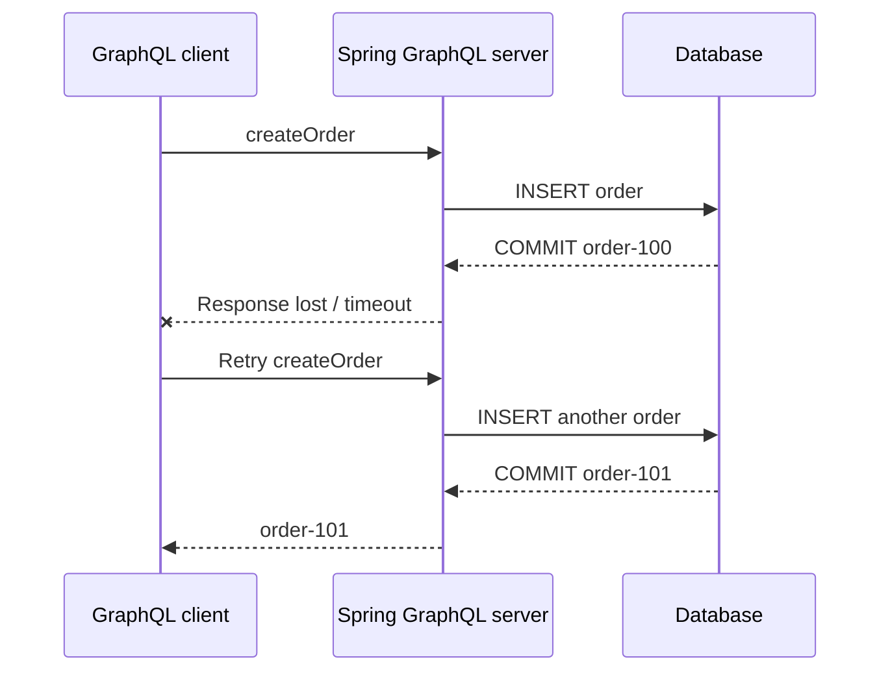
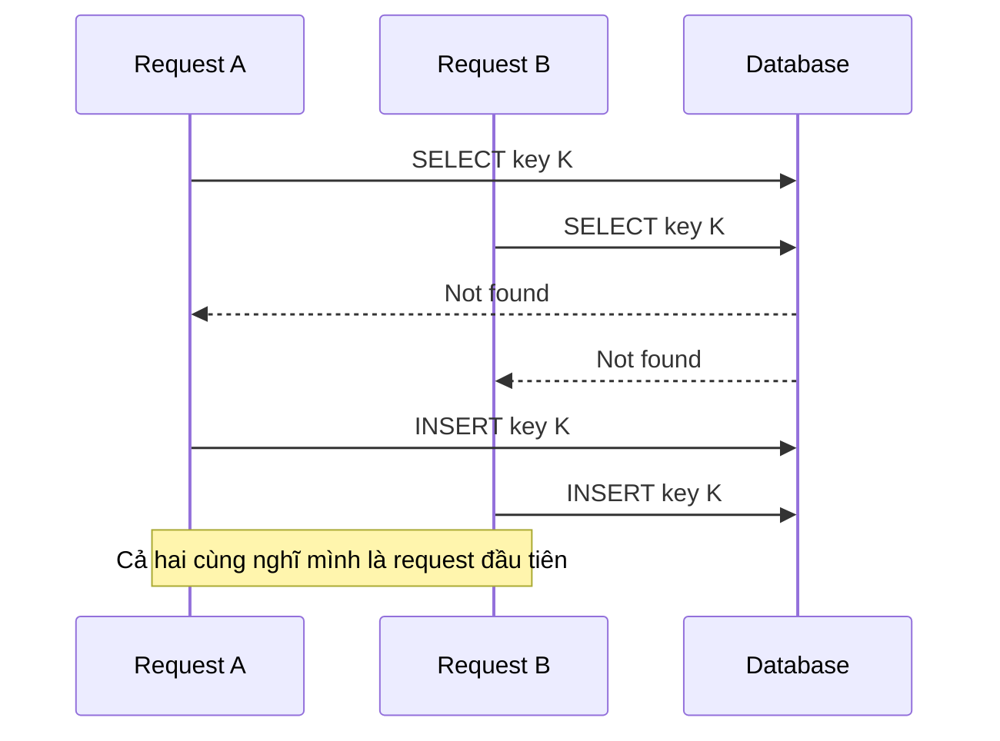
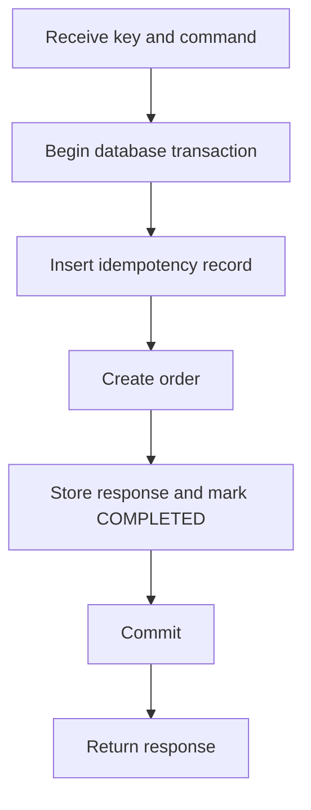
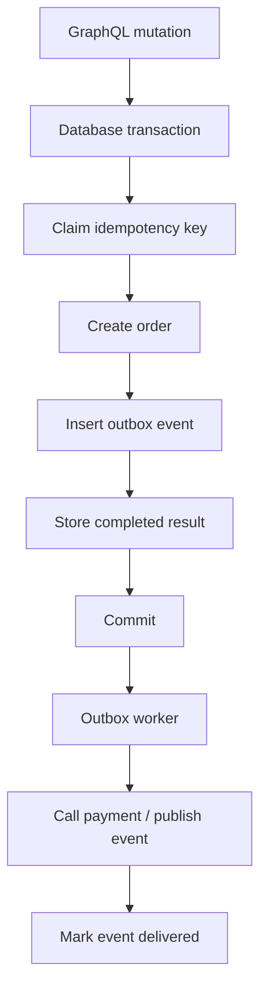

# Idempotent mutation trong Spring for GraphQL

Mutation trong GraphQL thường tạo hoặc thay đổi dữ liệu: tạo đơn hàng, đặt chỗ, thanh toán, cập nhật hồ sơ hoặc khởi chạy một quy trình nghiệp vụ. Client có thể gửi mutation nhưng không nhận được response vì timeout, mất mạng hoặc connection bị đóng. Khi đó client không biết server chưa xử lý, đang xử lý hay đã commit thành công. Nếu client gửi lại mutation, cùng một hành động có thể được thực hiện hai lần.

Idempotency giúp xử lý tình huống này. Client gửi một idempotency key ổn định cho cùng một ý định nghiệp vụ; server lưu kết quả của lần xử lý đầu tiên và dùng lại kết quả đó cho các lần retry tương ứng. Cơ chế này cần được bảo đảm ở tầng lưu trữ và transaction, không thể chỉ dựa vào một `Map` trong memory hoặc kiểm tra trước bằng một câu `SELECT`.

Sau bài này, bạn có thể:

- Hiểu vì sao GraphQL mutation cần idempotency khi retry.
- Thiết kế input có idempotency key.
- Phân biệt idempotency key với GraphQL operation ID và request ID.
- Tính request fingerprint để phát hiện key bị dùng sai payload.
- Dùng unique constraint để xử lý hai request đồng thời.
- Lưu mutation result trong transaction và replay response.
- Thiết kế trạng thái processing, completed và failed.
- Kết hợp idempotency với outbox, event và side effect bên ngoài.
- Xác định phạm vi key, retention, bảo mật và kiểm thử.

## 1. Vì sao mutation cần idempotency?

Giả sử client gọi mutation tạo đơn hàng:

```graphql
mutation CreateOrder {
    createOrder(input: {
        productId: "product-42"
        quantity: 2
    }) {
        id
        status
    }
}
```

Server có thể đã tạo đơn hàng và commit transaction, nhưng response bị mất trên đường truyền. Client chỉ nhìn thấy timeout. Nếu gửi lại cùng mutation, server có thể tạo thêm đơn hàng thứ hai.



Client đã gửi một ý định nghiệp vụ nhưng server thực hiện hai lần. Tình huống này đặc biệt nguy hiểm với thanh toán, gửi tiền, đặt chỗ có số lượng giới hạn hoặc gửi email.

Idempotency cho phép client retry cùng một ý định mà server không tạo thêm side effect. Server nhận diện lần retry thông qua key và trả lại kết quả đã ghi nhận.

## 2. Idempotent là gì?

Một thao tác idempotent có thể được thực hiện nhiều lần với cùng một input mà trạng thái nghiệp vụ cuối cùng giống như thực hiện một lần.

Ví dụ cập nhật trạng thái đơn hàng thành `CANCELLED` có thể idempotent nếu lần gọi sau không tạo thêm side effect. Ngược lại, thao tác `incrementBalance(100)` hoặc `createOrder(...)` không tự idempotent vì mỗi lần gọi có thể thay đổi trạng thái thêm một lần.

Idempotency không có nghĩa là mọi request lặp lại đều trả cùng HTTP status hoặc cùng metadata. Mục tiêu là bảo đảm một ý định nghiệp vụ chỉ được thực hiện một lần và các lần retry có thể nhận lại kết quả đã được ghi nhận.

Với GraphQL, operation thường được gửi qua HTTP POST, nhưng HTTP method không làm mutation trở thành idempotent. Tính idempotent là contract nghiệp vụ do ứng dụng triển khai.

## 3. Idempotency key là gì?

Idempotency key là mã duy nhất đại diện cho một ý định nghiệp vụ của client. Client tạo key trước lần gửi đầu tiên và tái sử dụng chính key đó khi retry cùng mutation.

Ví dụ input:

```graphql
input CreateOrderInput {
    idempotencyKey: ID!
    productId: ID!
    quantity: Int!
    currency: String!
}

type Mutation {
    createOrder(input: CreateOrderInput!): CreateOrderPayload!
}

type CreateOrderPayload {
    order: Order
    replayed: Boolean!
}
```

Client gửi key:

```graphql
mutation CreateOrder($input: CreateOrderInput!) {
    createOrder(input: $input) {
        order {
            id
            status
        }
        replayed
    }
}
```

Variables:

```json
{
  "input": {
    "idempotencyKey": "01J9X6A3F7W8M2K4N5P6Q7R8S9",
    "productId": "product-42",
    "quantity": 2,
    "currency": "VND"
  }
}
```

Khi client retry cùng thao tác, nó phải gửi lại đúng key. Nếu tạo key mới cho mỗi lần retry, server sẽ xem đó là những ý định mới và có thể tạo nhiều đơn hàng.

Key nên có entropy đủ cao, được tạo bằng random generator an toàn và có giới hạn độ dài ở server. UUID ngẫu nhiên hoặc ULID được tạo đúng cách là những lựa chọn thường gặp. Không nhúng email, số điện thoại, access token hoặc dữ liệu cá nhân vào key; key là định danh kỹ thuật và vẫn phải được kiểm tra quyền truy cập riêng.

## 4. Phân biệt idempotency key với các loại ID khác

Không nên dùng nhầm các ID có mục đích khác nhau:

| Giá trị | Mục đích | Có ổn định qua retry? |
| --- | --- | --- |
| Idempotency key | Nhận diện cùng ý định nghiệp vụ | Có, bắt buộc |
| GraphQL operation name | Tên operation trong document | Có thể giống nhau giữa nhiều lần gọi, không duy nhất |
| GraphQL operation ID/hash | Nhận diện document hoặc persisted query | Có, nhưng không nhận diện một lần tạo đơn hàng |
| Request ID | Theo dõi một lần gửi request | Thường thay đổi mỗi lần retry |
| Trace ID | Theo dõi một distributed trace | Có thể thay đổi hoặc được liên kết theo policy tracing |
| Order ID | Nhận diện entity được tạo | Chỉ có sau khi entity được tạo |

Idempotency key phải đại diện cho ý định tạo đơn hàng, không phải document query. Hai lần tạo hai đơn hàng khác nhau có thể dùng cùng GraphQL operation nhưng phải có hai idempotency key khác nhau.

## 5. Client phải giữ key qua retry

Client nên tạo key ở thời điểm người dùng xác nhận hành động, lưu key cùng pending command và tái sử dụng nó cho mọi lần retry của command đó.

```text
User confirms checkout
        |
        v
Create idempotency key K
        |
        v
Send createOrder(K, payload)
        |
        +---- response received ----> Complete client command
        |
        +---- timeout / connection lost
                    |
                    v
             Retry createOrder(K, same payload)
```

Nếu ứng dụng mobile bị đóng rồi mở lại, client có thể cần lưu key và trạng thái pending ở local durable storage để không tạo key mới khi khôi phục thao tác. Không tạo key mới chỉ vì request đầu tiên timeout.

Client chỉ nên retry theo policy đã thiết kế. Lỗi validation hoặc authorization thường không nên retry mù quáng. Lỗi timeout/connection có kết quả không chắc chắn mới là tình huống idempotency đặc biệt hữu ích.

## 6. Phạm vi duy nhất của idempotency key

Key cần được unique trong một phạm vi xác định. Thực tế thường dùng tổ hợp:

```text
tenant_id + actor_id + operation_type + idempotency_key
```

Phạm vi này tránh xung đột giữa hai người dùng hoặc hai tenant vô tình tạo cùng chuỗi key. Với hệ thống multi-tenant, tenant phải được lấy từ security context đã xác thực, không tin giá trị tenant tùy ý trong input.

Ví dụ schema bảng:

```sql
CREATE TABLE idempotency_record (
    id BIGINT GENERATED ALWAYS AS IDENTITY PRIMARY KEY,
    tenant_id VARCHAR(100) NOT NULL,
    actor_id VARCHAR(100) NOT NULL,
    operation_type VARCHAR(100) NOT NULL,
    idempotency_key VARCHAR(200) NOT NULL,
    request_hash VARCHAR(64) NOT NULL,
    status VARCHAR(20) NOT NULL,
    response_payload JSONB,
    created_at TIMESTAMP WITH TIME ZONE NOT NULL,
    updated_at TIMESTAMP WITH TIME ZONE NOT NULL,
    expires_at TIMESTAMP WITH TIME ZONE,
    CONSTRAINT uq_idempotency_scope UNIQUE
        (tenant_id, actor_id, operation_type, idempotency_key)
);
```

Kiểu `JSONB`, cú pháp identity và timestamp phụ thuộc database. Có thể dùng `TEXT`/JSON type tương ứng nếu database không hỗ trợ `JSONB`.

Unique constraint là hàng rào cuối cùng chống hai request đồng thời cùng chiếm một key. Kiểm tra bằng `SELECT` trước khi `INSERT` mà không có unique constraint vẫn có race condition.

## 7. Request fingerprint phát hiện key bị dùng lại sai payload

Client có thể vô tình hoặc cố ý gửi cùng idempotency key với payload khác:

```text
Request 1: key=K, productId=product-42, quantity=2
Request 2: key=K, productId=product-99, quantity=5
```

Nếu server chỉ nhìn key và trả kết quả cũ, client có thể hiểu nhầm rằng request thứ hai đã tạo đơn hàng với payload mới. Nếu server thực hiện request thứ hai, cùng key lại đại diện cho hai ý định khác nhau.

Giải pháp là tính request fingerprint từ các field nghiệp vụ có ý nghĩa:

```text
fingerprint = SHA-256(canonicalize(operationType, productId, quantity, currency))
```

Khi key đã tồn tại:

- Hash trùng: đây là retry của cùng payload; có thể replay kết quả.
- Hash khác: từ chối vì client dùng lại key cho một payload khác.

Không hash JSON thô nếu thứ tự key hoặc format có thể thay đổi mà semantics không đổi. Hãy canonicalize payload: sắp xếp field/map, chuẩn hóa số, enum, null/default và chỉ đưa vào những field ảnh hưởng tới side effect.

Không đưa các field chỉ phục vụ tracing hoặc UI như locale hiển thị vào fingerprint nếu chúng không làm thay đổi ý định nghiệp vụ. Ngược lại, phải đưa currency, price option, shipping address hoặc các giá trị có thể thay đổi side effect vào hash.

## 8. Tính fingerprint trong Java

Ví dụ đơn giản dùng chuỗi canonical đã được xây dựng rõ ràng:

```java
public record CreateOrderCommand(
        String productId,
        int quantity,
        String currency) {
}

public String fingerprint(CreateOrderCommand command) {
    String canonical = String.join("|",
            command.productId(),
            Integer.toString(command.quantity()),
            command.currency().toUpperCase(Locale.ROOT));

    try {
        MessageDigest digest = MessageDigest.getInstance("SHA-256");
        byte[] hash = digest.digest(canonical.getBytes(StandardCharsets.UTF_8));
        return HexFormat.of().formatHex(hash);
    }
    catch (NoSuchAlgorithmException exception) {
        throw new IllegalStateException("SHA-256 is unavailable", exception);
    }
}
```

Ví dụ này minh họa nguyên tắc. Nếu field có thể chứa ký tự `|`, cần dùng encoding không nhập nhằng như JSON canonicalization hoặc length-prefix encoding. Với payload phức tạp, dùng một canonical serializer được kiểm soát thay vì nối chuỗi thủ công.

SHA-256 ở đây dùng để so sánh payload, không phải xác thực người gửi. Authentication và authorization vẫn phải được thực hiện độc lập.

## 9. Lưu trạng thái idempotency

Một record idempotency thường có các trạng thái:

| Trạng thái | Ý nghĩa | Hành vi khi retry |
| --- | --- | --- |
| `PROCESSING` | Key đã được nhận và công việc đang chạy | Trả trạng thái đang xử lý hoặc hướng dẫn retry sau |
| `COMPLETED` | Side effect và kết quả đã được commit | Replay kết quả đã lưu |
| `FAILED_FINAL` | Thất bại cuối cùng, không retry cùng command | Replay lỗi đã ghi nhận hoặc trả mã lỗi ổn định |
| `RETRYABLE` | Thất bại có thể thử lại theo policy | Cho phép tiếp tục theo quy tắc recovery |

Không phải hệ thống nào cũng cần đủ bốn trạng thái. Với một transaction ngắn và đồng bộ, có thể insert record, tạo entity và đánh dấu `COMPLETED` trong cùng transaction; trạng thái `PROCESSING` chưa commit nên request khác thường chỉ nhìn thấy record sau khi transaction kết thúc.

Với công việc kéo dài hoặc xử lý bất đồng bộ, `PROCESSING` cần được commit riêng để worker khác biết command đang chạy. Khi đó phải có lease/heartbeat, owner hoặc fencing token để recovery worker không cùng thực hiện side effect với worker cũ.

## 10. Vì sao SELECT rồi INSERT không an toàn?

Một cách triển khai dễ mắc lỗi:

```java
if (!repository.existsByKey(key)) {
    repository.save(new IdempotencyRecord(key));
    orderService.createOrder(command);
}
```

Hai request đồng thời có thể chạy như sau:



Đây là race condition. Unique constraint trên scope/key sẽ cho phép tối đa một transaction insert thành công. Request còn lại phải xử lý conflict, đọc record đã được tạo và replay hoặc trả trạng thái processing.

Không dựa vào `synchronized` trong Java để giải quyết race giữa nhiều instance/pod. Lock trong memory chỉ có tác dụng trong một process và không đồng bộ giữa các node.

## 11. Transaction ngắn: ghi key và side effect cùng transaction

Với mutation tạo đơn hàng nhanh, một thiết kế đơn giản là lưu idempotency record, tạo order và lưu response trong cùng transaction database:



Nếu bước tạo order thất bại, transaction rollback cả idempotency record và order. Nếu commit thành công nhưng response bị mất, retry sẽ tìm thấy record `COMPLETED` và replay response.

Ví dụ service:

```java
@Service
public class CreateOrderService {

    private final IdempotencyRepository idempotencyRepository;
    private final OrderRepository orderRepository;

    @Transactional
    public CreateOrderResult create(
            Actor actor,
            String key,
            CreateOrderCommand command) {

        String requestHash = fingerprint(command);

        IdempotencyRecord record = idempotencyRepository.insertNew(
                actor.tenantId(), actor.id(), "CREATE_ORDER", key, requestHash);

        Order order = orderRepository.save(Order.create(actor, command));
        CreateOrderResult result = new CreateOrderResult(order.id(), order.status());

        record.complete(serialize(result));
        idempotencyRepository.save(record);
        return result;
    }
}
```

Đây là cấu trúc minh họa. `insertNew(...)` cần dựa vào unique constraint và xử lý duplicate key rõ ràng; không được triển khai bằng `existsByKey` rồi `save` không có bảo vệ cạnh tranh. Nếu duplicate insert ném exception làm transaction rollback-only, việc đọc record hiện có cần được thực hiện trong transaction mới hoặc sau khi transaction thất bại, tùy database và transaction manager.

## 12. Xử lý duplicate key và concurrent requests

Khi hai request cùng key đến gần như đồng thời, database unique constraint xác định request nào chiếm key. Request thua cuộc cần:

1. Nhận biết lỗi unique constraint đúng tên/index.
2. Không tiếp tục tạo order hoặc side effect.
3. Đọc idempotency record đã commit bằng transaction phù hợp.
4. So sánh request fingerprint.
5. Nếu record `COMPLETED`, trả kết quả đã lưu.
6. Nếu record đang `PROCESSING`, trả trạng thái đang xử lý hoặc retry response theo contract.

Không bắt mọi `DataIntegrityViolationException` rồi coi là duplicate idempotency. Lỗi có thể đến từ constraint khác như foreign key, unique order number hoặc NOT NULL. Hãy xác định constraint cụ thể.

Với transaction đồng bộ, request thứ hai có thể chờ unique insert đầu tiên kết thúc. Nếu transaction đầu commit, request thứ hai đọc kết quả; nếu transaction đầu rollback, request thứ hai có thể insert thành công và trở thành request thực thi.

## 13. Tách phần claim key và phần thực thi

Có thể tổ chức code thành hai bước: claim key và execute command. Bước claim phải được bảo vệ bằng unique constraint:

```java
public sealed interface ClaimResult {
    record NewClaim(IdempotencyRecord record) implements ClaimResult {}
    record Existing(IdempotencyRecord record) implements ClaimResult {}
}
```

Service orchestration:

```java
public CreateOrderResult handle(
        Actor actor,
        String key,
        CreateOrderCommand command) {

    String hash = fingerprint(command);
    ClaimResult claim = idempotencyService.claim(
            actor.tenantId(), actor.id(), "CREATE_ORDER", key, hash);

    if (claim instanceof ClaimResult.Existing existing) {
        return replayOrReject(existing.record(), hash);
    }

    return executeClaimedOrder((ClaimResult.NewClaim) claim, actor, command);
}
```

Phân tách này giúp làm rõ trách nhiệm nhưng không tự tạo ra atomicity. Cần xác định transaction boundary giữa claim, business write và completion. Với transaction ngắn, ba bước nên cùng commit một lần. Với job dài, claim có thể commit riêng và cần recovery protocol.

## 14. Replay kết quả đã lưu

Khi request retry có cùng scope, key và fingerprint, server không gọi lại business service. Server đọc kết quả đã lưu và trả lại cho client.

Có hai cách phổ biến:

- Lưu response payload đã serialize để replay đúng kết quả ban đầu.
- Lưu resource ID và metadata cần thiết, sau đó dựng lại payload từ trạng thái resource.

Lưu payload giúp response ổn định hơn nếu entity đã thay đổi sau lần thực hiện đầu tiên. Lưu resource ID giảm dữ liệu trùng nhưng response dựng lại có thể khác theo trạng thái hiện tại.

Chọn theo contract. Nếu client cần nhận chính xác kết quả của command ban đầu, lưu immutable result snapshot. Nếu API chỉ cam kết trả trạng thái hiện tại của resource, có thể lưu resource ID và query lại.

Ví dụ payload:

```json
{
  "orderId": "order-100",
  "status": "CREATED"
}
```

Không lưu access token, secret hoặc dữ liệu nhạy cảm không cần thiết trong response snapshot. Cần bảo vệ dữ liệu idempotency record như dữ liệu nghiệp vụ thông thường.

## 15. GraphQL payload cho kết quả replay

Có thể công khai một cờ `replayed` trong payload:

```graphql
type CreateOrderPayload {
    order: Order
    replayed: Boolean!
}
```

Lần đầu:

```json
{
  "data": {
    "createOrder": {
      "order": { "id": "order-100", "status": "CREATED" },
      "replayed": false
    }
  }
}
```

Lần retry:

```json
{
  "data": {
    "createOrder": {
      "order": { "id": "order-100", "status": "CREATED" },
      "replayed": true
    }
  }
}
```

`replayed` là thông tin tùy chọn hữu ích cho telemetry hoặc client UI. Nếu cần response GraphQL giống hệt giữa lần đầu và retry, có thể không expose cờ này và chỉ trả payload đã lưu. Dù chọn cách nào, idempotency contract phải được mô tả rõ.

## 16. Key đang PROCESSING

Với xử lý bất đồng bộ, request đầu có thể claim key rồi enqueue job. Request retry đến khi job chưa hoàn tất cần một response xác định.

Ví dụ payload:

```graphql
enum CommandStatus {
    PROCESSING
    COMPLETED
    FAILED
}

type CreateOrderPayload {
    status: CommandStatus!
    order: Order
    retryAfterMillis: Int
}
```

Nếu key đang `PROCESSING`, server có thể trả status đó cùng thời gian client nên thử truy vấn lại. Một cách khác là trả GraphQL error có code `IDEMPOTENCY_IN_PROGRESS` và retry hint trong extensions.

Không để request thứ hai tự chạy business command chỉ vì record đầu chưa có response payload. Key đã được claim phải có owner và trạng thái rõ ràng.

## 17. Recovery cho PROCESSING bị kẹt

Worker có thể chết sau khi claim key nhưng trước khi đánh dấu hoàn tất. Nếu record ở `PROCESSING` mãi mãi, client không thể hoàn tất command.

Với xử lý dài, lưu thêm:

- `owner_id` hoặc worker ID.
- `lease_until` hoặc thời điểm heartbeat gần nhất.
- `attempt`/version để phân biệt lần xử lý.
- `last_error_code` để chẩn đoán.

Recovery worker có thể claim lại record hết lease bằng atomic update có điều kiện. Fencing token/version giúp worker cũ không thể ghi đè kết quả sau khi lease đã chuyển cho worker mới.

Không chỉ dùng `updated_at` rồi cho phép hai worker cùng chạy nếu chưa có cơ chế khóa/compare-and-set. Recovery cũng cần idempotent ở từng side effect.

## 18. FAILED_FINAL và RETRYABLE

Không phải mọi lỗi đều nên được lưu như một kết quả cuối cùng.

`FAILED_FINAL` phù hợp với lỗi nghiệp vụ không thể thành công nếu lặp lại cùng payload, ví dụ sản phẩm không được phép bán hoặc số lượng không hợp lệ. Retry cùng key nên nhận lại lỗi đã ghi nhận.

`RETRYABLE` phù hợp khi thất bại trước side effect hoặc có thể tiếp tục an toàn, ví dụ dependency tạm thời không sẵn sàng trước khi order được tạo. Cần quy định rõ ai được retry, khi nào được chuyển trạng thái và attempt mới có giữ nguyên key hay không.

Không lưu mọi lỗi runtime thành `FAILED_FINAL` nếu hệ thống có thể phục hồi. Ngược lại, không tự động retry lỗi nghiệp vụ hoặc lỗi validation.

Nếu transaction rollback toàn bộ record khi lỗi, key không còn tồn tại và lần retry có thể thực thi lại từ đầu. Đây có thể là lựa chọn đúng cho command ngắn. Nếu muốn ghi nhận lỗi cuối cùng, cần transaction riêng sau khi xác định business outcome và tránh để record lỗi mâu thuẫn với side effect đã commit.

## 19. Transaction boundary và @Transactional

Để bảo đảm atomicity trong một database, idempotency record, business entity và response snapshot nên commit trong cùng transaction:

```java
@Transactional
public CreateOrderResult executeOnce(...) {
    IdempotencyRecord record = claimKey(...);
    Order order = createOrder(...);
    CreateOrderResult result = toResult(order);
    record.complete(serialize(result));
    return result;
}
```

Nếu bất kỳ bước nào thất bại trước commit, database rollback cả ba thay đổi. Nếu commit thành công, retry sẽ thấy record hoàn tất.

Lưu ý về Spring transaction:

- `@Transactional` thường áp dụng qua proxy; self-invocation có thể bỏ qua interceptor.
- Transaction manager chỉ bao phủ resource tham gia cùng transaction.
- Gọi remote payment provider không tự nằm trong transaction database.
- Reactive transaction dùng reactive transaction manager và phải giữ trong cùng reactive chain.
- Không gọi `.block()` trong reactive transaction để chuyển sang imperative flow.

Đừng giả định annotation `@Transactional` tạo distributed transaction giữa database, message broker và payment provider.

## 20. Reactive mutation và transaction

Với WebFlux/R2DBC, service có thể trả `Mono<CreateOrderResult>`:

```java
@Transactional
public Mono<CreateOrderResult> createOrder(
        Actor actor,
        String key,
        CreateOrderCommand command) {

    return idempotencyRepository.insertNew(actor, key, fingerprint(command))
            .flatMap(record -> orderRepository.save(Order.create(actor, command))
                    .flatMap(order -> {
                        CreateOrderResult result = toResult(order);
                        return idempotencyRepository.markCompleted(
                                record.id(), serialize(result))
                                .thenReturn(result);
                    }));
}
```

Đây là ví dụ minh họa transaction reactive. Các repository phải dùng cùng reactive transaction context và cùng database connection factory. Không chuyển một phần công việc sang `subscribe()` riêng vì phần đó có thể chạy ngoài transaction và hoàn tất sau khi transaction gốc đã kết thúc.

Không tự gọi `subscribe()` bên trong service. Hãy trả publisher để Spring GraphQL và transaction infrastructure quản lý subscription.

## 21. External side effects và transactional outbox

Database transaction không thể tự rollback một lệnh gọi đã gửi tới payment provider hoặc email service. Nếu server gọi payment provider rồi database rollback, hai hệ thống có thể không đồng nhất.

Transactional outbox giải quyết việc phối hợp database write và publish event:



Order, idempotency record và outbox event được commit cùng nhau. Worker đọc outbox và gửi event sau commit. Nếu worker gửi thành công nhưng chết trước khi đánh dấu delivered, event có thể được gửi lại; consumer hoặc provider vẫn cần idempotency riêng.

Outbox bảo đảm event không bị mất giữa database commit và publish, nhưng thường mang semantics at-least-once. Nó không tự bảo đảm downstream side effect chỉ xảy ra một lần.

## 22. Idempotency với payment provider

Nếu mutation gọi cổng thanh toán, hãy truyền idempotency key ổn định tới provider nếu API provider hỗ trợ. Có thể tạo key downstream từ command ID nội bộ, không nhất thiết dùng nguyên key do client gửi.

```java
paymentClient.capture(
        order.paymentReference(),
        paymentIdempotencyKey(order.id()));
```

Nếu provider không hỗ trợ idempotency, cần thiết kế reconciliation: lưu trạng thái request, provider reference, đối soát kết quả và xử lý trường hợp timeout không rõ provider đã capture hay chưa.

Không retry payment chỉ vì client GraphQL timeout. Trước khi retry side effect, cần biết trạng thái giao dịch hoặc dùng provider idempotency key để tránh charge hai lần.

## 23. Idempotency không thay thế authorization

Khi retry key đã tồn tại, server vẫn phải xác thực caller và kiểm tra caller có quyền đọc kết quả đã lưu. Không được trả response snapshot chỉ vì người gọi biết idempotency key.

Scope key nên gắn với actor và tenant từ security context. Nếu actor bị thu hồi quyền sau lần mutation đầu, policy có thể yêu cầu không trả lại dữ liệu nhạy cảm từ response snapshot. Có thể trả trạng thái command tối thiểu hoặc kiểm tra quyền trên resource trước khi replay payload.

Fingerprint không phải cơ chế bảo mật. Không chứa access token trong key hoặc fingerprint; không dùng key khó đoán như một capability token để truy cập kết quả.

## 24. Retention và hết hạn key

Idempotency record cần được lưu đủ lâu để bao phủ cửa sổ retry thực tế của client, gateway và quy trình nghiệp vụ. Nếu xóa key quá sớm, một retry muộn có thể tạo side effect mới.

Retention phụ thuộc loại command:

- Thao tác UI có thể retry trong vài phút.
- Checkout có thể cần lưu key lâu hơn thời gian thanh toán và xử lý đơn hàng.
- Chuyển tiền hoặc thanh toán có thể cần giữ dấu vết theo yêu cầu audit và đối soát.

Khi record hết hạn, cần xác định contract: key có thể được dùng lại hay bị từ chối vĩnh viễn? Với giao dịch tài chính, thường không nên cho phép reuse key chỉ vì response snapshot đã hết hạn; có thể lưu tombstone/hash tối thiểu lâu hơn để ngăn duplicate.

Job cleanup cần xóa record theo batch, tránh khóa bảng lâu. Không xóa `PROCESSING` record đang có lease hợp lệ.

## 25. Giới hạn kích thước và dữ liệu lưu trữ

Response snapshot có thể lớn, đặc biệt khi mutation trả nested object nhiều field. Chỉ lưu payload cần thiết để replay contract. Có thể lưu immutable result DTO nhỏ rồi dựng GraphQL payload theo selection set của retry.

GraphQL client có thể retry cùng mutation nhưng chọn selection set khác. Vì vậy, lưu nguyên response JSON của lần đầu có thể không phù hợp nếu lần retry yêu cầu field khác. Thông thường nên lưu kết quả nghiệp vụ ổn định (resource ID, command outcome, version) rồi cho GraphQL engine resolve selection set mới từ kết quả đó.

Nếu cần replay đúng response envelope ban đầu, document/selection set cũng phải nằm trong fingerprint hoặc contract phải yêu cầu retry dùng cùng operation. Đừng trộn request hash của payload nghiệp vụ với hash của GraphQL document nếu mục tiêu chỉ là ngăn side effect lặp.

## 26. GraphQL selection set và replay

Hai mutation có thể cùng input nhưng chọn field khác nhau:

```graphql
mutation First($input: CreateOrderInput!) {
    createOrder(input: $input) {
        order { id status }
    }
}
```

```graphql
mutation Retry($input: CreateOrderInput!) {
    createOrder(input: $input) {
        order { id status total customer { name } }
    }
}
```

Nếu idempotency record chỉ lưu `orderId`, resolver có thể trả `Order` và GraphQL engine tiếp tục resolve selection set của lần retry. Đây thường là cách linh hoạt hơn lưu JSON response của lần đầu.

Nếu cần trả kết quả bất biến theo thời điểm thực thi, hãy lưu command result snapshot và xác định field nào được phép query lại từ trạng thái hiện tại. Contract phải nói rõ replay trả snapshot hay resource hiện tại.

## 27. Idempotency cho các loại mutation khác

Idempotency không chỉ dành cho create:

| Mutation | Rủi ro khi retry | Cách thiết kế |
| --- | --- | --- |
| `createOrder` | Tạo hai đơn hàng | Key + unique constraint + lưu order ID |
| `capturePayment` | Charge hai lần | Provider idempotency key + transaction reference |
| `reserveSeat` | Giữ hai ghế | Key + unique reservation command + lock/inventory constraint |
| `sendInvitation` | Gửi nhiều email | Key + outbox event dedupe |
| `incrementBalance` | Cộng tiền nhiều lần | Ledger entry duy nhất theo command ID |
| `setProfile` | Ghi lặp cùng giá trị | Có thể idempotent tự nhiên nếu không có side effect phụ |
| `cancelOrder` | Phát nhiều event cancel | State transition có điều kiện + command key |

Với ledger tài chính, nên dùng command ID/transaction ID unique ở chính ledger entry. Không chỉ dựa vào bảng idempotency bên ngoài vì đường ghi ledger phải có invariant duy nhất của nó.

## 28. Kiểm thử idempotency

Test cần chứng minh cùng key và cùng payload chỉ tạo một side effect:

```java
@Test
void retriesReturnSameOrderWithoutCreatingAnother() {
    CreateOrderCommand command =
            new CreateOrderCommand("product-42", 2, "VND");

    CreateOrderResult first = service.create(actor, "key-123", command);
    CreateOrderResult retry = service.create(actor, "key-123", command);

    assertThat(retry.orderId()).isEqualTo(first.orderId());
    assertThat(orderRepository.countByCustomer(actor.id())).isEqualTo(1);
}
```

Test này giả định service trả kết quả đã lưu khi key tồn tại và fixture database được cô lập giữa các test.

Các tình huống cần có:

1. Lần đầu tạo command thành công.
2. Retry cùng key và payload trả lại cùng kết quả.
3. Cùng key nhưng payload khác bị từ chối.
4. Key giống nhau ở hai actor hoặc tenant khác nhau không xung đột nếu scope cho phép.
5. Hai request đồng thời cùng key chỉ tạo một side effect.
6. Transaction rollback không để lại record `COMPLETED` giả.
7. Request retry trong lúc `PROCESSING` nhận trạng thái đúng contract.
8. Worker recovery không để hai worker thực hiện side effect đồng thời.
9. Retry sau retention có hành vi đúng policy.
10. Caller không có quyền không thể replay response snapshot của actor khác.
11. GraphQL selection set khác nhau vẫn resolve đúng nếu contract hỗ trợ.
12. Outbox event hoặc payment provider không bị xử lý lặp khi worker retry.

## 29. Kiểm thử race condition

Để kiểm tra hai request đồng thời, dùng hai thread hoặc hai reactive subscription cùng gửi một key, có latch/barrier để bắt đầu gần như đồng thời:

```java
CountDownLatch start = new CountDownLatch(1);

CompletableFuture<CreateOrderResult> first = CompletableFuture.supplyAsync(() -> {
    await(start);
    return service.create(actor, "same-key", command);
});

CompletableFuture<CreateOrderResult> second = CompletableFuture.supplyAsync(() -> {
    await(start);
    return service.create(actor, "same-key", command);
});

start.countDown();

CreateOrderResult resultA = first.join();
CreateOrderResult resultB = second.join();

assertThat(resultA.orderId()).isEqualTo(resultB.orderId());
assertThat(orderRepository.countByCommandKey("same-key")).isEqualTo(1);
```

Ví dụ cần helper `await(...)` xử lý `InterruptedException`, executor test được quản lý và database thật hỗ trợ unique constraint. Để test race đáng tin cậy, nên dùng integration test với database cùng loại môi trường production; mock repository không thể xác nhận transaction isolation và unique constraint.

Không assert rằng request thứ hai luôn trả `replayed=true`: tùy timing, nó có thể chờ transaction đầu commit rồi replay, hoặc nhận trạng thái processing theo kiến trúc. Invariant quan trọng là chỉ có một side effect và mọi response đều tham chiếu cùng command result.

## 30. GraphQlTester cho mutation idempotent

Có thể kiểm thử contract GraphQL bằng `GraphQlTester`:

```java
String document = """
        mutation CreateOrder($input: CreateOrderInput!) {
            createOrder(input: $input) {
                order { id status }
                replayed
            }
        }
        """;

Map<String, Object> input = Map.of(
        "idempotencyKey", "key-123",
        "productId", "product-42",
        "quantity", 2,
        "currency", "VND");

String firstOrderId = graphQlTester.document(document)
        .variable("input", input)
        .execute()
        .path("createOrder.order.id")
        .entity(String.class)
        .get();

graphQlTester.document(document)
        .variable("input", input)
        .execute()
        .path("createOrder.order.id")
        .entity(String.class)
        .isEqualTo(firstOrderId);
```

Ngoài response, test cần kiểm tra database chỉ có một order và outbox/ledger chỉ có một command entry. Nếu GraphQL payload expose `replayed`, có thể kiểm tra cờ ở lần retry theo contract.

## 31. Lỗi GraphQL khi key bị dùng sai

Khi key đã tồn tại nhưng fingerprint khác, server nên trả lỗi ổn định, ví dụ:

```json
{
  "errors": [
    {
      "message": "Idempotency key was already used with a different request",
      "extensions": {
        "code": "IDEMPOTENCY_KEY_REUSED"
      }
    }
  ],
  "data": null
}
```

Có thể ánh xạ exception nghiệp vụ qua `@GraphQlExceptionHandler`:

```java
@GraphQlExceptionHandler
public GraphQLError handleKeyReuse(
        IdempotencyKeyReuseException exception,
        DataFetchingEnvironment environment) {

    return GraphqlErrorBuilder.newError(environment)
            .message("Idempotency key was already used with a different request")
            .extensions(Map.of("code", "IDEMPOTENCY_KEY_REUSED"))
            .build();
}
```

Không tiết lộ payload cũ trong error. Client chỉ cần biết key đã được dùng với request khác và cần tạo key mới cho một ý định mới.

## 32. Observability và audit

Nên ghi nhận:

- Số command mới, retry, replay và key reuse conflict.
- Tỷ lệ `PROCESSING` kéo dài hoặc hết lease.
- Thời gian từ claim đến completion.
- Duplicate conflict count theo operation type.
- Outbox delivery retry và provider idempotency result.
- Số record hết hạn và thời gian retention.

Log nên chứa operation type, record ID nội bộ và trace ID. Không log idempotency key đầy đủ nếu key có thể bị dùng để dò trạng thái command; có thể hash hoặc redact một phần. Không đưa key, actor ID hoặc resource ID thành metric label có cardinality không giới hạn.

Audit record cần cho phép điều tra ai khởi tạo command, command nào được replay và side effect nào được commit, nhưng không nên lưu dữ liệu nhạy cảm dư thừa.

## 33. Những lỗi thường gặp

- **Tạo key mới cho mỗi retry:** server xem retry là command mới.
- **Dùng operation name làm key:** nhiều ý định khác nhau có thể dùng cùng operation.
- **Chỉ dùng in-memory map:** không hoạt động ổn định giữa nhiều instance hoặc sau restart.
- **SELECT rồi INSERT không unique constraint:** hai request đồng thời có thể cùng thực thi.
- **Không so sánh fingerprint:** cùng key có thể bị dùng cho payload khác.
- **Đặt record và business write ở transaction khác nhau:** record có thể nói completed trong khi side effect rollback hoặc ngược lại.
- **Bắt mọi integrity violation thành duplicate:** che giấu lỗi constraint khác.
- **Replay response mà không kiểm tra authorization:** lộ dữ liệu của actor khác.
- **Lưu response JSON phụ thuộc selection set:** retry với selection set khác có thể không resolve đúng.
- **PROCESSING không có lease/recovery:** record có thể kẹt mãi.
- **Cho hai worker cùng xử lý khi lease hết:** side effect có thể lặp nếu thiếu fencing/idempotency downstream.
- **Tin rằng database transaction bao phủ payment/email:** external side effect cần outbox và idempotency riêng.
- **Xóa key quá sớm:** retry muộn có thể tạo side effect lần hai.
- **Chỉ test hai lời gọi tuần tự:** không phát hiện race condition giữa nhiều request.

## 34. Quy trình triển khai idempotent mutation

Khi xây dựng một mutation có thể được retry, hãy thực hiện:

1. Xác định side effect và những field input tạo nên một ý định nghiệp vụ.
2. Thêm `idempotencyKey` bắt buộc vào input mutation.
3. Quy định client tạo key một lần và giữ nguyên qua retry.
4. Chọn scope key theo tenant, actor và operation type.
5. Canonicalize input và tính request fingerprint.
6. Tạo unique constraint trên scope và key trong database.
7. Claim key atomically; không dựa vào `existsByKey` trước insert.
8. Với transaction ngắn, ghi idempotency record, business data và result trong cùng transaction.
9. Với xử lý dài, dùng trạng thái processing, lease, recovery và fencing.
10. Replay kết quả đã lưu khi key và fingerprint khớp; từ chối khi payload khác.
11. Kiểm tra authorization trước khi trả lại kết quả cũ.
12. Dùng outbox và idempotency downstream cho event/payment/email.
13. Chọn retention phù hợp với cửa sổ retry và yêu cầu audit.
14. Kiểm thử retry, payload mismatch, concurrency, rollback, recovery và selection set.
15. Theo dõi replay, conflict, processing timeout và side effect delivery.

Idempotent mutation giúp GraphQL client retry an toàn khi response bị mất hoặc timeout khiến kết quả thực thi không chắc chắn. Idempotency key nhận diện cùng ý định nghiệp vụ; fingerprint ngăn key bị dùng với payload khác; unique constraint xử lý request đồng thời; transaction gắn record với side effect và kết quả. Với công việc kéo dài hoặc gọi hệ thống bên ngoài, cần thêm trạng thái/recovery, outbox và idempotency ở downstream. Thiết kế đúng cả contract client lẫn invariant lưu trữ mới bảo đảm một command không bị thực hiện lặp.

## Tài liệu tham khảo

- [Spring for GraphQL — Mutations and Annotated Controllers](https://docs.spring.io/spring-graphql/reference/controllers.html)
- [Spring Framework — Declarative Transaction Management](https://docs.spring.io/spring-framework/reference/data-access/transaction/declarative.html)
- [Spring Data — Repository Query and Persistence](https://docs.spring.io/spring-data/commons/reference/repositories.html)
- [PostgreSQL — Unique Constraints](https://www.postgresql.org/docs/current/ddl-constraints.html#DDL-CONSTRAINTS-UNIQUE-CONSTRAINTS)
- [PostgreSQL — INSERT ON CONFLICT](https://www.postgresql.org/docs/current/sql-insert.html)
- [AWS Builders' Library — Making retries safe with idempotent APIs](https://aws.amazon.com/builders-library/making-retries-safe-with-idempotent-APIs/)
- [Microservices.io — Idempotent Consumer](https://microservices.io/patterns/communication-style/idempotent-consumer.html)
- [Microservices.io — Transactional Outbox](https://microservices.io/patterns/data/transactional-outbox.html)
