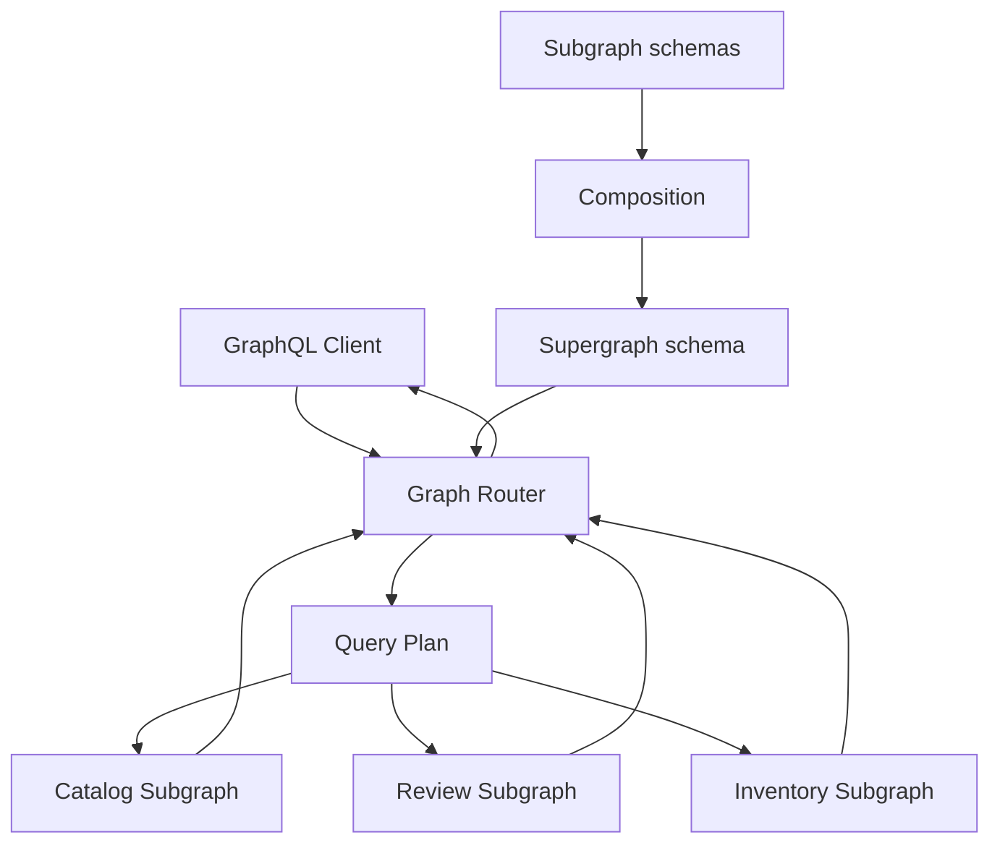
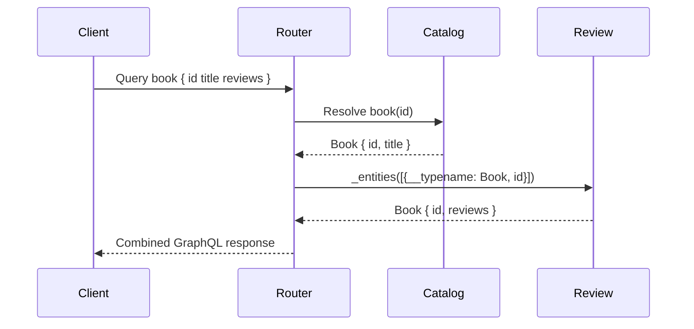

# GraphQL Federation là gì?

## 1. Vấn đề khi nhiều GraphQL service cùng tồn tại

Khi hệ thống phát triển, dữ liệu thường được chia cho nhiều nhóm và dịch vụ. Ví dụ:

- Catalog quản lý sách, sản phẩm và thông tin mô tả.
- Review quản lý đánh giá và nhận xét.
- Inventory quản lý tồn kho.
- Account quản lý người dùng và hồ sơ.

Mỗi nhóm có thể xây dựng GraphQL API riêng. Tuy nhiên, client thường cần dữ liệu từ nhiều nhóm trong cùng một màn hình. Nếu client phải gọi từng API, nó phải biết địa chỉ, schema, cách ghép dữ liệu và xử lý lỗi của từng service. Điều này làm client phụ thuộc chặt vào kiến trúc backend.

Một cách khác là tạo một GraphQL gateway duy nhất, nhưng gateway phải tự biết cách gọi và ghép từng service. Khi số service tăng, logic điều phối và schema tổng hợp có thể trở thành một điểm tập trung khó bảo trì.

GraphQL Federation giải quyết bài toán đó bằng một mô hình có quy ước chung: từng service công bố một phần schema của mình, các phần schema được composition thành một Supergraph, và Graph Router dùng metadata Federation để phân phối request.

## 2. GraphQL Federation là gì?

GraphQL Federation là kiến trúc kết hợp nhiều GraphQL API độc lập thành một graph thống nhất. Với Apollo Federation, mỗi GraphQL service tham gia được gọi là một **Subgraph**. Các Subgraph công bố schema và cách phân giải dữ liệu mà chúng sở hữu. Một công cụ composition kết hợp những schema này thành **Supergraph schema**. **Graph Router** đọc Supergraph schema để lập kế hoạch và điều phối một GraphQL operation đến một hoặc nhiều Subgraph.

Client gửi query đến một endpoint của Router. Client không cần biết query phải đi qua Catalog, Review hay Inventory. Router hiểu quan hệ giữa các type và field, gọi các Subgraph cần thiết rồi ghép kết quả thành một GraphQL response.

Federation không phải một cú pháp mới thay thế GraphQL. Nó bổ sung quy ước schema, entity và directive để nhiều GraphQL server có thể hợp tác như một graph.

## 3. Các thành phần trong kiến trúc Federation

Một hệ thống Federation thường có các thành phần sau:

| Thành phần | Trách nhiệm |
| --- | --- |
| Subgraph | GraphQL service độc lập, sở hữu một phần schema và dữ liệu |
| Entity | Object có khóa định danh để các Subgraph có thể tham chiếu cùng một thực thể |
| Federation directives | Khai báo khóa, quyền sở hữu field và quan hệ giữa các Subgraph |
| Schema composition | Kết hợp schema của các Subgraph và kiểm tra tính tương thích |
| Supergraph schema | Schema tổng hợp cùng metadata để Router lập kế hoạch |
| Graph Router | Nhận request, lập query plan, gọi Subgraph và ghép response |
| Client | Chỉ gọi một GraphQL endpoint của Supergraph |



Composition thường được thực hiện trong pipeline phát triển hoặc qua một nền tảng quản lý schema. Router tải Supergraph schema đã được compose để phục vụ request. Việc compose schema và việc thực thi query là hai hoạt động khác nhau.

## 4. Ví dụ: một graph gồm Catalog và Review

Giả sử ứng dụng bán sách có hai service:

- Catalog sở hữu thông tin sách như ID và tiêu đề.
- Review sở hữu đánh giá của sách.

Client muốn gọi một query duy nhất:

```graphql
query BookPage($id: ID!) {
    book(id: $id) {
        id
        title
        reviews {
            id
            rating
            text
        }
    }
}
```

Catalog trả về thông tin `Book`. Review cung cấp field `reviews` cho cùng entity `Book`. Router biết cách nối hai phần này nhờ entity key và Federation directives.

Client chỉ nhìn thấy một graph thống nhất. Nó không cần tự gọi Catalog trước rồi lấy ID gọi Review.

## 5. Subgraph và Supergraph khác nhau thế nào?

Subgraph là một GraphQL service có schema và runtime riêng. Nó có thể chạy, được triển khai và mở rộng độc lập với các Subgraph khác.

Supergraph là kết quả composition của nhiều Subgraph schema. Nó chứa các type và field mà client có thể truy cập, cùng metadata để Router biết field nào do Subgraph nào phân giải và cần chuyển tiếp entity như thế nào.

Ví dụ:

```text
Catalog schema             Review schema
----------------           ----------------
Book.id                    Book.id
Book.title                 Book.reviews
Book.price                 Review.rating
                           Review.text
       \                       /
        \                     /
         +-- Supergraph -----+
                 |
             Graph Router
                 |
            Client query
```

Supergraph không phải một bản sao database hoặc một service chứa toàn bộ dữ liệu. Nó là schema hợp nhất và metadata định tuyến. Dữ liệu vẫn được lấy từ các Subgraph chịu trách nhiệm.

## 6. Entity là nền tảng liên kết các Subgraph

Trong Federation, một entity là object có thể được định danh bằng một hoặc nhiều field khóa. Directive `@key` đánh dấu object type là entity và chỉ ra các field được dùng để nhận diện entity đó.

Ví dụ Catalog sở hữu entity `Book`:

```graphql
type Query {
    book(id: ID!): Book
}

type Book @key(fields: "id") {
    id: ID!
    title: String!
    price: Float!
}
```

`@key(fields: "id")` cho Router biết rằng một `Book` có thể được tham chiếu bằng `id`. Router không cần biết cách Catalog lưu sách; Catalog chịu trách nhiệm tìm entity theo khóa đó.

Một entity có thể có nhiều key nếu schema cần nhiều cách định danh. Chọn key ổn định, duy nhất và có thể được các Subgraph sử dụng để tra cứu.

## 7. Nhiều Subgraph có thể đóng góp field cho cùng entity

Review Subgraph có thể mở rộng entity `Book` để thêm field `reviews`:

```graphql
type Book @key(fields: "id") @extends {
    id: ID! @external
    reviews: [Review!]!
}

type Review {
    id: ID!
    rating: Int!
    text: String
}
```

Trong ví dụ tương thích với cách tích hợp `federation-jvm` của Spring for GraphQL:

- `@key` khai báo khóa của entity `Book`.
- `@extends` cho biết Subgraph này đóng góp thêm định nghĩa cho type `Book` đã tồn tại ở Subgraph khác.
- `@external` đánh dấu field `id` được định nghĩa/sở hữu ở nơi khác nhưng cần có trong schema hiện tại để tham chiếu entity.
- `reviews` là field do Review Subgraph cung cấp.

Trong Federation 2, schema có thể dùng từ khóa GraphQL `extend type` khi thư viện Subgraph hỗ trợ. Một số thư viện hoặc ví dụ tương thích cũ dùng directive `@extends`. Cần theo cú pháp mà thư viện Federation đang tích hợp yêu cầu.

## 8. Các Federation directive thường gặp

Directive mô tả quan hệ giữa các Subgraph và giúp Router lập kế hoạch:

| Directive | Ý nghĩa |
| --- | --- |
| `@key` | Khai báo field hoặc nhóm field dùng để định danh entity |
| `@external` | Khai báo field được định nghĩa ở Subgraph khác nhưng được tham chiếu tại đây |
| `@requires` | Cho biết resolver của field cần thêm field của entity từ Subgraph khác |
| `@provides` | Cho biết một field có thể cung cấp thêm một số field của entity trong phạm vi kết quả đó |
| `@shareable` | Cho phép nhiều Subgraph cùng phân giải một field trong Federation 2 |
| `@override` | Chuyển quyền sở hữu field từ Subgraph này sang Subgraph khác |
| `@link` | Import các directive và tính năng từ một Federation specification version |
| `@extends` | Cách khai báo mở rộng type trong một số thư viện Subgraph |

Không phải mọi directive đều cần dùng trong một graph nhỏ. Bắt đầu với `@key` và entity resolution; chỉ thêm `@requires`, `@provides`, `@shareable` hoặc `@override` khi quan hệ dữ liệu thực sự cần đến.

Ví dụ `@requires`: Shipping Subgraph cần `size` và `weight` do Catalog Subgraph sở hữu trước khi tính `shippingEstimate`:

```graphql
extend schema
    @link(
        url: "https://specs.apollo.dev/federation/v2.0",
        import: ["@key", "@external", "@requires"]
    )

type Product @key(fields: "id") {
    id: ID!
    size: Int @external
    weight: Int @external
    shippingEstimate: String @requires(fields: "size weight")
}
```

Router hiểu rằng phải lấy hai field phụ thuộc trước rồi mới gọi resolver `shippingEstimate`. Trong schema Federation 2, `@requires` có thể được dùng với entity extension và các field được đánh dấu `@external` theo quy tắc composition.

Ví dụ `@provides`: một field có thể cung cấp thêm field `name` của Product trong phạm vi kết quả trả về:

```graphql
extend schema
    @link(
        url: "https://specs.apollo.dev/federation/v2.0",
        import: ["@key", "@external", "@provides"]
    )

type Product @key(fields: "id") {
    id: ID!
    name: String! @external
    inStock: Boolean!
}

type Query {
    outOfStockProducts: [Product!]! @provides(fields: "name")
}
```

`@provides` không chuyển quyền sở hữu field trên toàn graph; nó mô tả rằng resolver `outOfStockProducts` có thể cung cấp `Product.name` trong đường đi cụ thể này. Field `name` được đánh dấu `@external` ở Subgraph này và phải có Subgraph khác có thể phân giải nó; trong Federation 2, field đó cần được đánh dấu `@shareable` ở ít nhất một Subgraph sở hữu field.

## 9. Federation 1 và Federation 2

Apollo Federation có nhiều phiên bản specification. Federation 2 bổ sung cơ chế `@link` để Subgraph khai báo rõ phiên bản và các directive được import.

Ví dụ Federation 2:

```graphql
extend schema
    @link(
        url: "https://specs.apollo.dev/federation/v2.0",
        import: ["@key"]
    )

type Product @key(fields: "upc") {
    upc: ID!
    name: String!
}
```

Với Federation 2, các directive được import từ specification qua `@link`. Cú pháp `extend type` là GraphQL type extension thông thường; `@extends` chỉ cần khi thư viện Subgraph không hỗ trợ từ khóa `extend` hoặc yêu cầu tương thích.

Khi ghép schema, tất cả Subgraph phải dùng các directive và quy tắc tương thích với Federation version mà Supergraph sử dụng. Không nên trộn cú pháp Federation 1 và Federation 2 mà không kiểm tra compatibility.

## 10. `_service` và `_entities` là hai field đặc biệt

Subgraph-compatible server cần cung cấp các field đặc biệt để Router hoặc công cụ Federation có thể làm việc với schema và entity.

**`_service`** trả về schema SDL của Subgraph, bao gồm Federation directives. Công cụ composition có thể đọc field này để lấy schema cần compose.

```graphql
query SubgraphSchema {
    _service {
        sdl
    }
}
```

**`_entities`** nhận danh sách entity representations và trả về các entity tương ứng. Representation chứa `__typename` cùng các field thuộc một `@key`.

```graphql
query ResolveBooks($representations: [_Any!]!) {
    _entities(representations: $representations) {
        ... on Book {
            id
            reviews {
                rating
            }
        }
    }
}
```

Variables minh họa:

```json
{
  "representations": [
    {
      "__typename": "Book",
      "id": "book-42"
    }
  ]
}
```

`_Any` là scalar Federation dùng để truyền representation có cấu trúc linh hoạt. `_Entity` là union được tạo từ các entity mà Subgraph hỗ trợ. Nếu Subgraph không đóng góp field cho entity nào thì không cần `_entities` và `_Entity`; `_service` vẫn là field phục vụ enhanced introspection.

## 11. Router thực hiện một query Federation như thế nào?

Khi client gửi query lấy sách và reviews, Router thực hiện khái quát các bước:

1. Parse và validate operation theo Supergraph schema.
2. Tạo query plan dựa trên quyền sở hữu field và quan hệ entity.
3. Gọi Catalog Subgraph để lấy `Book.id` và `Book.title`.
4. Tạo representation gồm `__typename` và key `id` cho từng `Book`.
5. Gọi Review Subgraph qua `_entities` để phân giải field `reviews`.
6. Ghép dữ liệu từ các Subgraph theo đúng vị trí entity.
7. Trả response thống nhất cho client.



Router có thể chạy song song các nhánh độc lập. Khi một field phụ thuộc vào kết quả từ Subgraph khác, Router phải chờ kết quả trước rồi mới gọi bước tiếp theo. Vì vậy, query plan có thể ảnh hưởng đáng kể đến latency.

## 12. Spring for GraphQL hỗ trợ Federation như thế nào?

Spring for GraphQL tích hợp thư viện `federation-jvm`, thư viện xây dựng trên GraphQL Java để chuyển schema thành Federation-compatible schema. Tích hợp này cung cấp:

- `FederationSchemaFactory` để tạo schema có Federation support.
- `@EntityMapping` để khai báo cách tải entity từ representation do Router gửi.
- Tích hợp entity mapping với `@SchemaMapping` và `@BatchMapping`.
- Cách xử lý exception từ entity mapping bằng `@GraphQlExceptionHandler`.

Spring for GraphQL không biến một GraphQL endpoint thông thường thành Subgraph chỉ bằng cách đặt nó sau Router. Ứng dụng cần Federation schema factory, entity resolver và schema directives phù hợp để đáp ứng Subgraph specification.

## 13. Thêm Federation support vào Spring Boot

Thư viện JVM hỗ trợ Federation có artifact `federation-graphql-java-support`:

```kotlin
dependencies {
    implementation("org.springframework.boot:spring-boot-starter-graphql")
    implementation("com.apollographql.federation:federation-graphql-java-support:<compatible-version>")
}
```

Chọn phiên bản thư viện Federation tương thích với Spring for GraphQL và GraphQL Java mà dự án đang dùng. Không tự chọn một phiên bản mới nhất độc lập nếu nó kéo theo GraphQL Java version không tương thích.

Khai báo `FederationSchemaFactory` và gắn nó vào `GraphQlSource`:

```java
import org.springframework.boot.graphql.autoconfigure.GraphQlSourceBuilderCustomizer;
import org.springframework.context.annotation.Bean;
import org.springframework.context.annotation.Configuration;
import org.springframework.graphql.data.federation.FederationSchemaFactory;

@Configuration(proxyBeanMethods = false)
public class FederationConfig {

    @Bean
    GraphQlSourceBuilderCustomizer federationCustomizer(
            FederationSchemaFactory factory) {
        return builder -> builder.schemaFactory(factory::createGraphQLSchema);
    }

    @Bean
    FederationSchemaFactory federationSchemaFactory() {
        return new FederationSchemaFactory();
    }
}
```

Với Spring Boot 3.x, package của `GraphQlSourceBuilderCustomizer` là `org.springframework.boot.autoconfigure.graphql`. Với Spring Boot 4.x, package chuyển sang `org.springframework.boot.graphql.autoconfigure`.

`FederationSchemaFactory` thuộc package `org.springframework.graphql.data.federation`. Factory phát hiện các controller method có `@EntityMapping`, sau đó thiết lập entity DataFetcher và TypeResolver khi tạo schema.

## 14. Dùng `@EntityMapping` để phân giải entity

Trong Review Subgraph, entity `Book` được nhận diện qua `id`. Khi Router gọi `_entities`, Spring cần tải entity `Book` tương ứng với representation.

```java
import java.util.List;

import org.springframework.graphql.data.federation.EntityMapping;
import org.springframework.graphql.data.method.annotation.Argument;
import org.springframework.graphql.data.method.annotation.SchemaMapping;
import org.springframework.stereotype.Controller;

@Controller
public class BookFederationController {

    private final ReviewService reviewService;

    public BookFederationController(ReviewService reviewService) {
        this.reviewService = reviewService;
    }

    @EntityMapping
    public Book book(@Argument String id) {
        return new Book(id);
    }

    @SchemaMapping(typeName = "Book", field = "reviews")
    public List<Review> reviews(Book book) {
        return reviewService.findByBookId(book.id());
    }
}

public record Book(String id) {
}
```

`@EntityMapping` được gọi khi entity được yêu cầu qua `_entities`. `@Argument` lấy `id` từ representation input map và chuyển đổi sang kiểu Java. Sau khi trả về `Book`, các field mapping thông thường như `@SchemaMapping` có thể phân giải những field mà Subgraph sở hữu.

Trong ví dụ này, `Book` chỉ là object tham chiếu mang khóa `id`; không cần tải toàn bộ dữ liệu sách nếu resolver `reviews` chỉ dùng khóa đó để tìm đánh giá.

Method có thể nhận toàn bộ `Map<String, Object>` representation, danh sách representation, `GraphQLContext`, `Principal`, `DataLoader` hoặc các tham số được Spring for GraphQL hỗ trợ. Method cũng có thể trả về entity trực tiếp, `Mono`, `CompletableFuture` hoặc `Callable`.

## 15. Batch entity resolution và DataLoader

Router có thể gửi nhiều representation trong cùng một `_entities` request. Spring for GraphQL hỗ trợ entity mapping theo danh sách ID để giảm số lần gọi service:

```java
@EntityMapping
public List<Book> book(@Argument List<String> idList) {
    // Phải trả các Book theo đúng thứ tự của idList.
    return bookService.findAllByIdsInOrder(idList);
}
```

Tên `idList` giúp Spring nhận diện argument `id` dạng danh sách; cũng có thể cấu hình tên argument rõ ràng trong annotation.

Với field lồng nhau, có thể dùng `@BatchMapping`:

```java
import java.util.List;
import java.util.Map;

@BatchMapping(typeName = "Book", field = "reviews")
public Map<Book, List<Review>> reviews(List<Book> books) {
    return reviewService.findByBooks(books);
}
```

Batch function cần trả mapping tương ứng với các source object. Khi backend trả dữ liệu theo thứ tự khác với danh sách đầu vào, hãy tạo map theo key để ghép chính xác.

`BatchLoaderRegistry` và `DataLoader` cũng có thể được dùng trong `@EntityMapping`. Nhờ đó, nhiều entity lookup có thể được gom lại theo request thay vì phát sinh một truy vấn riêng cho từng representation.

## 16. Composition và kiểm tra schema

Một Subgraph schema hợp lệ riêng lẻ chưa chắc đã compose được thành Supergraph. Composition phải kiểm tra các schema có tương thích hay không, ví dụ:

- Cùng entity phải có key tương thích.
- Field có cùng tên nhưng kiểu khác nhau có thể gây lỗi composition.
- Field được đánh dấu `@external` phải có quan hệ hợp lệ với field do Subgraph khác cung cấp.
- Các field được nhiều Subgraph phân giải phải tuân theo quy tắc `@shareable` hoặc directive tương ứng.
- `@requires` phải tham chiếu field có thể được lấy từ graph.

Với Apollo Rover CLI, có thể compose các Subgraph từ file cấu hình:

```bash
rover supergraph compose --config ./supergraph.yaml
```

Trong CI, nên chạy composition check trước khi publish schema hoặc deploy Subgraph. Điều này giúp phát hiện xung đột schema trước khi Router nhận Supergraph mới.

Không nên để Router tự compose động tất cả Subgraph trong mỗi lần khởi động production nếu pipeline có thể tạo và kiểm tra Supergraph artifact trước. Schema composition nên có quy trình versioning, review và rollback rõ ràng.

## 17. Lợi ích của GraphQL Federation

Federation hữu ích khi nhiều nhóm cùng sở hữu dữ liệu và cần cung cấp một graph thống nhất:

- **Quyền sở hữu rõ ràng:** mỗi nhóm chịu trách nhiệm cho type/field mà mình cung cấp.
- **Triển khai độc lập:** Subgraph có thể phát hành thay đổi riêng trong giới hạn composition rules.
- **Client đơn giản hơn:** client gọi một endpoint thay vì biết nhiều backend.
- **Mở rộng theo domain:** có thể thêm Subgraph mới mà không phải chuyển toàn bộ dữ liệu về một GraphQL server.
- **Hợp đồng schema rõ ràng:** directive và composition kiểm tra quan hệ giữa các phần schema.
- **Tái sử dụng entity:** nhiều Subgraph có thể đóng góp field cho cùng một object logic.

Federation đặc biệt có ích khi ranh giới ownership giữa các nhóm đã rõ và các domain cần kết hợp dữ liệu thường xuyên.

## 18. Chi phí và giới hạn cần cân nhắc

Federation không tự động làm hệ thống nhanh hơn hoặc đơn giản hơn. Nó thêm một lớp điều phối và các ràng buộc vận hành:

| Thách thức | Hệ quả | Cách giảm thiểu |
| --- | --- | --- |
| Network hop giữa các Subgraph | Latency tăng so với một service nội bộ | Thiết kế query plan, batch và timeout hợp lý |
| Subgraph lỗi hoặc chậm | Một phần response có thể lỗi hoặc toàn request kéo dài | Timeout, circuit breaker và error policy |
| N+1 qua entity resolution | Router gọi entity resolver với nhiều representation | Batch entity mapping, DataLoader và `@BatchMapping` |
| Schema composition thất bại | Supergraph mới không thể được publish | Composition check trong CI và review schema |
| Ownership field không rõ | Nhiều nhóm thay đổi cùng một field | Quy định owner, `@shareable` và `@override` đúng lúc |
| Authorization phân tán | Router và Subgraph có thể áp dụng chính sách khác nhau | Xác định trust boundary, truyền identity an toàn và kiểm tra quyền tại service sở hữu dữ liệu |
| Khó quan sát request | Một operation chạy qua nhiều service | Correlation ID, distributed tracing và metrics theo Subgraph |
| Phụ thuộc Router | Router trở thành thành phần hạ tầng quan trọng | Chạy nhiều instance, health check và rollout có kiểm soát |

Không nên chia một GraphQL API thành quá nhiều Subgraph nhỏ nếu các domain chưa có ranh giới ownership ổn định. Một GraphQL server duy nhất có thể đơn giản và hiệu quả hơn cho hệ thống nhỏ.

## 19. Federation khác schema stitching và API aggregation thế nào?

| Cách tiếp cận | Cách kết hợp | Cách quản lý quan hệ giữa dữ liệu |
| --- | --- | --- |
| API aggregation | Gateway gọi nhiều API rồi tự ghép response | Logic ghép thường nằm trong gateway code |
| Schema stitching | Ghép schema từ nhiều GraphQL service | Dùng cơ chế stitching và delegation của công cụ tương ứng |
| GraphQL Federation | Compose Subgraph schemas thành Supergraph | Entity keys, directives và query plan theo Federation specification |
| Một GraphQL server đơn | Một schema và một runtime | Các resolver nằm trong cùng service |

Federation không chỉ là proxy chuyển tiếp request. Nó có mô hình entity và metadata schema để Router biết cách lấy field từ nhiều Subgraph. Schema stitching vẫn là một kỹ thuật hợp lệ trong một số hệ thống, nhưng Federation cung cấp quy ước liên service chuyên biệt hơn cho kiến trúc Apollo.

## 20. Bảo mật và vận hành trong môi trường Federation

Graph Router không nên là nơi duy nhất kiểm tra quyền truy cập. Subgraph vẫn là service có dữ liệu và nghiệp vụ riêng, vì vậy cần xác thực request đến từ Router và kiểm tra quyền phù hợp tại service sở hữu dữ liệu.

Các điểm cần thiết kế:

- Truyền identity, tenant và scope từ client qua Router đến Subgraph theo một hợp đồng rõ ràng.
- Không tin các header do client tự gửi nếu Router chưa xác thực và chuẩn hóa.
- Bảo vệ endpoint Subgraph để client bên ngoài không bypass Router nếu kiến trúc yêu cầu mọi request phải qua gateway.
- Kiểm tra authorization trong resolver/entity mapping ở nơi có dữ liệu và chính sách nghiệp vụ.
- Giới hạn query depth, complexity, timeout và số lượng entity representation.
- Theo dõi latency và error rate theo từng Subgraph.
- Không log raw representation hoặc variables có dữ liệu cá nhân nếu không cần thiết.

Một request Federation có thể gọi nhiều Subgraph, do đó timeout tổng của Router phải phù hợp với timeout từng bước. Một Subgraph chậm có thể làm tăng thời gian hoàn thành toàn operation.

## 21. Khi nào nên dùng Federation?

Federation phù hợp khi:

- Nhiều team sở hữu các domain dữ liệu riêng.
- Các service cần phát triển và triển khai độc lập.
- Client thường xuyên cần kết hợp dữ liệu từ nhiều domain.
- Có nhu cầu quản trị schema, kiểm tra composition và theo dõi thay đổi ở cấp toàn graph.
- Hệ thống đủ lớn để lợi ích về ownership vượt chi phí vận hành Router và Subgraph.

Federation có thể chưa cần thiết khi:

- Hệ thống chỉ có một hoặc hai domain nhỏ.
- Một team sở hữu toàn bộ schema và resolver.
- Client chỉ cần gọi một service, không cần ghép dữ liệu liên service.
- Chưa có quy trình versioning, composition check và vận hành phân tán.

Hãy bắt đầu từ ranh giới domain và ownership. Số lượng microservice không phải tiêu chí duy nhất để quyết định có dùng Federation hay không.

## 22. Checklist triển khai GraphQL Federation

- [ ] Xác định domain và ownership của từng Subgraph.
- [ ] Chọn entity có key ổn định và duy nhất.
- [ ] Khai báo `@key` cho entity cần được tham chiếu liên Subgraph.
- [ ] Dùng `@external`, `@requires`, `@provides`, `@shareable` đúng ý nghĩa.
- [ ] Chọn Federation version và cú pháp tương thích giữa các Subgraph.
- [ ] Tích hợp `FederationSchemaFactory` vào `GraphQlSource`.
- [ ] Implement `@EntityMapping` cho các entity được Router yêu cầu.
- [ ] Dùng `@BatchMapping` hoặc DataLoader khi entity lookup có thể được gom batch.
- [ ] Kiểm tra `_service` và `_entities` trên từng Subgraph.
- [ ] Chạy schema composition check trong CI.
- [ ] Deploy Supergraph schema tương thích với Router.
- [ ] Kiểm thử query plan và response đi qua nhiều Subgraph.
- [ ] Kiểm tra authorization ở Router và Subgraph.
- [ ] Thiết lập timeout, tracing, metrics và error policy.
- [ ] Có quy trình rollback khi composition hoặc deploy schema thất bại.

## Kết luận

GraphQL Federation là kiến trúc kết hợp nhiều GraphQL Subgraph độc lập thành một Supergraph thống nhất. Mỗi Subgraph sở hữu một phần schema và dữ liệu; entity key cùng Federation directives mô tả cách các phần graph liên kết. Schema composition tạo Supergraph schema, còn Graph Router dùng metadata đó để lập query plan, gọi các Subgraph và ghép response cho client.

Trong Spring for GraphQL, Federation được tích hợp thông qua `federation-jvm`. `FederationSchemaFactory` cấu hình schema Federation-compatible, còn `@EntityMapping` tải entity theo representation từ `_entities`. Các field còn lại có thể dùng `@SchemaMapping`, `@BatchMapping` và DataLoader như GraphQL server thông thường. Federation đem lại ranh giới ownership và một API thống nhất, nhưng cũng thêm network hop, query planning, schema governance, bảo mật và yêu cầu observability. Chỉ nên áp dụng khi những lợi ích đó phù hợp với quy mô và cách tổ chức domain của hệ thống.

## Tài liệu tham khảo

- [Spring for GraphQL — Federation](https://docs.spring.io/spring-graphql/reference/federation.html)
- [Spring for GraphQL — `FederationSchemaFactory` API](https://docs.spring.io/spring-graphql/docs/current/api/org/springframework/graphql/data/federation/FederationSchemaFactory.html)
- [Apollo Federation — Overview](https://www.apollographql.com/docs/graphos/schema-design/federated-schemas/overview)
- [Apollo Federation — Subgraph Specification](https://www.apollographql.com/docs/graphos/schema-design/federated-schemas/reference/subgraph-spec)
- [Apollo Federation — Entities](https://www.apollographql.com/docs/graphos/schema-design/federated-schemas/entities/intro)
- [Apollo Federation — Schema Composition](https://www.apollographql.com/docs/graphos/schema-design/federated-schemas/composition)
- [Apollo Federation JVM](https://github.com/apollographql/federation-jvm)
- [Apollo Federation JVM Spring Example](https://github.com/apollographql/federation-jvm-spring-example)
