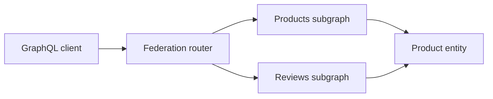

# Federated key trong Spring for GraphQL

Trong kiến trúc GraphQL Federation, một entity có thể được nhiều subgraph cùng đóng góp field. Router cần một cách nhận diện cùng một entity khi chuyển việc thực thi từ subgraph này sang subgraph khác. `@key` định nghĩa tập field dùng để nhận diện entity đó. Key có thể là một field, nhiều field kết hợp hoặc một field set có cấu trúc lồng nhau.

Spring for GraphQL tích hợp thư viện federation-jvm để xây dựng schema cho subgraph. `FederationSchemaFactory` tạo cơ chế `_entities` và type resolver; `@EntityMapping` ánh xạ entity representation do router gửi tới thành đối tượng Java. Khi thiết kế key, cần bảo đảm key ổn định, duy nhất, có thể phân giải ở subgraph và không thay thế bước authorization.

Sau bài này, bạn có thể:

- Hiểu entity, federated key và entity representation.
- Khai báo `@key` cho key đơn, key ghép, key lồng nhau và nhiều key thay thế.
- Phân biệt key định danh entity với field thông thường hoặc database primary key.
- Cấu hình `FederationSchemaFactory` trong Spring Boot.
- Viết `@EntityMapping` để resolve entity từ representation.
- Xử lý nhiều representation bằng batch mapping hoặc DataLoader.
- Hiểu `resolvable: false`, `@external` và khác biệt Federation 1/2.
- Xử lý entity không tồn tại, lỗi mapping, authorization và tenant.
- Kiểm thử `_entities` và bảo đảm key hoạt động qua nhiều subgraph.

## 1. Entity trong GraphQL Federation

GraphQL Federation chia một graph logic thành nhiều subgraph. Mỗi subgraph sở hữu một phần domain và có thể đóng góp field cho cùng một entity.

Ví dụ hệ thống thương mại điện tử có hai subgraph:

- Products subgraph quản lý mã hàng, tên và giá sản phẩm.
- Reviews subgraph quản lý đánh giá và xếp hạng sản phẩm.

Cả hai cùng làm việc với một entity `Product`, nhưng không nhất thiết cùng lưu toàn bộ dữ liệu sản phẩm.



Entity là object type có thể được nhận diện bằng một hoặc nhiều key. Router dùng key để chuyển entity representation tới subgraph cần resolve các field do subgraph đó sở hữu.

## 2. `@key` là gì?

Directive `@key` đánh dấu một object type là entity và khai báo tập field định danh entity đó.

```graphql
type Product @key(fields: "upc") {
    upc: ID!
    name: String!
    price: Int
}
```

Trong ví dụ, `upc` là key của `Product`. Mỗi sản phẩm phải có một UPC duy nhất trong phạm vi entity. Router có thể gửi giá trị UPC tới subgraph để yêu cầu resolve `Product` tương ứng.

`fields` có kiểu `FieldSet`, được truyền dưới dạng chuỗi có cú pháp selection set GraphQL. Đây là mô tả các field cần có trong representation, không phải một GraphQL query độc lập.

Key thường tương tự candidate key trong mô hình dữ liệu: nó phải xác định duy nhất một entity. Một entity có thể có nhiều key hợp lệ, do đó `@key` không nhất thiết là database primary key.

Các ví dụ trong bài dùng object entity. Từ Federation 2.3, `@key` cũng có thể áp dụng cho interface; khả năng này phụ thuộc phiên bản Federation và tooling của subgraph.

## 3. Key đơn

Key đơn sử dụng một field để nhận diện entity:

```graphql
type Book @key(fields: "id") {
    id: ID!
    title: String!
    authorId: ID!
}
```

Representation tương ứng có dạng:

```json
{
  "__typename": "Book",
  "id": "book-42"
}
```

`__typename` cho router và subgraph biết representation thuộc entity type nào. `id` là giá trị key mà resolver dùng để tìm entity.

Key đơn thường là lựa chọn dễ vận hành nhất nếu entity có một mã định danh ổn định. Field key nên có giá trị ở mọi entity và thường nên khai báo non-null (`ID!`, `String!`, ...).

## 4. Key ghép (compound key)

Khi một field không đủ để định danh duy nhất, có thể kết hợp nhiều field:

```graphql
type StoreProduct @key(fields: "sku market") {
    sku: String!
    market: String!
    name: String!
    price: Int
}
```

Trong ví dụ, cùng một `sku` có thể tồn tại ở nhiều thị trường. Cặp `(sku, market)` mới xác định duy nhất một sản phẩm trong catalog.

Representation:

```json
{
  "__typename": "StoreProduct",
  "sku": "SKU-100",
  "market": "VN"
}
```

Resolver phải nhận đủ hai thành phần:

```java
@Controller
public class StoreProductController {

    private final StoreProductService service;

    public StoreProductController(StoreProductService service) {
        this.service = service;
    }

    @EntityMapping
    public StoreProduct storeProduct(
            @Argument String sku,
            @Argument String market) {

        return service.findBySkuAndMarket(sku, market);
    }
}
```

`@Argument` lấy giá trị từ representation map. Tên argument cần khớp với field key trong SDL. Có thể chỉ định tên argument tường minh nếu tên tham số Java khác với tên field GraphQL.

## 5. Key có field lồng nhau

Field set của `@key` có thể chọn field bên trong một object field:

```graphql
type Product @key(fields: "sku organization { id }") {
    sku: String!
    organization: Organization!
    name: String!
}

type Organization {
    id: ID!
    name: String!
}
```

Key gồm `sku` và `organization.id`. Representation có dạng:

```json
{
  "__typename": "Product",
  "sku": "SKU-100",
  "organization": {
    "id": "org-7"
  }
}
```

Spring `@EntityMapping` có thể nhận toàn bộ representation dưới dạng `Map<String, Object>` để đọc cấu trúc lồng nhau:

```java
@EntityMapping
public Product product(Map<String, Object> representation) {
    String sku = (String) representation.get("sku");

    @SuppressWarnings("unchecked")
    Map<String, Object> organization =
            (Map<String, Object>) representation.get("organization");

    String organizationId = (String) organization.get("id");
    return productService.findBySkuAndOrganization(sku, organizationId);
}
```

Khi dùng representation map, cần kiểm tra kiểu và sự hiện diện của từng field trước khi ép kiểu. Không giả định dữ liệu gửi đến luôn đầy đủ hoặc hợp lệ chỉ vì router thường tạo representation theo schema.

Key field set không phải một query tùy ý. Không thể đưa field có argument, list, union hoặc interface vào `@key`; nested selection phải đi qua object field hợp lệ. Với key lồng nhau, cân nhắc chi phí lookup và độ ổn định của toàn bộ đường field.

## 6. Nhiều key thay thế cho cùng entity

Một entity có thể có nhiều cách định danh. Ví dụ sản phẩm có cả UPC và cặp SKU/market:

```graphql
type Product
    @key(fields: "upc")
    @key(fields: "sku market") {
    upc: ID!
    sku: String!
    market: String!
    name: String!
}
```

Trong Federation 2, `@key` là directive repeatable. Hãy xác nhận subgraph implementation hỗ trợ repeatable directive trước khi khai báo nhiều key.

Router có thể sử dụng một trong các key hợp lệ tùy query plan và subgraph. Mỗi key phải thực sự xác định cùng một entity; không được để một UPC hoặc cặp SKU/market trỏ tới hai sản phẩm khác nhau. Các subgraph có thể khai báo key khác nhau, nhưng phải có key tương thích để router liên kết cùng entity trong quá trình composition và query planning.

Khi một `@EntityMapping` cần hỗ trợ nhiều representation, có thể nhận full representation map và chọn đường lookup dựa trên key hiện diện:

```java
@EntityMapping
public Product product(Map<String, Object> representation) {
    if (representation.containsKey("upc")) {
        return productService.findByUpc((String) representation.get("upc"));
    }

    if (representation.containsKey("sku")
            && representation.containsKey("market")) {
        return productService.findBySkuAndMarket(
                (String) representation.get("sku"),
                (String) representation.get("market"));
    }

    throw new IllegalArgumentException("Unsupported Product key representation");
}
```

Trong hệ thống thực tế, nên chuẩn hóa key parsing thành một component riêng và trả lỗi representation rõ ràng. Không tự chọn một field bất kỳ làm key khi representation không khớp schema.

## 7. Key không nhất thiết là primary key của database

Key của Federation là hợp đồng định danh ở cấp graph. Nó có thể trùng database primary key, nhưng không bắt buộc.

Ví dụ database có `product_id` nội bộ, còn API dùng `upc`:

```graphql
type Product @key(fields: "upc") {
    upc: ID!
    name: String!
}
```

Subgraph có thể tra cứu theo UPC rồi lấy entity nội bộ. Việc tách key công khai khỏi primary key giúp thay đổi database mà không làm thay đổi hợp đồng Federation.

Một key tốt thường có các đặc điểm:

- Duy nhất trong phạm vi entity.
- Ổn định trong suốt vòng đời entity.
- Có sẵn khi router cần chuyển entity giữa subgraph.
- Có thể được lookup hiệu quả bằng index.
- Không phụ thuộc vào field hiển thị dễ đổi như tên hoặc mô tả.
- Không tiết lộ dữ liệu cá nhân hoặc bí mật không cần thiết.

Nếu ID chỉ duy nhất trong tenant, hãy cân nhắc key ghép gồm tenant identifier và entity ID. Tenant trong representation vẫn phải được kiểm tra với security context hiện tại.

## 8. Key và field có thể thay đổi

Không nên chọn field có thể đổi thường xuyên làm key nếu có thể tránh. Ví dụ `displayName`, email hoặc slug có thể thay đổi do nghiệp vụ. Nếu router giữ reference cũ trong một query plan hoặc event, key thay đổi có thể khiến entity không được resolve.

Nếu bắt buộc dùng natural key có thể thay đổi, cần có quy trình migration rõ ràng:

1. Giới thiệu key mới và resolver hỗ trợ đồng thời key cũ/mới.
2. Cập nhật các subgraph cần dùng key mới.
3. Xác nhận composition và query plan dùng key mới.
4. Chuyển traffic theo lộ trình tương thích.
5. Chỉ bỏ key cũ khi không còn caller hoặc subgraph phụ thuộc.

Với nhiều key thay thế, có thể giữ key cũ trong giai đoạn chuyển đổi, nhưng cần xác định thời điểm loại bỏ để không tạo hợp đồng vĩnh viễn ngoài ý muốn.

## 9. Key trong nhiều subgraph

Products subgraph sở hữu thông tin sản phẩm:

```graphql
type Product @key(fields: "upc") {
    upc: ID!
    name: String!
    price: Int
}
```

Reviews subgraph đóng góp field đánh giá cho cùng entity:

```graphql
type Product @key(fields: "upc") {
    upc: ID!
    reviews: [Review!]!
    averageRating: Float
}

type Review {
    id: ID!
    body: String!
}
```

Hai subgraph khai báo `Product` với cùng key. Router có thể lấy sản phẩm từ Products subgraph, sau đó gửi representation chứa `__typename` và `upc` tới Reviews subgraph để resolve `reviews`.

Trong Federation 2, các subgraph có thể đóng góp entity fields theo mô hình mở rộng mới; field key được xem là shareable theo quy tắc Federation 2. Không tự động sao chép mọi field của entity vào mọi subgraph. Chỉ khai báo những field mà subgraph thực sự sở hữu hoặc có thể resolve theo contract.

Với Federation 2, field được dùng trong `@key` tự động được xem là shareable theo quy tắc composition; không cần đánh dấu `@shareable` riêng chỉ vì field đó là key. Các field khác được định nghĩa ở nhiều subgraph cần tuân thủ quy tắc ownership/shareability tương ứng.

## 10. Federation 1 và Federation 2 khi mở rộng entity

Schema kiểu Federation 1 thường dùng `extend type`, `@key`, `@external` và `@extends`:

```graphql
extend type Product @key(fields: "upc") {
    upc: ID! @external
    reviews: [Review!]!
}
```

Trong Federation 2, subgraph khai báo federation version qua `@link` và có thể dùng entity definition theo cú pháp mới:

```graphql
extend schema
    @link(
        url: "https://specs.apollo.dev/federation/v2.3",
        import: ["@key"]
    )

type Product @key(fields: "upc") {
    upc: ID!
    reviews: [Review!]!
}
```

Ví dụ Federation 2 trên thể hiện field `upc` là key của entity trong subgraph. Trong Federation 1, field key được khai báo `@external` khi subgraph mở rộng entity do subgraph khác sở hữu. Quy tắc Federation 2 khác về ownership, `@external` và composition; hãy dùng đúng cú pháp theo federation version mà router/composer hỗ trợ.

Không trộn SDL Federation 1 và Federation 2 một cách tùy tiện. Khi nâng cấp, cần kiểm tra `@link`, directive import, quy tắc `@key`, `@external` và kết quả composition của toàn bộ subgraph.

## 11. `resolvable: false`

Federation 2 cho phép khai báo key không dùng để resolve entity tại subgraph hiện tại:

```graphql
type Product @key(fields: "upc", resolvable: false) {
    upc: ID!
}
```

`resolvable: false` báo cho router biết subgraph không cung cấp reference resolver để router chuyển tới subgraph này chỉ nhằm resolve entity bằng key đó. Directive hữu ích khi subgraph cần tham chiếu entity hoặc dùng entity trong quan hệ schema nhưng không có trách nhiệm resolve entity reference.

Nếu subgraph thực sự đóng góp field cần được resolve thông qua entity transition, phải có reference resolver tương ứng. Không đặt `resolvable: false` chỉ để né việc viết `@EntityMapping`; router có thể không tạo query plan chuyển tới subgraph đó để lấy field.

Đây là tính năng Federation 2. Không dùng argument `resolvable` trong Federation 1 schema.

## 12. Field `@inaccessible` làm key nội bộ

Federation 2 có directive `@inaccessible` để giữ field trong supergraph cho router sử dụng nhưng ẩn field đó khỏi API schema mà client nhìn thấy.

```graphql
type Product @key(fields: "internalId") {
    internalId: ID! @inaccessible
    name: String!
}
```

Field `internalId` vẫn có thể tham gia key và giúp router nối entity giữa subgraph, trong khi client không thể query trực tiếp field này qua API schema được expose.

Chỉ dùng cách này khi toàn bộ federation tooling và subgraph hỗ trợ Federation 2 tương ứng. `@inaccessible` không phải cơ chế bảo mật cho subgraph endpoint; người gọi trực tiếp subgraph vẫn có thể tương tác với schema của subgraph nếu endpoint được expose.

## 13. Entity representation và `_entities`

Federation sử dụng representation để chuyển thông tin entity từ router tới subgraph. Representation chứa `__typename` và các field của một key.

Ví dụ router yêu cầu resolve hai sản phẩm:

```graphql
query ResolveProducts {
    _entities(representations: [
        { __typename: "Product", upc: "UPC-100" }
        { __typename: "Product", upc: "UPC-200" }
    ]) {
        ... on Product {
            upc
            name
        }
    }
}
```

`_entities` là field đặc biệt của Federation. `FederationSchemaFactory` thiết lập `_entities` data fetcher và type resolver khi tạo GraphQL schema. Không cần tự khai báo `_entities` như một field nghiệp vụ thông thường trong schema.

Router gửi representation tương ứng với key mà subgraph công bố. Subgraph cần trả về entity instance đúng type và đúng thứ tự theo contract của entity resolution.

## 14. Cấu hình FederationSchemaFactory trong Spring Boot

Spring for GraphQL tích hợp với federation-jvm. Để bật Federation schema, khai báo `FederationSchemaFactory` bean và kết nối nó vào `GraphQlSource` bằng `GraphQlSourceBuilderCustomizer`:

Tích hợp này nằm trong package `org.springframework.graphql.data.federation` và có từ Spring for GraphQL 1.3.0. Hãy dùng phiên bản Spring GraphQL tương thích với Spring Boot và federation-jvm được dependency management của dự án hỗ trợ.

```java
import org.springframework.boot.autoconfigure.graphql.GraphQlSourceBuilderCustomizer;
import org.springframework.context.annotation.Bean;
import org.springframework.context.annotation.Configuration;
import org.springframework.graphql.data.federation.FederationSchemaFactory;

@Configuration
public class FederationConfig {

    @Bean
    public GraphQlSourceBuilderCustomizer federationCustomizer(
            FederationSchemaFactory factory) {
        return builder -> builder.schemaFactory(factory::createGraphQLSchema);
    }

    @Bean
    public FederationSchemaFactory federationSchemaFactory() {
        return new FederationSchemaFactory();
    }
}
```

Khi Boot xây dựng schema, factory chuyển type definition registry và runtime wiring thành federation-aware `GraphQLSchema`. Factory phát hiện các controller có `@EntityMapping` và thiết lập `_entities` resolver.

`FederationSchemaFactory` là tích hợp phía subgraph. Nó không thay thế router/composer và không tự hợp nhất nhiều subgraph thành supergraph. Việc composition và query planning thuộc Federation router hoặc GraphOS/Rover tooling.

## 15. `@EntityMapping` cho key đơn

`@EntityMapping` ánh xạ method Java với một federated entity type. `@Argument` lấy giá trị từ representation map:

```java
@Controller
public class ProductController {

    private final ProductService productService;

    public ProductController(ProductService productService) {
        this.productService = productService;
    }

    @EntityMapping
    public Product product(@Argument String upc) {
        return productService.findByUpc(upc);
    }
}
```

Mặc định, tên entity được suy ra từ tên method bằng cách viết hoa ký tự đầu tiên (`product` ánh xạ tới `Product`). Nếu cần chỉ định rõ tên entity, dùng thuộc tính `name` hoặc alias `value`:

```java
@EntityMapping(name = "Product")
public Product resolveProduct(@Argument String upc) {
    return productService.findByUpc(upc);
}
```

Method có thể trả entity trực tiếp hoặc kiểu bất đồng bộ như `Mono`, `CompletableFuture`, `Callable`. Nếu không tìm thấy entity, cần xử lý theo contract của ứng dụng; việc resolver trả null/empty được Federation integration xem là representation không resolve được.

## 16. `@EntityMapping` cho key ghép

Với key ghép `sku market`, resolver nhận từng field:

```java
@EntityMapping
public StoreProduct storeProduct(
        @Argument String sku,
        @Argument String market) {

    return storeProductService.findBySkuAndMarket(sku, market);
}
```

Spring bind argument từ representation theo tên field. Nếu method nhận `Map<String, Object>`, có thể đọc cả representation và tự chọn key cần dùng.

Khi key chứa nested object, dùng representation map hoặc một DTO phù hợp để xử lý cấu trúc. Kiểm tra missing field, sai kiểu và null trước khi gọi repository.

## 17. Một `@EntityMapping` xử lý nhiều representation

Spring for GraphQL cho phép entity mapping method nhận danh sách representation map để tải nhiều entity cùng lúc:

```java
@EntityMapping
public List<Product> product(List<Map<String, Object>> representations) {
    List<String> upcs = representations.stream()
            .map(representation -> (String) representation.get("upc"))
            .toList();

    return productService.findAllByUpcsInOrder(upcs);
}
```

Với method batch, trả về `List` hoặc `Flux` theo đúng thứ tự representation đầu vào. Nếu input là `[UPC-100, UPC-200]`, output phải là `[Product-100, Product-200]` tương ứng.

Spring cũng hỗ trợ cách bind danh sách key thông qua `@Argument List<Integer> idList`; quy ước tên `idList` giúp suy ra field representation là `id`. Có thể chỉ định tên argument tường minh nếu cần. Nếu backend không bảo đảm thứ tự, hãy map kết quả theo key rồi tái tạo thứ tự đầu vào trước khi trả về.

## 18. Batch entity lookup với DataLoader

Nếu entity mapping được gọi nhiều lần và mỗi lần truy vấn repository riêng, subgraph có thể gặp N+1. Có thể đăng ký batch loader bằng `BatchLoaderRegistry`:

```java
@Controller
public class ProductController {

    public ProductController(BatchLoaderRegistry registry,
                             ProductService productService) {
        registry.forTypePair(String.class, Product.class)
                .registerMappedBatchLoader((upcs, environment) ->
                        productService.findAllByUpcs(upcs)
                                .collectMap(Product::upc));
    }

    @EntityMapping
    public CompletableFuture<Product> product(
            @Argument String upc,
            DataLoader<String, Product> productLoader) {

        return productLoader.load(upc);
    }
}
```

DataLoader gom các key được yêu cầu trong cùng dispatch thành một batch. Batch function phải thực sự gọi API bulk như `findAllByUpcs`; nếu bên trong vẫn loop và gọi repository từng UPC thì N+1 vẫn còn.

Với mapped loader, map key-value giúp không phụ thuộc thứ tự backend. Nếu dùng positional batch loader trả `Flux<Product>`, phải bảo đảm số lượng và thứ tự phần tử khớp với danh sách key.

## 19. `@EntityMapping` và `@BatchMapping` phối hợp

Entity mapping lấy entity gốc theo key; các field lồng nhau tiếp tục được resolve bằng `@SchemaMapping` hoặc `@BatchMapping`.

```java
@Controller
public class ProductController {

    @EntityMapping
    public Product product(@Argument String upc) {
        return productService.findByUpc(upc);
    }

    @BatchMapping(typeName = "Product", field = "reviews")
    public Mono<Map<Product, List<Review>>> reviews(List<Product> products) {
        Set<String> upcs = products.stream()
                .map(Product::upc)
                .collect(Collectors.toSet());

        return reviewService.findByProductUpcs(upcs)
                .collectMultimap(Review::productUpc)
                .map(reviewsByUpc -> {
                    Map<Product, List<Review>> result = new HashMap<>();
                    for (Product product : products) {
                        result.put(product, List.copyOf(
                                reviewsByUpc.getOrDefault(product.upc(), List.of())));
                    }
                    return result;
                });
    }
}
```

Ví dụ minh họa việc batch field `reviews` sau khi các `Product` đã được resolve. Cần bảo đảm key equality/hashCode của `Product` ổn định khi dùng làm key của map. Nếu entity class mutable, có thể dùng mapped loader theo UPC hoặc một key wrapper ổn định.

## 20. Key không phải authorization

Representation đến từ router không đồng nghĩa với caller đã được phép truy cập entity. Subgraph vẫn phải xác thực request và kiểm tra quyền trên entity được resolve.

Các nguyên tắc quan trọng:

- Không trả entity chỉ vì caller biết ID hoặc UPC.
- Áp dụng tenant scope khi truy vấn entity.
- Không lấy tenant từ representation làm nguồn tin cậy duy nhất.
- Kiểm tra quyền cho cả field entity và field lồng nhau.
- Không dùng email, số điện thoại hoặc secret làm key nếu không cần thiết.
- Không log toàn bộ representation nếu chứa dữ liệu nhạy cảm.

Ví dụ:

```java
@EntityMapping
public Product product(@Argument String upc, Principal principal) {
    Actor actor = actorService.requireActor(principal);
    return productService.findVisibleByUpc(actor.tenantId(), upc)
            .orElseThrow(ProductNotFoundException::new);
}
```

Trả lỗi not found hoặc forbidden tùy policy chống enumeration của hệ thống. Không tiết lộ sự tồn tại của entity thuộc tenant khác qua thông báo lỗi khác biệt nếu đó là dữ liệu cần bảo vệ.

## 21. Entity không tồn tại và lỗi representation

Một representation có thể không resolve được vì:

- Thiếu `__typename`.
- Thiếu field key hoặc field có kiểu không hợp lệ.
- Entity đã bị xóa.
- Key không tồn tại trong subgraph.
- Caller không có quyền truy cập entity.
- Resolver gặp lỗi database hoặc downstream.

Spring Federation integration có `RepresentationException` và `RepresentationNotResolvedException` để biểu diễn lỗi representation. `RepresentationNotResolvedException` được dùng khi resolver trả null hoặc hoàn tất empty. Có thể dùng `@GraphQlExceptionHandler` để ánh xạ lỗi từ `@EntityMapping` thành `GraphQLError`; lỗi sẽ xuất hiện trong response `_entities`.

Không chuyển mọi lỗi kỹ thuật thành entity not found. Giữ error code nội bộ ổn định để quan sát, đồng thời chỉ trả thông tin phù hợp cho client.

## 22. `@EntityMapping` với GraphQL context và principal

Entity mapping method hỗ trợ nhiều kiểu tham số ngoài `@Argument`, bao gồm:

| Tham số | Mục đích |
| --- | --- |
| `@Argument` | Lấy một field từ representation map |
| `Map<String, Object>` | Toàn bộ representation của một entity |
| `List<Map<String, Object>>` | Nhiều representation cho một method batch |
| `GraphQLContext` | Context chung của GraphQL execution |
| `@ContextValue` | Một giá trị trong GraphQL context |
| `Principal` | Principal từ Spring Security nếu có |
| `@AuthenticationPrincipal` | Authentication principal |
| `DataLoader<I, E>` | Batch load entity theo key |
| `DataFetchingEnvironment` | Truy cập execution environment |

Nhờ đó, resolver có thể kết hợp key với tenant, principal, locale hoặc context của request. Tuy nhiên, context phải được thiết lập ở server từ nguồn đáng tin cậy; không coi field trong representation là thông tin xác thực.

## 23. Thiết kế key khi entity có nhiều tenant

Giả sử ID sản phẩm chỉ duy nhất trong từng tenant:

```graphql
type Product @key(fields: "tenantId id") {
    tenantId: ID!
    id: ID!
    name: String!
}
```

Representation chứa cả `tenantId` và `id`. Resolver có thể dùng cả hai để tìm đúng entity:

```java
@EntityMapping
public Product product(
        @Argument String tenantId,
        @Argument String id,
        Principal principal) {

    Actor actor = actorService.requireActor(principal);
    if (!actor.tenantId().equals(tenantId)) {
        throw new AccessDeniedException("Entity is not accessible");
    }
    return productService.findByTenantAndId(tenantId, id);
}
```

Trong ví dụ, `tenantId` có trong key để định danh duy nhất nhưng vẫn được so sánh với tenant trong security context. Key không thay thế authorization.

Nếu không muốn expose tenant field cho client trong Federation 2, có thể cân nhắc field key `@inaccessible` và bảo đảm các subgraph/router xử lý đúng. Tuy nhiên, router vẫn cần field đó trong supergraph để xây dựng representation.

## 24. Key và dữ liệu thiếu hoặc nullable

Key fields nên có mặt và thường nên non-null. Nếu một thành phần key có thể null, router có thể không tạo được representation hợp lệ hoặc resolver không thể xác định entity.

Ví dụ không nên dùng:

```graphql
type Customer @key(fields: "email") {
    email: String
    name: String!
}
```

Nếu email null hoặc thay đổi, customer không còn được định danh ổn định. Nên dùng ID ổn định:

```graphql
type Customer @key(fields: "id") {
    id: ID!
    email: String
    name: String!
}
```

Không dùng list field, union hoặc interface field trong field set của key. Với nested key, các field con phải tạo thành một đường selection hợp lệ và không chứa argument.

## 25. Kiểm thử key và entity resolution

Nên kiểm thử từ resolver method tới `_entities` execution. Ví dụ query `_entities`:

```java
@Test
void resolvesProductByFederatedKey() {
    graphQlTester.document("""
            query {
                _entities(representations: [
                    { __typename: "Product", upc: "UPC-100" }
                ]) {
                    ... on Product {
                        upc
                        name
                    }
                }
            }
            """)
        .execute()
        .errors()
        .verify()
        .path("_entities[0].name")
        .entity(String.class)
        .isEqualTo("Wireless Keyboard");
}
```

Test cần chạy với schema đã được cấu hình `FederationSchemaFactory`; nếu dùng GraphQL schema builder mặc định, `_entities` có thể không tồn tại.

Các tình huống nên kiểm thử:

1. Key đơn resolve đúng entity.
2. Key ghép resolve đúng theo tất cả field.
3. Nested key đọc đúng representation map.
4. Alternate key resolve cùng một entity.
5. Entity không tồn tại trả lỗi theo contract.
6. Representation thiếu `__typename` hoặc key được xử lý rõ ràng.
7. Batch entity mapping giữ đúng thứ tự representation.
8. DataLoader gom nhiều key và không tạo N+1.
9. Tenant/authorization được kiểm tra khi resolve.
10. Resolver exception được ánh xạ vào `_entities` errors.
11. Federation composition thành công giữa các subgraph.
12. `resolvable: false` không tạo query plan chuyển tới subgraph để resolve entity.

## 26. Kiểm thử batch entity resolution

Spring for GraphQL hỗ trợ một method `@EntityMapping` nhận `List` key hoặc `List<Map<String, Object>>` representation. Test cần xác nhận thứ tự trả về:

```java
@Test
void resolvesRepresentationsInInputOrder() {
    List<Product> products = controller.products(List.of(
            Map.of("__typename", "Product", "upc", "UPC-200"),
            Map.of("__typename", "Product", "upc", "UPC-100")));

    assertThat(products)
            .extracting(Product::upc)
            .containsExactly("UPC-200", "UPC-100");
}
```

Đây là unit test cho batch resolver. Nên có thêm GraphQL execution test để xác nhận `FederationSchemaFactory` gọi đúng method cho `_entities`.

Nếu backend trả kết quả theo thứ tự khác, hãy index kết quả theo key rồi dựng lại theo thứ tự representation ban đầu. Không dựa vào thứ tự ngẫu nhiên của `IN (...)` trong SQL.

## 27. Composition và hợp đồng giữa các subgraph

Key chỉ hữu ích khi schema các subgraph có thể compose thành supergraph. Trước khi deploy, kiểm tra:

- Tên entity type giống nhau giữa các subgraph.
- Key fields có kiểu tương thích.
- Có ít nhất một key phù hợp để router liên kết entity giữa các subgraph.
- Field key có khả năng resolve ở subgraph cần nhận representation.
- Federation version và directive imports nhất quán.
- Không có key field thiếu, sai kiểu hoặc dùng list/union/interface không hợp lệ.
- Resolver implementation thực sự lookup được entity theo key đã khai báo.

Composition thành công chưa chứng minh resolver chạy đúng dữ liệu. Cần kiểm thử subgraph riêng và query qua router/supergraph trong integration environment.

## 28. Những lỗi thường gặp

- **Chọn field không duy nhất làm key:** router có thể liên kết nhầm entity.
- **Dùng field dễ thay đổi:** key cũ không còn resolve được sau khi dữ liệu đổi.
- **Quên một thành phần của compound key:** lookup có thể trả nhầm bản ghi.
- **Không xử lý nested representation:** ép kiểu map sai hoặc thiếu field gây lỗi runtime.
- **Nghĩ key là database primary key bắt buộc:** Federation key là hợp đồng định danh graph, có thể khác ID nội bộ.
- **Dùng key như authorization token:** người biết ID có thể truy cập dữ liệu ngoài quyền.
- **Không bật FederationSchemaFactory:** schema không có `_entities` hoặc entity mapping không được đăng ký.
- **Entity resolver truy vấn từng representation:** gây N+1 khi router gửi nhiều entity.
- **Batch resolver trả sai thứ tự:** dữ liệu bị gắn nhầm entity.
- **Nhầm Federation 1 với Federation 2:** dùng `@external`, `@extends`, `@link` hoặc `resolvable` sai phiên bản.
- **Đặt `resolvable: false` trên entity cần resolve:** router không thể chuyển sang subgraph để lấy field.
- **Chỉ test controller method:** không phát hiện lỗi federation schema hoặc `_entities` wiring.
- **Không kiểm tra composition:** subgraph có thể chạy riêng nhưng không hợp nhất được.

## 29. Quy trình thiết kế Federated key

Khi đưa một entity vào Federation, hãy thực hiện:

1. Xác định entity type và subgraph sở hữu dữ liệu gốc.
2. Chọn key ổn định, duy nhất và có thể lookup hiệu quả.
3. Dùng key đơn nếu một field đã đủ định danh.
4. Dùng compound key nếu uniqueness phụ thuộc nhiều field.
5. Chỉ dùng nested key khi thật sự cần object field để định danh.
6. Khai báo nhiều `@key` nếu có nhiều candidate key được hỗ trợ.
7. Chọn đúng cú pháp Federation 1 hoặc Federation 2.
8. Cấu hình `FederationSchemaFactory` trong Spring Boot.
9. Viết `@EntityMapping` để resolve representation.
10. Dùng batch mapping hoặc DataLoader khi router gửi nhiều entity.
11. Kiểm tra authorization, tenant và dữ liệu representation.
12. Kiểm thử `_entities`, batch order, missing entity và error mapping.
13. Chạy composition và integration test qua router.

Federated key là hợp đồng định danh giúp router nối cùng một entity qua nhiều subgraph. `@key` có thể dùng một field, compound field set, nested field set hoặc nhiều key thay thế; key cần duy nhất và ổn định. Trong Spring for GraphQL, `FederationSchemaFactory` thiết lập `_entities`, còn `@EntityMapping` resolve representation thành entity Java. Khi triển khai, cần chọn đúng Federation version, batch lookup để tránh N+1, kiểm tra authorization độc lập và xác minh schema bằng cả composition lẫn execution test.

## Tài liệu tham khảo

- [Spring for GraphQL — Federation](https://docs.spring.io/spring-graphql/reference/federation.html)
- [Spring for GraphQL — FederationSchemaFactory API](https://docs.spring.io/spring-graphql/docs/1.4.3/api/org/springframework/graphql/data/federation/FederationSchemaFactory.html)
- [Apollo Federation — Introduction to Entities](https://www.apollographql.com/docs/graphos/schema-design/federated-schemas/entities/intro)
- [Apollo Federation — Directives Reference (`@key`)](https://www.apollographql.com/docs/graphos/schema-design/federated-schemas/reference/directives#key)
- [Apollo Federation — Composition Rules](https://www.apollographql.com/docs/graphos/schema-design/federated-schemas/reference/composition-rules)
- [Apollo Federation — Federation Versions](https://www.apollographql.com/docs/graphos/schema-design/federated-schemas/reference/versions)
