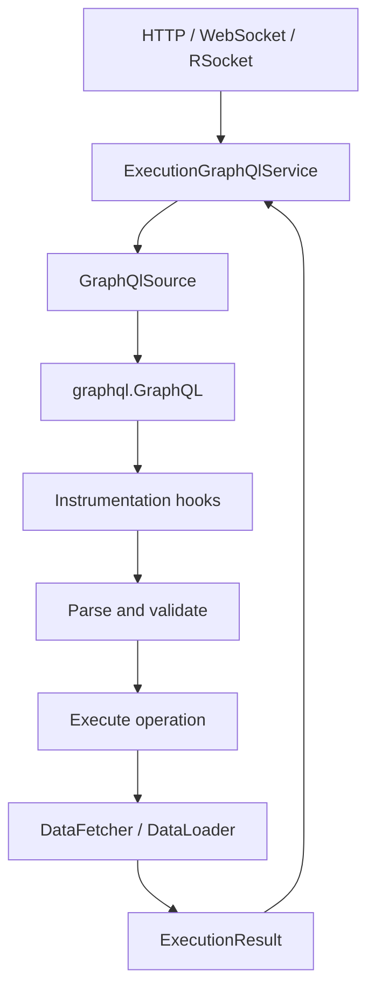
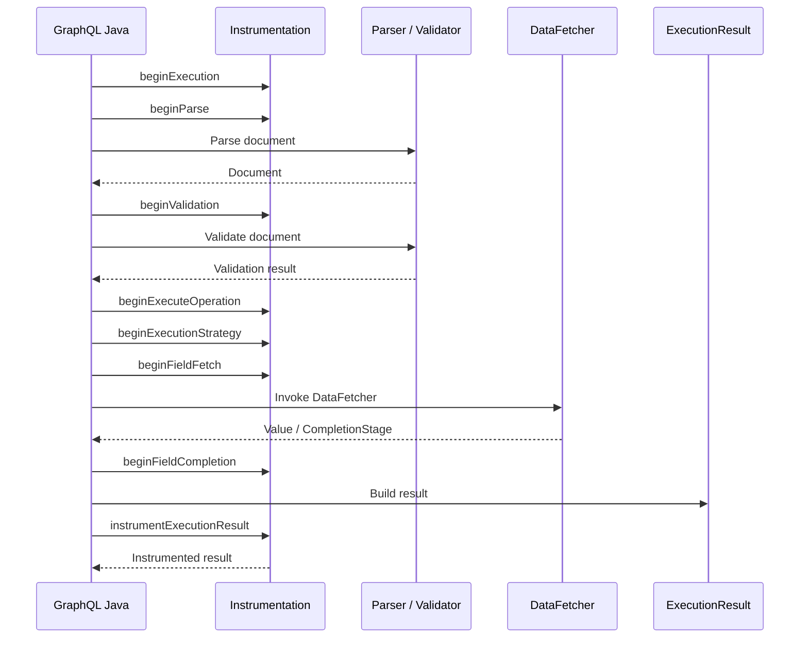

# GraphQL Java Instrumentation

## 1. Vì sao cần GraphQL Java Instrumentation?

Một GraphQL request đi qua nhiều bước trước khi tạo response: nhận `ExecutionInput`, parse document, validate theo schema, chọn operation, chạy execution strategy, gọi DataFetcher, hoàn thiện field và tạo `ExecutionResult`. Một request có thể gọi nhiều resolver, chờ `CompletableFuture`, chạy DataLoader hoặc phát ra nhiều event của Subscription.

Nếu chỉ đo thời gian HTTP tổng thể, ta khó biết thời gian đang tiêu tốn ở bước nào. Nếu cần ghi nhận một field được gọi bao nhiêu lần, đo thời gian của DataFetcher, thêm metadata vào response hoặc kiểm soát một hành vi ở cấp GraphQL engine, cần một extension point nằm bên trong GraphQL Java.

`graphql.execution.instrumentation.Instrumentation` là SPI cho phép gắn logic vào vòng đời thực thi GraphQL. Nó có thể quan sát hoạt động, ghi log/metrics/traces hoặc thay đổi một số dữ liệu và hành vi runtime.

Instrumentation không chỉ dùng cho logging. Những trường hợp thường gặp gồm:

- Đo thời gian toàn request và thời gian từng DataFetcher.
- Theo dõi số lần field được resolve và phát hiện resolver có vấn đề.
- Gắn trace metadata hoặc correlation information vào execution.
- Giới hạn độ sâu hoặc độ phức tạp của query.
- Kiểm tra field và argument trước khi thực thi.
- Bọc DataFetcher để bổ sung hành vi xuyên suốt nhiều resolver.
- Điều chỉnh `ExecutionInput`, document, schema hoặc `ExecutionResult` khi có yêu cầu rõ ràng.

## 2. Instrumentation nằm ở đâu trong Spring for GraphQL?

Spring for GraphQL dùng GraphQL Java làm engine thực thi. `ExecutionGraphQlService` là abstraction chính của Spring để gọi GraphQL Java; implementation `DefaultExecutionGraphQlService` lấy `graphql.GraphQL` instance từ `GraphQlSource`.

Với Spring Boot GraphQL starter, Boot tạo `GraphQlSource.Builder`, nạp SDL, cấu hình runtime wiring và phát hiện các bean `Instrumentation`. Các instrumentation này được gắn vào GraphQL runtime. Khi cần tùy chỉnh builder sâu hơn, có thể khai báo `GraphQlSourceBuilderCustomizer`.



Instrumentation làm việc bên trong GraphQL Java execution. Nó không thay thế transport handler của Spring và không tự tạo một HTTP endpoint mới.

## 3. Vòng đời thực thi mà Instrumentation có thể quan sát

GraphQL Java cung cấp nhiều callback tương ứng với các bước của execution. Tên và số lượng callback cụ thể phụ thuộc phiên bản GraphQL Java, nhưng các điểm mở rộng quan trọng gồm:

| Hook | Thời điểm | Mục đích thường gặp |
| --- | --- | --- |
| `instrumentExecutionInput` | Trước khi xử lý `ExecutionInput` | Điều chỉnh input trước khi GraphQL engine dùng |
| `beginExecution` | Bắt đầu xử lý một GraphQL execution | Đo tổng thời gian hoặc khởi tạo state |
| `beginParse` | Trước khi parse document | Đo hoặc theo dõi parse |
| `beginValidation` | Trước khi validate document | Theo dõi validation và lỗi schema |
| `beginExecuteOperation` | Ngay trước khi chạy operation | Theo dõi Query, Mutation hoặc Subscription operation |
| `beginExecutionStrategy` | Mỗi lần execution strategy chạy | Theo dõi quá trình resolve object/field |
| `beginFieldFetch` / `beginFieldFetching` | Trước khi gọi DataFetcher | Đo hoặc can thiệp vào hoạt động fetch field |
| `instrumentDataFetcher` | Khi GraphQL Java chuẩn bị dùng DataFetcher | Trả về DataFetcher được bọc hoặc điều chỉnh |
| `beginFieldCompletion` | Khi bắt đầu hoàn thiện giá trị field | Theo dõi bước chuyển giá trị Java thành GraphQL value |
| `instrumentExecutionResult` | Khi tạo kết quả thực thi | Bổ sung hoặc điều chỉnh `ExecutionResult` |

Một execution có thể đi qua nhiều hook và có nhiều lần gọi `beginExecutionStrategy` hoặc field fetch. Ví dụ query lấy danh sách sách và tác giả có thể gọi DataFetcher cho `Query.books`, sau đó gọi DataFetcher của field `Book.author` cho từng phần tử.



Các hook không nhất thiết đều được override. Một instrumentation thường chỉ triển khai những bước cần quan sát hoặc điều chỉnh.

## 4. Các kiểu dữ liệu quan trọng

Instrumentation API có một số kiểu trung tâm:

| Kiểu | Vai trò |
| --- | --- |
| `Instrumentation` | Interface định nghĩa các hook của GraphQL execution |
| `InstrumentationState` | State riêng của một execution, được truyền qua các hook |
| `InstrumentationContext<T>` | Callback nhận thông báo khi một bước bắt đầu dispatch và hoàn tất |
| `InstrumentationExecutionParameters` | Thông tin execution như query, schema, variables và execution input |
| `InstrumentationFieldFetchParameters` | Thông tin field đang được DataFetcher xử lý |
| `DataFetcher<?>` | Hàm lấy dữ liệu cho một field |
| `ExecutionResult` | Kết quả GraphQL gồm data, errors và extensions |
| `SimplePerformantInstrumentation` | Base class tiện dụng để override những hook cần thiết |

`Instrumentation` thường được tạo một lần và dùng chung cho nhiều request. Vì thế, không nên lưu thông tin mutable của từng request trực tiếp vào field của instrumentation instance.

## 5. `InstrumentationContext` và callback bất đồng bộ

Mỗi hook dạng `begin...` có thể trả về một `InstrumentationContext`. Context này nhận hai callback quan trọng:

- `onDispatched()`: bước xử lý được dispatch.
- `onCompleted(result, throwable)`: bước xử lý đã hoàn tất; `throwable` khác null nếu có exception trong bước đó.

Đây là thiết kế phù hợp với GraphQL execution bất đồng bộ. DataFetcher có thể trả về giá trị ngay lập tức hoặc một `CompletionStage`. Context giúp instrumentation ghi nhận thời gian hoàn tất của bước thay vì chỉ đo thời gian gọi method.

Ví dụ tạo callback khi một bước hoàn tất:

```java
// Ví dụ nằm trong một class đã khai báo logger.
InstrumentationContext<ExecutionResult> context =
    SimpleInstrumentationContext.whenCompleted((result, throwable) -> {
        if (throwable != null) {
            logger.warn("GraphQL execution step failed", throwable);
        }
    });
```

Không block thread để chờ `CompletionStage` hoàn tất. Hãy dùng callback do GraphQL Java cung cấp để theo dõi kết quả.

## 6. `InstrumentationState` và thread safety

GraphQL Java có thể chạy DataFetcher trên nhiều thread hoặc hoàn tất các future theo thứ tự khác nhau. Một instrumentation instance dùng chung giữa nhiều request không nên chứa các biến như `currentQuery`, `startTime` hoặc `currentUser` ở cấp instance.

`InstrumentationState` cho phép giữ dữ liệu chỉ thuộc một execution. GraphQL Java tạo state trước execution và truyền nó đến các hook tương ứng. Với công việc khởi tạo đơn giản có thể dùng state đồng bộ; với API hiện hành, `createStateAsync` cũng cho phép khởi tạo state bất đồng bộ.

Ví dụ một state đơn giản:

```java
import graphql.execution.instrumentation.InstrumentationState;

public final class RequestInstrumentationState implements InstrumentationState {

    private final long startedAtNanos = System.nanoTime();

    public long startedAtNanos() {
        return startedAtNanos;
    }
}
```

State này được tạo cho từng GraphQL execution. Nếu một execution có nhiều callback chạy song song và cùng ghi vào một collection trong state, collection đó phải được thiết kế thread-safe hoặc dùng cấu trúc dữ liệu phù hợp.

## 7. Dùng `SimplePerformantInstrumentation`

GraphQL Java cung cấp `SimplePerformantInstrumentation` làm base class. Có thể kế thừa class này và override những hook cần thiết mà không phải tự triển khai toàn bộ `Instrumentation` interface.

`SimpleInstrumentation` là API cũ và đã deprecated; tài liệu GraphQL Java hiện hành khuyến nghị `SimplePerformantInstrumentation` cho instrumentation mới.

```java
import graphql.execution.instrumentation.SimplePerformantInstrumentation;

public class AuditInstrumentation extends SimplePerformantInstrumentation {
    // Override các hook cần thiết.
}
```

Không cần tạo một instrumentation riêng cho mọi field. Nên gom các hành vi có cùng mục tiêu vào một implementation có phạm vi rõ ràng, tránh tạo nhiều wrapper không cần thiết.

## 8. Đo thời gian toàn bộ GraphQL execution

Ví dụ sau đo thời gian từ khi GraphQL Java bắt đầu execution đến khi `ExecutionResult` hoàn tất. Kết quả được ghi vào Micrometer Timer với tag `outcome` chỉ có hai giá trị cố định.

```java
import graphql.ExecutionResult;
import graphql.execution.instrumentation.InstrumentationContext;
import graphql.execution.instrumentation.InstrumentationState;
import graphql.execution.instrumentation.SimpleInstrumentationContext;
import graphql.execution.instrumentation.SimplePerformantInstrumentation;
import graphql.execution.instrumentation.parameters.InstrumentationExecutionParameters;
import io.micrometer.core.instrument.MeterRegistry;
import io.micrometer.core.instrument.Timer;

import java.util.concurrent.TimeUnit;

public final class RequestTimingInstrumentation extends SimplePerformantInstrumentation {

    private final MeterRegistry meterRegistry;

    public RequestTimingInstrumentation(MeterRegistry meterRegistry) {
        this.meterRegistry = meterRegistry;
    }

    @Override
    public InstrumentationContext<ExecutionResult> beginExecution(
            InstrumentationExecutionParameters parameters,
            InstrumentationState state) {

        long startedAt = System.nanoTime();

        return SimpleInstrumentationContext.whenCompleted((result, throwable) -> {
            boolean failed = throwable != null
                    || (result != null && !result.getErrors().isEmpty());

            Timer.builder("graphql.custom.execution.duration")
                    .tag("outcome", failed ? "error" : "success")
                    .register(this.meterRegistry)
                    .record(System.nanoTime() - startedAt, TimeUnit.NANOSECONDS);
        });
    }
}
```

`System.nanoTime()` phù hợp để đo khoảng thời gian vì không phụ thuộc đồng hồ hệ thống. Timer ghi cả request có GraphQL errors trong `ExecutionResult`, ngay cả khi engine không ném exception ra ngoài.

Không đưa raw query, variables, token, email hoặc user ID vào metric tag. Các giá trị này có thể làm tăng cardinality và gây rò rỉ dữ liệu.

## 9. Bọc DataFetcher bằng `instrumentDataFetcher`

`instrumentDataFetcher` cho phép nhận DataFetcher gốc và trả về một DataFetcher mới. Đây là điểm mở rộng hữu ích khi cần áp dụng một hành vi chung cho nhiều field, ví dụ đo thời gian gọi resolver hoặc bổ sung logging đã được lọc.

Ví dụ dưới đây đo thời gian DataFetcher trả về giá trị hoặc `CompletionStage` hoàn tất:

```java
import graphql.execution.instrumentation.InstrumentationState;
import graphql.execution.instrumentation.SimplePerformantInstrumentation;
import graphql.execution.instrumentation.parameters.InstrumentationFieldFetchParameters;
import graphql.schema.DataFetcher;
import io.micrometer.core.instrument.MeterRegistry;
import io.micrometer.core.instrument.Timer;

import java.util.concurrent.CompletionStage;
import java.util.concurrent.TimeUnit;

public final class DataFetcherTimingInstrumentation extends SimplePerformantInstrumentation {

    private final MeterRegistry meterRegistry;

    public DataFetcherTimingInstrumentation(MeterRegistry meterRegistry) {
        this.meterRegistry = meterRegistry;
    }

    @Override
    public DataFetcher<?> instrumentDataFetcher(
            DataFetcher<?> original,
            InstrumentationFieldFetchParameters parameters,
            InstrumentationState state) {

        String fieldName = parameters.getEnvironment().getFieldDefinition().getName();

        return environment -> {
            long startedAt = System.nanoTime();
            try {
                Object value = original.get(environment);
                if (value instanceof CompletionStage<?> stage) {
                    return stage.whenComplete((result, error) -> record(fieldName, startedAt));
                }
                record(fieldName, startedAt);
                return value;
            }
            catch (Exception exception) {
                record(fieldName, startedAt);
                throw exception;
            }
        };
    }

    private void record(String fieldName, long startedAt) {
        Timer.builder("graphql.custom.datafetcher.duration")
                .tag("field", fieldName)
                .register(this.meterRegistry)
                .record(System.nanoTime() - startedAt, TimeUnit.NANOSECONDS);
    }
}
```

Field name đến từ schema nên thường có tập giá trị hữu hạn. Nếu muốn thêm tag parent type, chỉ dùng tên type trong schema; không dùng path chứa list index hoặc giá trị argument làm metric tag.

Ví dụ này đo đến khi `CompletionStage` hoàn tất. Với reactive `Publisher` hoặc Subscription stream, thời điểm DataFetcher trả Publisher chưa phải lúc stream kết thúc. Muốn đo vòng đời stream, cần instrument các signal của Reactor/Reactive Streams hoặc hook phù hợp với subscription event.

## 10. Đăng ký Instrumentation trong Spring Boot

Spring Boot GraphQL starter tự phát hiện các bean có kiểu `Instrumentation` và đăng ký chúng vào GraphQL runtime. Vì vậy, cách đơn giản nhất là khai báo instrumentation như một bean:

```java
import graphql.execution.instrumentation.Instrumentation;
import io.micrometer.core.instrument.MeterRegistry;
import org.springframework.context.annotation.Bean;
import org.springframework.context.annotation.Configuration;

@Configuration(proxyBeanMethods = false)
public class GraphQlInstrumentationConfig {

    @Bean
    Instrumentation requestTimingInstrumentation(MeterRegistry meterRegistry) {
        return new RequestTimingInstrumentation(meterRegistry);
    }
}
```

Khi application context khởi tạo, Boot phát hiện bean và đưa instrumentation vào cấu hình GraphQL. Không cần tự tạo một `GraphQL` instance thứ hai trong controller hoặc service.

Nếu ứng dụng đã dùng `GraphQlObservationInstrumentation` của Spring for GraphQL, hãy kiểm tra các metric/trace có sẵn trước khi bổ sung timer trùng lặp. Custom instrumentation phù hợp khi cần metadata hoặc cách đo đặc thù của nghiệp vụ.

## 11. Tùy chỉnh GraphQL builder bằng `GraphQlSourceBuilderCustomizer`

`GraphQlSourceBuilderCustomizer` cho phép cấu hình `GraphQlSource.Builder` trước khi `GraphQlSource` được tạo. Có thể dùng `configureGraphQl` để điều chỉnh `GraphQL.Builder`.

Ví dụ thay đổi cách tạo execution ID:

```java
import org.springframework.boot.graphql.autoconfigure.GraphQlSourceBuilderCustomizer;
import org.springframework.context.annotation.Bean;
import org.springframework.context.annotation.Configuration;

@Configuration(proxyBeanMethods = false)
public class GraphQlBuilderConfig {

    @Bean
    GraphQlSourceBuilderCustomizer executionIdCustomizer() {
        return sourceBuilder -> sourceBuilder.configureGraphQl(graphQlBuilder ->
                graphQlBuilder.executionIdProvider(new CustomExecutionIdProvider())
        );
    }
}
```

`CustomExecutionIdProvider` là implementation do ứng dụng cung cấp. Trong Spring Boot 3.x, `GraphQlSourceBuilderCustomizer` nằm trong package `org.springframework.boot.autoconfigure.graphql`; Spring Boot 4.x dùng package `org.springframework.boot.graphql.autoconfigure`.

Thông thường, đăng ký bean `Instrumentation` là đủ. Chỉ dùng customizer để thay đổi các tùy chọn builder khác hoặc khi cần tự cấu hình rõ cách ghép instrumentation. Nếu gọi `GraphQL.Builder.instrumentation(...)` thủ công, hãy kiểm tra các instrumentation khác mà Boot hoặc ứng dụng đang sử dụng để tránh vô tình thay thế chúng.

## 12. Cấu hình trực tiếp khi không dùng Spring Boot

Ứng dụng chỉ dùng Spring for GraphQL có thể cấu hình instrumentation trực tiếp khi tạo `GraphQlSource`:

```java
import graphql.execution.instrumentation.Instrumentation;
import io.micrometer.core.instrument.MeterRegistry;
import org.springframework.core.io.ClassPathResource;
import org.springframework.graphql.execution.GraphQlSource;

public GraphQlSource graphQlSource(MeterRegistry meterRegistry) {
    Instrumentation instrumentation = new RequestTimingInstrumentation(meterRegistry);

    return GraphQlSource.schemaResourceBuilder()
            .schemaResources(new ClassPathResource("graphql/schema.graphqls"))
            .configureGraphQl(graphQlBuilder ->
                    graphQlBuilder.instrumentation(instrumentation))
            .build();
}
```

Trong ứng dụng thực tế, hãy đăng ký `GraphQlSource` này như một singleton bean và cấu hình đầy đủ runtime wiring, exception resolvers cùng các thành phần Spring GraphQL cần thiết.

## 13. Kết hợp nhiều Instrumentation

Một GraphQL runtime có thể dùng nhiều instrumentation. GraphQL Java cung cấp `ChainedInstrumentation` để kết hợp một danh sách instrumentation theo thứ tự xác định.

```java
import graphql.GraphQL;
import graphql.execution.instrumentation.ChainedInstrumentation;
import graphql.execution.instrumentation.Instrumentation;

import java.util.List;

Instrumentation instrumentation = new ChainedInstrumentation(List.of(
        new RequestTimingInstrumentation(meterRegistry),
        new AuditInstrumentation(),
        new QueryPolicyInstrumentation()
));

GraphQL graphQL = GraphQL.newGraphQL(schema)
        .instrumentation(instrumentation)
        .build();
```

Thứ tự trong danh sách là thứ tự các instrumentation được gọi trong chain. Khi một instrumentation thay đổi `ExecutionInput`, `DataFetcher` hoặc `ExecutionResult`, instrumentation chạy sau có thể quan sát kết quả đã được thay đổi.

Trong Spring Boot, starter có thể tự phát hiện nhiều bean `Instrumentation`. Nếu cần một thứ tự cụ thể hoặc một chain tự quản lý, hãy cấu hình rõ ràng và kiểm tra các instrumentation mặc định mà ứng dụng cần giữ lại.

## 14. Các Instrumentation có sẵn trong GraphQL Java

GraphQL Java cung cấp một số implementation có thể dùng trực tiếp:

| Instrumentation | Mục đích |
| --- | --- |
| `MaxQueryDepthInstrumentation` | Giới hạn độ sâu của query |
| `MaxQueryComplexityInstrumentation` | Giới hạn độ phức tạp tính toán của query |
| `FieldValidationInstrumentation` | Kiểm tra field và argument trước khi thực thi |
| `DataLoaderDispatcherInstrumentation` | Dispatch DataLoader theo các cấp execution khi cần |
| `TracingInstrumentation` | Tạo thông tin tracing theo định dạng Apollo Tracing cũ |
| `ExecutorInstrumentation` | Điều chỉnh executor/thread dùng cho DataFetcher trong các trường hợp phù hợp |

Ví dụ giới hạn query depth:

```java
import graphql.execution.instrumentation.Instrumentation;
import graphql.analysis.MaxQueryDepthInstrumentation;

Instrumentation depthLimit = new MaxQueryDepthInstrumentation(8);
```

Tên package và constructor của các implementation có thể thay đổi theo GraphQL Java version. Hãy kiểm tra Javadoc của dependency mà ứng dụng đang dùng trước khi sao chép cấu hình.

GraphQL Java cũng có parser-level limits như giới hạn số ký tự, số token và độ sâu grammar. Instrumentation giới hạn query depth/complexity bổ sung một lớp kiểm soát sau parse; nó không thay thế parser limits hoặc rate limiting ở transport.

## 15. Instrumentation và các extension point khác của Spring GraphQL

Các extension point có phạm vi khác nhau. Chọn đúng điểm mở rộng giúp code dễ hiểu và tránh xử lý cùng một việc ở nhiều lớp.

| Extension point | Phạm vi | Khi nào dùng |
| --- | --- | --- |
| GraphQL Java `Instrumentation` | Vòng đời parse, validation và execution của GraphQL engine | Đo thời gian, trace, giới hạn query, bọc DataFetcher |
| Spring `WebGraphQlInterceptor` | Request/response ở tầng Spring GraphQL transport | Đọc header, xác thực request, thêm GraphQLContext, thay đổi response |
| `RuntimeWiringConfigurer` | Cấu hình schema runtime wiring | Đăng ký scalar, directive wiring hoặc DataFetcher trực tiếp |
| `DataFetcherExceptionResolver` | Exception phát sinh từ DataFetcher | Chuyển exception thành GraphQL errors |
| `ExecutionStrategy` | Cách GraphQL Java điều phối việc fetch và complete field | Thay đổi sâu thuật toán thực thi hoặc transaction boundary |
| `GraphQlSourceBuilderCustomizer` | Cấu hình GraphQlSource/GraphQL builder lúc khởi tạo | Đăng ký hoặc thay đổi tùy chọn runtime |

Ví dụ: nếu cần lấy access token từ HTTP header, hãy dùng Spring Security hoặc `WebGraphQlInterceptor` để xác thực và đưa principal vào context. Không nên đọc HTTP header trong `Instrumentation`, vì GraphQL Java execution không nên phụ thuộc trực tiếp vào transport.

Nếu cần chuyển `BookNotFoundException` thành error code ổn định, dùng `DataFetcherExceptionResolver` hoặc `@GraphQlExceptionHandler`. Instrumentation có thể quan sát việc lỗi xảy ra, nhưng không phải extension point chuyên biệt để ánh xạ lỗi nghiệp vụ.

## 16. Instrumentation với Query, Mutation và Subscription

Instrumentation áp dụng ở cấp GraphQL execution, do đó có thể quan sát cả Query, Mutation và Subscription.

- Query có thể chạy nhiều field độc lập theo execution strategy.
- Mutation thường thực thi các root field tuần tự theo semantics của GraphQL.
- Subscription tạo một luồng event; sau khi thiết lập subscription, mỗi event có thể kích hoạt quá trình resolve field selection tương ứng.

Với Subscription, không nên đánh đồng thời gian khởi tạo operation với toàn bộ thời gian kết nối WebSocket. Một subscription có thể tồn tại lâu và phát nhiều event. Nếu cần đo từng event, hãy dùng hook liên quan đến subscribed field event hoặc instrumentation của reactive stream.

## 17. Bảo đảm tính bất đồng bộ và reactive

GraphQL Java hỗ trợ DataFetcher trả về giá trị đồng bộ hoặc `CompletionStage`. Spring for GraphQL còn hỗ trợ kiểu reactive như `Mono` và `Flux` thông qua integration của mình.

Khi viết instrumentation:

- Không gọi `.get()` hoặc `.join()` trên future chỉ để lấy kết quả đo đạc.
- Không block event-loop của WebFlux.
- Không giả định callback luôn chạy trên cùng thread đã bắt đầu execution.
- Dùng `InstrumentationContext` hoặc callback của `CompletionStage` để đo thời điểm hoàn tất.
- Với `Publisher` và Subscription, theo dõi signal subscribe/complete/cancel thay vì chỉ đo thời điểm DataFetcher trả về Publisher.
- Giữ state theo execution, không lưu state request vào singleton instrumentation instance.

Instrumentation chỉ nên thêm chi phí nhỏ vào đường xử lý. Nếu callback thực hiện I/O đồng bộ, ghi log quá nhiều hoặc tính toán nặng, chính instrumentation có thể trở thành nguyên nhân làm GraphQL request chậm.

## 18. Bảo mật và hiệu năng khi viết Instrumentation

Instrumentation có thể đọc query, variables, execution context, field arguments và kết quả. Những dữ liệu này có thể chứa thông tin nhạy cảm.

Một số nguyên tắc:

- Không ghi raw GraphQL document hoặc variables vào log theo mặc định.
- Không ghi access token, cookie, email, số tài khoản hoặc dữ liệu cá nhân vào span/metric tag.
- Chỉ dùng tag có tập giá trị hữu hạn, ví dụ operation type hoặc field name từ schema.
- Không đưa user ID, request ID, raw field path có list index vào metric tag.
- Không thay đổi `ExecutionInput` hoặc `ExecutionResult` nếu không có mục tiêu rõ ràng.
- Không dùng instrumentation thay thế authorization tại resolver/service.
- Đặt giới hạn độ sâu và độ phức tạp query phù hợp với workload thực tế.
- Đo overhead của instrumentation trước khi bật cho toàn bộ production traffic.

Instrumentation là code chạy trên đường xử lý của mọi GraphQL request. Một thay đổi nhỏ trong callback có thể ảnh hưởng đến latency của tất cả client.

## 19. Kiểm thử Instrumentation

Nên kiểm tra cả hành vi GraphQL và dữ liệu mà instrumentation phát ra.

Với request timing instrumentation, một integration test có thể:

1. Khởi động Spring context với instrumentation bean và `SimpleMeterRegistry`.
2. Gửi một Query thành công qua `GraphQlTester`.
3. Xác nhận response vẫn đúng như trước khi thêm instrumentation.
4. Xác nhận Timer `graphql.custom.execution.duration` có một sample với outcome `success`.
5. Gửi một operation tạo GraphQL error.
6. Xác nhận Timer vẫn được ghi và outcome là `error`.
7. Gửi operation có DataFetcher trả `CompletionStage` để xác nhận callback chỉ ghi sau khi future hoàn tất.

Với DataFetcher wrapper, kiểm thử cả kết quả đồng bộ, `CompletionStage` hoàn tất bình thường và `CompletionStage` hoàn tất exceptional. Nếu hỗ trợ Subscription, kiểm thử subscribe, event, error và cancel riêng.

Một test instrumentation không nên chỉ kiểm tra callback được gọi. Hãy xác nhận GraphQL response, error mapping và DataLoader vẫn hoạt động bình thường khi instrumentation được đăng ký cùng các extension point khác.

## 20. Lỗi thường gặp

| Hiện tượng | Nguyên nhân có thể | Cách xử lý |
| --- | --- | --- |
| Instrumentation không được gọi | Bean không được đăng ký vào GraphQlSource hoặc GraphQL runtime khác đang được dùng | Kiểm tra Boot starter, bean type và `GraphQlSource` thực tế |
| Timer chỉ đo thời gian gọi DataFetcher | Đo ngay sau khi method trả `CompletableFuture` | Gắn callback `whenComplete` hoặc dùng InstrumentationContext |
| Request duration thấp hơn thời gian người dùng cảm nhận | Chỉ đo GraphQL execution, không gồm transport, serialization hoặc network | So sánh với HTTP server observation và trace transport |
| Metric tăng cardinality | Tag chứa query, variables, user ID hoặc field path động | Chỉ dùng metadata có tập giá trị hữu hạn |
| Request khác nhau ghi đè state | Lưu `startTime` hoặc `currentQuery` ở field singleton | Dùng local callback hoặc `InstrumentationState` theo request |
| Callback chạy trên thread khác | GraphQL execution bất đồng bộ | Thiết kế thread-safe, không dựa vào ThreadLocal tùy tiện |
| DataLoader không dispatch | Custom instrumentation chain vô tình thay thế instrumentation cần thiết | Kiểm tra chain và DataLoader dispatcher |
| Query hợp lệ nhưng bị từ chối | Query depth/complexity limit quá thấp hoặc field validation rule không phù hợp | Điều chỉnh ngưỡng theo workload và test query đại diện |
| Response có extensions không mong muốn | `instrumentExecutionResult` thay đổi kết quả | Chỉ thêm extension theo hợp đồng rõ ràng và tránh ghi dữ liệu nhạy cảm |
| Dùng `SimpleInstrumentation` bị cảnh báo deprecated | Đang kế thừa base class cũ | Chuyển sang `SimplePerformantInstrumentation` |

## 21. Checklist triển khai GraphQL Java Instrumentation

- [ ] Xác định mục tiêu: timing, tracing, query limits, validation hay DataFetcher wrapper.
- [ ] Chọn đúng hook trong GraphQL execution lifecycle.
- [ ] Dùng `SimplePerformantInstrumentation` cho implementation mới.
- [ ] Trả về `InstrumentationContext` phù hợp với bước bất đồng bộ.
- [ ] Dùng `InstrumentationState` cho dữ liệu riêng của từng execution.
- [ ] Bảo đảm instrumentation singleton thread-safe.
- [ ] Đăng ký bean `Instrumentation` trong Spring Boot hoặc cấu hình trực tiếp `GraphQlSource`.
- [ ] Dùng `GraphQlSourceBuilderCustomizer` khi cần tùy chỉnh builder sâu hơn.
- [ ] Kiểm tra thứ tự khi kết hợp nhiều instrumentation.
- [ ] Không vô tình thay thế instrumentation cần cho DataLoader hoặc observability.
- [ ] Không log query, variables hoặc dữ liệu nhạy cảm.
- [ ] Giữ metric tag ở cardinality thấp.
- [ ] Kiểm thử Query, Mutation, async DataFetcher và Subscription nếu có.
- [ ] Đo overhead trước khi bật trên production.

## Kết luận

GraphQL Java Instrumentation là extension point ở cấp execution engine, cho phép quan sát và điều chỉnh các bước của một GraphQL request. Các hook như `beginExecution`, `beginParse`, `beginValidation`, `beginFieldFetch`, `instrumentDataFetcher` và `instrumentExecutionResult` hỗ trợ đo hiệu năng, tracing, query policy và các hành vi xuyên suốt nhiều DataFetcher.

Trong Spring for GraphQL, Spring Boot GraphQL starter tự phát hiện bean `Instrumentation` và đăng ký chúng vào `GraphQlSource`. Với instrumentation mới, nên kế thừa `SimplePerformantInstrumentation`, quản lý state theo từng execution và dùng callback để xử lý đúng vòng đời bất đồng bộ. Cần phân biệt Instrumentation với `WebGraphQlInterceptor`, `RuntimeWiringConfigurer`, `DataFetcherExceptionResolver` và `ExecutionStrategy` để chọn đúng lớp mở rộng. Một implementation tốt phải thread-safe, có overhead thấp, không làm lộ dữ liệu và giữ nguyên semantics của GraphQL response.

## Tài liệu tham khảo

- [GraphQL Java — Instrumentation](https://graphql-java.com/documentation/instrumentation/)
- [GraphQL Java — Limits](https://graphql-java.com/documentation/limits/)
- [GraphQL Java — `Instrumentation` API](https://javadoc.io/doc/com.graphql-java/graphql-java/latest/graphql/execution/instrumentation/Instrumentation.html)
- [GraphQL Java — `SimplePerformantInstrumentation` API](https://javadoc.io/doc/com.graphql-java/graphql-java/latest/graphql/execution/instrumentation/SimplePerformantInstrumentation.html)
- [GraphQL Java — `InstrumentationContext` API](https://javadoc.io/doc/com.graphql-java/graphql-java/latest/graphql/execution/instrumentation/InstrumentationContext.html)
- [Spring for GraphQL — Request Execution](https://docs.spring.io/spring-graphql/reference/request-execution.html)
- [Spring for GraphQL — Data Integration](https://docs.spring.io/spring-graphql/reference/data.html)
