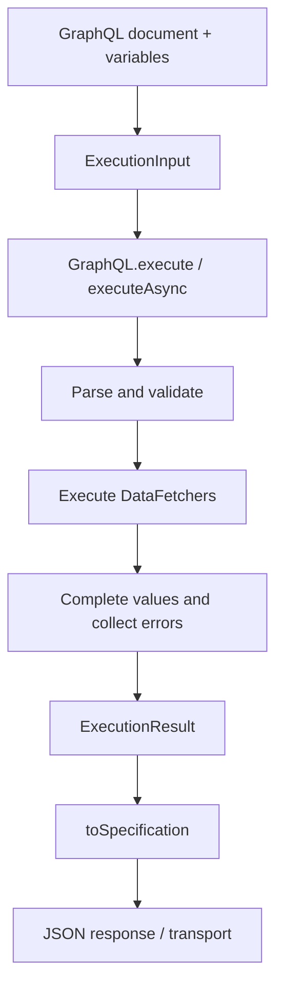

# ExecutionResult

Khi GraphQL Java thực thi một query hoặc mutation, engine tạo ra một đối tượng `graphql.ExecutionResult`. Đối tượng này chứa dữ liệu đã resolve, danh sách lỗi phát sinh trong request và metadata mở rộng nếu có. Đây là kết quả ở tầng GraphQL execution, trước khi Spring for GraphQL hoặc transport chuyển nó thành HTTP, WebSocket hay RSocket response.

`ExecutionResult` quan trọng vì GraphQL cho phép trả về partial data cùng errors. Một field có thể lỗi trong khi các field khác vẫn thành công. Ngoài ra, request có thể thất bại trước khi execution bắt đầu; lúc đó response có errors nhưng không có entry `data`. Vì thế, chỉ gọi `getData()` rồi kiểm tra null là chưa đủ để hiểu kết quả.

Bài học này trình bày cấu trúc và vòng đời của `ExecutionResult`, cách đọc `data`, `errors`, `extensions`, phân biệt request error với execution error, cách tạo và biến đổi result, cách serialize đúng GraphQL response format và cách Spring for GraphQL bọc kết quả này.

## 1. ExecutionResult nằm ở đâu trong luồng thực thi?

GraphQL Java nhận `ExecutionInput`, thực thi schema và trả về `ExecutionResult`:



Ở Spring for GraphQL, luồng được bao bởi các abstraction:

```text
HTTP / WebSocket / RSocket request
              |
              v
       ExecutionGraphQlService
              |
              v
          GraphQL Java
              |
              v
        ExecutionResult
              |
              v
      ExecutionGraphQlResponse
              |
              v
         GraphQlResponse
              |
              v
       Transport serialization
```

| Kiểu | Vai trò |
| --- | --- |
| `ExecutionInput` | Input GraphQL Java cần thực thi: document, operation name, variables, context và các tùy chọn |
| `ExecutionResult` | Kết quả cuối của một lần GraphQL execution |
| `DataFetcherResult<T>` | Giá trị trung gian mà một DataFetcher có thể trả về, gồm data, errors, local context và extensions |
| `ExecutionGraphQlResponse` | Spring server-side wrapper cho ExecutionResult, đồng thời giữ ExecutionInput |
| `GraphQlResponse` | API response cấp cao của Spring, cung cấp data, errors, extensions và field navigation |

Đừng nhầm `ExecutionResult` với HTTP response. Nó không chứa HTTP status code, cookie hay response headers. Những thông tin transport đó thuộc lớp Spring web/transport.

## 2. Các thành phần của ExecutionResult

API chính của `ExecutionResult`:

| Method | Ý nghĩa |
| --- | --- |
| `getData()` | Lấy dữ liệu GraphQL đã resolve; kiểu trả về generic và có thể là null |
| `isDataPresent()` | Cho biết response có entry `data` hay không |
| `getErrors()` | Danh sách `GraphQLError`; trả danh sách rỗng nếu không có lỗi |
| `getExtensions()` | Metadata mở rộng ở cấp response; có thể null nếu không có |
| `toSpecification()` | Chuyển kết quả thành Map tuân theo GraphQL response specification |
| `transform(...)` | Tạo một ExecutionResult mới dựa trên result hiện tại và builder |
| `newExecutionResult()` | Tạo builder để xây dựng một result mới |
| `fromSpecification(...)` | Tạo ExecutionResult từ Map response theo specification |

`ExecutionResult` là interface. Khi cần tạo result mới, ưu tiên static builder trên interface thay vì phụ thuộc trực tiếp vào implementation `ExecutionResultImpl`.

## 3. Đọc data và hiểu isDataPresent

`getData()` trả về dữ liệu của operation. Với query hoặc mutation, dữ liệu thường là Map tương ứng với root operation type:

```java
ExecutionResult result = graphQL.execute(executionInput);

Map<String, Object> data = result.getData();
List<GraphQLError> errors = result.getErrors();
```

Điểm cần chú ý: `getData()` trả về null trong nhiều tình huống khác nhau. Ví dụ:

- Request lỗi trước khi execution bắt đầu: response không có entry `data`.
- Execution gặp lỗi khiến toàn bộ data bị null propagation: response có entry `data` với giá trị null.
- Một result được tạo có chủ đích với data null.

`isDataPresent()` giúp phân biệt trường hợp không có entry `data` với trường hợp có entry nhưng giá trị null.

| Trường hợp | isDataPresent() | getData() | getErrors() |
| --- | --- | --- | --- |
| Query thành công | true | Object chứa data | Rỗng |
| Execution lỗi một field, còn partial data | true | Object có field null | Có lỗi |
| Lỗi lan truyền đến root | true | null | Có lỗi |
| Parse/validation/variable coercion error trước execution | false | null | Có lỗi |

Ví dụ kiểm tra đúng:

```java
if (!result.isDataPresent()) {
    // Request failed before execution produced a data entry.
    log.warn("GraphQL request errors: {}", result.getErrors());
} else if (result.getData() == null) {
    // Execution produced a data entry whose value is null.
    log.warn("GraphQL execution returned null data");
} else if (!result.getErrors().isEmpty()) {
    // Partial data is available together with field errors.
    log.warn("GraphQL completed with partial data");
}
```

Không viết logic kiểu `if (result.getData() == null) return 400`. Cần xét `isDataPresent()`, errors, chính sách API và quy tắc HTTP của transport. Một GraphQL execution error không tự động có nghĩa toàn bộ HTTP request phải thất bại.

## 4. Request errors và execution errors

GraphQL phân biệt lỗi xảy ra trước khi thực thi operation và lỗi xảy ra trong quá trình resolve field.

### Request error

Request error khiến GraphQL không thể bắt đầu execution. Ví dụ:

- GraphQL document sai cú pháp.
- Field hoặc argument không tồn tại trong schema.
- Operation name không xác định được.
- Variable không đúng kiểu hoặc không thể coerce.

Response không có entry `data`:

```json
{
  "errors": [
    {
      "message": "Cannot query field \"unknownField\" on type \"Query\".",
      "locations": [
        { "line": 2, "column": 3 }
      ]
    }
  ]
}
```

Trong trường hợp này, chưa có DataFetcher nào chạy cho operation. Do đó, lỗi thường không có `path` trỏ tới một response field.

### Execution error

Execution error xảy ra khi GraphQL đang resolve hoặc hoàn thiện giá trị của field. GraphQL có thể tiếp tục thực thi các field độc lập và trả partial data:

```graphql
query {
  book(id: "book-1") {
    id
    title
    author {
      name
    }
  }
  featuredBook {
    id
    title
  }
}
```

Nếu việc lấy author thất bại nhưng các field khác thành công:

```json
{
  "data": {
    "book": {
      "id": "book-1",
      "title": "Spring GraphQL",
      "author": null
    },
    "featuredBook": {
      "id": "book-2",
      "title": "GraphQL in Practice"
    }
  },
  "errors": [
    {
      "message": "Author service is unavailable",
      "path": ["book", "author"],
      "extensions": {
        "code": "AUTHOR_UNAVAILABLE"
      }
    }
  ]
}
```

Client vẫn sử dụng được `book.id`, `book.title` và `featuredBook`. Field lỗi được biểu diễn bằng null theo quy tắc hoàn thiện giá trị GraphQL.

### Non-null propagation

Nếu field bị lỗi có kiểu Non-Null, null không được giữ tại field đó. Lỗi lan truyền lên parent gần nhất có thể nhận null:

```graphql
type Book {
  id: ID!
  author: Author!
}

type Author {
  name: String!
}
```

Nếu `Book.author` là `Author!` và không thể resolve, GraphQL không thể trả `author: null`. Giá trị null lan truyền lên object Book; nếu field root `book` cũng Non-Null, lỗi tiếp tục lan truyền cao hơn. Error path vẫn chỉ tới field gốc gây lỗi, dù field đó không xuất hiện trong data cuối cùng.

Điều này giải thích vì sao schema nullability ảnh hưởng trực tiếp đến hình dạng `ExecutionResult` khi có lỗi.

## 5. Đọc GraphQLError

`ExecutionResult.getErrors()` trả về danh sách `GraphQLError`. Mỗi lỗi có thể cung cấp:

| Method | Nội dung |
| --- | --- |
| `getMessage()` | Mô tả lỗi dành cho developer |
| `getLocations()` | Vị trí line/column trong GraphQL document nếu xác định được |
| `getPath()` | Đường dẫn đến response position bị lỗi |
| `getErrorType()` | Phân loại lỗi trong GraphQL Java |
| `getExtensions()` | Metadata mở rộng riêng cho lỗi |
| `toSpecification()` | Chuyển error thành Map theo error format của GraphQL |

Ví dụ:

```java
for (GraphQLError error : result.getErrors()) {
    log.warn(
            "GraphQL error: message={}, path={}, type={}",
            error.getMessage(),
            error.getPath(),
            error.getErrorType());
}
```

### Path sử dụng response name và alias

Path không đơn thuần là tên field trong schema. Nó chỉ vị trí trong response, vì vậy phải dùng alias nếu operation có alias và dùng index bắt đầu từ 0 cho list:

```graphql
query {
  primary: book(id: "book-1") {
    author {
      name
    }
  }
}
```

Nếu lỗi xảy ra ở tên tác giả, path có thể là:

```json
["primary", "author", "name"]
```

Với list:

```json
["books", 2, "author", "name"]
```

Nhờ path, client biết chính xác response field nào bị ảnh hưởng mà không phải suy luận từ message.

### Extensions của error

GraphQL cho phép mỗi error có map `extensions`. Ứng dụng thường dùng nó để đưa mã lỗi ổn định:

```json
{
  "message": "Book is not available",
  "path": ["book"],
  "extensions": {
    "code": "BOOK_UNAVAILABLE",
    "retryable": false
  }
}
```

Client nên dựa vào `extensions.code` thay vì phân tích chuỗi message. Không đưa SQL, stack trace, access token, thông tin cá nhân hoặc nội dung exception nội bộ vào extensions gửi cho client.

## 6. Extensions ở cấp response

`ExecutionResult.getExtensions()` trả về metadata do implementation bổ sung cho toàn bộ response. Nó khác với `GraphQLError.getExtensions()`:

| Vị trí | Phạm vi | Ví dụ |
| --- | --- | --- |
| `ExecutionResult.extensions` | Toàn bộ operation result | Phiên bản API, tracing metadata, query cost |
| `GraphQLError.extensions` | Một lỗi cụ thể | Error code, retryable, mã nghiệp vụ |
| `DataFetcherResult.extensions` | Metadata do một DataFetcher đóng góp vào result | Nguồn dữ liệu, cache metadata |

Ví dụ response-level extensions:

```json
{
  "data": {
    "book": {
      "id": "book-1",
      "title": "Spring GraphQL"
    }
  },
  "extensions": {
    "queryCost": 12,
    "apiVersion": "2026.11"
  }
}
```

GraphQL specification dành key `extensions` cho metadata riêng của implementation. Không thêm key cấp cao nhất tùy ý như `traceId` hoặc `debug` bên ngoài `extensions`; response top-level chỉ có các key chuẩn `data`, `errors` và `extensions`.

`getExtensions()` có thể trả về null nếu không có extension. Khi đọc, xử lý null an toàn:

```java
Map<Object, Object> extensions = result.getExtensions();
if (extensions != null) {
    Object queryCost = extensions.get("queryCost");
}
```

Extensions là metadata phục vụ protocol và vận hành. Không dùng nó thay cho field trong schema để truyền dữ liệu nghiệp vụ mà client cần query, validate hoặc type-check.

## 7. Tạo ExecutionResult bằng builder

GraphQL Java cung cấp `ExecutionResult.newExecutionResult()`. Builder cho phép thiết lập data, errors và extensions:

```java
GraphQLError error = GraphqlErrorBuilder.newError()
        .message("Author service is unavailable")
        .path(List.of("book", "author"))
        .errorType(ErrorType.DataFetchingException)
        .extensions(Map.of("code", "AUTHOR_UNAVAILABLE"))
        .build();

Map<String, Object> book = new LinkedHashMap<>();
book.put("id", "book-1");
book.put("title", "Spring GraphQL");
book.put("author", null);

Map<String, Object> data = Map.of("book", book);

ExecutionResult result = ExecutionResult.newExecutionResult()
        .data(data)
        .addError(error)
        .addExtension("apiVersion", "2026.11")
        .build();
```

Kết quả có cả data và error. Đây là partial execution result: field `author` null vì lỗi, nhưng các field khác vẫn có thể sử dụng.

Builder hỗ trợ:

- `data(Object)` đặt data.
- `errors(List<GraphQLError>)` thay toàn bộ danh sách lỗi hiện tại.
- `addError(GraphQLError)` thêm một lỗi.
- `addErrors(List<GraphQLError>)` thêm nhiều lỗi.
- `extensions(Map<Object, Object>)` đặt map extensions.
- `addExtension(String, Object)` thêm một extension.
- `build()` tạo ExecutionResult.
- `from(ExecutionResult)` khởi tạo builder từ result có sẵn.

### Tạo result chỉ có request errors

Request error xảy ra trước execution nên response không có key `data`. Có thể dựng result từ specification map:

```java
Map<String, Object> requestErrorMap = Map.of(
        "errors",
        List.of(Map.of("message", "Invalid GraphQL document")));

ExecutionResult requestError =
        ExecutionResult.fromSpecification(requestErrorMap);

assert !requestError.isDataPresent();
assert requestError.getData() == null;
assert !requestError.getErrors().isEmpty();
```

`fromSpecification` phù hợp khi cần chuyển một map đã có cấu trúc GraphQL response thành object GraphQL Java. Nếu ứng dụng chỉ xử lý operation bình thường, hãy để GraphQL engine tạo result thay vì tự tạo thủ công.

## 8. Biến đổi ExecutionResult với transform

`ExecutionResult.transform(...)` tạo một result mới bằng cách khởi tạo builder từ result hiện tại rồi áp dụng thay đổi:

```java
ExecutionResult enriched = result.transform(builder ->
        builder.addExtension("service", "catalog-api"));
```

Result gốc không bị sửa trực tiếp. Đây là cách thích hợp để bổ sung metadata sau execution mà vẫn giữ data và errors đã có.

Có thể dùng transform để thêm một lỗi hoặc cập nhật lỗi:

```java
ExecutionResult updated = result.transform(builder ->
        builder.addError(additionalError));
```

Khi thay toàn bộ errors:

```java
ExecutionResult updated = result.transform(builder ->
        builder.errors(sanitizedErrors));
```

`errors(...)` thay danh sách hiện tại, trong khi `addError(...)` nối thêm lỗi. Chọn đúng method để tránh vô tình xóa errors mà DataFetcher hoặc execution engine đã tạo.

### Không thay đổi result theo cách phá response contract

Khi transform, cần giữ các quy tắc:

- Nếu execution đã chạy, response phải có entry `data`, kể cả khi giá trị là null.
- Nếu có lỗi, errors phải là danh sách không rỗng.
- Nếu không có lỗi, không nên phát một errors list rỗng vào response specification.
- Không xóa error path hoặc location cần thiết cho client chẩn đoán.
- Không đưa metadata nhạy cảm vào extensions.

Nếu sửa data hoặc errors sau execution, cần đảm bảo chúng vẫn nhất quán với nhau. Ví dụ, không xóa một field khỏi data nhưng giữ error path chỉ tới field đã bị đổi tên nếu điều đó làm client không thể định vị lỗi.

## 9. DataFetcherResult khác ExecutionResult như thế nào?

`DataFetcherResult<T>` không phải kết quả cuối của toàn GraphQL operation. Nó là object mà một DataFetcher có thể trả về để đóng góp data, errors, local context và extensions cho field hiện tại.

Ví dụ DataFetcher tải author từ service ngoài:

```java
DataFetcher<DataFetcherResult<Author>> authorFetcher = environment -> {
    Author author = authorService.findById(environment.getArgument("id"));

    if (author == null) {
        GraphQLError error = GraphqlErrorBuilder.newError(environment)
                .message("Author was not found")
                .errorType(ErrorType.DataFetchingException)
                .extensions(Map.of("code", "AUTHOR_NOT_FOUND"))
                .build();

        return DataFetcherResult.<Author>newResult()
                .data(null)
                .error(error)
                .build();
    }

    return DataFetcherResult.<Author>newResult()
            .data(author)
            .extensions(Map.of("source", "author-service"))
            .build();
};
```

GraphQL Java lấy data và errors từ DataFetcherResult, tiếp tục hoàn thiện các field khác, rồi tổng hợp thành `ExecutionResult` cuối cùng.

| Thuộc tính | DataFetcherResult | ExecutionResult |
| --- | --- | --- |
| Phạm vi | Một field/DataFetcher | Toàn operation execution |
| Data | Giá trị field | Cấu trúc data của root operation |
| Errors | Lỗi do field đóng góp | Tập lỗi tổng hợp |
| Extensions | Được merge vào result theo ExtensionsMerger | Extensions cuối cùng của operation |
| Local context | Có, truyền xuống child DataFetcher | Không phải response metadata |
| Serialization | Không serialize trực tiếp thành GraphQL response | Dùng `toSpecification()` để tạo response map |

### Local context chỉ dành cho DataFetcher con

`DataFetcherResult.localContext` truyền một object xuống các field con qua `DataFetchingEnvironment.getLocalContext()`. Nó không xuất hiện trong JSON response:

```java
return DataFetcherResult.<Book>newResult()
        .data(book)
        .localContext(new BookAccessContext(currentUser, permissions))
        .build();
```

Resolver của field con:

```java
DataFetcher<Author> authorFetcher = environment -> {
    BookAccessContext context = environment.getLocalContext();
    Book book = environment.getSource();

    return authorService.findVisibleAuthor(book, context.permissions());
};
```

Local context hữu ích khi parent DataFetcher đã tính toán metadata cần cho child field. Không đặt secret hoặc thông tin không cần thiết vào response extensions chỉ để truyền nội bộ giữa DataFetcher; hãy dùng local context hoặc GraphQLContext đúng phạm vi.

### Extensions từ nhiều DataFetcher

DataFetcherResult có thể đóng góp extensions. GraphQL Java dùng `ExtensionsBuilder` và `ExtensionsMerger` để gộp các map này vào `ExecutionResult.getExtensions()`. Quy tắc merge phụ thuộc merger đang cấu hình; default merger có thể deep-merge map, nối list và ưu tiên giá trị bên phải khi key trùng.

Không giả định extension key do hai DataFetcher độc lập đóng góp sẽ luôn được giữ theo cách bạn mong muốn nếu chúng dùng cùng một key. Hãy đặt namespace rõ ràng, ví dụ `catalog.source` và `pricing.cache`, hoặc cấu hình merger phù hợp.

## 10. Serialize đúng bằng toSpecification()

`ExecutionResult` là object Java, không phải JSON response map. Khi cần serialize kết quả thành GraphQL response, dùng `toSpecification()`:

```java
ExecutionResult result = graphQL.execute(executionInput);

Map<String, Object> responseMap = result.toSpecification();
String json = objectMapper.writeValueAsString(responseMap);
```

GraphQL Java cung cấp method này để tạo Map tuân theo response format của GraphQL specification. Đây là lựa chọn an toàn hơn việc đưa trực tiếp object `ExecutionResult` cho Jackson hoặc Gson serialize theo quy tắc bean thông thường.

### Vì sao không serialize trực tiếp ExecutionResult?

Một serializer Java có thể:

- Serialize tên property theo convention riêng.
- Bỏ qua giá trị null.
- Expose các thuộc tính implementation không thuộc GraphQL response format.
- Không xử lý đúng sự khác biệt giữa data absent và data null.

GraphQL response có các quy tắc riêng về việc có mặt của `data`, `errors` và `extensions`. `toSpecification()` giữ các quy tắc đó:

| Trạng thái | Map được tạo |
| --- | --- |
| Thành công | Có `data`; không có `errors` nếu không có lỗi |
| Partial data | Có `data` và `errors` |
| Request error trước execution | Có `errors`; không có `data` |
| Có metadata mở rộng | Thêm `extensions` nếu có |

### fromSpecification()

Chiều ngược lại, `ExecutionResult.fromSpecification(map)` chuyển một Map theo response specification thành object:

```java
Map<String, Object> responseMap = result.toSpecification();
ExecutionResult restored = ExecutionResult.fromSpecification(responseMap);
```

API này hữu ích cho adapter hoặc integration cần chuyển đổi giữa cấu trúc Map và GraphQL Java result. Map đầu vào phải tuân theo response format; không dùng nó để hợp thức hóa một payload tùy ý.

## 11. Thực thi đồng bộ và bất đồng bộ

GraphQL Java cung cấp hai cách gọi:

```java
ExecutionResult result = graphQL.execute(executionInput);
```

và:

```java
CompletableFuture<ExecutionResult> future =
        graphQL.executeAsync(executionInput);

future.thenAccept(result -> {
    Map<String, Object> response = result.toSpecification();
    // Serialize or pass the response to the transport.
});
```

`executeAsync()` trả về `CompletableFuture<ExecutionResult>`. Method `execute()` có hành vi đồng bộ ở API bên ngoài; bên trong GraphQL Java vẫn dùng execution async và chờ kết quả hoàn tất.

Nếu DataFetcher trả về `CompletionStage` hoặc `CompletableFuture`, GraphQL Java ghép các future đó vào toàn bộ execution và tạo `ExecutionResult` khi các field cần thiết đã hoàn tất. Ví dụ:

```java
DataFetcher<CompletableFuture<Book>> bookFetcher = environment ->
        CompletableFuture.supplyAsync(
                () -> bookService.findById(environment.getArgument("id")),
                bookExecutor);
```

Đừng gọi `join()` hoặc `get()` trên future ngay bên trong DataFetcher nếu mục tiêu là thực thi bất đồng bộ; thao tác chờ như vậy sẽ chặn thread và làm mất lợi ích của execution strategy. Chọn executor phù hợp với loại công việc, đặc biệt không chạy tác vụ blocking tùy tiện trên event-loop.

## 12. ExecutionResult với Subscription

Query và mutation thông thường tạo một execution result cho operation. Subscription tạo một response stream; mỗi event trong source stream tạo một execution result tương ứng.

```text
Subscription operation
        |
        v
Source Publisher<BookEvent>
        |
        +---- event A ----> ExecutionResult A
        |
        +---- event B ----> ExecutionResult B
        |
        +---- event C ----> ExecutionResult C
        |
        +---- complete / error / cancel
```

Vì vậy, không nên hiểu một Subscription là một `ExecutionResult` duy nhất chứa toàn bộ event đã phát. Mỗi response event có data và errors riêng. Source publisher có thể tiếp tục chạy lâu sau khi GraphQL đã tạo response stream ban đầu.

Trong GraphQL Java, subscription execution sử dụng `SubscriptionExecutionStrategy` và Reactive Streams APIs. Ở Spring for GraphQL, transport như WebSocket hoặc SSE xử lý response stream theo protocol tương ứng.

## 13. Spring for GraphQL bọc ExecutionResult như thế nào?

`ExecutionGraphQlResponse` là server-side wrapper cho `ExecutionResult` mà GraphQL Java trả về. Nó cũng cung cấp `ExecutionInput` đã được chuẩn bị và gửi vào GraphQL engine:

```java
ExecutionGraphQlResponse response =
        executionGraphQlService.execute(request).block();

ExecutionResult executionResult = response.getExecutionResult();
ExecutionInput executionInput = response.getExecutionInput();
```

Ví dụ trên minh họa cách đọc kết quả ở tầng server. Trong ứng dụng reactive, không gọi `block()` trên WebFlux event-loop; hãy compose `Mono<ExecutionGraphQlResponse>` theo reactive pipeline.

`GraphQlResponse` là API chung để đọc response:

| Method | Ý nghĩa |
| --- | --- |
| `getData()` | Đọc data; có thể null khi response không valid |
| `getErrors()` | Danh sách response errors |
| `getExtensions()` | Response-level extensions |
| `isValid()` | Kiểm tra response có data key với giá trị không null |
| `toMap()` | Map response theo GraphQL specification |
| `field(path)` | Điều hướng đến field trong data |

### isValid() không có nghĩa là không có errors

Trong Spring `GraphQlResponse`, `isValid()` kiểm tra response có entry `data` với giá trị khác null hay không. Một response có partial data và một số field errors vẫn có thể valid:

```json
{
  "data": {
    "book": {
      "id": "book-1",
      "author": null
    }
  },
  "errors": [
    {
      "message": "Author service unavailable",
      "path": ["book", "author"]
    }
  ]
}
```

Ở đây response có data khác null nên `isValid()` có thể trả true, dù `getErrors()` không rỗng. Đừng dùng `isValid()` như một shortcut cho “không có lỗi”.

Điều này cũng khác với `ExecutionResult.isDataPresent()`:

- `isDataPresent()` chỉ kiểm tra entry `data` có được đưa vào result hay không.
- `GraphQlResponse.isValid()` kiểm tra data có mặt và khác null.
- `getErrors().isEmpty()` kiểm tra response có errors hay không.

Ba phép kiểm tra trả lời ba câu hỏi khác nhau.

Nếu cần biết chính xác response map có key `data` hay không, đừng chỉ dựa vào `GraphQlResponse.isValid()`. Method này trả false cho cả trường hợp không có key data lẫn trường hợp data có giá trị null. Hãy kiểm tra `response.getExecutionResult().isDataPresent()` ở server-side hoặc `response.toMap().containsKey("data")` nếu đang làm việc với response map.

## 14. Biến đổi ExecutionResult qua WebGraphQlInterceptor

Spring for GraphQL cho phép interceptor xử lý response sau khi GraphQL Java thực thi. `WebGraphQlResponse.transform(...)` tạo response mới và cung cấp builder để thay đổi underlying `ExecutionResult`.

Ví dụ thêm correlation ID vào response extensions:

```java
public class ResponseMetadataInterceptor implements WebGraphQlInterceptor {

    private final CorrelationIdProvider correlationIdProvider;

    public ResponseMetadataInterceptor(
            CorrelationIdProvider correlationIdProvider) {
        this.correlationIdProvider = correlationIdProvider;
    }

    @Override
    public Mono<WebGraphQlResponse> intercept(
            WebGraphQlRequest request,
            Chain chain) {

        return chain.next(request).map(response -> {
            Map<Object, Object> extensions = new LinkedHashMap<>();
            Map<Object, Object> current = response.getExtensions();
            if (current != null) {
                extensions.putAll(current);
            }
            extensions.put("correlationId", correlationIdProvider.currentId());

            return response.transform(builder ->
                    builder.extensions(extensions).build());
        });
    }
}
```

Nếu response đã có extensions, hãy merge vào map hiện tại trước khi gọi `builder.extensions(...)`. Truyền một map mới mà không merge sẽ thay thế extension map hiện có.

Interceptor cũng có thể sửa request-level errors được tạo trước khi DataFetcher chạy. `DataFetcherExceptionResolver` chỉ xử lý exception phát sinh trong DataFetcher; lỗi parse hoặc validation xảy ra trước execution cần được xử lý ở tầng request/transport interceptor nếu muốn chuẩn hóa thêm.

Không dùng interceptor để biến mọi GraphQL errors thành HTTP errors một cách máy móc. GraphQL có thể trả partial data cùng errors; quyết định HTTP status và response format thuộc transport policy, còn `ExecutionResult` vẫn phải giữ semantics GraphQL.

## 15. Exception handling tạo GraphQLError như thế nào?

Khi DataFetcher ném exception, GraphQL Java mặc định chuyển nó thành `ExceptionWhileDataFetching` và thêm một `GraphQLError` vào `ExecutionResult.getErrors()`. Execution strategy có thể tiếp tục xử lý các field khác để tạo partial data.

Ở GraphQL Java thuần, `DataFetcherExceptionHandler` quyết định cách chuyển exception thành error:

```java
DataFetcherExceptionHandler handler = parameters -> {
    GraphQLError error = GraphqlErrorBuilder.newError()
            .message("Unable to load the requested book")
            .location(parameters.getSourceLocation())
            .path(parameters.getPath().toList())
            .errorType(ErrorType.DataFetchingException)
            .extensions(Map.of("code", "BOOK_LOOKUP_FAILED"))
            .build();

    return CompletableFuture.completedFuture(
            DataFetcherExceptionHandlerResult.newResult()
                    .error(error)
                    .build());
};
```

Handler nhận thông tin về exception, source location và response path. Ứng dụng có thể log exception nội bộ nhưng trả message đã được kiểm soát cho client.

### Spring for GraphQL dùng DataFetcherExceptionResolver

Trong Spring for GraphQL, thường không cần tự cài `DataFetcherExceptionHandler`. Spring đăng ký handler mặc định và hỗ trợ nhiều bean `DataFetcherExceptionResolver` để giải quyết exception theo thứ tự.

Ví dụ:

```java
@ControllerAdvice
public class BookExceptionHandler {

    @GraphQlExceptionHandler
    public GraphQLError handle(BookNotFoundException exception) {
        return GraphqlErrorBuilder.newError()
                .message("Book was not found")
                .errorType(org.springframework.graphql.execution.ErrorType.NOT_FOUND)
                .extensions(Map.of("code", "BOOK_NOT_FOUND"))
                .build();
    }
}
```

Hoặc implement `DataFetcherExceptionResolver`/`DataFetcherExceptionResolverAdapter` nếu cần một resolver dùng chung. Resolver trả về `GraphQLError` để Spring đưa vào execution result.

Phân biệt ba vị trí xử lý:

| Loại lỗi | Nơi xử lý phù hợp |
| --- | --- |
| Exception từ DataFetcher hoặc controller | `DataFetcherExceptionResolver` hoặc `@GraphQlExceptionHandler` |
| Parse, validation hoặc variable coercion error trước DataFetcher | `WebGraphQlInterceptor` hoặc request/transport layer |
| Subscription publisher phát error signal sau khi source đã được tạo | `SubscriptionExceptionResolver` |

`DataFetcherExceptionResolver` không xử lý request errors xảy ra trước khi DataFetcher được gọi. Tương tự, exception phát sinh sau khi subscription publisher bắt đầu stream cần `SubscriptionExceptionResolver`.

## 16. ExecutionResult và extensions: quy tắc an toàn

Extensions là nơi hữu ích để gửi metadata, nhưng mọi giá trị được serialize đều có thể đến client. Hãy coi chúng là dữ liệu public:

- Chỉ đưa mã lỗi ổn định, correlation ID đã được phép công khai hoặc metadata vận hành phù hợp.
- Không đưa stack trace, câu SQL, tên host nội bộ, credential, token hoặc PII.
- Không đưa object Java tùy ý có serializer không xác định; ưu tiên primitive, Map và List đơn giản.
- Dùng namespace cho metadata do nhiều module đóng góp.
- Tránh ghi đè extensions đã có khi transform response.
- Không dùng extensions để thay thế field GraphQL có schema và type rõ ràng.

Ví dụ metadata an toàn hơn:

```json
{
  "extensions": {
    "correlationId": "req-7f82",
    "queryCost": 12
  }
}
```

Ví dụ không nên gửi:

```json
{
  "extensions": {
    "databaseUrl": "jdbc:postgresql://db.internal:5432/catalog",
    "sql": "select * from users where email = ...",
    "accessToken": "secret-value"
  }
}
```

Nếu client cần một business status như trạng thái thanh toán hoặc quyền truy cập, cân nhắc biểu diễn thành field có kiểu trong schema thay vì giấu trong extensions.

## 17. Kiểm thử ExecutionResult

Có thể kiểm thử trực tiếp bằng GraphQL Java mà không cần HTTP server:

```java
class ExecutionResultTests {

    @Test
    void keepsPartialDataAndFieldError() {
        GraphQLError error = GraphqlErrorBuilder.newError()
                .message("Author service unavailable")
                .path(List.of("book", "author"))
                .extensions(Map.of("code", "AUTHOR_UNAVAILABLE"))
                .build();

        Map<String, Object> book = new LinkedHashMap<>();
        book.put("id", "book-1");
        book.put("author", null);

        ExecutionResult result = ExecutionResult.newExecutionResult()
                .data(Map.of("book", book))
                .addError(error)
                .build();

        assertThat(result.isDataPresent()).isTrue();
        assertThat(result.getErrors()).hasSize(1);
        assertThat(result.toSpecification())
                .containsKeys("data", "errors");
    }
}
```

### Kiểm thử request error không có data

```java
@Test
void requestErrorHasNoDataEntry() {
    ExecutionResult result = ExecutionResult.fromSpecification(
            Map.of("errors", List.of(
                    Map.of("message", "Invalid document"))));

    assertThat(result.isDataPresent()).isFalse();
    assertThat(result.getData()).isNull();
    assertThat(result.getErrors()).hasSize(1);
    assertThat(result.toSpecification()).doesNotContainKey("data");
}
```

### Kiểm thử transform giữ data và errors

```java
@Test
void transformAddsExtensionWithoutDroppingErrors() {
    GraphQLError error = GraphqlErrorBuilder.newError()
            .message("Field unavailable")
            .build();

    ExecutionResult original = ExecutionResult.newExecutionResult()
            .data(Map.of("book", Map.of("id", "book-1")))
            .addError(error)
            .build();

    ExecutionResult transformed = original.transform(builder ->
            builder.addExtension("correlationId", "req-123"));

    assertThat(transformed.getErrors()).hasSize(1);
    assertThat(transformed.getExtensions())
            .containsEntry("correlationId", "req-123");
    assertThat(original.getExtensions()).isNull();
}
```

Test cuối chứng minh transform tạo result mới và không làm thay đổi object ban đầu.

### Kiểm thử qua Spring GraphQlTester

Khi kiểm thử toàn bộ Spring GraphQL execution, dùng `GraphQlTester` để xác nhận cả data lẫn errors:

```java
graphQlTester.document("""
        query {
            book(id: "missing") {
                id
            }
        }
        """)
        .execute()
        .errors()
        .expect(error -> "BOOK_NOT_FOUND".equals(
                error.getExtensions().get("code")))
        .verify();
```

Nếu query trả partial data cùng error, hãy kiểm tra cả field còn dùng được và error path. Không chỉ assert HTTP status hoặc chỉ kiểm tra data.

## 18. Lỗi thường gặp

| Biểu hiện | Nguyên nhân | Cách xử lý |
| --- | --- | --- |
| `getData()` là null và code cho rằng mọi trường hợp đều giống nhau | Không phân biệt data absent và data null | Kiểm tra `isDataPresent()` cùng errors |
| Response không có partial data | Non-Null propagation đã đẩy null lên parent | Xem schema nullability và error path |
| Client không biết field nào lỗi | Không đọc `GraphQLError.getPath()` | Trả path chuẩn và giữ alias/list index |
| Error message lộ stack trace | Trả nguyên exception message hoặc cấu hình handler không an toàn | Dùng resolver để tạo message public, log chi tiết ở server |
| Extensions bị mất sau interceptor | Gọi `builder.extensions(newMap)` mà không merge map cũ | Copy extensions hiện tại rồi bổ sung key |
| Metadata xuất hiện ở sai vị trí | Nhầm error extensions với result extensions | Xác định metadata thuộc một error hay toàn response |
| JSON serializer bỏ key `data: null` | Serialize trực tiếp ExecutionResult hoặc cấu hình null inclusion không phù hợp | Serialize `result.toSpecification()` |
| Request validation error không qua resolver | Lỗi xảy ra trước khi DataFetcher chạy | Dùng request/transport interceptor |
| Subscription stream error không được resolver xử lý | Error phát ra sau khi publisher đã được trả về | Dùng `SubscriptionExceptionResolver` |
| Test chỉ kiểm tra data và bỏ sót errors | GraphQL cho phép partial data | Assert errors và data cùng nhau |
| `DataFetcherResult.localContext` xuất hiện trong JSON | Nhầm local context với extensions | Local context chỉ truyền cho child DataFetcher |
| Extension key bị ghi đè | Nhiều DataFetcher hoặc interceptor dùng chung key | Dùng namespace và kiểm tra ExtensionsMerger |
| Gọi `join()` trong DataFetcher | Chặn luồng async execution | Trả CompletionStage và compose future |

## 19. Nguyên tắc làm việc với ExecutionResult

- Xem `ExecutionResult` là kết quả tổng của một lần GraphQL execution.
- Phân biệt `getData()`, `isDataPresent()` và `getErrors()`.
- Hiểu request errors và execution errors tạo response khác nhau.
- Dùng `GraphQLError` message, locations, path, error type và extensions đúng mục đích.
- Tận dụng partial data; không coi mọi GraphQL error là thất bại toàn operation.
- Hiểu Non-Null propagation khi thiết kế schema và đọc result.
- Dùng `ExecutionResult.newExecutionResult()` để tạo result; ưu tiên interface thay vì implementation cụ thể.
- Dùng `transform()` để tạo result mới và giữ nguyên phần chưa cần thay đổi.
- Dùng `DataFetcherResult` cho data/errors/local context ở cấp field.
- Dùng `toSpecification()` trước khi serialize GraphQL response.
- Dùng `ExecutionGraphQlResponse` và `GraphQlResponse` khi tích hợp với Spring for GraphQL.
- Không nhầm `GraphQlResponse.isValid()` với điều kiện không có errors.
- Dùng `DataFetcherExceptionResolver` cho lỗi DataFetcher và interceptor cho request-level errors.
- Không đưa secret hoặc chi tiết nội bộ vào extensions.
- Kiểm thử cả data, errors, data presence và response map.

## 20. Bài tập thực hành

Xây dựng API thư viện và kiểm tra kết quả thực thi:

1. Tạo schema có Query `book(id: ID!)`, `books` và field nested `author`.
2. Tạo GraphQL Java `GraphQL` instance và gọi `executeAsync()`.
3. Đọc `ExecutionResult.getData()` và `getErrors()`.
4. Tạo một DataFetcher trả partial data cùng `GraphQLError`.
5. Thay đổi field `author` từ nullable sang Non-Null và quan sát null propagation.
6. So sánh `isDataPresent()` giữa request validation error và execution error làm data root null.
7. Dùng `ExecutionResult.newExecutionResult()` tạo result có data, error và extensions.
8. Dùng `transform()` bổ sung correlation ID mà vẫn giữ errors.
9. Dùng `DataFetcherResult` truyền local context cho resolver con.
10. Serialize bằng `toSpecification()` và xác nhận key `data`, `errors`, `extensions`.
11. Tích hợp `ExecutionGraphQlResponse` để đọc `getExecutionResult()`.
12. Viết `WebGraphQlInterceptor` chuẩn hóa request errors và không xóa extensions đã có.
13. Viết test cho request error, partial data, Non-Null propagation và response serialization.

Sau bài tập, bạn cần giải thích được một ExecutionResult có thể chứa data và errors đồng thời, cách phân biệt data absent với data null, và cách chuyển object GraphQL Java thành response map tuân theo specification.

## 21. Tài liệu tham khảo

- [GraphQL Java — Execution](https://graphql-java.com/documentation/execution/)
- [GraphQL Java — ExecutionResult API](https://javadoc.io/static/com.graphql-java/graphql-java/24.3/graphql/ExecutionResult.html)
- [GraphQL Java — ExecutionResult.Builder API](https://javadoc.io/static/com.graphql-java/graphql-java/24.3/graphql/ExecutionResult.Builder.html)
- [GraphQL Java — GraphQLError API](https://javadoc.io/static/com.graphql-java/graphql-java/24.3/graphql/GraphQLError.html)
- [GraphQL Java — DataFetcherResult API](https://javadoc.io/static/com.graphql-java/graphql-java/24.3/graphql/execution/DataFetcherResult.html)
- [Spring for GraphQL — Request Execution](https://docs.spring.io/spring-graphql/reference/request-execution.html)
- [Spring for GraphQL — Server Transports and Interception](https://docs.spring.io/spring-graphql/reference/transports.html)
- [Spring for GraphQL — ExecutionGraphQlResponse API](https://docs.spring.io/spring-graphql/docs/current/api/org/springframework/graphql/ExecutionGraphQlResponse.html)
- [GraphQL Specification — Response](https://spec.graphql.org/September2026/#sec-Response)

GraphQL Java và Spring for GraphQL được phát hành độc lập; chữ ký hoặc package API có thể thay đổi theo phiên bản dependency mà Spring Boot quản lý. Hãy kiểm tra Javadoc đúng phiên bản trong dependency tree của ứng dụng trước khi nâng cấp hoặc tùy biến sâu.
