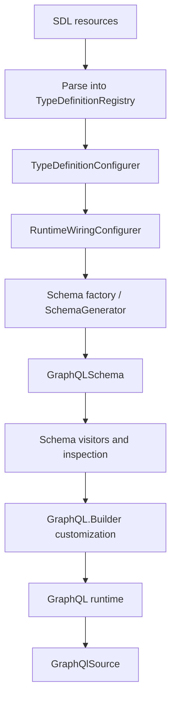

# Configurer và builder customization

## 1. Vì sao cần configurer và builder customization?

Spring for GraphQL dùng GraphQL Java để tạo executable schema và thực thi operation. Trong một ứng dụng Spring Boot thông thường, starter đã tạo `GraphQlSource`, nạp SDL, kết nối controller method với DataFetcher, cấu hình exception resolver và gắn instrumentation. Tuy nhiên, một số ứng dụng cần bổ sung hoặc thay đổi cách runtime được xây dựng:

- Đăng ký custom scalar như `DateTime`, `UUID` hoặc `Money`.
- Đăng ký `SchemaDirectiveWiring` để xử lý directive trong SDL.
- Đăng ký `TypeResolver` cho GraphQL interface và union.
- Thêm `WiringFactory` để đăng ký DataFetcher dựa trên cấu trúc schema.
- Thay đổi `TypeDefinitionRegistry` trước khi tạo executable schema.
- Dùng schema factory riêng, ví dụ để tạo Federation-compatible schema.
- Cấu hình GraphQL Java builder như `ExecutionIdProvider`, `PreparsedDocumentProvider` hoặc execution strategy.
- Duyệt schema, kiểm tra mapping và bổ sung xử lý vào code registry.

Spring cung cấp các callback có phạm vi rõ ràng để thực hiện những việc này. `RuntimeWiringConfigurer` tập trung vào runtime wiring; `GraphQlSourceBuilderCustomizer` cho phép tùy chỉnh builder tổng thể do Spring Boot tạo; `GraphQlSource.Builder` là API nền tảng khi cần tự xây dựng GraphQlSource.

## 2. Phân biệt các lớp cấu hình

Các API có tên gần nhau nhưng tác động vào những giai đoạn khác nhau:

| API | Tác động vào | Dùng khi |
| --- | --- | --- |
| `RuntimeWiringConfigurer` | `RuntimeWiring.Builder` | Đăng ký scalar, DataFetcher, directive wiring, type resolver hoặc wiring factory |
| `TypeDefinitionConfigurer` | `TypeDefinitionRegistry` sau khi parse SDL | Bổ sung hoặc chỉnh sửa định nghĩa type trước khi tạo schema |
| `GraphQlSourceBuilderCustomizer` | `GraphQlSource.SchemaResourceBuilder` | Tùy chỉnh toàn bộ quá trình build GraphQlSource trong Spring Boot |
| `GraphQlSource.Builder` | GraphQL source và `GraphQL.Builder` | Tự cấu hình schema, instrumentation, exception resolver và execution options |
| `GraphQlSource` | GraphQL runtime và schema đã tạo | Cung cấp runtime cho `ExecutionGraphQlService` |

Có thể hình dung các bước build theo thứ tự:



Sơ đồ biểu diễn các nhóm bước chính. Vị trí chính xác của một số visitor và inspection phụ thuộc API builder, nhưng điểm quan trọng là phải chọn callback tương ứng với loại object cần thay đổi.

## 3. Spring Boot tự cấu hình GraphQlSource như thế nào?

Khi dùng `spring-boot-starter-graphql`, Spring Boot tạo một `GraphQlSource.SchemaResourceBuilder` và cấu hình nó từ các property cùng bean trong ApplicationContext.

Quy trình auto-configuration hiện hành có thể tóm tắt như sau:

1. Tìm schema resources theo `spring.graphql.schema.locations` và `file-extensions`.
2. Thêm các schema resources được cấu hình bổ sung.
3. Đăng ký `DataFetcherExceptionResolver`, `SubscriptionExceptionResolver` và `Instrumentation` theo thứ tự được Spring quản lý.
4. Áp dụng schema inspection và cấu hình introspection nếu được yêu cầu.
5. Áp dụng các `TypeDefinitionConfigurer` mặc định của Boot.
6. Lấy các bean `RuntimeWiringConfigurer` theo thứ tự và thêm vào builder.
7. Lấy các bean `GraphQlSourceBuilderCustomizer` theo thứ tự và gọi từng customizer.
8. Gọi `build()` để tạo `GraphQlSource`.

Điều này có nghĩa là phần lớn ứng dụng chỉ cần khai báo các bean configurer/customizer. Không cần tự tạo `GraphQlSource` hoặc `GraphQL` instance trong controller.

## 4. `RuntimeWiringConfigurer` là gì?

`RuntimeWiringConfigurer` là callback của Spring for GraphQL cho phép cấu hình `graphql.schema.idl.RuntimeWiring.Builder`. Đây là nơi đăng ký những thành phần nối SDL với Java runtime:

- Custom scalar types.
- DataFetcher đăng ký trực tiếp.
- `TypeResolver` cho interface và union.
- `SchemaDirectiveWiring`.
- `WiringFactory` và các quy tắc wiring khác.

Spring Boot tự phát hiện bean `RuntimeWiringConfigurer` và thêm chúng vào `GraphQlSource.Builder`.

Ví dụ đăng ký custom scalar đã được ứng dụng tạo thành bean:

```java
import graphql.schema.GraphQLScalarType;
import org.springframework.context.annotation.Bean;
import org.springframework.context.annotation.Configuration;
import org.springframework.graphql.execution.RuntimeWiringConfigurer;

@Configuration(proxyBeanMethods = false)
public class GraphQlRuntimeWiringConfig {

    @Bean
    RuntimeWiringConfigurer scalarConfigurer(GraphQLScalarType dateTimeScalar) {
        return builder -> builder.scalar(dateTimeScalar);
    }
}
```

`dateTimeScalar` là một `GraphQLScalarType` được khai báo riêng. Scalar chịu trách nhiệm parse input từ client và serialize output về kiểu GraphQL phù hợp.

## 5. Đăng ký nhiều RuntimeWiringConfigurer

Có thể chia cấu hình theo trách nhiệm thay vì gom mọi thứ vào một bean lớn:

```java
import graphql.schema.GraphQLScalarType;
import graphql.schema.TypeResolver;
import org.springframework.context.annotation.Bean;
import org.springframework.context.annotation.Configuration;
import org.springframework.graphql.execution.RuntimeWiringConfigurer;

@Configuration(proxyBeanMethods = false)
public class GraphQlWiringConfig {

    @Bean
    RuntimeWiringConfigurer scalarConfigurer(GraphQLScalarType dateTimeScalar) {
        return builder -> builder.scalar(dateTimeScalar);
    }

    @Bean
    RuntimeWiringConfigurer directiveConfigurer() {
        return builder -> builder.directiveWiring(new MaskDirectiveWiring());
    }

    @Bean
    RuntimeWiringConfigurer typeResolverConfigurer(TypeResolver searchResultResolver) {
        return builder -> builder.type("SearchResult", typeWiring ->
                typeWiring.typeResolver(searchResultResolver));
    }
}
```

`MaskDirectiveWiring` và `searchResultResolver` là các thành phần do ứng dụng triển khai. Việc tách bean giúp từng cấu hình có thể được kiểm thử và quản lý độc lập. Nếu nhiều configurer cùng đăng ký một scalar, DataFetcher hoặc type resolver cho cùng tọa độ schema, cần xác định rõ bean nào sở hữu cấu hình đó.

## 6. Đăng ký DataFetcher trực tiếp khi thực sự cần

GraphQL Java cho phép đăng ký DataFetcher trực tiếp qua `RuntimeWiring.Builder`:

```java
import org.springframework.context.annotation.Bean;
import org.springframework.context.annotation.Configuration;
import org.springframework.graphql.execution.RuntimeWiringConfigurer;

@Configuration(proxyBeanMethods = false)
public class BookDataFetcherConfig {

    @Bean
    RuntimeWiringConfigurer bookDataFetcher(BookRepository repository) {
        return wiring -> wiring.type("Query", type -> type
                .dataFetcher("book", environment -> {
                    String id = environment.getArgument("id");
                    return repository.findById(id).orElse(null);
                }));
    }
}
```

Đoạn code giả định SDL có field `Query.book(id: ID!): Book` và repository có method tương ứng.

Trong Spring for GraphQL, phần lớn ứng dụng nên dùng `@Controller`, `@QueryMapping`, `@SchemaMapping` và các annotation controller khác. `AnnotatedControllerConfigurer` là một `RuntimeWiringConfigurer` do Boot tự đăng ký, nó tìm controller method và tạo DataFetcher tương ứng. Chỉ dùng DataFetcher đăng ký trực tiếp khi tích hợp thư viện cấp thấp, adapter hoặc wiring động.

## 7. Dùng WiringFactory khi wiring phụ thuộc schema

Một số cấu hình cần kiểm tra type definition trước khi quyết định có đăng ký DataFetcher hay không. `RuntimeWiringConfigurer` có overload nhận thêm `List<WiringFactory>` để thêm các factory được kết hợp và gọi theo thứ tự.

```java
import graphql.schema.idl.RuntimeWiring;
import graphql.schema.idl.WiringFactory;
import java.util.List;
import org.springframework.graphql.execution.RuntimeWiringConfigurer;

public final class SchemaAwareWiringConfigurer implements RuntimeWiringConfigurer {

    @Override
    public void configure(RuntimeWiring.Builder builder, List<WiringFactory> factories) {
        factories.add(new BookWiringFactory());
    }
}
```

`BookWiringFactory` là implementation của ứng dụng. Cách này phù hợp khi việc wiring phụ thuộc vào định nghĩa schema, ví dụ chọn DataFetcher dựa trên directive hoặc metadata của field. Nếu chỉ cần đăng ký một scalar hay một DataFetcher cố định, overload đơn giản với `RuntimeWiring.Builder` là đủ.

## 8. Tùy chỉnh TypeResolver cho interface và union

GraphQL interface và union trả về một object Java có thể thuộc nhiều kiểu concrete khác nhau. GraphQL Java cần `TypeResolver` để xác định GraphQL object type tương ứng.

Ví dụ SDL:

```graphql
union SearchResult = Book | Author

type Book {
    id: ID!
    title: String!
}

type Author {
    id: ID!
    name: String!
}
```

Nếu Java class không có tên trùng hoặc không thể suy luận từ class hierarchy, hãy đăng ký `TypeResolver` rõ ràng:

```java
import graphql.schema.TypeResolver;
import org.springframework.context.annotation.Bean;
import org.springframework.context.annotation.Configuration;
import org.springframework.graphql.execution.RuntimeWiringConfigurer;

@Configuration(proxyBeanMethods = false)
public class SearchResultWiringConfig {

    @Bean
    TypeResolver searchResultTypeResolver() {
        return environment -> {
            Object value = environment.getObject();
            if (value instanceof BookView) {
                return environment.getSchema().getObjectType("Book");
            }
            if (value instanceof AuthorView) {
                return environment.getSchema().getObjectType("Author");
            }
            throw new IllegalArgumentException("Unsupported SearchResult value");
        };
    }

    @Bean
    RuntimeWiringConfigurer searchResultConfigurer(TypeResolver searchResultTypeResolver) {
        return builder -> builder.type("SearchResult", type ->
                type.typeResolver(searchResultTypeResolver));
    }
}
```

`BookView` và `AuthorView` là các kiểu Java của ứng dụng. `GraphQlSource.Builder` cũng có `defaultTypeResolver(...)`; mặc định Spring dùng `ClassNameTypeResolver`, cố gắng khớp tên class và các supertype với GraphQL object type. Cấu hình resolver mặc định hữu ích khi muốn thay đổi quy tắc suy luận chung, còn `RuntimeWiringConfigurer` phù hợp khi chỉ cần cấu hình một interface/union cụ thể.

## 9. `TypeDefinitionConfigurer` thay đổi SDL trước khi tạo schema

`TypeDefinitionConfigurer` nhận `TypeDefinitionRegistry` sau khi SDL được parse và trước khi `GraphQLSchema` được tạo. Có thể dùng nó để bổ sung hoặc điều chỉnh định nghĩa type một cách có kiểm soát.

`GraphQlSource.SchemaResourceBuilder` cung cấp:

```java
builder.configureTypeDefinitions(typeDefinitionConfigurer);
```

Một ví dụ tích hợp sẵn là `ConnectionTypeDefinitionConfigurer`, có thể bổ sung các type connection/edge/page info theo quy ước pagination của Spring for GraphQL. Spring Boot GraphQL starter đã đăng ký configurer này trong auto-configuration thông thường.

Không nên dùng `TypeDefinitionConfigurer` để thay đổi schema theo từng request. Nó chạy trong giai đoạn build schema, thường lúc application startup. Nếu cần thay đổi schema khi deploy, hãy thay SDL hoặc tạo schema mới theo một quy trình build/reload rõ ràng.

## 10. `GraphQlSourceBuilderCustomizer` là gì?

`GraphQlSourceBuilderCustomizer` là callback của Spring Boot. Bean triển khai interface này nhận `GraphQlSource.SchemaResourceBuilder` do Boot đang cấu hình, từ đó có thể thêm những tùy chỉnh vượt ra ngoài runtime wiring.

Ví dụ tùy chỉnh `ExecutionIdProvider`:

```java
import graphql.execution.ExecutionIdProvider;
import org.springframework.context.annotation.Bean;
import org.springframework.context.annotation.Configuration;
import org.springframework.boot.graphql.autoconfigure.GraphQlSourceBuilderCustomizer;

@Configuration(proxyBeanMethods = false)
public class GraphQlSourceCustomizationConfig {

    @Bean
    GraphQlSourceBuilderCustomizer executionIdCustomizer(
            ExecutionIdProvider executionIdProvider) {

        return builder -> builder.configureGraphQl(graphQlBuilder ->
                graphQlBuilder.executionIdProvider(executionIdProvider));
    }
}
```

`executionIdProvider` là bean do ứng dụng cung cấp. Ví dụ này cho thấy customizer có thể đi vào `GraphQL.Builder` thông qua `configureGraphQl`.

Package của interface khác nhau theo Spring Boot major version:

| Phiên bản | Import |
| --- | --- |
| Spring Boot 3.x | `org.springframework.boot.autoconfigure.graphql.GraphQlSourceBuilderCustomizer` |
| Spring Boot 4.x | `org.springframework.boot.graphql.autoconfigure.GraphQlSourceBuilderCustomizer` |

`RuntimeWiringConfigurer` thuộc Spring for GraphQL nên package `org.springframework.graphql.execution` không thay đổi theo khác biệt trên.

## 11. Những nhóm API quan trọng của GraphQlSource.Builder

`GraphQlSource.schemaResourceBuilder()` trả về `GraphQlSource.SchemaResourceBuilder`, một builder chuyên đọc SDL resources và dùng RuntimeWiring để tạo schema. Nó kế thừa các method chung của `GraphQlSource.Builder`.

| Method | Công dụng |
| --- | --- |
| `schemaResources(Resource...)` | Thêm một hoặc nhiều SDL resources để parse và merge |
| `configureTypeDefinitions(...)` | Thay đổi `TypeDefinitionRegistry` trước khi tạo schema |
| `configureRuntimeWiring(...)` | Cấu hình DataFetcher, scalar, type resolver và directive wiring |
| `defaultTypeResolver(...)` | Đặt resolver mặc định cho interface/union chưa có resolver riêng |
| `schemaFactory(...)` | Cung cấp hàm tạo `GraphQLSchema` từ registry và runtime wiring |
| `inspectSchemaMappings(...)` | Kiểm tra mapping giữa schema, Java type và DataFetcher |
| `typeVisitors(...)` | Duyệt schema và có thể thay đổi `GraphQLCodeRegistry` |
| `typeVisitorsToTransformSchema(...)` | Duyệt và thay đổi chính schema |
| `configureGraphQl(...)` | Cấu hình `graphql.GraphQL.Builder` |
| `instrumentation(...)` | Đăng ký GraphQL Java instrumentation |
| `exceptionResolvers(...)` | Đăng ký DataFetcher exception resolvers |
| `subscriptionExceptionResolvers(...)` | Đăng ký subscription exception resolvers |
| `build()` | Tạo `GraphQlSource` |

Các method có thể được chain để tạo một cấu hình liền mạch. Không cần gọi tất cả method; chỉ thêm cấu hình mà ứng dụng thực sự cần.

## 12. Tùy chỉnh GraphQL.Builder bằng configureGraphQl

`configureGraphQl` nhận một `Consumer<graphql.GraphQL.Builder>`. Đây là nơi cấu hình những tùy chọn thuộc GraphQL Java runtime thay vì schema wiring.

Ví dụ cấu hình operation cache:

```java
import graphql.execution.preparsed.PreparsedDocumentProvider;
import org.springframework.boot.graphql.autoconfigure.GraphQlSourceBuilderCustomizer;
import org.springframework.context.annotation.Bean;
import org.springframework.context.annotation.Configuration;

@Configuration(proxyBeanMethods = false)
public class OperationCacheCustomizationConfig {

    @Bean
    GraphQlSourceBuilderCustomizer operationCacheCustomizer(
            PreparsedDocumentProvider documentProvider) {

        return builder -> builder.configureGraphQl(graphQlBuilder ->
                graphQlBuilder.preparsedDocumentProvider(documentProvider));
    }
}
```

`PreparsedDocumentProvider` là bean do ứng dụng cung cấp. Nó giúp GraphQL Java tái sử dụng document đã parse/validate; phần cache key, invalidation và giới hạn bộ nhớ cần được thiết kế riêng.

Các tùy chọn khác có thể cấu hình ở đây gồm execution ID provider, execution strategy, instrumentation hoặc các tùy chọn GraphQL Java khác được builder hỗ trợ. Không nên tạo một GraphQL runtime thứ hai chỉ để đặt một option có thể cấu hình qua callback này.

## 13. Thay schema factory khi cần generator đặc biệt

Mặc định `GraphQlSource.SchemaResourceBuilder` dùng GraphQL Java `SchemaGenerator` để tạo `GraphQLSchema` từ `TypeDefinitionRegistry` và `RuntimeWiring`.

Nếu cần một quy trình tạo schema đặc biệt, có thể dùng `schemaFactory`:

```java
builder.schemaFactory((typeDefinitionRegistry, runtimeWiring) ->
        customSchemaFactory.create(typeDefinitionRegistry, runtimeWiring));
```

`customSchemaFactory` là thành phần do ứng dụng cung cấp và phải trả về một `GraphQLSchema` hợp lệ. Đây là extension point thường dùng khi tích hợp Federation hoặc một schema generator khác.

Chỉ thay schema factory khi cần thay đổi cách tạo executable schema. Nếu chỉ cần thêm scalar, directive, DataFetcher hoặc TypeResolver, `RuntimeWiringConfigurer` đơn giản và dễ kiểm soát hơn.

## 14. Phân biệt schema traversal và schema transformation

Builder có hai nhóm visitor với tác động khác nhau:

| API | Cơ chế | Có thể thay đổi gì? | Chi phí |
| --- | --- | --- | --- |
| `typeVisitors(...)` | `SchemaTraverser` | Có thể điều chỉnh `GraphQLCodeRegistry`, ví dụ DataFetcher | Nhẹ hơn |
| `typeVisitorsToTransformSchema(...)` | `SchemaTransformer` | Có thể thay đổi chính cấu trúc `GraphQLSchema` | Nặng hơn |

Nếu chỉ muốn duyệt field và thay DataFetcher, dùng `typeVisitors`. Nếu cần thêm, xóa hoặc thay đổi GraphQL type/field sau khi schema được tạo, mới dùng `typeVisitorsToTransformSchema`.

Không dùng schema transformation cho một việc có thể thực hiện qua `RuntimeWiringConfigurer` hoặc `TypeDefinitionConfigurer`. Thay đổi schema càng muộn càng khó kiểm tra và có thể tạo khác biệt giữa SDL gốc với executable schema.

## 15. Kiểm tra mapping bằng inspectSchemaMappings

Một lỗi thường gặp là SDL khai báo field nhưng không có DataFetcher và cũng không có Java property tương ứng. GraphQL Java có thể trả `null` mà không báo lỗi wiring rõ ràng khi startup.

`inspectSchemaMappings` cho phép Spring for GraphQL kiểm tra schema với các DataFetcher có khả năng mô tả metadata. Báo cáo có thể bao gồm:

- Field trong schema không có DataFetcher hoặc Java property phù hợp.
- DataFetcher đăng ký cho field không tồn tại.
- Argument mà DataFetcher/controller mong đợi nhưng schema không khai báo.
- Sai khác nullability giữa SDL và Java property/return type khi có đủ metadata.
- Type bị bỏ qua do không đủ thông tin để kiểm tra.

Ví dụ:

```java
import org.slf4j.Logger;
import org.slf4j.LoggerFactory;
import org.springframework.boot.graphql.autoconfigure.GraphQlSourceBuilderCustomizer;
import org.springframework.context.annotation.Bean;
import org.springframework.context.annotation.Configuration;

@Configuration(proxyBeanMethods = false)
public class SchemaInspectionConfig {

    private static final Logger logger = LoggerFactory.getLogger(SchemaInspectionConfig.class);

@Bean
GraphQlSourceBuilderCustomizer schemaInspectionCustomizer() {
    return builder -> builder.inspectSchemaMappings(report ->
            logger.info("GraphQL schema inspection:\n{}", report));
}
}
```

Với interface/union mà Java class không thể suy luận tự động, có thể cung cấp mapping bổ sung:

```java
builder.inspectSchemaMappings(
        initializer -> initializer.classMapping("Book", BookView.class),
        report -> logger.info("GraphQL schema inspection:\n{}", report));
```

Inspection hữu ích trong startup hoặc CI. Nó không thay thế integration test, nhưng giúp phát hiện sớm lỗi wiring trước khi client gặp field trả về `null` hoặc lỗi non-null propagation.

## 16. Dùng property hay programmatic customization?

Spring Boot cung cấp property cho những cấu hình phổ biến, ví dụ vị trí schema, file extension, introspection, schema printer và schema inspection. Nên dùng property khi chỉ cần thay đổi một giá trị cấu hình đơn giản.

Ví dụ:

```yaml
spring:
  graphql:
    schema:
      locations: classpath*:graphql/**/
      file-extensions: .graphqls,.gqls
      inspection:
        enabled: true
      introspection:
        enabled: true
```

Programmatic customization phù hợp khi cần cung cấp object Java, callback hoặc logic có điều kiện như:

- Đăng ký custom scalar bean.
- Gắn `SchemaDirectiveWiring`.
- Cung cấp `TypeResolver` hoặc `WiringFactory`.
- Thay `ExecutionIdProvider` hoặc `PreparsedDocumentProvider`.
- Dùng schema factory đặc biệt.
- Đăng ký visitor hoặc custom execution strategy.

Không tạo customizer chỉ để thay đổi một property đã có sẵn. Cấu hình declarative trong `application.yml` thường dễ đọc, dễ override theo profile và dễ vận hành hơn.

## 17. Thứ tự thực thi của nhiều configurer và customizer

Khi có nhiều bean cùng loại, thứ tự cấu hình có thể ảnh hưởng đến kết quả cuối cùng. Spring Boot lấy các bean thông qua `orderedStream()`, vì vậy có thể dùng `@Order` hoặc triển khai `Ordered` để khai báo thứ tự.

```java
import graphql.schema.GraphQLScalarType;
import org.slf4j.Logger;
import org.slf4j.LoggerFactory;
import org.springframework.boot.graphql.autoconfigure.GraphQlSourceBuilderCustomizer;
import org.springframework.context.annotation.Bean;
import org.springframework.context.annotation.Configuration;
import org.springframework.core.annotation.Order;
import org.springframework.graphql.execution.RuntimeWiringConfigurer;

@Configuration(proxyBeanMethods = false)
public class OrderedGraphQlConfig {

    private static final Logger logger = LoggerFactory.getLogger(OrderedGraphQlConfig.class);

@Bean
@Order(10)
RuntimeWiringConfigurer scalarConfigurer(GraphQLScalarType dateTimeScalar) {
    return builder -> builder.scalar(dateTimeScalar);
}

@Bean
@Order(20)
RuntimeWiringConfigurer directiveConfigurer() {
    return builder -> builder.directiveWiring(new MaskDirectiveWiring());
}

@Bean
@Order(10)
GraphQlSourceBuilderCustomizer sourceCustomizer() {
    return builder -> builder.inspectSchemaMappings(report -> logger.info("{}", report));
}
}
```

Trong auto-configuration hiện hành, Boot áp dụng các `RuntimeWiringConfigurer` theo thứ tự trước, sau đó mới gọi các `GraphQlSourceBuilderCustomizer` theo thứ tự. `@Order` được sắp xếp trong từng nhóm; không dùng nó để giả định một customizer sẽ chạy xen giữa hai RuntimeWiringConfigurer.

Nếu hai bean cùng thay đổi một field, scalar hoặc builder option, hãy xác định rõ quyền sở hữu cấu hình. Đừng phụ thuộc vào thứ tự khởi tạo bean ngẫu nhiên hoặc thứ tự khai báo method trong class.

## 18. Tự tạo GraphQlSource khi không dùng Spring Boot

`GraphQlSourceBuilderCustomizer` là API của Spring Boot. Nếu ứng dụng chỉ dùng Spring for GraphQL mà không dùng Boot auto-configuration, có thể tạo `GraphQlSource` trực tiếp:

```java
import graphql.execution.ExecutionIdProvider;
import graphql.schema.GraphQLScalarType;
import org.slf4j.Logger;
import org.slf4j.LoggerFactory;
import org.springframework.context.annotation.Bean;
import org.springframework.context.annotation.Configuration;
import org.springframework.core.io.ClassPathResource;
import org.springframework.graphql.data.method.annotation.support.AnnotatedControllerConfigurer;
import org.springframework.graphql.execution.GraphQlSource;

@Configuration(proxyBeanMethods = false)
public class StandaloneGraphQlConfig {

    private static final Logger logger = LoggerFactory.getLogger(StandaloneGraphQlConfig.class);

    @Bean
    AnnotatedControllerConfigurer controllerConfigurer() {
        return new AnnotatedControllerConfigurer();
    }

@Bean
GraphQlSource graphQlSource(
        GraphQLScalarType dateTimeScalar,
        ExecutionIdProvider executionIdProvider,
        AnnotatedControllerConfigurer controllerConfigurer) {

    return GraphQlSource.schemaResourceBuilder()
            .schemaResources(new ClassPathResource("graphql/schema.graphqls"))
            .configureRuntimeWiring(builder -> builder.scalar(dateTimeScalar))
            .configureRuntimeWiring(controllerConfigurer)
            .configureGraphQl(graphQlBuilder ->
                    graphQlBuilder.executionIdProvider(executionIdProvider))
            .inspectSchemaMappings(report -> logger.info("GraphQL schema inspection:\n{}", report))
            .build();
}
}
```

Trong cấu hình standalone, cần tự đăng ký các configurer, instrumentation, exception resolvers, controller configurer và các thành phần mà Boot thường tạo giúp. Nếu schema đã được tạo từ nơi khác, có thể dùng `GraphQlSource.builder(graphQLSchema)` để tạo source dựa trên schema có sẵn.

## 19. Khi nào nên tự khai báo GraphQlSource bean?

Trong Spring Boot, bean `GraphQlSource` mặc định được tạo có điều kiện khi ứng dụng có schema và chưa có bean `GraphQlSource` khác. Nếu tự khai báo một `GraphQlSource` bean, auto-configuration mặc định sẽ lùi lại.

Khi đó, ứng dụng phải chịu trách nhiệm lắp ráp đầy đủ cấu hình cần thiết. Việc chỉ tạo source bằng `GraphQlSource.schemaResourceBuilder().build()` có thể khiến các bean `RuntimeWiringConfigurer`, `GraphQlSourceBuilderCustomizer`, instrumentation hoặc exception resolver đã khai báo không được áp dụng như khi dùng auto-configuration.

Trước khi thay bean `GraphQlSource`, hãy cân nhắc liệu một `GraphQlSourceBuilderCustomizer` có đáp ứng yêu cầu hay không. Chỉ thay toàn bộ source khi cần kiểm soát sâu cách tạo schema/runtime hoặc có một implementation `GraphQlSource` đặc biệt.

## 20. Lỗi thường gặp và cách xử lý

| Hiện tượng | Nguyên nhân có thể | Cách xử lý |
| --- | --- | --- |
| Custom scalar không hoạt động | Bean `RuntimeWiringConfigurer` không được phát hiện hoặc scalar chưa đăng ký | Kiểm tra bean, package import và SDL scalar declaration |
| Directive xuất hiện trong SDL nhưng không có tác dụng | Chưa đăng ký `SchemaDirectiveWiring` | Đăng ký qua `RuntimeWiringConfigurer.directiveWiring(...)` |
| Interface/union trả lỗi type resolution | Không có TypeResolver phù hợp với object Java | Đăng ký resolver cụ thể hoặc cấu hình `ClassNameTypeResolver` |
| `@SchemaMapping` không được gọi | Controller configurer không nằm trong RuntimeWiring của source tự tạo | Đảm bảo `AnnotatedControllerConfigurer` được thêm vào builder |
| `GraphQlSourceBuilderCustomizer` không được gọi | Đang dùng custom GraphQlSource bean khiến Boot auto-configuration lùi lại | Áp dụng customizer thủ công hoặc quay lại Boot-managed source |
| Import customizer không compile | Package khác giữa Boot 3 và Boot 4 | Dùng package đúng major version |
| Customizer ghi đè cấu hình trước | Nhiều customizer thay cùng GraphQL.Builder option | Gộp cấu hình liên quan hoặc xác định thứ tự bằng `@Order` |
| Schema mapping report có unmapped fields | Thiếu DataFetcher hoặc property không khớp | Sửa SDL/controller mapping và kiểm tra tên field/argument |
| Type bị skipped trong inspection | DataFetcher không mô tả return type hoặc kiểu quá tổng quát | Dùng return type cụ thể hoặc cung cấp class mapping |
| Thay schema bằng visitor gây lỗi runtime | Dùng nhầm traversal và transformation | Chọn `typeVisitors` hay `typeVisitorsToTransformSchema` theo mục tiêu |
| Exception mapping thay đổi sau khi custom ExecutionStrategy | Strategy tự tạo không dùng `DataFetcherExceptionResolver` của Spring | Tạo `DataFetcherExceptionHandler` từ resolver beans và gắn vào strategy |

## 21. Bảo mật, hiệu năng và khả năng bảo trì

Configurer và builder customizer thường chạy khi ứng dụng khởi tạo, nhưng kết quả của chúng ảnh hưởng đến mọi GraphQL request. Vì vậy:

- Không truy cập database hoặc remote service trong callback build schema nếu có thể nạp dữ liệu lúc startup theo cách rõ ràng hơn.
- Không tạo `DataFetcher` dùng chung mutable state không thread-safe.
- Không log toàn bộ SDL, query hoặc biến đầu vào nếu có thể chứa dữ liệu nhạy cảm.
- Giữ `TypeResolver` và directive wiring nhẹ, có hành vi xác định.
- Không sửa schema bằng visitor nếu chỉ cần thay code registry.
- Không thay `ExecutionStrategy` chỉ để đo thời gian; dùng instrumentation cho mục tiêu quan sát.
- Bảo toàn exception resolver và instrumentation mặc định khi thay builder hoặc source.
- Dùng `@Order` khi nhiều bean thay đổi cùng cấu hình và kiểm thử thứ tự thực tế.
- Chạy schema inspection và integration test sau khi thay đổi wiring.

Một customizer nên thể hiện một mục tiêu cụ thể. Nếu một bean vừa thay schema factory, execution strategy, instrumentation, resolver và scalar cùng lúc, việc chẩn đoán lỗi khởi tạo sẽ khó hơn nhiều.

## 22. Kiểm thử cấu hình và builder customization

Không chỉ kiểm tra rằng ApplicationContext khởi động thành công. Hãy kiểm tra hành vi GraphQL sau khi các configurer được áp dụng:

1. Khởi động `@SpringBootTest` với schema và các bean configurer cần thiết.
2. Kiểm tra `GraphQlSource` tồn tại trong ApplicationContext.
3. Gửi Query có custom scalar và xác nhận input/output serialization đúng.
4. Gửi query qua interface/union để xác nhận TypeResolver trả đúng concrete type.
5. Gửi query dùng directive để xác nhận `SchemaDirectiveWiring` có tác dụng.
6. Xác nhận schema inspection không báo unmapped field hoặc argument ngoài dự kiến.
7. Kiểm tra execution ID, instrumentation, exception mapping và query cache nếu customizer có thay đổi các phần đó.
8. Nếu có nhiều configurer, xác nhận thứ tự và kết quả wiring cuối cùng.

`GraphQlTester` phù hợp để kiểm tra response ở cấp GraphQL. Có thể dùng `ApplicationContextRunner` khi muốn kiểm tra riêng auto-configuration và điều kiện tạo bean mà không cần khởi động toàn bộ web server.

## 23. Checklist triển khai

- [ ] Dùng `RuntimeWiringConfigurer` cho scalar, directive, DataFetcher, TypeResolver và WiringFactory.
- [ ] Ưu tiên annotated controller cho DataFetcher thông thường.
- [ ] Dùng `TypeDefinitionConfigurer` khi cần thay registry trước khi tạo schema.
- [ ] Dùng `GraphQlSourceBuilderCustomizer` cho builder customization trong Spring Boot.
- [ ] Kiểm tra package customizer theo Spring Boot 3.x hoặc 4.x.
- [ ] Dùng `configureGraphQl` cho các tùy chọn thuộc `GraphQL.Builder`.
- [ ] Dùng `schemaFactory` khi thực sự cần generator/schema factory riêng.
- [ ] Phân biệt `typeVisitors` và `typeVisitorsToTransformSchema`.
- [ ] Bật `inspectSchemaMappings` để phát hiện lỗi wiring sớm.
- [ ] Dùng `@Order` khi có nhiều configurer/customizer phụ thuộc thứ tự.
- [ ] Không tự khai báo `GraphQlSource` bean nếu chỉ cần một customizer nhỏ.
- [ ] Nếu tự tạo source, tự lắp ráp các configurer/resolver/instrumentation cần thiết.
- [ ] Kiểm thử Query, scalar, directive, union/interface, error handling và execution options.

## Kết luận

Configurer và builder customization cho phép điều chỉnh cách Spring for GraphQL kết nối SDL với GraphQL Java runtime. `RuntimeWiringConfigurer` tập trung vào scalar, directive, DataFetcher, TypeResolver và WiringFactory. `TypeDefinitionConfigurer` thay đổi registry trước khi tạo schema. `GraphQlSourceBuilderCustomizer` cho phép Spring Boot tinh chỉnh `GraphQlSource.SchemaResourceBuilder`, còn `GraphQlSource.Builder` cung cấp API nền tảng để cấu hình schema, GraphQL runtime, instrumentation và exception handling.

Trong ứng dụng Boot thông thường, nên giữ auto-configuration và bổ sung các bean configurer/customizer có phạm vi rõ ràng. Chỉ tự tạo `GraphQlSource` khi cần kiểm soát toàn bộ quy trình. Cần hiểu thứ tự Boot áp dụng wiring configurers và source customizers, chọn đúng visitor cho schema traversal hay transformation, và dùng schema mapping inspection cùng integration test để phát hiện lỗi ngay khi khởi động hoặc trong CI.

## Tài liệu tham khảo

- [Spring for GraphQL — Request Execution](https://docs.spring.io/spring-graphql/reference/request-execution.html)
- [Spring for GraphQL — `RuntimeWiringConfigurer` API](https://docs.spring.io/spring-graphql/docs/current/api/org/springframework/graphql/execution/RuntimeWiringConfigurer.html)
- [Spring for GraphQL — `GraphQlSource` API](https://docs.spring.io/spring-graphql/docs/current/api/org/springframework/graphql/execution/GraphQlSource.html)
- [Spring for GraphQL — `GraphQlSource.SchemaResourceBuilder` API](https://docs.spring.io/spring-graphql/docs/current/api/org/springframework/graphql/execution/GraphQlSource.SchemaResourceBuilder.html)
- [Spring Boot 3.5 — `GraphQlSourceBuilderCustomizer` API](https://docs.spring.io/spring-boot/3.5/api/java/org/springframework/boot/autoconfigure/graphql/GraphQlSourceBuilderCustomizer.html)
- [Spring Boot 4.1 — `GraphQlSourceBuilderCustomizer` API](https://docs.spring.io/spring-boot/api/java/org/springframework/boot/graphql/autoconfigure/GraphQlSourceBuilderCustomizer.html)
- [Spring Boot — GraphQL Auto-configuration](https://docs.spring.io/spring-boot/reference/web/spring-graphql.html)
- [GraphQL Java — Schema Directives](https://graphql-java.com/documentation/schema/#schema-directives)
