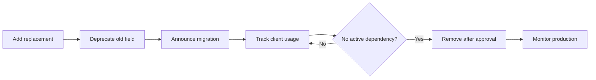

# Deprecate field

GraphQL API thường phục vụ nhiều client với tốc độ nâng cấp khác nhau. Khi một field không còn phù hợp, được đổi tên hoặc được thay bằng một cấu trúc tốt hơn, xóa ngay field cũ có thể làm query đang chạy thất bại. GraphQL cung cấp directive tích hợp `@deprecated` để quản lý giai đoạn chuyển tiếp.

`@deprecated` đánh dấu một phần của schema là không nên dùng nữa và công bố lý do qua `reason`. Thành phần đã deprecated vẫn tồn tại, vẫn được query và vẫn phải trả dữ liệu đúng trong thời gian chuyển đổi. Client có thể chuyển sang field mới theo lịch riêng trong khi server duy trì tương thích ngược.

Trong Spring for GraphQL, schema SDL là nơi khai báo deprecation. Resolver Java tiếp tục phục vụ field cũ; `@SchemaMapping` hoặc `@QueryMapping` không tự đánh dấu field deprecated. Để gỡ field an toàn, cần kết hợp schema metadata, hướng dẫn migration, telemetry về usage, kiểm tra breaking change và một mốc loại bỏ đã được thông báo.

## 1. Deprecation giải quyết vấn đề gì?

Giả sử API thư viện từng cung cấp field `User.name`:

```graphql
type User {
  id: ID!
  name: String!
}
```

Client A đang dùng:

```graphql
query CurrentUser {
  me {
    id
    name
  }
}
```

Sau một thời gian, sản phẩm cần tách tên hiển thị thành `firstName` và `lastName`. Nếu xóa `name` ngay khi thêm hai field mới, query của Client A sẽ không còn hợp lệ và GraphQL validation sẽ từ chối request.

Thay đổi an toàn hơn:

```graphql
type User {
  id: ID!
  name: String! @deprecated(reason: "Use firstName and lastName instead.")
  firstName: String!
  lastName: String!
}
```

Client mới có thể dùng hai field mới. Client cũ vẫn query `name` và nhận kết quả như trước. Schema thông báo rằng field này sẽ được thay thế, còn đội phát triển có thời gian theo dõi và hỗ trợ các client migration.

### Deprecate không đồng nghĩa với remove

| Trạng thái | Có trong schema? | Query cũ còn hợp lệ? | Resolver còn chạy? |
| --- | --- | --- | --- |
| Field bình thường | Có | Có | Có |
| Field deprecated | Có | Có | Có |
| Field đã remove | Không | Không | Không |

`@deprecated` là metadata cho schema, tooling và client developer. Nó không tự:

- Xóa field khỏi schema.
- Ngăn client gửi field trong operation.
- Bỏ qua resolver hoặc trả null thay cho dữ liệu.
- Tạo log, metric hoặc cảnh báo runtime.
- Đặt lịch tự động xóa field.
- Chuyển query cũ sang field mới.

Các việc này thuộc trách nhiệm của server, công cụ quản trị schema và quy trình phối hợp với client.

## 2. Directive @deprecated trong GraphQL SDL

`@deprecated` là built-in schema directive của GraphQL. Với implementation hỗ trợ SDL, không cần tự khai báo directive này trong schema.

Định nghĩa của directive trong GraphQL Specification hiện hành:

```graphql
directive @deprecated(
  reason: String! = "No longer supported"
) on FIELD_DEFINITION
  | ARGUMENT_DEFINITION
  | INPUT_FIELD_DEFINITION
  | ENUM_VALUE
  | DIRECTIVE_DEFINITION
```

`reason` mô tả vì sao thành phần không còn được khuyến nghị và client nên dùng gì thay thế. Nội dung reason được định dạng bằng Markdown, do đó có thể dùng tên field, liên kết hoặc đoạn giải thích ngắn.

Nếu bỏ qua `reason`, giá trị mặc định là `No longer supported`. Trong API thực tế, nên ghi lý do cụ thể và replacement thay vì để thông báo chung chung.

### Đánh dấu một field

```graphql
type User {
  id: ID!
  displayName: String!
  name: String! @deprecated(reason: "Use displayName instead.")
}
```

Field `name` vẫn là field hợp lệ của type `User`. Client có thể tiếp tục query nó:

```graphql
query {
  user(id: "user-42") {
    id
    name
  }
}
```

Schema introspection sẽ cho biết `name` có `isDeprecated = true` và cung cấp `deprecationReason`.

### Viết reason có ích

Reason tốt trả lời ít nhất hai câu hỏi:

1. Client nên chuyển sang thành phần nào?
2. Vì sao thành phần cũ không còn được khuyến nghị?

Ví dụ:

```graphql
type Product {
  price: String @deprecated(
    reason: "Use priceMinorUnits and priceCurrency. The old field combines amount and currency in a string that clients must parse."
  )
  priceMinorUnits: Int!
  priceCurrency: Currency!
}
```

Reason yếu:

```graphql
price: String @deprecated(reason: "Old field.")
```

Reason yếu không đưa ra hướng migration. Client developer vẫn phải tìm tài liệu khác để biết field nào thay thế.

### Không biến reason thành nơi quản lý toàn bộ timeline

Có thể đưa mốc dự kiến loại bỏ vào reason, nhưng lịch có thể thay đổi. Hãy quản lý ngày công bố, hạn migration và ngày remove trong changelog hoặc deprecation registry có owner. Nếu ngày trong SDL đã lỗi thời, thông tin đó làm client mất niềm tin vào schema.

## 3. Những vị trí có thể deprecate

GraphQL Specification hiện hành cho phép `@deprecated` ở các vị trí sau:

| Vị trí | Ví dụ | Ý nghĩa |
| --- | --- | --- |
| Field definition | `User.name` | Field output không nên được dùng nữa |
| Argument definition | `Query.users(oldFilter:)` | Argument cũ được thay bằng argument khác |
| Input field definition | `UserFilter.legacyStatus` | Field trong input object không nên gửi nữa |
| Enum value | `SortOrder.OLDEST_FIRST` | Giá trị enum cũ được thay thế |
| Directive definition | Directive tùy chỉnh cũ | Directive không còn được khuyến nghị |

Các vị trí ngoài field và enum value phụ thuộc phiên bản GraphQL Specification và GraphQL Java mà ứng dụng sử dụng. Khi nâng cấp GraphQL Java, kiểm tra parser/schema validation và introspection thực tế trước khi dùng những vị trí mới.

### Deprecate argument

```graphql
type Query {
  users(
    first: Int = 20
    oldLimit: Int @deprecated(reason: "Use first instead.")
  ): [User!]!
}
```

Trong giai đoạn chuyển đổi, resolver cần xử lý cả argument mới và cũ. Nếu client gửi cả hai, phải có quy tắc rõ ràng, ví dụ ưu tiên argument mới và ghi nhận việc client còn gửi argument cũ.

Không để hai argument điều khiển cùng một hành vi nhưng có kết quả khác nhau tùy thứ tự đọc hoặc giá trị null. Hãy xác định rõ semantics cho trường hợp không truyền, truyền null và truyền cả hai.

### Deprecate input object field

```graphql
input UserFilter {
  status: UserStatus
  legacyName: String @deprecated(
    reason: "Use nameContains for case-insensitive partial matching."
  )
  nameContains: String
}
```

Client có thể dần chuyển từ `legacyName` sang `nameContains`. Server vẫn cần hỗ trợ input cũ trong thời gian migration và xác định cách xử lý khi client gửi cả hai.

### Deprecate enum value

```graphql
enum OrderSort {
  CREATED_AT_DESC
  CREATED_AT_ASC
  OLD_NEWEST @deprecated(
    reason: "Use CREATED_AT_DESC instead."
  )
}
```

Enum value deprecated vẫn là một giá trị enum đã khai báo. Client cũ có thể tiếp tục gửi hoặc nhận giá trị đó trong giai đoạn chuyển tiếp. Server nên giữ mapping hành vi tương đương cho đến khi loại bỏ.

### Không deprecate required argument/input field trực tiếp

Theo GraphQL Specification hiện hành, argument hoặc input object field bắt buộc (Non-Null và không có default value) không được đánh dấu deprecated. Trước tiên phải làm nó optional bằng cách đổi sang nullable hoặc thêm default value:

```graphql
input SearchInput {
  # Không hợp lệ nếu vẫn là String! và không có default
  # oldQuery: String! @deprecated(reason: "Use query.")

  oldQuery: String @deprecated(reason: "Use query.")
  query: String
}
```

Đây là thay đổi hợp đồng riêng cần đánh giá tương thích. Không đổi một input bắt buộc thành optional chỉ để thêm directive mà không kiểm tra logic validation và behavior hiện tại.

## 4. Java @Deprecated và GraphQL @deprecated khác nhau

Java có annotation `java.lang.Deprecated`:

```java
@Deprecated
public String getName() {
    return displayName;
}
```

GraphQL có schema directive `@deprecated`:

```graphql
type User {
  name: String @deprecated(reason: "Use displayName.")
}
```

Hai cơ chế này phục vụ hai contract khác nhau:

| Cơ chế | Áp dụng cho | Người nhận thông tin |
| --- | --- | --- |
| Java `@Deprecated` | Class, method, constructor, field trong source Java | Developer đang biên dịch code Java |
| GraphQL `@deprecated` | Thành phần trong GraphQL schema | GraphQL client, schema registry, IDE, GraphiQL và introspection tooling |

Đánh dấu Java method deprecated không tự bảo đảm GraphQL schema có `isDeprecated = true`. Tương tự, thêm `@deprecated` vào SDL không tự làm compiler Java cảnh báo khi code server gọi method đó.

Nếu cả Java API và GraphQL API đều cần deprecation, quản lý hai annotation riêng và kiểm tra schema output sau khi build.

## 5. Introspection phát hiện deprecated field

GraphQL introspection cung cấp hai thuộc tính:

- `isDeprecated: Boolean!` cho biết thành phần có deprecated hay không.
- `deprecationReason: String` giải thích lý do.

Các collection introspection như `__Type.fields` và `__Type.enumValues` có argument `includeDeprecated`. Giá trị mặc định là `false`, nên query introspection thông thường có thể không trả về các field đã deprecated.

### Lấy cả field bình thường và deprecated

```graphql
query UserFields {
  __type(name: "User") {
    name
    fields(includeDeprecated: true) {
      name
      isDeprecated
      deprecationReason
    }
  }
}
```

Response minh họa:

```json
{
  "data": {
    "__type": {
      "name": "User",
      "fields": [
        {
          "name": "id",
          "isDeprecated": false,
          "deprecationReason": null
        },
        {
          "name": "displayName",
          "isDeprecated": false,
          "deprecationReason": null
        },
        {
          "name": "name",
          "isDeprecated": true,
          "deprecationReason": "Use displayName instead."
        }
      ]
    }
  }
}
```

### Lấy argument deprecated

```graphql
query UserQueryArguments {
  __type(name: "Query") {
    fields {
      name
      args(includeDeprecated: true) {
        name
        isDeprecated
        deprecationReason
      }
    }
  }
}
```

### Lấy enum value deprecated

```graphql
query OrderSortValues {
  __type(name: "OrderSort") {
    enumValues(includeDeprecated: true) {
      name
      isDeprecated
      deprecationReason
    }
  }
}
```

### Lấy input object field deprecated

```graphql
query UserFilterFields {
  __type(name: "UserFilter") {
    inputFields(includeDeprecated: true) {
      name
      isDeprecated
      deprecationReason
    }
  }
}
```

Introspection hữu ích cho IDE, code generator, schema documentation và script governance. Tuy nhiên, introspection có thể bị giới hạn hoặc tắt ở production theo chính sách bảo mật. Khi đó, client cần schema artifact đã publish hoặc tài liệu schema được tạo trong CI.

`@deprecated` là schema directive, không phải executable directive. Không đặt nó lên field selection trong operation để yêu cầu server bỏ field hoặc phát cảnh báo; deprecation được khai báo trên schema definition.

## 6. Spring for GraphQL: khai báo SDL và giữ resolver cũ

Spring for GraphQL đọc SDL để xây dựng GraphQL schema. Khai báo deprecation trong file schema:

`src/main/resources/graphql/schema.graphqls`

```graphql
type Query {
  user(id: ID!): User
}

type User {
  id: ID!
  displayName: String!
  name: String! @deprecated(
    reason: "Use displayName instead. The name field will be removed after client migration."
  )
}
```

Resolver có thể phục vụ cả field mới và field cũ:

```java
@Controller
public class UserController {

    private final DeprecatedUsageRecorder usageRecorder;

    public UserController(DeprecatedUsageRecorder usageRecorder) {
        this.usageRecorder = usageRecorder;
    }

    @SchemaMapping(typeName = "User", field = "displayName")
    public String displayName(User user) {
        return user.displayName();
    }

    @SchemaMapping(typeName = "User", field = "name")
    public String legacyName(
            User user,
            DataFetchingEnvironment environment) {

        String clientId = environment.getGraphQlContext().get("clientId");
        usageRecorder.record("User.name", clientId);

        return user.displayName();
    }
}
```

Trong ví dụ, field `name` vẫn trả cùng giá trị như `displayName`. Resolver cũ ghi nhận usage trước khi trả kết quả để đội API biết client nào còn phụ thuộc vào field này.

`clientId` cần được đưa vào GraphQLContext từ một nguồn server-side đáng tin cậy, chẳng hạn authenticated client identity được xác thực trong interceptor hoặc security layer. Không coi một header tùy ý do client tự khai là danh tính đã xác thực.

Nếu model đã có property `name` và Spring GraphQL có thể resolve bằng property data fetcher mặc định, việc thêm `@SchemaMapping` tường minh cho field deprecated giúp đặt telemetry và behavior rõ ràng.

### Resolver cũ nên delegate vào cùng logic nghiệp vụ

Không duy trì hai nhánh logic riêng cho field mới và field cũ nếu chúng có cùng ý nghĩa:

```java
@Service
public class UserPresentationService {

    public String displayName(User user) {
        return user.firstName() + " " + user.lastName();
    }
}
```

```java
@Controller
public class UserController {

    private final UserPresentationService presentationService;

    public UserController(UserPresentationService presentationService) {
        this.presentationService = presentationService;
    }

    @SchemaMapping(typeName = "User", field = "displayName")
    public String displayName(User user) {
        return presentationService.displayName(user);
    }

    @SchemaMapping(typeName = "User", field = "name")
    public String deprecatedName(User user) {
        return presentationService.displayName(user);
    }
}
```

Cả hai resolver dùng cùng một quy tắc nghiệp vụ. Điều này giảm nguy cơ field cũ và field mới trả kết quả khác nhau trong thời gian chuyển đổi.

### Kiểm thử field cũ vẫn hoạt động

Deprecation không được làm thay đổi response của client cũ. Có thể kiểm tra bằng `GraphQlTester`:

```java
GraphQlTester.Response response = graphQlTester.document("""
        query {
            user(id: "u-1") {
                name
                displayName
            }
        }
        """)
        .execute();

response.path("user.name")
        .entity(String.class)
        .isEqualTo("Ada Lovelace");

response.path("user.displayName")
        .entity(String.class)
        .isEqualTo("Ada Lovelace");
```

Ngoài việc kiểm tra response, test có thể verify `DeprecatedUsageRecorder` đã ghi nhận schema coordinate `User.name`. Test này chứng minh field cũ vừa còn tương thích vừa có telemetry để quản lý migration.

## 7. Theo dõi usage của deprecated field

Không nên xóa field chỉ vì đã đánh dấu deprecated một thời gian. Cần biết client nào còn gọi nó và tần suất sử dụng ra sao.

Các dữ liệu nên thu thập:

| Dữ liệu | Mục đích |
| --- | --- |
| Schema coordinate, ví dụ `User.name` | Xác định chính xác field deprecated |
| Client/application ID | Xác định consumer cần migration |
| Operation name | Tìm query hoặc mutation còn dùng field |
| Timestamp | Xem xu hướng và khoảng thời gian usage |
| Environment | Phân biệt dev, staging và production |
| Request count | Ước lượng mức độ phụ thuộc |

### Schema coordinate và response path khác nhau

Schema coordinate `User.name` là định danh ổn định của field trong schema. Response path có thể chứa alias và list index:

```graphql
query {
  primary: user(id: "u-1") {
    name
  }
  users {
    name
  }
}
```

Một usage record có thể có:

```text
schemaCoordinate = User.name
operationName = CurrentUser
responsePath = primary.name
clientId = mobile-ios
```

Dùng schema coordinate để tổng hợp field usage; dùng response path khi cần điều tra một vị trí cụ thể trong operation.

### Dùng counter với cardinality có giới hạn

Metric phù hợp:

```text
graphql.deprecated.field.usage
  schema_coordinate = User.name
```

Không đưa raw user ID, request ID, session ID hoặc operation hash không giới hạn vào metric labels. Các giá trị đó làm cardinality tăng nhanh. Nếu cần phân tích theo từng client, lưu structured log hoặc trace event có kiểm soát; giữ metric tags ở tập giá trị hữu hạn.

### Ghi nhận usage ở resolver

Với một số field cụ thể, ghi nhận ngay trong resolver là cách đơn giản:

```java
@SchemaMapping(typeName = "User", field = "name")
public String deprecatedName(
        User user,
        DataFetchingEnvironment environment) {

    String clientId = environment.getGraphQlContext().get("clientId");
    usageRecorder.record("User.name", clientId);

    return user.displayName();
}
```

Với nhiều field deprecated, tránh sao chép telemetry code vào mọi resolver. Có thể xây dựng cơ chế wrapper hoặc GraphQL Java instrumentation để quan sát DataFetcher theo schema coordinate. Dù dùng cách nào, phải bảo đảm instrumentation không thay đổi giá trị trả về, error behavior hoặc async completion.

### Không chỉ đếm request

Một request có thể query cùng một field nhiều lần bằng alias hoặc ở nhiều node khác nhau. Xác định rõ metric đang đếm:

- Số request có ít nhất một lần sử dụng field.
- Số lần DataFetcher của field được gọi.
- Số client duy nhất còn sử dụng field.
- Số operation name khác nhau có field đó.

Các con số này trả lời câu hỏi khác nhau. Để quyết định remove, số client và operation còn phụ thuộc thường quan trọng hơn tổng số lần gọi.

## 8. Quy trình deprecation an toàn

Một lifecycle dễ quản lý gồm năm giai đoạn:



### Giai đoạn 1: Thêm replacement

Trước khi đánh dấu field cũ, phải có field mới hoạt động và được kiểm thử:

- Field mới có dữ liệu đầy đủ.
- Type, nullability và semantics rõ ràng.
- Authorization giống hoặc chặt chẽ hơn field cũ.
- Pagination, sorting, filtering và error behavior đã được xác định.
- Tài liệu có ví dụ query mới.

Đừng đánh dấu deprecated nếu replacement chưa tồn tại hoặc chưa đáp ứng nghiệp vụ mà client đang dùng.

### Giai đoạn 2: Đánh dấu field cũ

Thêm `@deprecated(reason: ...)` vào SDL. Reason cần nói rõ replacement và hướng migration.

Giữ resolver cũ hoạt động và trả dữ liệu tương thích. Nếu cần, resolver cũ delegate sang service hoặc mapper dùng chung.

### Giai đoạn 3: Công bố deprecation

Thông báo cho client owners:

- Schema coordinate nào bị deprecated.
- Lý do và field/argument thay thế.
- Query cũ và query mới tương ứng.
- Khác biệt behavior hoặc response shape.
- Ngày công bố, thời hạn migration và ngày dự kiến remove.
- Kênh liên hệ khi gặp vấn đề.

Đưa thay đổi vào schema changelog và tài liệu API. Client có thể nhìn thấy warning trong IDE, nhưng không nên giả định mọi client đều dùng công cụ introspection.

### Giai đoạn 4: Theo dõi migration

Theo dõi usage theo từng client và operation. Kiểm tra cả:

- Ứng dụng web/mobile đang được hỗ trợ.
- Phiên bản ứng dụng cũ vẫn có người sử dụng.
- Batch job, integration và service-to-service client.
- Consumer không chạy thường xuyên nhưng có nghiệp vụ quan trọng.
- Môi trường production thực tế, không chỉ staging.

Một field có usage bằng 0 trong một ngày không chứng minh rằng mọi client đã migrate. Chọn cửa sổ quan sát đủ dài để bao phủ chu kỳ hoạt động của các consumer.

### Giai đoạn 5: Remove có kiểm soát

Chỉ xóa khi đã đáp ứng chính sách migration của tổ chức:

- Không còn client production được hỗ trợ phụ thuộc vào field.
- Owner của client xác nhận migration hoặc đã hết thời hạn hỗ trợ.
- Schema diff và breaking change review được phê duyệt.
- Changelog nêu rõ field bị remove.
- Có kế hoạch quan sát validation errors sau release.
- Có phương án rollback hoặc khôi phục field nếu phát hiện consumer bị bỏ sót.

Sau khi remove, query còn tham chiếu field sẽ thất bại ở bước validation. Resolver Java cũ cũng có thể được xóa sau khi không còn mapping nào cần nó.

## 9. Ví dụ migration từ name sang displayName

### Trước migration

```graphql
type User {
  id: ID!
  name: String!
}
```

```graphql
query UserCard {
  user(id: "u-1") {
    id
    name
  }
}
```

### Release A: thêm field mới

```graphql
type User {
  id: ID!
  name: String!
  displayName: String!
}
```

Client cũ vẫn hoạt động. Client mới có thể bắt đầu dùng `displayName`.

### Release B: deprecate field cũ

```graphql
type User {
  id: ID!
  name: String! @deprecated(
    reason: "Use displayName instead. This field will be removed after client migration."
  )
  displayName: String!
}
```

Resolver cũ tiếp tục trả cùng nội dung:

```java
@SchemaMapping(typeName = "User", field = "name")
public String name(User user) {
    return user.displayName();
}
```

### Client migration

Query mới:

```graphql
query UserCard {
  user(id: "u-1") {
    id
    displayName
  }
}
```

Client chạy test, phát hành phiên bản mới và theo dõi response. Server ghi nhận usage của `User.name` để biết còn consumer nào chưa chuyển đổi.

### Release C: remove field

Sau khi đạt tiêu chí migration:

```graphql
type User {
  id: ID!
  displayName: String!
}
```

Đây là breaking change đối với bất kỳ client nào còn query `name`. Việc field đã deprecated trước đó không làm thao tác remove trở thành non-breaking.

## 10. Schema review và CI

Deprecation cần được review như một thay đổi API có vòng đời, không chỉ là một directive trong SDL.

Trong pull request thay đổi schema, reviewer nên kiểm tra:

- Replacement đã tồn tại và có behavior tương đương chưa?
- Reason có chỉ rõ replacement không?
- Resolver cũ còn chạy và có test không?
- Client có thể gửi cả argument/input cũ và mới không?
- Telemetry có thể nhận diện client còn sử dụng field không?
- Changelog và migration guide đã cập nhật chưa?
- Có owner và ngày review/remove dự kiến chưa?

### So sánh schema

Schema diff giúp phát hiện remove hoặc thay đổi type gây breaking change:

```text
Production schema
        |
        v
Proposed schema
        |
        v
Schema diff
        |
        +--> Safe changes
        |
        +--> Dangerous changes
        |
        +--> Breaking changes
                 |
                 v
          Owner approval
```

Ví dụ CI có thể:

1. Build schema từ SDL của branch.
2. So sánh với schema production hoặc schema của release trước.
3. Fail khi có breaking change chưa được phê duyệt.
4. Cảnh báo các thay đổi dangerous để reviewer đánh giá.
5. Lưu schema artifact và changelog.

Deprecation directive tự nó thường không làm query cũ mất hợp lệ; xóa field mới là breaking change. CI vẫn cần phát hiện việc xóa field deprecated khi migration chưa được duyệt.

### Schema registry và usage analytics

Với nhiều team hoặc nhiều client, schema registry có thể lưu lịch sử schema, so sánh phiên bản và phân tích operation usage. Với hệ thống nhỏ hơn, có thể lưu SDL trong Git và chạy schema diff trong CI.

Không bắt buộc phải dùng một dịch vụ registry cụ thể. Quan trọng là có nguồn schema production đáng tin cậy, có lịch sử thay đổi và có dữ liệu usage để quyết định thời điểm remove.

## 11. Những lỗi thường gặp

| Biểu hiện | Nguyên nhân | Cách xử lý |
| --- | --- | --- |
| Client vẫn query được field deprecated | Đây là behavior đúng của deprecation | Giữ resolver hoạt động đến khi remove |
| IDE không hiển thị warning | Tooling không đọc introspection hoặc schema artifact cũ | Refresh schema và kiểm tra `isDeprecated` |
| Introspection không thấy field deprecated | `includeDeprecated` mặc định là false | Đặt `includeDeprecated: true` |
| Field cũ trả dữ liệu khác field mới | Hai resolver chứa logic riêng | Delegate về cùng service/mapper |
| Không biết client nào còn dùng field | Chỉ thêm directive, không có telemetry | Ghi nhận usage theo schema coordinate và client |
| Usage metric tăng cardinality | Gắn user/request/operation ID không giới hạn vào labels | Dùng metric tags hữu hạn; chi tiết để trong log/trace |
| Remove field làm production lỗi | Không kiểm tra client cũ, job định kỳ hoặc integration | Quan sát đủ lâu và xác nhận client owners |
| `@deprecated` bị parser từ chối ở input field | GraphQL Java/runtime chưa hỗ trợ spec location đó | Kiểm tra phiên bản và hỗ trợ directive |
| Deprecated required input bị schema validation từ chối | Required argument/input field không thể deprecate trực tiếp | Làm optional có kiểm soát trước |
| Chỉ đánh dấu Java method `@Deprecated` | Java annotation không thay thế GraphQL schema directive | Đánh dấu `@deprecated` trong SDL |
| Reason chỉ ghi “old” | Thiếu replacement và hướng migration | Viết reason cụ thể |
| Field mới có behavior khác field cũ | Migration thay đổi semantics cùng lúc | Tách migration thành các bước và mô tả khác biệt |
| Schema diff cho phép remove nhưng client vẫn dùng | Schema diff không biết đầy đủ production usage | Kết hợp schema check với telemetry |

## 12. Checklist deprecate field

- [ ] Replacement đã có trong schema và hoạt động.
- [ ] Replacement giữ semantics hoặc mô tả rõ behavior mới.
- [ ] Field cũ được đánh dấu bằng `@deprecated(reason: ...)`.
- [ ] Reason chỉ rõ field thay thế và lý do.
- [ ] Resolver cũ vẫn hoạt động.
- [ ] Field mới và cũ dùng chung logic nghiệp vụ nếu có thể.
- [ ] Authorization và data visibility của hai field đã được kiểm tra.
- [ ] Introspection trả `isDeprecated` và `deprecationReason` đúng.
- [ ] Client owners đã nhận migration guide và timeline.
- [ ] Runtime usage được đo theo schema coordinate.
- [ ] Metric labels không chứa giá trị cardinality cao.
- [ ] Changelog và deprecation registry được cập nhật.
- [ ] CI có schema diff và breaking change review.
- [ ] Usage window đủ dài để phát hiện client ít hoạt động.
- [ ] Remove chỉ được thực hiện sau khi có phê duyệt.
- [ ] Production được theo dõi sau khi remove.

## 13. Bài tập thực hành

Thực hiện deprecation cho field `User.name` trong Spring for GraphQL:

1. Tạo SDL có `User.name` và resolver trả tên hiển thị.
2. Thêm field `User.displayName` với behavior tương đương.
3. Đánh dấu `User.name` bằng `@deprecated` và viết reason rõ ràng.
4. Dùng `@SchemaMapping` để phục vụ cả hai field.
5. Thêm telemetry ghi nhận mỗi lần `User.name` được resolve.
6. Truyền client identity đã xác thực vào GraphQLContext.
7. Viết introspection query với `fields(includeDeprecated: true)`.
8. Xác nhận `isDeprecated` và `deprecationReason` trong response.
9. Viết GraphQlTester test để chứng minh query cũ vẫn chạy.
10. Viết query mới chỉ dùng `displayName`.
11. Tạo báo cáo usage theo client và operation name.
12. Mô phỏng schema diff khi xóa `name` và xác định vì sao đây là breaking change.
13. Lập kế hoạch thông báo, thời hạn migration và điều kiện remove.

Sau bài tập, bạn cần giải thích được sự khác nhau giữa deprecate và remove, cách client đọc deprecation qua introspection, và vì sao phải kết hợp metadata schema với usage telemetry trước khi xóa field.

## 14. Tài liệu tham khảo

- [GraphQL Specification — @deprecated](https://spec.graphql.org/September2026/#sec--deprecated)
- [GraphQL Specification — Schema Introspection](https://spec.graphql.org/September2026/#sec-Schema-Introspection)
- [GraphQL.org — Schema Change Management](https://www.graphql.org/learn/governance-versioning/)
- [GraphQL.org — Tooling and Automation for Governance](https://www.graphql.org/learn/governance-tooling/)
- [GraphQL Java — SDL Directives](https://graphql-java.com/documentation/directives/)
- [Spring for GraphQL — Annotated Controllers](https://docs.spring.io/spring-graphql/reference/controllers.html)
- [Spring for GraphQL — Request Execution](https://docs.spring.io/spring-graphql/reference/request-execution.html)

Deprecation là một giai đoạn tương thích trong quá trình tiến hóa schema. Chỉ xóa field khi replacement đã được dùng, client phụ thuộc đã được xử lý và schema owner đã chấp thuận breaking change.
