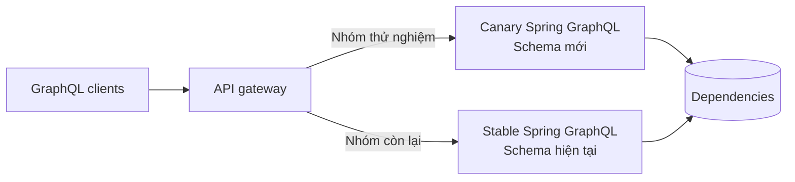

# Canary schema change

## Mục tiêu

Một thay đổi GraphQL có thể làm hỏng client dù ứng dụng server vẫn khởi động bình thường. Chỉ cần một client gửi field chưa tồn tại trên một instance cũ, GraphQL sẽ từ chối operation ngay ở bước validation. Vì vậy, phát hành schema cần được phối hợp với phiên bản resolver, cách định tuyến request và thời điểm client bắt đầu sử dụng field mới.

Sau bài học này, bạn có thể:

- Phân biệt thay đổi schema tương thích và thay đổi có nguy cơ phá vỡ client.
- Thiết kế quy trình canary để thử nghiệm schema mới trên một nhóm request hoặc client.
- Triển khai field mới bằng Spring for GraphQL với `@SchemaMapping` hoặc `@BatchMapping`.
- Theo dõi lỗi GraphQL, độ trễ và mức sử dụng field trong quá trình tăng traffic.
- Lập kế hoạch rollback, deprecation và loại bỏ field cũ theo quy trình expand-contract.

## 1. Canary schema change là gì?

Canary schema change là cách phát hành một thay đổi GraphQL theo từng giai đoạn. Trước khi phục vụ toàn bộ traffic, nhóm phát triển đưa phiên bản server có schema mới vào một nhóm instance hoặc một nhóm client nhỏ. Nhóm này nhận traffic thử nghiệm; các request còn lại tiếp tục chạy trên phiên bản ổn định. Khi số liệu và hành vi thực tế đạt tiêu chí đã định, phạm vi traffic được tăng dần.

GraphQL có một endpoint chung, nhưng mỗi operation có thể chọn các field khác nhau. Server phải kiểm tra operation dựa trên schema của instance nhận request. Ví dụ, schema mới có field `availability`, trong khi schema cũ chưa có field này. Một query yêu cầu `availability` sẽ thành công trên instance mới và thất bại với lỗi validation trên instance cũ. Load balancer phân phối ngẫu nhiên từng request vì thế có thể tạo ra lỗi chập chờn nếu client đã bắt đầu dùng field mới nhưng traffic vẫn đi đến cả hai phiên bản.

Canary cần giải quyết hai vấn đề cùng lúc:

1. **Phơi bày thay đổi có kiểm soát:** chỉ nhóm client hoặc request được chọn mới sử dụng schema mới trong giai đoạn thử nghiệm.
2. **Giữ tính nhất quán:** mọi request của nhóm thử nghiệm, kể cả request introspection hoặc các bước tiếp theo trong một luồng nghiệp vụ, phải nhìn thấy cùng một hợp đồng schema tương ứng.

Spring for GraphQL cung cấp cơ chế khai báo schema SDL, ánh xạ field vào Java và thực thi GraphQL. Việc chia traffic canary thường do ingress, API gateway, service mesh hoặc hệ thống triển khai đảm nhiệm. Bản thân `@SchemaMapping` và `@BatchMapping` không tự tạo ra weighted routing hay cơ chế phát hành canary.

## 2. Hiểu ranh giới tương thích của schema

GraphQL cho phép client chọn chính xác field cần đọc. Do đó, một thay đổi ảnh hưởng đến hợp đồng mà client nhìn thấy, ngay cả khi cấu trúc database không đổi. Trước khi phát hành, hãy phân loại thay đổi và xem xét cả client được sinh code từ schema.

| Thay đổi | Tác động thường gặp | Cách xử lý |
|---|---|---|
| Thêm field output mới | Thường tương thích với client cũ vì client không yêu cầu field đó | Có thể phát hành theo hướng additive; kiểm tra resolver và quyền truy cập |
| Thêm field input tùy chọn | Thường tương thích nếu client cũ không cần gửi field mới | Đặt nullable hoặc có default phù hợp |
| Thêm argument tùy chọn cho field | Thường tương thích nếu không bắt buộc client truyền argument | Cung cấp default hoặc xử lý trường hợp không truyền |
| Xóa hoặc đổi tên field | Client đang chọn field cũ sẽ lỗi validation | Deprecate, chuyển client, sau đó mới xóa |
| Đổi output từ nullable sang non-null | Có thể làm thay đổi cách client xử lý null và lỗi null propagation | Xem là thay đổi có rủi ro; kiểm chứng dữ liệu và client |
| Thêm input field bắt buộc hoặc argument bắt buộc | Client cũ có thể không còn hợp lệ | Tránh thay đổi trực tiếp; dùng quy trình chuyển đổi nhiều bước |
| Đổi kiểu của field hoặc enum | Có thể phá vỡ code sinh tự động hoặc logic xử lý của client | Đánh giá như breaking change |
| Thêm giá trị enum output | Schema mới hợp lệ, nhưng client có switch exhaustive có thể chưa biết giá trị mới | Kiểm tra khả năng xử lý giá trị chưa biết ở client |

“Tương thích” ở đây không chỉ có nghĩa là GraphQL parser chấp nhận schema. Một client có thể biên dịch thành công nhưng vẫn lỗi khi nhận enum mới, thay đổi ý nghĩa dữ liệu hoặc field trả về chậm hơn đáng kể. Hãy đánh giá cả hợp đồng kỹ thuật, hành vi nghiệp vụ và hiệu năng.

### Quy tắc additive-first

Khi cần thay thế một field, hãy thêm field mới trước, chuyển client sang field mới, rồi mới loại bỏ field cũ. Ví dụ, thay vì đổi ngay `name` thành `displayName`, hãy giữ cả hai field trong một khoảng thời gian:

```graphql
type Product {
    id: ID!
    name: String!
    displayName: String
}
```

Sau khi client đã chuyển đổi và số liệu cho thấy `name` không còn được sử dụng, đánh dấu field cũ là deprecated:

```graphql
type Product {
    id: ID!
    name: String! @deprecated(reason: "Use displayName instead")
    displayName: String
}
```

Directive `@deprecated` là một phần của GraphQL SDL. Nó thông báo ý định ngừng hỗ trợ cho công cụ và người phát triển, nhưng không tự chặn query cũ và cũng không tự xóa field. Server vẫn phải giữ resolver cho đến khi chính sách loại bỏ cho phép xóa.

## 3. Ví dụ: thêm field availability cho Product

Giả sử API hiện có schema:

```graphql
type Query {
    product(id: ID!): Product
}

type Product {
    id: ID!
    name: String!
}
```

Yêu cầu mới là cho phép client xem tình trạng tồn kho. Ta thêm `availability` dưới dạng nullable trong giai đoạn đầu:

```graphql
type Query {
    product(id: ID!): Product
}

type Product {
    id: ID!
    name: String!
    availability: Availability
}

type Availability {
    status: AvailabilityStatus!
    estimatedRestockAt: String
}

enum AvailabilityStatus {
    IN_STOCK
    LOW_STOCK
    OUT_OF_STOCK
    UNKNOWN
}
```

Field `availability` nullable cho phép server trả `null` khi dữ liệu tồn kho chưa sẵn sàng hoặc chưa có kết quả. Điều này không có nghĩa là được phép che giấu lỗi tùy tiện: cần phân biệt trường hợp “không có dữ liệu” với lỗi truy cập service hoặc lỗi hệ thống, đồng thời ghi nhận các trường hợp đó trong observability. Nếu nghiệp vụ đảm bảo luôn có một đối tượng `Availability`, có thể cân nhắc non-null sau khi dữ liệu và resolver đã ổn định; việc siết nullability cần được đánh giá như thay đổi hợp đồng riêng.

Client mới có thể yêu cầu field:

```graphql
query ProductAvailability($id: ID!) {
    product(id: $id) {
        id
        name
        availability {
            status
            estimatedRestockAt
        }
    }
}
```

Ví dụ response khi có dữ liệu:

```json
{
  "data": {
    "product": {
      "id": "p-42",
      "name": "Mechanical Keyboard",
      "availability": {
        "status": "IN_STOCK",
        "estimatedRestockAt": null
      }
    }
  }
}
```

Client cũ vẫn gửi query chỉ chọn `id` và `name`, nên không phụ thuộc vào field mới. Đây là đặc tính giúp thay đổi additive dễ triển khai hơn, miễn là mọi instance phục vụ query mới đều có schema và resolver tương ứng.

## 4. Ánh xạ field trong Spring for GraphQL

Trong Spring for GraphQL, schema SDL định nghĩa hợp đồng; controller cung cấp dữ liệu cho từng field. Với một resolver đơn giản, có thể dùng `@SchemaMapping`:

```java
@Controller
public class ProductAvailabilityController {

    private final InventoryService inventoryService;

    public ProductAvailabilityController(InventoryService inventoryService) {
        this.inventoryService = inventoryService;
    }

    @SchemaMapping(typeName = "Product", field = "availability")
    public Availability availability(Product product) {
        return inventoryService.findAvailability(product.id()).orElse(null);
    }
}
```

Spring for GraphQL liên kết method này với field `Product.availability`. Đối tượng `Product` được truyền vào là source object của field cha. Nếu service không có thông tin tồn kho, ví dụ trả về `null` phù hợp với khai báo `availability: Availability` nullable trong SDL.

Nếu query trả về danh sách nhiều product, gọi service một lần cho từng product có thể tạo ra vấn đề N+1. Có thể dùng `@BatchMapping` để gom các source object thành một lần tra cứu theo lô:

```java
@Controller
public class ProductAvailabilityController {

    private final InventoryService inventoryService;

    public ProductAvailabilityController(InventoryService inventoryService) {
        this.inventoryService = inventoryService;
    }

    @BatchMapping(typeName = "Product", field = "availability")
    public Map<Product, Availability> availability(List<Product> products) {
        List<String> productIds = products.stream()
                .map(Product::id)
                .toList();

        Map<String, Availability> availabilityById =
                inventoryService.findAvailabilityByProductIds(productIds);

        Map<Product, Availability> result = new LinkedHashMap<>();
        for (Product product : products) {
            Availability availability = availabilityById.get(product.id());
            if (availability != null) {
                result.put(product, availability);
            }
        }
        return result;
    }
}
```

Ví dụ giả định `Product` có accessor `id()` và `InventoryService` trả về map theo product ID. Các import cần thiết gồm `java.util.List`, `java.util.Map`, `java.util.LinkedHashMap` và annotation của Spring for GraphQL. `@BatchMapping` tự đăng ký cơ chế batch loading cho field được chỉ định; các key trong map là source object tương ứng với value. Khi không có entry cho một product, kết quả của field đó là `null`, phù hợp với schema ví dụ.

Trong canary, schema và resolver phải được phát hành cùng nhau. Nếu SDL khai báo field mới nhưng resolver thiếu hoặc truy cập một dependency chưa sẵn sàng, query có thể qua validation nhưng thất bại khi thực thi. Nếu resolver đã được triển khai mà schema của instance không có field, query sẽ bị từ chối ở bước validation. Hãy kiểm tra cả hai mặt trong artifact canary.

## 5. Chọn chiến lược định tuyến canary

Vì mỗi instance Spring GraphQL thường khởi tạo schema từ cấu hình ứng dụng khi chạy, một đợt rolling deployment có thể tạo ra hai schema cùng tồn tại trong cụm. Chiến lược định tuyến phải phù hợp với cách client sử dụng field mới.

### Chiến lược A: triển khai schema additive lên toàn bộ server trước

Đây thường là cách đơn giản và an toàn nhất cho field mới tương thích ngược:

1. Phát hành server có SDL và resolver mới lên toàn bộ instance.
2. Chờ đến khi không còn instance cũ nhận traffic; kiểm tra health và schema trên các instance.
3. Sau đó mới phát hành client bắt đầu yêu cầu field mới.
4. Nếu cần thử nghiệm tính năng, dùng feature flag ở tầng nghiệp vụ hoặc client để chỉ một nhóm người dùng sử dụng dữ liệu mới.

Với cách này, mọi instance đều hiểu field mới trước khi client gửi query có field đó. Có thể canary việc triển khai server bằng cách tăng dần số instance mới, nhưng trong giai đoạn trộn phiên bản, client chưa được phép yêu cầu field chỉ có trên phiên bản mới.

### Chiến lược B: tách nhóm canary server và ghim nhóm client

Khi cần thử nghiệm schema hoặc resolver mới trên một nhóm người dùng, triển khai một pool canary riêng. Gateway định tuyến nhóm client thử nghiệm đến pool đó và các client còn lại đến pool ổn định.



Nhóm client được chọn cần được định tuyến nhất quán. Có thể dùng cookie, client ID, tenant ID hoặc một header được gateway xác thực và kiểm soát. Không nên tin một header tùy ý do client gửi nếu header đó có thể cho phép người dùng tự chuyển sang pool chưa được phép.

Đảm bảo cả query và introspection của một nhóm đi đến cùng pool. Nếu một công cụ lấy schema từ stable pool nhưng query lại được gửi đến canary pool, client có thể sinh operation dựa trên hợp đồng khác với server nhận request. Với persisted query, registry hoặc cache schema, hãy gắn rõ môi trường/pool và phiên bản schema để tránh dùng nhầm artifact.

### Chiến lược C: weighted routing theo request

Gateway có thể gửi một tỷ lệ nhỏ request đến canary. Cách này phù hợp để kiểm tra độ ổn định của server mới với các operation tương thích trên cả hai schema. Tuy nhiên, nếu client đã gửi field mới mà request có thể rơi vào stable pool, lỗi validation sẽ xuất hiện theo tỷ lệ traffic. Chỉ bật query có field mới khi một trong các điều kiện sau đúng:

- Tất cả instance có thể nhận query đều đã hỗ trợ field mới; hoặc
- Request thuộc nhóm client được ghim vào pool có schema mới.

Không dùng tỷ lệ weighted routing làm bằng chứng rằng một schema mới an toàn cho mọi client. Tỷ lệ canary chỉ nói về phân phối traffic; tính tương thích vẫn phụ thuộc vào nội dung operation và schema của từng đích đến.

## 6. Quy trình phát hành theo từng giai đoạn

Một quy trình thực tế có thể chia thành các cổng kiểm soát sau.

### Giai đoạn 1 — Chuẩn bị thay đổi

- Lưu snapshot schema hiện tại và tạo schema candidate từ đúng commit chuẩn bị phát hành.
- Chạy schema diff để tìm field bị xóa, đổi tên, thay đổi nullability, argument hoặc input type.
- Kiểm tra operation đang được client sử dụng, đặc biệt persisted queries và query của các ứng dụng di động có chu kỳ cập nhật dài.
- Xác định owner của client, nhóm người dùng thử nghiệm, cách định tuyến, ngưỡng dừng và người chịu trách nhiệm rollback.
- Kiểm tra migration database theo hướng expand-contract. Schema mới không nên phụ thuộc vào cột hoặc bảng chỉ tồn tại sau một migration chưa được áp dụng trên toàn bộ môi trường.

Schema diff tự động rất hữu ích nhưng không thay thế review nghiệp vụ. Một thay đổi có thể không bị đánh dấu breaking về mặt SDL mà vẫn thay đổi ý nghĩa field, quyền truy cập hoặc đặc tính hiệu năng.

### Giai đoạn 2 — Triển khai server canary

Triển khai đúng artifact chứa SDL, controller, service và cấu hình cần thiết. Đưa instance vào pool canary sau khi health check thành công. Chạy smoke test trực tiếp vào pool này, bao gồm:

- Query cũ không yêu cầu field mới.
- Query thử nghiệm có yêu cầu field mới.
- Trường hợp không có dữ liệu và trường hợp dependency lỗi.
- Quyền truy cập của người dùng được phép và không được phép.
- Query danh sách đủ lớn để kiểm tra batch loading và giới hạn tài nguyên.

Không coi HTTP 200 là điều kiện thành công duy nhất. GraphQL thường trả response HTTP thành công nhưng vẫn có mảng `errors`; kiểm tra cả `data`, `errors`, mã lỗi mở rộng nếu có và nội dung dữ liệu trả về.

### Giai đoạn 3 — Phát traffic thử nghiệm

Chọn nhóm nhỏ có thể quan sát và liên hệ khi gặp lỗi. Nếu client bắt đầu gửi field mới, ghim request của nhóm đó vào canary pool. Bắt đầu bằng traffic nội bộ hoặc synthetic traffic, sau đó mở rộng đến một nhóm người dùng thật có kiểm soát.

So sánh canary với stable trong cùng khoảng thời gian và theo cùng loại operation. Theo dõi ít nhất:

- Tỷ lệ GraphQL error, validation error và resolver exception.
- Latency p50, p95, p99 của request và resolver mới.
- Timeout, lỗi kết nối và tỷ lệ lỗi của dependency tồn kho.
- Số truy vấn database, kích thước batch và dấu hiệu N+1.
- Tỷ lệ trả `null`, giá trị `UNKNOWN` và độ chính xác nghiệp vụ của dữ liệu tồn kho.
- Tỷ lệ request bị từ chối do xác thực hoặc phân quyền.

Đặt ngưỡng trước khi bắt đầu. Ví dụ, nếu error rate hoặc p95 vượt ngưỡng trong nhiều cửa sổ đo liên tiếp, dừng tăng traffic và chuyển về bước điều tra. Ngưỡng cụ thể phải dựa trên baseline và SLO của hệ thống; không sao chép một con số cố định cho mọi dịch vụ.

### Giai đoạn 4 — Tăng phạm vi và phát hành client

Chỉ tăng traffic khi canary ổn định và các dependency có đủ năng lực. Có thể tăng theo các nấc nhỏ như 1%, 5%, 10%, 25%, 50% rồi 100%, nhưng chọn bước và thời gian quan sát dựa trên lưu lượng thực tế. Ở mỗi nấc, xác nhận lại error rate, latency, dữ liệu và tải hệ thống.

Nếu server đã được triển khai trên toàn bộ instance và schema additive, có thể cho client mới sử dụng field sau khi xác minh không còn instance cũ. Nếu server canary vẫn tách riêng, tiếp tục ghim cohort client vào pool đó cho đến khi hoàn tất rollout hoặc có kế hoạch hợp nhất pool rõ ràng.

### Giai đoạn 5 — Deprecate và loại bỏ field cũ

Khi client đã chuyển sang field mới, đánh dấu field cũ bằng `@deprecated` và công bố thời hạn hỗ trợ. Theo dõi usage theo field và theo client/operation đã biết. Chỉ xóa field sau khi:

- Không còn client được hỗ trợ gọi field cũ trong khoảng thời gian đã thống nhất.
- Các client phát hành chậm, tác vụ định kỳ và tích hợp đối tác đã được kiểm tra.
- Schema diff xác nhận việc xóa nằm trong một đợt phát hành breaking change có chủ đích.
- Có phương án khôi phục hoặc phát hành bản tương thích nếu phát hiện consumer bị bỏ sót.

Không suy ra field đã hết sử dụng chỉ từ một vài ngày traffic thấp. Hãy bao phủ chu kỳ nghiệp vụ, batch job, mùa cao điểm và các phiên bản ứng dụng còn được hỗ trợ.

## 7. Kiểm thử schema và resolver

Kiểm thử canary cần xác nhận schema và hành vi cùng lúc. Một test với `GraphQlTester` có thể kiểm tra operation sử dụng field mới:

```java
@SpringBootTest
class ProductAvailabilityGraphQlTests {

    @Autowired
    GraphQlTester graphQlTester;

    @Test
    void exposesAvailabilityForProduct() {
        graphQlTester.document("""
                query ProductAvailability {
                    product(id: "p-42") {
                        id
                        availability {
                            status
                        }
                    }
                }
                """)
                .execute()
                .path("product.availability.status")
                .entity(String.class)
                .isEqualTo("IN_STOCK");
    }
}
```

Ví dụ giả định test context có dữ liệu hoặc fixture để query `product(id: "p-42")` trả về sản phẩm có tồn kho. Trong test thực tế, cấu hình service mock hoặc test database theo pattern của dự án và kiểm tra cả trường hợp không có availability.

Nên bổ sung các lớp kiểm thử sau:

1. **Schema validation:** schema candidate khởi tạo được và có đúng field, type, nullability dự kiến.
2. **Compatibility:** các operation cũ vẫn chạy trên schema mới; các operation mới chỉ được gửi đến pool có hỗ trợ schema mới.
3. **Resolver:** kiểm tra dữ liệu bình thường, dữ liệu thiếu, lỗi dependency và xử lý null.
4. **Security:** kiểm tra field nhạy cảm với principal có và không có authority; kiểm tra lỗi không làm lộ dữ liệu qua field khác.
5. **Performance:** query danh sách xác nhận batch loading, giới hạn số lượng phần tử và thời gian phản hồi.
6. **Deployment smoke test:** gọi endpoint canary sau khi triển khai để xác nhận đúng artifact và cấu hình đang chạy.

Với client dùng persisted query, đưa tập operation được hỗ trợ vào kiểm thử contract. Một operation không được validate trên schema candidate cần được điều tra trước khi rollout, kể cả khi operation đó hiện ít traffic.

## 8. Quan sát usage và lỗi ở cấp field

GraphQL request có thể thành công ở cấp HTTP nhưng một hoặc nhiều field vẫn lỗi. Vì vậy, dashboard cần phân biệt request-level success với field-level outcome. Với Spring for GraphQL, có thể tận dụng observability và Micrometer instrumentation mà ứng dụng đang cấu hình để ghi nhận operation, data fetcher, thời gian xử lý và lỗi. Cần xác minh convention/tag thực tế của phiên bản Spring GraphQL và hệ thống metrics trong dự án trước khi xây dashboard.

Để quyết định có thể xóa field cũ hay chưa, cần thống kê usage đủ chi tiết. Nên thu thập loại operation, tên field, client hoặc tenant đã được chuẩn hóa và kết quả xử lý. Tránh đưa toàn bộ query, ID người dùng, token, biến chứa dữ liệu cá nhân hoặc giá trị có cardinality rất cao vào metric label. Nếu cần điều tra query cụ thể, dùng log có kiểm soát quyền truy cập, chính sách retention và redaction phù hợp.

Các tín hiệu cần đối chiếu:

| Tín hiệu | Điều cần phát hiện |
|---|---|
| Validation error | Client gửi field hoặc argument không có trong schema của pool nhận request |
| Resolver error | Code mới lỗi, dependency lỗi hoặc dữ liệu không đáp ứng giả định |
| Null rate | Field nullable trả null nhiều hơn baseline hoặc ngoài dự kiến |
| Latency theo field | Resolver mới làm chậm operation hoặc gọi dependency quá nhiều |
| Batch size và DB calls | Batch không hoạt động như dự kiến hoặc còn N+1 |
| Usage theo client | Client nào còn phụ thuộc field cũ hoặc đang dùng field mới |
| Authorization failure | Quy tắc phân quyền mới từ chối nhầm hoặc cho phép truy cập sai |

Không gắn nguyên query string hoặc user ID vào nhãn metric. Điều đó dễ tạo cardinality lớn, làm tăng chi phí monitoring và có thể đưa dữ liệu nhạy cảm vào hệ thống quan sát.

## 9. Bảo mật và tính nhất quán dữ liệu

Field mới có thể làm lộ dữ liệu mà trước đây client không thể truy cập. Hãy xem xét authorization ở đúng ranh giới field, nhất là khi một object chứa cả thông tin công khai và thông tin chỉ dành cho một số vai trò. Spring Security method security có thể được áp dụng cho method resolver, ví dụ:

```java
@PreAuthorize("hasAuthority('inventory:read')")
@SchemaMapping(typeName = "Product", field = "availability")
public Availability availability(Product product) {
    return inventoryService.findAvailability(product.id()).orElse(null);
}
```

Đoạn code yêu cầu method security đã được bật và authority được định nghĩa nhất quán trong ứng dụng. Cần kiểm thử cả người dùng thiếu quyền. GraphQL có thể trả một phần `data` cùng `errors`; client phải xử lý đúng trạng thái field bị từ chối. Không dùng việc ẩn field khỏi UI làm biện pháp bảo mật thay cho kiểm tra quyền ở server.

Kiểm tra thêm các điểm sau:

- Resolver không tin ID hoặc tenant do client gửi mà bỏ qua phạm vi truy cập của principal.
- Batch loader áp dụng cùng quy tắc phân quyền cho toàn bộ key trong batch; không để dữ liệu của tenant này xuất hiện trong kết quả tenant khác.
- Cache được phân vùng theo ngữ cảnh bảo mật khi dữ liệu phụ thuộc người dùng hoặc tenant.
- Field mới không làm lộ thông tin qua error message, log hoặc tracing attribute.
- Schema candidate và schema stable có cùng chính sách bảo vệ cho các field đã tồn tại.

## 10. Rollback và phục hồi

Rollback canary thường bắt đầu bằng việc ngừng đưa traffic mới vào pool canary hoặc chuyển cohort về pool ổn định. Tuy nhiên, nếu client đã gửi field chỉ tồn tại trên schema mới, chuyển client đó về stable sẽ gây validation error. Vì vậy, rollback phải xét đồng thời server và client.

Trước release, xác định rõ:

- Cách gateway ngừng route cohort mới vào canary.
- Cách tắt feature flag hoặc dừng client sử dụng field mới.
- Phiên bản server ổn định nào vẫn tương thích với operation đang chạy.
- Cách xử lý dữ liệu đã ghi bởi phiên bản mới và migration database liên quan.
- Dashboard, ngưỡng rollback và người có quyền thực hiện.

Ưu tiên thay đổi additive để rollback server không làm mất field mà client cũ đang cần. Nếu resolver mới gặp lỗi nhưng schema mới vẫn tương thích, có thể tắt phần nghiệp vụ bằng feature flag hoặc trả trạng thái fallback được thiết kế rõ ràng. Không trả dữ liệu giả như `IN_STOCK` chỉ để tránh lỗi; giá trị fallback phải biểu đạt đúng trạng thái chưa xác định.

Với migration database, áp dụng expand-contract: thêm cấu trúc mới trước, phát hành code có thể đọc/ghi tương thích, chuyển traffic và dữ liệu, rồi mới xóa cấu trúc cũ trong một đợt riêng. Không rollback ứng dụng về bản cũ nếu migration đã xóa cột mà bản cũ vẫn cần.

## 11. Các lỗi triển khai thường gặp

**Client nhận lỗi validation theo tỷ lệ traffic.** Một phần request có field mới đang được gửi đến instance schema cũ. Kiểm tra routing, trạng thái rollout của từng instance và nguồn schema mà client dùng để sinh operation. Khắc phục bằng cách hoàn tất triển khai additive trước hoặc ghim cohort vào pool canary.

**Introspection cho thấy schema mới nhưng query lại báo field không tồn tại.** Request introspection và request nghiệp vụ có thể đang đi đến hai pool khác nhau, hoặc cache schema/persisted query không được phân vùng đúng. Kiểm tra routing nhất quán và cache theo môi trường.

**Query qua validation nhưng field trả lỗi.** SDL đã khai báo field nhưng resolver hoặc dependency chưa sẵn sàng. Kiểm tra `@SchemaMapping`/`@BatchMapping`, bean wiring, quyền truy cập, timeout và dữ liệu trả về.

**Latency tăng khi query danh sách.** Resolver có thể gọi service một lần cho từng object. Kiểm tra số lần gọi database, dùng `@BatchMapping` hoặc DataLoader phù hợp, giới hạn kích thước query và đo lại bằng traffic đại diện.

**Field cũ vẫn có traffic sau khi deprecate.** Directive chỉ là thông báo. Xác định client/operation còn dùng field, liên hệ owner qua quy trình phát hành đã thống nhất và duy trì resolver cho đến khi consumer được chuyển đổi.

**Canary ổn với traffic nội bộ nhưng lỗi khi mở rộng.** Traffic thử nghiệm có thể chưa đại diện cho tenant lớn, quyền khác nhau, query phức tạp hoặc dữ liệu hiếm. Mở rộng theo cohort có chủ đích và kiểm tra phân bố operation, kích thước dữ liệu và quyền truy cập.

## 12. Ví dụ kế hoạch release

Giả sử nhóm cần bổ sung `Product.availability` cho một ứng dụng web. Một kế hoạch có thể là:

| Thời điểm | Server/schema | Client | Điều kiện đi tiếp |
|---|---|---|---|
| R0 | Kiểm tra schema diff, thêm field nullable và resolver | Chưa gửi field mới | Schema candidate và operation cũ đều qua test |
| R1 | Triển khai pool canary | Nhóm nội bộ gửi query mới | Smoke test, quyền truy cập và metrics đạt ngưỡng |
| R2 | Mở rộng pool canary hoặc triển khai additive lên toàn cụm | Cohort thử nghiệm dùng field mới | Không có lỗi validation; latency và dữ liệu trong ngưỡng |
| R3 | Hoàn tất triển khai server | Mở rộng client theo cohort | Tất cả đích đến có schema và resolver mới |
| R4 | Giữ field cũ, đánh dấu deprecated khi có thay thế | Client chuyển sang field mới | Usage field cũ giảm theo kế hoạch |
| R5 | Xóa field cũ trong release breaking change đã thông báo | Các client được hỗ trợ không còn dùng field cũ | Contract test và kiểm kê consumer xác nhận an toàn |

Các mốc R0–R5 là ví dụ thứ tự công việc, không phải thời lượng cố định. Có thể kéo dài giai đoạn canary nếu traffic thấp, dependency chưa ổn định hoặc chưa quan sát đủ chu kỳ nghiệp vụ.

## 13. Checklist trước khi tăng traffic

- [ ] Schema diff đã được review và phân loại compatibility.
- [ ] SDL, resolver, service và cấu hình canary thuộc cùng một artifact.
- [ ] Operation cũ vẫn chạy trên schema mới.
- [ ] Operation mới chỉ đến server đã hỗ trợ field mới.
- [ ] Introspection, persisted query và cache schema được định tuyến/phân vùng nhất quán.
- [ ] Resolver xử lý dữ liệu thiếu, lỗi dependency và null đúng hợp đồng.
- [ ] Authorization được kiểm tra ở cấp field và trong batch loader.
- [ ] Query danh sách đã được kiểm tra N+1, batch size và giới hạn tài nguyên.
- [ ] Dashboard theo dõi GraphQL errors, validation errors, latency, dependency và field usage.
- [ ] Ngưỡng dừng, cách giảm traffic và phương án rollback đã được thống nhất.
- [ ] Kế hoạch deprecation ghi rõ consumer, thời hạn và điều kiện xóa field.

## Kết luận

Canary schema change là quy trình phối hợp hợp đồng GraphQL, resolver Spring, client và định tuyến traffic. Với thay đổi additive, hãy triển khai khả năng hỗ trợ trên server trước khi client sử dụng field mới. Khi cần thử nghiệm trên một nhóm client, giữ cohort đó nhất quán với pool schema canary. Theo dõi lỗi ở cấp GraphQL field, hiệu năng, quyền truy cập và mức sử dụng thực tế; chỉ deprecate rồi xóa field cũ sau khi đã xác nhận các consumer được hỗ trợ chuyển đổi. Cách làm này giúp phát hành schema theo từng bước và giữ khả năng phục hồi khi canary không đạt tiêu chí.
