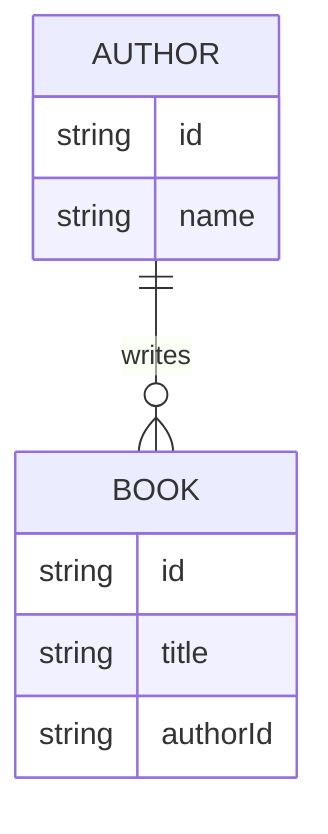
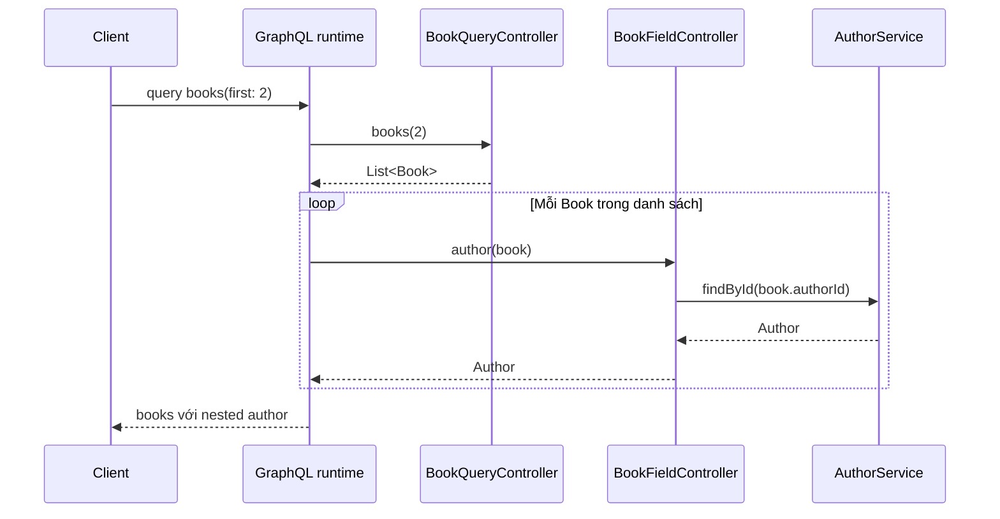

# Xây nested field bằng `@SchemaMapping`

Trong GraphQL, một object thường chứa các field tham chiếu tới object khác. Ví dụ `Book` có `author`, còn `Author` có danh sách `books`. Spring for GraphQL dùng `@SchemaMapping` để gắn một method Java với field trên GraphQL type. Method nhận object cha làm source, lấy dữ liệu liên quan từ service và trả về giá trị cho field con.

Bài thực hành này xây chuỗi `Query.books → Book.author → Author.books`. Bạn sẽ khai báo SDL, tạo model/service, viết root query bằng `@QueryMapping`, resolve nested field bằng `@SchemaMapping`, rồi kiểm tra toàn bộ cây dữ liệu bằng `GraphQlTester`. Cuối bài, thay resolver gọi service từng lần bằng DataLoader để tránh N+1.

## Kết quả cần đạt

- Phân biệt root field và nested field trong GraphQL.
- Hiểu source object được truyền vào method `@SchemaMapping` như thế nào.
- Ánh xạ chính xác GraphQL parent type và field name.
- Đọc argument của nested field bằng `@Argument`.
- Kiểm thử query có nhiều cấp nested field.
- Nhận diện N+1 và chuyển lookup lặp lại sang DataLoader.

## 1. Xác định cấu trúc dữ liệu

Ta dùng ví dụ thư viện sách. Một cuốn sách có một tác giả; một tác giả có thể viết nhiều cuốn sách:



Model Java giữ `authorId` trong `Book` để service có thể tìm tác giả. `authorId` là chi tiết nội bộ của model; client sẽ truy cập tác giả thông qua nested field `author`.

Đặt mỗi record trong một file riêng (`Book.java` và `Author.java`) trong cùng package của ví dụ:

```java
public record Book(
        String id,
        String title,
        String authorId) {
}

public record Author(
        String id,
        String name) {
}
```

Giả sử application có các service sau. Có thể triển khai chúng bằng repository, database hoặc dữ liệu in-memory trong bài thực hành:

Đặt `BookService` và `AuthorService` trong hai file interface riêng:

```java
import java.util.List;
import java.util.Map;
import java.util.Optional;
import java.util.Set;

public interface BookService {
    List<Book> findAll(int first);
    Optional<Book> findById(String id);
    List<Book> findByAuthorId(String authorId, int first);
}

public interface AuthorService {
    Optional<Author> findById(String id);
    Map<String, Author> findAllByIds(Set<String> ids);
}
```

`BookService` chịu trách nhiệm truy vấn sách; `AuthorService` chịu trách nhiệm truy vấn tác giả. Controller GraphQL chỉ điều phối lời gọi service và ánh xạ kết quả vào schema.

## 2. Khai báo schema SDL

Tạo file `src/main/resources/graphql/schema.graphqls`:

```graphql
type Query {
  books(first: Int = 20): [Book!]!
  book(id: ID!): Book
}

type Book {
  id: ID!
  title: String!
  author: Author
}

type Author {
  id: ID!
  name: String!
  books(first: Int = 10): [Book!]!
}
```

`Query.books` và `Query.book` là root fields. `Book.author` và `Author.books` là nested fields vì chúng được khai báo bên trong object type thay vì root `Query`.

`Book.author` nullable trong ví dụ vì dữ liệu sách có thể tham chiếu tới tác giả không còn tồn tại. Nếu nghiệp vụ bảo đảm mọi sách luôn có tác giả và resolver luôn resolve được, có thể khai báo `author: Author!`; khi đó phải xử lý trường hợp thiếu tác giả để không vi phạm Non-Null.

`first` là argument của field. Default value giúp client có thể bỏ qua argument; service vẫn cần áp dụng giới hạn tối đa để tránh tải quá nhiều dữ liệu.

Vì `Author.books` được khai báo `[Book!]!`, service phải trả một list khác null. Khi tác giả chưa có sách, trả `List.of()` hoặc collection rỗng; không trả null.

## 3. Viết root resolver bằng `@QueryMapping`

`@QueryMapping` ánh xạ method vào field thuộc root `Query`. Ví dụ:

```java
import java.util.List;
import java.util.Optional;
import org.springframework.graphql.data.method.annotation.Argument;
import org.springframework.graphql.data.method.annotation.QueryMapping;
import org.springframework.stereotype.Controller;

@Controller
public class BookQueryController {

    private final BookService bookService;

    public BookQueryController(BookService bookService) {
        this.bookService = bookService;
    }

    @QueryMapping
    public List<Book> books(@Argument("first") Integer first) {
        return bookService.findAll(limit(first, 20));
    }

    @QueryMapping
    public Book book(@Argument("id") String id) {
        return bookService.findById(id).orElse(null);
    }

    private int limit(Integer requested, int defaultValue) {
        int value = requested == null ? defaultValue : requested;
        if (value < 1 || value > 100) {
            throw new IllegalArgumentException("first phải nằm trong khoảng 1..100");
        }
        return value;
    }
}
```

Method `books` nhận argument `first` từ GraphQL và trả về danh sách `Book`. Method `book` trả `null` khi không tìm thấy vì schema khai báo `Book` nullable. Trong ứng dụng thực tế, ánh xạ lỗi giới hạn page size thành GraphQL error có mã ổn định bằng exception handler.

## 4. Resolve `Book.author` bằng `@SchemaMapping`

Nested field cần biết object cha nào đang được resolve. Với query `books`, GraphQL gọi root resolver để lấy danh sách `Book`. Khi client yêu cầu `author`, GraphQL gọi data fetcher tương ứng cho từng `Book`.

```java
import org.springframework.graphql.data.method.annotation.SchemaMapping;
import org.springframework.stereotype.Controller;

@Controller
public class BookFieldController {

    private final AuthorService authorService;

    public BookFieldController(AuthorService authorService) {
        this.authorService = authorService;
    }

    @SchemaMapping(typeName = "Book", field = "author")
    public Author author(Book book) {
        return authorService.findById(book.authorId()).orElse(null);
    }
}
```

Trong method trên:

- `typeName = "Book"` xác định parent GraphQL type.
- `field = "author"` xác định field được resolve.
- Tham số `Book book` là source object hiện tại. Spring for GraphQL truyền object mà field `author` thuộc về vào tham số này.
- Giá trị trả về `Author` trở thành kết quả của `Book.author`.

Method được gọi riêng cho mỗi source `Book` cần field `author`. Nếu danh sách có 10 sách, resolver có thể gọi `authorService.findById(...)` 10 lần. Đây là điểm cần chú ý khi xử lý nested fields.

Nếu source object đã có property/getter trùng tên với GraphQL field, GraphQL Java có thể đọc property bằng property data fetcher mặc định mà không cần method `@SchemaMapping`. Dùng `@SchemaMapping` khi cần truy vấn quan hệ, tính toán giá trị, áp dụng logic hoặc kiểm soát rõ cách resolve field. Trong ví dụ này `Book` chỉ có `authorId`, không có property `author`, nên cần resolver để tải `Author`.

### Quy tắc suy luận tên

Có thể viết ngắn hơn khi tên method trùng với field và source parameter đủ để suy ra parent type:

```java
@SchemaMapping
public Author author(Book book) {
    return authorService.findById(book.authorId()).orElse(null);
}
```

Spring suy ra field name `author` từ tên method và parent type từ kiểu source `Book`. Khi muốn tránh mơ hồ hoặc method không theo quy ước đặt tên, khai báo rõ `typeName` và `field` như ví dụ chính.

Cũng có thể đặt `@SchemaMapping(typeName = "Book")` ở cấp class để dùng chung parent type cho các method nested field trong controller; từng method chỉ cần khai báo `@SchemaMapping(field = "...")`.

## 5. Resolve tiếp `Author.books`

Nested field có thể tiếp tục tạo thành một cây dữ liệu sâu hơn. Thêm method vào controller:

```java
import java.util.List;
import org.springframework.graphql.data.method.annotation.Argument;
import org.springframework.graphql.data.method.annotation.SchemaMapping;
import org.springframework.stereotype.Controller;

@SchemaMapping(typeName = "Author")
@Controller
public class AuthorFieldController {

    private final BookService bookService;

    public AuthorFieldController(BookService bookService) {
        this.bookService = bookService;
    }

    @SchemaMapping(field = "books")
    public List<Book> books(
            Author author,
            @Argument("first") Integer first) {
        int limit = first == null ? 10 : first;
        if (limit < 1 || limit > 100) {
            throw new IllegalArgumentException("first phải nằm trong khoảng 1..100");
        }
        return bookService.findByAuthorId(author.id(), limit);
    }
}
```

`Author` là source object của nested field `books`. `@Argument("first")` lấy argument được khai báo trên `Author.books(first: Int)` trong SDL. Hai loại tham số có vai trò khác nhau: `Author author` là parent source, còn `first` là dữ liệu client gửi cho field.

Query có thể yêu cầu nhiều cấp:

```graphql
query AuthorBooks {
  books(first: 5) {
    id
    title
    author {
      id
      name
      books(first: 2) {
        id
        title
      }
    }
  }
}
```

GraphQL chỉ resolve những field client chọn. Nếu client chỉ yêu cầu `books { id title }`, các method `Book.author` và `Author.books` không cần được gọi.

Response rút gọn có dạng:

```json
{
  "data": {
    "books": [
      {
        "id": "book-1",
        "title": "Spring GraphQL",
        "author": {
          "id": "author-1",
          "name": "Lan Nguyen",
          "books": [
            { "id": "book-1", "title": "Spring GraphQL" }
          ]
        }
      }
    ]
  }
}
```

## 6. Theo dõi luồng resolve

Với query:

```graphql
query {
  books(first: 2) {
    title
    author {
      name
    }
  }
}
```

Luồng thực thi khái quát:



GraphQL runtime ghép kết quả của root field và nested fields thành một response JSON. Controller không cần tự tạo object JSON lồng nhau; mỗi resolver chỉ chịu trách nhiệm cho field mà nó ánh xạ.

## 7. Kiểm thử nested field bằng `GraphQlTester`

Test nên gửi một operation hoàn chỉnh qua GraphQL runtime để kiểm tra cả root mapping lẫn nested mapping. Với Spring Boot, `@GraphQlTest` tạo test slice cho các controller được chọn.

```java
// Spring Boot 4.x:
import org.springframework.boot.graphql.test.autoconfigure.GraphQlTest;
// Spring Boot 3.x:
// import org.springframework.boot.test.autoconfigure.graphql.GraphQlTest;

import static org.mockito.BDDMockito.given;
import static org.mockito.BDDMockito.then;
import static org.mockito.Mockito.times;

import java.util.List;
import java.util.Optional;
import org.junit.jupiter.api.Test;
import org.springframework.beans.factory.annotation.Autowired;
import org.springframework.graphql.test.tester.GraphQlTester;
import org.springframework.test.context.bean.override.mockito.MockitoBean;

@GraphQlTest({BookQueryController.class, BookFieldController.class, AuthorFieldController.class})
class NestedFieldTests {

    @Autowired
    GraphQlTester graphQlTester;

    @MockitoBean
    BookService bookService;

    @MockitoBean
    AuthorService authorService;

    @Test
    void resolvesBookAndNestedAuthor() {
        Book book = new Book("book-1", "Spring GraphQL", "author-1");
        Author author = new Author("author-1", "Lan Nguyen");

        given(bookService.findAll(2)).willReturn(List.of(book));
        given(bookService.findByAuthorId("author-1", 2)).willReturn(List.of(book));
        given(authorService.findById("author-1")).willReturn(Optional.of(author));

        var response = graphQlTester.document("""
                query {
                  books(first: 2) {
                    id
                    title
                    author {
                      id
                      name
                      books(first: 2) {
                        title
                      }
                    }
                  }
                }
                """)
                .execute();

        response.path("books[0].title")
                .entity(String.class)
                .isEqualTo("Spring GraphQL");
        response.path("books[0].author.name")
                .entity(String.class)
                .isEqualTo("Lan Nguyen");
        response.path("books[0].author.books[0].title")
                .entity(String.class)
                .isEqualTo("Spring GraphQL");

        then(authorService).should(times(1)).findById("author-1");
        then(bookService).should(times(1)).findByAuthorId("author-1", 2);
    }
}
```

Test giả định schema SDL ở phần trước được nạp trong test context và hai service được thay bằng mock. Nếu dùng Spring Boot trước 3.4, có thể dùng `@MockBean` thay cho `@MockitoBean`; package của `@GraphQlTest` cũng khác giữa Spring Boot 3 và 4 như ghi chú import.

Để kiểm tra thêm cấp `Author.books`, cấu hình `bookService.findByAuthorId("author-1", 2)` trả danh sách sách và mở rộng selection set:

```graphql
query {
  books(first: 2) {
    author {
      name
      books(first: 2) {
        title
      }
    }
  }
}
```

Trong test, kiểm tra path `books[0].author.books[0].title` và xác minh service nhận đúng `authorId` cùng page size. Điều này chứng minh argument của nested field được bind đúng và parent source là tác giả đang được resolve.

## 8. Nhận diện và xử lý N+1

Ví dụ `BookFieldController.author(...)` gọi `authorService.findById(...)` một lần cho mỗi Book. Nếu query lấy N sách, số lần lookup có thể tăng theo N. Đây là dạng N+1 thường gặp trong nested field:

| Số Book | Lần tải danh sách | Lần lookup Author theo resolver đơn giản |
| ---: | ---: | ---: |
| 5 | 1 | 5 |
| 20 | 1 | 20 |
| 100 | 1 | 100 |

Giải pháp là gom các key lại bằng DataLoader. Spring for GraphQL cung cấp `BatchLoaderRegistry` để đăng ký batch loader gắn với GraphQL request.

Đăng ký mapped batch loader:

```java
import java.util.Map;
import org.springframework.graphql.execution.BatchLoaderRegistry;
import org.springframework.stereotype.Component;
import reactor.core.publisher.Mono;

@Component
public class AuthorDataLoaderConfiguration {

    public AuthorDataLoaderConfiguration(
            BatchLoaderRegistry registry,
            AuthorService authorService) {
        registry.forTypePair(String.class, Author.class)
                .registerMappedBatchLoader((authorIds, environment) ->
                        Mono.fromSupplier(() -> authorService.findAllByIds(authorIds)));
    }
}
```

`findAllByIds` trả về `Map<String, Author>` với key là author ID. Mapped batch loader cho phép DataLoader tìm đúng Author theo key, không phụ thuộc thứ tự mà repository trả về map.

Thay resolver đơn bằng resolver sử dụng DataLoader:

```java
import java.util.concurrent.CompletableFuture;
import org.dataloader.DataLoader;
import org.springframework.graphql.data.method.annotation.SchemaMapping;

@SchemaMapping(typeName = "Book", field = "author")
public CompletableFuture<Author> author(
        Book book,
        DataLoader<String, Author> authorDataLoader) {
    return authorDataLoader.load(book.authorId());
}
```

Mỗi Book vẫn yêu cầu `load(authorId)`, nhưng DataLoader gom các key trong cùng execution và dispatch batch loader. DataLoader cache theo request cũng tránh tải lặp cùng một key trong request đó. Cache này không phải cache dùng chung giữa các request.

Không nên vừa đăng ký `@SchemaMapping` vừa `@BatchMapping` cho cùng một field. Nếu chọn `@BatchMapping(typeName = "Book", field = "author")`, Spring tạo batch resolver cho field đó; hãy dùng một cách ánh xạ duy nhất cho cùng field.

## 9. Khi nào dùng `@SchemaMapping`, khi nào dùng `@BatchMapping`?

| Cách ánh xạ | Phù hợp khi |
| --- | --- |
| `@SchemaMapping` | Field cần xử lý theo từng parent, tính toán một giá trị hoặc gọi service với logic riêng. |
| `@SchemaMapping` + DataLoader | Resolver vẫn trả kết quả theo parent nhưng các lookup theo key có thể gom batch. |
| `@BatchMapping` | Có thể nhận nhiều parent cùng lúc và trả kết quả cho cả nhóm. |

Ví dụ `@BatchMapping` có thể thay resolver `Book.author` đơn lẻ:

```java
import java.util.LinkedHashMap;
import java.util.List;
import java.util.Map;
import java.util.Set;
import java.util.stream.Collectors;
import org.springframework.graphql.data.method.annotation.BatchMapping;
import org.springframework.stereotype.Controller;

@Controller
public class BookBatchFieldController {

    private final AuthorService authorService;

    public BookBatchFieldController(AuthorService authorService) {
        this.authorService = authorService;
    }

    @BatchMapping(typeName = "Book", field = "author")
    public Map<Book, Author> author(List<Book> books) {
        Set<String> authorIds = books.stream()
                .map(Book::authorId)
                .collect(Collectors.toSet());

        Map<String, Author> authors = authorService.findAllByIds(authorIds);
        Map<Book, Author> result = new LinkedHashMap<>();
        for (Book book : books) {
            result.put(book, authors.get(book.authorId()));
        }
        return result;
    }
}
```

Ví dụ này là một controller thay thế cho `BookFieldController` trong phần `@SchemaMapping` đơn lẻ. Không đăng ký cả hai resolver cho `Book.author`. `LinkedHashMap` giữ mapping theo source object; giá trị null được giữ nếu không tìm thấy Author, phù hợp với `Book.author` nullable trong SDL.

Chọn cách đơn giản nhất đáp ứng workload. `@SchemaMapping` giúp tách logic field rõ ràng; DataLoader hoặc `@BatchMapping` giải quyết việc gom nhiều lookup. Không batch hóa mọi field một cách máy móc nếu field chỉ trả một giá trị tính toán rẻ.

## 10. Các lỗi thường gặp

| Triệu chứng | Nguyên nhân | Cách xử lý |
| --- | --- | --- |
| Nested field luôn null | Field không có resolver phù hợp, source property không tồn tại hoặc service không tìm thấy dữ liệu. | Kiểm tra SDL, `typeName`, `field`, source object và service result. |
| Method `@SchemaMapping` không được gọi | Sai parent type/field name hoặc controller không được component scan. | Dùng tên tường minh và kiểm tra controller bean trong context. |
| `@Argument` nhận null | Tên argument không khớp SDL hoặc client không truyền giá trị. | Khai báo `@Argument("first")` và kiểm tra operation variables. |
| Lấy nhầm parent object | Method signature dùng sai source parameter. | Dùng đúng Java type đại diện cho parent GraphQL object. |
| Resolver gọi service quá nhiều lần | Nested resolver thực hiện lookup cho từng parent. | Dùng DataLoader hoặc `@BatchMapping`. |
| Field Non-Null làm mất cả object cha | Resolver trả null trong khi SDL khai báo `!`. | Sửa dữ liệu/resolver hoặc thiết kế field nullable nếu null là kết quả hợp lệ. |
| Test slice không tìm thấy service | `@GraphQlTest` không nạp service thật. | Mock collaborator bằng `@MockitoBean` hoặc import cấu hình cần thiết. |
| Batch mapping trả nhầm parent | Kết quả batch không ghép đúng key/source. | Dùng map theo parent hoặc bảo đảm thứ tự kết quả đúng hợp đồng. |

## Bài tập thực hành

Hoàn thành các yêu cầu sau trong ứng dụng Spring for GraphQL:

1. Tạo SDL gồm `Query.books`, `Book.author` và `Author.books` như ví dụ.
2. Tạo record `Book` và `Author`; viết service truy vấn dữ liệu tương ứng.
3. Viết `BookQueryController` với `@QueryMapping` cho `books`.
4. Viết `BookFieldController` resolve `Book.author` bằng `@SchemaMapping`.
5. Viết `AuthorFieldController` resolve `Author.books` và bind argument `first`.
6. Gửi query lồng ba cấp bằng GraphQlTester và kiểm tra title, author name, danh sách books của author.
7. Ghi nhận số lần gọi `AuthorService.findById` khi lấy nhiều Book; sau đó thay bằng DataLoader hoặc `@BatchMapping` và so sánh số lần batch lookup.
8. Kiểm tra trường hợp Book không có Author và bảo đảm response tuân theo nullability trong SDL.

### Tiêu chí hoàn thành

- Query root trả đúng danh sách Book.
- `Book.author` resolve đúng Author tương ứng với `authorId` của từng Book.
- `Author.books(first: ...)` trả đúng sách theo tác giả và giới hạn số lượng.
- Nested selection set được kiểm tra qua GraphQlTester.
- Không có resolver nào tự tạo JSON response; GraphQL runtime ghép các field.
- Nếu tối ưu bằng DataLoader/`@BatchMapping`, kết quả batch khớp đúng parent/key và không phụ thuộc thứ tự ngẫu nhiên từ repository.

## Ghi nhớ

`@SchemaMapping` ánh xạ một method Java vào field của GraphQL object type. Source parameter là object cha đang được resolve; `typeName` xác định parent type, `field` xác định field con, còn `@Argument` lấy argument được khai báo ngay trên field đó. Root fields thường dùng `@QueryMapping` hoặc `@MutationMapping`; nested fields dùng `@SchemaMapping`.

Khi client chọn nested field, GraphQL runtime gọi resolver tương ứng và ghép kết quả vào response. Cách viết một service lookup cho mỗi parent dễ dẫn tới N+1 khi field nằm trong list. Dùng DataLoader hoặc `@BatchMapping` để gom lookup theo request, đồng thời giữ đúng nullability, authorization và quan hệ giữa parent với kết quả.

## Tài liệu tham khảo

- [Spring for GraphQL — Annotated Controllers](https://docs.spring.io/spring-graphql/reference/controllers.html)
- [Spring for GraphQL — `@SchemaMapping` API](https://docs.spring.io/spring-graphql/docs/current/api/org/springframework/graphql/data/method/annotation/SchemaMapping.html)
- [Spring for GraphQL — Batch Loading](https://docs.spring.io/spring-graphql/reference/request-execution.html#execution.batch-loading)
- [Spring for GraphQL — Testing](https://docs.spring.io/spring-graphql/reference/testing.html)
