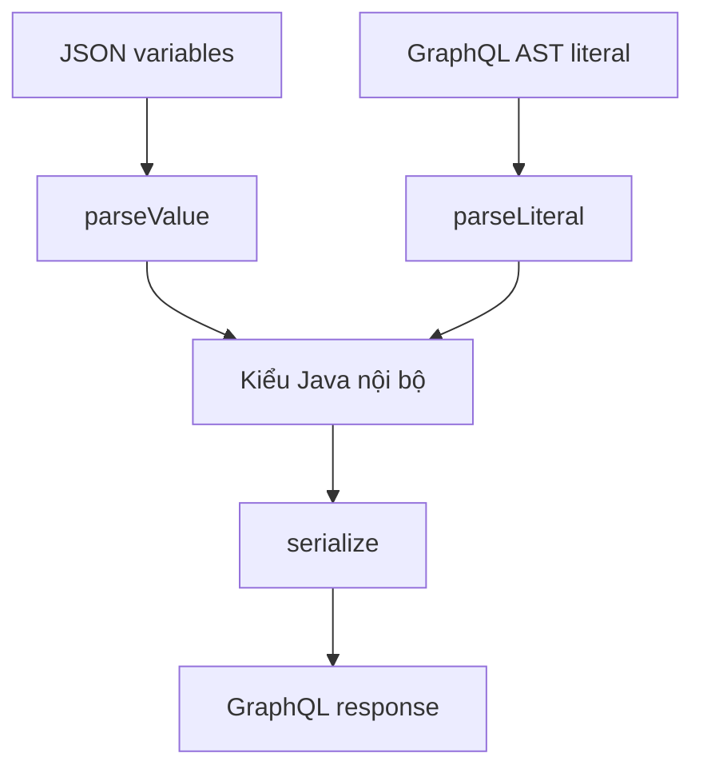

# Thêm custom scalar

## Mục tiêu

GraphQL có năm scalar tích hợp sẵn: `Int`, `Float`, `String`, `Boolean` và `ID`. Chúng đáp ứng các kiểu dữ liệu phổ biến, nhưng API thực tế thường cần biểu diễn những giá trị có quy tắc riêng như số điện thoại, ngày giờ, tiền tệ, UUID hoặc email. Custom scalar cho phép định nghĩa một kiểu dữ liệu nguyên tử mới trong schema, đồng thời kiểm soát cách GraphQL đọc dữ liệu đầu vào và chuyển dữ liệu đầu ra.

Trong bài thực hành này, ta xây dựng scalar `PhoneNumber` theo định dạng E.164 bằng Spring for GraphQL và GraphQL Java. Bạn sẽ:

- Khai báo scalar trong GraphQL SDL và hiểu vai trò của `Coercing`.
- Cài đặt ba chiều chuyển đổi `parseValue`, `parseLiteral` và `serialize`.
- Đăng ký `GraphQLScalarType` vào runtime wiring của Spring for GraphQL.
- Dùng scalar trong Query, Mutation và Java resolver.
- Kiểm thử dữ liệu hợp lệ, dữ liệu sai định dạng và kết quả resolver bằng `GraphQlTester`.
- Phân biệt kiểm tra định dạng của scalar với kiểm tra nghiệp vụ, bảo mật và xác thực quyền truy cập.

## 1. Khi nào cần custom scalar?

Scalar là kiểu dữ liệu GraphQL không có các field con. Client nhận một giá trị đơn như chuỗi, số hoặc boolean. Các kiểu `String`, `Int` và `ID` không thể diễn đạt đầy đủ ý nghĩa của mọi dữ liệu nghiệp vụ. Ví dụ, nếu dùng `String` cho số điện thoại, client có thể gửi `abc`, `123` hoặc chuỗi có dấu cách mà schema vẫn chấp nhận. Resolver phải tự kiểm tra ở nhiều nơi, dễ dẫn đến quy tắc không nhất quán.

Một custom scalar có thể tập trung quy tắc chuyển đổi và định dạng tại một chỗ. Một số trường hợp thường gặp:

| Scalar | Dạng biểu diễn thường dùng | Quy tắc cần thống nhất |
|---|---|---|
| `Date` | Chuỗi `YYYY-MM-DD` | Ngày lịch hợp lệ, không chứa giờ hoặc múi giờ |
| `DateTime` | Chuỗi ISO-8601/RFC 3339 | Quy tắc offset, múi giờ và độ chính xác |
| `UUID` | Chuỗi UUID chuẩn | Cú pháp và cách chuẩn hóa chữ hoa/thường |
| `EmailAddress` | Chuỗi email | Quy tắc cú pháp được hệ thống chấp nhận |
| `PhoneNumber` | Chuỗi E.164 | Dấu `+`, mã quốc gia và giới hạn độ dài |
| `Money` | Chuỗi decimal hoặc object nội bộ | Độ chính xác, scale và đơn vị tiền tệ |

Custom scalar phù hợp khi giá trị được xem như một đơn vị nguyên tử trong hợp đồng API. Nếu client cần truy vấn các thuộc tính độc lập, ví dụ số tiền và loại tiền, một object type như `Money { amount, currency }` có thể phù hợp hơn. Không nên gom một cấu trúc phức tạp thành chuỗi JSON chỉ để gọi nó là scalar; cách đó làm mất khả năng chọn field và kiểm tra kiểu của GraphQL.

## 2. Ba chiều coercion của scalar

GraphQL Java dùng interface `Coercing` để chuyển đổi giữa giá trị trong Java và biểu diễn trên giao thức GraphQL. Một scalar hoàn chỉnh cần xử lý ba luồng sau:



| Method | Hướng dữ liệu | Thời điểm được gọi |
|---|---|---|
| `parseValue` | JSON variables → kiểu Java | Client truyền biến trong phần JSON của request |
| `parseLiteral` | GraphQL AST literal → kiểu Java | Client ghi giá trị trực tiếp trong document |
| `serialize` | Kiểu Java → giá trị response | Resolver trả dữ liệu cho field scalar |

Hai method parse không thay thế nhau. Một operation có thể dùng variables hoặc literal; implementation chỉ hỗ trợ `parseValue` nhưng bỏ qua `parseLiteral` sẽ tạo ra hành vi không nhất quán giữa hai cách truyền input. `serialize` cũng cần thiết vì dữ liệu nội bộ có thể không hợp lệ hoặc không thể biểu diễn đúng trên wire format.

GraphQL xử lý nullability theo SDL. Nếu argument hoặc field được khai báo nullable và giá trị là `null`, scalar coercing thường không được gọi cho giá trị null đó. Dùng dấu `!` trong SDL khi nghiệp vụ bắt buộc có giá trị; không cố xử lý null bằng cách biến nó thành chuỗi rỗng trong scalar.

## 3. Thiết kế PhoneNumber scalar

Ta chọn `PhoneNumber` làm ví dụ. Giá trị được lưu và truyền dưới dạng Java `String`, nhưng phải tuân theo E.164: bắt đầu bằng dấu `+`, tiếp theo là từ 1 đến 15 chữ số; chữ số đầu tiên không được là `0`. Ví dụ `+84912345678` hợp lệ theo quy tắc cú pháp này, còn `0912345678`, `+84 912 345 678` và `abc` không hợp lệ.

Đây là quy tắc định dạng, không chứng minh số điện thoại đang hoạt động, được cấp phát hay thuộc về người dùng. Những điều đó cần quy trình nghiệp vụ riêng như gửi OTP hoặc xác minh với nhà cung cấp.

Trong SDL, khai báo scalar bằng từ khóa `scalar`:

```graphql
scalar PhoneNumber

type Customer {
    id: ID!
    phone: PhoneNumber
}

type Query {
    customer(id: ID!): Customer
}

type Mutation {
    updateCustomerPhone(customerId: ID!, phone: PhoneNumber!): Customer!
}
```

`PhoneNumber!` ở argument của mutation yêu cầu client phải truyền một giá trị khác null. Field `Customer.phone` vẫn nullable vì một khách hàng có thể chưa cung cấp số điện thoại. Khai báo scalar trong SDL mới chỉ định nghĩa tên kiểu; ứng dụng còn phải đăng ký implementation để GraphQL Java biết cách coercion.

Nếu dự án đã khai báo `type Query` hoặc `type Mutation` ở file SDL khác, hãy thêm field vào type hiện hữu hoặc dùng `extend type Query`/`extend type Mutation`. Không khai báo lại cùng một root type trong nhiều file schema.

## 4. Cài đặt GraphQLScalarType

Tạo một class chịu trách nhiệm định nghĩa scalar. Ví dụ dưới đây dùng API `Coercing` hiện đại của GraphQL Java, với `GraphQLContext` và `Locale` trong các method coercion:

```java
package com.example.graphql.scalar;

import graphql.GraphQLContext;
import graphql.execution.CoercedVariables;
import graphql.language.StringValue;
import graphql.language.Value;
import graphql.schema.Coercing;
import graphql.schema.CoercingParseLiteralException;
import graphql.schema.CoercingParseValueException;
import graphql.schema.CoercingSerializeException;
import graphql.schema.GraphQLScalarType;

import java.util.Locale;
import java.util.regex.Pattern;

public final class PhoneNumberScalar {

    private static final Pattern E164_PATTERN =
            Pattern.compile("\\+[1-9][0-9]{0,14}");

    private PhoneNumberScalar() {
    }

    public static final GraphQLScalarType PHONE_NUMBER =
            GraphQLScalarType.newScalar()
                    .name("PhoneNumber")
                    .description("Phone number in E.164 format")
                    .coercing(new Coercing<String, String>() {

                        @Override
                        public String serialize(
                                Object dataFetcherResult,
                                GraphQLContext graphQLContext,
                                Locale locale) {
                            if (!(dataFetcherResult instanceof String value)) {
                                throw new CoercingSerializeException(
                                        "PhoneNumber must be represented by a String.");
                            }

                            try {
                                return validate(value);
                            } catch (IllegalArgumentException exception) {
                                throw new CoercingSerializeException(
                                        "Cannot serialize an invalid PhoneNumber.");
                            }
                        }

                        @Override
                        public String parseValue(
                                Object input,
                                GraphQLContext graphQLContext,
                                Locale locale) {
                            if (!(input instanceof String value)) {
                                throw new CoercingParseValueException(
                                        "PhoneNumber variable must be a String.");
                            }

                            try {
                                return validate(value);
                            } catch (IllegalArgumentException exception) {
                                throw new CoercingParseValueException(
                                        "PhoneNumber must use E.164 format.");
                            }
                        }

                        @Override
                        public String parseLiteral(
                                Value<?> input,
                                CoercedVariables variables,
                                GraphQLContext graphQLContext,
                                Locale locale) {
                            if (!(input instanceof StringValue stringValue)) {
                                throw new CoercingParseLiteralException(
                                        "PhoneNumber literal must be a string.");
                            }

                            try {
                                return validate(stringValue.getValue());
                            } catch (IllegalArgumentException exception) {
                                throw new CoercingParseLiteralException(
                                        "PhoneNumber must use E.164 format.");
                            }
                        }
                    })
                    .build();

    private static String validate(String value) {
        String normalized = value.trim();
        if (!E164_PATTERN.matcher(normalized).matches()) {
            throw new IllegalArgumentException("Invalid E.164 phone number.");
        }
        return normalized;
    }
}
```

Implementation này có một số quyết định quan trọng:

1. **Chọn kiểu Java nội bộ:** `Coercing<String, String>` có nghĩa giá trị đã parse và giá trị được serialize đều là `String`. Nếu ứng dụng có value object `PhoneNumber`, có thể thay kiểu nội bộ bằng class đó để tránh truyền chuỗi tùy ý sâu vào domain.
2. **Kiểm tra loại input:** JSON number, boolean, object hoặc list không được tự động ép thành chuỗi. Literal cũng phải là `StringValue`; một `IntValue` không hợp lệ dù nội dung chữ số có vẻ giống số điện thoại.
3. **Dùng chung quy tắc định dạng:** `validate` được gọi ở cả input và output. Dữ liệu lưu trong database hoặc trả từ service bên ngoài cũng phải tuân thủ hợp đồng khi serialize.
4. **Ném đúng loại lỗi:** input variables sai dùng `CoercingParseValueException`; literal sai dùng `CoercingParseLiteralException`; dữ liệu resolver không thể chuyển thành response dùng `CoercingSerializeException`.
5. **Không trả dữ liệu sai như fallback:** scalar không tự sửa số điện thoại sai thành một giá trị có vẻ hợp lệ. Input lỗi phải bị từ chối để client sửa request; output lỗi cần được quan sát và xử lý như lỗi dữ liệu phía server.

Ví dụ trên chuẩn hóa bằng `trim()` trước khi kiểm tra. Nếu hợp đồng muốn từ chối mọi khoảng trắng thay vì loại bỏ khoảng trắng ở hai đầu, hãy bỏ bước trim và kiểm thử rõ hành vi đó. Một scalar nên có một chính sách canonical duy nhất để client và server không hiểu khác nhau.

### Vì sao parseLiteral cần kiểm tra AST node?

GraphQL document được parse thành Abstract Syntax Tree (AST). Literal chuỗi được biểu diễn bằng `StringValue`, literal số bằng `IntValue` hoặc `FloatValue`, boolean bằng `BooleanValue`. Vì vậy, `parseLiteral` cần kiểm tra node type trước khi lấy nội dung. Không nên gọi `toString()` trên AST rồi tự phân tích chuỗi; cách đó phụ thuộc chi tiết biểu diễn của parser và dễ chấp nhận sai kiểu.

Đối với variables, dữ liệu đã được giải mã từ JSON nên `parseValue` nhận các đối tượng Java như `String`, `Integer`, `Boolean`, `Map` hoặc `List`. Kiểm tra `instanceof String` giúp giới hạn đúng kiểu đầu vào.

## 5. Đăng ký scalar trong Spring for GraphQL

Spring for GraphQL sử dụng `RuntimeWiringConfigurer` để bổ sung scalar, data fetcher và các thành phần runtime khác. Tạo một bean cấu hình:

```java
package com.example.graphql.config;

import com.example.graphql.scalar.PhoneNumberScalar;
import org.springframework.context.annotation.Bean;
import org.springframework.context.annotation.Configuration;
import org.springframework.graphql.execution.RuntimeWiringConfigurer;

@Configuration
public class GraphQlScalarConfiguration {

    @Bean
    RuntimeWiringConfigurer phoneNumberRuntimeWiringConfigurer() {
        return wiringBuilder ->
                wiringBuilder.scalar(PhoneNumberScalar.PHONE_NUMBER);
    }
}
```

Khi Spring khởi tạo GraphQL runtime, bean `RuntimeWiringConfigurer` được áp dụng vào `RuntimeWiring.Builder`. Scalar đã đăng ký phải có tên trùng chính xác với tên trong SDL: `PhoneNumber`. Nếu SDL khai báo `PhoneNumber` nhưng runtime đăng ký `Phone`, schema sẽ không tìm được implementation tương ứng.

Với cấu hình Spring Boot mặc định, schema SDL thường được đặt trong `src/main/resources/graphql/` và có thể tách thành nhiều file `.graphqls` hoặc `.gqls`. Ví dụ:

```text
src/main/resources/
└── graphql/
    ├── customer.graphqls
    └── common-scalars.graphqls
```

Đặt `scalar PhoneNumber` trong một file schema được Spring GraphQL nạp cùng các type còn lại. Tránh khai báo cùng một scalar nhiều lần trong các file SDL. Nếu dự án tùy chỉnh `spring.graphql.schema.locations`, hãy bảo đảm thư mục chứa file schema thực sự nằm trong danh sách location.

Khi khởi động ứng dụng, kiểm tra log khởi tạo schema. Một lỗi thường gặp là schema đã khai báo custom scalar nhưng không có scalar wiring. Trường hợp này thường được phát hiện lúc tạo `GraphQLSchema`, trước khi request nghiệp vụ được xử lý.

## 6. Dùng scalar trong resolver

Do `PhoneNumberScalar` dùng `String` làm kiểu Java nội bộ, resolver có thể nhận `String` qua `@Argument` và trả `String` trong object kết quả. Ví dụ một model record:

```java
package com.example.customer;

public record Customer(String id, String phone) {
}
```

Controller có thể ánh xạ Query và Mutation như sau:

```java
package com.example.customer;

import org.springframework.graphql.data.method.annotation.Argument;
import org.springframework.graphql.data.method.annotation.MutationMapping;
import org.springframework.graphql.data.method.annotation.QueryMapping;
import org.springframework.stereotype.Controller;

@Controller
public class CustomerGraphQlController {

    private final CustomerService customerService;

    public CustomerGraphQlController(CustomerService customerService) {
        this.customerService = customerService;
    }

    @QueryMapping
    public Customer customer(@Argument("id") String id) {
        return customerService.findById(id);
    }

    @MutationMapping
    public Customer updateCustomerPhone(
            @Argument("customerId") String customerId,
            @Argument("phone") String phone) {
        return customerService.updatePhone(customerId, phone);
    }
}
```

`CustomerService` ở đây đại diện cho lớp nghiệp vụ và repository của ứng dụng. GraphQL runtime thực hiện scalar coercion trước khi gọi mutation resolver. Nếu `phone` không đúng định dạng, `parseValue` hoặc `parseLiteral` phát sinh lỗi và resolver không được gọi. Khi service trả về `Customer`, `serialize` xác nhận giá trị `phone` trước khi ghi vào response.

Ví dụ query:

```graphql
query FindCustomer($id: ID!) {
    customer(id: $id) {
        id
        phone
    }
}
```

Ví dụ mutation sử dụng variables:

```graphql
mutation UpdatePhone($customerId: ID!, $phone: PhoneNumber!) {
    updateCustomerPhone(customerId: $customerId, phone: $phone) {
        id
        phone
    }
}
```

Request variables tương ứng:

```json
{
  "customerId": "customer-17",
  "phone": "+84912345678"
}
```

Client cũng có thể truyền literal trực tiếp:

```graphql
mutation {
    updateCustomerPhone(
        customerId: "customer-17",
        phone: "+84912345678"
    ) {
        id
        phone
    }
}
```

Mutation dùng variables đi qua `parseValue`; mutation dùng literal đi qua `parseLiteral`. Cả hai đều trả về cùng kiểu Java nội bộ để service xử lý.

## 7. Kiểm thử với GraphQlTester

Không nên chỉ kiểm tra class scalar độc lập. Cần xác nhận scalar đã được đăng ký trong runtime, schema nhận đúng kiểu, resolver nhận dữ liệu đã parse và response được serialize đúng định dạng. `GraphQlTester` cho phép gửi operation đến GraphQL execution engine trong test context.

### Kiểm thử input variables hợp lệ

```java
@SpringBootTest
class CustomerPhoneGraphQlTests {

    @Autowired
    GraphQlTester graphQlTester;

    @Test
    void acceptsPhoneNumberVariable() {
        graphQlTester.document("""
                mutation UpdatePhone($customerId: ID!, $phone: PhoneNumber!) {
                    updateCustomerPhone(
                        customerId: $customerId,
                        phone: $phone
                    ) {
                        id
                        phone
                    }
                }
                """)
                .variable("customerId", "customer-17")
                .variable("phone", "+84912345678")
                .execute()
                .path("updateCustomerPhone.phone")
                .entity(String.class)
                .isEqualTo("+84912345678");
    }
}
```

Test này giả định test context đã có dữ liệu hoặc mock `CustomerService` để mutation trả về khách hàng với số điện thoại được cập nhật. Nếu service trả về giá trị khác, hãy điều chỉnh fixture để test tập trung vào hợp đồng scalar.

### Kiểm thử literal

```java
@Test
void acceptsPhoneNumberLiteral() {
    graphQlTester.document("""
            mutation {
                updateCustomerPhone(
                    customerId: "customer-17",
                    phone: "+84912345678"
                ) {
                    phone
                }
            }
            """)
            .execute()
            .path("updateCustomerPhone.phone")
            .entity(String.class)
            .isEqualTo("+84912345678");
}
```

Test này đi qua `parseLiteral`. Nên giữ riêng test variables và literal để khi một trong hai luồng bị thiếu implementation, lỗi được phát hiện rõ ràng.

### Kiểm thử input sai định dạng

```java
@Test
void rejectsInvalidPhoneNumberVariable() {
    var response = graphQlTester.document("""
            mutation UpdatePhone($customerId: ID!, $phone: PhoneNumber!) {
                updateCustomerPhone(
                    customerId: $customerId,
                    phone: $phone
                ) {
                    id
                }
            }
            """)
            .variable("customerId", "customer-17")
            .variable("phone", "0912345678")
            .execute();

    response.errors().satisfy(errors ->
            assertThat(errors).isNotEmpty());
}
```

Đoạn test cần import assertion tương ứng, ví dụ `org.assertj.core.api.Assertions.assertThat`. Có thể bổ sung test cho input không phải chuỗi, chuỗi rỗng, số có khoảng trắng ở giữa, số có hơn 15 chữ số và số bắt đầu bằng `+0`. Với literal, kiểm tra cả literal sai kiểu như `phone: 12345`; GraphQL phải từ chối vì AST node không phải `StringValue`.

### Kiểm thử serialize

`serialize` được gọi khi resolver trả giá trị cho field scalar. Để kiểm tra chiều này, có thể cấu hình service test trả về một `Customer` có phone hợp lệ và xác nhận response chứa chuỗi E.164. Một test bổ sung có thể cố ý trả về giá trị sai từ fixture để xác nhận GraphQL ghi nhận field error thay vì phát ra dữ liệu không hợp lệ.

Nếu test chỉ gọi `PhoneNumberScalar.validate` hoặc `Coercing` trực tiếp, test đó không chứng minh scalar đã được đăng ký trong Spring GraphQL runtime. Nên có ít nhất một integration test đi qua `GraphQlTester` như ví dụ trên.

## 8. Xử lý lỗi và thông điệp trả về

Ba nhóm lỗi coercion phản ánh ba nguồn dữ liệu khác nhau:

| Lỗi | Nguyên nhân | Hành vi mong đợi |
|---|---|---|
| `CoercingParseValueException` | JSON variable sai kiểu hoặc sai định dạng | GraphQL từ chối operation trước khi gọi resolver |
| `CoercingParseLiteralException` | Literal sai AST node hoặc sai định dạng | GraphQL từ chối operation khi coercion literal |
| `CoercingSerializeException` | Resolver trả kiểu Java hoặc giá trị không thể serialize | GraphQL ghi nhận lỗi ở field tương ứng theo quy tắc xử lý lỗi và nullability |

Không đưa giá trị input đầy đủ vào exception message. Số điện thoại, email, token và các dữ liệu định danh có thể là dữ liệu cá nhân. Một thông báo như “PhoneNumber must use E.164 format” đủ để client hiểu hợp đồng mà không làm lộ giá trị nhạy cảm trong log hay response.

Với field output nullable, lỗi serialize có thể khiến field đó thành `null` và xuất hiện trong `errors`. Nếu field nằm trong một nhánh non-null, lỗi có thể lan truyền lên parent gần nhất có thể nhận null. Đây là quy tắc null propagation của GraphQL; hãy thiết kế nullability phù hợp và kiểm tra response thực tế trong integration test.

Không nên bắt mọi exception rồi trả `null` để làm response có vẻ thành công. Việc đó che giấu lỗi dữ liệu và làm client khó phân biệt “không có số điện thoại” với “server không serialize được số điện thoại”. Hãy để lỗi kỹ thuật được ghi nhận đúng cách, đồng thời chuẩn hóa thông điệp công khai qua cơ chế xử lý lỗi của ứng dụng.

## 9. Mở rộng sang value object trong Java

Trong ví dụ đầu, kiểu Java nội bộ là `String` để tập trung vào cơ chế scalar. Với domain lớn hơn, nên cân nhắc tạo value object nhằm ngăn chuỗi chưa được kiểm tra đi vào tầng nghiệp vụ:

```java
public record PhoneNumber(String value) {

    public PhoneNumber {
        value = value == null ? null : value.trim();
        if (value == null || !value.matches("\\+[1-9][0-9]{0,14}")) {
            throw new IllegalArgumentException("Invalid E.164 phone number.");
        }
    }
}
```

Khi đó, scalar có thể khai báo `Coercing<PhoneNumber, String>`:

```java
GraphQLScalarType phoneNumberScalar = GraphQLScalarType.newScalar()
        .name("PhoneNumber")
        .coercing(new Coercing<PhoneNumber, String>() {
            // parseValue và parseLiteral tạo PhoneNumber sau khi kiểm tra input.
            // serialize đọc PhoneNumber.value() và trả về String.
        })
        .build();
```

Đoạn thứ hai chỉ minh họa kiểu generic và ranh giới chuyển đổi; khi triển khai cần cung cấp đầy đủ ba method coercion như phần trước. Ưu điểm của value object là service và domain model nhận một giá trị đã được kiểm tra. Tuy nhiên, không nên lặp lại quy tắc khác nhau giữa constructor của value object và scalar. Hãy đặt logic xác thực ở một nơi dùng chung, hoặc để scalar tạo value object và dùng constructor làm hàng rào cuối cùng.

## 10. Dùng scalar có sẵn hay tự viết?

Không phải mọi scalar đều cần tự triển khai. Với kiểu phổ biến như `Date`, `DateTime`, `UUID`, `Long` hoặc `BigDecimal`, có thể dùng thư viện scalar mở rộng đã được cộng đồng sử dụng. GraphQL Java Extended Scalars cung cấp các implementation sẵn có, ví dụ `ExtendedScalars.Date`, `ExtendedScalars.DateTime`, `ExtendedScalars.UUID` và một số scalar khác tùy phiên bản thư viện.

Ví dụ đăng ký scalar từ thư viện:

```java
import graphql.scalars.ExtendedScalars;
import org.springframework.context.annotation.Bean;
import org.springframework.context.annotation.Configuration;
import org.springframework.graphql.execution.RuntimeWiringConfigurer;

@Configuration
public class ExtendedScalarConfiguration {

    @Bean
    RuntimeWiringConfigurer extendedScalarConfigurer() {
        return wiringBuilder -> wiringBuilder
                .scalar(ExtendedScalars.Date)
                .scalar(ExtendedScalars.DateTime)
                .scalar(ExtendedScalars.UUID);
    }
}
```

Thêm dependency `com.graphql-java:graphql-java-extended-scalars` với phiên bản tương thích với phiên bản GraphQL Java mà Spring Boot đang sử dụng. Không chọn một phiên bản mới nhất một cách độc lập nếu nó yêu cầu GraphQL Java khác phiên bản runtime hiện có. Kiểm tra dependency tree và tài liệu tương ứng của phiên bản thư viện trước khi nâng cấp.

Chọn thư viện có sẵn khi định dạng là chuẩn phổ biến và implementation đáp ứng đúng hợp đồng của hệ thống. Tự viết scalar khi cần quy tắc domain riêng, cách chuẩn hóa đặc thù hoặc kiểu Java nội bộ riêng. Dù chọn cách nào, vẫn phải thống nhất định dạng trong SDL, client, tài liệu API và hệ thống lưu trữ.

## 11. Những lưu ý về thiết kế và bảo mật

**Scalar chỉ kiểm tra biểu diễn dữ liệu.** `PhoneNumber` kiểm tra cú pháp E.164, không xác nhận quyền sở hữu số điện thoại, không kiểm tra tenant và không xác thực người gọi. Những kiểm tra đó thuộc service hoặc security layer.

**Không biến scalar thành nơi chứa nghiệp vụ.** Một scalar nên có quy tắc parse, serialize và canonicalization rõ ràng. Không gọi database, gửi OTP hoặc truy cập service từ `Coercing`; các thao tác này có side effect và khiến quá trình parse/validation khó dự đoán.

**Giữ input và output nhất quán.** Nếu input chấp nhận một định dạng nhưng output trả định dạng khác, client sẽ khó dùng lại giá trị nhận được. Nên xác định một wire format canonical, kiểm tra ở cả parse và serialize.

**Cẩn thận với chuẩn hóa.** Tự động xóa dấu cách, đổi chữ hoa/thường hoặc chuyển múi giờ có thể làm thay đổi ý nghĩa dữ liệu. Chỉ chuẩn hóa khi đó là một phần của hợp đồng đã công bố và có test bao phủ.

**Không dùng regex để thay thế mọi xác minh.** Regex có thể kiểm tra cú pháp cơ bản nhưng không chứng minh dữ liệu có thật. Với email hoặc số điện thoại, xác minh quyền sở hữu cần quy trình gửi mã xác nhận hoặc xác thực qua nhà cung cấp.

**Không đưa dữ liệu nhạy cảm vào metrics.** Tránh gắn giá trị scalar thực tế vào metric label, tracing tag hoặc exception message. Chỉ ghi nhận loại lỗi, tên operation/field đã chuẩn hóa và metadata cần thiết theo chính sách bảo vệ dữ liệu.

**Định nghĩa nullability có chủ đích.** `PhoneNumber` nullable khi khách hàng có thể chưa có số. Dùng `PhoneNumber!` khi nghiệp vụ bắt buộc. Đừng dùng custom scalar để né quy tắc null propagation của GraphQL.

**Mô tả scalar cho client.** Tên `PhoneNumber` chưa nói rõ wire format. Hãy ghi format trong schema documentation và API guide. GraphQL hỗ trợ directive `@specifiedBy` để liên kết tới tài liệu mô tả đặc tả scalar nếu dự án có một tài liệu chuẩn ổn định. Ví dụ: `scalar PhoneNumber @specifiedBy(url: "<URL tài liệu đặc tả E.164>")`; thay phần placeholder bằng URL tài liệu chính thức mà dự án quyết định sử dụng.

## 12. Các lỗi thường gặp khi thêm custom scalar

| Triệu chứng | Nguyên nhân thường gặp | Cách kiểm tra |
|---|---|---|
| Schema không khởi tạo được | SDL khai báo scalar nhưng runtime chưa đăng ký scalar cùng tên | Kiểm tra `RuntimeWiringConfigurer` và tên trong SDL |
| Variables hợp lệ nhưng literal thất bại | Chỉ cài `parseValue`, `parseLiteral` thiếu hoặc kiểm tra sai AST | Gửi operation dùng literal trực tiếp |
| Literal hợp lệ nhưng variables thất bại | `parseValue` không hỗ trợ kiểu Java do JSON decoder cung cấp | Kiểm tra loại object nhận trong `parseValue` |
| Query chạy nhưng response field lỗi | `serialize` từ chối giá trị resolver trả về | Kiểm tra kiểu Java và dữ liệu từ service/database |
| Resolver không được gọi khi input sai | Đây là hành vi đúng của scalar coercion | Kiểm tra GraphQL errors trước khi debug resolver |
| Client nhận lỗi khó hiểu | Exception message quá chung hoặc không có tài liệu wire format | Chuẩn hóa lỗi và công bố định dạng scalar |
| Scalar tự hoạt động trong test unit nhưng lỗi khi chạy ứng dụng | Test không nạp Spring GraphQL runtime hoặc bean wiring chưa được tạo | Bổ sung test qua `GraphQlTester` |
| Nâng dependency làm lỗi runtime | Phiên bản Extended Scalars không tương thích GraphQL Java | Kiểm tra phiên bản transitive và dependency alignment |

## 13. Checklist hoàn thành bài thực hành

- [ ] SDL có khai báo `scalar PhoneNumber` và dùng scalar đúng nơi.
- [ ] Java có `GraphQLScalarType` với tên trùng tên trong SDL.
- [ ] `parseValue` kiểm tra variables từ JSON.
- [ ] `parseLiteral` kiểm tra đúng AST node và nội dung literal.
- [ ] `serialize` kiểm tra dữ liệu do resolver trả về.
- [ ] Các lỗi coercion dùng exception phù hợp với chiều xử lý.
- [ ] Scalar được đăng ký bằng bean `RuntimeWiringConfigurer`.
- [ ] Query/Mutation resolver nhận kiểu Java đúng với scalar đã chọn.
- [ ] Test hợp lệ cho variables, literal và response serialization.
- [ ] Test input sai định dạng và xác nhận resolver không chạy.
- [ ] Không đưa dữ liệu nhạy cảm vào exception, log hoặc metric label.
- [ ] Tài liệu API mô tả wire format, nullability và quy tắc canonicalization.

## Kết luận

Custom scalar mở rộng hệ kiểu của GraphQL bằng cách gom quy tắc chuyển đổi vào một implementation có thể tái sử dụng. Trong Spring for GraphQL, quy trình gồm khai báo scalar trong SDL, cài `Coercing`, đăng ký `GraphQLScalarType` qua `RuntimeWiringConfigurer`, sau đó dùng kiểu này trong resolver và kiểm thử qua `GraphQlTester`. Luôn triển khai đủ `parseValue`, `parseLiteral` và `serialize`; kiểm tra cả input lẫn output, đồng thời giữ xác thực nghiệp vụ và bảo mật ở đúng tầng của ứng dụng.
