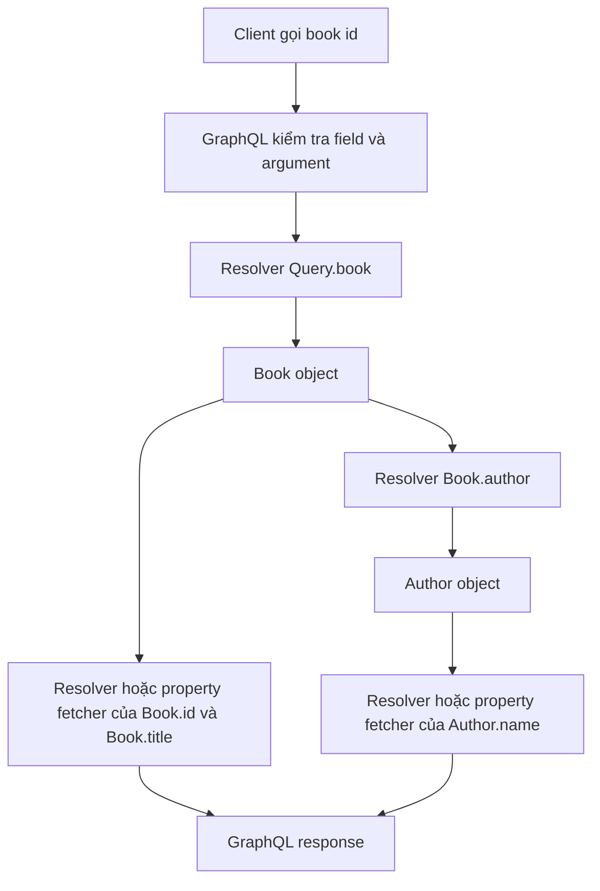

# Field definition

Trong GraphQL SDL, **field definition** mô tả một field mà client có thể truy vấn trên một object type hoặc interface. Mỗi định nghĩa cho biết tên field, các argument mà client có thể truyền, kiểu dữ liệu trả về và những directive áp dụng cho field. Đây là contract mà GraphQL client nhìn thấy; phần lấy dữ liệu thực tế được nối vào field thông qua resolver, chẳng hạn `DataFetcher` của GraphQL Java hoặc các phương thức mapping của Spring for GraphQL.

Ví dụ, schema sau định nghĩa field `book` trên root type `Query`. Client phải truyền `id` và nhận về một `Book` nếu tìm thấy:

```graphql
type Query {
    book(id: ID!): Book
}

type Book {
    id: ID!
    title: String!
    author: Author
}

type Author {
    id: ID!
    name: String!
}
```

`book` có argument `id` với kiểu `ID!`, còn kiểu trả về là `Book` có thể null. `Book.author` là một field khác, không có argument và trả về `Author` có thể null. Khi client yêu cầu `book`, GraphQL tiếp tục phân giải các field con được chọn như `id`, `title` và `author`.

## 1. Cú pháp của một field definition

Trong object type hoặc interface, cấu trúc tổng quát của một field definition là:

```graphql
"""Mô tả field (không bắt buộc)."""
fieldName(argumentName: ArgumentType = defaultValue): ReturnType @directive
```

Các thành phần có ý nghĩa như sau:

| Thành phần | Ý nghĩa |
| --- | --- |
| Description | Mô tả field cho người đọc schema và công cụ tài liệu |
| `fieldName` | Tên field mà client dùng trong operation |
| `argumentName: ArgumentType` | Argument có tên và kiểu dữ liệu xác định; có thể có nhiều argument hoặc không có argument nào |
| `= defaultValue` | Giá trị mặc định được dùng khi client không truyền argument |
| `ReturnType` | Kiểu dữ liệu mà field trả về, có thể là kiểu đơn, list hoặc non-null |
| `@directive` | Metadata hoặc hành vi được gắn vào field theo định nghĩa directive |

Ví dụ một type có các field không có argument, một argument và nhiều argument:

```graphql
type Query {
    health: String!
    book(id: ID!): Book
    searchBooks(keyword: String!, limit: Int = 10): [Book!]!
}
```

`health` không nhận argument. `book` nhận một argument bắt buộc tên `id`. `searchBooks` nhận `keyword` bắt buộc và `limit` tùy chọn có giá trị mặc định là `10`. Tên argument có ý nghĩa trong GraphQL document; thứ tự argument khi gọi field không quyết định ý nghĩa của chúng.

Tên field và argument tuân theo quy tắc tên của GraphQL: bắt đầu bằng chữ cái hoặc dấu gạch dưới, sau đó có thể chứa chữ cái, chữ số hoặc dấu gạch dưới. Các tên bắt đầu bằng `__` được dành riêng cho hệ thống introspection của GraphQL, vì vậy không nên dùng tiền tố này cho field nghiệp vụ.

## 2. Return type: scalar, object, enum và các kiểu output

Field trong object type hoặc interface phải trả về một **output type**. Các output type gồm scalar, enum, object, interface, union và các dạng list/non-null bọc quanh những kiểu hợp lệ đó. Một `input object` không thể được dùng làm kiểu trả về.

Ví dụ:

```graphql
scalar DateTime

enum BookStatus {
    DRAFT
    PUBLISHED
    ARCHIVED
}

type Query {
    currentTime: DateTime!
    bookStatus(id: ID!): BookStatus
    book(id: ID!): Book
    searchBooks(keyword: String!): [Book!]!
}
```

GraphQL có các scalar tích hợp `Int`, `Float`, `String`, `Boolean` và `ID`. Ứng dụng có thể khai báo scalar riêng như `DateTime` để mô tả kiểu dữ liệu miền nghiệp vụ. Khai báo `scalar DateTime` trong SDL chỉ tạo tên kiểu trong schema; ứng dụng vẫn cần cấu hình cách parse input và serialize output cho scalar đó trong runtime.

Enum biểu diễn một tập giá trị hữu hạn. Client gửi tên enum như `PUBLISHED`, không gửi một object tùy ý. Enum có thể dùng làm kiểu trả về hoặc kiểu input, nhưng không thể thay bằng một `input object` trong vị trí output.

### List và non-null

GraphQL dùng dấu ngoặc vuông để biểu diễn list và dấu `!` để biểu diễn non-null. Hai wrapper này có thể kết hợp:

| Kiểu | Ý nghĩa |
| --- | --- |
| `Book` | Một `Book` hoặc `null` |
| `Book!` | Bắt buộc có một `Book`, không được `null` |
| `[Book]` | List có thể `null`; từng phần tử cũng có thể `null` |
| `[Book]!` | List không được `null`; từng phần tử có thể `null` |
| `[Book!]` | List có thể `null`; từng phần tử không được `null` |
| `[Book!]!` | List không được `null` và không phần tử nào được `null` |

Ví dụ:

```graphql
type Query {
    optionalBook: Book
    requiredBook: Book!
    books: [Book!]!
}
```

Với `books: [Book!]!`, resolver phải cung cấp một list khác `null` và mọi phần tử trong list cũng phải khác `null`. Nếu một phần tử vi phạm non-null, GraphQL thực hiện quy tắc lan truyền null lên vị trí nullable gần nhất trong response. Nếu không còn vị trí nullable phù hợp, `data` có thể trở thành `null` và lỗi được đưa vào danh sách `errors`.

Chọn nullability là quyết định về contract API. Hãy dùng `!` khi ứng dụng bảo đảm giá trị luôn tồn tại trong mọi trường hợp hợp lệ. Nếu dữ liệu có thể thiếu, bị xóa hoặc không được phép xem, kiểu nullable thường mô tả contract trung thực hơn. Non-null không tự tạo dữ liệu; nó đặt ra điều kiện mà resolver và dữ liệu trả về phải đáp ứng.

## 3. Argument definition và giá trị mặc định

Argument cho phép client điều khiển cách field lấy dữ liệu. Một field có thể khai báo nhiều argument, mỗi argument có tên, kiểu input và giá trị mặc định tùy chọn.

```graphql
type Query {
    books(
        authorId: ID
        status: BookStatus = PUBLISHED
        limit: Int = 20
        offset: Int = 0
    ): [Book!]!
}
```

Trong ví dụ này, client có thể lọc theo `authorId`, chọn `status`, phân trang bằng `limit` và `offset`. Nếu không truyền `status`, GraphQL dùng `PUBLISHED`; nếu không truyền `limit` hoặc `offset`, lần lượt dùng `20` và `0`.

Client truyền argument theo tên:

```graphql
query {
    books(status: ARCHIVED, limit: 5, offset: 10) {
        id
        title
    }
}
```

Giá trị argument phải phù hợp với kiểu input đã khai báo. GraphQL kiểm tra và coercion giá trị theo schema trước khi gọi resolver. Ví dụ, một chuỗi không hợp lệ không thể được truyền vào argument `limit: Int` chỉ vì resolver Java có thể nhận một `Object`.

### Khi nào một argument là bắt buộc?

Một argument có kiểu non-null và không có giá trị mặc định là required argument:

```graphql
type Query {
    book(id: ID!): Book
    books(limit: Int! = 20): [Book!]!
}
```

`id: ID!` bắt buộc client phải cung cấp. `limit: Int! = 20` có kiểu non-null nhưng có giá trị mặc định, vì vậy client được phép bỏ qua argument và GraphQL sử dụng `20`. Nếu client truyền explicit `null` cho argument non-null, request không hợp lệ.

Giá trị mặc định phải là một giá trị literal phù hợp với kiểu input, chẳng hạn số, chuỗi, boolean, enum, list, object hoặc `null` khi kiểu cho phép. Không thể dùng một lời gọi hàm Java hoặc truy vấn database làm default value trong SDL.

### Input object để nhóm các argument

Khi field cần nhiều điều kiện lọc, có thể gom chúng vào một input object:

```graphql
input BookFilter {
    keyword: String
    authorId: ID
    status: BookStatus = PUBLISHED
}

type Query {
    searchBooks(filter: BookFilter, limit: Int = 20): [Book!]!
}
```

Client có thể truyền input object trực tiếp hoặc thông qua variable:

```graphql
query SearchBooks($filter: BookFilter, $limit: Int = 20) {
    searchBooks(filter: $filter, limit: $limit) {
        id
        title
    }
}
```

Input object chỉ dùng cho dữ liệu đầu vào. Các field bên trong `input BookFilter` không phải field output và không có resolver riêng. Chúng là cấu trúc dữ liệu được GraphQL kiểm tra trước khi chuyển đến resolver của `searchBooks`.

## 4. Field definition khác input value definition

GraphQL SDL có hai cấu trúc dễ nhầm:

- **Field definition** nằm trong `type` hoặc `interface`, mô tả dữ liệu client có thể đọc. Nó có thể có argument và một output type.
- **Input value definition** dùng để khai báo argument của field hoặc field bên trong `input object`. Nó chỉ nhận input type và có thể có default value.

So sánh:

```graphql
type Book {
    title: String!
    author: Author
    relatedBooks(limit: Int = 5): [Book!]!
}

input BookInput {
    title: String!
    authorId: ID
}
```

`Book.author` là output field trả về `Author`. `Book.relatedBooks` là output field nhận argument `limit` và trả về list `Book`. Trong khi đó, `BookInput.authorId` là input value, không phải field có thể được client truy vấn độc lập.

Quy tắc kiểu cũng khác nhau: output field có thể trả về object, interface hoặc union; argument và input object field chỉ được dùng input type như scalar, enum hoặc input object. Vì thế, không thể khai báo `author: Author` bên trong `input BookInput` nếu `Author` là object type.

## 5. Description và directive trên field

Description giúp schema dễ đọc trong code review, tài liệu API và công cụ GraphQL IDE. Có thể viết mô tả một dòng hoặc nhiều dòng bằng chuỗi ba dấu nháy kép:

```graphql
type Query {
    """Tìm một quyển sách theo mã định danh."""
    book(id: ID!): Book
}
```

Directive gắn metadata hoặc chỉ thị vào một vị trí trong schema. Một directive phổ biến trên field definition là `@deprecated`, dùng để đánh dấu field cũ và hướng client chuyển sang field khác:

```graphql
type Book {
    """Tên hiển thị hiện tại của sách."""
    title: String!

    """Field cũ; hãy dùng title."""
    oldTitle: String @deprecated(reason: "Use title instead.")
}
```

Field bị deprecated vẫn có thể tồn tại trong schema và vẫn có thể được client gọi trong thời gian chuyển đổi. Metadata deprecation giúp client và công cụ phát hiện API nên được thay thế; nó không tự xóa field và cũng không tự chặn request.

### Khai báo custom directive

Schema có thể định nghĩa directive riêng và giới hạn vị trí mà directive được phép áp dụng:

```graphql
enum Role {
    READER
    EDITOR
}

directive @requiresRole(role: Role!) on FIELD_DEFINITION

type Query {
    publicCatalog: [Book!]!
    editorialNotes: [String!]! @requiresRole(role: EDITOR)
}
```

`on FIELD_DEFINITION` cho biết directive có thể được gắn vào field definition. Bản thân dòng khai báo và cách gắn `@requiresRole` chỉ mô tả directive trong schema; ứng dụng phải triển khai cơ chế diễn giải nó, ví dụ qua cấu hình runtime, instrumentation hoặc lớp bảo mật của Spring. Nếu không có thành phần thực thi tương ứng, directive tùy chỉnh không tự kiểm tra quyền truy cập.

## 6. Field definition được nối với resolver trong Spring for GraphQL

SDL mô tả field và kiểu dữ liệu; resolver cung cấp giá trị cho field trong mỗi operation. Trong GraphQL Java, thành phần thực hiện việc đó là `DataFetcher`. Spring for GraphQL cho phép khai báo resolver bằng annotation trên Spring bean.

Với schema:

```graphql
type Query {
    book(id: ID!): Book
}

type Book {
    id: ID!
    title: String!
    author: Author
}
```

Controller có thể viết:

```java
@Controller
public class BookController {

    private final BookService bookService;
    private final AuthorService authorService;

    public BookController(
            BookService bookService,
            AuthorService authorService) {
        this.bookService = bookService;
        this.authorService = authorService;
    }

    @QueryMapping
    public Book book(@Argument("id") String bookId) {
        return bookService.findById(bookId);
    }

    @SchemaMapping(typeName = "Book", field = "author")
    public Author author(Book book) {
        return authorService.findById(book.authorId());
    }
}
```

`@QueryMapping` ánh xạ phương thức vào field `Query.book`. `@Argument("id")` lấy giá trị argument tên `id` từ GraphQL request và chuyển thành tham số Java. `@SchemaMapping` ánh xạ phương thức `author` vào field `Book.author`; tham số `Book` là source object được trả về từ field cha.

Không cần viết resolver riêng cho mọi field. Nếu `Book` đã có property `id` và `title` phù hợp, GraphQL Java có thể dùng `PropertyDataFetcher` mặc định để đọc chúng từ source object. Chỉ cần mapping riêng khi field cần gọi service, áp dụng nghiệp vụ, chuyển đổi dữ liệu hoặc truy xuất nguồn khác.

Luồng xử lý một query lồng nhau diễn ra như sau:



Client có thể chọn các field cần lấy:

```graphql
query {
    featured: book(id: "book-01") {
        title
        author {
            name
        }
    }
}
```

Alias `featured` đổi tên key trong response của operation này, không đổi tên field `book` trong schema và cũng không làm thay đổi cách resolver được ánh xạ. Selection set quyết định các field con nào được thực thi cho request đó.

## 7. Field trên Query, Mutation và Subscription

Field definition xuất hiện trên cả object type thông thường và ba root operation type. Mỗi root type có ý nghĩa thực thi riêng:

```graphql
type Query {
    book(id: ID!): Book
}

type Mutation {
    renameBook(id: ID!, title: String!): Book!
}

type Subscription {
    bookUpdated(id: ID!): Book!
}
```

- `Query` mô tả những field đọc dữ liệu. Các field cấp cao nhất trong một query có thể được thực thi song song theo execution strategy.
- `Mutation` mô tả các field thay đổi dữ liệu. Các field cấp cao nhất của một mutation được GraphQL thực thi tuần tự để giữ thứ tự thao tác.
- `Subscription` mô tả field tạo luồng sự kiện. Resolver của subscription cần cung cấp publisher hoặc luồng reactive phù hợp; mỗi sự kiện phát ra tiếp tục được xử lý theo selection set của client.

Trong Spring for GraphQL, các phương thức tương ứng thường dùng `@QueryMapping`, `@MutationMapping` và `@SubscriptionMapping`. Việc khai báo return type trong SDL vẫn phải phản ánh dữ liệu mà resolver có thể phát ra.

## 8. Lỗi thường gặp khi định nghĩa field

| Lỗi | Vì sao không hợp lệ hoặc không đúng ý định | Cách sửa |
| --- | --- | --- |
| Dùng object type làm argument | Argument chỉ nhận input type | Đổi sang ID, scalar, enum hoặc khai báo `input object` |
| Dùng input object làm return type | Field output phải trả về output type | Dùng object, scalar, enum, interface hoặc union |
| Bỏ argument bắt buộc khỏi operation | Argument non-null không có default phải được truyền | Truyền argument hoặc thay đổi contract nếu nghiệp vụ cho phép |
| Resolver trả `null` cho field non-null | Vi phạm contract của field và kích hoạt null propagation | Sửa dữ liệu/resolver hoặc khai báo nullable nếu `null` là kết quả hợp lệ |
| Trả phần tử `null` trong `[Book!]!` | Mỗi phần tử của list được khai báo non-null | Loại bỏ phần tử thiếu hoặc thay đổi kiểu list phù hợp |
| Khai báo field nhưng không có dữ liệu | Schema có contract nhưng resolver/property fetcher không trả giá trị mong muốn | Kiểm tra mapping, source object và service |
| Gắn custom directive nhưng không có xử lý | SDL chỉ khai báo metadata, không tự triển khai hành vi tùy chỉnh | Cấu hình thành phần runtime diễn giải directive |

Khi đọc lỗi schema, hãy xác định lỗi thuộc giai đoạn nào. Parse/validation error cho biết SDL hoặc kiểu dữ liệu không hợp lệ. Argument validation error xảy ra khi operation gửi thiếu hoặc sai kiểu input. Execution error xảy ra trong lúc resolver chạy, ví dụ service ném exception hoặc vi phạm non-null. Phân biệt ba giai đoạn này giúp tìm đúng nơi cần sửa.

## 9. Cách thiết kế field definition dễ dùng và dễ bảo trì

Tên field nên mô tả dữ liệu hoặc hành động theo ngôn ngữ nghiệp vụ. Tên argument nên rõ nghĩa, chẳng hạn `authorId`, `status`, `limit` và `offset`; tránh những tên chung chung như `value` hoặc `param` khi schema có nhiều field.

Chọn return type và nullability theo khả năng thực tế của dữ liệu. Dùng list để biểu diễn tập kết quả và chọn non-null cho list hoặc phần tử chỉ khi ứng dụng có thể bảo đảm điều kiện đó. Dùng input object khi nhóm filter hoặc tham số có liên quan; khi số lượng argument ít, khai báo trực tiếp thường dễ đọc hơn.

Viết description cho field và argument quan trọng, cung cấp default value khi có hành vi mặc định ổn định, và dùng `@deprecated` khi cần chuyển client khỏi API cũ. Với custom directive, luôn có phần triển khai runtime tương ứng và kiểm thử hành vi đó. Cuối cùng, kiểm thử cả schema lẫn resolver bằng `GraphQlTester` để bảo đảm field mà SDL công bố thực sự hoạt động đúng qua Spring for GraphQL.

Field definition là ranh giới giữa contract GraphQL và logic ứng dụng: SDL quy định client được gọi gì, truyền dữ liệu nào và nhận kiểu kết quả nào; GraphQL Java thực thi field thông qua data fetcher; Spring for GraphQL giúp nối những field đó với controller, service và các cơ chế của Spring. Nắm rõ các thành phần này giúp thiết kế schema nhất quán, tránh lỗi kiểu dữ liệu và tạo API dễ mở rộng.
