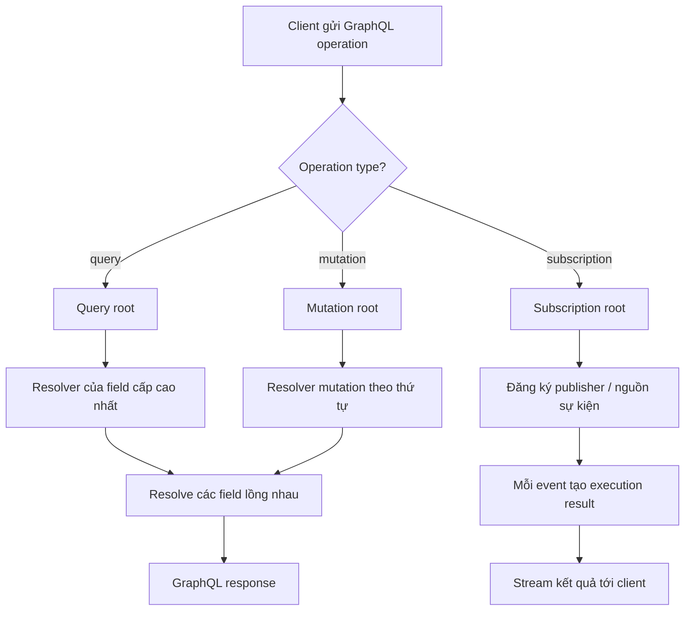

# Schema root operation

Trong GraphQL, **root operation type** là object type làm điểm bắt đầu để thực thi một loại operation. Schema xác định root type nào tiếp nhận `query`, root type nào tiếp nhận `mutation` và root type nào tiếp nhận `subscription`. Các field được khai báo trên những object type này chính là những thao tác cấp cao nhất mà client có thể gọi.

Ba loại operation tương ứng với ba root type:

- **Query root** cung cấp các field để đọc hoặc tra cứu dữ liệu.
- **Mutation root** cung cấp các field để tạo, cập nhật hoặc xóa dữ liệu.
- **Subscription root** cung cấp các field để đăng ký nhận một luồng sự kiện.

Hiểu đúng root operation giúp thiết kế schema có ranh giới rõ ràng, đồng thời giúp Spring for GraphQL ánh xạ các field cấp cao nhất tới controller phù hợp.

## Phân biệt operation, operation type và operation name

GraphQL có ba khái niệm thường dễ bị nhầm lẫn:

| Khái niệm | Ví dụ | Ý nghĩa |
| --- | --- | --- |
| Operation type | `query`, `mutation`, `subscription` | Chọn loại root operation sẽ được thực thi. |
| Root operation type trong schema | `Query`, `Mutation`, `Subscription` | Object type định nghĩa các field cấp cao nhất của từng loại operation. |
| Operation name | `ProductDetail`, `CreateProduct` | Tên tùy chọn của một operation trong document, chủ yếu để nhận diện và theo dõi. |

Ví dụ:

```graphql
query ProductDetail($id: ID!) {
  product(id: $id) {
    id
    name
  }
}
```

Trong ví dụ này, `query` là operation type; `Query` (theo quy ước mặc định) là root operation type của schema; `ProductDetail` là operation name; `product` là field được gọi trên Query root.

Operation name không phải tên root type và cũng không quyết định resolver nào được gọi. Resolver được xác định từ field mà operation yêu cầu.

## Ba root operation type

### Query root

Query root là điểm bắt đầu cho các operation đọc dữ liệu. Schema thường khai báo những field như `product`, `products`, `customer` hoặc `orders` trên object type này.

```graphql
type Query {
  product(id: ID!): Product
  products(category: String, first: Int = 20): [Product!]!
  currentUser: User
}
```

Client có thể yêu cầu nhiều field cấp cao nhất trong cùng một query:

```graphql
query Dashboard {
  currentUser {
    id
    displayName
  }
  products(category: "BOOK", first: 5) {
    id
    name
  }
}
```

Server thực thi các field của Query theo cơ chế thực thi query thông thường; các field cấp cao nhất có thể được thực thi song song. Vì vậy, không nên dựa vào thứ tự viết field trong query để tạo thứ tự cập nhật dữ liệu hoặc điều phối side effect.

Query nên được thiết kế cho mục đích đọc dữ liệu. Nếu một thao tác cần thay đổi trạng thái nghiệp vụ, hãy mô hình hóa nó thành mutation để client và server có ngữ nghĩa thực thi phù hợp.

### Mutation root

Mutation root chứa các field thực hiện thay đổi trạng thái, chẳng hạn `createProduct`, `updateProduct`, `deleteProduct` hoặc `placeOrder`.

```graphql
input CreateProductInput {
  name: String!
  price: Float!
}

type Mutation {
  createProduct(input: CreateProductInput!): Product!
  deleteProduct(id: ID!): Boolean!
}
```

Client gọi mutation bằng operation type `mutation` và có thể chọn dữ liệu muốn nhận lại sau khi thao tác hoàn tất:

```graphql
mutation AddProduct($input: CreateProductInput!) {
  createProduct(input: $input) {
    id
    name
    price
  }
}
```

Các field cấp cao nhất trong cùng một mutation operation được thực thi tuần tự theo thứ tự xuất hiện. Quy tắc này hữu ích khi một operation gọi nhiều thao tác ghi cần thứ tự xác định. Tuy nhiên, nó **không tự tạo transaction**: nếu field thứ hai lỗi, server không tự động rollback thay đổi do field thứ nhất thực hiện. Muốn có tính nguyên tử, cần triển khai transaction và quy tắc nghiệp vụ ở tầng service hoặc persistence.

Mutation root là tùy chọn. Nếu API chỉ đọc dữ liệu và không cung cấp thao tác ghi qua GraphQL, schema có thể không khai báo mutation root.

### Subscription root

Subscription root khai báo những field cho phép client đăng ký nhận sự kiện theo thời gian. Ví dụ:

```graphql
type Subscription {
  productChanged(productId: ID!): Product!
  orderStatusChanged(orderId: ID!): OrderStatusUpdate!
}
```

Client đăng ký một field bằng operation `subscription`:

```graphql
subscription WatchProduct($id: ID!) {
  productChanged(productId: $id) {
    id
    name
    price
  }
}
```

Khác với query và mutation thông thường, subscription operation phải chọn đúng **một field cấp cao nhất**. Mỗi sự kiện được phát ra từ nguồn dữ liệu sẽ tạo một execution result cho operation đó. Vì vậy, nếu cần theo dõi nhiều loại sự kiện, có thể thiết kế một field tổng hợp hoặc mở các subscription riêng.

Subscription root cũng là tùy chọn. API không cần khai báo subscription nếu không cung cấp luồng sự kiện.

## Khai báo root operation trong SDL

GraphQL SDL cho phép khai báo root operation type bằng định nghĩa `schema`. Có hai cách tổ chức phổ biến.

### Dùng tên root type mặc định

Khi schema không có định nghĩa `schema` tường minh, GraphQL sử dụng quy ước tên mặc định:

- `Query` là query root.
- `Mutation` là mutation root nếu type này tồn tại.
- `Subscription` là subscription root nếu type này tồn tại.

Ví dụ:

```graphql
type Query {
  product(id: ID!): Product
}

type Mutation {
  createProduct(input: CreateProductInput!): Product!
}

type Product {
  id: ID!
  name: String!
}

input CreateProductInput {
  name: String!
}
```

Trong schema này, GraphQL hiểu `Query` là query root và `Mutation` là mutation root. Không cần viết thêm block `schema` vì tên root type tuân theo quy ước mặc định.

Nếu không khai báo `Mutation`, client không thể thực thi mutation operation trên schema đó. Tương tự, thiếu `Subscription` nghĩa là schema không cung cấp subscription root.

### Đặt tên root type tùy chỉnh

Khi muốn dùng tên khác, cần khai báo rõ quan hệ giữa operation và object type trong block `schema`:

```graphql
schema {
  query: CatalogQuery
  mutation: CatalogCommand
  subscription: CatalogEvents
}

type CatalogQuery {
  product(id: ID!): Product
  products(first: Int = 20): [Product!]!
}

type CatalogCommand {
  createProduct(input: CreateProductInput!): Product!
}

type CatalogEvents {
  productChanged(productId: ID!): Product!
}
```

Khai báo này nói với GraphQL rằng operation `query` bắt đầu từ `CatalogQuery`, operation `mutation` bắt đầu từ `CatalogCommand` và operation `subscription` bắt đầu từ `CatalogEvents`. Tên type có thể theo ngôn ngữ miền nghiệp vụ của hệ thống, miễn là schema ánh xạ rõ ràng.

Trong block `schema`, query root là bắt buộc. Mutation root và subscription root chỉ cần khai báo khi API hỗ trợ hai loại operation đó.

## Quy tắc thiết kế và kiểm tra root type

Các root operation type phải là object type. Chúng không thể là scalar, enum, input object, interface hay union. Mỗi loại operation có một điểm bắt đầu xác định trong schema.

Những quy tắc quan trọng cần nhớ:

1. **Query root là bắt buộc.** Một schema GraphQL phải có query root để client có thể thực thi query và truy vấn introspection.
2. **Mutation và Subscription là tùy chọn.** Chỉ khai báo khi API thực sự hỗ trợ thao tác ghi hoặc luồng sự kiện tương ứng.
3. **Root type phải là object type.** Các field của root type được định nghĩa như field của object type thông thường, có kiểu trả về và đối số rõ ràng.
4. **Các root type phải là những object type riêng biệt.** Không dùng cùng một object type làm query root, mutation root và subscription root.
5. **Field cấp cao nhất phải phù hợp với mục đích operation.** Query phục vụ đọc, mutation phục vụ thay đổi dữ liệu, subscription phục vụ phát sự kiện.
6. **Subscription operation chỉ chọn một field cấp cao nhất.** Thiết kế field và payload sao cho một luồng có thể mang đủ dữ liệu client cần.

Các root type có thể tham chiếu tới cùng những object type nghiệp vụ. Chẳng hạn `Product` có thể được trả về từ query `product`, mutation `createProduct` và subscription `productChanged`. Việc tái sử dụng kiểu trả về giúp schema nhất quán, trong khi ba root type vẫn giữ vai trò riêng.

## Cách Spring for GraphQL ánh xạ root operation

Spring for GraphQL đọc schema SDL và liên kết các field cấp cao nhất với phương thức xử lý trong controller. Các annotation chuyên biệt giúp biểu đạt rõ loại operation:

| Annotation | Root operation mặc định | Mục đích |
| --- | --- | --- |
| `@QueryMapping` | `Query` | Xử lý field trên query root. |
| `@MutationMapping` | `Mutation` | Xử lý field trên mutation root. |
| `@SubscriptionMapping` | `Subscription` | Xử lý field trên subscription root và trả về luồng dữ liệu. |

Ví dụ schema dùng tên root mặc định:

```graphql
type Query {
  product(id: ID!): Product
}

type Mutation {
  renameProduct(id: ID!, name: String!): Product!
}

type Subscription {
  productChanged(id: ID!): Product!
}
```

Các phương thức controller có thể được viết như sau:

```java
@Controller
public class ProductGraphQlController {

    private final ProductService productService;
    private final ProductEventService productEventService;

    public ProductGraphQlController(
            ProductService productService,
            ProductEventService productEventService) {
        this.productService = productService;
        this.productEventService = productEventService;
    }

    @QueryMapping
    public Product product(@Argument String id) {
        return productService.findById(id);
    }

    @MutationMapping
    public Product renameProduct(
            @Argument String id,
            @Argument String name) {
        return productService.rename(id, name);
    }

    @SubscriptionMapping
    public Flux<Product> productChanged(@Argument String id) {
        return productEventService.watch(id);
    }
}
```

Ở đây, `@QueryMapping`, `@MutationMapping` và `@SubscriptionMapping` là các shortcut dành cho root type theo tên mặc định. `@Argument` lấy đối số từ field trong SDL. Phương thức subscription trả về `Flux<Product>` để phát nhiều kết quả theo thời gian.

### Khi schema dùng tên root tùy chỉnh

Với schema đã khai báo `CatalogQuery`, `CatalogCommand` và `CatalogEvents`, các shortcut mặc định gắn với tên `Query`, `Mutation` và `Subscription` không còn khớp với tên type tùy chỉnh. Có thể dùng `@SchemaMapping` và chỉ rõ `typeName` cùng `field`:

```java
@Controller
public class CatalogGraphQlController {

    @SchemaMapping(typeName = "CatalogQuery", field = "product")
    public Product product(@Argument String id) {
        return productService.findById(id);
    }

    @SchemaMapping(typeName = "CatalogCommand", field = "createProduct")
    public Product createProduct(@Argument CreateProductInput input) {
        return productService.create(input);
    }

    @SchemaMapping(typeName = "CatalogEvents", field = "productChanged")
    public Flux<Product> productChanged(@Argument String productId) {
        return productEventService.watch(productId);
    }
}
```

Ví dụ trên tập trung vào cách khai báo mapping; các dependency `productService`, `productEventService` và kiểu `CreateProductInput` được giả định đã có trong ứng dụng. Dùng `@SchemaMapping` tường minh giúp code phản ánh đúng root type tùy chỉnh mà schema đã khai báo.

## Một request đi từ root operation tới resolver như thế nào?

Khi nhận một operation, GraphQL engine xác định operation type, tìm root type tương ứng rồi thực thi field cấp cao nhất. Từ giá trị trả về của field đó, engine tiếp tục thực thi các field lồng nhau mà client đã chọn.



Ví dụ với query:

```graphql
query ProductPage($id: ID!) {
  product(id: $id) {
    id
    name
    seller {
      id
      displayName
    }
  }
}
```

Engine bắt đầu từ Query root và gọi resolver của field `product`. Khi nhận được object `Product`, engine tiếp tục resolve `id`, `name` và `seller`. Resolver của `seller` có thể lấy dữ liệu từ object cha, repository hoặc service tùy cách triển khai.

Root operation chỉ quyết định điểm bắt đầu và ngữ nghĩa thực thi. Các field lồng nhau vẫn tuân theo hệ thống type và cơ chế mapping thông thường của GraphQL.

## Lỗi thường gặp khi khai báo root operation

| Triệu chứng | Nguyên nhân | Cách khắc phục |
| --- | --- | --- |
| Schema validation báo thiếu query root | Chưa khai báo `Query` theo quy ước mặc định hoặc chưa ánh xạ `query` trong block `schema`. | Bổ sung query root object type và khai báo field hợp lệ. |
| Client gọi mutation nhưng operation không được hỗ trợ | Schema không có mutation root hoặc block `schema` chưa ánh xạ mutation. | Khai báo mutation root và các field ghi cần thiết. |
| Client gọi subscription nhưng server không nhận operation | Schema thiếu subscription root hoặc chưa cấu hình transport phù hợp. | Khai báo subscription root, mapping và transport như WebSocket khi cần. |
| Resolver không được gọi | Tên field trong operation không khớp field trong schema hoặc mapping sai type/field. | Kiểm tra SDL và annotation mapping. |
| Dùng tên root tùy chỉnh nhưng shortcut không khớp | `@QueryMapping`/`@MutationMapping`/`@SubscriptionMapping` đang trỏ tới tên mặc định. | Dùng `@SchemaMapping(typeName = "...", field = "...")` cho root type tùy chỉnh. |
| Mutation thứ hai chạy dù mutation thứ nhất lỗi | Hiểu nhầm việc thực thi tuần tự là transaction. | Tổ chức transaction và xử lý lỗi ở tầng nghiệp vụ khi cần tính nguyên tử. |
| Subscription có nhiều field cấp cao nhất | Operation không tuân thủ quy tắc một root field cho subscription. | Tách thành các subscription operation riêng hoặc thiết kế một field tổng hợp. |

Khi debug, nên kiểm tra theo thứ tự: operation type trong request, block `schema` hoặc quy ước tên mặc định, object type được chọn làm root, field trong SDL và mapping tương ứng trong controller.

## Ghi nhớ

Root operation type là object type mà GraphQL dùng làm điểm bắt đầu cho mỗi loại operation. Query root bắt buộc; Mutation root và Subscription root chỉ cần khi API cung cấp các khả năng tương ứng. Nếu không khai báo block `schema`, GraphQL dùng các tên mặc định `Query`, `Mutation` và `Subscription`; nếu đặt tên khác, phải ánh xạ tường minh trong SDL.

Trong Spring for GraphQL, các shortcut `@QueryMapping`, `@MutationMapping` và `@SubscriptionMapping` phù hợp với root type mặc định. Khi dùng tên tùy chỉnh, có thể khai báo `@SchemaMapping` với `typeName` và `field` rõ ràng. Thiết kế đúng root operation giúp schema thể hiện rõ hợp đồng API và giúp server thực thi từng loại request theo đúng ngữ nghĩa.
