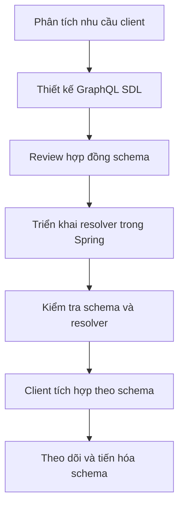

# Schema-first development

## Mục tiêu

Sau bài học này, bạn có thể:

- Giải thích cách tiếp cận schema-first và vai trò của SDL trong một dự án Spring for GraphQL.
- Thiết kế các type, field, argument, input, enum và quy tắc nullability cho API.
- Tổ chức schema thành nhiều file và mở rộng type bằng `extend`.
- Ánh xạ schema vào Query, Mutation và field resolver bằng annotation của Spring for GraphQL.
- Kiểm tra hợp đồng schema và resolver bằng GraphQlTester.
- Tiến hóa schema mà vẫn duy trì khả năng tương thích với client đang hoạt động.

## 1. Schema-first development là gì?

Schema-first development là cách xây dựng GraphQL API bắt đầu từ hợp đồng schema. Nhóm phát triển mô tả API bằng GraphQL SDL (Schema Definition Language), thống nhất những type, field, argument và operation mà client được phép sử dụng, rồi triển khai resolver trong server để thực hiện hợp đồng đó.

Ví dụ, trước khi viết Java, nhóm thống nhất rằng client có thể tìm sách theo ID và nhận về một đối tượng có ID, tiêu đề và tác giả:

```graphql
type Query {
  book(id: ID!): Book
}

type Book {
  id: ID!
  title: String!
  author: String
}
```

Schema trả lời các câu hỏi:

- Client có thể gọi operation nào?
- Operation nhận argument gì và kiểu dữ liệu ra sao?
- Kết quả có hình dạng thế nào?
- Field nào có thể null, field nào bắt buộc có giá trị?
- Những đối tượng nào liên kết với nhau?

SDL chưa chứa logic truy cập database hoặc quy tắc nghiệp vụ. Phần triển khai được nối vào schema bằng DataFetcher, annotated controller và các thành phần runtime wiring.

Có thể hình dung quy trình như sau:



Với Spring for GraphQL, schema thường được đặt trong `src/main/resources/graphql/`. Spring Boot nạp các file SDL, tạo GraphQLSchema và kết nối field với resolver trong ứng dụng.

## 2. Vì sao nên thiết kế schema trước?

Schema-first giúp nhóm thống nhất API trước khi phụ thuộc vào cách tổ chức Java hoặc database. Điều này hữu ích khi backend và frontend được phát triển song song.

Ví dụ, frontend có thể bắt đầu viết query và mock response theo SDL trong lúc backend triển khai repository và service. Hai nhóm cùng dựa trên một hợp đồng nên giảm việc phải đoán tên field hoặc hình dạng response.

Một số lợi ích cụ thể:

- **Hợp đồng rõ ràng:** type và field được công bố bằng SDL, có thể review độc lập với mã nguồn.
- **Phát triển song song:** client và server có thể làm việc dựa trên schema đã thống nhất.
- **Validation:** GraphQL kiểm tra operation theo schema trước khi gọi resolver.
- **Tài liệu và công cụ:** SDL có thể dùng cho documentation, autocomplete, introspection và sinh kiểu client.
- **Quản lý thay đổi:** việc thêm, deprecate hoặc loại bỏ field có thể được đánh giá như một thay đổi API.

Schema-first cũng có chi phí. Nhóm cần duy trì SDL và đảm bảo resolver khớp với hợp đồng. Một schema được thiết kế quá phức tạp hoặc thay đổi tùy tiện có thể khiến client khó sử dụng. Vì vậy, hãy bắt đầu từ nhu cầu của use case thay vì mô phỏng toàn bộ cấu trúc database.

## 3. Schema-first và code-first khác nhau thế nào?

Hai cách tiếp cận khác nhau ở nơi bắt đầu định nghĩa API:

| Tiêu chí | Schema-first | Code-first |
|---|---|---|
| Nguồn mô tả API | File GraphQL SDL | Code và metadata của ngôn ngữ |
| Thứ tự làm việc | Thiết kế schema rồi triển khai resolver | Viết code rồi tạo hoặc suy ra schema |
| Review hợp đồng | Có thể review SDL độc lập | Thường phải đọc code hoặc schema được sinh |
| Phát triển client song song | Thuận lợi khi SDL được chốt sớm | Cần có schema được sinh và chia sẻ |
| Rủi ro thường gặp | SDL và resolver bị lệch nhau | API bị chi phối bởi cấu trúc code |
| Phù hợp khi | Muốn API contract là nguồn thống nhất | Hệ sinh thái có công cụ code-first phù hợp |

Spring for GraphQL tập trung vào mô hình schema-first: bạn định nghĩa SDL và triển khai các phương thức xử lý field. Các annotation như `@QueryMapping` và `@SchemaMapping` liên kết phương thức Java với field đã khai báo trong schema.

Schema-first không có nghĩa phải tạo Java class thủ công cho mọi type. Bạn có thể dùng record, DTO, domain object hoặc kiểu scalar phù hợp. Điều quan trọng là kiểu Java được dùng để phân giải dữ liệu phải cung cấp giá trị mà schema công bố.

## 4. Bắt đầu thiết kế root operation

Một GraphQL schema cần có root query type. Theo quy ước, type này tên là `Query`. `Mutation` và `Subscription` là tùy chọn, chỉ cần khai báo khi API có thao tác thay đổi dữ liệu hoặc luồng sự kiện.

Ví dụ schema cho hệ thống quản lý sách:

```graphql
type Query {
  book(id: ID!): Book
  books(limit: Int = 20): [Book!]!
}

type Mutation {
  createBook(input: CreateBookInput!): Book!
  renameBook(id: ID!, title: String!): Book
}

type Book {
  id: ID!
  title: String!
  author: Author!
}

type Author {
  id: ID!
  name: String!
  books: [Book!]!
}

input CreateBookInput {
  title: String!
  authorId: ID!
}
```

Trong ví dụ:

- `Query.book` tìm một quyển sách theo ID.
- `Query.books` trả về danh sách sách, với số lượng giới hạn mặc định là 20.
- `Mutation.createBook` tạo sách từ một input object.
- `Mutation.renameBook` đổi tiêu đề sách.
- `Book.author` và `Author.books` mô tả quan hệ hai chiều giữa sách và tác giả.

Root type có thể dùng tên khác nếu khai báo tường minh:

```graphql
schema {
  query: RootQuery
  mutation: RootMutation
}

type RootQuery {
  status: String!
}

type RootMutation {
  resetCatalog: Boolean!
}
```

Nếu dùng tên mặc định `Query`, `Mutation` và `Subscription`, thông thường không cần khai báo khối `schema`.

## 5. Chọn đúng kiểu dữ liệu cho field

GraphQL có các scalar tích hợp sẵn:

| Scalar | Ý nghĩa |
|---|---|
| `String` | Chuỗi ký tự |
| `Int` | Số nguyên có dấu 32-bit |
| `Float` | Số thực dấu phẩy động |
| `Boolean` | Giá trị đúng hoặc sai |
| `ID` | Định danh của đối tượng |

GraphQL không định nghĩa sẵn các kiểu như `Date`, `DateTime`, `Long` hoặc `BigDecimal`. Nếu API cần các kiểu này, có thể khai báo custom scalar trong SDL, ví dụ `scalar Date`, rồi đăng ký cách parse và serialize giá trị tương ứng bằng runtime wiring trong Spring for GraphQL. Khai báo scalar trong SDL một mình chưa đủ để server biết cách chuyển đổi giá trị.

Bạn có thể khai báo object type, enum, interface, union và input object để biểu diễn miền dữ liệu.

### Object type

Object type mô tả dữ liệu client có thể đọc:

```graphql
type Book {
  id: ID!
  title: String!
  publishedYear: Int
  author: Author
}
```

Mỗi field có tên và kiểu trả về. Field có thể là scalar, enum, object type hoặc danh sách các kiểu đó.

### Enum

Enum giới hạn giá trị field trong một tập hợp xác định:

```graphql
enum BookStatus {
  DRAFT
  PUBLISHED
  ARCHIVED
}

type Book {
  id: ID!
  status: BookStatus!
}
```

Enum giúp client biết các giá trị hợp lệ và tránh phải truyền chuỗi tùy ý cho những trường có tập giá trị cố định.

### Input object

Input object gom nhiều argument liên quan thành một cấu trúc đầu vào:

```graphql
input CreateBookInput {
  title: String!
  authorId: ID!
  publishedYear: Int
}
```

Dùng input object cho mutation có nhiều tham số giúp operation dễ đọc và dễ mở rộng. GraphQL phân biệt input type với output object type: input object không thể chứa field có kiểu object output như `Author`; thay vào đó, thường truyền ID hoặc một input object lồng phù hợp.

### Interface và union

Interface mô tả tập field chung của nhiều object type:

```graphql
interface SearchResult {
  id: ID!
  label: String!
}

type Book implements SearchResult {
  id: ID!
  label: String!
  title: String!
}

type Author implements SearchResult {
  id: ID!
  label: String!
  name: String!
}
```

Union cho phép field trả về một trong nhiều object type mà không yêu cầu chúng có field chung:

```graphql
union CatalogItem = Book | Author
```

Khi dùng interface hoặc union, server cần xác định object type cụ thể lúc thực thi. GraphQL Java có thể dùng type resolver mặc định nếu tên lớp Java tương ứng rõ với GraphQL type; trong trường hợp phức tạp, hãy cấu hình `TypeResolver` qua runtime wiring.

## 6. Hiểu nullability và danh sách

Dấu `!` trong SDL biểu thị giá trị không được null. Nếu không có dấu này, field có thể trả về null.

Với danh sách, cần phân biệt nullability của danh sách và từng phần tử:

| Kiểu | Danh sách có thể null? | Phần tử có thể null? |
|---|---:|---:|
| `[Book]` | Có | Có |
| `[Book!]` | Có | Không |
| `[Book]!` | Không | Có |
| `[Book!]!` | Không | Không |

Ví dụ:

```graphql
type Query {
  books: [Book!]!
  featuredBook: Book
}
```

`books` luôn phải trả về một danh sách, có thể là danh sách rỗng, và không phần tử nào được null. `featuredBook` có thể không tồn tại nên được phép trả về null.

Nullability ảnh hưởng trực tiếp đến response. Nếu resolver trả null cho một field non-null hoặc xảy ra lỗi khi phân giải field đó, GraphQL tạo execution error và lan truyền null lên field cha gần nhất cho phép null. Việc này có thể khiến một phần lớn hơn của response trở thành null.

Không nên gắn `!` cho tất cả field chỉ để schema trông chặt chẽ. Hãy chọn nullability dựa trên cam kết nghiệp vụ mà server có thể bảo đảm.

## 7. Thiết kế argument và pagination

Argument cho phép client truyền điều kiện vào field. Ví dụ:

```graphql
type Query {
  books(
    authorId: ID
    status: BookStatus
    limit: Int = 20
  ): [Book!]!
}
```

Khi thiết kế argument:

- Dùng tên thể hiện ý nghĩa nghiệp vụ.
- Chọn kiểu dữ liệu rõ ràng và dùng non-null khi giá trị thật sự bắt buộc.
- Cung cấp default value cho những tùy chọn có mặc định hợp lý.
- Validate giới hạn đầu vào ở server, ví dụ không cho phép `limit` vượt quá mức tối đa.
- Không dùng argument để cho client truy cập trực tiếp vào tên cột hoặc câu lệnh database.

Với danh sách lớn, nên thiết kế pagination thay vì trả toàn bộ dữ liệu. Một schema theo cursor có thể như sau:

```graphql
type Query {
  books(first: Int = 20, after: String): BookConnection!
}

type BookConnection {
  edges: [BookEdge!]!
  pageInfo: PageInfo!
}

type BookEdge {
  cursor: String!
  node: Book!
}

type PageInfo {
  hasNextPage: Boolean!
  endCursor: String
}
```

Cursor pagination thường phù hợp với danh sách có thể thay đổi trong lúc client đang duyệt. Server cần xác định cách tạo cursor ổn định và áp dụng giới hạn tối đa cho `first`. GraphQL không tự triển khai pagination; resolver và service phải thực hiện truy vấn tương ứng.

## 8. Tổ chức schema thành nhiều file

Một schema có thể được chia thành nhiều file theo miền nghiệp vụ hoặc loại type. Spring Boot mặc định tìm file `.graphqls` và `.gqls` trong:

```text
src/main/resources/graphql/
```

Ví dụ cấu trúc:

```text
src/main/resources/graphql/
├── book.graphqls
├── author.graphqls
└── common.graphqls
```

File `book.graphqls` có thể khai báo root type và các type chính:

```graphql
type Query {
  book(id: ID!): Book
  books(limit: Int = 20): [Book!]!
}

type Mutation {
  createBook(input: CreateBookInput!): Book!
}

type Book {
  id: ID!
  title: String!
  author: Author!
}

input CreateBookInput {
  title: String!
  authorId: ID!
}
```

File `author.graphqls` định nghĩa type `Author` và bổ sung field vào root type `Query`:

```graphql
extend type Query {
  author(id: ID!): Author
}

type Author {
  id: ID!
  name: String!
  books: [Book!]!
}
```

GraphQL Java hợp nhất các định nghĩa từ schema resources thành một schema thực thi. Khi mở rộng type, dùng `extend type` để thêm field vào type đã có. Không khai báo lặp lại một type gốc trong nhiều file theo cách tạo ra định nghĩa xung đột.

Có thể cấu hình vị trí schema khác mặc định:

```yaml
spring:
  graphql:
    schema:
      locations: classpath:graphql/**/
      file-extensions: .graphqls,.gqls
```

Khi schema được chia thành nhiều file, nên thống nhất quy ước đặt tên và quyền sở hữu theo miền. Một thay đổi ở file dùng chung có thể ảnh hưởng đến nhiều operation.

## 9. Ánh xạ SDL vào controller Spring for GraphQL

Sau khi schema được thống nhất, server cần cung cấp dữ liệu cho các field. Spring for GraphQL hỗ trợ annotation để liên kết phương thức Java với field trong SDL.

Ví dụ với schema đã khai báo:

```graphql
type Query {
  book(id: ID!): Book
  books(limit: Int = 20): [Book!]!
}

type Mutation {
  createBook(input: CreateBookInput!): Book!
  renameBook(id: ID!, title: String!): Book
}
```

Input object có thể ánh xạ vào Java record hoặc DTO:

```java
public record CreateBookInput(String title, String authorId) {
}
```

Controller:

```java
@Controller
public class BookController {

    private final BookService bookService;

    public BookController(BookService bookService) {
        this.bookService = bookService;
    }

    @QueryMapping
    public Book book(@Argument String id) {
        return bookService.findById(id);
    }

    @QueryMapping
    public List<Book> books(@Argument Integer limit) {
        return bookService.findBooks(limit);
    }

    @MutationMapping
    public Book createBook(@Argument("input") CreateBookInput input) {
        return bookService.create(input);
    }

    @MutationMapping
    public Book renameBook(
            @Argument String id,
            @Argument String title) {
        return bookService.rename(id, title);
    }
}
```

Các annotation có ý nghĩa:

- `@QueryMapping` ánh xạ phương thức vào field của root type `Query`.
- `@MutationMapping` ánh xạ phương thức vào field của root type `Mutation`.
- `@SubscriptionMapping` ánh xạ phương thức vào field của root type `Subscription`.
- `@Argument` lấy argument từ operation của client.

Theo mặc định, Spring suy ra tên field từ tên phương thức. Có thể chỉ định tên tường minh, ví dụ `@QueryMapping(name = "bookById")`, nếu tên phương thức Java khác tên field trong SDL.

Kiểu trả về Java cần cung cấp dữ liệu phù hợp với GraphQL type. Resolver có thể trả về object đồng bộ hoặc kiểu reactive như `Mono` và `Flux`, tùy operation và kiến trúc ứng dụng.

## 10. Ánh xạ field lồng bằng @SchemaMapping

Không phải field nào cũng là root operation. Trong schema:

```graphql
type Book {
  id: ID!
  title: String!
  author: Author!
}
```

Field `Book.author` cần được phân giải từ một đối tượng Book. Nếu Java object đã có property hoặc getter tương ứng, GraphQL Java có thể sử dụng `PropertyDataFetcher` mặc định. Khi cần truy vấn service hoặc áp dụng logic riêng, hãy khai báo `@SchemaMapping`.

Ví dụ Java record:

```java
public record Book(
        String id,
        String title,
        String authorId) {
}
```

Record có `authorId` nhưng không có property `author`, vì vậy có thể viết resolver:

```java
@Controller
public class BookFieldController {

    private final AuthorService authorService;

    public BookFieldController(AuthorService authorService) {
        this.authorService = authorService;
    }

    @SchemaMapping(typeName = "Book", field = "author")
    public Author author(Book book) {
        return authorService.findById(book.authorId());
    }
}
```

Tham số `Book book` là source object của field cha. Spring truyền đối tượng đó vào phương thức để resolver có thể đọc `authorId` và lấy tác giả tương ứng.

Có thể dùng `@SchemaMapping` cho các field lồng khác, ví dụ `Author.books`. Nếu query trả về nhiều tác giả và mỗi resolver tải danh sách sách riêng lẻ, có thể phát sinh N+1. Trong trường hợp đó, hãy cân nhắc `@BatchMapping` hoặc DataLoader để gom việc tải dữ liệu.

## 11. Schema là hợp đồng API, không phải bản sao database

Một sai lầm phổ biến là thiết kế GraphQL type bằng cách sao chép nguyên trạng entity hoặc bảng database. Cách này khiến API phụ thuộc vào cấu trúc lưu trữ và có thể vô tình công bố field nội bộ.

Ví dụ, entity có thể chứa:

- Mật khẩu đã băm hoặc token nội bộ.
- Trạng thái xử lý chỉ dùng trong backend.
- Quan hệ lazy loading hoặc cấu trúc persistence.
- Trường phục vụ audit và vận hành.

Những field đó không mặc nhiên nên xuất hiện trong GraphQL schema. Schema nên phản ánh dữ liệu và hành động mà client được phép sử dụng.

Hãy cân nhắc tách:

- **GraphQL output type:** hình dạng dữ liệu client được đọc.
- **GraphQL input type:** dữ liệu client được phép gửi.
- **Domain model/entity:** mô hình nghiệp vụ và lưu trữ phía server.
- **DTO:** cấu trúc trung gian nếu cần chuyển đổi dữ liệu.

Sự tách biệt này giúp thay đổi database mà không buộc phải thay đổi API, đồng thời cho phép áp dụng validation và authorization ở ranh giới phù hợp.

## 12. Kiểm tra hợp đồng schema

Schema-first chỉ hữu ích khi hợp đồng được kiểm tra thường xuyên. Có thể chia việc kiểm tra thành ba nhóm.

### Kiểm tra SDL

Khi ứng dụng khởi động, Spring for GraphQL nạp schema resources và tạo GraphQLSchema. Lỗi cú pháp SDL, type không hợp lệ hoặc tham chiếu kiểu không tồn tại có thể làm quá trình tạo schema thất bại.

Cần kiểm tra:

- Root Query được khai báo.
- Các type và field được tham chiếu đều tồn tại.
- Input type chỉ chứa các kiểu hợp lệ cho đầu vào.
- Không có định nghĩa type hoặc field xung đột.
- Nullability và default value phản ánh đúng hợp đồng.

### Kiểm tra mapping

SDL hợp lệ không đồng nghĩa mọi field đều có resolver đúng. Một field có thể dùng property fetcher mặc định, hoặc cần một mapping tường minh.

Có thể bật schema mapping inspection trên GraphQlSource builder để phát hiện một số field chưa được ánh xạ, mapping thừa hoặc không tương thích mà Spring có thể suy luận. Inspection không thay thế test thực thi; nó không thể xác minh mọi nhánh nghiệp vụ hay mọi kết quả runtime.

### Kiểm tra operation bằng GraphQlTester

Spring for GraphQL cung cấp `GraphQlTester` để gửi GraphQL document và kiểm tra response mà không cần phụ thuộc vào một transport cụ thể.

Ví dụ test slice cho controller:

```java
@GraphQlTest(BookController.class)
class BookControllerTests {

    @Autowired
    GraphQlTester graphQlTester;

    @MockitoBean
    BookService bookService;

    @Test
    void bookQueryReturnsTitle() {
        given(bookService.findById("b-1"))
                .willReturn(new Book("b-1", "Spring GraphQL", "a-1"));

        graphQlTester.document("""
                query {
                    book(id: "b-1") {
                        id
                        title
                    }
                }
                """)
                .execute()
                .path("book.title")
                .entity(String.class)
                .isEqualTo("Spring GraphQL");
    }
}
```

Trong ví dụ, `@GraphQlTest` nạp phần cấu hình GraphQL cần thiết cho test slice và controller được chỉ định. `@MockitoBean` thay service bằng mock để test tập trung vào việc ánh xạ operation và tạo response. Với phiên bản Spring Boot cũ chưa có `@MockitoBean`, dự án có thể dùng `@MockBean` tương ứng với phiên bản đang sử dụng.

Nên có test cho cả trường hợp thành công và các tình huống quan trọng như ID không tồn tại, argument không hợp lệ, quyền truy cập bị từ chối và resolver trả lỗi. Khi thay đổi SDL, các test operation hiện có giúp phát hiện thay đổi làm hỏng client.

## 13. Tiến hóa schema mà không phá vỡ client

Schema là hợp đồng được nhiều client sử dụng. Thay đổi schema cần được đánh giá theo khả năng tương thích.

### Thay đổi thường tương thích

Thêm một field nullable mới thường không ảnh hưởng đến operation cũ:

```graphql
type Book {
  id: ID!
  title: String!
  subtitle: String
}
```

Client cũ không yêu cầu `subtitle` nên tiếp tục hoạt động. Client mới có thể chọn field đó khi cần.

### Đánh dấu field cũ là deprecated

Nếu cần thay thế field, hãy dùng directive `@deprecated`:

```graphql
type Book {
  id: ID!
  oldTitle: String @deprecated(reason: "Use title instead")
  title: String!
}
```

Client có thời gian chuyển đổi sang field mới. Backend nên theo dõi mức sử dụng field cũ và thống nhất thời điểm loại bỏ với các nhóm client.

### Những thay đổi có nguy cơ breaking

Một số thay đổi có thể làm operation hiện tại không còn hợp lệ hoặc thay đổi ý nghĩa dữ liệu:

- Xóa field đang được client sử dụng.
- Đổi tên field hoặc argument.
- Đổi kiểu trả về hoặc kiểu argument theo hướng không tương thích.
- Chuyển field nullable thành non-null khi server chưa bảo đảm giá trị.
- Thêm argument bắt buộc không có default vào field hiện có.
- Xóa giá trị enum mà client đang xử lý.

Thêm một giá trị enum mới cũng có thể ảnh hưởng client sinh code hoặc dùng switch exhaustive. Vì vậy, hãy đánh giá cả khả năng tương thích của GraphQL operation lẫn cách client xử lý dữ liệu.

## 14. Quy trình làm việc schema-first trong nhóm

Một quy trình thực tế có thể gồm:

1. **Thu thập use case:** xác định màn hình hoặc nghiệp vụ cần query, mutation và subscription nào.
2. **Thiết kế SDL:** đặt tên type, field, argument, input và nullability.
3. **Review hợp đồng:** kiểm tra tính dễ dùng, bảo mật, pagination và khả năng tiến hóa.
4. **Chia sẻ schema:** cung cấp SDL cho nhóm client và backend cùng phát triển.
5. **Triển khai resolver:** dùng controller, service và repository để cung cấp dữ liệu.
6. **Kiểm tra mapping và operation:** chạy test schema, resolver và các GraphQL document quan trọng.
7. **Phát hành và theo dõi:** quan sát lỗi field, operation usage và mức sử dụng field deprecated.

Trong quá trình review, hãy ưu tiên câu hỏi: “Client cần thực hiện use case gì và schema giúp client làm điều đó ra sao?” Câu hỏi này giữ schema tập trung vào hợp đồng API thay vì chi tiết triển khai.

## Kết luận

Schema-first development đặt GraphQL SDL làm hợp đồng trung tâm của API. Nhóm thiết kế type, field, argument và nullability trước, sau đó dùng Spring for GraphQL để ánh xạ schema vào Query, Mutation, Subscription và các field resolver.

Một schema tốt cần phản ánh use case của client, tách biệt khỏi cấu trúc database, có pagination và quy tắc nullability rõ ràng, đồng thời được kiểm tra bằng schema mapping inspection và GraphQlTester. Khi API thay đổi, hãy ưu tiên các thay đổi tương thích và dùng deprecation để client có thời gian chuyển đổi.

## Tài liệu tham khảo

- [Spring for GraphQL — Request Execution](https://docs.spring.io/spring-graphql/reference/request-execution.html)
- [Spring for GraphQL — Annotated Controllers](https://docs.spring.io/spring-graphql/reference/controllers.html)
- [Spring for GraphQL — Testing](https://docs.spring.io/spring-graphql/reference/testing.html)
- [GraphQL Specification — Type System](https://spec.graphql.org/)
