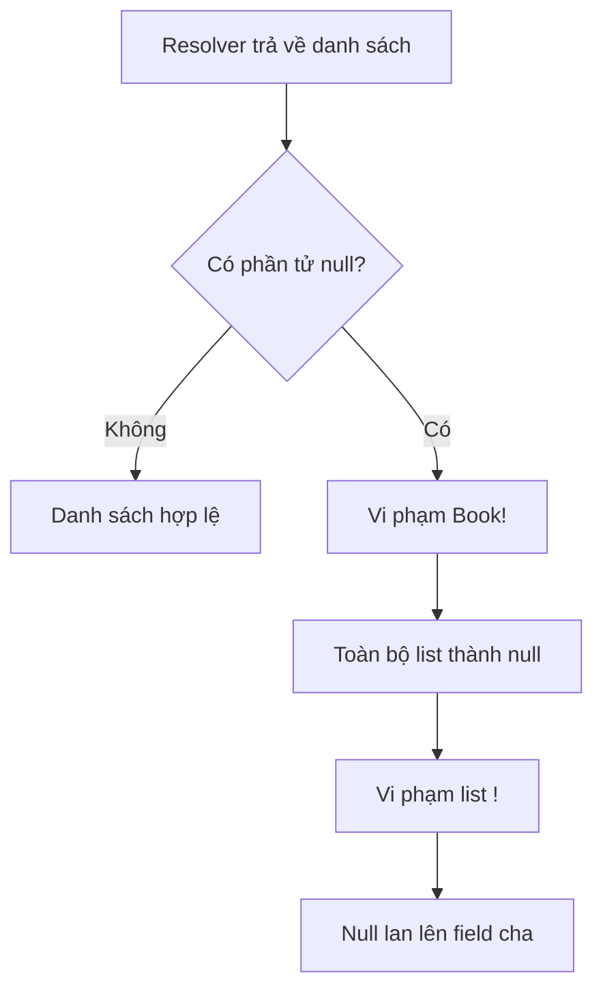

# Nullable và non-null trong GraphQL

Trong GraphQL, một kiểu dữ liệu mặc định cho phép giá trị `null`. Muốn bắt buộc một field hoặc một đối số phải có giá trị, ta thêm dấu `!` vào sau kiểu, ví dụ `String!` hoặc `Book!`. Quy tắc này được gọi là nullability và là một phần quan trọng của hợp đồng API: client biết khi nào có thể nhận `null`, còn server phải bảo đảm dữ liệu trả về phù hợp với schema.

Với Spring for GraphQL, nullability được khai báo trong GraphQL SDL. Resolver Java cung cấp giá trị cho các field, nhưng kiểu Java như `String`, `Book` hay `List<Book>` tự nó không thay thế được hợp đồng nullability trong schema. Vì vậy, khi thiết kế API cần xem xét cả SDL, dữ liệu thực tế và cách resolver xử lý trường hợp không có giá trị.

## 1. Nullable là mặc định

Nếu không có dấu `!`, GraphQL xem kiểu là nullable. Ví dụ:

```graphql
type Query {
    book(id: ID!): Book
    greeting: String
}

type Book {
    id: ID!
    title: String!
    subtitle: String
}
```

Trong schema trên:

- `book(id: ID!): Book` yêu cầu client truyền `id` khác null, nhưng kết quả `book` có thể là null.
- `greeting: String` có thể trả về một chuỗi hoặc null.
- `Book.id` và `Book.title` luôn phải có giá trị.
- `Book.subtitle` có thể là null.

Điểm cần nhớ là kiểu của argument và kiểu trả về của field là hai hợp đồng độc lập. Một argument có thể bắt buộc trong khi kết quả tìm kiếm vẫn có thể không tồn tại. Ví dụ `book(id: ID!): Book` phù hợp với tình huống client luôn phải cung cấp ID, nhưng sách có thể không được tìm thấy.

Nếu field nullable trả về null, đó là một kết quả hợp lệ theo schema. Client cần kiểm tra null trước khi sử dụng giá trị. Với một field object, client có thể vẫn nhận được các field khác của object cha bình thường.

## 2. Dấu Non-Null `!`

Đặt dấu `!` sau kiểu để khai báo giá trị không được null:

```graphql
type Query {
    requiredGreeting: String!
    optionalGreeting: String
}
```

`requiredGreeting` phải trả về một chuỗi khác null. `optionalGreeting` có thể trả về chuỗi hoặc null. Nếu resolver trả null cho `requiredGreeting`, GraphQL không thể tạo response hợp lệ theo schema và phát sinh execution error.

Non-Null không có nghĩa là chuỗi phải khác rỗng. Với kiểu `String!`, các giá trị `""` hoặc `"   "` vẫn là chuỗi hợp lệ về mặt GraphQL. Nếu nghiệp vụ yêu cầu nội dung không rỗng, ứng dụng cần kiểm tra thêm ở tầng validation hoặc domain.

Tương tự, `Int!` chỉ yêu cầu giá trị số nguyên khác null; nó không tự đặt giới hạn min/max. `ID!` yêu cầu ID có giá trị, nhưng không tự xác minh ID đó có tồn tại trong database hay người gọi có quyền truy cập hay không.

## 3. Nullable và Non-Null trong danh sách

Với List type, dấu `!` có thể áp dụng độc lập cho danh sách và phần tử. Có bốn dạng cơ bản:

| Kiểu SDL | Danh sách có thể null? | Phần tử có thể null? |
| --- | --- | --- |
| `[Book]` | Có | Có |
| `[Book]!` | Không | Có |
| `[Book!]` | Có | Không |
| `[Book!]!` | Không | Không |

Ví dụ:

```graphql
type Query {
    optionalBooks: [Book]
    books: [Book!]!
    featuredBooks: [Book!]
    booksWithPlaceholders: [Book]!
}
```

`books: [Book!]!` cam kết resolver luôn trả về một danh sách khác null và mọi phần tử đều là `Book` khác null. Khi không có sách, danh sách rỗng `[]` là kết quả hợp lệ. `featuredBooks: [Book!]` cho phép cả danh sách là null, nhưng nếu có danh sách thì từng phần tử phải khác null.

Không nên nhầm `null` với danh sách rỗng. `null` có nghĩa field không có giá trị theo hợp đồng; `[]` có nghĩa danh sách tồn tại nhưng hiện không có phần tử. Nếu API cần phân biệt hai trạng thái này, hãy chọn nullability phù hợp và mô tả rõ ý nghĩa nghiệp vụ.

## 4. Quy tắc Non-Null ở input

Non-Null ở input xác định dữ liệu mà client bắt buộc phải cung cấp. Ví dụ:

```graphql
type Query {
    book(id: ID!): Book
    searchBooks(keyword: String, pageSize: Int!): [Book!]!
}
```

Client phải truyền `id` cho `book` và `pageSize` cho `searchBooks`. `keyword` nullable nên có thể nhận null hoặc được bỏ qua. `pageSize: Int!` phải nhận một số nguyên khác null.

Với input object:

```graphql
input BookFilter {
    keyword: String
    authorId: ID!
    page: Int = 1
    pageSize: Int! = 20
}

type Query {
    searchBooks(filter: BookFilter!): [Book!]!
}
```

`filter` là argument bắt buộc. Bên trong input object, `authorId` cũng bắt buộc. `page` là nullable và có giá trị mặc định là `1`; `pageSize` là Non-Null nhưng có giá trị mặc định là `20`, vì vậy client có thể bỏ qua field này nhưng nếu đã truyền thì không được truyền null.

Một input field Non-Null không có giá trị mặc định phải được cung cấp. Nếu client bỏ qua field hoặc truyền null, GraphQL từ chối request trong bước kiểm tra/coercion đầu vào và resolver tương ứng không được thực thi.

## 5. Phân biệt bỏ qua field, truyền null và giá trị mặc định

Đối với input nullable, ba tình huống sau có thể mang ý nghĩa khác nhau:

1. Bỏ qua field: client không gửi field đó trong input object hoặc không gửi argument.
2. Truyền `null`: client gửi field với giá trị null một cách tường minh.
3. Truyền giá trị: client cung cấp một giá trị cụ thể.

Ví dụ:

```graphql
type Query {
    booksByPage(page: Int = 1): [Book!]!
}
```

Nếu client bỏ qua `page`, GraphQL sử dụng giá trị mặc định `1`. Nếu client truyền `page: null`, giá trị là null; default không được áp dụng thay cho null tường minh. Nếu client truyền `page: 3`, resolver nhận giá trị `3`.

Quy tắc tương tự áp dụng cho field trong input object có default. Default được dùng khi field bị bỏ qua, không phải khi client chủ động truyền null. Đối với input field Non-Null có default, bỏ qua field là hợp lệ vì GraphQL có thể dùng default; truyền null vẫn không hợp lệ.

Sự khác biệt giữa bỏ qua và truyền null đặc biệt hữu ích với mutation cập nhật một phần. Ví dụ, khi cập nhật hồ sơ, bỏ qua `nickname` có thể có nghĩa là giữ nguyên nickname cũ, trong khi truyền `nickname: null` có thể có nghĩa là xóa nickname. Nếu ứng dụng cần phân biệt hai trạng thái này trong Java, không nên chỉ dựa vào một biến nullable đơn giản mà cần dùng cơ chế binding giữ được thông tin field có được truyền hay không.

Spring for GraphQL cung cấp `ArgumentValue<T>` để biểu diễn giá trị argument và phân biệt trường hợp không được cung cấp với trường hợp được cung cấp null. Ví dụ schema và resolver:

```graphql
type Mutation {
    updateProfile(nickname: String): Profile!
}

type Profile {
    nickname: String
}
```

```java
import org.springframework.graphql.data.ArgumentValue;
import org.springframework.graphql.data.method.annotation.Argument;
import org.springframework.graphql.data.method.annotation.MutationMapping;
import org.springframework.stereotype.Controller;

@Controller
public class ProfileController {

    private final ProfileService profileService;

    public ProfileController(ProfileService profileService) {
        this.profileService = profileService;
    }

    @MutationMapping
    public Profile updateProfile(
            @Argument("nickname") ArgumentValue<String> nickname) {

        if (!nickname.isOmitted()) {
            // Field đã được gửi: giá trị có thể là null hoặc một chuỗi.
            return profileService.updateNickname(nickname.value());
        }

        // Field bị bỏ qua: giữ nguyên nickname hiện tại.
        return profileService.currentProfile();
    }
}
```

Trong ví dụ, bỏ qua `nickname` giữ nguyên giá trị cũ, còn truyền `nickname: null` yêu cầu xóa nickname. `ProfileService` là service của ứng dụng và được inject qua constructor. Với mutation thực tế, hãy xác định rõ quy tắc khi field bị bỏ qua, được gửi null hoặc có giá trị, sau đó kiểm thử từng trường hợp.

## 6. Null propagation khi resolver vi phạm Non-Null

Khi resolver trả null cho một field nullable, GraphQL có thể đưa null vào response mà không cần tạo execution error chỉ vì giá trị null đó. Nhưng nếu resolver trả null cho field Non-Null, GraphQL tạo execution error và lan truyền null lên field cha gần nhất có thể nhận null. Cơ chế này thường được gọi là null bubbling hoặc null propagation.

Xem schema:

```graphql
type Query {
    book: Book!
    status: String!
}

type Book {
    id: ID!
    title: String!
    subtitle: String
}
```

Nếu resolver `Book.subtitle` trả null, response có thể chứa `"subtitle": null`; các field khác vẫn có thể được trả về. Nếu resolver `Book.title` trả null, field `title` vi phạm Non-Null. GraphQL phải làm object `Book` thành null. Nhưng field `Query.book` cũng là Non-Null, nên null tiếp tục lan truyền lên root operation. Khi không còn field cha nullable để dừng, phần `data` của response có thể là null.

Ví dụ response khi lỗi lan truyền đến root:

```json
{
  "data": null,
  "errors": [
    {
      "message": "Cannot return null for non-nullable field Book.title.",
      "path": ["book", "title"]
    }
  ]
}
```

Thông điệp trên minh họa cấu trúc lỗi; nội dung thực tế phụ thuộc GraphQL Java và cấu hình ứng dụng. Trường `path` chỉ vị trí field gây lỗi trong response, kể cả khi null đã lan truyền lên field cha.

## 7. Null propagation với List type

Null propagation có quy tắc rõ ràng với danh sách. Giả sử resolver trả về một phần tử null:

- `[Book]`: danh sách có thể null và phần tử có thể null, nên phần tử null được chấp nhận.
- `[Book]!`: danh sách không thể null, nhưng phần tử có thể null; phần tử null được chấp nhận.
- `[Book!]`: phần tử null làm cả danh sách trở thành null; danh sách nullable nên lỗi dừng tại field danh sách.
- `[Book!]!`: phần tử null làm danh sách trở thành null, nhưng danh sách cũng Non-Null nên lỗi tiếp tục lan lên field cha.

Sơ đồ sau minh họa trường hợp `[Book!]!`:



Ví dụ:

```graphql
type Query {
    books: [Book!]!
    optionalBooks: [Book!]
    booksWithNullableItems: [Book]!
}
```

Nếu một phần tử trong `booksWithNullableItems` là null, danh sách vẫn hợp lệ. Nếu một phần tử trong `optionalBooks` là null, cả field `optionalBooks` trở thành null nhưng các field khác của root Query vẫn có thể được trả về. Nếu một phần tử trong `books` là null, lỗi lan tiếp qua field `books` vì danh sách cũng Non-Null.

Khi list chứa object, lỗi Non-Null ở một field con của object cũng có thể khiến phần tử object trở thành null. Nếu kiểu phần tử là `Book!`, lỗi đó tiếp tục làm cả danh sách null. Vì vậy, null propagation có thể bắt đầu từ một field sâu bên trong object chứ không chỉ từ chính giá trị phần tử mà resolver list trả về.

## 8. Áp dụng nullability trong resolver Spring for GraphQL

Ví dụ schema:

```graphql
type Query {
    book(id: ID!): Book
    allBooks: [Book!]!
}

type Book {
    id: ID!
    title: String!
    subtitle: String
}
```

Resolver có thể triển khai như sau:

```java
import java.util.List;
import org.springframework.graphql.data.method.annotation.Argument;
import org.springframework.graphql.data.method.annotation.QueryMapping;
import org.springframework.stereotype.Controller;

@Controller
public class BookController {

    private final BookService bookService;

    public BookController(BookService bookService) {
        this.bookService = bookService;
    }

    @QueryMapping
    public Book book(@Argument("id") String id) {
        return bookService.findById(id).orElse(null);
    }

    @QueryMapping
    public List<Book> allBooks() {
        return bookService.findAll();
    }
}
```

`book` có kiểu trả về nullable (`Book`), nên trả null khi không tìm thấy bản ghi là hợp lệ. `allBooks` có kiểu `[Book!]!`, vì vậy `bookService.findAll()` cần trả về danh sách khác null và không chứa phần tử null. Nếu không có sách, service nên trả về danh sách rỗng.

Một ví dụ field lồng nhau:

```graphql
type Book {
    id: ID!
    author: Author!
    subtitle: String
}
```

Resolver cho `author` phải luôn trả về một `Author` khác null. Nếu domain cho phép sách chưa có tác giả, schema nên cân nhắc khai báo `author: Author` để phản ánh đúng dữ liệu. Nếu nghiệp vụ yêu cầu mọi sách phải có tác giả, giữ `Author!` và xử lý dữ liệu thiếu ở tầng domain hoặc service.

Spring for GraphQL dùng schema để kiểm tra và hoàn tất kết quả. Chú thích Java như `@Nullable` có thể giúp IDE, static analysis hoặc người đọc hiểu ý định, nhưng không tự thay đổi kiểu GraphQL đã khai báo. Cần bảo đảm kiểu SDL và giá trị resolver thống nhất với nhau.

## 9. Xử lý exception và lỗi Non-Null

Không có dữ liệu và có lỗi khi truy xuất dữ liệu là hai tình huống khác nhau. Với field nullable, trả null có thể diễn đạt trường hợp không tìm thấy. Nếu database ngừng hoạt động, service timeout hoặc có lỗi nghiệp vụ, nên phát sinh exception phù hợp và ánh xạ lỗi sang GraphQL error theo chính sách của ứng dụng.

Spring for GraphQL hỗ trợ `DataFetcherExceptionResolver` để xử lý exception phát sinh trong data fetcher. Resolver lỗi có thể chuyển exception thành `GraphQLError` với message, error classification hoặc extensions phù hợp. Tuy nhiên, việc ánh xạ exception không làm thay đổi quy tắc nullability: nếu field được khai báo Non-Null và không có giá trị hoàn tất, null vẫn phải lan truyền theo schema.

Khi thiết kế lỗi, cần cân nhắc:

- Dùng null cho trạng thái không có giá trị nếu field nullable và đó là ý nghĩa nghiệp vụ mong muốn.
- Dùng GraphQL error cho trường hợp thực thi thất bại cần được client nhận biết.
- Tránh đưa stack trace, SQL, token hoặc dữ liệu nội bộ vào message trả về client.
- Chọn Non-Null ở mức phù hợp để lỗi của một field không làm mất quá nhiều dữ liệu không liên quan.
- Dùng `path` và `extensions` để client có thể xác định vị trí và loại lỗi mà không phụ thuộc vào nội dung message.

## 10. Cách chọn Nullable hay Non-Null

Không nên đánh dấu mọi field là Non-Null chỉ để schema có vẻ nghiêm ngặt. Quyết định cần dựa vào ý nghĩa dữ liệu và khả năng bảo đảm của hệ thống.

| Câu hỏi thiết kế | Gợi ý |
| --- | --- |
| Field có thể không tồn tại theo nghiệp vụ không? | Nếu có, cân nhắc kiểu nullable. |
| Service có luôn bảo đảm được giá trị không? | Chỉ dùng Non-Null khi có thể duy trì cam kết đó. |
| Danh sách không có phần tử có phải trạng thái bình thường không? | Dùng danh sách Non-Null và trả `[]` nếu không có kết quả. |
| Một phần tử có thể thiếu mà các phần tử khác vẫn hữu ích không? | Cân nhắc list cho phép phần tử null hoặc thiết kế object kết quả riêng. |
| Lỗi ở field con có nên làm hỏng toàn bộ object/list không? | Xem lại vị trí nullable để xác định điểm dừng của null propagation. |
| Input có cần phân biệt bỏ qua với xóa bằng null không? | Dùng nullable input và binding giữ được trạng thái omitted/null. |

Một số quy ước hữu ích:

- Dùng Non-Null cho ID và field bắt buộc của object khi dữ liệu và quy trình tạo object bảo đảm luôn có giá trị.
- Dùng nullable cho field có thể vắng mặt hợp lệ, như ảnh đại diện, mô tả phụ hoặc ngày kết thúc chưa xác định.
- Với danh sách truy vấn, thường dùng `[Item!]!` và trả `[]` khi không có kết quả, nếu domain không cần trạng thái null cho toàn bộ danh sách.
- Với input update một phần, cân nhắc nullable field để biểu diễn yêu cầu xóa; đồng thời phân biệt field bị bỏ qua với field được gửi null.
- Không dùng Non-Null thay cho validation nghiệp vụ, kiểm tra quyền hoặc xác minh sự tồn tại của dữ liệu.

## 11. Kiểm thử nullability

Kiểm thử cần xác nhận cả kết quả bình thường lẫn các trường hợp biên. Với Spring GraphQL, có thể dùng `GraphQlTester` để thực thi document và kiểm tra response.

Ví dụ kiểm thử field nullable khi không tìm thấy sách:

```java
@Test
void missingBookReturnsNull() {
    graphQlTester.document("""
            query {
                book(id: "missing-id") {
                    id
                    title
                }
            }
            """)
        .execute()
        .path("book")
        .valueIsNull();
}
```

Ví dụ kiểm thử danh sách rỗng cho field `[Book!]!`:

```java
@Test
void noBooksReturnsAnEmptyList() {
    graphQlTester.document("""
            query {
                allBooks { id title }
            }
            """)
        .execute()
        .path("allBooks")
        .entityList(BookView.class)
        .hasSize(0);
}
```

Ngoài ra, nên có các kiểm thử xác nhận:

1. Request thiếu argument Non-Null bị từ chối trước khi gọi resolver.
2. Request truyền null cho argument Non-Null bị từ chối.
3. Input field bị bỏ qua được áp dụng default nếu có.
4. Input field nullable truyền null tường minh vẫn giữ null thay vì dùng default.
5. Resolver trả null cho field Non-Null tạo execution error và null lan truyền đúng cấp.
6. Một phần tử null trong `[Item!]` làm cả list thành null.
7. Một phần tử null trong `[Item]` được chấp nhận.
8. Client nhận được `data`, `errors` và `path` phù hợp khi xảy ra lỗi thực thi.

Các ví dụ test giả định `graphQlTester` và dữ liệu test đã được cấu hình trong test context. Khi kiểm thử null propagation, hãy tạo resolver hoặc fixture có thể chủ động trả null/throw exception để xác nhận đúng hành vi của schema.

## 12. Lỗi thường gặp

| Hiện tượng | Nguyên nhân | Cách xử lý |
| --- | --- | --- |
| Client không thể bỏ qua argument | Argument được khai báo Non-Null và không có default | Truyền giá trị bắt buộc hoặc đổi schema nếu nghiệp vụ cho phép bỏ qua. |
| Request bị từ chối khi truyền null | Input có kiểu Non-Null | Gửi giá trị hợp lệ hoặc thay đổi hợp đồng input khi null là trạng thái được phép. |
| Resolver trả null nhưng response có error | Field output được khai báo Non-Null | Bảo đảm resolver trả giá trị hoặc điều chỉnh nullability cho đúng domain. |
| Một field lỗi làm `data` thành null | Null lan truyền qua các field cha Non-Null đến root | Xem lại vị trí nullable và mức độ ảnh hưởng mong muốn. |
| Default không được áp dụng khi client gửi null | Default chỉ áp dụng khi input bị bỏ qua | Phân biệt omitted và explicit null trong logic client/server. |
| Java field nullable nhưng GraphQL vẫn báo Non-Null violation | SDL mới là hợp đồng GraphQL; kiểu Java không tự sửa SDL | Đồng bộ schema với khả năng trả về của resolver. |

## 13. Checklist trước khi công bố schema

1. Xác định field nào bắt buộc và field nào có thể vắng mặt theo nghiệp vụ.
2. Kiểm tra riêng nullability của argument, input field, output field, danh sách và phần tử.
3. Đặt default cho input chỉ khi có giá trị mặc định rõ ràng về nghiệp vụ.
4. Xác định cách xử lý khác nhau giữa omitted, explicit null và giá trị cụ thể.
5. Bảo đảm resolver không trả null cho field Non-Null hoặc phần tử Non-Null.
6. Xem xét điểm dừng của null propagation để một lỗi không làm mất dữ liệu không liên quan.
7. Phân biệt không tìm thấy dữ liệu với lỗi khi thực thi resolver.
8. Viết test cho null, danh sách rỗng, input thiếu, input null và lỗi Non-Null.

Nullable và Non-Null là cam kết giữa GraphQL server và client. Schema càng phản ánh sát dữ liệu thực tế, client càng dễ xử lý response và server càng tránh được những lỗi lan truyền ngoài dự kiến. Trong Spring for GraphQL, hãy bắt đầu từ SDL, sau đó bảo đảm resolver, service và kiểm thử cùng tuân theo hợp đồng đó.
