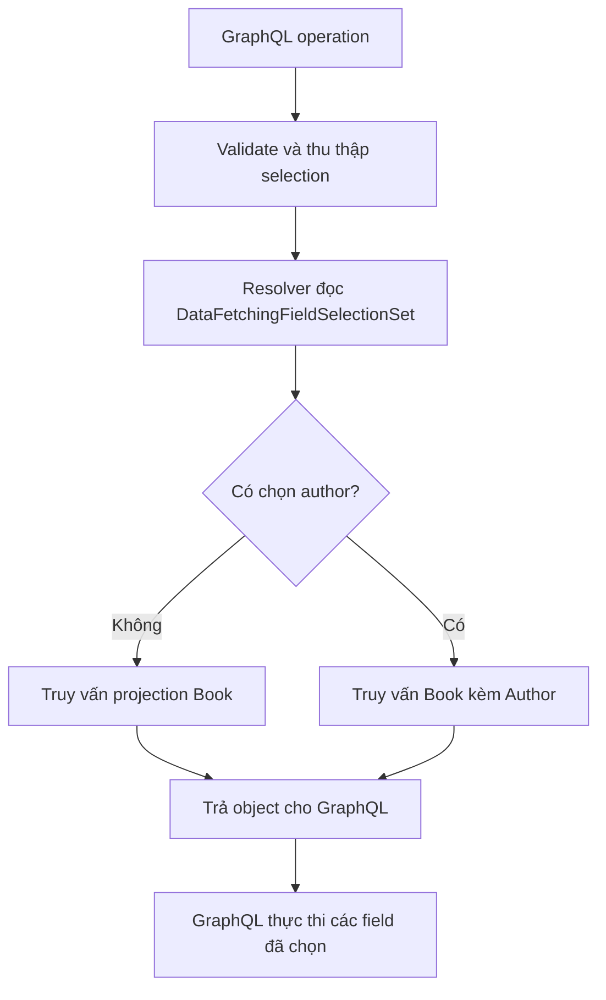

# Field selection trong GraphQL

Field selection là cách client chỉ định những field muốn nhận trong một GraphQL operation. Thay vì server trả về một object với toàn bộ thuộc tính cố định, client mô tả một selection set gồm các field ở từng cấp của cấu trúc dữ liệu. GraphQL kiểm tra selection set theo schema, thực thi các field tương ứng và tạo response có hình dạng bám theo lựa chọn đó.

Trong Spring for GraphQL, SDL định nghĩa field có thể được chọn, còn resolver cung cấp dữ liệu cho field khi operation được thực thi. GraphQL Java cũng cung cấp `DataFetchingFieldSelectionSet` để resolver biết những field con nào được yêu cầu; thông tin này có thể hỗ trợ tối ưu truy vấn server-side nếu được dùng đúng cách.

Sau bài này, bạn có thể:

- Đọc selection set ở root field và các field lồng nhau.
- Phân biệt leaf field với composite field.
- Hiểu response key, alias và cách chọn cùng một field nhiều lần.
- Tái sử dụng field selection bằng named fragment và inline fragment.
- Dùng `@include`, `@skip` và `__typename` trong operation.
- Hiểu quy tắc validation của selection set và đọc selection set trong Spring for GraphQL.
- Tối ưu truy vấn dựa trên field được yêu cầu mà vẫn giữ đúng hợp đồng và bảo mật API.

## 1. Selection set là gì?

Một GraphQL operation có thể chứa một hoặc nhiều field. Các field được đặt trong cặp dấu ngoặc nhọn tạo thành **selection set**. Selection set ở root bắt đầu từ root operation type, chẳng hạn `Query`; field trả về object có thể có selection set con.

Ví dụ schema:

```graphql
type Query {
    book(id: ID!): Book
}

type Book {
    id: ID!
    title: String!
    publishedYear: Int
    author: Author
}

type Author {
    id: ID!
    name: String!
}
```

Client có thể chỉ chọn hai field của sách và tên tác giả:

```graphql
query {
    book(id: "book-42") {
        title
        author {
            name
        }
    }
}
```

Selection set root gồm field `book`. Selection set của `book` gồm `title` và `author`; selection set của `author` gồm `name`. Server trả về đúng cấu trúc được chọn:

```json
{
  "data": {
    "book": {
      "title": "GraphQL in Practice",
      "author": {
        "name": "Nguyen An"
      }
    }
  }
}
```

Các field `id` và `publishedYear` không xuất hiện trong response vì client không chọn chúng. Điều này không có nghĩa database chắc chắn chỉ đọc hai cột; selection set điều khiển cấu trúc dữ liệu GraphQL trả về. Muốn giảm cột được đọc, server phải chủ động dùng projection, query tối ưu hoặc fetch plan phù hợp.

## 2. Leaf field và composite field

Quy tắc cơ bản của GraphQL là phân biệt field lá và field có cấu trúc con:

- **Leaf field** có kiểu scalar hoặc enum. Client chọn field trực tiếp và không đặt selection set con.
- **Composite field** có kiểu object, interface hoặc union. Client phải chỉ rõ selection set con để xác định dữ liệu cần lấy từ kiểu đó.

Ví dụ hợp lệ:

```graphql
query {
    book(id: "book-42") {
        id
        title
        status
        author {
            name
        }
    }
}
```

Hai trường hợp không hợp lệ:

```graphql
# Sai: title là scalar, không có field con
query {
    book(id: "book-42") {
        title {
            length
        }
    }
}

# Sai: author là object, phải có selection set
query {
    book(id: "book-42") {
        author
    }
}
```

Quy tắc này cũng áp dụng cho list. Nếu field có kiểu `[Book!]!`, từng phần tử là object `Book`, vì vậy client phải chọn field con. List chứa scalar hoặc enum thì không cần selection set con, ví dụ `tags: [String!]!` có thể được chọn trực tiếp bằng `tags`.

## 3. Selection set quyết định hình dạng response

GraphQL response phản chiếu cấu trúc selection set. Field lồng nhau tạo object lồng nhau; list tạo mảng; alias đổi tên key trong response. Ví dụ:

```graphql
query {
    book(id: "book-42") {
        id
        title
        author {
            id
            name
        }
    }
}
```

Response có dạng object `book`, bên trong có `id`, `title` và object `author`. Nếu `book` không tìm thấy và field được khai báo nullable, response có thể chứa `"book": null`. Nếu field con phát sinh lỗi, GraphQL có thể trả partial data cùng mảng `errors`; nullability quyết định lỗi có lan lên field cha hay không.

Selection set không phải danh sách thuộc tính Java cần serialize một cách tự động. GraphQL thực thi từng field theo schema: field có resolver riêng sẽ gọi resolver đó; field đơn giản có thể được đọc qua property data fetcher mặc định. Nhờ vậy, hai client có thể chọn hai tập field khác nhau từ cùng một object domain mà không cần tạo hai endpoint riêng.

## 4. Alias: chọn cùng field nhiều lần

Alias đặt tên response key cho một lần chọn field. Cú pháp là `aliasName: fieldName`:

```graphql
query CompareBooks {
    firstBook: book(id: "book-42") {
        id
        title
    }
    secondBook: book(id: "book-99") {
        id
        title
    }
}
```

Response sử dụng alias làm key:

```json
{
  "data": {
    "firstBook": {
      "id": "book-42",
      "title": "GraphQL in Practice"
    },
    "secondBook": {
      "id": "book-99",
      "title": "Spring APIs"
    }
  }
}
```

Alias không đổi tên field trong schema và không đổi tên method resolver. Cả hai lần chọn vẫn gọi field `Query.book`; alias chỉ quyết định tên response key và cho phép phân biệt các lần gọi có argument khác nhau.

Nếu chọn cùng một field với argument khác nhau nhưng không dùng alias, các field có cùng response key sẽ xung đột và operation không hợp lệ:

```graphql
# Không hợp lệ: hai lần chọn book có cùng response key nhưng argument khác nhau
query {
    book(id: "book-42") { title }
    book(id: "book-99") { title }
}
```

Hãy dùng alias khi cần nhiều kết quả từ cùng một field:

```graphql
query {
    first: book(id: "book-42") { title }
    second: book(id: "book-99") { title }
}
```

Khi đọc response hoặc viết test, hãy truy cập theo alias, chẳng hạn `first.title`, thay vì `book.title`.

## 5. Field arguments kết hợp với selection

Argument được gắn vào field để thay đổi dữ liệu mà field trả về, còn selection set xác định những field con cần lấy. Hai khái niệm này bổ sung cho nhau:

```graphql
type Query {
    books(status: BookStatus, limit: Int = 20): [Book!]!
}

type Book {
    id: ID!
    title: String!
    status: BookStatus!
}
```

```graphql
query {
    books(status: PUBLISHED, limit: 10) {
        id
        title
    }
}
```

`status` và `limit` quyết định tập sách được truy vấn; `id` và `title` quyết định phần dữ liệu của mỗi sách được trả về. Resolver của `Query.books` nhận argument qua `@Argument`, còn các field con của `Book` được GraphQL phân giải theo selection set tương ứng.

Nếu cần lấy cùng một field theo nhiều điều kiện, hãy kết hợp argument với alias:

```graphql
query {
    drafts: books(status: DRAFT) {
        id
        title
    }
    published: books(status: PUBLISHED) {
        id
        title
    }
}
```

## 6. Named fragment để tái sử dụng selection set

Khi nhiều operation hoặc nhiều vị trí cần cùng một nhóm field, có thể khai báo named fragment:

```graphql
fragment BookSummary on Book {
    id
    title
    status
}

query BookCatalog {
    books {
        ...BookSummary
    }
}
```

`BookSummary` là fragment áp dụng cho kiểu `Book`. Dấu `...BookSummary` đưa các field của fragment vào selection set tại vị trí đó. Fragment giúp tránh lặp lại các nhóm field dài và giữ cho các operation dùng cùng cấu trúc dữ liệu.

Một fragment có thể chứa field lồng nhau hoặc spread một fragment khác:

```graphql
fragment AuthorSummary on Author {
    id
    name
}

fragment BookDetails on Book {
    id
    title
    author {
        ...AuthorSummary
    }
}

query {
    book(id: "book-42") {
        ...BookDetails
    }
}
```

Fragment spread phải tương thích với kiểu tại vị trí sử dụng. GraphQL kiểm tra type condition và phát hiện chu trình fragment không hợp lệ. Không tạo fragment A spread B và fragment B spread lại A, vì vòng lặp đó không thể được thực thi hợp lệ.

Fragment là cách tổ chức document ở phía client; nó không tạo thêm type hoặc resolver trong schema server. Khi GraphQL thực thi, các field được chọn thông qua fragment vẫn được phân giải như những field bình thường.

## 7. Inline fragment cho interface và union

Khi một field trả về interface hoặc union, client có thể chọn field chung (nếu là interface), sau đó dùng inline fragment để chọn field riêng theo kiểu runtime:

```graphql
union SearchResult = Book | Author

type Query {
    search(text: String!): [SearchResult!]!
}

type Book {
    id: ID!
    title: String!
}

type Author {
    id: ID!
    name: String!
}
```

```graphql
query Search($text: String!) {
    search(text: $text) {
        __typename
        ... on Book {
            id
            title
        }
        ... on Author {
            id
            name
        }
    }
}
```

`... on Book` chỉ áp dụng selection set bên trong khi object thực tế là `Book`; `... on Author` áp dụng khi object là `Author`. `__typename` cho client biết kiểu cụ thể của từng phần tử trong union. Đây là mẫu phổ biến để xây dựng search result có nhiều loại object.

Với interface, có thể chọn field chung trực tiếp rồi bổ sung field riêng:

```graphql
interface Node {
    id: ID!
}

type Book implements Node {
    id: ID!
    title: String!
}

type Author implements Node {
    id: ID!
    name: String!
}

type Query {
    node(id: ID!): Node
}
```

```graphql
query {
    node(id: "42") {
        id
        ... on Book {
            title
        }
        ... on Author {
            name
        }
    }
}
```

## 8. Directive @include và @skip

Directive `@include` và `@skip` điều khiển việc một field hoặc fragment có được đưa vào kết quả thực thi hay không:

- `@include(if: Boolean!)`: chỉ chọn field khi biểu thức là `true`.
- `@skip(if: Boolean!)`: bỏ qua field khi biểu thức là `true`.

Ví dụ:

```graphql
query BookDetails($id: ID!, $withAuthor: Boolean!, $hideYear: Boolean!) {
    book(id: $id) {
        id
        title
        publishedYear @skip(if: $hideYear)
        author @include(if: $withAuthor) {
            id
            name
        }
    }
}
```

Client truyền variables:

```json
{
  "id": "book-42",
  "withAuthor": true,
  "hideYear": false
}
```

Trong lần thực thi này, `author` được chọn và `publishedYear` cũng được chọn. Nếu `withAuthor` là `false`, field `author` bị bỏ qua và resolver cho field đó không cần chạy. Các directive này hữu ích khi một màn hình có các phần dữ liệu tùy chọn hoặc khi client cần tái sử dụng cùng một operation với các cấu hình hiển thị khác nhau.

`@include` và `@skip` là directive chuẩn của executable document. Chúng không thay đổi schema và không phải cơ chế phân quyền. Không dùng directive phía client để bảo vệ dữ liệu nhạy cảm; server phải kiểm tra quyền dù field có được client hiển thị hay không.

## 9. Meta field __typename

`__typename` là meta field trả về tên object type cụ thể tại vị trí đang được thực thi:

```graphql
query {
    book(id: "book-42") {
        __typename
        id
        title
    }
}
```

Response ví dụ:

```json
{
  "data": {
    "book": {
      "__typename": "Book",
      "id": "book-42",
      "title": "GraphQL in Practice"
    }
  }
}
```

Client thường dùng `__typename` để phân biệt kiểu runtime của interface/union, chuẩn hóa cache hoặc chọn component hiển thị phù hợp. Đây là meta field do GraphQL cung cấp; không cần tự khai báo `__typename` trong SDL hoặc viết resolver cho nó.

GraphQL cũng có các meta field introspection như `__schema` và `__type` ở root query để khám phá schema. Chúng phục vụ việc tìm hiểu cấu trúc API, khác với `__typename` vốn có thể được chọn trên object trong operation thông thường. Server có thể cấu hình chính sách introspection theo môi trường, nhưng điều đó không thay thế kiểm soát truy cập field dữ liệu.

## 10. Quy tắc validation của field selection

Trước khi gọi resolver, GraphQL kiểm tra operation theo schema. Một số quy tắc quan trọng:

- Field được chọn phải tồn tại trên kiểu hiện tại hoặc được cung cấp bởi interface/fragment phù hợp.
- Leaf field phải được chọn mà không có selection set con.
- Composite field phải có selection set con.
- Argument phải tồn tại, có kiểu tương thích và đáp ứng yêu cầu non-null.
- Fragment type condition phải tương thích với kiểu tại vị trí spread.
- Các field có cùng response key phải có thể được merge mà không xung đột về tên field, argument hoặc cấu trúc selection.
- Variable dùng trong argument hoặc directive phải được khai báo và có kiểu tương thích.

Ví dụ operation sai vì chọn field không tồn tại:

```graphql
query {
    book(id: "book-42") {
        title
        unknownField
    }
}
```

Operation này bị từ chối ở bước validation. Resolver `Query.book` chưa cần được gọi. Đây là lợi ích của schema có kiểu: lỗi tên field, cấu trúc selection hoặc argument được phát hiện sớm thay vì âm thầm trả dữ liệu thiếu.

### Field conflict và response key

GraphQL gom các lần chọn field theo response key để tạo kết quả. Hai field cùng response key phải tương thích. Nếu chúng dùng argument khác nhau, hãy đặt alias khác nhau. Nếu cùng field, cùng argument và selection set tương thích, GraphQL có thể merge các lần chọn thành một nhóm field trong quá trình thực thi.

Fragment không bỏ qua quy tắc merge. Hai fragment có thể cùng chọn một field, nhưng nếu chúng tạo xung đột về cùng response key thì operation vẫn không hợp lệ.

## 11. Đọc selection set trong Spring for GraphQL

Thông thường, resolver không cần biết client đã chọn những field con nào. GraphQL sẽ tự thực thi field con được yêu cầu. Tuy nhiên, trong một số trường hợp, service có thể tối ưu cách lấy dữ liệu dựa trên selection set.

GraphQL Java cung cấp `DataFetchingFieldSelectionSet` qua `DataFetchingEnvironment.getSelectionSet()`. Spring for GraphQL cho phép nhận `DataFetchingEnvironment` trong method resolver:

```java
@Controller
public class BookController {

    private final BookService bookService;

    public BookController(BookService bookService) {
        this.bookService = bookService;
    }

    @QueryMapping
    public Book book(
            @Argument("id") String id,
            DataFetchingEnvironment environment) {

        DataFetchingFieldSelectionSet selectionSet = environment.getSelectionSet();
        boolean loadAuthor = selectionSet.contains("author/*");

        return bookService.findById(id, loadAuthor);
    }
}
```

Trong ví dụ, `author/*` kiểm tra xem selection set hiện tại có field con nào dưới `author` hay không. Service có thể dùng kết quả này để chọn projection hoặc fetch plan phù hợp. Các pattern của `DataFetchingFieldSelectionSet.contains(...)` hỗ trợ glob; đường dẫn được xét tương đối với field đang được phân giải.

Có thể kiểm tra một field cụ thể:

```java
boolean authorNameSelected = selectionSet.contains("author/name");
boolean reviewsSelected = selectionSet.contains("reviews/*");
```

Selection set của GraphQL Java đã tính đến các field được đưa vào qua fragment và directive của operation hiện tại. Vì vậy, dùng API này đáng tin cậy hơn việc tự phân tích chuỗi query bằng tìm kiếm văn bản. Nếu cần chi tiết hơn, `selectionSet.getFields()` cung cấp các `SelectedField` để xem tên, đường dẫn, kiểu object và selection set lồng nhau.

## 12. Dùng field selection để tối ưu truy vấn server-side

Giả sử client chỉ yêu cầu `Book.id` và `Book.title`, ứng dụng có thể chỉ cần truy vấn các cột đó. Nếu client yêu cầu thêm `author { name }`, server có thể bổ sung join hoặc fetch tác giả. Đây là một hướng tối ưu projection:



Việc tối ưu cần được thiết kế ở service/repository, không nên biến resolver thành nơi chứa các câu SQL tùy tiện. Một số lưu ý:

- Dùng projection, DTO hoặc fetch plan có kiểm soát để chỉ lấy dữ liệu cần thiết.
- Xử lý nested selection và fragment; không chỉ nhìn vào field cấp một nếu query cần tối ưu sâu hơn.
- Cân nhắc alias: tên field trong schema vẫn là tên field thật, response key có thể là alias.
- Không giả định selection set luôn tương đương một danh sách cột database; một field có thể cần nhiều dữ liệu nội bộ để tính toán hoặc kiểm tra nghiệp vụ.
- Giữ batch loading để tránh N+1 khi một selection set yêu cầu quan hệ cho nhiều object cha.
- Đo số query, thời gian thực thi và số bản ghi đọc trước khi kết luận projection có cải thiện hiệu năng.

Đặc biệt, không dùng việc client có chọn field hay không để quyết định quyền truy cập. Field nhạy cảm phải được bảo vệ ở resolver hoặc service. Selection set là gợi ý tối ưu truy vấn và điều khiển response, không phải ranh giới bảo mật.

## 13. Field selection và giới hạn tài nguyên

GraphQL cho phép client lồng selection set nhiều cấp. Một operation nhỏ về số dòng có thể gây tải lớn nếu mỗi cấp truy vấn nhiều bản ghi hoặc resolver field con phát sinh N+1. Vì vậy, việc client chọn ít field không bảo đảm operation rẻ.

Server nên cân nhắc:

- Giới hạn độ sâu query (query depth) để tránh cây field lồng nhau quá sâu.
- Tính query complexity hoặc cost dựa trên số field, argument và kích thước list dự kiến.
- Bắt buộc pagination cho các field trả về danh sách lớn.
- Đặt timeout và giới hạn concurrency phù hợp.
- Dùng DataLoader hoặc `@BatchMapping` cho quan hệ được chọn lặp lại.
- Theo dõi field chậm và số lần resolver/repository được gọi.

Alias cũng cần được tính đến trong giới hạn tài nguyên: client có thể gọi cùng một field nhiều lần với argument khác nhau bằng các alias. Hệ thống tính complexity nên đánh giá số lần thực thi thực tế và kích thước dữ liệu có thể trả về, không chỉ đếm số tên field khác nhau.

## 14. Kiểm thử field selection bằng GraphQlTester

`GraphQlTester` giúp kiểm tra response có đúng cấu trúc mà operation yêu cầu hay không. Ví dụ:

```java
graphQlTester.document("""
        query {
            book(id: "book-42") {
                title
                author {
                    name
                }
            }
        }
        """)
    .execute()
    .path("book.title")
    .entity(String.class)
    .isEqualTo("GraphQL in Practice");
```

Với alias, kiểm tra theo response key:

```java
graphQlTester.document("""
        query {
            featured: book(id: "book-42") {
                title
            }
        }
        """)
    .execute()
    .path("featured.title")
    .entity(String.class)
    .isEqualTo("GraphQL in Practice");
```

Nên kiểm thử thêm các trường hợp:

1. Chọn leaf field không có selection set và composite field có selection set.
2. Bỏ qua field không cần thiết và xác nhận field resolver tương ứng không được gọi.
3. Chọn cùng field với argument khác nhau thông qua alias.
4. Tái sử dụng fragment và chọn kiểu cụ thể bằng inline fragment.
5. Bật/tắt `@include` và `@skip` bằng variables.
6. Kiểm tra `__typename` cho interface/union.
7. Gửi operation sai để xác nhận GraphQL từ chối trước khi gọi resolver.
8. Xác nhận selection set dùng cho projection vẫn giữ đúng dữ liệu và không bỏ qua kiểm tra quyền.

## 15. Những lỗi thường gặp

- **Thiếu selection set trên object field:** composite field phải có field con.
- **Thêm selection set vào scalar hoặc enum:** leaf field không có field con.
- **Nhầm alias với tên schema:** alias chỉ đổi response key, không đổi field được resolver xử lý.
- **Chọn cùng field với argument khác nhau mà không alias:** gây conflict trên cùng response key.
- **Dùng fragment sai type condition:** fragment không tương thích với kiểu tại vị trí spread sẽ bị validation từ chối.
- **Tự parse query bằng chuỗi:** dễ bỏ sót fragment, alias, directive và cấu trúc lồng nhau; dùng `DataFetchingFieldSelectionSet`.
- **Xem selection set là cơ chế authorization:** client có thể tự gửi operation khác; quyền luôn phải được kiểm tra ở server.
- **Cho rằng chọn ít field đồng nghĩa truy vấn ít dữ liệu:** resolver hoặc repository có thể vẫn tải toàn bộ entity; cần projection/fetch plan và đo hiệu năng.
- **Bỏ qua alias khi tính query cost:** một field có thể được thực thi nhiều lần với các argument khác nhau.

## 16. Quy trình thiết kế và xử lý field selection

Khi thiết kế operation hoặc resolver, có thể thực hiện theo trình tự sau:

1. Xác định kiểu trả về của field là scalar/enum hay object/interface/union.
2. Chọn đúng field con cho composite type và giữ selection set gọn theo nhu cầu client.
3. Dùng argument để lọc hoặc phân trang; dùng alias khi cần nhiều lần gọi cùng field với tham số khác nhau.
4. Dùng named fragment để tái sử dụng nhóm field và inline fragment cho interface/union.
5. Dùng `@include`/`@skip` cho field tùy chọn và `__typename` khi cần nhận diện kiểu runtime.
6. Để GraphQL validation kiểm tra field, argument, fragment và response key trước khi thực thi.
7. Chỉ đọc selection set ở server khi có lợi ích tối ưu rõ ràng; dùng API của GraphQL Java thay vì tự phân tích query.
8. Kết hợp projection, batch loading, pagination và query cost limit để kiểm soát tải.
9. Kiểm thử response shape, alias, fragment, directive, resolver invocation và quyền truy cập.

Field selection là cơ chế giúp GraphQL API linh hoạt theo nhu cầu dữ liệu của client. Khi hiểu selection set, alias, fragment và directive, bạn có thể viết operation rõ ràng và dự đoán response chính xác. Trong Spring for GraphQL, kết hợp cơ chế thực thi field mặc định với resolver có chủ đích và `DataFetchingFieldSelectionSet` khi cần tối ưu sẽ giúp API tránh tải thừa mà vẫn giữ đúng hợp đồng và kiểm soát bảo mật.

## Tài liệu tham khảo

- [GraphQL Specification — Executable Definitions and Selection Sets](https://spec.graphql.org/October2021/#sec-Selection-Sets)
- [GraphQL Specification — Field Selection Merging](https://spec.graphql.org/October2021/#sec-Field-Selection-Merging)
- [GraphQL Java — DataFetchingFieldSelectionSet](https://javadoc.io/doc/com.graphql-java/graphql-java/latest/graphql/schema/DataFetchingFieldSelectionSet.html)
- [Spring for GraphQL — Annotated Controllers](https://docs.spring.io/spring-graphql/reference/controllers.html)
- [Spring for GraphQL — GraphQlTester](https://docs.spring.io/spring-graphql/reference/testing.html)
