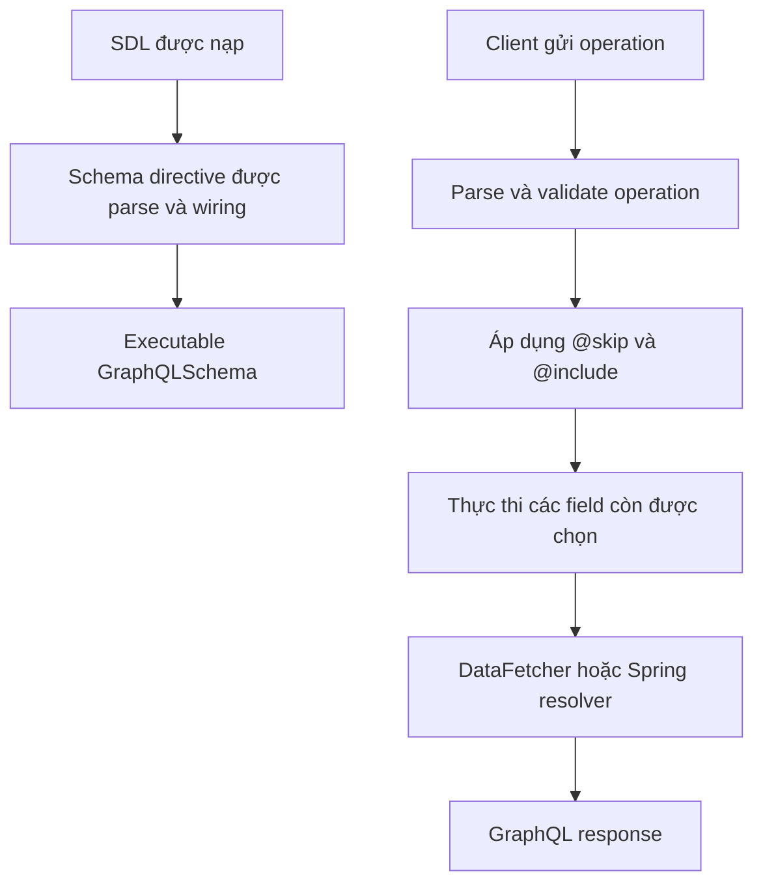

# Directive trên field

Trong GraphQL, **directive** là một cấu trúc có tên, có thể nhận argument và được gắn vào một vị trí xác định trong schema hoặc operation. Directive bổ sung metadata hoặc chỉ thị cho công cụ và runtime biết cách diễn giải một phần của GraphQL. Trên field, directive có thể dùng để đánh dấu API đã lỗi thời, điều khiển field nào được đưa vào response theo điều kiện của client hoặc áp dụng một quy tắc riêng do ứng dụng triển khai.

Cần phân biệt hai nơi directive xuất hiện. **Schema directive** được khai báo trong SDL, ví dụ `@deprecated` trên một field definition. **Executable directive** được client gắn vào field trong query, mutation hoặc fragment, ví dụ `@include` và `@skip`. Chúng có vị trí hợp lệ và thời điểm xử lý khác nhau.

## 1. Cú pháp và vị trí của directive

Một directive có dạng tổng quát:

```graphql
@directiveName(argument: value)
```

Khi dùng trong field definition của SDL, directive được đặt sau kiểu trả về:

```graphql
type Book {
    title: String! @deprecated(reason: "Use displayTitle instead.")
}
```

Một directive phải được định nghĩa hoặc được cung cấp bởi GraphQL specification/runtime, và chỉ được đặt tại những vị trí mà khai báo directive cho phép. Khi tự định nghĩa directive, SDL dùng từ khóa `directive`, khai báo argument, tùy chọn `repeatable`, rồi liệt kê vị trí hợp lệ sau `on`:

```graphql
directive @audit(action: String!) on FIELD_DEFINITION
```

`FIELD_DEFINITION` là vị trí dành cho field trong object type hoặc interface. Directive có thể được khai báo cho các vị trí khác như `OBJECT`, `SCALAR`, `ARGUMENT_DEFINITION`, `INPUT_FIELD_DEFINITION`, `ENUM_VALUE`, `FIELD`, `FRAGMENT_SPREAD` hoặc `INLINE_FRAGMENT`. Vị trí hợp lệ phụ thuộc vào mục đích của directive.

Một directive có thể nhận argument bắt buộc hoặc tùy chọn, giống argument của field. Giá trị truyền vào directive phải đúng kiểu đã khai báo. Nếu muốn một directive có thể xuất hiện nhiều lần trên cùng một vị trí, khai báo từ khóa `repeatable`:

```graphql
directive @tag(value: String!) repeatable on FIELD_DEFINITION

type Book {
    title: String! @tag(value: "searchable") @tag(value: "public")
}
```

Nếu không khai báo `repeatable`, không được gắn cùng directive nhiều lần trên một vị trí trong schema hoặc operation.

## 2. `@deprecated`: đánh dấu field không còn được khuyến nghị

`@deprecated` là directive chuẩn dùng để thông báo một phần của schema không còn được khuyến nghị sử dụng. Nó thường được gắn vào field cũ khi API có field thay thế:

```graphql
type Book {
    id: ID!
    displayTitle: String!

    title: String @deprecated(reason: "Use displayTitle instead.")
}
```

Trong ví dụ, client nên chuyển từ `Book.title` sang `Book.displayTitle`. Field `title` vẫn tồn tại trong schema và vẫn có thể được gọi trong giai đoạn chuyển đổi. `@deprecated` giúp công cụ GraphQL IDE, introspection và tài liệu API nhận biết field cũ; nó không tự xóa field, không tự chặn request và không tự chuyển dữ liệu sang field mới.

Nếu không truyền `reason`, directive có lý do mặc định theo GraphQL specification là `No longer supported`. Trong API thực tế, nên ghi lý do cụ thể để người dùng biết field thay thế hoặc cách di chuyển.

`@deprecated` cũng có thể được dùng ở các vị trí schema khác như argument definition, input field definition và enum value:

```graphql
enum BookFormat {
    HARDCOVER
    PAPERBACK
    EBOOK @deprecated(reason: "Use DIGITAL instead.")
    DIGITAL
}

enum BookStatus {
    DRAFT
    PUBLISHED
}

type Book {
    id: ID!
}

type Query {
    books(
        oldStatus: String @deprecated(reason: "Use status.")
        status: BookStatus
    ): [Book!]!
}

input BookFilter {
    legacyCode: String @deprecated(reason: "Use id.")
    id: ID
}
```

Một client có thể kiểm tra trạng thái deprecation qua schema introspection, gồm thông tin `isDeprecated` và `deprecationReason` trên những thành phần hỗ trợ deprecation. Nhờ đó, công cụ có thể hiển thị cảnh báo trước khi field bị loại bỏ trong một phiên bản schema sau này.

### Quy trình loại bỏ field cũ

Một quy trình an toàn thường gồm các bước:

1. Thêm field mới với kiểu dữ liệu và hành vi đã được xác định.
2. Giữ field cũ để client hiện tại tiếp tục hoạt động, đồng thời đánh dấu field đó bằng `@deprecated`.
3. Cập nhật tài liệu và hướng dẫn client chuyển sang field mới.
4. Theo dõi việc sử dụng field cũ nếu hệ thống có telemetry phù hợp.
5. Chỉ xóa field khi đã đánh giá ảnh hưởng và thực hiện theo chính sách versioning hoặc vòng đời API của hệ thống.

Không nên đánh dấu deprecation chỉ vì muốn đổi tên cho đẹp nếu chưa có hướng dẫn chuyển đổi rõ ràng. Directive là tín hiệu cho người dùng schema, vì vậy reason nên ngắn gọn, chính xác và có thể hành động được.

## 3. `@include` và `@skip`: điều khiển field trong operation

`@include` và `@skip` là các executable directive chuẩn. Chúng được client gắn vào field hoặc fragment trong GraphQL document để quyết định một phần selection set có được thực thi hay không.

- `@include(if: Boolean!)` chỉ đưa vị trí được gắn directive vào operation nếu biểu thức là `true`.
- `@skip(if: Boolean!)` bỏ qua vị trí được gắn directive nếu biểu thức là `true`.

Ví dụ client muốn chỉ lấy phần mô tả dài khi giao diện đang mở chế độ chi tiết:

```graphql
query BookDetails($id: ID!, $showDescription: Boolean!) {
    book(id: $id) {
        id
        title
        description @include(if: $showDescription)
    }
}
```

Khi `$showDescription` là `false`, field `description` không được đưa vào kết quả của operation. Client có thể dùng `@skip` cho trường hợp ngược lại:

```graphql
query BookSummary($id: ID!, $hideAuthor: Boolean!) {
    book(id: $id) {
        id
        title
        author @skip(if: $hideAuthor) {
            name
        }
    }
}
```

Các directive này không sửa schema và cũng không phải điều kiện phân quyền. Chúng chỉ điều khiển selection set của operation hiện tại. Nếu người dùng không có quyền đọc `author`, server vẫn phải thực hiện kiểm tra bảo mật ở resolver/service hoặc lớp bảo mật phù hợp; client không thể tự bảo vệ dữ liệu bằng cách bỏ field khỏi query.

`@include` và `@skip` có thể được dùng trên field, fragment spread và inline fragment. Ví dụ:

```graphql
query Search($showBooks: Boolean!) {
    search(keyword: "Spring") {
        ... on Book @include(if: $showBooks) {
            title
        }
    }
}
```

Việc field bị bỏ qua không đồng nghĩa resolver của field đó trả về `null`. Field không nằm trong selection set sau khi áp dụng directive nên không xuất hiện trong response. Điều này khác với một field được chọn nhưng resolver trả `null`.

## 4. Schema directive và executable directive khác nhau

Hai nhóm directive thường bị nhầm vì đều dùng ký hiệu `@`, nhưng chúng được gắn vào các vị trí khác nhau:

| Tiêu chí | Schema directive | Executable directive |
| --- | --- | --- |
| Nơi xuất hiện | SDL định nghĩa schema | Query, mutation, subscription hoặc fragment của client |
| Ví dụ | `@deprecated`, `@specifiedBy`, directive tùy chỉnh trên field definition | `@include`, `@skip` |
| Vị trí | `FIELD_DEFINITION`, `SCALAR`, `ENUM_VALUE`... | `FIELD`, `FRAGMENT_SPREAD`, `INLINE_FRAGMENT`... |
| Mục đích | Mô tả hoặc bổ sung hành vi cho schema | Điều khiển cách một operation được thực thi |
| Thời điểm | Khi schema được parse/build hoặc khi runtime diễn giải metadata | Khi server xử lý operation |

Ví dụ sau là schema directive vì nó gắn vào field definition trong SDL:

```graphql
type Book {
    title: String! @deprecated(reason: "Use displayTitle.")
}
```

Ví dụ sau là executable directive vì nó nằm trong query mà client gửi:

```graphql
query {
    book(id: "book-01") {
        title @include(if: true)
    }
}
```

Không thể tùy ý đặt một directive vào vị trí bất kỳ. Ví dụ `@include` không phải directive để đánh dấu field trong SDL; nó được dùng trong executable document. Ngược lại, `@deprecated` là metadata schema và không phải cách điều kiện hóa một field trong query.

## 5. `@specifiedBy` và metadata của custom scalar

GraphQL có directive chuẩn `@specifiedBy` dành cho scalar definition. Directive này liên kết custom scalar với tài liệu mô tả định dạng hoặc quy tắc serialize của nó:

```graphql
"""Thời điểm theo chuẩn ISO-8601."""
scalar DateTime @specifiedBy(
    url: "https://scalars.graphql.org/andimarek/date-time"
)
```

`@specifiedBy` giúp client và công cụ biết định dạng scalar dự kiến. Nó không tự triển khai parser hay serializer. Trong ứng dụng Spring for GraphQL, cần đăng ký scalar runtime tương ứng, thường bằng `GraphQLScalarType` và `Coercing` của GraphQL Java, thông qua cấu hình runtime wiring.

Directive này nằm trên scalar definition chứ không phải field definition. Nếu một field có kiểu `DateTime`, metadata của scalar được khai báo một lần ở định nghĩa `DateTime` và áp dụng cho mọi field dùng kiểu đó.

## 6. Tự định nghĩa directive trên field

Khi directive chuẩn không đáp ứng nhu cầu, có thể khai báo custom directive. Ví dụ, schema muốn đánh dấu một field cần chuẩn hóa chuỗi trước khi trả về:

```graphql
directive @uppercase on FIELD_DEFINITION

type Book {
    title: String! @uppercase
}
```

Khai báo trên chỉ định nghĩa tên directive và vị trí hợp lệ. GraphQL không tự hiểu từ `uppercase` rằng cần đổi chuỗi thành chữ hoa. Ứng dụng phải triển khai logic diễn giải directive trong runtime.

Một custom directive có thể nhận argument:

```graphql
directive @mask(prefix: Int!, suffix: Int!) on FIELD_DEFINITION

type Customer {
    email: String! @mask(prefix: 2, suffix: 3)
}
```

Trong ví dụ, directive mô tả quy tắc che một phần email. Ứng dụng cần kiểm tra argument và triển khai cách biến đổi giá trị. Với dữ liệu nhạy cảm, che chuỗi ở response không thay thế kiểm tra quyền truy cập dữ liệu gốc; server phải bảo đảm người gọi được phép truy cập field và dữ liệu trước khi trả kết quả.

### Directive wiring trong GraphQL Java

GraphQL Java cung cấp `SchemaDirectiveWiring` để xử lý custom schema directive trong lúc xây dựng executable schema. Một wiring có thể đọc argument của directive, lấy data fetcher hiện tại rồi bọc nó bằng logic bổ sung.

Ví dụ minh họa cách bọc data fetcher để viết hoa giá trị chuỗi:

```java
public class UppercaseDirective implements SchemaDirectiveWiring {

    @Override
    public GraphQLFieldDefinition onField(
            SchemaDirectiveWiringEnvironment<GraphQLFieldDefinition> environment) {

        GraphQLFieldDefinition field = environment.getElement();
        DataFetcher<?> original = environment.getCodeRegistry()
            .getDataFetcher(environment.getFieldsContainer(), field);

        DataFetcher<?> wrapped = DataFetcherFactories.wrapDataFetcher(
            original,
            (dataEnvironment, value) -> value instanceof String
                ? ((String) value).toUpperCase(Locale.ROOT)
                : value
        );

        environment.getCodeRegistry().dataFetcher(
            environment.getFieldsContainer(), field, wrapped);

        return field;
    }
}
```

Đăng ký wiring vào `RuntimeWiring`:

```java
RuntimeWiring wiring = RuntimeWiring.newRuntimeWiring()
    .directive("uppercase", new UppercaseDirective())
    .build();
```

Với Spring for GraphQL, có thể đưa cấu hình này qua `RuntimeWiringConfigurer` để Spring quản lý trong quá trình tạo `GraphQlSource`:

```java
@Bean
RuntimeWiringConfigurer directiveConfigurer() {
    return builder -> builder.directive(
        "uppercase", new UppercaseDirective());
}
```

Các class trong ví dụ cần import từ GraphQL Java, bao gồm `SchemaDirectiveWiring`, `SchemaDirectiveWiringEnvironment`, `GraphQLFieldDefinition`, `DataFetcher`, `DataFetcherFactories` và `RuntimeWiring`. Chữ ký chi tiết của API có thể thay đổi theo phiên bản GraphQL Java được Spring for GraphQL quản lý; khi triển khai, hãy dùng đúng phiên bản tương thích với dependency management của dự án.

## 7. Directive và bảo mật theo field

Một custom directive như `@requiresRole` có thể làm schema dễ đọc hơn:

```graphql
enum Role {
    READER
    EDITOR
}

directive @requiresRole(role: Role!) on FIELD_DEFINITION

type Query {
    publicBooks: [Book!]!
    editorialNotes: [String!]! @requiresRole(role: EDITOR)
}
```

Tuy nhiên, khai báo `@requiresRole` không tự xác thực người dùng và không tự từ chối request. Muốn directive có tác dụng, cần triển khai cơ chế đọc role và áp dụng kiểm tra trong runtime, hoặc dùng cơ chế method security của Spring trên resolver/service. Ví dụ với Spring Security method security đã được bật:

```java
@Controller
public class EditorialController {

    private final EditorialService editorialService;

    public EditorialController(EditorialService editorialService) {
        this.editorialService = editorialService;
    }

    @QueryMapping
    @PreAuthorize("hasAuthority('EDITOR')")
    public List<String> editorialNotes() {
        return editorialService.findNotes();
    }
}
```

Trong ví dụ, `@PreAuthorize` là cơ chế bảo mật thực thi của Spring Security; nó kiểm tra quyền khi phương thức resolver được gọi. Nếu ứng dụng đồng thời dùng custom directive để mô tả policy trong SDL, cần bảo đảm directive và method security có cùng quy tắc, tránh tạo hai nguồn cấu hình mâu thuẫn.

Kiểm tra quyền nên được thực hiện ở server cho mọi request. Không dùng `@skip` hoặc `@include` như cơ chế bảo mật vì client có thể tự thay đổi operation. Cũng không nên chỉ ẩn field khỏi tài liệu hoặc introspection rồi giả định rằng dữ liệu đã được bảo vệ.

## 8. Directive ảnh hưởng đến resolver và response như thế nào?

Với executable directive `@skip` và `@include`, GraphQL xử lý điều kiện trong operation trước khi thực thi các field không được chọn. Field bị loại khỏi selection set sẽ không gọi resolver trong operation đó.

Với schema directive như `@deprecated`, schema giữ metadata để công cụ introspection và client đọc được. Resolver vẫn có thể được gọi nếu client truy vấn field cũ.

Với custom directive, hành vi phụ thuộc vào phần triển khai runtime. Một directive có thể bọc `DataFetcher`, thay đổi cách xây dựng schema, bổ sung instrumentation hoặc được dùng như metadata cho một thành phần khác. Nếu không có code diễn giải directive, nó không tự thay đổi dữ liệu hoặc quyền truy cập.

Sơ đồ sau tóm tắt các giai đoạn:



## 9. Kiểm thử directive

Nên kiểm thử cả contract trong schema lẫn hành vi runtime của directive.

Với `@deprecated`, kiểm tra introspection hoặc schema metadata để xác nhận field được đánh dấu đúng và reason có nội dung phù hợp. Với `@include` và `@skip`, gửi operation với cả giá trị `true` và `false`, xác nhận field xuất hiện hoặc bị bỏ qua đúng điều kiện. Với custom directive, kiểm tra logic biến đổi hoặc policy được triển khai, bao gồm cả trường hợp argument sai hoặc dữ liệu không đúng kiểu.

Ví dụ kiểm thử executable directive qua `GraphQlTester`:

```java
graphQlTester.document("""
        query($showTitle: Boolean!) {
            book(id: "book-01") {
                title @include(if: $showTitle)
            }
        }
        """)
    .variable("showTitle", false)
    .execute()
    .path("book.title")
    .pathDoesNotExist();
```

Với custom directive dùng `SchemaDirectiveWiring`, nên kiểm tra thông qua schema đã được Spring cấu hình để xác nhận wiring được đăng ký vào `GraphQlSource` và data fetcher được bọc đúng. Một unit test cho class directive riêng lẻ có thể kiểm tra logic biến đổi, nhưng chưa chứng minh Spring Boot đã nạp SDL và wiring trong application context.

## 10. Lỗi thường gặp và cách xử lý

| Triệu chứng | Nguyên nhân | Cách kiểm tra hoặc sửa |
| --- | --- | --- |
| Directive không hợp lệ tại field | Directive không cho phép vị trí `FIELD_DEFINITION` hoặc `FIELD` đang dùng | Kiểm tra khai báo `on ...` và nơi gắn directive |
| Directive chưa được định nghĩa | Tên custom directive chưa có khai báo hoặc runtime/schema không cung cấp | Khai báo `directive @name ... on ...` trước khi dùng |
| Thiếu argument của directive | Argument non-null không có default chưa được truyền | Bổ sung argument đúng kiểu |
| Gắn `@include` trong SDL | Nhầm executable directive với schema directive | Chỉ dùng `@include` trong operation/fragment |
| Field deprecated vẫn được gọi | `@deprecated` chỉ đánh dấu metadata | Thực hiện lộ trình loại bỏ field và cập nhật client |
| Custom directive không tạo hành vi | Chưa đăng ký `SchemaDirectiveWiring` hoặc logic diễn giải | Bổ sung wiring hoặc cơ chế runtime tương ứng |
| Dữ liệu vẫn truy cập được khi client dùng `@skip` | `@skip` không phải kiểm tra quyền | Bảo vệ resolver/service bằng Spring Security hoặc policy server-side |
| Scalar có `@specifiedBy` nhưng parse thất bại | Metadata không cung cấp coercing implementation | Đăng ký custom scalar runtime và kiểm thử parse/serialize |

Khi gặp lỗi, trước hết xác định directive nằm trong SDL hay executable document. Sau đó kiểm tra vị trí directive, tên, argument và phần runtime wiring tương ứng. Nếu schema khởi động thành công nhưng hành vi không xảy ra, nguyên nhân thường nằm ở việc custom directive chưa được diễn giải hoặc resolver không dùng cơ chế đó.

## 11. Nguyên tắc sử dụng directive trong API

Chỉ tạo custom directive khi nó diễn tả một quy tắc có ý nghĩa rõ ràng và có thành phần runtime chịu trách nhiệm thực hiện. Đặt tên theo mục đích, khai báo argument có kiểu cụ thể và giới hạn directive ở đúng vị trí. Với directive ảnh hưởng đến bảo mật, ghi rõ cách policy được kiểm tra và kiểm thử các trường hợp được phép lẫn bị từ chối.

Dùng `@deprecated` để hỗ trợ quá trình chuyển đổi API thay vì xóa field đột ngột. Dùng `@include` và `@skip` để giảm dữ liệu không cần thiết trong operation, nhưng luôn để server quyết định quyền truy cập. Với custom scalar, dùng `@specifiedBy` để công bố định dạng và triển khai coercion tương ứng.

Directive bổ sung cách diễn đạt cho schema và operation, nhưng hiệu quả thực tế phụ thuộc vào vị trí hợp lệ và thành phần thực thi. Hiểu rõ ranh giới giữa metadata SDL, điều kiện trong operation và custom runtime wiring giúp API GraphQL dễ khám phá, an toàn và có thể tiến hóa mà không gây nhầm lẫn cho client.
