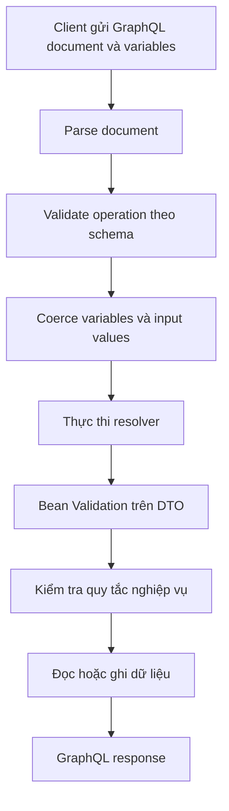

# Input validation

Input validation là quá trình kiểm tra dữ liệu client gửi vào GraphQL API trước và trong khi thực hiện nghiệp vụ. GraphQL schema có thể kiểm tra cấu trúc, kiểu dữ liệu, field bắt buộc và khả năng chuyển đổi scalar. Tuy nhiên, schema không thể tự biết một email đã được sử dụng hay một đơn hàng có đang ở trạng thái cho phép hủy hay không. Những quy tắc đó thuộc validation nghiệp vụ ở server.

Với Spring for GraphQL, nên kết hợp nhiều lớp kiểm tra: GraphQL engine xác minh operation và input theo SDL; Bean Validation kiểm tra các ràng buộc trên DTO; service/domain layer bảo vệ quy tắc nghiệp vụ và tính nhất quán dữ liệu. Mỗi lớp có trách nhiệm riêng, giúp lỗi được phát hiện đúng nơi và không phụ thuộc vào một giao diện client duy nhất.

## 1. Các lớp validation trong một GraphQL request

Một request GraphQL thường đi qua các bước sau:



Các bước parse, validate document và coercion diễn ra trước khi resolver thực thi. Nếu document sai cú pháp, chọn field không tồn tại hoặc truyền biến không tương thích kiểu, operation bị từ chối trước khi chạy nghiệp vụ.

Sau khi resolver nhận được dữ liệu đã được GraphQL chuyển đổi, ứng dụng tiếp tục kiểm tra các điều kiện mà schema không thể biểu diễn, ví dụ độ dài chuỗi, định dạng email, giá trị phải lớn hơn 0, quyền sở hữu tài nguyên hoặc trạng thái hiện tại của đối tượng.

Có thể phân chia trách nhiệm như sau:

| Lớp | Kiểm tra | Ví dụ |
| --- | --- | --- |
| GraphQL document validation | Cấu trúc operation và field theo schema | Field không tồn tại, thiếu selection set |
| Input coercion | Kiểu scalar, enum, list, input object, nullability | Truyền chuỗi vào `Int!` |
| Bean Validation | Ràng buộc trên DTO | `@NotBlank`, `@Email`, `@Size` |
| Domain validation | Quy tắc nghiệp vụ | Email đã được đăng ký, số lượng vượt tồn kho |
| Authorization | Quyền của người dùng trên thao tác và tài nguyên | Chỉ chủ đơn hàng mới được hủy |
| Persistence constraint | Bất biến được database bảo vệ | Unique constraint, foreign key |

## 2. Validation được khai báo trong GraphQL schema

SDL cho phép thể hiện một số quy tắc đầu vào ngay trong hợp đồng API.

```graphql
input RegisterUserInput {
    name: String!
    email: String!
    age: Int
    roles: [String!]!
}

type Mutation {
    registerUser(input: RegisterUserInput!): User!
}
```

Khai báo trên giúp GraphQL kiểm tra:

- `input` của mutation phải được cung cấp và không null.
- `name` và `email` phải có giá trị khác null.
- `age` có thể không được gửi hoặc nhận null.
- `roles` phải là một danh sách khác null; từng phần tử trong danh sách cũng không được null.

Nhưng `String!` không đồng nghĩa với chuỗi không rỗng. Client vẫn có thể gửi `""` hoặc một chuỗi chỉ có dấu cách. `Int` cũng không thể tự diễn đạt rằng tuổi phải từ 18 trở lên. Các điều kiện này cần validation ở tầng ứng dụng.

### 2.1. Hiểu đúng nullability và field bị bỏ qua

Trong input object, cần phân biệt field bắt buộc, field tùy chọn và giá trị mặc định.

```graphql
input UpdateProfileInput {
    displayName: String!
    bio: String
    locale: String = "vi"
}
```

- `displayName: String!` phải được cung cấp và không được null.
- `bio: String` có thể bị bỏ qua hoặc được gửi tường minh với `null`.
- `locale` dùng giá trị mặc định `vi` nếu client không cung cấp field đó.

Với mutation cập nhật từng phần, field bị bỏ qua thường có nghĩa là giữ nguyên giá trị cũ; field được gửi với `null` có thể mang nghĩa xóa giá trị. Đây là quy ước nghiệp vụ mà API cần xác định rõ.

Ví dụ variables:

```json
{
  "input": {
    "displayName": "Lan Nguyen",
    "bio": null
  }
}
```

Trong trường hợp này `bio` được gửi tường minh là null, còn `locale` không được gửi nên schema áp dụng giá trị mặc định. Nếu ứng dụng cần phân biệt field bị bỏ qua với field được gửi null, không nên chỉ bind vào một thuộc tính Java nullable mà không giữ thông tin về sự hiện diện của field. Có thể đọc map input, dùng kiểu biểu diễn tri-state hoặc một lớp mapping chuyên biệt.

### 2.2. List input và coercion

GraphQL có quy tắc input coercion cho list. Với một input có kiểu `[String!]!`, client có thể gửi một giá trị đơn và GraphQL có thể chuyển nó thành list một phần tử:

```graphql
input TagInput {
    labels: [String!]!
}
```

Hai variables dưới đây đều có thể được coercion hợp lệ:

```json
{ "labels": ["java", "graphql"] }
```

```json
{ "labels": "graphql" }
```

Sau coercion, resolver nhận một danh sách. Nếu hợp đồng nghiệp vụ bắt buộc client phải gửi một tập hợp, hãy cân nhắc chuẩn hóa ở client và kiểm tra số lượng phần tử ở server thay vì giả định JSON đầu vào luôn có dạng array.

## 3. Scalar và input coercion

GraphQL có các scalar tích hợp sẵn với quy tắc chuyển đổi riêng:

| Scalar | Input thường được chấp nhận | Lưu ý |
| --- | --- | --- |
| `Int` | Số nguyên trong phạm vi signed 32-bit | Không nhận chuỗi số như `"12"` |
| `Float` | Giá trị số | Không dùng chuỗi định dạng số thay thế |
| `String` | Chuỗi | Không tự chuyển số hoặc boolean thành chuỗi |
| `Boolean` | `true` hoặc `false` | Không nhận chuỗi `"true"` |
| `ID` | Chuỗi hoặc số nguyên theo quy tắc ID | Thường được biểu diễn dưới dạng chuỗi trong response |

Ví dụ schema:

```graphql
type Mutation {
    updateStock(productId: ID!, quantity: Int!): Product!
}
```

Request truyền `quantity: "5"` là sai kiểu; GraphQL không tự biến chuỗi thành số nguyên. Client nên gửi số JSON `5`.

Với biến được khai báo `Int!`, GraphQL kiểm tra cả kiểu và nullability trước khi gọi resolver. Việc kiểm tra phạm vi, ví dụ `quantity` phải lớn hơn 0 và không vượt quá giới hạn kho, vẫn thuộc ứng dụng.

## 4. Dùng custom scalar cho dữ liệu có định dạng

Khi một giá trị có định dạng hoặc quy tắc chuyển đổi riêng, custom scalar có thể làm schema rõ nghĩa hơn. Ví dụ `EmailAddress`, `Date` hoặc `DateTime`.

```graphql
scalar EmailAddress
scalar LocalDate

input CreateAccountInput {
    email: EmailAddress!
    birthDate: LocalDate
}
```

Custom scalar cần serializer và parser phù hợp. Trong GraphQL Java, scalar thường được xây dựng bằng `GraphQLScalarType` cùng `Coercing` để định nghĩa cách parse literal, parse variable và serialize output.

Custom scalar có thể kiểm tra cú pháp của giá trị, nhưng không thay thế kiểm tra nghiệp vụ. Scalar `EmailAddress` có thể từ chối chuỗi không đúng định dạng, nhưng không thể tự xác định địa chỉ đó đã tồn tại trong hệ thống hay chưa.

Không nên tạo custom scalar cho mọi kiểu Java. Chỉ nên dùng khi kiểu dữ liệu có ý nghĩa hợp đồng rõ ràng, có quy tắc parse/serialize ổn định và được tái sử dụng. Nếu không, scalar chuẩn cùng validation ở DTO có thể dễ hiểu hơn.

## 5. Validation DTO với Jakarta Bean Validation

Trong ứng dụng Spring Boot, có thể dùng Jakarta Bean Validation để khai báo ràng buộc trên input DTO. Cần có implementation validation trong runtime classpath, thường thông qua dependency `spring-boot-starter-validation`.

Ví dụ Maven:

```xml
<dependency>
    <groupId>org.springframework.boot</groupId>
    <artifactId>spring-boot-starter-validation</artifactId>
</dependency>
```

Định nghĩa input record:

```java
package com.example.graphql.user;

import jakarta.validation.constraints.Email;
import jakarta.validation.constraints.NotBlank;
import jakarta.validation.constraints.Size;

public record RegisterUserInput(
    @NotBlank(message = "Name must not be blank")
    @Size(max = 100, message = "Name must be at most 100 characters")
    String name,

    @NotBlank(message = "Email must not be blank")
    @Email(message = "Email format is invalid")
    @Size(max = 254, message = "Email is too long")
    String email
) {}
```

Controller nhận input và yêu cầu validation:

```java
package com.example.graphql.user;

import jakarta.validation.Valid;
import org.springframework.graphql.data.method.annotation.Argument;
import org.springframework.graphql.data.method.annotation.MutationMapping;
import org.springframework.stereotype.Controller;

@Controller
public class UserMutationController {

    private final UserService userService;

    public UserMutationController(UserService userService) {
        this.userService = userService;
    }

    @MutationMapping
    public User registerUser(@Argument @Valid RegisterUserInput input) {
        return userService.register(input);
    }
}
```

Spring for GraphQL hỗ trợ tích hợp validation cho các method argument theo cấu hình và phiên bản Spring đang dùng. Cần bảo đảm Bean Validation provider có trên classpath và annotation validation được kích hoạt cho handler method. Khi nâng phiên bản framework, kiểm tra cách exception validation được phát sinh và xử lý trong GraphQL execution để client nhận lỗi nhất quán.

Các annotation thường dùng:

| Annotation | Ý nghĩa |
| --- | --- |
| `@NotNull` | Giá trị không được null |
| `@NotBlank` | Chuỗi phải có ít nhất một ký tự không phải khoảng trắng |
| `@NotEmpty` | Chuỗi hoặc collection không được rỗng |
| `@Size(min, max)` | Giới hạn độ dài hoặc số phần tử |
| `@Min`, `@Max` | Giới hạn số nguyên hoặc kiểu số tương thích |
| `@Positive`, `@PositiveOrZero` | Giá trị phải dương hoặc không âm |
| `@Email` | Kiểm tra định dạng email theo validator |
| `@Pattern` | Kiểm tra chuỗi theo regular expression |

Annotation cần được chọn theo đúng ý nghĩa. Ví dụ `@NotEmpty` chấp nhận chuỗi chỉ có dấu cách, trong khi `@NotBlank` thì không.

## 6. Validation lồng nhau và quy tắc nhiều field

Input object có thể chứa input object khác. Để validation đi sâu vào các thuộc tính lồng nhau, dùng `@Valid` ở thuộc tính chứa object.

```java
public record AddressInput(
    @NotBlank String street,
    @NotBlank String city,
    @Pattern(regexp = "[0-9]{5,6}") String postalCode
) {}

public record CreateCustomerInput(
    @NotBlank String name,
    @Valid AddressInput address
) {}
```

Nếu `address` có thể null theo schema, cần xác định rõ nghiệp vụ có cho phép thiếu địa chỉ hay không. `@Valid` kích hoạt kiểm tra object con khi object đó hiện diện; nó không tự biến field nullable thành bắt buộc. Dùng `@NotNull @Valid` nếu object phải tồn tại.

Một số quy tắc cần so sánh nhiều field, ví dụ `startDate` phải trước `endDate`, hoặc `password` và `confirmPassword` phải trùng nhau. Có thể tạo class-level constraint với custom Jakarta Validation annotation và validator.

Ví dụ ý tưởng:

```java
@ValidDateRange
public record BookingInput(
    @NotNull LocalDate startDate,
    @NotNull LocalDate endDate
) {}
```

Validator của `@ValidDateRange` sẽ nhận toàn bộ object và kiểm tra quan hệ giữa hai ngày. Không nên đặt logic so sánh nhiều field vào các resolver rời rạc vì cùng quy tắc có thể bị lặp ở nhiều mutation.

## 7. Domain validation trong service

Bean Validation phù hợp với các ràng buộc cấu trúc của dữ liệu như độ dài, định dạng và phạm vi số. Các điều kiện phụ thuộc vào trạng thái hệ thống cần được kiểm tra trong service hoặc domain layer.

Ví dụ đăng ký người dùng:

```java
@Service
public class UserService {

    private final UserRepository userRepository;

    public UserService(UserRepository userRepository) {
        this.userRepository = userRepository;
    }

    public User register(RegisterUserInput input) {
        if (userRepository.existsByEmail(input.email())) {
            throw new EmailAlreadyRegisteredException(input.email());
        }

        User user = new User(input.name(), input.email());
        return userRepository.save(user);
    }
}
```

Kiểm tra email đã tồn tại cần truy vấn dữ liệu nên không thể giải quyết bằng `@Email`. Đồng thời, kiểm tra `existsByEmail` trước khi lưu không loại bỏ hoàn toàn race condition: hai request đồng thời vẫn có thể cùng vượt qua bước kiểm tra. Database nên có unique constraint để bảo vệ bất biến, và service cần chuyển lỗi vi phạm constraint thành lỗi nghiệp vụ phù hợp.

Với các thao tác phụ thuộc trạng thái, hãy kiểm tra điều kiện trong transaction phù hợp. Ví dụ chỉ cho phép hủy đơn hàng khi đơn chưa được giao. Nếu có cập nhật đồng thời, cân nhắc optimistic locking hoặc cơ chế khóa theo yêu cầu nghiệp vụ.

## 8. Xử lý lỗi validation trong GraphQL

GraphQL có hai nhóm lỗi cần phân biệt:

- **Request error**: lỗi parse, document validation hoặc input coercion. Resolver chưa được thực thi; response thường có `errors` và không có kết quả `data` thực thi.
- **Execution error**: lỗi xảy ra khi resolver hoặc field đang được thực thi. Response có thể chứa cả `data` một phần và `errors`, tùy vị trí lỗi và nullability của schema.

Ví dụ lỗi input coercion:

```graphql
type Mutation {
    setAge(age: Int!): User!
}
```

Client truyền chuỗi `"twenty"` cho argument `age` sẽ bị từ chối trước khi resolver chạy. Không nên bắt lỗi này trong service vì service chưa nhận được request hợp lệ.

Với lỗi validation DTO hoặc domain, server cần quyết định cách biểu diễn thống nhất. Có hai cách phổ biến:

1. Dùng GraphQL errors để thông báo mutation không thể thực thi, với mã lỗi và thông điệp đã được chuẩn hóa.
2. Trả payload có `userErrors` khi lỗi là kết quả nghiệp vụ có thể dự đoán và client cần hiển thị cùng response.

Ví dụ payload:

```graphql
type UserError {
    field: String
    code: String!
    message: String!
}

type RegisterUserPayload {
    user: User
    userErrors: [UserError!]!
}
```

Không nên trộn lẫn tùy tiện hai cách trong cùng một API. Hãy quy định rõ lỗi nào là lỗi đầu vào có thể hiển thị, lỗi nào là lỗi xác thực/phân quyền và lỗi nào là sự cố hệ thống. Thông điệp trả cho client không được tiết lộ stack trace, SQL hoặc dữ liệu nhạy cảm.

Spring for GraphQL cho phép xử lý exception bằng `@GraphQlExceptionHandler` trong controller hoặc `@ControllerAdvice`, kết hợp `DataFetcherExceptionResolver` khi cần cấu hình ở cấp thấp hơn. Có thể ánh xạ exception nghiệp vụ thành `GraphQLError` có error code và message an toàn. Với validation exception, hãy kiểm tra loại exception cụ thể do cấu hình handler method phát sinh trong phiên bản đang sử dụng.

## 9. Ví dụ xử lý exception nghiệp vụ

Giả sử service ném `EmailAlreadyRegisteredException`. Có thể dùng exception handler để chuẩn hóa lỗi:

```java
import graphql.GraphQLError;
import graphql.GraphqlErrorBuilder;
import graphql.schema.DataFetchingEnvironment;
import org.springframework.graphql.data.method.annotation.GraphQlExceptionHandler;
import org.springframework.graphql.execution.ErrorType;
import org.springframework.web.bind.annotation.ControllerAdvice;

@ControllerAdvice
public class GraphQlErrorHandler {

    @GraphQlExceptionHandler
    public GraphQLError handleEmailAlreadyRegistered(
            EmailAlreadyRegisteredException exception,
            DataFetchingEnvironment environment) {
        return GraphqlErrorBuilder.newError(environment)
            .errorType(ErrorType.BAD_REQUEST)
            .message("This email address is already registered")
            .build();
    }
}
```

Đây là ví dụ cho một exception nghiệp vụ. Trong ứng dụng thực tế, nên dùng error code ổn định, giới hạn thông tin nhạy cảm và có thể gắn metadata an toàn vào `extensions` để client phân loại lỗi. Không nên đưa email đầy đủ hoặc thông tin cá nhân vào log hay message nếu không cần thiết.

Nếu muốn trả lỗi theo payload, service có thể trả một kết quả nghiệp vụ có trạng thái thay vì ném exception cho trường hợp dự kiến. Exception handler phù hợp hơn với lỗi cần đi qua GraphQL error channel.

## 10. Authorization cũng là một phần của kiểm tra input

Một input hợp lệ về kiểu và định dạng vẫn có thể không được phép thực hiện. Ví dụ client gửi `orderId` tồn tại nhưng đơn hàng thuộc người dùng khác.

```graphql
type Mutation {
    cancelOrder(orderId: ID!): Order!
}
```

Server phải lấy principal từ security context, tải đơn hàng và kiểm tra quyền trên đơn hàng đó. Không tin `userId` do client gửi để quyết định chủ sở hữu.

Quyền có thể được kiểm tra ở service/domain layer hoặc method security theo kiến trúc ứng dụng. Nếu một field có quy tắc quyền riêng, cần kiểm tra tại ranh giới field hoặc dữ liệu phù hợp. Ẩn field trong giao diện, dùng alias khác hoặc bỏ field khỏi query không thay thế authorization phía server.

Validation và authorization có thể trả lỗi tương tự nhau ở phía client, nhưng mục đích khác nhau. Validation nói dữ liệu không thỏa hợp đồng; authorization nói người dùng hiện tại không được phép thực hiện hành động trên tài nguyên.

## 11. Kiểm thử input validation

Nên kiểm tra cả lỗi bị GraphQL engine từ chối trước resolver và lỗi do ứng dụng phát hiện sau khi resolver chạy.

Ví dụ dùng `GraphQlTester` để kiểm tra kết quả mutation:

```java
import static org.assertj.core.api.Assertions.assertThat;

import org.junit.jupiter.api.Test;
import org.springframework.beans.factory.annotation.Autowired;
import org.springframework.boot.test.autoconfigure.graphql.GraphQlTest;
import org.springframework.graphql.test.tester.GraphQlTester;

@GraphQlTest(UserMutationController.class)
class UserMutationControllerTest {

    @Autowired
    GraphQlTester graphQlTester;

    @Test
    void rejectsBlankName() {
        graphQlTester.document("""
                mutation {
                    registerUser(input: {
                        name: "   "
                        email: "lan@example.com"
                    }) {
                        id
                    }
                }
                """)
            .execute()
            .errors()
            .satisfy(errors -> assertThat(errors).isNotEmpty());
    }
}
```

Đoạn test trên minh họa cách xác nhận operation có ít nhất một lỗi; trong dự án thực tế, nên kiểm tra thêm error code, message đã chuẩn hóa hoặc payload `userErrors` theo hợp đồng đã chọn. Nếu test controller gọi service, cung cấp mock/test bean tương ứng.

Các nhóm test nên có:

- Thiếu argument hoặc field bắt buộc.
- Truyền scalar sai kiểu và enum không hợp lệ.
- Field input không được schema khai báo.
- Chuỗi rỗng, chỉ có khoảng trắng, quá dài hoặc sai định dạng.
- Input object lồng nhau và lỗi cross-field.
- Quy tắc nghiệp vụ phụ thuộc dữ liệu hiện có.
- Người dùng không có quyền thao tác trên tài nguyên.
- Request đồng thời và vi phạm constraint ở database.

Với request error do GraphQL validation, cần xác nhận resolver không được gọi. Với domain validation, cần xác nhận dữ liệu không bị ghi một phần và response tuân theo error contract.

## 12. Bảo vệ server trước input độc hại hoặc quá lớn

Validation không chỉ để cải thiện thông báo lỗi. Input không giới hạn có thể làm tăng chi phí CPU, bộ nhớ, database và log.

Một số biện pháp cần cân nhắc:

- Giới hạn độ dài chuỗi và số phần tử trong list.
- Phân trang danh sách thay vì nhận hoặc trả một collection không giới hạn.
- Giới hạn kích thước HTTP request body tại gateway và application server.
- Giới hạn độ sâu và độ phức tạp query, đặc biệt với field lồng nhau hoặc resolver tốn kém.
- Rate limit theo người dùng, client hoặc operation phù hợp.
- Chuẩn hóa và kiểm tra dữ liệu trước khi dùng trong truy vấn database; sử dụng parameter binding thay vì ghép chuỗi SQL.
- Tránh ghi toàn bộ input chứa thông tin cá nhân, token hoặc bí mật vào log.

Không nên chỉ dựa vào client-side validation. Client có thể bị sửa đổi hoặc gọi API trực tiếp, vì vậy server luôn phải kiểm tra dữ liệu và quyền truy cập.

## 13. Checklist thiết kế input validation

- Schema đã khai báo đúng kiểu, nullability và giá trị mặc định chưa?
- Có phân biệt field bị bỏ qua với field được gửi `null` khi cập nhật từng phần không?
- Scalar và custom scalar có quy tắc parse/serialize rõ ràng không?
- DTO có các ràng buộc cấu trúc phù hợp và validation đã được kích hoạt không?
- Quy tắc phụ thuộc trạng thái hoặc dữ liệu hiện có nằm trong service/domain layer chưa?
- Database có constraint bảo vệ các bất biến quan trọng không?
- Authorization được kiểm tra cho người dùng và tài nguyên đích chưa?
- Error response có nhất quán và không làm lộ thông tin nội bộ không?
- Đã giới hạn kích thước input, số phần tử, query cost và tần suất request chưa?
- Test đã bao phủ request error, execution error và các tình huống cạnh tranh chưa?

Input validation trong GraphQL là sự phối hợp giữa schema, coercion, Bean Validation và domain rules. SDL giúp client hiểu hợp đồng và loại bỏ sớm request sai cấu trúc; DTO validation kiểm tra dữ liệu có hình dạng hợp lệ; service/domain bảo vệ quy tắc nghiệp vụ; database bảo vệ bất biến cuối cùng. Trong Spring for GraphQL, kết hợp các lớp này với xử lý lỗi và kiểm thử rõ ràng giúp API an toàn, dễ dự đoán và dễ bảo trì.
