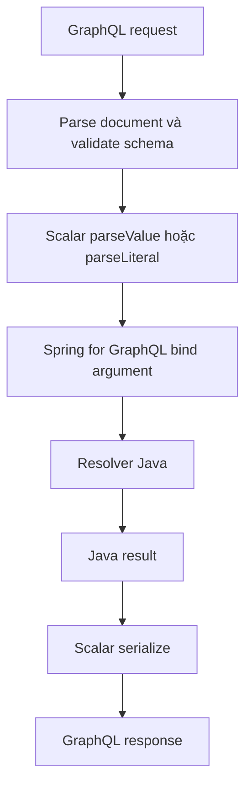

# Chuyển đổi scalar sang Java type

## 1. Scalar trong GraphQL và Java type

Trong GraphQL, scalar là kiểu dữ liệu đơn trị ở cấp schema. Những kiểu scalar chuẩn gồm `Int`, `Float`, `String`, `Boolean` và `ID`. Khi một operation gửi dữ liệu đầu vào hoặc nhận kết quả từ resolver, GraphQL cần chuyển đổi giá trị giữa biểu diễn của GraphQL và kiểu dữ liệu mà chương trình Java sử dụng.

Ví dụ, schema khai báo một field nhận mã sách và trả về số lượng bản sao:

```graphql
type Query {
    availableCopies(bookId: ID!): Int!
}
```

Ở phía Java, resolver có thể nhận `bookId` dưới dạng `String` và trả về `Integer`:

```java
@QueryMapping
public Integer availableCopies(@Argument String bookId) {
    return inventoryService.countAvailableCopies(bookId);
}
```

GraphQL không tự hiểu mọi class Java. Việc chuyển đổi được thực hiện qua cơ chế coercion của scalar trong GraphQL Java, kết hợp với cách Spring for GraphQL ánh xạ argument và kết quả của data fetcher. Khi dùng kiểu Java phù hợp, resolver có thể tập trung vào nghiệp vụ thay vì tự parse chuỗi trong từng phương thức.

## 2. Luồng chuyển đổi scalar

Một scalar có ba trách nhiệm chuyển đổi chính:

1. **Parse input value:** chuyển giá trị từ biến trong request thành giá trị Java phù hợp.
2. **Parse literal:** chuyển giá trị được viết trực tiếp trong GraphQL document thành giá trị nội bộ.
3. **Serialize output:** chuyển kết quả Java do resolver trả về thành giá trị có thể gửi trong GraphQL response.

Ví dụ client gửi biến:

```json
{
  "query": "query($bookId: ID!) { availableCopies(bookId: $bookId) }",
  "variables": {
    "bookId": "book-42"
  }
}
```

GraphQL kiểm tra kiểu của biến theo schema, sau đó scalar `ID` xử lý giá trị đầu vào. Spring for GraphQL đưa giá trị đã được GraphQL Java xử lý vào resolver. Khi resolver trả về `Integer`, scalar `Int` serialize giá trị đó thành số trong response JSON.



`parseValue` được dùng cho giá trị truyền qua `variables`; `parseLiteral` được dùng khi giá trị xuất hiện trực tiếp trong document. `serialize` xử lý dữ liệu trả về từ resolver. Một custom scalar cần định nghĩa nhất quán cả ba hướng chuyển đổi để input và output có cùng quy ước.

## 3. Ánh xạ các scalar chuẩn sang Java type

GraphQL Java biểu diễn các scalar chuẩn bằng những kiểu Java thông dụng. Bảng dưới đây là cách ánh xạ phù hợp trong phần lớn ứng dụng Spring for GraphQL:

| GraphQL scalar | Java type thường dùng | Ghi chú |
| --- | --- | --- |
| `String` | `String` | Chuỗi Unicode |
| `Boolean` | `Boolean` hoặc `boolean` | Dùng `Boolean` khi giá trị có thể nullable |
| `Int` | `Integer` hoặc `int` | Số nguyên có dấu 32-bit |
| `Float` | `Double` hoặc `double` | Số dấu phẩy động độ chính xác kép |
| `ID` | `String` | Dùng cho định danh; response được serialize thành chuỗi |

Ví dụ schema:

```graphql
type Query {
    book(id: ID!): Book
    searchBooks(title: String!, available: Boolean): [Book!]!
    totalPages(bookId: ID!): Int!
    averageRating(bookId: ID!): Float
}

type Book {
    id: ID!
    title: String!
    available: Boolean!
    pageCount: Int!
    rating: Float
}
```

Resolver Java tương ứng:

```java
@Controller
public class BookController {

    private final BookService bookService;

    public BookController(BookService bookService) {
        this.bookService = bookService;
    }

    @QueryMapping
    public Book book(@Argument String id) {
        return bookService.findById(id).orElse(null);
    }

    @QueryMapping
    public List<Book> searchBooks(
            @Argument String title,
            @Argument Boolean available) {
        return bookService.search(title, available);
    }

    @QueryMapping
    public Integer totalPages(@Argument String bookId) {
        return bookService.totalPages(bookId);
    }

    @QueryMapping
    public Double averageRating(@Argument String bookId) {
        return bookService.averageRating(bookId);
    }
}
```

Ví dụ rút gọn tập trung vào kiểu tham số và kiểu trả về; `Book`, `BookService` và các phương thức nghiệp vụ là thành phần do ứng dụng định nghĩa.

### Lưu ý riêng với `Int`, `Float` và `ID`

`Int` của GraphQL là số nguyên có dấu 32-bit. Java `Long` có phạm vi lớn hơn, vì vậy không nên khai báo field GraphQL là `Int` rồi trả về một giá trị `Long` có thể vượt giới hạn 32-bit. Nếu nghiệp vụ cần số nguyên 64-bit, hãy dùng custom scalar phù hợp hoặc biểu diễn theo một quy ước khác được schema công bố rõ ràng.

`Float` của GraphQL dùng độ chính xác kép. Trong Java, `Double` thường là lựa chọn phù hợp. Với tiền tệ hoặc phép tính cần độ chính xác thập phân, không nên dùng `Double` vì sai số dấu phẩy động có thể ảnh hưởng kết quả. Hãy cân nhắc `BigDecimal` cùng custom scalar hoặc một kiểu scalar mở rộng đã được đăng ký.

`ID` biểu diễn định danh, không mang ý nghĩa số học. Dù giá trị có thể trông giống số, nên dùng `String` ở Java để tránh vô tình thực hiện phép tính hoặc làm mất định dạng như số 0 ở đầu. Nếu domain model dùng `UUID`, có thể khai báo scalar UUID riêng và cấu hình coercion tương ứng.

## 4. Nullable, non-null và danh sách khi ánh xạ Java

GraphQL dùng dấu `!` để biểu thị một giá trị non-null. Không có `!` nghĩa là giá trị có thể là `null`. Quy tắc này áp dụng cả với scalar đơn lẻ lẫn phần tử trong danh sách.

| SDL | Java type thường dùng | Ý nghĩa |
| --- | --- | --- |
| `String` | `String` | Có thể trả về `null` |
| `String!` | `String` | Resolver phải trả về giá trị khác `null` |
| `[Int!]!` | `List<Integer>` | Danh sách không null, từng phần tử không null |
| `[Int]` | `List<Integer>` | Danh sách và phần tử đều có thể null |
| `[Book!]` | `List<Book>` | Danh sách có thể null, từng phần tử không null |

Java primitive như `int` và `boolean` không thể chứa `null`. Nếu field GraphQL nullable, nên dùng wrapper như `Integer` hoặc `Boolean` để biểu diễn trường hợp không có giá trị. Với field non-null, vẫn nên kiểm tra dữ liệu trước khi trả về; nếu resolver trả `null` cho field non-null, GraphQL tạo lỗi thực thi và áp dụng quy tắc null propagation lên field cha.

Ví dụ:

```graphql
type Query {
    bookRating(bookId: ID!): Float
    bookPageCount(bookId: ID!): Int!
}
```

```java
@QueryMapping
public Double bookRating(@Argument String bookId) {
    return ratingService.findRating(bookId).orElse(null);
}

@QueryMapping
public Integer bookPageCount(@Argument String bookId) {
    return bookService.pageCount(bookId);
}
```

Field `bookRating` có thể không có đánh giá nên dùng `Double` nullable. `bookPageCount` được khai báo non-null nên service cần bảo đảm luôn có kết quả hợp lệ.

## 5. Scalar coercion và `@Argument` trong Spring for GraphQL

Khi dùng annotation-based controller, `@Argument` liên kết argument của field trong schema với tham số phương thức Java. Tên argument có thể được ghi tường minh để tránh phụ thuộc vào metadata tên tham số khi biên dịch:

```graphql
type Query {
    booksByYear(year: Int!): [Book!]!
}
```

```java
@QueryMapping
public List<Book> booksByYear(@Argument("year") Integer publicationYear) {
    return bookService.findByYear(publicationYear);
}
```

Tên tham số Java là `publicationYear`, còn tên argument trong SDL là `year`; `@Argument("year")` tạo liên kết rõ ràng. Với scalar chuẩn, GraphQL Java đã kiểm tra và coercion giá trị theo scalar trước khi resolver được gọi. Spring for GraphQL tiếp tục bind argument vào tham số phương thức.

Nếu kiểu Java của tham số không tương thích với giá trị mà scalar cung cấp, cần điều chỉnh kiểu tham số hoặc định nghĩa scalar/converter phù hợp. Tránh nhận mọi giá trị dưới dạng `Object` rồi tự ép kiểu trong từng resolver vì cách đó làm mất lợi ích kiểm tra kiểu của schema.

Với input object, Spring for GraphQL có thể bind cấu trúc đầu vào sang DTO hoặc kiểu Java phù hợp. Các scalar bên trong input object vẫn phải được coercion đúng trước khi dữ liệu được bind. Vì vậy, cần phân biệt hai việc: scalar chuyển đổi một giá trị đơn; argument binding ánh xạ kết quả đó vào tham số hoặc object Java.

## 6. Khi nào cần custom scalar?

Scalar chuẩn không bao phủ mọi kiểu dữ liệu của ứng dụng. Một số domain type thường gặp gồm:

- Ngày lịch: `LocalDate`.
- Thời điểm có múi giờ: `OffsetDateTime` hoặc `Instant` theo quy ước của hệ thống.
- Định danh UUID: `UUID`.
- Số tiền: `BigDecimal`.
- Email, URL hoặc mã định danh nghiệp vụ có định dạng riêng.

Có thể biểu diễn một số kiểu dưới dạng `String`, nhưng schema khi đó không thể hiện được định dạng chuyên biệt và server phải tự xác thực ở nhiều nơi. Custom scalar giúp công bố tên kiểu rõ ràng và tập trung quy tắc parse/serialize.

Ví dụ schema:

```graphql
scalar Date
scalar DateTime
scalar UUID

type Query {
    booksPublishedOn(date: Date!): [Book!]!
    bookByUuid(id: UUID!): Book
}

type Book {
    id: UUID!
    title: String!
    publishedOn: Date!
    createdAt: DateTime!
}
```

Khai báo `scalar Date` hoặc `scalar UUID` trong SDL chỉ tạo tên scalar trong schema. Nó không tự biết cách chuyển thành `LocalDate` hay `UUID`. Server phải đăng ký một implementation `GraphQLScalarType` có coercing tương ứng.

## 7. Dùng graphql-java-extended-scalars

Đối với những kiểu phổ biến, có thể dùng thư viện `graphql-java-extended-scalars` thay vì tự viết lại coercion. Thư viện cung cấp các scalar mở rộng như `Date`, `DateTime`, `Time`, `UUID`, `Long`, `BigDecimal` và một số kiểu khác.

Thêm dependency `com.graphql-java:graphql-java-extended-scalars` vào dự án. Chọn phiên bản tương thích với phiên bản GraphQL Java mà Spring Boot đang quản lý; không ghim một phiên bản tùy ý có thể kéo theo GraphQL Java không tương thích.

Với Gradle Kotlin DSL, khai báo theo dạng:

```kotlin
dependencies {
    implementation("com.graphql-java:graphql-java-extended-scalars:<compatible-version>")
}
```

Sau đó đăng ký các scalar cần dùng bằng `RuntimeWiringConfigurer`:

```java
import graphql.scalars.ExtendedScalars;
import org.springframework.context.annotation.Bean;
import org.springframework.context.annotation.Configuration;
import org.springframework.graphql.execution.RuntimeWiringConfigurer;

@Configuration
public class GraphQlScalarConfig {

    @Bean
    RuntimeWiringConfigurer scalarConfigurer() {
        return wiringBuilder -> wiringBuilder
            .scalar(ExtendedScalars.Date)
            .scalar(ExtendedScalars.DateTime)
            .scalar(ExtendedScalars.UUID)
            .scalar(ExtendedScalars.BigDecimal);
    }
}
```

Khi schema có `scalar Date`, `scalar DateTime`, `scalar UUID` hoặc scalar mở rộng tương ứng, tên scalar trong SDL phải khớp với tên mà implementation đăng ký cung cấp. Hãy kiểm tra tài liệu của phiên bản thư viện đang dùng để xác nhận kiểu Java đầu vào/đầu ra và định dạng serialize của từng scalar.

Ví dụ resolver dùng các kiểu Java domain tương ứng:

```java
import java.time.LocalDate;
import java.util.UUID;
import org.springframework.graphql.data.method.annotation.Argument;
import org.springframework.graphql.data.method.annotation.QueryMapping;
import org.springframework.stereotype.Controller;

@Controller
public class BookQueryController {

    private final BookService bookService;

    public BookQueryController(BookService bookService) {
        this.bookService = bookService;
    }

    @QueryMapping
    public List<Book> booksPublishedOn(@Argument LocalDate date) {
        return bookService.findPublishedOn(date);
    }

    @QueryMapping
    public Book bookByUuid(@Argument UUID id) {
        return bookService.findByUuid(id).orElse(null);
    }
}
```

Trong ví dụ, `Date` được dùng cho ngày lịch và `UUID` cho định danh. Nếu scalar đang chọn serialize thành một kiểu Java khác, cần điều chỉnh chữ ký resolver hoặc dùng custom scalar có coercing trả về đúng domain type.

## 8. Tự định nghĩa scalar bằng GraphQLScalarType

Khi thư viện scalar mở rộng không có kiểu phù hợp, có thể định nghĩa custom scalar bằng `GraphQLScalarType` và `Coercing`. `Coercing` là nơi quy định ba hướng chuyển đổi:

| Phương thức coercion | Vai trò |
| --- | --- |
| `parseValue` | Xử lý giá trị từ `variables` của request |
| `parseLiteral` | Xử lý literal được viết trực tiếp trong GraphQL document |
| `serialize` | Chuyển kết quả Java thành giá trị output của GraphQL |

Ví dụ một scalar `Money` có thể chọn `BigDecimal` làm kiểu Java nội bộ và serialize thành chuỗi thập phân theo quy ước của API. Khi cài đặt, cần xác định rõ:

- Chấp nhận input là chuỗi hay số JSON.
- Có cho phép số âm hay không.
- Số chữ số thập phân tối đa.
- Cách làm tròn hoặc từ chối giá trị vượt độ chính xác.
- Định dạng output nhất quán giữa mọi resolver.
- Cách báo lỗi khi input sai định dạng hoặc vượt giới hạn.

Khung đăng ký scalar:

```java
GraphQLScalarType moneyScalar = GraphQLScalarType.newScalar()
    .name("Money")
    .description("Số tiền được biểu diễn bằng giá trị thập phân")
    .coercing(moneyCoercing)
    .build();
```

`moneyCoercing` là implementation `Coercing` do ứng dụng cung cấp. Sau khi tạo scalar, đăng ký nó trong `RuntimeWiringConfigurer`:

```java
@Bean
RuntimeWiringConfigurer moneyScalarConfigurer() {
    return wiringBuilder -> wiringBuilder.scalar(moneyScalar);
}
```

SDL tương ứng:

```graphql
scalar Money

type Product {
    id: ID!
    price: Money!
}
```

Đừng chỉ đổi tên `BigDecimal` thành `Money` trong SDL rồi kỳ vọng Spring tự chuyển đổi. Scalar phải có coercing được đăng ký để GraphQL Java hiểu cách parse và serialize kiểu này.

## 9. Quy tắc thiết kế custom scalar

Custom scalar là một phần của API contract, nên định dạng của nó cần ổn định và có thể kiểm tra.

**Định dạng input:** chấp nhận một định dạng rõ ràng. Ví dụ `Date` nhận chuỗi `YYYY-MM-DD`; `UUID` nhận chuỗi UUID chuẩn. Không nên chấp nhận quá nhiều định dạng tương đương nếu không có lý do tương thích cụ thể.

**Định dạng output:** serialize nhất quán, độc lập với locale hoặc timezone mặc định của máy chủ. Với thời gian, phải xác định rõ có giữ offset hay chuẩn hóa UTC.

**Giới hạn giá trị:** xác định miền giá trị hợp lệ, độ chính xác và giới hạn độ dài trước khi đưa dữ liệu vào tầng nghiệp vụ.

**Thông báo lỗi:** lỗi coercion nên chỉ ra giá trị không hợp lệ và định dạng mong đợi ở mức an toàn. Không để stack trace, câu SQL hoặc dữ liệu nội bộ xuất hiện trong lỗi gửi client.

**Tính tương thích:** thay đổi định dạng scalar có thể làm hỏng client dù tên field không đổi. Nếu cần đổi format, nên thiết kế giai đoạn chuyển đổi hoặc một scalar/field mới.

**Tính nhất quán:** cùng một scalar phải dùng chung quy tắc ở mọi field. Tránh mỗi resolver tự parse `String` thành `LocalDate` theo cách riêng.

## 10. Những lỗi thường gặp khi chuyển scalar sang Java type

| Hiện tượng | Nguyên nhân có thể | Hướng xử lý |
| --- | --- | --- |
| Argument không bind được vào tham số Java | Kiểu Java không tương thích với kết quả coercion hoặc tên argument không khớp | Kiểm tra scalar, kiểu tham số và `@Argument("name")` |
| Giá trị `Long` vượt giới hạn `Int` | GraphQL `Int` chỉ là số nguyên 32-bit | Dùng scalar `Long` đã đăng ký hoặc kiểu phù hợp khác |
| Sai số khi xử lý tiền | Dùng `Float`/`Double` cho phép tính thập phân chính xác | Dùng `BigDecimal` với scalar được hỗ trợ |
| `LocalDate` không parse được | SDL khai báo scalar nhưng chưa đăng ký coercing tương ứng | Đăng ký `ExtendedScalars.Date` hoặc custom scalar |
| Biến hợp lệ nhưng literal không hợp lệ (hoặc ngược lại) | `parseValue` và `parseLiteral` có quy tắc khác nhau | Kiểm thử cả hai đường input |
| Resolver trả về lỗi serialize | Java result không đúng kiểu mà scalar output mong đợi | Kiểm tra `serialize` và kiểu trả về của resolver |
| `ID` bị xử lý như số | Dùng `Integer`/`Long` cho mã định danh | Dùng `String` hoặc custom UUID scalar |
| Nullable field gây lỗi primitive | Java primitive không biểu diễn được `null` | Dùng wrapper type như `Integer` hoặc `Boolean` |
| Custom scalar hoạt động ở môi trường này nhưng lỗi ở môi trường khác | Dựa vào timezone, locale hoặc format mặc định | Định nghĩa format tường minh và kiểm thử độc lập môi trường |

## 11. Kiểm thử scalar coercion với GraphQlTester

Nên kiểm thử input qua `variables`, literal trực tiếp và output serialization. Ví dụ schema:

```graphql
scalar Date

type Query {
    booksPublishedOn(date: Date!): [Book!]!
}

type Book {
    id: ID!
    title: String!
}
```

Operation dùng variable:

```graphql
query BooksPublishedOn($date: Date!) {
    booksPublishedOn(date: $date) {
        id
        title
    }
}
```

Kiểm thử với GraphQlTester:

```java
graphQlTester.document("""
    query BooksPublishedOn($date: Date!) {
        booksPublishedOn(date: $date) {
            id
            title
        }
    }
    """)
    .variable("date", "2025-05-20")
    .execute()
    .errors()
    .verify();
```

Ví dụ này xác nhận request không phát sinh GraphQL error với ngày hợp lệ. Trong test đầy đủ, cần kiểm tra kết quả resolver nhận đúng `LocalDate`, response serialize đúng định dạng và giá trị như `20-05-2025` hoặc `2025-02-30` bị từ chối nếu không thuộc format được quy định.

Một bộ kiểm thử scalar nên bao gồm:

- Input hợp lệ qua `variables`.
- Input hợp lệ dưới dạng literal trong operation.
- Input sai định dạng, sai kiểu JSON hoặc vượt miền giá trị.
- Output hợp lệ từ resolver.
- Resolver trả về kiểu Java không tương thích.
- Giá trị null đối với field nullable và non-null.
- Quy tắc timezone, độ chính xác và locale nếu scalar có liên quan.

## 12. Checklist lựa chọn Java type cho scalar

- [ ] Kiểu Java phù hợp với miền giá trị và độ chính xác của scalar.
- [ ] `Int` không bị dùng cho giá trị vượt giới hạn 32-bit.
- [ ] `Float` không được dùng cho phép tính tiền tệ cần độ chính xác thập phân.
- [ ] `ID` được xử lý như định danh, không phải số để tính toán.
- [ ] Field nullable dùng Java reference type có thể nhận `null`.
- [ ] Custom scalar đã khai báo trong SDL và đăng ký runtime wiring.
- [ ] `parseValue`, `parseLiteral` và `serialize` tuân theo cùng một định dạng.
- [ ] Argument Java dùng kiểu tương thích với giá trị scalar đã coercion.
- [ ] Đã kiểm thử input variables, literal và output serialization.
- [ ] Lỗi coercion không làm lộ dữ liệu nội bộ và có thông báo đủ rõ cho client.

## Kết luận

Chuyển đổi scalar sang Java type là quá trình phối hợp giữa GraphQL scalar coercion và argument/result binding của Spring for GraphQL. Các scalar chuẩn thường ánh xạ trực tiếp sang `String`, `Boolean`, `Integer`, `Double` và `String` cho `ID`. Cần chú ý giới hạn 32-bit của `Int`, độ chính xác của `Float`, ý nghĩa định danh của `ID` và khả năng null của Java wrapper type.

Với các kiểu domain như ngày tháng, UUID hoặc tiền tệ, hãy chọn custom scalar hoặc thư viện scalar mở rộng phù hợp, đăng ký qua `RuntimeWiringConfigurer` và thống nhất định dạng parse/serialize. Khi scalar được thiết kế như một phần rõ ràng của schema contract, resolver Java nhận dữ liệu có kiểu, client gửi giá trị nhất quán và lỗi chuyển đổi có thể được phát hiện sớm ở bước GraphQL coercion.
