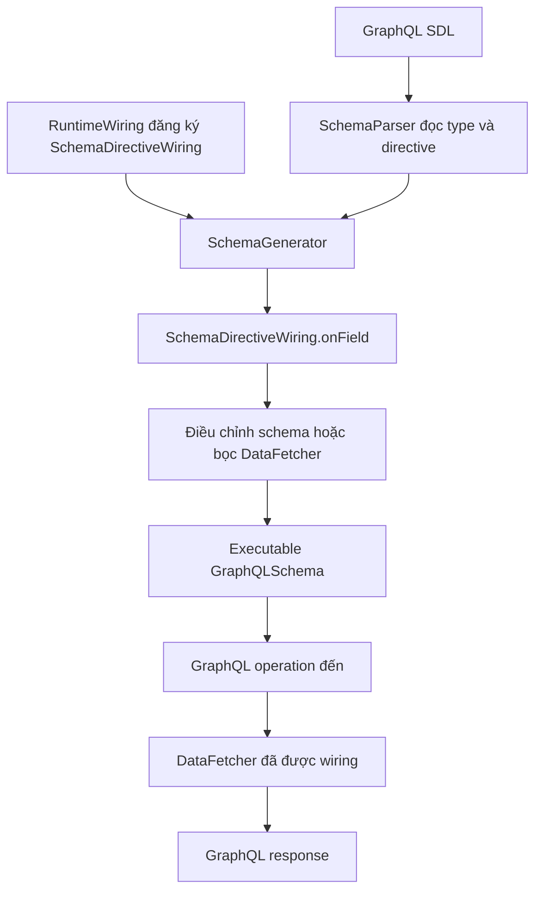

# Directive wiring

Trong GraphQL SDL, khai báo một custom directive mới chỉ mô tả tên, argument và vị trí mà directive được phép xuất hiện. GraphQL không tự suy ra hành vi từ tên directive. Muốn directive thực sự tác động đến quá trình lấy dữ liệu, ứng dụng phải **wire directive vào runtime**.

Với GraphQL Java, cơ chế phổ biến để làm việc này là `SchemaDirectiveWiring`. Thành phần này được gọi trong lúc xây dựng executable schema. Nó có thể đọc metadata của directive, thay đổi schema element hoặc bọc `DataFetcher` hiện có để thêm hành vi khi field được thực thi. Trong Spring for GraphQL, đăng ký wiring thường được thực hiện qua `RuntimeWiringConfigurer` để Spring đưa cấu hình vào quá trình tạo `GraphQlSource`.

## 1. Khai báo directive chưa tạo ra hành vi

Giả sử API muốn chuẩn hóa tên sách thành chữ hoa trước khi trả về:

```graphql
directive @uppercase on FIELD_DEFINITION

type Book {
    id: ID!
    title: String! @uppercase
}
```

SDL trên cho biết `@uppercase` được phép gắn lên field definition và field `Book.title` sử dụng directive đó. Nhưng nếu ứng dụng chỉ nạp SDL, GraphQL không tự đổi `title` thành chữ hoa. Directive mới là metadata trong schema cho đến khi có thành phần runtime diễn giải nó.

Có thể phân biệt ba bước:

1. **Khai báo:** SDL định nghĩa directive và gắn nó vào vị trí hợp lệ.
2. **Wiring:** GraphQL Java nhận một implementation biết cách xử lý directive trong quá trình tạo schema.
3. **Thực thi:** hành vi được cài đặt trong wiring chạy khi field tương ứng được resolve, ví dụ một `DataFetcher` đã được bọc.

`@deprecated`, `@specifiedBy`, `@include` và `@skip` là các directive chuẩn có ngữ nghĩa do GraphQL specification và runtime quy định. Ứng dụng thường không cần tự viết `SchemaDirectiveWiring` để làm cho các directive chuẩn này hoạt động. Bài này tập trung vào custom schema directive.

## 2. SchemaDirectiveWiring hoạt động ở giai đoạn nào?

GraphQL Java dùng SDL và runtime wiring để xây dựng `GraphQLSchema` có thể thực thi. Trong quá trình này, `SchemaDirectiveWiring` được gọi cho schema element có gắn directive tương ứng. Với field definition, phương thức `onField` nhận một `SchemaDirectiveWiringEnvironment<GraphQLFieldDefinition>`.

Environment cung cấp những thông tin cần thiết để xử lý directive, bao gồm schema element hiện tại, directive được áp dụng, field container và code registry đang được xây dựng. Với field, code registry là nơi liên kết field với `DataFetcher` sẽ được gọi khi operation chạy.

Luồng khái quát:



Điểm quan trọng là wiring diễn ra khi schema được tạo, thường trong lúc ứng dụng Spring khởi động. `onField` không phải resolver được gọi cho mỗi request. Nếu wiring bọc `DataFetcher`, đoạn wrapper do nó tạo ra mới được gọi khi field thực sự được chọn và thực thi.

## 3. Bọc DataFetcher bằng SchemaDirectiveWiring

GraphQL Java cung cấp `SchemaDirectiveWiring` để tùy chỉnh schema element. Ví dụ sau tạo directive `@uppercase` và bọc data fetcher của field để chuyển giá trị chuỗi thành chữ hoa:

```java
public class UppercaseDirective implements SchemaDirectiveWiring {

    @Override
    public GraphQLFieldDefinition onField(
            SchemaDirectiveWiringEnvironment<GraphQLFieldDefinition> environment) {

        GraphQLFieldDefinition field = environment.getElement();
        DataFetcher<?> originalFetcher = environment.getCodeRegistry()
            .getDataFetcher(environment.getFieldsContainer(), field);

        DataFetcher<?> wrappedFetcher = DataFetcherFactories.wrapDataFetcher(
            originalFetcher,
            (dataEnvironment, value) -> {
                if (value instanceof String) {
                    return ((String) value).toUpperCase(Locale.ROOT);
                }
                return value;
            }
        );

        environment.getCodeRegistry().dataFetcher(
            environment.getFieldsContainer(), field, wrappedFetcher);

        return field;
    }
}
```

Các bước trong `onField`:

1. `environment.getElement()` lấy `GraphQLFieldDefinition` đang được xử lý.
2. `environment.getCodeRegistry()` cung cấp registry để đọc data fetcher hiện tại và đăng ký wrapper.
3. `getDataFetcher(...)` lấy resolver ban đầu, có thể là resolver được đăng ký từ controller hoặc một fetcher mặc định.
4. `DataFetcherFactories.wrapDataFetcher(...)` tạo fetcher mới bao quanh fetcher cũ.
5. `dataFetcher(...)` đăng ký fetcher mới cho field hiện tại.
6. Trả lại field definition để quá trình xây dựng schema tiếp tục.

Wrapper giữ lại kết quả của data fetcher gốc rồi áp dụng phép biến đổi. Vì vậy, logic lấy dữ liệu vẫn nằm ở resolver/service hiện có; directive chỉ thêm một bước xử lý vào pipeline của field.

Ví dụ dùng `Locale.ROOT` để chuyển chữ hoa giúp kết quả không phụ thuộc locale mặc định của máy chủ. Trong ứng dụng thực tế, cũng cần quyết định rõ cách xử lý `null`, kiểu dữ liệu không phải chuỗi và lỗi từ fetcher gốc. Ví dụ trên chỉ biến đổi giá trị khi nó là `String`; các kiểu khác được trả nguyên trạng.

Các import cụ thể phụ thuộc phiên bản GraphQL Java được Spring for GraphQL quản lý. Những API cốt lõi trong ví dụ gồm `SchemaDirectiveWiring`, `SchemaDirectiveWiringEnvironment`, `GraphQLFieldDefinition`, `DataFetcher`, `DataFetcherFactories` và `Locale`.

## 4. Đăng ký wiring bằng RuntimeWiring

Khi dùng GraphQL Java trực tiếp, đăng ký implementation vào `RuntimeWiring.Builder` bằng tên directive:

```java
RuntimeWiring runtimeWiring = RuntimeWiring.newRuntimeWiring()
    .directive("uppercase", new UppercaseDirective())
    .build();
```

Tên `uppercase` phải khớp với tên được khai báo trong SDL `directive @uppercase ...`. Nếu tên không khớp, implementation sẽ không được áp dụng cho directive mong muốn.

Khi dùng Spring for GraphQL, cung cấp cấu hình tương tự dưới dạng bean `RuntimeWiringConfigurer`:

```java
@Configuration
public class GraphQlDirectiveConfiguration {

    @Bean
    RuntimeWiringConfigurer directiveConfigurer() {
        return builder -> builder.directive(
            "uppercase", new UppercaseDirective());
    }
}
```

Spring Boot thu thập các `RuntimeWiringConfigurer` và áp dụng chúng khi tạo `GraphQlSource`. Nhờ đó, custom directive được đăng ký cùng các cấu hình runtime khác như scalar, type resolver và data fetcher.

Nếu cần truy cập dependency do Spring quản lý, có thể khai báo `UppercaseDirective` thành bean rồi inject nó vào cấu hình. Điều này hữu ích khi directive cần dùng một service, clock, policy hoặc thành phần khác. Tuy nhiên, tránh đưa nghiệp vụ lớn vào directive wiring; các quy tắc domain nên nằm trong service để dễ kiểm thử và tái sử dụng.

## 5. Đọc argument của directive

Directive có thể nhận argument để tùy chỉnh hành vi. Ví dụ, `@mask` nhận số ký tự cần giữ ở đầu và cuối chuỗi:

```graphql
directive @mask(prefix: Int!, suffix: Int!) on FIELD_DEFINITION

type Customer {
    email: String! @mask(prefix: 2, suffix: 3)
}
```

Trong `SchemaDirectiveWiringEnvironment`, implementation có thể đọc directive được áp dụng trên element hiện tại và lấy các argument đã được parse. API GraphQL Java có các abstraction như `GraphQLAppliedDirective` và `GraphQLAppliedDirectiveArgument` cho applied directive. Cách đọc giá trị cụ thể có thể khác giữa các thế hệ API directive; hãy dùng kiểu applied directive phù hợp với phiên bản GraphQL Java trong dự án.

Về mặt thiết kế, cần kiểm tra argument trước khi sử dụng: giá trị có nằm trong miền hợp lệ không, có thể gây lỗi chỉ số hoặc lộ dữ liệu không, và hành vi nào áp dụng khi giá trị không hợp lệ. Kiểu non-null trong SDL giúp GraphQL kiểm tra directive argument đã được cung cấp, nhưng không thay thế validation nghiệp vụ cho giới hạn như `prefix` phải không âm.

Ví dụ thuật toán che email nên xác định rõ trường hợp chuỗi ngắn hơn tổng số ký tự cần giữ. Không nên âm thầm tạo kết quả gây hiểu lầm hoặc làm lộ toàn bộ dữ liệu. Hãy tách hàm biến đổi thành logic thuần để có thể kiểm thử độc lập.

## 6. Wiring cho nhiều vị trí schema

`SchemaDirectiveWiring` không chỉ dành cho field. Interface cung cấp các callback cho nhiều loại schema element, chẳng hạn object, argument, enum, enum value, input object, input field, interface, union và scalar. Chỉ override callback phù hợp với vị trí được khai báo trong SDL.

Ví dụ directive đánh dấu một enum value:

```graphql
directive @legacy on ENUM_VALUE

enum BookFormat {
    HARDCOVER
    PAPERBACK
    EBOOK @legacy
}
```

Nếu cần xử lý directive này khi xây dựng schema, implementation có thể override callback dành cho enum value. Tương tự, directive trên `ARGUMENT_DEFINITION` hoặc `INPUT_FIELD_DEFINITION` cần xử lý đúng schema element tương ứng. Không thể dùng `onField` để xử lý mọi vị trí directive vì mỗi callback nhận một kiểu element khác nhau.

Với directive được khai báo `repeatable`, một element có thể mang nhiều lần áp dụng của cùng directive. Wiring cần xem xét toàn bộ các applied directive nếu ngữ nghĩa yêu cầu kết hợp nhiều lần, thay vì mặc định chỉ có một cấu hình.

## 7. Khi nào dùng WiringFactory?

`SchemaDirectiveWiring` phù hợp khi muốn áp dụng một cách xử lý xác định cho mọi vị trí gắn một directive. Trong những trường hợp cần quyết định wiring động dựa trên schema element, có thể cân nhắc `WiringFactory` của GraphQL Java.

`WiringFactory` cho phép runtime hỏi xem có wiring tùy chỉnh cho một field hoặc một loại thành phần cụ thể hay không. Nó hữu ích khi ứng dụng cần chọn data fetcher theo metadata hoặc quy ước schema. Tuy nhiên, nó là extension point cấp thấp hơn và cần được thiết kế cẩn thận để không xung đột với mapping do Spring for GraphQL đăng ký.

Trong ứng dụng Spring, bắt đầu bằng `RuntimeWiringConfigurer` để đăng ký `SchemaDirectiveWiring` thường dễ hiểu và dễ bảo trì. Chỉ dùng `WiringFactory` khi có yêu cầu thực sự cần lựa chọn wiring động mà một directive wiring cố định không đáp ứng.

## 8. Tương tác với resolver của Spring

Một field có thể được cung cấp dữ liệu bởi `@QueryMapping`, `@SchemaMapping`, `@BatchMapping`, một `DataFetcher` được đăng ký trực tiếp hoặc property fetcher mặc định. Directive wiring có thể đọc data fetcher đang được gắn vào field rồi bọc nó, do đó hành vi của directive có thể áp dụng cho các nguồn resolver khác nhau.

Ví dụ, SDL khai báo:

```graphql
directive @uppercase on FIELD_DEFINITION

type Query {
    greeting: String! @uppercase
}
```

Controller vẫn chỉ tập trung cung cấp giá trị:

```java
@Controller
public class GreetingController {

    @QueryMapping
    public String greeting() {
        return "hello from spring";
    }
}
```

Sau khi wiring được đăng ký, field `greeting` trả về `HELLO FROM SPRING`. Controller không cần biết directive đang bọc data fetcher của nó.

Khi kết hợp nhiều thành phần cùng thay đổi `DataFetcher`, thứ tự cấu hình có thể ảnh hưởng kết quả. Ví dụ một wrapper ghi log trước khi gọi fetcher gốc và wrapper khác biến đổi giá trị sau khi fetcher trả về. Nên thống nhất nơi đăng ký wiring, giữ wrapper nhỏ và kiểm thử schema cuối cùng thay vì giả định thứ tự từ cách viết bean.

## 9. Directive wiring và bảo mật

Custom directive có thể mô tả policy trong schema, chẳng hạn:

```graphql
directive @requiresRole(role: String!) on FIELD_DEFINITION

type Query {
    publicBooks: [Book!]!
    editorialNotes: [String!]! @requiresRole(role: "EDITOR")
}
```

Tuy nhiên, directive chỉ có hiệu lực bảo mật nếu runtime wiring thực sự kiểm tra danh tính và quyền của người gọi. Việc gắn `@requiresRole` không tự kích hoạt Spring Security. Cần triển khai kiểm tra server-side, ví dụ thông qua Spring Security method security trên resolver/service hoặc một wrapper được kiểm thử đầy đủ.

Không nên xem việc che dữ liệu bằng directive là thay thế authorization. Nếu người dùng không được phép xem email, việc trả email đầy đủ cho wrapper rồi chỉ che một phần vẫn có thể tạo rủi ro qua log, exception hoặc các nhánh code khác. Kiểm tra quyền truy cập phải xảy ra trước khi dữ liệu nhạy cảm được tiết lộ, và nên đặt gần lớp nghiệp vụ hoặc truy cập dữ liệu để các đường gọi khác cũng được bảo vệ.

Với directive dùng để phân quyền, cần kiểm thử cả trường hợp được phép và bị từ chối, danh tính không có authority, nhiều role, field lồng nhau và lỗi khi resolver gọi service. Có thể dùng directive làm metadata thống nhất, nhưng policy thực thi cần có một nguồn xác thực rõ ràng.

## 10. Kiểm thử directive wiring

Một unit test cho class wiring có thể xác minh phép biến đổi của wrapper. Tuy nhiên, chỉ kiểm thử class đó chưa chứng minh SDL đã được nạp và wiring đã đăng ký trong schema Spring. Nên có kiểm thử tích hợp qua `GraphQlTester` để đi qua schema và resolver thực tế.

Ví dụ kiểm thử field `greeting`:

```java
graphQlTester.document("""
        query {
            greeting
        }
        """)
    .execute()
    .path("greeting")
    .entity(String.class)
    .isEqualTo("HELLO FROM SPRING");
```

Nên kiểm tra thêm:

- Field không gắn directive vẫn giữ nguyên kết quả.
- Field có kiểu khác `String` không bị wrapper biến đổi ngoài ý muốn.
- Giá trị `null` được xử lý đúng với nullability của schema.
- Exception từ data fetcher gốc vẫn được xử lý theo cơ chế lỗi GraphQL của ứng dụng.
- Nếu directive có argument, kiểm tra giá trị hợp lệ, biên và thiếu argument.
- Nếu directive ảnh hưởng bảo mật, kiểm tra cả truy cập được phép và bị từ chối.

Nếu dùng nhiều wrapper, hãy kiểm thử kết quả sau khi tất cả wiring được áp dụng cùng nhau. Điều này giúp phát hiện trường hợp một wiring vô tình ghi đè data fetcher đã được wiring khác đăng ký.

## 11. Lỗi thường gặp

| Triệu chứng | Nguyên nhân có thể | Cách xử lý |
| --- | --- | --- |
| Directive có trong SDL nhưng không có tác dụng | Chưa đăng ký `SchemaDirectiveWiring` | Đăng ký qua `RuntimeWiringConfigurer` hoặc runtime wiring tương ứng |
| Wiring không được gọi | Tên directive đăng ký không khớp SDL hoặc vị trí không đúng | Kiểm tra tên và `on FIELD_DEFINITION` |
| Field trả về giá trị cũ | Wrapper chưa được đăng ký vào code registry hoặc bị wiring khác ghi đè | Kiểm tra data fetcher cuối cùng và thứ tự cấu hình |
| Lỗi khi lấy directive argument | Đọc sai applied directive hoặc sai kiểu giá trị | Dùng API applied directive phù hợp phiên bản và kiểm tra kiểu |
| Resolver controller không chạy | Schema mapping không được đăng ký hoặc field/type không khớp | Kiểm tra SDL và mapping của Spring |
| Directive hoạt động với field này nhưng không phải field khác | Chỉ override callback cho một vị trí hoặc field khác không gắn directive | Kiểm tra vị trí SDL và callback tương ứng |
| Custom directive bị áp dụng nhiều lần | Directive repeatable hoặc wiring wrapper bị đăng ký lặp | Kiểm tra khai báo repeatable và quá trình tạo schema |
| Authorization bị bỏ qua ở đường gọi khác | Policy chỉ đặt trong một resolver | Đưa kiểm tra vào service/security boundary phù hợp |

Khi chẩn đoán, xác định lỗi ở giai đoạn schema build hay field execution. Nếu ứng dụng không khởi động, xem lỗi parse SDL, vị trí directive và đăng ký runtime wiring. Nếu ứng dụng khởi động nhưng directive không tác động, kiểm tra callback `SchemaDirectiveWiring`, code registry và wrapper. Nếu chỉ một request gặp lỗi, kiểm tra data fetcher, argument và dữ liệu runtime.

## 12. Nguyên tắc thiết kế directive wiring

Giữ directive nhỏ và có một mục đích rõ ràng. Dùng directive để biểu diễn metadata hoặc một hành vi dùng chung thực sự áp dụng ở tầng GraphQL. Đặt logic nghiệp vụ vào service; directive wiring chỉ nên điều phối hoặc bọc data fetcher để thực hiện cross-cutting behavior.

Khi bọc fetcher, luôn giữ hành vi bất đồng bộ, exception và nullability của fetcher gốc. Không chặn luồng hoặc tự gọi lại fetcher nhiều lần nếu không có lý do rõ ràng. Kiểm tra kiểu dữ liệu trước khi biến đổi và xác định cách xử lý khi giá trị không đúng định dạng.

Với Spring for GraphQL, dùng `RuntimeWiringConfigurer` để đưa wiring vào `GraphQlSource`, đồng thời kiểm thử qua `GraphQlTester`. Khi cần directive động hoặc lựa chọn resolver theo metadata phức tạp, đánh giá `WiringFactory` và kiểm soát thứ tự cấu hình. Đối với bảo mật, directive chỉ có thể là phần mô tả policy; server vẫn phải thực hiện authorization tại runtime.

Directive wiring là cầu nối giữa metadata trong SDL và hành vi thực thi của GraphQL Java. Nắm rõ thời điểm schema được xây dựng, cách `SchemaDirectiveWiring` tương tác với `DataFetcher` và cách Spring đăng ký runtime wiring giúp triển khai directive có thể tái sử dụng, kiểm thử được và phù hợp với kiến trúc Spring for GraphQL.
