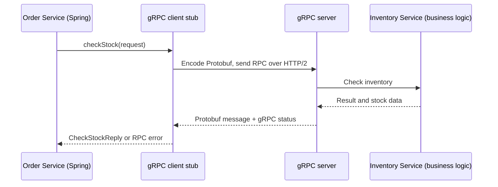

# What Is gRPC and What Communication Problem Does It Solve?

In a single-process Spring application, Java components can invoke each other's methods directly. When a system is split into multiple services running on different machines or containers, those calls must cross the network: the application needs to agree on data formats, how requests are sent, how errors are returned, wait timeouts, and authentication. **gRPC** provides a Remote Procedure Call (RPC) model to address this group of problems.

This lesson belongs to the **Introduction** chapter of **SPRING_GRPC**. It lays the foundation for learning how to design contracts with Protocol Buffers, generate Java code, build gRPC clients/servers in Spring, handle unary and streaming RPCs, metadata, deadlines, statuses, interceptors, TLS, integration testing, and monitor performance and reliability.

## 1. From In-Application Method Calls to Cross-Service Communication

Suppose a retail system has three services:

- **Order Service** accepts purchase orders.
- **Inventory Service** checks the quantity of items remaining in stock.
- **Payment Service** processes payments.

When a user places an order, Order Service needs to ask Inventory Service: "Does item `SKU-123` have at least 2 units available?" If both services live in the same Java application, the developer can call `inventoryService.checkStock("SKU-123", 2)`. When they run independently, this call becomes a network communication.

Turning a Java method call into a network request raises several questions:

1. How do the client and server agree on the **path or method name**, data types, and API version?
2. How is a Java object converted into bytes transmitted over the network, and then reconstructed on the receiving side?
3. If Inventory Service responds slowly, loses connectivity, or returns a business error, how does Order Service recognize it?
4. If continuous inventory updates are needed, must the client send hundreds of repeated requests?
5. When multiple teams use Java, Go, or Python, how do we avoid writing manual integration code for every pair of technologies?

A REST API using HTTP and JSON can solve many of these questions. gRPC is another option, particularly well-suited when services need **strongly typed contracts, automatically generated client/server code, efficient communication, and streaming support**.

## 2. What Is gRPC?

**gRPC is an open-source RPC framework** that allows a program to invoke methods exposed by another program over a network. Developers describe the service and messages in a contract, then use tooling to generate the code needed for client and server communication.

In common usage with Java and Spring, gRPC combines four components:

| Component | Role |
| --- | --- |
| **Protocol Buffers (Protobuf)** | The `.proto` contract definition language and default binary serialization format for messages |
| **Code generator (`protoc` and plugins)** | Generates Java classes representing messages and client/server stubs/skeletons from `.proto` |
| **gRPC runtime** | Executes remote calls, transmits messages, and manages data streams, status, and RPC lifecycle |
| **HTTP/2** | The commonly used transport protocol, supporting multiplexing multiple streams over a single connection and bidirectional streams |

Two terms are easily confused:

- **RPC** is the communication model: a client invokes an operation that the server executes elsewhere.
- **gRPC** is the framework implementing that model, adding concrete conventions, libraries, tooling, and transport protocols.

Protobuf is the popular default choice for gRPC, though the concept of gRPC is not synonymous with Protobuf. Similarly, HTTP/2 helps gRPC transport data, but does not by itself define method contracts or generate Java stubs.

### "Calling Like a Method" Does Not Mean "Identical to a Local Call"

For example, a client might write a call shaped like `stub.checkStock(request)`. This syntax resembles calling a Java method, yet in reality there are still **network latency, connection failures, resource limits, potential duplicate requests, and process independence between the two sides**. A sound design must treat every RPC as a call that can be slow or fail.

## 3. Protobuf Contracts: What Do Both Sides Agree On?

Consider the following `inventory.proto` contract:

```protobuf
syntax = "proto3";

package inventory.v1;

option java_package = "com.example.inventory.grpc";
option java_multiple_files = true;

service InventoryService {
  rpc CheckStock(CheckStockRequest) returns (CheckStockReply);
  rpc WatchStock(WatchStockRequest) returns (stream StockUpdate);
}

message CheckStockRequest {
  string sku = 1;
  int32 requested_quantity = 2;
}

message CheckStockReply {
  bool available = 1;
  int32 remaining_quantity = 2;
}

message WatchStockRequest {
  string sku = 1;
}

message StockUpdate {
  string sku = 1;
  int32 remaining_quantity = 2;
}
```

Reading the contract in order:

- `service InventoryService` declares the operations the server provides.
- `CheckStock` takes one `CheckStockRequest` and returns one `CheckStockReply`: this is a **unary** RPC.
- `WatchStock` takes one request but returns `stream StockUpdate`: this is a **server streaming** RPC.
- `string`, `int32`, and `bool` describe field data types; the numbers `= 1`, `= 2` are **field numbers in the wire format**, not arbitrary display indices.
- `package inventory.v1` sets the contract namespace; `java_package` specifies the package for generated Java code. Both serve different purposes.

After running the code generator, the Java side can use types such as `CheckStockRequest`, `CheckStockReply`, and `InventoryServiceGrpc`. The client receives a **stub**: a representation of the remote service containing methods with parameter and return types matching the contract. The server receives a **base class/implementation skeleton** for writing business logic.

### Why Do Contracts Matter?

Without a shared typed contract, teams must coordinate via documentation and manually maintain data conversion code. Wrong field names or mismatched data types often only surface during integration runtime. With `.proto`, the code generator and compiler catch many discrepancies between source code and API definitions early.

However, contracts still require version governance. When evolving Protobuf, it is generally best to **add new fields with unused field numbers**, avoid changing the meaning of or reusing old field numbers; when removing fields, you can declare `reserved` to prevent reuse. This is one part of backward compatibility, not a guarantee that every change is safe.

## 4. How Does a gRPC Call Actually Happen?



Core sequence:

1. The client constructs a request using a Java class generated from Protobuf.
2. The stub turns the method call into an RPC; the gRPC runtime encodes the message and sends it over the network connection.
3. The server routes the request to the corresponding implementation method.
4. Business code processes the data, such as querying the remaining stock quantity.
5. The server returns data and an RPC status; with streaming, messages can arrive multiple times over time.
6. The stub decodes the data so the client can handle it using the corresponding Java type or receive an appropriate error/status.

**Key takeaway:** code generation reduces the boilerplate developers must write to transfer requests and responses between both sides. It does not replace business design, access control, error handling, or data management.

## 5. Four Communication Patterns Supported by gRPC

| RPC Pattern | Communication Shape | System Example |
| --- | --- | --- |
| **Unary** | One request → one response | Checking inventory before creating an order |
| **Server streaming** | One request → multiple responses from server | Watching inventory changes after subscribing |
| **Client streaming** | Multiple requests from client → one response from server | Pushing a series of sensor events and receiving a final summary |
| **Bidirectional streaming** | Both sides send a stream of messages | Synchronizing interactive two-way events within a session |

Example of how Protobuf describes all four patterns:

```protobuf
service ExampleService {
  rpc GetOne(OneRequest) returns (OneReply);
  rpc Watch(WatchRequest) returns (stream Event);
  rpc Upload(stream Event) returns (UploadSummary);
  rpc Exchange(stream ClientEvent) returns (stream ServerEvent);
}
```

The snippet above illustrates the syntax; the message types would need to be fully defined in an actual `.proto` file.

With **unary**, the client typically waits for a single result and processes it synchronously or asynchronously. With **streaming**, a single RPC can stay open longer and transmit multiple messages without initiating a separate RPC for each message.

Streaming solves the problem of delivering continuous updates, but introduces additional responsibilities: managing **backpressure/flow control**, buffering, stream completion, session cancellation, connection lifetime, and scenarios where the two sides send/receive at different speeds. Do not choose streaming just because gRPC supports it; a simple unary RPC is usually easier to operate when each task only needs a single answer.

## 6. What Communication Problems Does gRPC Solve?

### 6.1. Standardizing APIs Across Multiple Languages

A Java Spring service can provide a `.proto` contract to clients written in Go, Python, or any language supported by gRPC. Each side generates code from the same definition, reducing discrepancies in method names, request/response structures, and data types. Teams still need to align on business semantics: when "in stock" is calculated, whether checking stock reserves items, and which errors are safe to retry.

### 6.2. Reducing Communication Boilerplate

Instead of each project building its own HTTP client code, manually mapping JSON to Java classes, and mapping errors by hand, developers call methods on the generated stub. Business code can therefore focus on the operation to perform. Connection configuration, deadlines, interceptors, and testing still must be designed.

### 6.3. Supporting Frequent Inter-Service Communication

Protobuf is a compact binary format in many scenarios; HTTP/2 provides multiplexing so multiple RPCs can share a connection. As a result, gRPC can fit systems with high volumes of internal calls or that need to exchange structured data frequently.

Do not assume "gRPC is always faster than REST." Actual results depend on payload size, number of connections, channel reuse, server configuration, proxies, TLS, compression, business operations, and the network environment. Measure latency and throughput under realistic load before drawing conclusions.

### 6.4. Building Stream-Based Communication

When a client needs updates from a server or both sides need continuous exchange, streaming reduces the need to repeat short requests. It is useful for processing progress, live observation data, session event delivery, and synchronization. However, a stream is not a durable message queue: when a connection drops, the application must determine how to resume or replay data.

### 6.5. Establishing Clear Rules for Remote Calls

gRPC provides deadlines, cancellation, metadata, status codes, and interceptors so services share a common mechanism for:

- **Deadline:** the client bounds how long an RPC is allowed to last.
- **Cancellation:** the client or server can cancel an RPC that is no longer needed.
- **Status:** terminates an RPC with standard codes such as `OK`, `INVALID_ARGUMENT`, `NOT_FOUND`, `UNAVAILABLE`, or `DEADLINE_EXCEEDED`.
- **Metadata:** carries control information such as auth tokens, correlation IDs, or trace context; it does not replace business data fields in the request.
- **Interceptor:** places cross-cutting logic at the gRPC boundary, such as authentication checks, logging, metrics, or trace propagation.

These mechanisms provide tools for consistent error handling; **they do not automatically make a system fault-tolerant** unless the application defines appropriate timeouts, retries, load limits, and business policies.

## 7. Where Does gRPC Fit in a Spring Application?

In a Spring application, gRPC typically serves as **the communication layer at the service boundary**. Data travels from the client stub over the network to a gRPC server adapter, and is then passed to Spring-managed business services. Repositories and databases sit behind that layer.

```text
Calling application (Spring)             Provider application (Spring)
----------------------------             -----------------------------
Business Service                         gRPC Server Adapter
       |                                          |
  gRPC Client Stub  ---- HTTP/2 + Protobuf ---->  |
                                                  v
                                          Application Service
                                                  |
                                             Repository/DB
```

For the **SPRING_GRPC** module, the development workflow typically follows these steps:

1. Design `.proto` files reflecting API boundaries and semantics between services.
2. Configure the build to generate Java classes and stubs from the contract.
3. Implement gRPC server methods, wiring them to Spring beans containing business logic.
4. Configure the gRPC client, manage channels/stubs, and invoke methods with appropriate deadlines.
5. Integrate authentication, TLS, interceptors, error mapping, logging, and tracing.
6. Run integration tests over a real gRPC transport and monitor latency, errors, and throughput.

The mechanism for registering a server adapter or injecting a client stub into Spring depends on the integration library/starter and version in use. **Do not assume that merely adding `@Service` causes every gRPC server to automatically publish methods**; check how the integration library registers `BindableService` implementations and manages channel lifecycles.

### Unary RPC Implementation Example in Java

Based on the `InventoryService` contract in section 3, a server-side class can be written as follows:

```java
import com.example.inventory.grpc.CheckStockReply;
import com.example.inventory.grpc.CheckStockRequest;
import com.example.inventory.grpc.InventoryServiceGrpc;
import io.grpc.Status;
import io.grpc.stub.StreamObserver;

public final class InventoryGrpcAdapter
        extends InventoryServiceGrpc.InventoryServiceImplBase {

    private final StockQuery stockQuery;

    public InventoryGrpcAdapter(StockQuery stockQuery) {
        this.stockQuery = stockQuery;
    }

    @Override
    public void checkStock(
            CheckStockRequest request,
            StreamObserver<CheckStockReply> responseObserver) {

        if (request.getSku().isBlank()
                || request.getRequestedQuantity() <= 0) {
            responseObserver.onError(
                Status.INVALID_ARGUMENT
                    .withDescription("Invalid SKU or quantity")
                    .asRuntimeException());
            return;
        }

        try {
            int remaining = stockQuery.remainingQuantity(request.getSku());
            CheckStockReply reply = CheckStockReply.newBuilder()
                .setAvailable(remaining >= request.getRequestedQuantity())
                .setRemainingQuantity(remaining)
                .build();

            responseObserver.onNext(reply);
            responseObserver.onCompleted();
        } catch (RuntimeException ex) {
            responseObserver.onError(
                Status.INTERNAL
                    .withDescription("Unable to query inventory")
                    .asRuntimeException());
        }
    }
}
```

`StockQuery` in the example represents a business interface provided by the application itself, such as `int remainingQuantity(String sku)`. The adapter is responsible for **reading the request, validating input data, calling business logic, constructing the response, and returning a gRPC status**. Registering the adapter with the gRPC server and Spring configuration is omitted here to focus on the communication role.

A corresponding client call:

```java
import com.example.inventory.grpc.CheckStockReply;
import com.example.inventory.grpc.CheckStockRequest;
import com.example.inventory.grpc.InventoryServiceGrpc;
import io.grpc.ManagedChannel;
import io.grpc.ManagedChannelBuilder;
import io.grpc.StatusRuntimeException;
import java.util.concurrent.TimeUnit;

ManagedChannel channel = ManagedChannelBuilder
    .forAddress("localhost", 9090)
    .usePlaintext() // For local testing only
    .build();

try {
    var stub = InventoryServiceGrpc.newBlockingStub(channel)
        .withDeadlineAfter(500, TimeUnit.MILLISECONDS);

    CheckStockReply reply = stub.checkStock(
        CheckStockRequest.newBuilder()
            .setSku("SKU-123")
            .setRequestedQuantity(2)
            .build());

    System.out.println("In stock: " + reply.getAvailable());
} catch (StatusRuntimeException ex) {
    System.err.println("gRPC status: " + ex.getStatus().getCode());
} finally {
    channel.shutdown();
}
```

This is a minimal example to illustrate the Java API generated by gRPC Java. In a real Spring application, `ManagedChannel` and stubs should be managed as components with an appropriate lifecycle to **reuse connections**, externalize addresses and security settings into application configuration, and avoid creating a new channel per request. The `500 ms` deadline is illustrative only and must be chosen based on actual latency and business requirements. A blocking stub is also unsuitable if used directly on non-blocking request-handling threads.

## 8. Comparing gRPC with REST and Asynchronous Messaging

These three communication approaches address overlapping needs, yet have different strengths:

| Criterion | gRPC | REST/HTTP API | Queue / Event Messaging |
| --- | --- | --- | --- |
| Typical model | Remote method invocation | Resource-oriented HTTP communication | Publishing and consuming messages/events |
| Contract | Typically `.proto` and generated stubs | Typically JSON, optionally OpenAPI for contract definition | Message schemas and topic/queue conventions |
| Communication | Unary and streaming | Request-response common; streaming via additional techniques | Asynchronous via messages/events |
| Browser clients | Usually requires gRPC-Web or a compatible gateway layer | Very convenient direct integration | Typically via backend/gateway |
| Coupling between sides | Usually requires server availability during the RPC | Usually requires server availability during the request | Can decouple producer and consumer timing |
| Typical use cases | Internal APIs with strict typing and high call volume | Public APIs, web integration, and HTTP ecosystem | Background processing, event broadcasting, asynchronous integration |

**There is no universally best choice.** A system might use REST for web app → backend, gRPC for backend → backend, and a message broker for background tasks. If the goal is "place an order and wait immediately for an inventory check result," unary gRPC is a suitable candidate. If the goal is "notify multiple independent services that an order was created so they can process it later," event messaging usually models the requirement better.

### When Is gRPC Not a Convenient Choice?

- APIs tested directly by users via browsers or common HTTP tools when the system lacks a suitable gateway.
- Small systems with very few internal calls where adding schema and code generation increases operational overhead without clear benefit.
- Primary requirements involving asynchronous delivery, durable event storage, replay after hours, or communication while consumers are offline.
- Infrastructure such as proxies, load balancers, service meshes, or observability tools that does not yet support or is not properly configured for HTTP/2 and gRPC.

## 9. Operational Aspects to Understand from the Start

A contract-compliant gRPC API can still fail in a distributed deployment. The following concepts will be covered in greater depth in later lessons, but understanding their roles from this introductory lesson is essential.

### Deadlines, Cancellation, and Retries

Suppose Order Service has at most 800 ms to respond to a customer. If the inventory check call consumes the entire time budget, subsequent steps will have no time left. The client must set a reasonable **deadline** for the RPC, and the server should observe cancellation/deadlines to avoid continuing unnecessary work.

When encountering `UNAVAILABLE`, an application may consider retrying; however, retrying is not an unconditional operation. An RPC that **reads inventory** can be retried under an appropriate policy, whereas an RPC that **deducts inventory or creates a payment** can cause side effects if sent repeatedly. For write operations, design idempotency, unique request IDs, or deduplication mechanisms before enabling retries.

### Status and Error Mapping

The `OK` code indicates that the RPC completed successfully at the protocol level. `INVALID_ARGUMENT` is used for invalid input, `NOT_FOUND` for nonexistent resources when appropriate, `DEADLINE_EXCEEDED` for timed-out RPCs, and `UNAVAILABLE` when a service is temporarily unavailable. Do not return `INTERNAL` for every error, as the client loses the ability to distinguish what action to take.

**Business errors** and **infrastructure errors** also need to be separated. "Insufficient stock" in our example can be a valid response with `available = false`, not necessarily a failed RPC. By contrast, losing the connection to the inventory service is an infrastructure error and requires a different handling mechanism.

### Metadata, Interceptors, and Security

Metadata allows sending information such as authorization tokens or trace context alongside an RPC. Interceptors enable applying shared checks/processing without duplicating them in every business method. **TLS** protects data in transit and authenticates the server; some environments use **mTLS** to authenticate both sides. Do not use `usePlaintext()` over production networks or log sensitive tokens.

### Testing and Observability

A test that only calls the adapter's Java method directly cannot verify that gRPC communication works. Integration tests should spin up a server/client in a controlled environment, send real Protobuf requests, and verify responses, statuses, deadlines, and cancellation scenarios. In production, monitor **RPC count, error rate by status, latency percentiles (p50/p95/p99), stream duration, connections, and resource utilization**. Distributed tracing across services helps identify which RPC slows down the entire order flow.

## 10. Which Real-World Problems Should Use gRPC?

Applying concrete scenarios to make a decision:

**Scenario A – Order Service queries Inventory Service:** Both services are developed by the same organization, need fast inventory checks, use Java/Spring, can agree on `.proto`, and control the deployment environment. **Unary gRPC** is a reasonable choice because the contract is explicit, Java stubs are strongly typed, and deadlines/statuses are consistent. Performance should be measured rather than assuming speed advantages automatically.

**Scenario B – Dashboard wants to view live inventory updates:** The backend needs to push continuous changes. **Server-streaming gRPC** can work well between services capable of speaking gRPC, whereas browsers may require a gateway or web alternatives such as SSE/WebSocket depending on the architecture. Reconnect behavior and potential missed events must be accounted for.

**Scenario C – Sending notifications after a successful order:** Recipients do not need to return an immediate result and might be temporarily offline. A **message broker** is generally a better fit, because direct RPC does not inherently provide durable queues or long-term replay mechanisms.

Before choosing gRPC, answer four questions: **Who is the client?**; **is a synchronous response needed?**; **is streaming needed?**; and **does the team control the schema, build tooling, and HTTP/2 infrastructure?**. This is how you determine whether gRPC solves a real need or merely adds technology.

## 11. Common Misconceptions

| Misconception | Accurate Understanding |
| --- | --- |
| "gRPC turns network calls into safe local calls." | The syntax looks like a Java method call, but latency, timeouts, connection drops, and distributed failures still exist. |
| "Using gRPC means the API is automatically encrypted." | You must configure TLS/mTLS and authentication appropriate for your environment. |
| "Protobuf makes every schema change compatible." | Compatibility depends on how fields are added, changed, removed, and how contract versions are managed. |
| "Streaming is always faster than unary." | Streaming carries lifecycle management, flow control, and connection recovery overhead; it is only useful when the problem requires a data stream. |
| "Retries make every RPC more reliable." | Uncontrolled retries can amplify load and duplicate side effects. |
| "gRPC replaces REST and message brokers." | Each tool has different strengths; many architectures combine them. |

## 12. Key Takeaways

gRPC provides a way to **invoke methods across processes/services** based on an API contract, structured messages, and generated stubs. In a Spring environment, it typically sits at the communication layer between services, while business beans remain responsible for application rules and data.

Three points to solidify before moving on:

1. **`.proto` is the agreement point between client and server**: it describes services, methods, and messages; the code generator turns the contract into a typed Java API.
2. **gRPC supports unary and three streaming forms**: choose the pattern based on the actual communication flow, not how "modern" the technology feels.
3. **RPC is network communication and must be designed as network communication**: it requires deadlines, statuses, security, cautious retries, integration testing, and observability.

Once you understand what problems gRPC solves and its limitations, you can proceed purposefully to designing Protobuf contracts, configuring code generation, and building Spring gRPC clients and servers.

### References

- [gRPC – Introduction](https://grpc.io/docs/what-is-grpc/introduction/)
- [gRPC – Core concepts, architecture and lifecycle](https://grpc.io/docs/what-is-grpc/core-concepts/)
- [Protocol Buffers – Language Guide (proto3)](https://protobuf.dev/programming-guides/proto3/)
- [gRPC – Deadlines](https://grpc.io/docs/guides/deadlines/)
