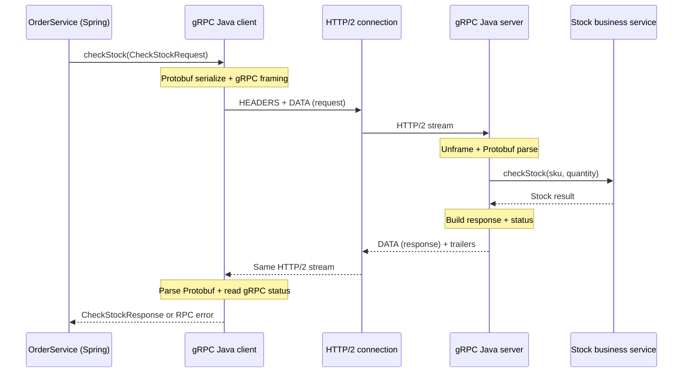

# Relationship Between gRPC, HTTP/2, Protocol Buffers, and RPC

When starting to learn **SPRING_GRPC**, learners often encounter four concepts together: **RPC**, **gRPC**, **Protocol Buffers**, and **HTTP/2**. They are closely related, yet not synonymous. Understanding the responsibility of each layer helps explain why a Java method in Spring can be invoked from another application over the network, how data is encoded, and what happens when the network is slow or a call fails.

This lesson belongs to the **Introduction** chapter. It lays the foundation for the gRPC service development roadmap in the Spring ecosystem: designing Protobuf contracts, generating Java code, implementing unary and streaming clients/servers, and then handling metadata, deadlines, statuses, interceptors, TLS, integration testing, and monitoring performance and reliability.

## 1. Four Concepts, Four Distinct Responsibilities

Imagine **Order Service** needs to ask **Inventory Service** how much stock remains. Two Spring applications run in separate processes and need to communicate over the network.

| Concept | What Is It? | Question It Answers |
| --- | --- | --- |
| **RPC (Remote Procedure Call)** | A communication model for invoking a procedure or method executed in another process | "How does application A ask application B to perform an operation?" |
| **gRPC** | A framework providing an RPC execution mechanism and client/server ecosystem | "Who routes the call, manages stubs, data streams, metadata, deadlines, and statuses?" |
| **Protocol Buffers (Protobuf)** | A system for defining data schemas, services, and a binary encoding format | "How do both sides agree on message structure and encode/decode data?" |
| **HTTP/2** | An application-layer HTTP transport protocol featuring streams, frames, and multiplexing | "How do messages and control information travel across a network connection?" |

You can visualize the layers as follows:

```text
Business intent: "Check inventory for SKU-123, quantity 2"
                     |
                     v
RPC:             remote procedure call
                     |
                     v
gRPC:            stub / server handler / RPC lifecycle
                     |
          +----------+----------+
          |                     |
          v                     v
Protobuf: .proto contract    HTTP/2: transport via
          + message encoding           streams and frames
          |                     |
          +----------+----------+
                     |
                     v
             gRPC over network connection
                     |
                     v
            Inventory Service (Spring)
```

This diagram illustrates **the relationship of responsibilities**, not the byte order on the wire. In practice, gRPC takes an encoded Protobuf message, frames it according to gRPC framing rules, and sends those bytes inside HTTP/2 DATA frames; RPC control information is carried in HTTP/2 headers/trailers.

An easy way to remember this: **RPC is the idea; gRPC implements that idea; Protobuf describes and encodes messages; HTTP/2 transports the RPC over the network.**

## 2. RPC: A Communication Model Between Two Processes

**Remote Procedure Call** allows a client to request that a server execute an operation through an interface that looks like a function call. Instead of manually building an HTTP request, client-side code can look like this:

```java
StockResponse response = stockClient.checkStock(request);
```

Semantically, `checkStock` is a call to a remote operation. However, between invoking the call and receiving the result, many steps occur: serializing data, sending over the network, routing on the server, executing business logic, and transmitting the response back.

The concept of **RPC is broader than gRPC**. Before and outside gRPC, there have been many RPC solutions with different ways of describing contracts and transport protocols. Not every RPC uses HTTP/2, nor is every HTTP call an RPC.

### Why Is an RPC Not Like a Local Java Method Call?

| In-Process Call | Network RPC Call |
| --- | --- |
| Typically accesses objects directly in memory | Must serialize and transmit messages across processes |
| Errors mainly stem from program code and local resources | Adds DNS, connection, proxy, server overload, and timeout failures |
| Latency is usually tiny; no network design needed | Latency depends on the network and target service |
| Caller and callee usually share the same lifecycle | The server can restart independently of the client |
| Relatively clear whether the method ran when an error occurs | When a connection drops, it may be unknown whether the server processed a write operation |

For example: a client sends a request to "deduct 2 units from inventory," the server completes the update, but the connection drops before the response reaches the client. If the client retries unconditionally, inventory risks being deducted twice. Calling syntax that looks like a Java method **does not eliminate** network uncertainty. For write operations, consider unique request IDs, idempotency, and retry policies.

## 3. Protobuf: Typed Data Contracts and Message Encoding

Protocol Buffers provides two capabilities that usually go hand in hand in gRPC:

1. **Contract definition** via `.proto` files: which messages, fields, and services exist.
2. **Code generation and data encoding**: generating Java data types along with serialize/parse methods using Protobuf's binary format.

In gRPC Java, the service code generator also produces **client stubs** and **server-side API/implementation skeletons**. This is the combined output of the Protobuf compiler and the gRPC code generation plugin.

### 3.1. A Complete `.proto` Contract

```protobuf
syntax = "proto3";

package inventory.v1;

option java_package = "vn.example.inventory.v1";
option java_multiple_files = true;

service StockService {
  rpc CheckStock(CheckStockRequest) returns (CheckStockResponse);
  rpc WatchStock(WatchStockRequest) returns (stream StockEvent);
}

message CheckStockRequest {
  string sku = 1;
  int32 quantity = 2;
}

message CheckStockResponse {
  bool available = 1;
  int32 remaining_quantity = 2;
}

message WatchStockRequest {
  string sku = 1;
}

message StockEvent {
  string sku = 1;
  int32 remaining_quantity = 2;
}
```

Different parts have distinct roles:

- `service StockService` defines the RPC interface; it contains no database query logic.
- `rpc CheckStock(...) returns (...)` describes a call taking one request and returning one response (**unary**).
- The `stream` keyword in `WatchStock` specifies that the server can return **multiple** `StockEvent` messages on the same RPC.
- `message` defines the structure of a message. The numbers `1` and `2` are **field numbers** used in Protobuf encoding, not line numbers or element positions in JSON.
- `package inventory.v1` is the package of the Protobuf contract and contributes to the full gRPC service name; `java_package` determines the package of the generated Java classes.

Once the build is configured and code generation runs, the Java project receives classes such as `CheckStockRequest`, `CheckStockResponse`, and `StockServiceGrpc`. Client and server can share the same contract even when implemented in different languages, provided their respective gRPC and Protobuf libraries support them.

### 3.2. What Does Protobuf Encode?

Suppose the client builds a message:

```java
CheckStockRequest request = CheckStockRequest.newBuilder()
    .setSku("SKU-123")
    .setQuantity(2)
    .build();
```

Using Protobuf's default binary wire format, the payload for this exact value can be represented in hexadecimal:

```text
0A 07 53 4B 55 2D 31 32 33 10 02
|  |  \___________________/ |  |
|  |        SKU-123         |  +-- quantity = 2
|  +-- length = 7           +----- field 2, wire type varint
+-- field 1, wire type length-delimited
```

In this example, the Protobuf payload is **11 bytes** long. Each field is identified by its field number and wire type; the value is encoded according to that type. This is not a JSON string transmitting the keys `"sku"` and `"quantity"` verbatim.

Important notes:

- Protobuf is **not** a security encryption mechanism; anyone able to read the payload and knowing the schema can decode the data. Transport security is handled by TLS and system-level protections.
- Protobuf is **not required** to travel over gRPC. You can use Protobuf to store files, persist messages, or send over other transports.
- gRPC commonly uses Protobuf and the `.proto` model, but the framework supports custom serialization mechanisms; therefore, gRPC should not be defined simply as "Protobuf over the network."

### 3.3. A Contract Is Not Business Logic

`.proto` states that the request has a `quantity` field of type `int32`; it does not enforce `quantity > 0`, verify whether the SKU exists, or decide whether to reserve stock. Those rules must be enforced by validation and business logic layers.

When modifying schemas, field numbers are a key part of compatibility: add new fields with new numbers, do not reuse numbers of deleted fields, and consider `reserved` for unused numbers/names. **Successful code generation does not automatically guarantee that every contract change is compatible with older clients.**

## 4. HTTP/2: The Protocol Carrying Calls Over the Network

Standard gRPC typically uses **HTTP/2** as its transport protocol. HTTP/2 organizes data into **frames**, groups frames belonging to the same **stream**, and lets multiple streams share one **connection**.

These three concepts are distinct:

| HTTP/2 Concept | Meaning When Using gRPC |
| --- | --- |
| **Connection** | A transport connection capable of serving multiple concurrent RPCs |
| **Stream** | A logically independent HTTP/2 stream, typically corresponding to one gRPC call |
| **Frame** | An HTTP/2 encapsulation unit, such as `HEADERS` or `DATA`; a single gRPC message may span multiple frames or share frames with other data |

A gRPC stream is **the lifecycle of a single RPC call**. An HTTP/2 stream is **the transport stream** used for that RPC. A **Protobuf message** is **the unit of business data** within an RPC. With unary, there is typically one request message and one response message. With streaming, multiple messages can travel over a single HTTP/2 stream, without creating multiple independent RPCs.

### What Capabilities Does HTTP/2 Provide?

**Multiplexing:** multiple HTTP/2 streams can share a single TCP connection. The gRPC runtime can execute multiple RPCs concurrently without opening a new TCP connection for each call.

**Framing and ordering:** data is split into frames; within each stream, HTTP/2 preserves byte order so the receiver can reconstruct messages.

**Flow control:** HTTP/2 includes mechanisms to regulate bytes in flight at both connection and stream levels. This helps with streaming, though applications must still account for fast producers, slow consumers, and buffer capacity.

**Header compression:** HTTP/2 uses HPACK to represent headers more efficiently. This is distinct from **Protobuf payload** compression, which is a separate optional mechanism.

**Trailers:** HTTP/2 can send a group of headers at the end of a stream. gRPC uses this section to transmit **the RPC completion status**.

HTTP/2 does not guarantee all RPCs are faster in every situation. Multiple streams still share resources and a TCP connection; TCP packet loss can affect streams on the same connection. Actual throughput and latency also depend on servers, application load, TLS, proxies, and connection management.

### What Does HTTP/2 Not Provide by Itself?

HTTP/2 does not know what the `CheckStock` method means, does not require `sku` to be a string, does not generate Java stubs, and does not determine the `INVALID_ARGUMENT` error code. Those are responsibilities of the contract, the gRPC runtime, and the application.

Likewise, **REST APIs can also run over HTTP/2**; thus equating "gRPC = HTTP/2, REST = HTTP/1.1" is incorrect. REST describes an API design style, whereas HTTP/2 is a version of the HTTP transport protocol.

## 5. How Does gRPC Combine RPC, Protobuf, and HTTP/2?

gRPC connects these components into a unified execution pipeline:

1. Developers write a `.proto` contract defining services and messages.
2. Code generation tooling generates data types and communication code for client/server.
3. The client builds a Protobuf message and invokes the gRPC stub method defined in the contract.
4. The gRPC runtime wraps the message as a **gRPC length-prefixed message**, attaches HTTP/2 headers, and sends it over an HTTP/2 stream.
5. The server-side runtime reads the bytes, decodes the message, and dispatches it to the registered handler method.
6. The server returns a message and status code; the client reads the response or receives an RPC error.



With Spring, business code can be a Spring bean using repositories or other services. The gRPC adapter serves as **the communication boundary**: receiving a Protobuf request and translating it into a business operation. Whether adapters are auto-registered or stubs are injected depends on the chosen gRPC/Spring integration library; a Protobuf contract does not start a server on its own.

## 6. Tracing a Unary RPC at the Byte and Protocol Level

Consider a `CheckStock` call:

```text
Request:
  sku = "SKU-123"
  quantity = 2

Response (example):
  available = true
  remaining_quantity = 8
```

### 6.1. gRPC Framing of a Protobuf Message

In gRPC over HTTP/2, each message is transmitted with a **5-byte** prefix before the payload:

```text
+----------------------+------------------------+---------------------+
| Compressed-Flag      | Message-Length         | Message             |
| 1 byte               | 4 bytes (big-endian)   | N bytes             |
+----------------------+------------------------+---------------------+
```

- **Compressed-Flag** is `0` when the message is uncompressed, and `1` when compressed using a negotiated encoding.
- **Message-Length** is the length in bytes of the message payload per gRPC framing, excluding the 5-byte prefix.
- **Message** is the serialized payload, which by default is Protobuf bytes.

For the 11-byte Protobuf request from section 3.2 with compression disabled, the framed message is:

```text
00 | 00 00 00 0B | 0A 07 53 4B 55 2D 31 32 33 10 02
|    |             \_______________________________/
|    |                       Protobuf (11 bytes)
|    +-- Length 11 bytes (4-byte big-endian integer)
+-- Uncompressed
```

That totals **16 bytes** for one gRPC-framed message in this example, **excluding HTTP/2 frame overhead, HTTP/2 headers, TLS, or TCP/IP**. This count is merely to understand the structure, not a size benchmark between gRPC and JSON.

In particular, **one gRPC message does not equal one HTTP/2 DATA frame**. HTTP/2 can split the bytes of one message across multiple DATA frames, or pack bytes of multiple messages into consecutive frames. The gRPC runtime reconstructs messages using the length prefix and byte ordering within the stream.

### 6.2. HTTP/2 Headers Identifying the Remote Method

A typical unary request is represented logically as follows:

```http
:method: POST
:scheme: https
:authority: inventory.internal:8443
:path: /inventory.v1.StockService/CheckStock
content-type: application/grpc
te: trailers
grpc-timeout: 1000m
```

This is a **human-readable illustration of headers**, not a raw HTTP/2 byte dump. In HTTP/2, fields starting with `:` are *pseudo-headers*; the data is encoded into a HEADERS frame. `grpc-timeout: 1000m` expresses the client-side deadline as a relative timeout of roughly **1000 milliseconds**.

Look closely at `:path`:

```text
/inventory.v1.StockService/CheckStock
 \_______________________/ \________/
        Service               Method
```

This name comes from **package + service + rpc method** in `.proto`; it is not an arbitrary URL route defined on a REST controller. The gRPC runtime uses it to route to the corresponding server method.

After the headers, the client sends DATA containing the framed message, and marks the end of its request stream using HTTP/2's send-stream termination mechanism (*half-close*). It is called half-close because the server is still allowed to send responses on the same stream.

### 6.3. Responses and gRPC Trailers

A successful response can look logically like this:

```http
:status: 200
content-type: application/grpc

[DATA: gRPC-framed CheckStockResponse]

grpc-status: 0
```

Here `grpc-status: 0` means **OK**. The gRPC status is typically sent in **HTTP/2 trailers**, i.e., a HEADERS frame at the end of the stream, rather than having to sit inside the Protobuf response payload.

If the SKU is invalid, the server can terminate the RPC with:

```text
HTTP/2 :status = 200
gRPC grpc-status = 3 (INVALID_ARGUMENT)
```

This is **not contradictory**: HTTP status and gRPC status exist at two different layers. HTTP `200` can indicate that communication occurred at the HTTP layer, while `grpc-status = 3` indicates the *RPC* ended with an input error. A genuine transport failure may result in a non-`200` HTTP status, a stream reset, or a dropped connection; in that case the gRPC client handles the error accordingly.

### 6.4. Distinguishing Four Kinds of Data on a Call

| Data | Example | Where Is It Carried? |
| --- | --- | --- |
| Procedure identifier | `/inventory.v1.StockService/CheckStock` | HTTP/2 `:path` |
| Control metadata | `authorization`, `grpc-timeout`, trace context | HTTP/2 headers; possibly trailers |
| Business data | SKU and quantity | Protobuf message inside gRPC DATA |
| RPC result/status | `grpc-status: 0` or `3` | gRPC trailers (or trailers-only response) |

Do not put all information in one place. For example, a deadline is a per-call policy and normally travels via the deadline/metadata mechanism, whereas requested quantity is business data belonging in the request message.

## 7. How Does gRPC Streaming Relate to HTTP/2 Streams?

In gRPC there are four call types, all sharing the same contract, message framing, and transport mechanisms:

| Type | Request messages | Response messages | Example |
| --- | ---: | ---: | --- |
| Unary | 1 | 1 | Checking inventory |
| Server streaming | 1 | N | Watching inventory updates |
| Client streaming | N | 1 | Sending multiple data samples for aggregation |
| Bidirectional streaming | N | M | Both sides exchanging continuous updates |

N and M represent application-dependent message counts; a stream may end with fewer messages than expected if an error or cancellation occurs.

In HTTP/2, each RPC logically uses one HTTP/2 stream, regardless of whether one or many messages flow inside. With server streaming, the server sends gRPC-framed messages sequentially over the **same** HTTP/2 stream; with bidirectional streaming, the client and server can both send messages in two directions while the RPC remains open.

```text
HTTP/2 connection (shared across multiple RPCs)
|
+-- HTTP/2 stream A: unary CheckStock
|     Client: [request 1] -------->
|     Server:            <-------- [response 1] + status
|
+-- HTTP/2 stream B: server-streaming WatchStock
|     Client: [subscribe] -------->
|     Server:            <-------- [event 1][event 2][event 3] ... + status
|
+-- HTTP/2 stream C: bidirectional RPC
      Client: [msg 1][msg 2] ------>
      Server:       <------ [msg A][msg B][msg C] ... + status
```

Do not confuse **HTTP/2 multiplexing** with **gRPC streaming**:

- Multiplexing is the ability for **multiple HTTP/2 streams/RPCs to operate concurrently** on one connection.
- gRPC streaming is the ability for **multiple messages to occur within a single RPC** in one or both directions.

For example, 200 concurrent unary RPCs can use HTTP/2 multiplexing without any RPC streaming. Conversely, a single server-streaming RPC can deliver thousands of events over just one HTTP/2 stream.

Streaming also requires managing when to finish requests, deadlines, cancellation, flow control, message limits, and slow-receiver behavior. HTTP/2 flow control helps regulate bytes, but does not automatically dictate how an application drops events, replays events, or recovers after connection loss.

## 8. What Does gRPC Handle That HTTP/2 and Protobuf Do Not?

Several responsibilities belong to the **RPC runtime**, not to Protobuf or HTTP/2 alone:

**Routing and method invocation.** The runtime extracts the gRPC service/method name from the request, decodes the message, invokes the registered handler, and encodes the response. Protobuf describes message structure; HTTP/2 transports bytes.

**Call lifecycle management.** The runtime creates and closes RPCs, handles client/server streaming, completion, cancellation, and terminal states.

**Deadlines.** A client can bound the lifetime of a call. When a deadline expires, the runtime reports `DEADLINE_EXCEEDED` on the client and can signal cancellation to the server; server applications still need to actively stop work where appropriate.

**Metadata and interceptors.** Metadata is typically mapped onto HTTP/2 headers/trailers. gRPC interceptors provide hooks to attach tokens, check permissions, measure latency, record traces, or translate errors. Metadata is the mechanism for carrying control data; **interceptors** are the code processing that data.

**Status.** gRPC defines a set of result codes, for example:

| gRPC code | Numeric value | Illustrative scenario |
| --- | ---: | --- |
| `OK` | 0 | RPC completed successfully |
| `INVALID_ARGUMENT` | 3 | Invalid request |
| `DEADLINE_EXCEEDED` | 4 | Exceeded allowed time |
| `NOT_FOUND` | 5 | Requested resource not found |
| `UNAUTHENTICATED` | 16 | Missing or invalid authentication credentials |
| `PERMISSION_DENIED` | 7 | Authenticated but not authorized |
| `UNAVAILABLE` | 14 | Service temporarily unavailable |
| `INTERNAL` | 13 | Unexpected internal error |

Insufficient stock is **not necessarily** an RPC error. Under the `CheckStock` contract, the server can return `available = false` with `OK`: the check request executed successfully, and the business outcome is out of stock. Conversely, a dropped connection is a technical failure and can lead to `UNAVAILABLE`.

**Connections, security, and reliability.** gRPC Java provides channels, stubs, credentials configuration, streaming, and error handling. TLS secures the network connection—Protobuf does not. Retries, load balancing, and operational policies must be configured according to the environment and RPC idempotency; do not enable retries by default for operations with side effects.

## 9. Concrete Connection to Java and Spring

In **SPRING_GRPC**, the layers fit together as follows:

```text
Calling application: Order Service (Spring)
  Spring Bean / Application Service
       |
       v
  StockServiceGrpc.StockServiceBlockingStub  <-- generated from .proto
       |
  gRPC Java runtime
       |
       +-- Protobuf serializer / marshaller
       +-- Metadata / deadline / interceptors
       +-- HTTP/2 transport (channel)
                    ||
                  Network
                    ||
  gRPC server (HTTP/2)
       |
  Unframe gRPC, parse Protobuf, dispatch to method
       |
  StockServiceImplBase (server adapter)        <-- skeleton from .proto
       |
  Spring Service / Domain logic
       |
  Repository / Database
Provider application: Inventory Service (Spring)
```

### 9.1. Code Generation: Two Distinct Outputs

From `stock.proto`, the Java build process typically uses:

- `protoc` to generate message classes such as `CheckStockRequest` and `CheckStockResponse`.
- The gRPC Java plugin (commonly called `protoc-gen-grpc-java`) to generate `StockServiceGrpc` containing client stubs and server interfaces/skeletons.

Specific configuration belongs to the Maven/Gradle plugin and the gRPC/Spring library being used. **Generating Java classes does not automatically start a gRPC server**: the application still needs runtime configuration, handler registration, and a listening port.

### 9.2. Client-Side Stub

The following snippet illustrates a call using gRPC Java; the data classes and stub are generated from the contract in section 3:

```java
import io.grpc.ManagedChannel;
import io.grpc.ManagedChannelBuilder;
import io.grpc.StatusRuntimeException;
import java.util.concurrent.TimeUnit;
import vn.example.inventory.v1.CheckStockRequest;
import vn.example.inventory.v1.CheckStockResponse;
import vn.example.inventory.v1.StockServiceGrpc;

ManagedChannel channel = ManagedChannelBuilder
    .forAddress("localhost", 9090)
    .usePlaintext() // Illustrating local machine testing only
    .build();

try {
    var stub = StockServiceGrpc.newBlockingStub(channel)
        .withDeadlineAfter(1, TimeUnit.SECONDS);

    CheckStockRequest request = CheckStockRequest.newBuilder()
        .setSku("SKU-123")
        .setQuantity(2)
        .build();

    CheckStockResponse response = stub.checkStock(request);
    System.out.println(response.getAvailable());
} catch (StatusRuntimeException ex) {
    System.err.println("RPC status: " + ex.getStatus().getCode());
} finally {
    channel.shutdown();
}
```

What happens beneath `stub.checkStock(request)`:

1. **Protobuf** provides the `CheckStockRequest` type and request encoder.
2. **gRPC** knows to call `StockService/CheckStock`, manages the deadline, and turns the result into a response or `StatusRuntimeException`.
3. **HTTP/2** carries headers, framed data, and trailers across the connection.
4. The server side performs the reverse and invokes the inventory-checking logic.

In real Spring applications, channels and stubs are normally managed by application configuration and lifecycle for reuse; do not create a new channel per request as in this standalone snippet. When deploying across production networks, configure **TLS**, authentication, and appropriate service addresses. How beans are declared, which annotations expose a gRPC service, or which starters are used depends on the chosen integration solution; there is no single default annotation shared across all gRPC/Spring distributions.

### 9.3. Server-Side Adapter

A typical server adapter extends the base class generated by gRPC Java:

```java
import io.grpc.stub.StreamObserver;
import vn.example.inventory.v1.CheckStockRequest;
import vn.example.inventory.v1.CheckStockResponse;
import vn.example.inventory.v1.StockServiceGrpc;

public final class StockGrpcAdapter
        extends StockServiceGrpc.StockServiceImplBase {

    private final StockQueryService stockQueryService;

    public StockGrpcAdapter(StockQueryService stockQueryService) {
        this.stockQueryService = stockQueryService;
    }

    @Override
    public void checkStock(
            CheckStockRequest request,
            StreamObserver<CheckStockResponse> observer) {
        int remaining = stockQueryService.remaining(request.getSku());
        CheckStockResponse response = CheckStockResponse.newBuilder()
            .setAvailable(remaining >= request.getQuantity())
            .setRemainingQuantity(remaining)
            .build();
        observer.onNext(response);
        observer.onCompleted();
    }
}
```

`StockQueryService` is a hypothetical business interface defined by the application, for example with a method `int remaining(String sku)`. This snippet only illustrates the adapter boundary; before production use, add validation, error-to-gRPC-status mapping, cancellation checks, and proper handler registration for your Spring integration. **The adapter executes the RPC; the Spring service executes business rules; Protobuf describes the data; HTTP/2 transports the bytes.**

## 10. Common Confusions When Learning These Four Concepts

| Statement | Analysis |
| --- | --- |
| "Protobuf is gRPC." | Protobuf is a schema and serialization system; gRPC is an RPC execution framework. They can be used independently. |
| "gRPC is just HTTP/2." | HTTP/2 transports streams and frames; it does not define services/methods, generate stubs, or produce gRPC statuses. |
| "Every Protobuf message needs a TCP connection." | Many messages and many RPCs can share a single HTTP/2 connection via streams. |
| "Every Protobuf message equals one HTTP/2 frame." | gRPC messages have a length prefix; their bytes may span multiple DATA frames. |
| "HTTP status 200 means the RPC succeeded." | You must inspect `grpc-status`; `200` can accompany a gRPC error code. |
| "Streaming exists because of HTTP/2 multiplexing." | Multiplexing allows multiple concurrent RPCs; streaming allows multiple messages within one RPC. The two concepts are related but distinct. |
| "Protobuf encrypts data for security automatically." | Binary encoding is not encryption; TLS and access control mechanisms protect communication. |
| "gRPC only works with Java/Spring." | `.proto` contracts support generating clients/servers for many languages; Spring is one specific deployment environment. |
| "Having HTTP/2 means browsers can call standard gRPC directly." | Browser HTTP/2 support does not equal full support for the gRPC wire protocol/trailers; web clients typically use gRPC-Web or a compatible gateway. |
| "REST cannot use Protobuf or HTTP/2." | REST is an API style and can certainly use HTTP/2 and a payload format other than JSON. |

## 11. Diagnosing an Issue at the Right Layer

Consider a Spring system using gRPC to check inventory. The engineering team observes four symptoms:

**Case A:** The server receives the request but cannot find the method `/inventory.v1.StockService/CheckStock`. Check the service/method names in `.proto`, code generation, package, handler registration, and gRPC route/proxy configuration. This is primarily a **gRPC contract and routing** issue, not how SKU is stored in Protobuf.

**Case B:** The client receives `DEADLINE_EXCEEDED` after 1 second. Check the deadline configured on the client, queuing time, network, server processing time, and overload conditions. This is primarily an **RPC lifecycle and latency** issue, and increasing the HTTP/2 window size will not necessarily resolve it.

**Case C:** A new field is added to an API, but older client versions do not understand the new business semantics. Check **Protobuf schema evolution** rules, compatibility, and rollout conditions across versions. HTTP/2 does not dictate how a field is interpreted.

**Case D:** Multiple streaming flows run concurrently while the application consumes more and more memory. Check the number of streams, producer/consumer rates, buffered message counts, flow control, cancellation handling, and client/server design. This is an interplay between **gRPC streaming**, **HTTP/2 flow control**, and **application logic**.

Separating layers cleanly helps isolate faults faster. Testing should also cover the corresponding layers: unit tests for Protobuf serialization, tests for gRPC handlers/clients, integration tests over the transport, and measurements of deadlines, errors, throughput, and latency in realistic environments.

## 12. Connections to Security, Testing, and Observability

Because all four layers collaborate to form a remote call, developing Spring gRPC services requires tracking responsibilities at each layer:

| Goal | Suitable Tool or Observation Point |
| --- | --- |
| Clear contracts | `.proto` reviews, code generation checks, schema compatibility testing |
| Accurate data | Mapping and validation unit tests, Protobuf serialize/parse tests |
| Correct gRPC methods | Real client/server tests verifying statuses, metadata, and interceptors |
| No indefinite hangs | Deadlines, cancellation, streaming lifecycle management |
| Secure communication | TLS/mTLS, application-layer authentication and authorization |
| Suitable performance | p50/p95/p99 latency, message size, throughput, concurrent RPCs |
| Distributed debugging | Trace IDs via metadata, contextual logs, error metrics by gRPC status |
| Stable infrastructure | Monitoring HTTP/2 connections/streams, proxies, resource limits, and load |

Observability data does not appear automatically just because you chose Protobuf or HTTP/2. The application needs appropriate instrumentation, interceptors, tracing, and metric/log collection. When discussing performance, measure **real business operations** instead of concluding "Protobuf is binary so RPC is always faster than REST/JSON."

## 13. Mental Map and Key Takeaways

When looking at a line of Java code like:

```java
CheckStockResponse response = stub.checkStock(request);
```

Interpret it layer by layer:

1. **RPC** expresses the intent to invoke an operation remotely.
2. **`.proto` and Protobuf** define the method and request/response types, generate Java classes, and serialize data into bytes.
3. **gRPC** uses the stub to send the request, manages the call lifecycle, routes on the server, reads the response/status, and provides deadlines/interceptors/metadata.
4. **HTTP/2** provides connections, streams, frames, and transport for headers, DATA, and trailers.
5. **Spring** provides application structure, manages business components, and integrates the gRPC runtime according to the chosen library.

The two most important distinctions are **RPC vs. HTTP/2** (interaction model vs. transport protocol) and **Protobuf vs. gRPC** (data contract/encoding vs. call execution framework). Grasping these two boundaries helps you read protocol errors accurately, configure Java code generation, design unary/streaming RPCs, and decide whether to fix a bug in the client, contract, server, or infrastructure.

### References

- [gRPC – Introduction](https://grpc.io/docs/what-is-grpc/introduction/)
- [gRPC – Core concepts, architecture and lifecycle](https://grpc.io/docs/what-is-grpc/core-concepts/)
- [gRPC – Protocol HTTP/2](https://github.com/grpc/grpc/blob/master/doc/PROTOCOL-HTTP2.md)
- [Protocol Buffers – Overview](https://protobuf.dev/overview/)
- [Protocol Buffers – Encoding](https://protobuf.dev/programming-guides/encoding/)
- [HTTP/2 – RFC 9113](https://www.rfc-editor.org/rfc/rfc9113)
