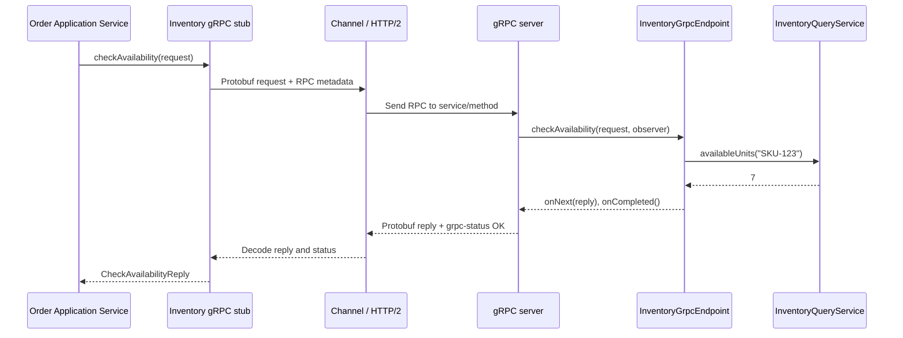
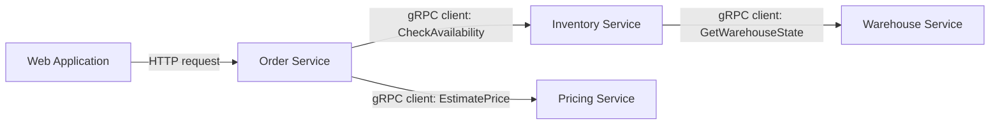

# Client, Server, Service, and Method in a Single Call

In a standalone Java application, you can call `inventoryService.checkAvailability(...)` like a normal method. When ordering and inventory checking are deployed as **two independent Spring applications**, such a call must traverse the network. gRPC enables the two applications to work together via a strongly typed API contract and communication code generated from Protocol Buffers.

To read and design a gRPC call, you must first distinguish four concepts: **client**, **server**, **service**, and **method**. They are not at the same level: client/server are **the roles of the communicating parties**; service/method are **the exposed interface and operation**.

This lesson belongs to the **Introduction** chapter of the **SPRING_GRPC** module—the foundation for building gRPC clients/servers in Spring using Protocol Buffers contracts and Java code generation. The examples below also lead into upcoming topics: unary/streaming RPCs, metadata, deadlines, statuses, interceptors, TLS, integration testing, and reliability monitoring.

## 1. Identifying the Four Components Correctly

Consider a retail system:

- **Order Service** accepts order creation requests.
- **Inventory Service** manages stock and answers whether there is enough inventory.
- Before creating an order, Order Service needs to ask Inventory Service about item code `SKU-123` and quantity `2`.

In that call:

| Term | Role in the Example | Primary Responsibility |
| --- | --- | --- |
| **Client** | Order Service when calling inventory | Builds the request, selects the target server, calls the method via a stub, receives the response or error |
| **Server** | The Inventory Service process accepting gRPC connections | Listens on a port, accepts RPCs, looks up the registered handler, dispatches the request to the handler method |
| **Service** | `InventoryService` in the `.proto` contract | Groups RPC methods sharing a business purpose; names the remote API |
| **Method** | `CheckAvailability` | Defines a specific RPC operation along with its request and response types |

Key distinctions:

- Client/server are **per-call** roles, not necessarily a fixed classification for an entire application. A single process can both serve RPCs from other applications and invoke RPCs on a third service.
- A gRPC service is **a remote method contract**; Spring's `@Service` is **a marker for a Spring-managed business component**. These two uses of the word "service" are not automatically synonymous.
- A gRPC method is **an operation in the network contract**. On the Java side, a generated method starts with a lowercase letter, while the gRPC system identifies the call using the full service and method name in `.proto`.

## 2. The `.proto` Contract Defines Services and Methods

Between client and server, there needs to be a single shared source of description. With gRPC, that source is typically a **Protocol Buffers** `.proto` file.

Example `inventory.proto`:

```protobuf
syntax = "proto3";

package warehouse.v1;

option java_package = "com.example.warehouse.grpc";
option java_multiple_files = true;

service InventoryService {
  rpc CheckAvailability(CheckAvailabilityRequest)
      returns (CheckAvailabilityReply);

  rpc WatchAvailability(WatchAvailabilityRequest)
      returns (stream AvailabilityUpdate);
}

message CheckAvailabilityRequest {
  string sku = 1;
  int32 requested_units = 2;
}

message CheckAvailabilityReply {
  bool available = 1;
  int32 units_in_stock = 2;
}

message WatchAvailabilityRequest {
  string sku = 1;
}

message AvailabilityUpdate {
  string sku = 1;
  int32 units_in_stock = 2;
}
```

Reading in order:

1. `package warehouse.v1` defines the **Protobuf namespace**. Combined with the service name, it forms the full service name `warehouse.v1.InventoryService`.
2. `service InventoryService` declares **a group of remotely callable methods**. This is a contract; it contains no SQL, business logic, or network addresses.
3. `rpc CheckAvailability(...) returns (...)` declares a **unary RPC**: one request and one response.
4. `rpc WatchAvailability(...) returns (stream AvailabilityUpdate)` declares a **server-streaming RPC**: the client sends one request, and the server can send multiple updates within the same RPC.
5. `message` defines the data structure of a request/response. `sku` and `requested_units` are message fields, not arbitrary Java parameter names sent over the wire.
6. `java_package` determines the package containing generated Java code; it does not replace `package` in the full gRPC service name.

If you need to add a new business operation, such as `ReserveItems`, the contract is usually extended with **a new method** with its own request/response. If you need to change the type or meaning of an existing field, check schema compatibility with older clients before deploying.

### Service and Method Names on the Wire

The `CheckAvailability` call is identified by gRPC using its method path:

```text
/warehouse.v1.InventoryService/CheckAvailability
 \___________________________/ \_______________/
         full service                method
```

This path is used in the `:path` field of an HTTP/2 request under standard gRPC transport. It is an **RPC identifier**, not an arbitrary REST controller route and not the server's network address.

Make sure to distinguish:

| Information | Example | What Is It Used For? |
| --- | --- | --- |
| Server address | `inventory.internal:9090` | Tells the client where to connect |
| Full service name | `warehouse.v1.InventoryService` | Identifies the API group the server provides |
| Method name | `CheckAvailability` | Identifies the operation within the service |
| Method path | `/warehouse.v1.InventoryService/CheckAvailability` | Enables the gRPC server to route the call |
| Request message | `CheckAvailabilityRequest` | Carries the business payload for the call |

One host can serve **multiple gRPC services**, and one gRPC service can have **multiple methods**. Co-locating services/methods at the same network address does not make them the same operation.

## 3. What Does a Client Actually Consist Of?

In gRPC Java, a "client" is not just a single line calling a function. It typically combines **application logic**, a **channel**, and a **stub**:

```text
Order Service (Spring)
  |
  +-- Application Service: creates item check request
  |
  +-- gRPC client stub: calls checkAvailability(request)
           |
           +-- ManagedChannel: communication channel to Inventory Server
                    |
                    +-- gRPC runtime + HTTP/2 transport
                             |
                           Network
```

A **client stub** is the object representing the remote API. The stub exposes methods typed according to the contract, such as `checkAvailability(CheckAvailabilityRequest)`.

**ManagedChannel** is the gRPC Java object that manages communication resources to a resolved endpoint or set of endpoints, including connections and operational state. One channel can be shared by multiple stubs and multiple RPCs. Channels should generally be **reused** rather than created anew for each request.

Order Service's **Application Service** decides *when* to query inventory and *what to do* with the result. It does not need to encode Protobuf or assemble HTTP/2 headers by hand.

### Common Stub Types in gRPC Java

From `InventoryService`, the gRPC Java plugin typically generates `InventoryServiceGrpc` with these stub factory methods:

| Stub Factory | Style | When Is It Appropriate? |
| --- | --- | --- |
| `InventoryServiceGrpc.newBlockingStub(channel)` | Invokes unary/server-streaming calls by blocking the calling thread | Synchronous, simple applications where thread count is controlled |
| `InventoryServiceGrpc.newStub(channel)` | Asynchronous, using callbacks/`StreamObserver` | Streaming or applications that must not block threads |
| `InventoryServiceGrpc.newFutureStub(channel)` | Unary returning `ListenableFuture` | When composing asynchronous unary operations |

The blocking stub does not support every streaming pattern synchronously; for client-streaming and bidirectional streaming, use the asynchronous API or the corresponding library mechanism. Stubs themselves are generally lightweight objects from which you can derive variants with deadlines, credentials, or interceptors. Actual connections are managed by the channel.

## 4. Server, Service Handler, and Spring Business Logic

On the Inventory Service side, distinguish three components:

1. **gRPC server** is the runtime listening for and receiving RPCs over the network.
2. **gRPC service implementation/handler** is the code registered with the server to implement methods in `.proto`.
3. **Spring business service** contains business rules and calls repositories/databases as needed.

```text
                  Inventory Service (Spring application)

               +------------------------------------+
HTTP/2 request | gRPC server runtime                |
-------------->|  finds warehouse.v1.InventoryService|
               |    -> CheckAvailability            |
               +------------------+-----------------+
                                  |
                                  v
               +------------------------------------+
               | InventoryGrpcEndpoint              |
               | (gRPC handler / adapter)           |
               +------------------+-----------------+
                                  |
                                  v
               +------------------------------------+
               | InventoryQueryService              |
               | (Spring @Service / business logic) |
               +------------------+-----------------+
                                  |
                                  v
                             Repository/DB
```

The gRPC service name and the Spring business service class name may look similar because they belong to the same business domain, yet their responsibilities differ. The adapter class converts **Protobuf request ↔ business data**, handles RPC errors, and returns the response; the business service decides **whether enough stock is available**.

A class annotated with Spring's `@Component` or `@Service` **does not automatically become a gRPC endpoint** in every library. The gRPC runtime must **register the handler**. With Spring gRPC starters, scanning or annotation mechanisms follow the starter and version documentation; with plain gRPC Java, you typically call `addService(...)` when building the server.

## 5. How Does a Unary RPC Travel from Client to Server?

Suppose Order Service needs to check whether the warehouse has two units of `SKU-123`:



Behind the diagram is a meaningful sequence of steps:

1. **Preparing the contract:** both sides use the same `InventoryService/CheckAvailability` definition and compatible messages. Java code may be generated and packaged in a shared library, or generated independently from compatible `.proto` versions.
2. **Building the request:** the client sets `sku` and `requested_units` on `CheckAvailabilityRequest`.
3. **Calling the stub:** the application calls `stub.checkAvailability(request)`; the stub knows the method descriptor, message types, and RPC options.
4. **Sending over the network:** gRPC serializes the message as Protobuf, adds framing, and sends headers and data over an HTTP/2 stream on the channel.
5. **Routing:** the server reads the service/method name, locates the registered handler, and parses the request into the corresponding Java type.
6. **Executing business logic:** the handler validates required inputs and invokes the Spring business service to query remaining stock.
7. **Returning the result:** the handler creates `CheckAvailabilityReply`; gRPC sends the response and the terminal RPC status code.
8. **Receiving the result:** the client decodes the response; if the RPC fails, the stub reports an error via the appropriate API, such as `StatusRuntimeException` for a blocking stub.

For a **successful unary RPC**, the server must emit **one** response and complete normally. In the `StreamObserver` API, the standard pair of calls is `onNext(response)` followed by `onCompleted()`. On failure, the handler calls `onError(...)` to terminate the RPC with an error and **must not** call `onCompleted()` afterward.

### HTTP Status and gRPC Status Belong to Two Different Layers

In gRPC over HTTP/2, an RPC can use HTTP status `200` while returning gRPC status `INVALID_ARGUMENT`. The **RPC** status is conveyed by the gRPC status, usually inside HTTP/2 trailers. Clients must inspect results using gRPC's status mechanism, not merely look at HTTP `200`.

Input error example:

```text
Client requests:
  sku = ""
  requested_units = -2

Server returns:
  gRPC status = INVALID_ARGUMENT
  message     = "sku and requested_units must be valid"
```

Conversely, "valid SKU but insufficient stock" can be a normal business response:

```text
CheckAvailabilityReply:
  available = false
  units_in_stock = 1

gRPC status = OK
```

Distinguishing **business outcomes** from **communication failures** helps the client take the right action and avoid unnecessary retries.

## 6. Server Example: From gRPC Method to Spring Bean

The example below uses two classes with separate responsibilities. First, a very simple Spring service simulating an inventory query:

```java
package com.example.warehouse.application;

import java.util.Map;
import org.springframework.stereotype.Service;

@Service
public class InventoryQueryService {
    private final Map<String, Integer> quantities = Map.of(
        "SKU-123", 7,
        "SKU-456", 0
    );

    public int availableUnits(String sku) {
        return quantities.getOrDefault(sku, 0);
    }
}
```

This uses sample in-memory data to keep focus on the RPC flow. In a real application, the Spring service might query a repository/database and distinguish a nonexistent SKU from a SKU with zero stock according to business policy.

The gRPC handler class uses the Java types generated from `inventory.proto`:

```java
package com.example.warehouse.transport.grpc;

import com.example.warehouse.application.InventoryQueryService;
import com.example.warehouse.grpc.CheckAvailabilityReply;
import com.example.warehouse.grpc.CheckAvailabilityRequest;
import com.example.warehouse.grpc.InventoryServiceGrpc;
import io.grpc.Status;
import io.grpc.stub.StreamObserver;
import org.springframework.stereotype.Component;

@Component
public class InventoryGrpcEndpoint
        extends InventoryServiceGrpc.InventoryServiceImplBase {

    private final InventoryQueryService inventoryQuery;

    public InventoryGrpcEndpoint(InventoryQueryService inventoryQuery) {
        this.inventoryQuery = inventoryQuery;
    }

    @Override
    public void checkAvailability(
            CheckAvailabilityRequest request,
            StreamObserver<CheckAvailabilityReply> responseObserver) {

        if (request.getSku().isBlank()
                || request.getRequestedUnits() <= 0) {
            responseObserver.onError(
                Status.INVALID_ARGUMENT
                    .withDescription("sku and requested_units must be valid")
                    .asRuntimeException());
            return;
        }

        final int remaining;
        try {
            remaining = inventoryQuery.availableUnits(request.getSku());
        } catch (RuntimeException ex) {
            responseObserver.onError(
                Status.INTERNAL
                    .withDescription("Unable to query inventory")
                    .asRuntimeException());
            return;
        }

        CheckAvailabilityReply response = CheckAvailabilityReply.newBuilder()
            .setAvailable(remaining >= request.getRequestedUnits())
            .setUnitsInStock(remaining)
            .build();

        responseObserver.onNext(response);
        responseObserver.onCompleted();
    }
}
```

Note the names produced by the code generator:

- `InventoryServiceGrpc.InventoryServiceImplBase` is the base class for the server handler.
- `checkAvailability` is the Java method corresponding to the `CheckAvailability` RPC in `.proto`.
- `CheckAvailabilityRequest` and `CheckAvailabilityReply` are Protobuf classes with getters/builders generated for the defined fields.
- `StreamObserver<CheckAvailabilityReply>` represents **the RPC's response channel**. For unary, the handler sends one response; for streaming, it can send multiple responses before completing.

`@Component` lets Spring manage the instance and inject `InventoryQueryService`. **It does not replace registering the gRPC service implementation** with the gRPC server. Without an auto-registering starter, plain gRPC Java server creation might include:

```java
import io.grpc.Server;
import io.grpc.ServerBuilder;

// endpoint is an InventoryGrpcEndpoint instance provided by Spring.
Server server = ServerBuilder.forPort(9090)
    .addService(endpoint)
    .build()
    .start();
```

This is an **illustration of the registration step**, not a full Spring Boot configuration. In a complete application, the server must start/stop with the Spring lifecycle, configure ports, TLS, interceptors, readiness checks, and graceful shutdown. A Spring gRPC starter can replace this manual registration; exact details depend on the library.

### Why Not Put All Business Logic Inside the Handler?

If inventory calculation logic and database access live directly inside `checkAvailability`, communication code becomes hard to test in isolation and hard to reuse for REST APIs or background jobs. Separating the adapter from `InventoryQueryService` enables:

- Testing inventory calculation logic without opening a gRPC connection.
- Testing the gRPC layer against the contract: validation, response mapping, and statuses.
- Swapping the transport mechanism easily without rewriting business logic.

## 7. Client Example: Creating a Stub and Calling the Right Method

The following snippet illustrates a standalone Java client so you can clearly see the roles of channel and stub. In a real Spring project, they are usually managed and reused through application configuration.

```java
import com.example.warehouse.grpc.CheckAvailabilityReply;
import com.example.warehouse.grpc.CheckAvailabilityRequest;
import com.example.warehouse.grpc.InventoryServiceGrpc;
import io.grpc.ManagedChannel;
import io.grpc.ManagedChannelBuilder;
import io.grpc.StatusRuntimeException;
import java.util.concurrent.TimeUnit;

ManagedChannel channel = ManagedChannelBuilder
    .forAddress("localhost", 9090)
    .usePlaintext() // Only used in local test examples
    .build();

try {
    InventoryServiceGrpc.InventoryServiceBlockingStub stub =
        InventoryServiceGrpc.newBlockingStub(channel)
            .withDeadlineAfter(800, TimeUnit.MILLISECONDS);

    CheckAvailabilityRequest request = CheckAvailabilityRequest.newBuilder()
        .setSku("SKU-123")
        .setRequestedUnits(2)
        .build();

    CheckAvailabilityReply response = stub.checkAvailability(request);

    if (response.getAvailable()) {
        System.out.println("In stock: " + response.getUnitsInStock());
    } else {
        System.out.println("Out of stock");
    }
} catch (StatusRuntimeException ex) {
    System.err.println("RPC error: " + ex.getStatus().getCode());
} finally {
    channel.shutdown();
}
```

Relationships between objects in the snippet:

| Object / Call | Role |
| --- | --- |
| `ManagedChannel` | Manages the communication path to the server |
| `InventoryServiceBlockingStub` | Client proxy representing the remote `InventoryService` |
| `CheckAvailabilityRequest` | Input payload generated from the Protobuf schema |
| `stub.checkAvailability(request)` | Executes the RPC method with Java-level type safety |
| `CheckAvailabilityReply` | Decoded response payload |
| `StatusRuntimeException` | Represents an RPC error on a blocking stub |
| `withDeadlineAfter(...)` | Bounds wait time for calls actually invoked through that stub |

The `800 ms` deadline is illustrative only. An appropriate deadline depends on business requirements, network latency, system load, and time needed for downstream steps. `usePlaintext()` is only for controlled test environments; production environments require proper TLS and authentication configuration.

### Can One Client Call Multiple Methods?

Yes. A stub for `InventoryService` can expose both `checkAvailability(...)` and `watchAvailability(...)`. However, streaming call APIs do not necessarily look like unary ones: server-streaming may return a stream/iterator of results, whereas client-streaming or bidirectional streaming requires mechanisms to send and receive multiple messages. The contract determines the call pattern, and the library generates the corresponding API.

## 8. Client and Server Can Swap Roles Within the Same System

A Spring application is not permanently only a client or only a server:



In the diagram:

- **Order Service** acts as a server for HTTP requests from the web application; at the same time, it acts as a **gRPC client** when calling Inventory or Pricing.
- **Inventory Service** is the **gRPC server** for the `CheckAvailability` call, yet becomes a **gRPC client** when querying Warehouse Service.
- **Warehouse Service** is the gRPC server for `GetWarehouseState`.

Thus, saying "Inventory is a server" is only accurate in the context of the current call. Always specify **who calls whom** and **which service/method is being invoked**. When analyzing a chain of consecutive RPCs, each hop has its own deadline, status, metadata, and resources; intermediate applications must manage how these are propagated or bounded.

## 9. One Service Has Many Methods; What Properties Does a Method Have?

Revisit the contract:

```protobuf
service InventoryService {
  rpc CheckAvailability(CheckAvailabilityRequest)
      returns (CheckAvailabilityReply);
  rpc WatchAvailability(WatchAvailabilityRequest)
      returns (stream AvailabilityUpdate);
}
```

Both methods belong to the same service yet have **different communication shapes**. A gRPC method is defined by:

1. **Name** of the method within the service, e.g., `CheckAvailability`.
2. **Request type** the client is allowed to send, e.g., `CheckAvailabilityRequest`.
3. **Response type** the server sends back, e.g., `CheckAvailabilityReply`.
4. **Cardinality** — whether each direction carries one or multiple messages (unary, server streaming, client streaming, or bidirectional streaming).
5. **Business semantics** that both sides must agree on even if Protobuf syntax cannot express all of them: valid input constraints, business states, side effects, and idempotency.

Complete example of all four shapes:

```protobuf
service RpcShapes {
  rpc Unary(In) returns (Out);
  rpc ServerStream(In) returns (stream Out);
  rpc ClientStream(stream In) returns (Out);
  rpc BidiStream(stream In) returns (stream Out);
}

message In {
  string value = 1;
}

message Out {
  string value = 1;
}
```

| Method Type | Client Sends | Server Sends | Handling Responsibility |
| --- | --- | --- | --- |
| Unary | One message | One message | Server returns result and closes the call |
| Server streaming | One message | Multiple messages | Server manages emitting data until finished or canceled |
| Client streaming | Multiple messages | One message | Server receives and aggregates the entire request stream |
| Bidirectional streaming | Multiple messages | Multiple messages | Both sides send/receive independently within the same RPC |

With streaming, the method remains **one method and one RPC** throughout the session; it is not a new RPC per message. Learners must distinguish RPC lifetime, message count, and HTTP/2 connection count.

## 10. Control Aspects Accompanying a Call

Client, server, service, and method define who calls which operation. For calls to operate reliably in real environments, additional control rules are needed.

### 10.1. Metadata: Information Outside the Business Message

Clients can send **metadata** such as authorization tokens, correlation IDs, or trace context. Metadata is mapped by gRPC onto HTTP/2 headers; servers typically process it via interceptors or metadata APIs.

Do not place security tokens inside `CheckAvailabilityRequest` just because it is easy to add a field to the request. Tokens belong to control/authentication metadata, whereas SKU and quantity belong to **the business message**.

### 10.2. Deadline: When Waiting Must End

A client cannot always wait indefinitely for a server to respond. Deadlines cap how long an RPC may take and are usually configured on the stub or call options. When time expires, the client can receive `DEADLINE_EXCEEDED` and the call is canceled at the gRPC layer; the server should respect cancellation to stop work that is no longer useful.

In the Order → Inventory → Warehouse chain, if each hop uses overly long, uncoordinated timeouts, total elapsed time will exceed Order Service's response budget. Deadlines must be designed along the actual call path and according to application policy.

### 10.3. Status: Success, Input Error, or Infrastructure Failure?

Selected gRPC codes:

| Status | Typical Meaning | Example with `CheckAvailability` |
| --- | --- | --- |
| `OK` | RPC executed successfully | Check completed, even if stock is zero |
| `INVALID_ARGUMENT` | Submitted data is invalid | Empty `sku` or non-positive quantity |
| `NOT_FOUND` | Resource not found per contract | SKU does not exist if the API chooses to model that as an error |
| `DEADLINE_EXCEEDED` | Call exceeded time limit | Inventory took longer than the deadline |
| `UNAVAILABLE` | Service temporarily unable to serve | Connection lost or endpoint temporarily unavailable |
| `UNIMPLEMENTED` | Method not implemented/supported | Client called a method without a matching server handler |
| `INTERNAL` | Unexpected internal error | Adapter encountered an unrecoverable failure |

Do not automatically retry just because an RPC returned an error. For a method with side effects like "deduct inventory," a network error can occur **after the server has already finished processing**; retrying without idempotency can cause incorrect state.

### 10.4. Interceptors, TLS, and Access Control

**Interceptors** are the right place for cross-cutting logic across many methods: validating tokens, logging, tracing, or recording metrics. **TLS** encrypts and protects connections between endpoints; **mTLS** can be used when both client and server must be authenticated. Access control still needs to be evaluated per user/service, gRPC service, and specific method.

### 10.5. Measuring by Service and Method

In operations, metrics usually need to be broken down by service/method name and status: RPC count, error rate, p50/p95/p99 latency, active streaming RPCs, bytes transferred, and resource usage. Instead of only seeing "Inventory Server is slow," you can pinpoint that **`warehouse.v1.InventoryService/CheckAvailability`** is the specific method experiencing a p99 spike.

## 11. Common Configuration Errors and Misconceptions

| Symptom or Statement | Cause / Understanding to Check |
| --- | --- |
| "Adding `@Service` in Spring lets clients call it automatically." | A Spring business bean is not necessarily a gRPC handler registered with the server. |
| "Installing Protobuf makes the server open a port automatically." | Protobuf only describes and encodes data; the gRPC runtime must be initialized, configured, and have services registered. |
| Client reports `UNIMPLEMENTED` | Possibly wrong service/method name, mismatched contract versions, or handler not registered/overridden properly. |
| Client reports `UNAVAILABLE` | Check endpoint, DNS, port, TLS, proxy, network, and server health. Do not immediately conclude the method does not exist. |
| Client cannot decode response | Check contract and message type compatibility, plugins/code generation, and data framing. |
| "Every method needs its own server." | One gRPC server can serve multiple services and multiple methods on a single port. |
| "Every call must create a new channel." | Channels are normally reused, while deadlines/metadata can be configured per call/stub. |
| "One microservice has only one role." | An application can both receive RPCs and invoke other RPCs. |
| "Insufficient stock is a network error." | It can be a valid business outcome with `OK`, depending on the contract. |
| "Calling a stub is identical to calling an internal method." | gRPC calls can still be slow, canceled, fail, or leave uncertainty about whether the server processed a write. |

### Debugging Example with `UNIMPLEMENTED`

Suppose a client generated from a newer contract includes `WatchAvailability`, while the running server has not yet implemented that method. When calling it, the client may receive `UNIMPLEMENTED`. A sensible analysis path:

1. Check which endpoint the client is actually calling.
2. Check the package/service/method names generated from `.proto`.
3. Check which service handlers are registered on the server.
4. Check whether the deployed server version overrides the corresponding method.

In gRPC Java, a service's generated base class provides default implementations that return `UNIMPLEMENTED` for un-overridden methods. Having a service registered does not guarantee that **every method** has business handling implemented.

## 12. Check Your Understanding

**Scenario 1:** Order Service uses `InventoryServiceGrpc.newBlockingStub(channel)` and calls `checkAvailability(...)`. What are the client, server, service, and method?

**Answer:** Order Service is the client of this RPC; Inventory Service is the server; `warehouse.v1.InventoryService` is the gRPC service; `CheckAvailability` is the gRPC method. The stub and channel are the client-side communication components.

**Scenario 2:** Inventory Service receives `CheckAvailability` and then calls Pricing Service to compute prices. Is Inventory Service a client or a server?

**Answer:** It is a **server** for the RPC received from Order Service, and at the same time a **client** for the RPC sent to Pricing Service. Roles depend on each hop.

**Scenario 3:** The server has the Spring bean `InventoryQueryService` but has not registered `InventoryGrpcEndpoint`. Can clients invoke the method?

**Answer:** You cannot assume yes. A business bean existing in the Spring container does not mean the gRPC runtime has exposed the corresponding handler. You must register the service implementation according to your gRPC/Spring library's mechanism.

**Scenario 4:** `CheckAvailability` returns `available = false`. Should the client interpret this as a connection failure?

**Answer:** No. If the RPC has status `OK`, this is the business outcome "insufficient stock." Only when receiving an error gRPC status or losing connection should it follow the RPC failure path.

**Scenario 5:** `WatchAvailability` returns hundreds of updates. Is the server executing hundreds of different gRPC methods?

**Answer:** No. A server-streaming RPC can send many response messages through the same method and a single open RPC. The method is `WatchAvailability`; each `AvailabilityUpdate` is just one message in the stream.

## 13. Takeaways Before Moving to Hands-On Lessons

Always answer four questions before writing or debugging an RPC:

1. **Who is the client?** Which application initiates the call, stub, and request?
2. **Who is the server?** Which process is listening and registering the handler?
3. **Which service is exposed?** What is its full name in `.proto`?
4. **Which method is called?** What request does it accept, what response does it return, and is it unary or streaming?

In the **SPRING_GRPC** ecosystem, Protobuf establishes the contract, code generation tooling creates Java messages/stubs/server bases, the gRPC runtime coordinates calls over HTTP/2, and Spring organizes business beans and application lifecycle. Clients invoke methods via stubs; servers route calls to registered handlers; handlers use Spring services to process logic and terminate RPCs with a response or error status.

Once you have a firm grasp on these roles and boundaries, the next steps become much clearer: designing methods in `.proto`, generating Java code, implementing unary and streaming clients/servers, using metadata, setting deadlines, mapping statuses, adding interceptors and TLS, writing integration tests, and tracking latency and reliability per method.

### References

- [gRPC – Introduction](https://grpc.io/docs/what-is-grpc/introduction/)
- [gRPC – Core concepts, architecture and lifecycle](https://grpc.io/docs/what-is-grpc/core-concepts/)
- [gRPC – Java basics](https://grpc.io/docs/languages/java/basics/)
- [gRPC – Status codes](https://grpc.io/docs/guides/status-codes/)
- [Protocol Buffers – Proto3 language guide](https://protobuf.dev/programming-guides/proto3/)
