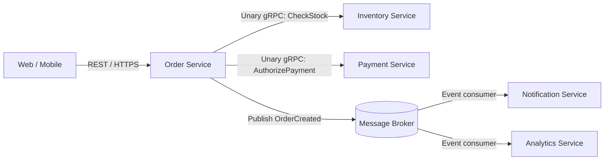
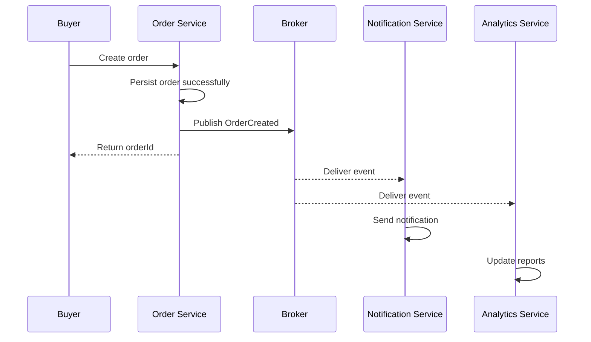
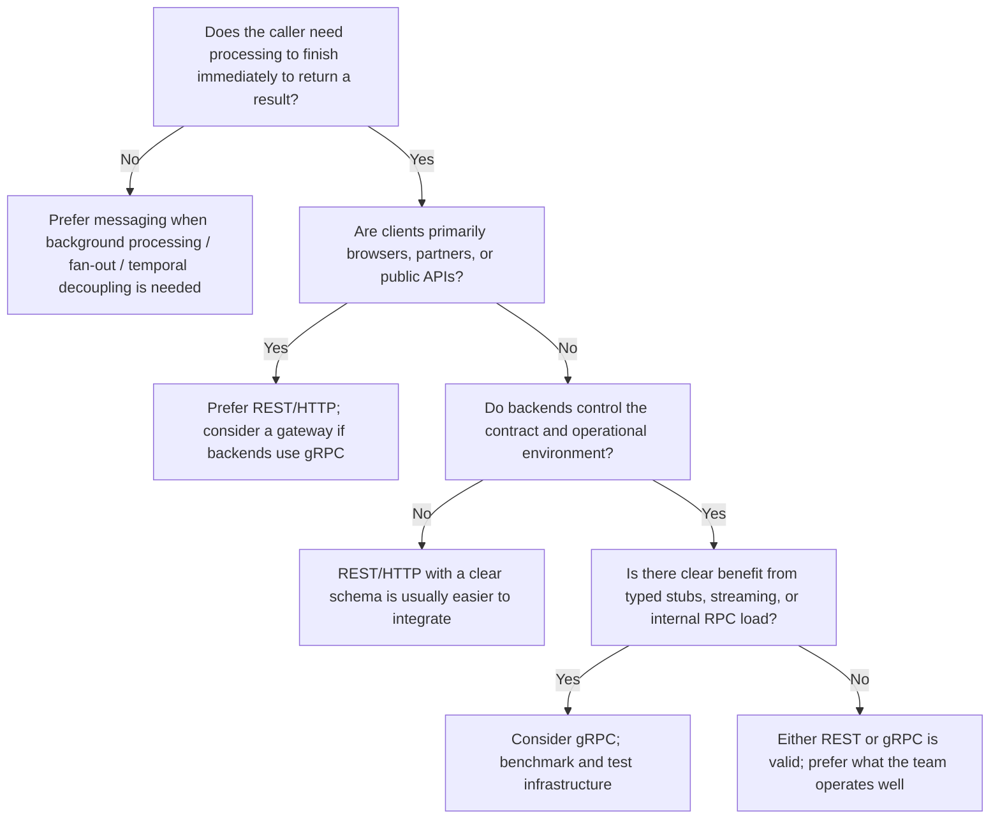

# When Is gRPC a Better Fit Than REST or Messaging?

When splitting a Spring application into multiple services, the question "should we use gRPC, REST, or messaging?" usually comes up right at the communication design step. All three can transfer data between processes, yet they serve **different interaction styles**. The right choice depends on whether the caller needs an immediate result, who consumes the data, whether both sides must be active at the same time, and how the system handles failures.

This lesson belongs to the **Introduction** chapter of **SPRING_GRPC**, a module for developing gRPC services in the Spring ecosystem: describing APIs with Protocol Buffers, generating Java code, and building clients/servers for unary or streaming RPCs; then applying metadata, deadlines, statuses, interceptors, TLS, integration testing, and performance and reliability monitoring. The content below focuses on **architectural decisions** before configuring those components.

## 1. One Problem, Three Communication Needs

Suppose an e-commerce platform has the following components:

- **Web/Mobile App** displays products and lets customers place orders.
- **Order Service** accepts order creation requests.
- **Inventory Service** checks stock quantities.
- **Payment Service** processes payments.
- **Notification Service** sends notifications after an order is confirmed.
- **Analytics Service** records events for reporting.

Three questions emerge:

1. Order Service must know **right now** whether products are in stock to decide the next step. This is a **request–response** interaction; either unary gRPC or REST can handle it.
2. The web application needs to call product and order APIs that are easy to use from browsers and external integrations. **REST/HTTP** is usually the convenient choice.
3. Once an order is created, Notification and Analytics need to know **"OrderCreated"**, yet they do not have to run at the exact moment Order Service is handling the request. **Messaging/events** are a more natural fit when processing time needs to be decoupled.



The diagram illustrates one possible architecture, not a mandatory rule. A system could use REST between Order and Inventory if appropriate, or use gRPC-Web/a gateway for some browser clients. What matters is **choosing technology based on communication semantics**, rather than forcing one style onto every link.

## 2. Distinguishing the Nature of gRPC, REST, and Messaging

### 2.1. gRPC: Contract-Driven Remote Procedure Calls

gRPC is a **Remote Procedure Call (RPC)** framework. A client calls a method defined in a `.proto` contract; the gRPC runtime handles network transport, message serialization (typically with Protobuf), deadlines, statuses, metadata, and streaming modes. For Java, code generation creates message classes and stubs so clients call methods with explicit data types.

Example:

```java
CheckStockReply reply = stockStub.checkStock(
    CheckStockRequest.newBuilder()
        .setSku("SKU-123")
        .setQuantity(2)
        .build()
);
```

The client must know the **target service/method**, and must be prepared for the call to be slow, exceed its deadline, or fail. **Streaming** enables a single RPC to carry multiple messages, yet it does not turn an RPC into a durable queue.

### 2.2. REST: Resource-Oriented APIs Over HTTP

REST is an **architectural style**. REST APIs typically represent resources via URIs, use HTTP methods such as `GET`, `POST`, `PUT`, and `DELETE`, return HTTP statuses, and commonly carry JSON payloads.

Example:

```http
GET /api/products/SKU-123
Accept: application/json
```

```json
{
  "sku": "SKU-123",
  "name": "Mechanical keyboard",
  "availableUnits": 7
}
```

REST **does not require JSON**, and REST APIs can also run over **HTTP/2**. Comparing "gRPC uses HTTP/2 while REST only uses HTTP/1.1" is inaccurate. With Spring, REST is typically straightforward to build using Spring MVC or WebFlux, making it convenient for browsers, public APIs, proxies, HTTP caching, and ubiquitous API testing tools.

### 2.3. Messaging: Sending Messages Through an Intermediary

In messaging, a producer sends a message to a **queue**, **topic**, or intermediary service; consumers receive and process it according to the messaging system's mechanisms. The producer may not know consumer implementation details, and in many architectures the two sides do not need to be online simultaneously.

Example event:

```json
{
  "eventId": "evt-8f2a",
  "eventType": "OrderCreated",
  "orderId": "ORD-1001",
  "occurredAt": "2026-11-19T01:00:00Z"
}
```

Brokers like RabbitMQ or Kafka support different consumption and retention models. **Durability, delivery guarantees, ordering, and replayability** depend on the product, configuration, and consumer design; merely adopting a broker does not automatically prevent data loss or guarantee exactly-once processing.

Messaging also includes **command messages** or request/reply patterns; therefore, not all messaging should be equated with event pub/sub. In this lesson, "messaging" mainly refers to **brokered asynchronous communication**, as that is the alternative most commonly weighed against direct RPC calls.

## 3. Decision Comparison Table

| Criterion | gRPC | REST/HTTP API | Brokered Messaging |
| --- | --- | --- | --- |
| Primary model | Remote method invocation | Request–response over HTTP resources | Sending/receiving messages, usually asynchronous |
| Does the caller wait for a result? | Typically needs the RPC result or response stream; client APIs can be non-blocking | Typically needs an HTTP response; client APIs can be non-blocking | Usually does not require consumers to finish before the producer continues |
| Contract | `.proto`, typed messages, generated Java stubs | HTTP semantics; can use OpenAPI/JSON Schema | Event/command schemas, queue/topic and version conventions |
| Typical format | Binary Protobuf | JSON, or other formats | JSON, Protobuf, Avro, etc. |
| Stream support | Unary, client/server/bidirectional streaming | Streaming possible via SSE, WebSocket, or HTTP streaming depending on API | Event streams via topics/queues; not identical to a single RPC stream |
| Standard browser clients | Standard gRPC typically requires gRPC-Web or a compatible gateway | Directly via `fetch`, HTTP SDKs | Usually via a backend or gateway |
| Temporal coupling | Typically requires target server availability during the RPC | Typically requires server availability to answer the HTTP request | Can decouple production and processing time if the broker retains/persists messages |
| Broadcasting to multiple parties | Must call multiple targets or introduce a distribution layer | Similar, without adding another mechanism | Well-suited for fan-out/pub-sub depending on topic/subscription design |
| Persistence and replay | Not a built-in RPC feature | Not a built-in HTTP request feature | Can be supported depending on broker, retention, ack, and configuration |
| Error observability | gRPC statuses, deadlines, interceptors, per-method metrics | HTTP statuses, middleware, tracing, per-route metrics | Retries/DLQ, consumer lag, acks, processing errors, cross-message tracing |
| Common strengths | Service-to-service calls with tight contracts; backend-to-backend streaming | Web/public APIs, HTTP ecosystem, diverse integrations | Background processing, temporal decoupling, multiple subscribers, event-driven workflows |

This table reflects **common usage scenarios**, not absolute technological limits. For instance, REST can certainly enforce strict schemas, gRPC can be invoked asynchronously on the client, and messaging can implement request/reply if you explicitly design correlation, timeouts, and response handling.

## 4. When Should You Prefer gRPC?

### 4.1. Backend Services Needing Strongly Typed Responses

Suppose Order Service needs an inventory answer before proceeding. This requirement has:

- A **specific method**: `CheckStock`.
- **Strongly typed request/response**: `sku`, `quantity`, `available`, `remaining`.
- A **bounded wait time** because a user is waiting.
- Two sides owned by teams that can align on `.proto` versions.

In this case, unary gRPC fits well because the framework generates Java stubs and standardizes message transmission, deadlines, and RPC statuses.

Minimal `inventory.proto` contract:

```protobuf
syntax = "proto3";

package commerce.inventory.v1;

option java_package = "com.example.inventory.grpc";
option java_multiple_files = true;

service InventoryService {
  rpc CheckStock(CheckStockRequest) returns (CheckStockReply);
}

message CheckStockRequest {
  string sku = 1;
  int32 quantity = 2;
}

message CheckStockReply {
  bool available = 1;
  int32 remaining = 2;
}
```

From this contract, a Java client can use `InventoryServiceGrpc.newBlockingStub(channel)` or asynchronous stubs generated by gRPC. The server implements the corresponding method, for example in a class extending `InventoryServiceGrpc.InventoryServiceImplBase`, and delegates the request to a Spring bean handling business logic.

The real value here is **the contract and inter-service integration experience**; do not claim gRPC is always faster than every REST API solely based on the Protobuf format.

### 4.2. Internal Networks with High Call Density and Steady Latency Needs

By default, gRPC typically encodes binary Protobuf, uses HTTP/2, and supports multiplexing multiple RPCs over a single connection. This **can** reduce serialization overhead, shrink payloads, and utilize connections efficiently in certain service-to-service workloads.

However, actual outcomes also depend on:

- Payload size and shape; small payloads may be dominated by network and business-logic costs.
- How channels/HTTP connections are reused.
- TLS, proxies, load balancers, service meshes, and thread/event-loop configuration.
- Concurrency level, message sizes, compression, and backpressure.
- Database or downstream service effects when building responses.

**Decide with realistic benchmarks**, such as measuring p50/p95/p99, throughput, CPU, memory, timeout errors, and operational overhead across properly configured options. Do not extrapolate from one sample payload size to conclude the entire system will be faster.

### 4.3. Streaming Data Within a Single RPC Session

For example, Inventory Service wants to push continuous stock updates to another backend:

```protobuf
service StockStreamService {
  rpc WatchStock(WatchRequest) returns (stream StockUpdate);
}

message WatchRequest {
  string sku = 1;
}

message StockUpdate {
  string sku = 1;
  int32 remaining = 2;
  int64 sequence = 3;
}
```

**Server streaming** lets the client send one request and receive multiple updates within the same RPC. If both directions must send continuously, gRPC also provides bidirectional streaming. Compared to repeating hundreds of unary calls, this can simplify the update protocol within an open session.

Yet there are three limitations to understand:

1. A gRPC stream **does not automatically persist events** when a client disconnects.
2. HTTP/2 flow control helps regulate bytes, but the application must still handle slow consumers, buffering, and stream cancellation.
3. If consumers need to catch up on events after hours offline, a broker with suitable retention/replay is usually a better fit than raw streaming.

In web browsers, consider SSE/WebSocket or gRPC-Web/a gateway depending on the stream type and client capabilities. **gRPC-Web does not natively provide all streaming modes identically to standard gRPC.**

### 4.4. Multiple Languages Sharing One Contract

A system with a Spring/Java backend, a Go processor, and a Python service can all generate clients/servers from compatible versions of a Protobuf contract. Code generation catches many type and method-name mismatches earlier than hand-written JSON code.

Still, REST with OpenAPI SDK generation also addresses part of the contract problem. gRPC fits well when teams want **RPC semantics and generated stubs as the primary interface**; REST remains very sensible when parties already have strong HTTP standards, testing tools, and API governance.

## 5. When Is REST More Convenient?

### 5.1. APIs for Browsers and External Partners

When clients are mainly web apps, third-party mobile SDKs, or partners using standard HTTP tooling, REST usually has lower friction:

- Browsers use `fetch` directly against HTTP endpoints.
- Teams easily inspect requests with everyday HTTP tools.
- Caching, CDNs, HTTP statuses, and gateway/auth standards are often already in the infrastructure.
- Resource-oriented APIs such as `/orders/{id}` and `/products/{sku}` can feel more natural than RPC method names.

Example in Spring MVC:

```java
@RestController
@RequestMapping("/api/products")
public class ProductController {
    private final ProductQueryService products;

    public ProductController(ProductQueryService products) {
        this.products = products;
    }

    @GetMapping("/{sku}")
    public ProductView getProduct(@PathVariable String sku) {
        return products.findBySku(sku);
    }
}
```

`ProductQueryService` and `ProductView` here are hypothetical application domain types. The controller illustrates how REST exposes resources; not-found error handling and security are omitted. There is no need to pull a gRPC stub layer into a browser merely to read product details.

### 5.2. Leveraging HTTP Semantics and Caching

A frequently queried, rarely changing resource can take advantage of `GET`, `Cache-Control`, `ETag`, and appropriate caching components. REST APIs hold an ecosystem advantage for this scenario.

gRPC can still be cached at the application or gateway layer, but it does not inherit HTTP's built-in `GET` caching mechanisms in the same way REST does. Not every REST endpoint is cacheable either—especially sensitive data or user-specific responses—so caching must be designed carefully.

### 5.3. Simple Problems Where the Team Already Operates REST Well

If two applications exchange only a few requests/responses per minute, adding a code generation pipeline, HTTP/2 compatibility checks, gRPC-specific observability, and tooling may not deliver proportional benefits. Spring REST with a clear OpenAPI contract can be enough.

**REST does not mean weak typing.** OpenAPI, schema validation, typed SDKs, and contract tests give REST solid API governance. What you should compare is **the cost of change and operations for your team**, not slogans like "RPC is more modern than HTTP."

## 6. When Is Messaging Better Than Both gRPC and Direct REST?

### 6.1. The Sender Does Not Need to Wait for the Receiver to Finish

After an order is created, sending emails and recording analytics should not prolong the customer's response time if they can run in the background. Order Service can publish `OrderCreated` and finish the request; consumers process it afterward.



In practice, publishing messages and writing to the database require **a consistency strategy**. For instance, the transactional outbox pattern helps prevent scenarios where the order commits successfully but the event is lost if the application crashes before publishing. The diagram simplifies this step to highlight communication roles.

### 6.2. Reducing Temporal Coupling Between Services

If Notification Service is temporarily down for maintenance, Order Service can still create orders as long as the broker and message persistence policies function properly. The event can be picked up by the consumer later.

With direct gRPC/REST, if the caller **requires** an immediate result from Notification Service, Notification going down breaks the call flow. A broker can reduce **temporal coupling**, though it does not automatically eliminate schema, infrastructure, or business-consistency dependencies.

### 6.3. One Event Needs to Reach Multiple Systems

`OrderCreated` can be consumed by Notification, Analytics, Loyalty, or Fraud Detection without Order Service calling each service directly. With proper topics/subscriptions, each consumer can maintain its own processing rules and deployment schedule.

With gRPC, Order Service could still fan out by calling multiple services, but as consumer count grows, that pushes distribution and error-handling logic onto the producer. Messaging is usually a better fit when the primary requirement is **broadcasting events to multiple parties**.

### 6.4. Needing Policy-Driven Retries, Retention, or Replay

Some brokers support acknowledgments, retention, retries, dead-letter queues (DLQs), consumer groups, or replay. These capabilities help when background processing takes longer or consumers go down temporarily.

However, you must explicitly design:

- **Delivery semantics:** at-most-once, at-least-once, or platform-specific guarantees; never assume the entire business flow is automatically exactly-once.
- **Idempotency:** the same event may be redelivered; consumers should deduplicate by `eventId` or a business key.
- **Ordering:** event order may only be guaranteed within a specific partition/queue, if configured.
- **Retention/replay:** how long does the broker keep messages, from where do consumers recover, and what are the limits?
- **Poison messages:** repeatedly failing messages need retry/backoff policies, isolation, and alerting.
- **Schema evolution:** older consumer versions must understand newer messages, or follow a version migration strategy.

Asynchronous communication brings flexibility, but also requires the system to accept **eventual consistency** and handle states such as "pending," "sent but not yet processed," and "reprocessed."

## 7. Messaging Is a Poor Fit When an Immediate Answer Is Needed

Suppose Order Service has only a short window to decide whether to allow a customer to place an order. If you use a topic to send `CheckStockRequested` and wait for a `CheckStockResult` event, you have to build yourself:

1. A correlation ID linking request and result.
2. Timeouts when no response arrives.
3. Storage for the state of in-flight pending requests.
4. Handling of late or duplicate results.
5. Retry rules and tracking whether the request was already processed.

Messaging **can still** implement request/reply; some brokers support that pattern. Yet if the problem simply needs synchronous "send one request, receive one response," unary gRPC or REST is usually simpler.

Conversely, if business rules allow returning a tracking code `202 Accepted` and processing later, combining REST to accept the request with messaging for background processing is a strong option.

## 8. Quick Selection Rules by Business Requirement

Follow the questions in order:



This is a **candidate-filtering process**, not an absolute set of mutually exclusive rules. Some scenarios need both immediate streaming and persistence: you can use a broker as the event source and gRPC server-streaming to push data to another backend. Each communication segment can choose its fitting mechanism.

### Practical Scenario Matrix

| Scenario | Option to Consider First | Reason |
| --- | --- | --- |
| Order → Inventory: check stock before confirmation | **Unary gRPC** or REST | Needs immediate reply, bounded timeout, clear request/response |
| Order → Payment: request payment authorization | **Unary gRPC** or REST, with idempotency | Synchronous, but operation has side effects so retries must be controlled |
| Browser → Catalog: browse products | **REST** | Fits browsers, HTTP tooling, resource caching |
| Backend → Backend: watch live processing progress | **Server-streaming gRPC** | Multiple updates within one RPC session |
| Order → Notification after order is saved | **Messaging** | User does not need to wait for notification delivery |
| OrderCreated → multiple consumers | **Messaging/pub-sub** | Producer does not need to know every consumer |
| Batch data ingestion where each record needs step-by-step immediate feedback | **Client/bidirectional gRPC streaming** or batch API | Depends on send–receive cadence and stream-management capability |
| Long-running job needing results hours later | **REST to submit job + messaging to process + status query** | Decouples timing, tracks progress, supports recovery |
| Syncing events for replay after a consumer was offline | **Messaging with retention/replay** | A raw gRPC stream does not inherently guarantee replay |
| Small API with many partners/tools knowing only HTTP/JSON | **REST** | Reduces integration and operational cost |

## 9. Example Combining All Three Technologies in Spring

Suppose a system chooses REST for its public API, gRPC for Order to query inventory, and messaging for events after an order is created.

### 9.1. REST Entering the System

```http
POST /api/orders
Content-Type: application/json

{
  "sku": "SKU-123",
  "quantity": 2
}
```

The Order Controller validates the HTTP request, calls the Spring application service, and returns an order ID. This is a convenient **ingestion boundary** for web clients.

### 9.2. Unary gRPC Between Services

From `inventory.proto` in section 4, the Java code generated by gRPC enables:

```java
import com.example.inventory.grpc.CheckStockReply;
import com.example.inventory.grpc.CheckStockRequest;
import com.example.inventory.grpc.InventoryServiceGrpc;
import io.grpc.StatusRuntimeException;
import java.util.concurrent.TimeUnit;

public final class InventoryGateway {
    private final InventoryServiceGrpc.InventoryServiceBlockingStub stub;

    public InventoryGateway(
            InventoryServiceGrpc.InventoryServiceBlockingStub stub) {
        this.stub = stub;
    }

    public boolean hasEnoughStock(String sku, int quantity) {
        CheckStockRequest request = CheckStockRequest.newBuilder()
            .setSku(sku)
            .setQuantity(quantity)
            .build();

        try {
            CheckStockReply reply = stub
                .withDeadlineAfter(300, TimeUnit.MILLISECONDS)
                .checkStock(request);
            return reply.getAvailable();
        } catch (StatusRuntimeException ex) {
            // Caller must decide whether to fail/abort/retry based on the status code.
            throw ex;
        }
    }
}
```

`InventoryGateway` is a client-side adapter class; the stub is passed via its constructor. The Spring application must configure the channel/stub, credentials, endpoint, and resource lifecycle accordingly; this snippet assumes no specific starter or annotation. The `300 ms` deadline is illustrative only and must be chosen according to actual time budgets.

In particular, `CheckStock` **only checks information at a point in time**. If business requirements forbid overselling, you need a stock reservation/deduction operation with proper transactional concurrency guarantees. Receiving `available = true` does not guarantee the item will still be in stock at payment time.

### 9.3. Messaging After Saving the Order

When Order Service saves the order successfully, the application creates `OrderCreated` with a unique ID and publishes it using the chosen consistency mechanism. Notification Service consumes the event and sends an email, while Analytics Service updates reports.

Example payload:

```json
{
  "eventId": "evt-8f2a",
  "schemaVersion": 1,
  "eventType": "OrderCreated",
  "orderId": "ORD-1001",
  "occurredAt": "2026-11-19T01:00:00Z"
}
```

Consumers must prevent duplicate processing; the producer must solve the "database commit succeeded but event publish failed" problem, for example via a **transactional outbox**. The chosen broker must have proper ack, retention, and error-handling policies. Do not treat a successful `publish` as meaning the email was definitely sent.

### 9.4. Why Does This Combination Make Sense?

Each step has **different latency and consistency requirements**:

- Browsers want a standard HTTP/JSON interface.
- Order needs an immediate stock-check result with a tight deadline.
- Notification and Analytics are allowed to run later, independently of the customer request.

Instead of forcing one transport across the entire system, using an appropriate mechanism at each boundary simplifies that boundary's responsibilities.

## 10. Latency, Throughput, and Resources: What Should You Measure?

### Latency of One RPC

For a synchronous gRPC call, the time observed by the client can include:

```text
Total latency ≈ client-side queuing
              + sending request over network
              + server-side queuing and processing
              + sending response over network
              + serialization/deserialization and runtime overhead
```

Protobuf and connection reuse can reduce some components; they cannot fix slow SQL queries, overloaded downstream services, or retry storms. Measure **end-to-end latency** and break down metrics by method, payload, client/server version, concurrency, and error rate.

### Deadlines and Time Budgets

For example, the order placement API is allocated at most `800 ms` for synchronous steps. If Order calls Inventory and then Payment sequentially, each call must have a **reasonable budget**, leaving time for authentication, business logic, and returning the HTTP response. Setting an 800 ms deadline on every downstream call can cause the entire flow to exceed its target.

A timeout or deadline should be tested under realistic load. Too short causes false timeouts; too long ties up resources and delays failure detection.

### Throughput and Streaming

For gRPC streaming, measure concurrent streams, messages/second, message sizes, memory usage, consumer slowdowns, and stream lifetimes. For brokers, measure publish-to-consume latency, queue depth, consumer lag, retry/DLQ counts, and event staleness. The two groups of metrics reflect different properties; comparing only "requests/second" is rarely meaningful.

## 11. Reliability: How Do gRPC/REST and Messaging Fail Differently?

### Direct Calls Leave Uncertainty About Whether the Server Processed the Request

A client sends a `ReserveStock` request; the server reserves inventory and commits to the database, but the connection drops before the response reaches the client. The client may receive `UNAVAILABLE` or another transport error and **cannot determine the business outcome** from the status alone.

Automatic retries could reserve inventory a second time. Solutions include idempotent request IDs, proper transactions/locking, or a status lookup endpoint—not simply increasing retry counts.

For a **read** method such as `CheckStock`, policy-driven retries can be more reasonable, yet still require backoff, retry caps, and load monitoring.

### Messaging Can Deliver Messages Multiple Times

A consumer finishes updating a report but crashes before acknowledging the message. The broker may redeliver the same message. If the consumer is not idempotent, the report may count the order twice.

Strategies include deduplicating by `eventId`, recording processed IDs in the same transaction as business updates, or designing updates so they can be re-executed safely. **"At-least-once delivery" does not mean "exactly-once business effect."**

### Multi-Step Coordinated Systems

When creating an order, reserving stock, and processing payment span different services, gRPC helps them call each other quickly with contracts; a broker helps broadcast events and run deferrable work. Yet **neither technology solves distributed transactions by itself**.

Long-running workflows may need sagas, orchestration/choreography, intermediate states, and compensating actions. Choosing a transport is only one part of designing consistency.

## 12. Security and Operations When Using gRPC in Spring

Regardless of approach, authentication, authorization, and observability cannot be skipped; only where the mechanisms sit differs:

| Need | gRPC | REST | Messaging |
| --- | --- | --- | --- |
| Protecting data in transit | TLS/mTLS; channel/server credentials config | HTTPS/TLS; gateway and HTTP security | TLS to broker, ACLs, and client/broker policies |
| Authentication and authorization | Metadata, interceptors, per-method authorization | Headers/tokens, Spring Security, per-endpoint authorization | Credentials/ACLs on topics/queues; permission and event-data checks |
| Timeouts / cancellation | RPC deadlines and cancellation | HTTP timeouts, client cancellation | Retention, TTL, retries/DLQ, task and consumer timeouts |
| Error handling | gRPC status codes and business mapping | HTTP statuses and error bodies | Ack/nack, retry/backoff, DLQ, and processing state |
| Monitoring | Metrics and tracing by service/method/status | Metrics and tracing by endpoint/status | Producer publish outcomes, consumer lag, processing latency, DLQ |
| Testing | Contract/mapping unit tests + gRPC integration tests | Controller/API/contract tests | Producer-consumer contracts, retry/duplicate/out-of-order tests |

When using gRPC in Spring, test with **a real gRPC server and client** in a suitable environment instead of only calling the Java handler directly. Important tests can include connectivity, deadlines, status mapping, metadata/interceptors, TLS, stream cancellation, and behavior when the server is temporarily unavailable. For messaging, test duplicate handling and broker/consumer failure states. For REST, focus on HTTP contracts, auth, caching, validation, and status codes.

gRPC/Spring integration libraries and starters vary in configuration and how service beans are registered. Follow the version you are deploying, reuse `ManagedChannel` appropriately, and never use `usePlaintext()` over production networks.

## 13. Common Wrong Conclusions

| Claim | What to Understand Instead |
| --- | --- |
| "gRPC is always faster than REST." | Performance depends on workload, payload, encoding, connections, runtime, and business logic. Benchmark it. |
| "REST only has JSON and HTTP/1.1." | REST can use HTTP/2 and non-JSON payloads. |
| "gRPC has streaming so it can replace Kafka/RabbitMQ." | gRPC streams serve data-transfer sessions; they do not automatically persist and replay like a properly configured broker. |
| "Messaging guarantees no events are ever lost." | Durability and redelivery depend on the broker, acks, transactions, retention, and consumers. |
| "Asynchronous means faster." | The producer may return early, but end-to-end business completion can be slower and eventual consistency adds complexity. |
| "Just retrying gRPC makes it reliable." | Retrying non-idempotent writes can cause duplicate side effects. |
| "All web clients can call standard gRPC directly." | Browsers typically need gRPC-Web/a gateway or an appropriate HTTP API. |
| "REST lacks strong contracts." | OpenAPI and typed SDKs give REST managed contracts. |
| "Using a broker makes services completely independent." | Dependencies still exist on schemas, infrastructure, historical data, and event semantics. |
| "Just use gRPC for all internal links." | Some internal flows are background work or fan-out, which fit messaging better. |

## 14. Thought Exercise: Choosing Mechanisms for a Spring System

Given a system with these requirements:

1. A frontend calls an endpoint to fetch order details; the data can be read repeatedly.
2. Order Service must validate account balance before accepting a payment operation.
3. After payment completes, three independent services need to update their records.
4. A monitoring backend needs to observe real-time progress of a running job.
5. A consumer may be offline for hours, yet upon restarting must process missed events.

A reasonable plan:

- **(1) REST:** order resource, web tooling, and HTTP caching if data policy permits.
- **(2) Unary gRPC or REST:** obtain a synchronous result with a deadline and idempotency for operations with side effects; gRPC fits well if this is internal backend communication with a Protobuf contract.
- **(3) Messaging/pub-sub:** publish a payment-succeeded event so multiple subscribers process independently; ensure publishing is consistent with the business outcome.
- **(4) gRPC server-streaming:** reasonable between backends when each session needs multiple updates. Include heartbeats/cancellation/reconnect as required.
- **(5) Messaging with appropriate retention/replay:** a standard gRPC stream is not sufficient to replay data across hours of consumer downtime.

There is no "single right answer" without knowing operational constraints. For instance, the frontend might need SSE instead of REST polling, and reliability in step (2) depends far more on transactions and idempotency design than on choosing gRPC versus REST.

## 15. Checklist Before Designing Services

To decide whether gRPC truly fits better than REST or messaging for a communication link, answer:

1. **Is an immediate result required?** If not, consider messaging to decouple timing and run in the background.
2. **Who is the client?** Browsers/partners usually integrate REST easily; internal backends can leverage typed gRPC stubs.
3. **One-off exchange or a stream of messages?** Unary fits single request/response; gRPC streaming fits live update sessions; a broker fits persisted/replayable events.
4. **Are there multiple independent consumers?** Fan-out and event reaction are usually easier to manage with messaging.
5. **What happens when failures occur?** Idempotency, deadlines, retries, acks, retention, and intermediate states matter more than the protocol name.
6. **Are the infrastructure and team ready?** Contract/code generation, HTTP/2 proxies, TLS, tracing, schema governance, and integration testing all carry costs.
7. **Do you have measurement data?** Benchmark on realistic load before picking gRPC purely for expected performance gains.

**gRPC fits well when you need direct client/server communication between services with explicit contracts, typed APIs, standard deadlines/statuses, and potentially streaming. REST is convenient for web/partner resource APIs and the HTTP ecosystem. Messaging fits when you need asynchronous processing, multiple subscribers, temporal decoupling, or durable/replayable messages.** In real Spring applications, combining all three across appropriate business boundaries is often a sound design.

### References

- [gRPC – Introduction](https://grpc.io/docs/what-is-grpc/introduction/)
- [gRPC – Core concepts, architecture and lifecycle](https://grpc.io/docs/what-is-grpc/core-concepts/)
- [gRPC – Performance best practices](https://grpc.io/docs/guides/performance/)
- [gRPC – Deadlines](https://grpc.io/docs/guides/deadlines/)
- [Spring – Building a RESTful Web Service](https://spring.io/guides/gs/rest-service/)
- [Apache Kafka – Documentation](https://kafka.apache.org/documentation/)
- [RabbitMQ – Tutorials](https://www.rabbitmq.com/tutorials)
