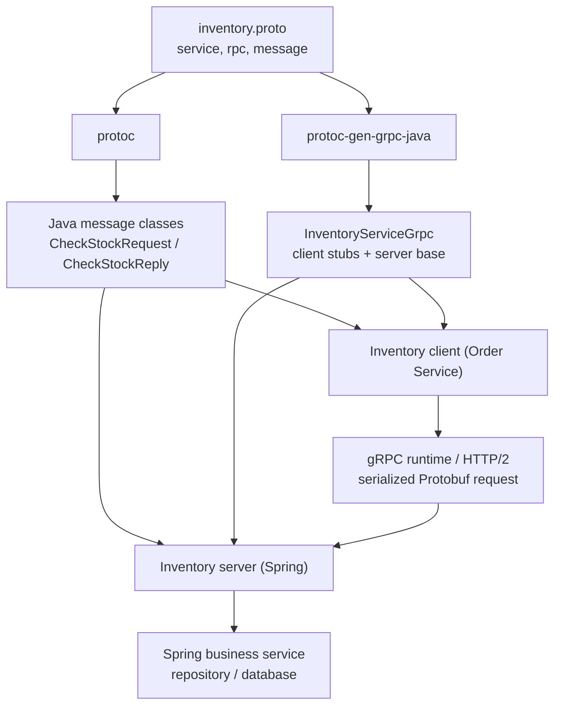
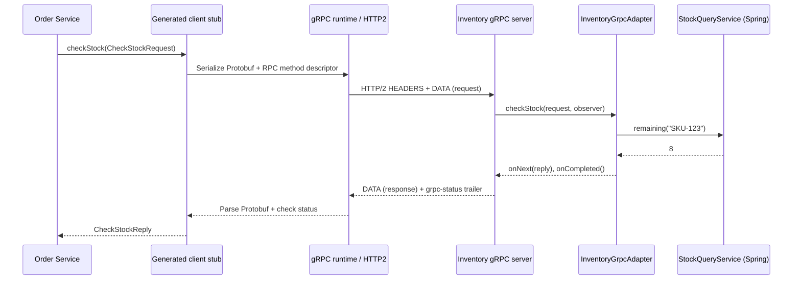

# Pipeline From `.proto` File to Client and Server Code

When building a **SPRING_GRPC** system, you do not need to manually write most of the code that converts Java requests into network bytes, routes to server-side methods, and decodes responses. Instead, you describe the interface in a **Protocol Buffers** (`.proto`) file, run Java code generation tools, and implement business logic against the generated API. This is the starting point of contract-first gRPC development.

This lesson belongs to the **Introduction** chapter and explains **the complete pipeline from a `.proto` file to client and server code** in the Spring ecosystem. After understanding this pipeline, you can move on to unary/streaming RPCs, metadata, deadlines, statuses, interceptors, TLS, integration testing, and reliability monitoring. Examples use an Order Service calling an Inventory Service to check stock; package names and project paths are illustrative only.

## 1. The Big Picture: From Contract to a Runnable RPC

Suppose **Order Service** needs to ask **Inventory Service**: "Does item `SKU-123` have at least two units available?" Two separate Spring applications need to agree on method names and request/response data types.

The typical implementation pipeline is:



The diagram has two critical outputs:

1. **Message code** from the Protobuf compiler (`protoc`): creates classes representing data structures and provides serialize/parse functionality.
2. **RPC code** from the gRPC Java codegen plugin (`protoc-gen-grpc-java`): creates the class describing the gRPC service, client stubs, and the base class for the server to implement methods.

When two teams share a compatible contract, client and server can generate code independently. Code generation guarantees the interface is **consistent in names and types at compile time**, yet it does not by itself guarantee the server is running, network connectivity works, or business rules are implemented properly.

## 2. Step 1 — Writing the `.proto` File as the Contract Source

In a Java project, a familiar location for proto files is:

```text
inventory-service/
  src/
    main/
      proto/
        inventory/
          v1/
            inventory.proto
```

You can also use a dedicated module to manage contracts and distribute them to both server and clients. The exact location is determined by build configuration; common plugins default to scanning `src/main/proto`.

Contents of `inventory.proto`:

```protobuf
syntax = "proto3";

package commerce.inventory.v1;

option java_package = "com.example.inventory.grpc";
option java_multiple_files = true;

service InventoryService {
  rpc CheckStock(CheckStockRequest) returns (CheckStockReply);

  rpc WatchStock(WatchStockRequest) returns (stream StockUpdate);
}

message CheckStockRequest {
  string sku = 1;
  int32 requested_quantity = 2;
}

message CheckStockReply {
  bool available = 1;
  int32 remaining_quantity = 2;
}

message WatchStockRequest {
  string sku = 1;
}

message StockUpdate {
  string sku = 1;
  int32 remaining_quantity = 2;
}
```

### Reading Each Part of the Contract

| Element | Meaning | Impact on Generated Code |
| --- | --- | --- |
| `syntax = "proto3"` | Selects proto3 syntax version of Protobuf | Compiler applies proto3 rules for fields, messages, and services |
| `package commerce.inventory.v1` | Contract namespace, distinguishing services across APIs | Full service name is `commerce.inventory.v1.InventoryService` |
| `java_package` | Java package for generated Protobuf/gRPC code | Java classes reside in `com.example.inventory.grpc` |
| `java_multiple_files = true` | Allows separate top-level Java classes for messages | Produces classes like `CheckStockRequest` and `CheckStockReply` |
| `service InventoryService` | Groups related RPC methods | gRPC Java plugin generates `InventoryServiceGrpc` |
| `rpc CheckStock(...) returns (...)` | One request, one response | Unary RPC API |
| `returns (stream StockUpdate)` | Server returns multiple messages for one request | Server-streaming RPC API |
| `string sku = 1` | Field with type and **wire field number** | Builder getters/setters and serialize/parse logic |

**Note on packages:** the service name used at the gRPC layer is based on the **Protobuf package** and service name; `java_package` only controls the package of generated Java code. Changing `java_package` does not change the service path on the network.

In this example, the unary method path over gRPC/HTTP2 is:

```text
/commerce.inventory.v1.InventoryService/CheckStock
 \__________________________________/ \________/
               service                 method
```

This path is not an arbitrarily chosen REST endpoint. Client stubs and server handlers generated from the same contract agree on this method name.

### Schemas Define Structure, Not All Business Rules

`CheckStockRequest` states that `sku` is a string and `requested_quantity` is a 32-bit integer. It **does not automatically enforce** that the SKU exists or that the quantity is positive. The server must still validate data and decide whether "insufficient stock" is returned as a valid response or an error under the contract.

Field numbers like `1` and `2` are part of the wire format. When modifying an API, do not arbitrarily change meanings or reuse old field numbers; usually reserve deleted field numbers using `reserved` and verify compatibility with active client versions.

## 3. Step 2 — What Do `protoc` and the gRPC Java Plugin Do?

A `.proto` file goes through **two code generation paths** in the gRPC Java ecosystem:

```text
inventory.proto
    |
    +--> protoc --java_out=...
    |       |
    |       +--> CheckStockRequest.java
    |       +--> CheckStockReply.java
    |       +--> WatchStockRequest.java
    |       +--> StockUpdate.java
    |       +--> other descriptors/outer classes
    |
    +--> protoc + protoc-gen-grpc-java
            |
            +--> InventoryServiceGrpc.java
                    +--> method descriptors
                    +--> client stub types
                    +--> server implementation base
```

**`protoc`** is the Protocol Buffers compiler. It parses the contract and generates Java message classes when invoked with `--java_out`. It can also generate code for other languages via corresponding plugins/outputs.

**`protoc-gen-grpc-java`** is the dedicated gRPC Java codegen plugin. It receives service/method definitions from the proto file via protoc's plugin mechanism and generates code for executing RPCs. The typical output flag is `--grpc-java_out`.

### Why Are Both Needed?

If you only generate Protobuf message classes, you can create and parse `CheckStockRequest`, but you will not have `InventoryServiceGrpc` or stubs to call methods remotely.

Having only the RPC descriptor class without message classes or runtime dependencies means Java code cannot compile or operate completely. **Data code and RPC code complement each other.**

### An Illustrative Codegen Command

Once `protoc` and the `protoc-gen-grpc-java` executable are installed, you can run them on the contract conceptually as follows:

```bash
protoc \
  -I=src/main/proto \
  --java_out=build/generated/source/proto/main/java \
  --grpc-java_out=build/generated/source/proto/main/grpc \
  src/main/proto/inventory/v1/inventory.proto
```

This example is meant to **illustrate inputs and outputs**. Output directories must exist or be created by the build system, and `protoc-gen-grpc-java` must be on `PATH` or specified explicitly with `--plugin`. On Windows, line continuation and executable paths differ from Unix shells; in practice, let Maven/Gradle run code generation to keep environments consistent.

Never manually edit `.java` files in generated directories: the next build can regenerate them and wipe out all changes. To change a method or message, **edit `.proto` and regenerate**.

## 4. Step 3 — Wiring Code Generation into the Build Process

In a Spring project using Gradle or Maven, the code generation flow must run before Java compilation:

```text
Read .proto
   |
   v
Resolve protoc + grpc-java plugin
   |
   v
Generate Java sources
   |
   v
Add generated folders to Java source set
   |
   v
Compile Java (with grpc/protobuf dependencies)
   |
   v
Package application / client contract library
```

The involved dependencies fall into three distinct groups:

| Group | Example Artifact | Role |
| --- | --- | --- |
| Compiler | `com.google.protobuf:protoc` | Generates Java messages from `.proto` |
| Codegen plugin | `io.grpc:protoc-gen-grpc-java` | Generates `*Grpc.java` for services/stubs |
| Runtime | `com.google.protobuf:protobuf-java`, `io.grpc:grpc-protobuf`, `io.grpc:grpc-stub`, transport such as `grpc-netty-shaded` | Runs generated code, exchanges RPCs over the network |

In some environments, artifacts are managed by a BOM or dependency management; choose compatible versions per your stack's guidelines. **Versions of compiler, plugin, and runtime should be managed intentionally**, avoiding picking the latest version of each independently and assuming they are always compatible.

### 4.1. Gradle Groovy DSL Configuration Example

The snippet below illustrates the responsibilities of plugins and dependencies. `<...>` placeholders are **values to fill in per project version**, not copy-pasteable runnable code verbatim:

```groovy
plugins {
    id 'java'
    id 'com.google.protobuf' version '<protobuf-gradle-plugin-version>'
}

dependencies {
    implementation 'com.google.protobuf:protobuf-java:<protobuf-version>'
    implementation 'io.grpc:grpc-protobuf:<grpc-version>'
    implementation 'io.grpc:grpc-stub:<grpc-version>'
    implementation 'io.grpc:grpc-netty-shaded:<grpc-version>'
}

protobuf {
    protoc {
        artifact = 'com.google.protobuf:protoc:<protobuf-version>'
    }
    plugins {
        grpc {
            artifact = 'io.grpc:protoc-gen-grpc-java:<grpc-version>'
        }
    }
    generateProtoTasks {
        all().configureEach { task ->
            task.plugins {
                grpc {}
            }
        }
    }
}
```

With an appropriate Gradle Protobuf plugin configuration, the tasks generating messages and gRPC Java sources integrate into the Java build lifecycle. A typical output layout:

```text
build/generated/source/proto/main/
  java/
    com/example/inventory/grpc/
      CheckStockRequest.java
      CheckStockReply.java
      WatchStockRequest.java
      StockUpdate.java
      ...
  grpc/
    com/example/inventory/grpc/
      InventoryServiceGrpc.java
```

Output folder names and paths may vary across plugins/build tools. What matters is that **the Java compiler receives both the message classes folder and the gRPC service classes folder**.

### 4.2. With Maven, the Essence Is the Same

In Maven, a Protobuf Java plugin invokes `protoc`, the gRPC Java plugin outputs service code, and both generated source sets are added to the `compile` phase. Many projects use `protobuf-maven-plugin` or an equivalent tool. Regardless of tooling, the invariant rules are:

1. The build locates `.proto` files and imported dependencies.
2. `protoc` runs with matching compiler/plugin versions.
3. Both message classes and gRPC service classes are generated.
4. Generated code compiles alongside gRPC/Protobuf runtime dependencies.
5. Server or client is packaged using types from the same contract.

Do not treat the generated directory as the contract source: **`.proto` is the source to review and version-control**.

## 5. Step 4 — Accurately Identifying Generated Java Code

Once code generation succeeds, you typically see the following types:

| Generated Type | Used On Which Side? | Role |
| --- | --- | --- |
| `CheckStockRequest` | Both client and server | Holds request data, provides `newBuilder()`, getters, and serialize/parse |
| `CheckStockReply` | Both | Holds response data, provides builder/getters and serialize/parse |
| `WatchStockRequest` / `StockUpdate` | Both | Holds messages for server-streaming |
| `InventoryServiceGrpc` | Both | Contains service name, method descriptors, stub factories, server base |
| `InventoryServiceGrpc.InventoryServiceBlockingStub` | Client | Blocking unary API; some server-streaming forms return an iterator |
| `InventoryServiceGrpc.InventoryServiceStub` | Client | Asynchronous API, required for streaming |
| `InventoryServiceGrpc.InventoryServiceFutureStub` | Client | Future-based API for unary calls |
| `InventoryServiceGrpc.InventoryServiceImplBase` | Server | Base class for implementing methods in familiar generated gRPC Java style |

Some API names can evolve across gRPC Java generations; for instance, how server handlers bind or base class names may depend on the generator version. When encountering differences, inspect **the actual code generated in your current project** rather than copying class names from an outdated tutorial.

### 5.1. Java Messages Are Generated Data Classes

Client request construction example:

```java
CheckStockRequest request = CheckStockRequest.newBuilder()
    .setSku("SKU-123")
    .setRequestedQuantity(2)
    .build();
```

Server reading data:

```java
String sku = request.getSku();
int quantity = request.getRequestedQuantity();
```

With Protobuf Java messages, resulting objects are **immutable**; builders construct values. Builder setters use Java types matching the proto fields—for example, `int32` maps to `int` and `string` maps to `String`.

### 5.2. Java Method Names vs. Network Method Names

Contract declaration:

```protobuf
rpc CheckStock(CheckStockRequest) returns (CheckStockReply);
```

Typical Java client call:

```java
CheckStockReply reply = stub.checkStock(request);
```

The method name in `.proto` is `CheckStock`, whereas the Java name is `checkStock` per codegen conventions. On the wire, the method is identified as:

```text
/commerce.inventory.v1.InventoryService/CheckStock
```

Because of this, the client never has to assemble URLs, specify HTTP methods, or parse HTTP/2 trailers for routing. The gRPC runtime handles this using the generated descriptors.

### 5.3. What the Generator Does Not Create for You

Codegen **does not build** a complete retail system. You still have to write:

- Inventory-checking logic, transactions, and database access.
- Input validation and mapping business errors to gRPC statuses.
- Server endpoint configuration, TLS/credentials, and access policies.
- Client lifecycle, deadlines, controlled retries, observability, and shutdown.
- Contract tests, integration tests, and version compatibility management.

The generator only ensures the communication skeleton matching the contract is produced consistently.

## 6. Step 5 — Implementing the Server Handler from the Generated Base Class

Inventory Service is the **server** for `CheckStock`. In Java, a handler typically overrides methods from `InventoryServiceImplBase` and delegates to a Spring business service.

Inventory query service example:

```java
package com.example.inventory.application;

import java.util.Map;
import org.springframework.stereotype.Service;

@Service
public class StockQueryService {
    private final Map<String, Integer> stock = Map.of(
        "SKU-123", 8,
        "SKU-456", 0
    );

    public int remaining(String sku) {
        return stock.getOrDefault(sku, 0);
    }
}
```

This uses in-memory data to focus on gRPC. In a real system, the business layer typically calls a repository/database and distinguishes a nonexistent SKU from zero quantity if the contract requires it.

Server adapter:

```java
package com.example.inventory.transport;

import com.example.inventory.application.StockQueryService;
import com.example.inventory.grpc.CheckStockReply;
import com.example.inventory.grpc.CheckStockRequest;
import com.example.inventory.grpc.InventoryServiceGrpc;
import io.grpc.Status;
import io.grpc.stub.StreamObserver;
import org.springframework.stereotype.Component;

@Component
public class InventoryGrpcAdapter
        extends InventoryServiceGrpc.InventoryServiceImplBase {

    private final StockQueryService stockQuery;

    public InventoryGrpcAdapter(StockQueryService stockQuery) {
        this.stockQuery = stockQuery;
    }

    @Override
    public void checkStock(
            CheckStockRequest request,
            StreamObserver<CheckStockReply> observer) {

        if (request.getSku().isBlank()
                || request.getRequestedQuantity() <= 0) {
            observer.onError(
                Status.INVALID_ARGUMENT
                    .withDescription("SKU and quantity must be valid")
                    .asRuntimeException());
            return;
        }

        final int remaining;
        try {
            remaining = stockQuery.remaining(request.getSku());
        } catch (RuntimeException ex) {
            observer.onError(
                Status.INTERNAL
                    .withDescription("Unable to query inventory")
                    .asRuntimeException());
            return;
        }

        CheckStockReply response = CheckStockReply.newBuilder()
            .setAvailable(remaining >= request.getRequestedQuantity())
            .setRemainingQuantity(remaining)
            .build();

        observer.onNext(response);
        observer.onCompleted();
    }
}
```

### Why Does the Server Method Take a `StreamObserver`?

Server-side gRPC Java uses `StreamObserver<CheckStockReply>` to **emit responses and completion signals**. For a successful unary call:

1. `observer.onNext(response)` sends one response.
2. `observer.onCompleted()` signals that the RPC is complete.

On error:

1. `observer.onError(status.asRuntimeException())` terminates the RPC with an error.
2. After `onError(...)`, you must **never** call `onNext(...)` or `onCompleted()` for the same RPC.

For example, returning `available = false` when stock is insufficient can still be a **successful** RPC with status `OK`. Conversely, invalid input can return `INVALID_ARGUMENT`.

**Distinguish roles:** `InventoryGrpcAdapter` is the gRPC server handler; `StockQueryService` is the Spring business bean. Annotating with `@Component` only helps Spring instantiate and inject the adapter; **it does not by itself guarantee the gRPC runtime has registered that adapter**.

### Registering the Server Using the Plain gRPC Java API

One way to illustrate publishing the handler is:

```java
import io.grpc.Server;
import io.grpc.ServerBuilder;

// adapter is an initialized InventoryGrpcAdapter instance.
Server server = ServerBuilder.forPort(9090)
    .addService(adapter)
    .build()
    .start();
```

Calling `addService(adapter)` registers the handler's gRPC methods with the server. In a real Spring Boot application, manage the server with the Spring lifecycle or use an appropriate gRPC starter. With starters, how handlers, ports, and security are declared varies across libraries/versions; do not randomly attach annotations that do not belong to your chosen stack.

In production, you also need graceful shutdown, TLS, and resource limits. This gRPC server is **not** a Spring MVC `@RestController`; a single Spring application can serve both HTTP REST and gRPC if configured to do so.

## 7. Step 6 — Creating a Client Stub and Calling the Server

Order Service is the **client** of Inventory Service. It needs a connection channel and a stub generated from the contract.

Standalone Java snippet illustrating the call mechanism:

```java
import com.example.inventory.grpc.CheckStockReply;
import com.example.inventory.grpc.CheckStockRequest;
import com.example.inventory.grpc.InventoryServiceGrpc;
import io.grpc.ManagedChannel;
import io.grpc.ManagedChannelBuilder;
import io.grpc.StatusRuntimeException;
import java.util.concurrent.TimeUnit;

ManagedChannel channel = ManagedChannelBuilder
    .forAddress("localhost", 9090)
    .usePlaintext() // Only use in controlled local testing
    .build();

try {
    var stub = InventoryServiceGrpc.newBlockingStub(channel)
        .withDeadlineAfter(700, TimeUnit.MILLISECONDS);

    CheckStockRequest request = CheckStockRequest.newBuilder()
        .setSku("SKU-123")
        .setRequestedQuantity(2)
        .build();

    CheckStockReply response = stub.checkStock(request);

    System.out.println("In stock: " + response.getAvailable());
    System.out.println("Remaining in stock: " + response.getRemainingQuantity());
} catch (StatusRuntimeException ex) {
    System.err.println("gRPC status: " + ex.getStatus().getCode());
} finally {
    channel.shutdown();
}
```

Key lines:

| Code | Responsibility |
| --- | --- |
| `ManagedChannelBuilder.forAddress(...)` | Tells the runtime the address of the target service |
| `InventoryServiceGrpc.newBlockingStub(channel)` | Creates a client stub from the generated gRPC service class |
| `CheckStockRequest.newBuilder()` | Builds a message conforming to the Protobuf schema |
| `withDeadlineAfter(...)` | Bounds the duration of calls executed through the stub |
| `stub.checkStock(request)` | Invokes the remote method via the gRPC runtime |
| `StatusRuntimeException` | How Java blocking stubs surface RPC errors |
| `channel.shutdown()` | Requests channel closure and releases resources per lifecycle |

Note that `700 ms` is illustrative only; deadlines must derive from the latency budget of the entire business flow. `usePlaintext()` is unsuitable for production networks; production deployments require TLS and authentication/authorization policies.

### How Do Channels and Stubs Differ?

A **Channel** manages the communication path and connection resources. A **Stub** is a client interface for a service that uses a channel to send calls. You can create multiple stubs for services sharing an appropriate channel, or derive stub variants with different deadlines/credentials.

In Spring, manage channels via beans/lifecycle for **reuse**; creating and shutting down a channel on every HTTP request is inefficient. The standalone example above only illustrates the structure of a complete call.

### How Can a Spring Client Be Structured?

At the application layer, you can create a gateway wrapping the stub:

```java
package com.example.order.integration;

import com.example.inventory.grpc.CheckStockReply;
import com.example.inventory.grpc.CheckStockRequest;
import com.example.inventory.grpc.InventoryServiceGrpc;
import java.util.concurrent.TimeUnit;
import org.springframework.stereotype.Component;

@Component
public class InventoryGateway {
    private final InventoryServiceGrpc.InventoryServiceBlockingStub stub;

    public InventoryGateway(
            InventoryServiceGrpc.InventoryServiceBlockingStub stub) {
        this.stub = stub;
    }

    public boolean hasEnoughStock(String sku, int units) {
        CheckStockReply reply = stub
            .withDeadlineAfter(700, TimeUnit.MILLISECONDS)
            .checkStock(CheckStockRequest.newBuilder()
                .setSku(sku)
                .setRequestedQuantity(units)
                .build());
        return reply.getAvailable();
    }
}
```

This snippet assumes you have configured a **Spring bean for the stub** (via a starter or your own `@Configuration`). `InventoryGateway` focuses on translating data between Order Service and the gRPC contract. It should not create a channel on every call. At a higher layer, the application distinguishes `false` (insufficient stock) from a gRPC error where the check failed to complete.

## 8. Step 7 — From Java Method to Bytes on the Network

When the client calls `stub.checkStock(request)`, the actual runtime flow is:



Three layers work together:

- **Protobuf** defines message types and encodes request/response contents into bytes.
- **gRPC** identifies the service/method, frames messages, invokes handlers, and handles metadata/deadlines/statuses.
- **HTTP/2** transmits headers, DATA, and trailers across streams on a connection.

Remote calls still have latency and can fail. Having a generated stub **does not make a network call as safe as an in-process local call**.

### What Travels Over the Network vs. What Does Not

Transmitted:

1. Service/method name for server routing.
2. Serialized Protobuf message.
3. RPC metadata, such as tokens or trace context.
4. Status, response message, and stream termination info.

Not transmitted:

- Java objects like `ManagedChannel` or `StreamObserver` as live objects usable directly in the other process.
- The Spring bean `StockQueryService` or SQL logic inside its class.
- The entire `.proto` file on every request. Client and server already use the schema and generated code to know how to process messages.

This is why both client and server must share **compatible code and contracts** before communicating, rather than expecting the server to understand arbitrary Java objects over the wire.

## 9. How Do Unary and Streaming Affect Generated Code?

Method signatures in `.proto` determine the **API shape** on the Java side.

```protobuf
service ExampleService {
  rpc GetOne(In) returns (Out);
  rpc Subscribe(In) returns (stream Out);
  rpc Upload(stream In) returns (Out);
  rpc Exchange(stream In) returns (stream Out);
}

message In {
  string value = 1;
}

message Out {
  string value = 1;
}
```

| RPC Type | Client Sends | Server Sends | Generated Java Code Must Support |
| --- | --- | --- | --- |
| Unary (`GetOne`) | One request | One response | Blocking/async/future stub; server handler returns one response |
| Server streaming (`Subscribe`) | One request | Multiple responses | Client receives sequence/callbacks; server emits multiple times via response observer |
| Client streaming (`Upload`) | Multiple requests | One response | Client uses request observer to send multiple messages; server receives stream |
| Bidirectional streaming (`Exchange`) | Multiple requests | Multiple responses | Both sides actively send/receive within the same RPC |

With standard gRPC Java plugins:

- Unary server handlers have a signature like `void getOne(In request, StreamObserver<Out> observer)`.
- Server-streaming handlers also take `StreamObserver<Out>`, but may invoke `onNext` multiple times.
- Client-streaming/bidirectional-streaming server handlers typically return `StreamObserver<In>` to receive incoming requests one by one, while receiving a `StreamObserver<Out>` to send responses.
- Async stubs work with `StreamObserver`; blocking stubs only provide synchronous methods suitable for unary and server streaming.

### Server-Streaming Example in This Lesson's Contract

The `WatchStock` method in section 2 lets a client subscribe to stock updates:

```java
// Example server-side handling with a finite sequence of updates.
@Override
public void watchStock(
        WatchStockRequest request,
        StreamObserver<StockUpdate> observer) {
    observer.onNext(StockUpdate.newBuilder()
        .setSku(request.getSku())
        .setRemainingQuantity(8)
        .build());
    observer.onNext(StockUpdate.newBuilder()
        .setSku(request.getSku())
        .setRemainingQuantity(7)
        .build());
    observer.onCompleted();
}
```

This uses simulated data to illustrate **one RPC returning two messages**. In production, you need an event source, cancellation checks, flow control, concurrency safety, stream lifetime limits, and error handling. When streaming runs, a single RPC can stay open a long time, yet it does not automatically persist or replay events.

## 10. Organizing Contracts Across Multiple Spring Applications

In a multi-service system, contracts usually need to be managed independently from business implementations:

```text
repo/
  inventory-contract/
    src/main/proto/inventory/v1/inventory.proto
  inventory-server/
    src/main/java/.../InventoryGrpcAdapter.java
    src/main/java/.../StockQueryService.java
  order-service/
    src/main/java/.../InventoryGateway.java
```

There are two common distribution approaches:

**Approach A — Packaging shared generated code:** the contract module generates message + gRPC classes and publishes them as a Java library. Java server and clients depend on that version. This is convenient when applications share the JVM and artifact release process.

**Approach B — Distributing `.proto` files/descriptors:** each language or project generates code from versioned contracts. Suitable across multiple languages, provided contract versions stay compatible.

Governance points for both approaches:

1. **Source of truth:** establish which repo/package owns the `.proto` file.
2. **Versioning:** distinguish backward-compatible additions from changes that break older clients.
3. **CI:** builds must run codegen and verify generated code compiles; optionally add schema compatibility checks.
4. **Release:** server and client can deploy at different times; avoid APIs that only work if both upgrade simultaneously.
5. **Review:** changes to field numbers, method signatures, or business semantics must be reviewed as API changes.

Do not manually copy `*Grpc.java` files and edit them per project: they will quickly drift from the contract and become painful to upgrade.

## 11. When `.proto` Changes, What Happens to Client and Server?

Suppose you add a field to the request:

```protobuf
message CheckStockRequest {
  string sku = 1;
  int32 requested_quantity = 2;
  string warehouse_id = 3;
}
```

After re-running code generation:

- The Java request builder gains `setWarehouseId(...)` and its corresponding getter.
- New clients can send `warehouse_id`.
- New servers can read that field to select a warehouse.
- Old clients typically know nothing about the new field; the server must handle when the field is absent or takes its default value.

**Adding a new field with a new number** is usually safer than changing types/numbers or removing an active field; however, **semantic compatibility** must still be checked. If the new server requires `warehouse_id` on every request while older clients do not send it, business logic can still break even though Protobuf parses cleanly.

### Changes Requiring Extra Caution

| Change | Potential Impact |
| --- | --- |
| Adding a field with a new number | Usually preserves wire compatibility; verify defaults and business logic |
| Reusing a deleted field number | Old clients may interpret new data with old semantics; avoid |
| Renaming `service` or `rpc method` | Changes RPC identity on the wire; can trigger `UNIMPLEMENTED` |
| Changing Protobuf service `package` | Changes full service/method name, affecting routing |
| Changing `java_package` | Moves Java classes in source; can break compilation even though wire service is unchanged |
| Changing a method's request/response types | Requires careful compatibility assessment across clients/servers and serialization |
| Adding a method | New clients must know which servers have deployed the method before calling it |

Therefore, the code generation pipeline should pair **schema evolution** rules, rollout plans, and old-client/new-server testing where appropriate.

## 12. Common Pipeline Errors and How to Isolate Them

### Error 1 — `CheckStockRequest` Not Found at Compile Time

Likely causes:

- The Protobuf Java generation task did not run.
- `src/main/proto` was not scanned or `.proto` is not in the expected build path.
- The generated folder was not added to the Java source set.
- Source code imports the wrong package after changing `java_package`.

**How to check:** verify Java message output from the compiler and compare against the configured package. If only `InventoryServiceGrpc.java` exists without message classes, inspect both codegen steps.

### Error 2 — Message Classes Exist, But `InventoryServiceGrpc` Is Missing

Likely cause: configuration ran `protoc --java_out` without **enabling the gRPC Java plugin**. The Protobuf compiler generates messages, but does not generate gRPC Java service stubs without the appropriate plugin.

**How to check:** verify the `protoc-gen-grpc-java` artifact, the `generateProto` task, and the `grpc` plugin output configuration.

### Error 3 — Package `io.grpc` or `com.google.protobuf` Not Found

Generated code exists, but Java compilation is missing runtime dependencies or has conflicting versions. Check `grpc-stub`, `grpc-protobuf`, `protobuf-java`, and the appropriate transport runtime. Note that runtime dependencies are **separate** from compiler/plugin codegen dependencies.

### Error 4 — Client Receives `UNIMPLEMENTED`

For example, the client calls `/commerce.inventory.v1.InventoryService/CheckStock`, but the server did not register the handler, implemented a different contract, or failed to override the method. In gRPC Java, an un-overridden base-class method returns `UNIMPLEMENTED`.

**How to check:** package/service/method names, generated stub version, server registration, handler implementation, and the actual endpoint the client connects to.

### Error 5 — Client Receives `UNAVAILABLE` or Connection/TLS Errors

This is typically a **transport/connectivity** issue: server not running, wrong host/port, DNS/proxy, plaintext/TLS mismatch, or target service unready. Do not jump to editing `.proto` before verifying the network path.

### Error 6 — Server Runs, But Returns `INVALID_ARGUMENT`

The contract matches and connectivity works, yet the request violates business validation, such as `requested_quantity = 0`. This is a **data/business-logic issue**, not evidence of broken codegen.

### Error 7 — Stream Never Finishes or Client Hangs Indefinitely

The server may have forgotten `onCompleted()`/`onError()`, or a long-lived streaming RPC lacks proper client API usage, deadlines, and cancellation. Check method lifecycle, error handling, flow control, client observers, and cancellation.

### Stage-by-Stage Troubleshooting Table

| Symptom | Where to Look First? |
| --- | --- |
| `.proto` fails to parse | Protobuf syntax, imports, and options |
| Java message classes missing | `protoc`, generate task, and output directory |
| `*Grpc.java` missing | `protoc-gen-grpc-java` plugin |
| Compile errors on classes/packages | Dependencies, generated source sets, `java_package` |
| gRPC server not listening on port | Server lifecycle, port binding, runtime config |
| `UNIMPLEMENTED` | Service/method name and handler registration |
| `UNAVAILABLE` | Endpoint, connectivity, DNS, TLS, proxy |
| `DEADLINE_EXCEEDED` | Timeout budget, network, server/downstream load |
| `INVALID_ARGUMENT` | Request validation and API semantics |

Splitting issues across **schema → code generation → compilation → server registration → transport → business logic** helps pinpoint root causes accurately instead of making random edits across layers.

## 13. Testing the Codegen Pipeline and Client/Server

Even with successful codegen, a system must still prove that client and server can communicate. Testing can be divided into layers:

### 13.1. Contract and Code Generation Checks

- `.proto` files compile cleanly.
- Both Java message classes and `*Grpc.java` are generated.
- Generated code compiles with runtime dependencies.
- Schema changes are checked for compatibility with active versions.

### 13.2. Server Handler Tests

- Valid requests yield responses with expected fields and gRPC status `OK`.
- Invalid requests return `INVALID_ARGUMENT` per contract.
- Business "out of stock" cases have a consistent representation, such as `available = false`.
- Processing failures map to appropriate statuses without leaking sensitive system internals.

### 13.3. Integration Testing Over gRPC

Spin up server and client using the corresponding gRPC libraries, invoke `CheckStock` with real Protobuf requests, and verify responses and statuses. In gRPC Java, **in-process** tests can exercise handler and stub flows without opening sockets, yet **they do not validate real HTTP/2/TLS/proxy behavior**.

Before production, run tests over real gRPC transport covering:

- Host/port, HTTP/2, and TLS/mTLS if used.
- Metadata and interceptors, verifying auth and trace propagation.
- Deadlines, cancellation, and slow/unavailable server scenarios.
- Streaming, flow control, and client/server shutdown.
- Latency, throughput, and error rates under representative load.

Latency metrics should be tracked by **service/method**, gRPC status code, and `p50/p95/p99` percentiles. Measuring only the Java business service timing misses network and serialization overhead.

## 14. Practical Working Checklist

When adding a new gRPC API in Spring, proceed in order:

1. **Design `.proto`:** package, java options, service/method, request/response, field numbers, and streaming cardinality.
2. **Configure compiler and plugin:** `protoc` generates message classes, `protoc-gen-grpc-java` generates `*Grpc.java`.
3. **Wire the build:** Gradle/Maven compiles both generated source directories with matching runtime dependencies.
4. **Implement server handler:** override generated methods, validate requests, call Spring business services, return response/status, and finish the RPC.
5. **Register gRPC server:** listen on endpoint, register service implementations, configure lifecycle and security.
6. **Build client:** manage channels, stubs, deadlines, metadata, and error mapping.
7. **Integration test:** call real server from generated client, verifying success, invalid requests, timeouts, unavailable states, and streaming if applicable.
8. **Publish contract and monitor:** version schemas, verify compatibility, track latency/statuses, and ensure safe independent client/server upgrades.

To check your understanding, try answering:

**Question 1:** `CheckStockRequest.java` is generated, but `InventoryServiceGrpc.java` is missing. Which step is missing?  
**Hint:** check the `protoc-gen-grpc-java` plugin and gRPC output configuration.

**Question 2:** You repurpose the `requested_quantity` field to a new meaning while keeping field number `2`. Compilation succeeds; is it safe?  
**Hint:** codegen does not automatically verify **semantic** compatibility with older clients.

**Question 3:** The server has bean `StockQueryService` and class `InventoryGrpcAdapter`, yet the client receives `UNIMPLEMENTED`. What should you check?  
**Hint:** server registration, service/method identity, and overridden handler methods.

**Question 4:** When do you use a blocking stub vs. an async stub?  
**Hint:** blocking fits some thread-blocking unary/server-streaming calls, while client/bidirectional streaming generally requires the async API. In reactive systems, avoid blocking event-loop threads.

## 15. Takeaways

The core chain of a **SPRING_GRPC** project is:

```text
.proto (contract)
   |
   +--> protoc ------------------> Java message classes
   |
   +--> protoc-gen-grpc-java ---> Java gRPC stubs + server base
                                     |
                            +--------+--------+
                            |                 |
                       Client stub       Server handler
                            |                 |
                       ManagedChannel      Spring service
                            |                 |
                            +---- gRPC / HTTP2+
```

- **The `.proto` file** is the contract: it defines **services, methods, and messages**.
- **`protoc`** generates message representation/encoding classes; the **gRPC Java plugin** generates stubs, method descriptors, and server base classes.
- **The client** uses a stub over a channel to call methods; **the server** registers handlers and implements business logic via Spring services.
- **The gRPC runtime** handles transport between both sides; codegen does not eliminate network failures, deadlines, statuses, or security concerns.
- **Builds and tests** must verify contracts, generated code, handler registration, and real transport behavior.

Mastering this pipeline shows you whether to adjust **`.proto`**, build config, client stubs, server handlers, or Spring business logic during development and debugging. It also sets up the foundation for diving deeper into Protocol Buffers design, unary/streaming RPCs, and operating reliable gRPC services.

### References

- [gRPC – Introduction](https://grpc.io/docs/what-is-grpc/introduction/)
- [gRPC – Java basics](https://grpc.io/docs/languages/java/basics/)
- [gRPC – Core concepts, architecture and lifecycle](https://grpc.io/docs/what-is-grpc/core-concepts/)
- [Protocol Buffers – Java tutorial](https://protobuf.dev/getting-started/javatutorial/)
- [Protocol Buffers – Proto3 guide](https://protobuf.dev/programming-guides/proto3/)
- [Protocol Buffers Gradle Plugin](https://github.com/google/protobuf-gradle-plugin)
