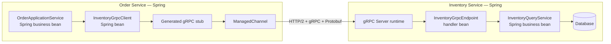
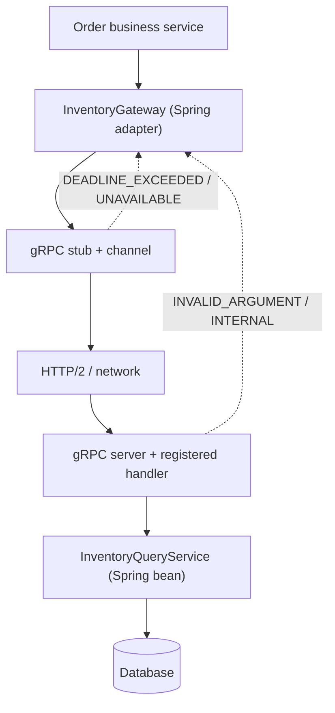

# At Which Layer Does Spring Help Manage gRPC Services?

When building a gRPC service with Spring, it is easy to mistake **gRPC service**, **Spring `@Service`**, and **gRPC server** for the same thing. In reality, they belong to different layers of responsibility. **Spring primarily helps at the application integration and management layer**: creating beans, injecting dependencies, loading configuration, managing lifecycles, and wiring cross-cutting concerns such as security, observability, and testing. The **gRPC runtime** handles RPC invocation, method routing, message exchange, statuses, and transport. **Protocol Buffers** defines the contract and the generated message classes.

This lesson belongs to the **Introduction** chapter of the **SPRING_GRPC** module. The goal of the module is to develop gRPC clients/servers in the Spring ecosystem from Protocol Buffers contracts, generate Java code, serve unary and streaming RPCs, and then handle metadata, deadlines, statuses, interceptors, TLS, integration testing, and performance and reliability monitoring. To achieve that, you must first understand *which part* Spring helps manage and *which part* gRPC still provides.

## 1. The Direct Answer: Spring Manages the Application and gRPC Integration Layer

A Spring Boot application can run both a gRPC server and gRPC clients. However, Spring does not replace the gRPC protocol itself or Protobuf code generation tooling. Responsibilities can be separated into five layers:

| Layer | Typical Artifacts | Primary Responsibility | Who Owns It? |
| --- | --- | --- | --- |
| **Contract** | `.proto`, `service`, `rpc`, `message` | Defines methods and data structures between both sides | Protocol Buffers and API designers |
| **Generated code** | `*Request`, `*Reply`, `*Grpc`, client stubs, server bases | Provides Java types and APIs to invoke/implement RPCs | `protoc` and the gRPC Java plugin |
| **RPC communication** | `Server`, `ManagedChannel`, `StreamObserver`, method descriptors | Routing, execution, message transfer, statuses, deadlines, streaming | gRPC Java runtime |
| **Application integration** | Beans, `@Configuration`, DI, lifecycle, application properties | Instantiates, configures, and connects handlers/clients to business logic | Spring / Spring Boot / Spring gRPC integration library |
| **Business logic and data** | `@Service`, repositories, transactions | Checks inventory, processes payments, enforces business rules | Spring application code |

Key point to remember: **a gRPC service is declared in `.proto`; the service implementation is a Java handler; Spring can manage that handler as a bean.** Only once the gRPC runtime is configured and registers the handler can its methods actually receive remote calls.

## 2. Full Picture of a Call Between Two Spring Applications

Suppose Order Service needs to ask Inventory Service whether enough stock is available to place an order.



In this architecture:

1. Spring instantiates and injects `OrderApplicationService`, `InventoryGrpcClient`, and business components on the calling side.
2. A client stub generated from `.proto` uses a `ManagedChannel` to invoke the gRPC method.
3. The gRPC runtime receives the request, reads the service/method identifier, and dispatches it to the registered handler.
4. The Spring-managed handler can inject `InventoryQueryService` to run business logic.
5. The gRPC runtime returns the response or error status over the network. Spring supports component lifecycle/configuration, while serialization and transport belong to gRPC/Protobuf.

The diagram clarifies the boundary: **Spring manages application objects running on top of gRPC; the gRPC runtime itself is responsible for the protocol and the lifecycle of each individual RPC.**

## 3. Distinguishing the Three Uses of "Service"

### 3.1. `service` in Protobuf Is an API Contract

Consider `inventory.proto`:

```protobuf
syntax = "proto3";

package commerce.inventory.v1;

option java_package = "com.example.inventory.grpc";
option java_multiple_files = true;

service InventoryService {
  rpc CheckStock(CheckStockRequest) returns (CheckStockReply);
  rpc WatchStock(WatchStockRequest) returns (stream StockUpdate);
}

message CheckStockRequest {
  string sku = 1;
  int32 quantity = 2;
}

message CheckStockReply {
  bool available = 1;
  int32 remaining = 2;
}

message WatchStockRequest {
  string sku = 1;
}

message StockUpdate {
  string sku = 1;
  int32 remaining = 2;
}
```

`InventoryService` defines a **gRPC service** with two methods. The contract contains no warehouse logic, declares no Spring beans, and opens no sockets on its own. During the build:

- `protoc` generates message classes such as `CheckStockRequest` and `CheckStockReply`.
- The gRPC Java plugin generates `InventoryServiceGrpc`, client stubs, and the server implementation base.
- Generated code is added to the source set so the Java compiler compiles it with gRPC runtime dependencies.

The network RPC identifier for `CheckStock` is:

```text
/commerce.inventory.v1.InventoryService/CheckStock
```

This name is derived from **Protobuf package + service name + method name**, not from `@Service` or Spring bean names.

### 3.2. Spring's `@Service` Marks a Business Bean

Example Spring bean for querying inventory:

```java
package com.example.inventory.application;

import java.util.Map;
import org.springframework.stereotype.Service;

@Service
public class InventoryQueryService {
    private final Map<String, Integer> quantities = Map.of(
        "SKU-123", 8,
        "SKU-456", 0
    );

    public int remainingQuantity(String sku) {
        return quantities.getOrDefault(sku, 0);
    }
}
```

Spring creates the instance, manages injection, and lets other classes use the `InventoryQueryService` bean. The `@Service` annotation here **does not automatically expose an RPC method**. Without a registered gRPC server handler, clients cannot call `CheckStock` merely because this business bean exists.

This uses mock in-memory data; a real system can swap in a repository/database and must decide how to distinguish a nonexistent SKU from a SKU with zero quantity.

### 3.3. The gRPC Server Handler Is the Communication Adapter Layer

After generating code from the proto file, a server adapter can extend `InventoryServiceGrpc.InventoryServiceImplBase` and override `checkStock`. The handler receives a Protobuf message, calls the business bean, builds a reply, and signals RPC completion.

It bridges two worlds:

```text
gRPC Client --> gRPC runtime --> Generated service base / handler
                                         |
                                Spring-managed bean
                                         |
                                Spring business service
                                         |
                                       Data
```

The handler can be managed by Spring via `@Component` or `@Bean` declarations. Some integration libraries also provide dedicated annotations or auto-registration mechanisms. **How it becomes a Spring bean and how it is exposed by the gRPC server are two logically distinct steps to verify**, even when a starter automates both.

## 4. How Does Spring Help the Lifecycle of a gRPC Service?

Spring provides the **IoC container** and, when using Spring Boot, **auto-configuration** based on present dependencies. Together they address the following needs:

| Need | What Spring Can Support | What Must Coordinate with gRPC |
| --- | --- | --- |
| Creating handlers | Component scanning `@Component`, `@Bean` definitions | Runtime must receive the corresponding `BindableService`/`ServerServiceDefinition` |
| Injecting business logic | Constructor injection of services/repositories | Handler calls business logic without manually instantiating services via `new` |
| Starting the server | Lifecycle beans, configuration, or starter | gRPC `Server` must bind a port and register methods |
| Stopping the server | Destroy callbacks, shutdown lifecycle management | Wait for eligible RPCs to complete or cancel per policy |
| Creating clients | `@Configuration`, stub/channel beans, or starter | Configure target, resolver, credentials, deadlines |
| Environment configuration | `application.yml`, properties, profiles, environment variables | Map to concrete server/channel/transport configuration |
| Cross-cutting concerns | Beans for auth, metrics, tracing, and policies | Attach proper gRPC server/client interceptors and TLS credentials |
| Testing | Spring Test context, test configs, business mocks | Use a gRPC test server/client to verify contracts and statuses |

An application initialized by Spring does not mean a gRPC server is automatically listening. **Enabling the server, port, service registration, and interceptors depends on the chosen integration library and configuration.**

## 5. Server Example: Handler Injected with Business Logic by Spring

From the `InventoryService` contract in section 3, a handler can be written as follows:

```java
package com.example.inventory.transport.grpc;

import com.example.inventory.application.InventoryQueryService;
import com.example.inventory.grpc.CheckStockReply;
import com.example.inventory.grpc.CheckStockRequest;
import com.example.inventory.grpc.InventoryServiceGrpc;
import io.grpc.Status;
import io.grpc.stub.StreamObserver;
import org.springframework.stereotype.Component;

@Component
public class InventoryGrpcEndpoint
        extends InventoryServiceGrpc.InventoryServiceImplBase {

    private final InventoryQueryService inventoryQuery;

    public InventoryGrpcEndpoint(InventoryQueryService inventoryQuery) {
        this.inventoryQuery = inventoryQuery;
    }

    @Override
    public void checkStock(
            CheckStockRequest request,
            StreamObserver<CheckStockReply> observer) {

        if (request.getSku().isBlank() || request.getQuantity() <= 0) {
            observer.onError(Status.INVALID_ARGUMENT
                .withDescription("SKU and quantity must be valid")
                .asRuntimeException());
            return;
        }

        final int remaining;
        try {
            remaining = inventoryQuery.remainingQuantity(request.getSku());
        } catch (RuntimeException ex) {
            observer.onError(Status.INTERNAL
                .withDescription("Unable to check inventory")
                .asRuntimeException());
            return;
        }

        CheckStockReply response = CheckStockReply.newBuilder()
            .setAvailable(remaining >= request.getQuantity())
            .setRemaining(remaining)
            .build();

        observer.onNext(response);
        observer.onCompleted();
    }
}
```

In this example:

- `@Component` tells Spring to instantiate the `InventoryGrpcEndpoint` bean.
- Constructor injection supplies `InventoryQueryService` to the handler.
- `checkStock` is the **overridden gRPC Java method**, receiving the request and `StreamObserver` from the Protobuf-generated API.
- `onNext` and `onCompleted` send the response and complete a successful unary RPC, respectively.
- `onError` terminates the RPC with an error; after calling `onError`, do not call `onNext`/`onCompleted`.

When stock is insufficient, the handler can return `available = false` with status `OK` because the inventory check itself succeeded. When input data is invalid, `INVALID_ARGUMENT` is appropriate. This design separates **business outcomes** from **RPC invocation failures**.

### Why Shouldn't the Handler Contain All Business Logic?

If the handler directly writes SQL queries, handles transactions, and enforces inventory rules, the communication layer becomes hard to reuse. Separating the handler from the Spring business service helps:

1. Unit test business logic independently of gRPC.
2. Test request/response mapping and gRPC statuses separately.
3. Reuse the business service for REST, batch jobs, or message consumers if needed.
4. Keep versioning decisions at the `.proto` layer and data-processing decisions at the application layer.

This is a **code organization principle**, not a wire-protocol requirement. In a tiny application, you could write logic directly in the handler, though a layered architecture is usually easier to maintain.

## 6. Registering a gRPC Service with the Server: Where Spring Integration Truly Participates

Once Spring creates `InventoryGrpcEndpoint`, the runtime needs to know which methods that handler serves. There are two common paths.

### 6.1. Using Plain gRPC Java and Letting Spring Manage the Server

A minimal configuration example for the **Inventory Service application**:

```java
package com.example.inventory.config;

import com.example.inventory.transport.grpc.InventoryGrpcEndpoint;
import io.grpc.Server;
import io.grpc.ServerBuilder;
import org.springframework.context.annotation.Bean;
import org.springframework.context.annotation.Configuration;

@Configuration
public class GrpcServerConfiguration {

    @Bean(initMethod = "start", destroyMethod = "shutdown")
    public Server grpcServer(InventoryGrpcEndpoint endpoint) {
        return ServerBuilder.forPort(9090)
            .addService(endpoint)
            .build();
    }
}
```

Meaning:

- Spring injects the `endpoint` bean into the `@Bean` method.
- `ServerBuilder.addService(endpoint)` **registers the gRPC service handler**.
- Spring invokes `start()` upon bean initialization and `shutdown()` upon bean destruction as declared via `initMethod`/`destroyMethod`.
- The gRPC Java runtime is what actually opens the port and handles transport.

This is an instructional pattern showing where the two frameworks connect, **not a complete production configuration**. Depending on requirements, the application also needs TLS, interceptors, readiness checks, startup exception handling, graceful shutdown, and awaiting completion of active RPCs; specifically, gRPC server's `shutdown()` initiates shutdown and does not mean all RPCs have already finished immediately. When using a starter with server auto-configuration, **do not manually create a second server like above**, as two servers may attempt to bind the same port.

### 6.2. Using a Spring gRPC Integration Library / Starter

A starter can auto-configure the gRPC server, read the port from application properties, and register compatible beans such as `BindableService`. Developers then typically focus on:

- Configuring starter dependencies and properties.
- Creating handlers matching the starter's scanning/registration mechanism.
- Injecting Spring business services into handlers.
- Adding interceptors, TLS, and health/observability using the integration's APIs.

However, **there is no single annotation shared across all gRPC–Spring libraries**. Names like `@GrpcService`, property keys, and auto-registration rules depend on the library and version. Some solutions use Spring `@Service`/`@Component` on beans implementing `BindableService`; others provide specialized annotations. When applying to a project, consult the documentation for your exact starter rather than guessing from examples of a different library.

### When to Choose Which Approach?

| Approach | Benefits | Accompanying Responsibilities |
| --- | --- | --- |
| **Plain gRPC Java + Spring beans** | Clear visibility into wiring points, direct control over Server/Channel | Manually configure service registration, lifecycle, TLS, interceptors, readiness |
| **Spring gRPC integration/starter** | Less boilerplate configuration and leverages auto-configuration | Follow the starter's APIs, versions, lifecycle, and scan/registration rules |

Either choice requires **application-implemented handlers** and a **gRPC runtime to serve RPCs**. A starter bridges those two parts; it does not generate business logic from `.proto`.

## 7. At Which Layer Does Spring Manage the gRPC Client?

On the **Order Service** side, Spring can provide channels and stubs as beans for application classes to inject. This is resource and dependency management—Spring itself does not perform the network call.

### 7.1. Creating Channels/Stubs with `@Configuration`

Example for a **local development** environment:

```java
package com.example.order.config;

import com.example.inventory.grpc.InventoryServiceGrpc;
import io.grpc.ManagedChannel;
import io.grpc.ManagedChannelBuilder;
import org.springframework.beans.factory.annotation.Value;
import org.springframework.context.annotation.Bean;
import org.springframework.context.annotation.Configuration;

@Configuration
public class InventoryGrpcClientConfiguration {

    @Bean(destroyMethod = "shutdown")
    public ManagedChannel inventoryChannel(
            @Value("${inventory.grpc.host}") String host,
            @Value("${inventory.grpc.port}") int port) {
        return ManagedChannelBuilder.forAddress(host, port)
            .usePlaintext() // Only use in local development
            .build();
    }

    @Bean
    public InventoryServiceGrpc.InventoryServiceBlockingStub inventoryStub(
            ManagedChannel inventoryChannel) {
        return InventoryServiceGrpc.newBlockingStub(inventoryChannel);
    }
}
```

Corresponding properties:

```yaml
inventory:
  grpc:
    host: localhost
    port: 9090
```

In a real application, use **TLS and proper target details**, configure credentials, service discovery/load balancing if needed, and an appropriate awaiting shutdown policy. `usePlaintext()` illustrates local usage only. Do not mix manual configuration with a starter's auto-client mechanism without knowing exactly which beans are created, to avoid duplicate configs or resources.

### 7.2. Injecting the Stub into a Client Adapter

An integration-layer gateway on the Order Service side:

```java
package com.example.order.integration;

import com.example.inventory.grpc.CheckStockReply;
import com.example.inventory.grpc.CheckStockRequest;
import com.example.inventory.grpc.InventoryServiceGrpc;
import java.util.concurrent.TimeUnit;
import org.springframework.stereotype.Component;

@Component
public class InventoryGateway {

    private final InventoryServiceGrpc.InventoryServiceBlockingStub stub;

    public InventoryGateway(
            InventoryServiceGrpc.InventoryServiceBlockingStub stub) {
        this.stub = stub;
    }

    public boolean hasStock(String sku, int quantity) {
        CheckStockRequest request = CheckStockRequest.newBuilder()
            .setSku(sku)
            .setQuantity(quantity)
            .build();

        CheckStockReply reply = stub
            .withDeadlineAfter(500, TimeUnit.MILLISECONDS)
            .checkStock(request);

        return reply.getAvailable();
    }
}
```

Spring manages `InventoryGateway` and injects the configured stub. The **gRPC stub** executes the call over `ManagedChannel`, encodes Protobuf, and returns a response or error. `withDeadlineAfter` creates call configuration on a **derived stub**; it does not mutate the global configuration of the stub bean.

The `500 ms` value is illustrative only. A production client must handle `StatusRuntimeException` at the proper boundary, pick timeouts based on latency budgets, and apply cautious fallbacks/retries. If the Spring application runs non-blocking request processing, never invoke a blocking stub directly on an event-loop thread.

### How Long Should a Channel Live?

| Management Strategy | Consequence |
| --- | --- |
| Create a channel per request | Setup overhead, higher resource usage, and leak risk if unclosed |
| Shared application-scoped channel bean | Reuses connections/transport, easier lifecycle and metrics management |
| Multiple channels per target or policy | May be needed when different endpoints, credentials, or loads require separate settings |

`ManagedChannel` holds network resources; Spring can manage when it is created/destroyed, while transport and connection rules remain managed by gRPC. **Do not share one channel across the wrong target or wrong security credentials** just to save connections.

## 8. Layering and Error-Handling Responsibilities

When Order Service calls `InventoryGateway.hasStock(...)` and it fails, you need to know where the failure occurred:



| Error or Outcome | Relevant Layer | Diagnostic Action |
| --- | --- | --- |
| Spring bean not found | Spring IoC/configuration | Check component scan, `@Bean`, constructor injection, profiles |
| `BeanCreationException` while binding port | Spring lifecycle + gRPC server | Check port, server configuration, and bind errors |
| `UNIMPLEMENTED` | gRPC service registration/method | Check `.proto` service/method names and registered handlers |
| `UNAVAILABLE` | Network/channel/transport | Check host/port, DNS, TLS, proxy, server health |
| `INVALID_ARGUMENT` | Validation in gRPC handler | Check request payload and contract rules |
| `DEADLINE_EXCEEDED` | RPC deadline/latency | Check timeout budget, network, queues, and processing time |
| `INTERNAL` | Unexpected server error | Check server logs, error mapping, traces, and business/infra failures |
| `available = false`, status `OK` | Business result | Handle as "insufficient stock"; do not retry as a network failure |

### Spring Exceptions Do Not Automatically Become Meaningful gRPC Statuses

An exception thrown by a Spring service can propagate into the handler. Unless explicitly translated, the client may receive a generic gRPC error and lose the ability to determine the cause. Developers should establish clear mapping conventions, such as:

- Invalid request → `INVALID_ARGUMENT`.
- SKU not found, if the contract models that as an error → `NOT_FOUND`.
- Caller unauthorized → `PERMISSION_DENIED` or `UNAUTHENTICATED` depending on context.
- Unexpected internal failure → `INTERNAL`; never leak sensitive stack traces to clients.

Do not equate **HTTP status** with **gRPC status**. gRPC may return HTTP/2 `:status 200` while trailers report a `grpc-status` other than `OK`. Client stubs interpret status through gRPC's mechanism.

## 9. Metadata and Interceptors: Spring Provides Beans, gRPC Attaches Them to RPCs

Metadata includes information accompanying an RPC that does not belong to business fields like `sku` or `quantity`: authorization tokens, correlation IDs, trace context, or deadlines. In gRPC, metadata is usually mapped to HTTP/2 headers/trailers.

An **Interceptor** is a gRPC component for cross-cutting logic across multiple methods. Spring can instantiate interceptors as beans, inject needed dependencies, and configure them by profile. Yet for an interceptor to actually run, **the gRPC server/client runtime must attach it to the call chain**.

Plain gRPC Java illustration during manual server registration:

```java
import io.grpc.Server;
import io.grpc.ServerBuilder;
import io.grpc.ServerInterceptor;
import io.grpc.ServerInterceptors;

// endpoint: InventoryGrpcEndpoint bean
// authenticationInterceptor: bean implementing ServerInterceptor
Server server = ServerBuilder.forPort(9090)
    .addService(ServerInterceptors.intercept(
        endpoint, authenticationInterceptor))
    .build();
```

Merely defining `@Component class AuthenticationInterceptor implements ServerInterceptor` does not guarantee the interceptor is automatically applied to every RPC. When using a starter, check that exact library's mechanism for registering global/per-service interceptors, including execution order.

### Where Should Logic Live?

| Type of Logic | Usually Appropriate Location |
| --- | --- |
| Translating Protobuf requests into business arguments | gRPC handler/adapter |
| Rules checking whether stock is sufficient | Spring business service |
| Token validation across multiple methods | gRPC server interceptor + injected auth service |
| Authorization by SKU or order owner | Handler/business service using user context |
| Trace ID / correlation ID | gRPC metadata + interceptor/tracing instrumentation |
| TLS/mTLS | gRPC server/channel transport credentials and infrastructure |
| Business logging | Business layer with appropriate context; avoid logging tokens |

Spring Security can supply authentication/authorization infrastructure, yet **an HTTP Servlet/WebFlux filter chain does not automatically protect every gRPC method**. To secure gRPC, use a security integration built for the gRPC runtime or explicitly attach appropriate interceptors and policies.

## 10. Deadlines, Cancellation, and Streaming: Spring Manages Beans, gRPC Manages Calls

A **Spring singleton bean** can live for the entire lifetime of the application, whereas each RPC lives only from start until response/status completion. This distinction is especially important with streaming.

### 10.1. Deadlines and Cancellation Belong to Each RPC

A client can set a deadline:

```java
CheckStockReply reply = stub
    .withDeadlineAfter(500, TimeUnit.MILLISECONDS)
    .checkStock(request);
```

When the deadline expires, the client typically receives `DEADLINE_EXCEEDED`. gRPC can send a cancellation signal to the server; business code should check or honor cancellation status to avoid continuing costly work.

**Spring bean scope does not set deadlines**, and `@Transactional` does not automatically set gRPC deadlines. Database, HTTP request, or transaction timeouts each have distinct semantics; coordinate time budgets across them without assuming they are the same mechanism.

### 10.2. Singleton Handlers and Per-RPC Data

A gRPC handler may be a Spring singleton serving many concurrent calls. Do not store mutable request data in bean fields:

```java
// DO NOT DO THIS: singleton field shared across multiple RPCs.
private String currentSku;
```

If multiple clients call concurrently, they can overwrite `currentSku` and corrupt or leak data across RPCs. Instead, use local variables, immutable data, per-call objects, or context mechanisms supported by the runtime.

Similarly, **Spring HTTP MVC request scope** does not automatically map to a "gRPC request scope." To propagate authentication or tracing context into handlers, use gRPC context, metadata, or verified integration mechanisms; never assume you can read `HttpServletRequest` as in a REST controller.

### 10.3. Long-Lived Streams Do Not Mean Longer-Lived Beans

`WatchStock` is a server-streaming RPC:

```protobuf
rpc WatchStock(WatchStockRequest) returns (stream StockUpdate);
```

The server can emit multiple `StockUpdate` messages within one RPC. Spring can inject an update source or repository into the handler, while gRPC manages the stream, `StreamObserver`, and completion/cancellation.

Simple example:

```java
@Override
public void watchStock(
        WatchStockRequest request,
        StreamObserver<StockUpdate> observer) {
    observer.onNext(StockUpdate.newBuilder()
        .setSku(request.getSku())
        .setRemaining(8)
        .build());
    observer.onNext(StockUpdate.newBuilder()
        .setSku(request.getSku())
        .setRemaining(7)
        .build());
    observer.onCompleted();
}
```

This snippet merely illustrates two messages on a finite stream. In a real system, manage event sources, backpressure/flow control, cancellation, buffering, and thread safety. Never let a streaming RPC hold threads or resources indefinitely due to missing termination logic.

## 11. What Are the Limits of Connecting Spring Transactions and gRPC?

A Spring `@Transactional` annotation can manage a database transaction around a business method when a proper transaction manager is configured. However, **gRPC does not automatically participate in database transactions**.

Example:

1. Order Service calls `ReserveStock` over gRPC.
2. Inventory Service opens a transaction and deducts inventory.
3. The database commits successfully.
4. The network connection drops before the response reaches Order Service.

From the connection failure alone, the client cannot be sure the server did not deduct stock. Retrying automatically could deduct inventory a second time. Design **idempotency keys**, status lookup queries, or deduplication mechanisms to protect write operations.

`@Transactional` in Order Service **does not automatically open a distributed transaction spanning Inventory Service**. Multi-service workflows may require sagas, outbox patterns, compensation, or other consistency strategies. Spring helps build business logic and local transactions within appropriate scopes; gRPC itself is the communication layer between services.

## 12. Who Owns TLS, Security, and Environment Configuration?

Spring Boot makes managing properties, profiles, and shared config convenient, yet transport security must still be configured in gRPC or the corresponding starter.

| Component | What Spring Commonly Assists With | What the Runtime Must Execute |
| --- | --- | --- |
| Server port and address | Reading from properties/profiles | gRPC binds address/port |
| TLS certificates | Loading paths/secrets/configs into beans | gRPC transport performs TLS handshake and encryption |
| Peer authentication via mTLS | Wiring credential providers | Transport verifies client/server identity |
| RPC access tokens | Beans providing tokens/credentials, policies | gRPC client metadata; server interceptors/auth |
| Method authorization | Authentication service, business authorization | Reject/deny RPCs or return `PERMISSION_DENIED` appropriately |
| Logs and traces | Instrumentation config, logging/metrics | Extract/attach metadata, record per-RPC metrics |

A common mistake is assuming Spring Boot's `server.port` is always the gRPC port as well. **Spring Boot's HTTP web server and the gRPC server can listen on separate ports**, depending on the library and configuration. Likewise, HTTPS on REST endpoints does not guarantee the gRPC endpoint has TLS enabled.

When using proxies or service meshes, confirm that the network path truly supports HTTP/2 and enforces end-to-end TLS or TLS termination as intended.

## 13. At Which Layers Does Spring Help Test gRPC Services?

Layered development lets you test each category of risk separately.

### 13.1. Unit Testing Business Beans

Test `InventoryQueryService.remainingQuantity(...)` or other business logic as plain Java classes. You do not need to start a gRPC server to verify stock calculations.

### 13.2. Testing Handlers and Status Translation

Verify:

- Valid requests map to expected responses.
- Blank `sku` or `quantity <= 0` returns `INVALID_ARGUMENT`.
- Out-of-stock produces `available = false` with a successful RPC.
- Business exceptions map to appropriate statuses.

Calling `checkStock` directly as a Java method only verifies handler/mapping logic; it does not prove a real endpoint can serve RPCs.

### 13.3. gRPC Integration Tests

Start a gRPC server with registered handlers and a client stub using the same contract. Send real `CheckStockRequest` messages and verify responses, statuses, deadlines, and metadata.

In gRPC Java, **in-process transport** can test services/stubs without opening sockets. However, such tests do not validate real HTTP/2 behavior, TLS, proxies, or production transport conditions. Before production, run tests over real transport if those concerns matter.

### 13.4. Spring Integration Tests

Load the Spring application context or test configuration to verify:

- Handlers and business services are wired properly.
- The runtime/starter registers the expected gRPC services.
- Properties, profiles, and startup/shutdown lifecycles behave properly.
- Client stubs/channels complete RPCs against the test server.
- Interceptors, TLS, and environment-specific dependencies are wired correctly.

You do not need to boot every database and external dependency for every test. Choose the integration level to match your goal; at a minimum, include a test proving **Spring wiring and gRPC methods work together end-to-end**.

## 14. System Observability: Spring Supports Instrumentation, gRPC Supplies RPC Events

In operations, knowing that beans started is not enough—you must see how each method performs.

| Operational Question | Metrics or Signals to Observe |
| --- | --- |
| How often do clients call `CheckStock`? | Total RPC count by service/method |
| Which method is slow? | Latency histograms, p50/p95/p99 by method |
| Which errors are spiking? | Rates of `UNAVAILABLE`, `DEADLINE_EXCEEDED`, `INTERNAL`, etc. |
| Are too many streams staying open long? | Concurrent/active streams, stream duration, buffering |
| Is the server overloaded? | CPU, memory, request concurrency, thread pools, queues, DB latency |
| Why is Order Service slow? | Distributed tracing from Order → Inventory → database |
| Are clients losing connections? | Channel states, connection failures, TLS/proxy logs |

Spring Boot provides Actuator/Micrometer and tracing integrations, yet **gRPC metrics do not appear automatically just because Spring beans exist**. Configure gRPC server/client instrumentation and monitor tag cardinality—especially service, method, and status—while avoiding high-cardinality metric tags like SKU, tokens, or user IDs.

Proper logging and tracing should help pinpoint whether an error sits in **Spring bean lifecycle**, **gRPC runtime/transport**, or **business service**. That is a direct payoff of clean layering.

## 15. Common Misconceptions

| Statement | Accurate Understanding |
| --- | --- |
| "`@Service` is enough to publish a gRPC API." | `@Service` marks a Spring bean; the gRPC server needs registered handlers. A starter may auto-register according to its own rules. |
| "`service` in `.proto` is a Spring bean." | It is an RPC contract used to generate Java classes and identify the service on the network. |
| "Spring generates all client/server code from `.proto`." | `protoc` and the gRPC Java plugin generate code. Spring integrates that code into the application. |
| "Spring Boot's web server is always the gRPC server." | They are often different runtimes/ports, depending on starter and infrastructure. |
| "Having a `ManagedChannel` bean means the server is running." | Channels are client-side resources; the server must start and register services separately. |
| "Spring Security HTTP filters protect every RPC." | gRPC needs an authentication/authorization chain compatible with gRPC, typically via interceptors or dedicated integration. |
| "Since handlers are Spring singletons, RPCs can share request fields." | Singleton beans serve multiple concurrent RPCs; mutable per-request state must not be stored in shared fields. |
| "`@Transactional` manages an entire RPC chain across microservices." | Local transactions do not automatically span processes and remote services. |
| "When a gRPC method throws, Spring knows which status to return." | Exceptions/statuses must be mapped explicitly per contract. |
| "Spring manages shutdown so open streams need no handling." | The runtime has separate streaming/cancellation mechanics; graceful shutdown needs an explicit policy. |
| "Every starter uses `@GrpcService` and the same property names." | Annotations and configuration keys depend strictly on the specific library and version. |

## 16. Analysis Exercise for a Spring gRPC Application

Suppose a project has:

```text
com.example.inventory
  ├── application
  │     └── InventoryQueryService.java
  ├── transport.grpc
  │     └── InventoryGrpcEndpoint.java
  ├── config
  │     └── GrpcServerConfiguration.java
  └── generated
        ├── CheckStockRequest.java
        ├── CheckStockReply.java
        └── InventoryServiceGrpc.java
```

This is a role diagram only; real generated directories typically reside under `build/generated` or Maven's target folder.

**Scenario 1:** The Spring context starts successfully with bean `InventoryQueryService`, yet the client gets `UNIMPLEMENTED`. Where should you look?

**Hint:** check whether `InventoryGrpcEndpoint` was registered with the gRPC server, whether contract service/method names match, and whether the method is properly overridden.

**Scenario 2:** The client calls gRPC fine locally but fails after deployment, even though REST endpoints work. Where should you look?

**Hint:** check the dedicated gRPC address/port, HTTP/2 proxies/load balancers, TLS credentials, network policies, and server readiness—not just the web app's `server.port`.

**Scenario 3:** Two concurrent RPCs send different SKUs and occasionally mix up results. Where should you look?

**Hint:** look for mutable fields storing per-request state in singleton handlers/services, and switch to local variables or safe per-call context.

**Scenario 4:** A `ServerInterceptor` bean was added, yet no RPC traces/logs appear. Where should you look?

**Hint:** verify the interceptor was attached to the server/client by the gRPC runtime via manual registration or your starter's mechanism.

**Scenario 5:** `@Transactional` in Order Service rolled back, yet Inventory Service still deducted stock. Can this happen?

**Hint:** yes. Transactions across separate services do not automatically combine; you need idempotency/compensation/saga or an appropriate consistency strategy.

## 17. Checklist for Implementing gRPC Services in Spring

To avoid mixing up responsibilities, follow this order:

1. **Define the contract:** write `.proto` with package, service/methods, messages, and compatibility rules.
2. **Generate Java code:** configure `protoc` and `protoc-gen-grpc-java`, verifying message classes and `*Grpc` are generated.
3. **Build business beans:** place business processing in Spring services with appropriate validation and transactions.
4. **Write gRPC handlers:** extend generated server bases, map requests/responses and statuses.
5. **Register server handlers:** decide between a starter or manual config, and confirm handlers are served by the runtime.
6. **Manage clients:** inject configured stubs/channels, reuse channels, set deadlines, and handle errors contextually.
7. **Configure security and cross-cutting concerns:** TLS/mTLS, metadata, auth, interceptors, logging, and tracing for gRPC.
8. **Manage lifecycles:** startup/shutdown, readiness, and active streams.
9. **Test end-to-end:** verify Spring wiring, server registration, real RPCs, statuses, deadlines, streaming, and failure scenarios.
10. **Monitor:** track latency, statuses, throughput, active streams, and resources by service/method.

When reaching step 5, always answer: **"Has this bean been registered with the gRPC runtime?"** When reaching step 6, answer: **"How long do this channel and stub live, and are they pointing to the right destination?"** These are the two places where Spring configuration and gRPC configuration are most often confused.

## 18. Takeaways

**Spring helps manage gRPC at the application and integration layer:** Spring IoC creates handlers, gateways, and business services; Spring Boot can auto-configure the runtime via a starter; beans and properties manage connections, startup/shutdown, security, and observability. **gRPC remains the RPC execution framework:** it manages channels, servers, method dispatch, metadata, statuses, deadlines, and streaming over HTTP/2. **Protobuf remains the contract and message format**, used by the compiler/plugin to generate Java classes.

Whenever you see a Java class with `@Service`, ask **is it business logic or a gRPC endpoint?**; whenever you see `InventoryService` in `.proto`, ask **which handler implements it and which server registers it?** Clearly answering these two questions helps you organize layers cleanly in the **SPRING_GRPC** ecosystem and tackle deeper topics around metadata, deadlines, statuses, interceptors, TLS, integration testing, and reliability monitoring.

### References

- [gRPC – Introduction](https://grpc.io/docs/what-is-grpc/introduction/)
- [gRPC – Java basics](https://grpc.io/docs/languages/java/basics/)
- [gRPC – Core concepts, architecture and lifecycle](https://grpc.io/docs/what-is-grpc/core-concepts/)
- [Spring Framework – IoC Container](https://docs.spring.io/spring-framework/reference/core/beans.html)
- [Spring Boot – Developing with Spring Boot](https://docs.spring.io/spring-boot/reference/using/index.html)
- [Spring gRPC – Reference documentation](https://docs.spring.io/spring-grpc/reference/)
- [gRPC – Deadlines](https://grpc.io/docs/guides/deadlines/)
- [gRPC – Status codes](https://grpc.io/docs/guides/status-codes/)
