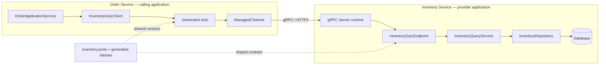
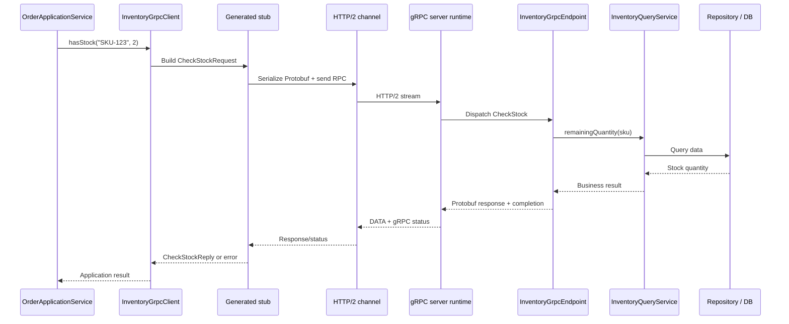

# Components You Will Encounter in a Spring gRPC Application

A **Spring gRPC** application consists of more than just one `.proto` file and one class with a request-handling method. For a remote call to work, the application needs components that define the contract, generated Java code, a gRPC server or client runtime, RPC-handling adapters, business beans, configuration, and supporting capabilities such as security, observability, and testing.

This lesson belongs to the **Introduction** chapter of the **SPRING_GRPC** module. The module focuses on developing gRPC clients/servers in the Spring ecosystem using Protocol Buffers and Java code generation, supporting unary/streaming RPCs, metadata, deadlines, statuses, interceptors, TLS, integration testing, and performance and reliability monitoring. This lesson maps out the components you will encounter and clarifies which component participates in the path of a call.

## 1. Component Map of an Application

Consider an example where Order Service needs to check stock in Inventory Service. Both applications may use Spring Boot, yet one acts as the client and the other acts as the server for this call.



Components are grouped into six areas:

1. **Contract and code generation:** `.proto` files, Protobuf message classes, service descriptors, and stubs.
2. **Server side:** gRPC server runtime, service implementations/handlers, and the handler registration mechanism.
3. **Client side:** target/endpoint, `ManagedChannel`, stubs, and per-RPC configuration.
4. **Spring application:** IoC container, configuration, business beans, repositories, and transactions.
5. **Cross-cutting:** interceptors, metadata, credentials, TLS, deadlines, health, metrics, and tracing.
6. **Testing and operations:** test server/client, environment configuration, lifecycle, and graceful shutdown.

Not every project has a separate class for every box in the diagram. A starter might auto-create several beans or combine configuration responsibilities into one component. What matters is **roles and relationships**, not file counts.

## 2. Contract and Generated Code: The Foundation for Mutual Understanding

### 2.1. The `.proto` File

The proto file is the contract source: it declares packages, services, methods, and messages. Example:

```protobuf
syntax = "proto3";

package commerce.inventory.v1;

option java_package = "com.example.inventory.grpc";
option java_multiple_files = true;

service InventoryService {
  rpc CheckStock(CheckStockRequest) returns (CheckStockReply);
}

message CheckStockRequest {
  string sku = 1;
  int32 quantity = 2;
}

message CheckStockReply {
  bool available = 1;
  int32 remaining = 2;
}
```

This contract answers three questions:

- **Which service is called?** `commerce.inventory.v1.InventoryService`.
- **Which method is called?** `CheckStock`.
- **What data is sent and received?** `CheckStockRequest` and `CheckStockReply`.

`.proto` contains no Spring beans, SQL, or port configuration. It describes the exchange interface, so it should be reviewed and versioned like a public API between applications.

### 2.2. Generated Java Code

`protoc` and the gRPC Java plugin typically produce two groups of code:

| Generated Code | Examples | Role |
| --- | --- | --- |
| Protobuf message classes | `CheckStockRequest`, `CheckStockReply` | Builders, getters, serialization, and parsing of data |
| gRPC service classes | `InventoryServiceGrpc` | Method descriptors, client stubs, and server implementation base |

The client side uses stubs to invoke typed methods; the server side extends the base class or implements the generated service type to provide methods. These files are **generated sources**, not where business logic belongs. When the contract changes, update `.proto` and re-run code generation.

### 2.3. How Can Contracts Be Shared?

Two Java applications typically use a contract module published as a library, or each application generates code from the same managed proto version. If client and server are implemented in different languages, each side generates code from the same compatible schema.

What matters is managing versions, field numbers, and method changes. A change may compile cleanly yet still break semantics or compatibility with applications that have not upgraded.

## 3. Server-Side Components

The server side comprises the runtime accepting RPCs, handlers implementing services, and backing beans executing business logic.

### 3.1. The gRPC Server Runtime

The gRPC server runtime:

- Listens on the configured address/port.
- Accepts connections and HTTP/2 streams.
- Identifies the service/method in an RPC.
- Dispatches decoded requests to registered handlers.
- Sends responses, trailers, and gRPC statuses back to the client.
- Manages transport, cancellation, and streaming.

In gRPC Java, the server is typically built on a transport implementation such as Netty. A Spring application can instantiate the server directly or let an integration starter configure and manage it. Either way, **the server runtime remains the component executing gRPC communication**.

The gRPC server can use a separate port from Spring Boot's web server. For example, REST runs on port 8080 while gRPC runs on port 9090. These numbers are illustrative only; check your integration library and deployment environment's actual configuration.

### 3.2. Service Implementation or Handler

The handler is the adapter implementing the methods in the contract. With the commonly generated gRPC Java API, a server class can extend `InventoryServiceGrpc.InventoryServiceImplBase`:

```java
@Component
public class InventoryGrpcEndpoint
        extends InventoryServiceGrpc.InventoryServiceImplBase {

    private final InventoryQueryService inventoryQuery;

    public InventoryGrpcEndpoint(InventoryQueryService inventoryQuery) {
        this.inventoryQuery = inventoryQuery;
    }

    @Override
    public void checkStock(
            CheckStockRequest request,
            StreamObserver<CheckStockReply> observer) {
        int remaining = inventoryQuery.remaining(request.getSku());

        CheckStockReply reply = CheckStockReply.newBuilder()
            .setAvailable(remaining >= request.getQuantity())
            .setRemaining(remaining)
            .build();

        observer.onNext(reply);
        observer.onCompleted();
    }
}
```

This is an illustrative skeleton assuming generated types and `InventoryQueryService` already exist. The handler turns a Protobuf request into a business call, converts the result into a response, and finishes the RPC. Production code needs validation, error mapping, cancellation checks, and appropriate security rules.

`@Component` lets Spring create the bean and inject constructor dependencies. It **does not automatically mean** the method is exposed on the gRPC server in every stack.

### 3.3. Service Registration Mechanism

The server must know which handler serves which service/method. With plain gRPC Java, the registration point is typically `ServerBuilder.addService(...)`. With a Spring integration/starter, the library may scan beans implementing services and register them automatically, or provide custom annotations/configs.

Annotation names, properties, and scanning rules depend on the starter and version. Therefore, when reading a project, find the answer to: **where are handler beans registered with the server runtime?**

Avoid enabling a starter's auto-registration while simultaneously creating another manual server without understanding their lifecycles; doing so can lead to two servers or port conflicts.

### 3.4. Business Beans

Handlers should not need to know database details or execute all business rules. A class like `InventoryQueryService` can:

- Validate SKUs and quantities.
- Query inventory through a repository.
- Apply business rules.
- Manage transactions when needed.
- Return domain results for the handler to map into Protobuf responses.

Business beans can be shared across REST controllers, gRPC handlers, message consumers, or batch jobs. This keeps logic decoupled from a single transport protocol.

### 3.5. Repositories and Data Systems

Repositories are components accessing databases or storage systems. They are typically Spring-managed, not gRPC components. An RPC call may terminate in a handler without hitting a database, or a handler may invoke multiple beans/repositories before replying.

When measuring latency, distinguish time spent in the gRPC runtime, handler, business service, and database. Measuring only the repository method fails to reflect how long the client actually waits.

## 4. Client-Side Components

The client side also involves more than a single stub call.

### 4.1. Target or Service Address

The client must know how to locate the server: fixed host/port locally, DNS/service discovery, resolvers, or load balancing config. Addresses are network routing details, distinct from service/method names in the contract.

Example:

```text
Endpoint: inventory.internal:9090
Service:  commerce.inventory.v1.InventoryService
Method:   CheckStock
Path:     /commerce.inventory.v1.InventoryService/CheckStock
```

The endpoint tells where to connect; service/method tells which operation is requested.

### 4.2. ManagedChannel

`ManagedChannel` is gRPC Java's client-side abstraction for managing communication to a target. It encompasses connection state, transport, and resolver/load balancing mechanics depending on configuration.

A channel is typically a long-lived resource reused across many calls. Do not create a new channel for every HTTP request or every business call. In Spring, channels can be created as beans and closed according to the application lifecycle.

### 4.3. Stub

A stub is the client API generated from a gRPC service:

| Common Stub | Call Style | Notes |
| --- | --- | --- |
| `newBlockingStub(channel)` | Synchronous, blocks calling thread | Suitable for unary and certain server-streaming APIs |
| `newStub(channel)` | Asynchronous via observers | Used for streaming and callbacks |
| `newFutureStub(channel)` | Future-based | Primarily for unary RPCs |

A stub is neither a server nor its own dedicated connection. It uses a channel to execute calls. You can derive stub instances with deadlines, credentials, or suitable call options.

### 4.4. Client Adapter / Gateway

A bean like `InventoryGrpcClient` or `InventoryGateway` can hide generated stub details from business layers. It is responsible for:

- Building Protobuf requests from application data.
- Invoking the corresponding stub method.
- Attaching deadlines and metadata per policy.
- Converting Protobuf responses into application domain types.
- Mapping gRPC statuses into errors understood by callers.

Short example:

```java
@Component
public class InventoryGrpcClient {
    private final InventoryServiceGrpc.InventoryServiceBlockingStub stub;

    public InventoryGrpcClient(
            InventoryServiceGrpc.InventoryServiceBlockingStub stub) {
        this.stub = stub;
    }

    public boolean hasStock(String sku, int quantity) {
        CheckStockReply reply = stub
            .withDeadlineAfter(400, TimeUnit.MILLISECONDS)
            .checkStock(CheckStockRequest.newBuilder()
                .setSku(sku)
                .setQuantity(quantity)
                .build());
        return reply.getAvailable();
    }
}
```

This snippet assumes channel/stub are configured and injected. The 400 ms deadline is an example and must be tuned to the business flow's time budget. If using a blocking stub, never invoke it directly on a reactive application's event loop.

## 5. How Does Spring Manage and Wire Components Together?

The Spring IoC container creates beans, injects dependencies, and applies configuration. Spring Boot can provide auto-configuration; a gRPC integration library can add server/client beans, properties, and handler registration mechanisms.

Common responsibilities:

| Spring Component | What It Supports |
| --- | --- |
| Application context | Instantiating and managing beans, dependency injection |
| `@Configuration` / `@Bean` | Declaring servers, channels, stubs, or interceptors when configuring manually |
| Properties / profiles | Externalizing hosts, ports, TLS materials, and policies into environment config |
| Lifecycle callbacks | Starting/stopping resources in alignment with application lifecycle |
| Business services / repositories | Organizing logic and data access |
| Starter / auto-configuration | Integrating gRPC server/client per the library's APIs |
| Spring Test | Loading context and verifying wiring, configuration, and beans |

One thing to verify in any project is **which component creates the server/channels and who closes them**. If a starter already manages the server, avoid declaring a manual server as well. If creating channels manually, ensure channels shut down when the application stops.

### Example Client Configuration Managed by Spring

This pattern uses gRPC Java directly in Spring configuration to highlight bean roles:

```java
@Configuration
public class InventoryGrpcConfiguration {

    @Bean(destroyMethod = "shutdown")
    ManagedChannel inventoryChannel(
            @Value("${inventory.grpc.host}") String host,
            @Value("${inventory.grpc.port}") int port) {
        return ManagedChannelBuilder.forAddress(host, port)
            .useTransportSecurity()
            .build();
    }

    @Bean
    InventoryServiceGrpc.InventoryServiceBlockingStub inventoryStub(
            ManagedChannel inventoryChannel) {
        return InventoryServiceGrpc.newBlockingStub(inventoryChannel);
    }
}
```

This template illustrates Spring creating and destroying the channel alongside the stub. `useTransportSecurity()` assumes the target has valid TLS configured; environments needing CA/trust material or mTLS may need more specific credentials setup. Do not use this pattern in place of your chosen starter's guidance if the starter manages clients automatically.

## 6. Cross-Cutting Components Shared Across RPCs

Beyond clients, servers, and business beans, a real gRPC application typically includes cross-cutting components.

### 6.1. Interceptors

Client interceptors and server interceptors handle shared logic across many RPCs, such as:

- Validating or attaching tokens.
- Reading/writing correlation IDs and trace context.
- Logging methods, durations, and outcomes.
- Recording metrics.
- Enforcing shared policies.

Spring can instantiate interceptor beans and inject supporting services. However, an interceptor only executes if attached to a gRPC channel/server or registered by the starter's mechanism.

### 6.2. Metadata and Credentials

Metadata carries control information alongside an RPC, such as authorization tokens or trace context. Credentials describe how a client proves identity or establishes security. Do not stuff tokens into business messages just because messages are easy to access.

Distinguish:

- **TLS/mTLS:** secures the transport channel and authenticates peers at the transport layer.
- **Call credentials / authorization metadata:** carries per-call authentication credentials.
- **Server interceptor / authorization:** verifies identity and method-level permissions.

These three mechanisms complement one another; enabling TLS does not automatically mean every caller is authorized to invoke every method.

### 6.3. Deadlines, Cancellation, and Statuses

Deadlines are typically set per RPC on the client side. Cancellation allows ending a call that is no longer needed. Status describes communication outcomes at the gRPC level, such as `OK`, `INVALID_ARGUMENT`, `NOT_FOUND`, `UNAVAILABLE`, or `DEADLINE_EXCEEDED`.

These are not separate mandatory Spring beans per application. They are concepts/APIs of the gRPC runtime; Spring can help configure policies or supply supporting beans.

### 6.4. Health, Reflection, and Observability

Some applications also implement:

- **gRPC health service:** lets infrastructure check serving health per service.
- **Server reflection:** exposes descriptors so compatible tooling can discover services/methods; evaluate carefully which environments should enable it.
- **Metrics:** RPC counts, latency, statuses, active streams.
- **Tracing:** following request paths from Order through Inventory to databases/downstream services.
- **Logging:** recording enough context for diagnosis while omitting tokens and sensitive data.

Health/reflection do not appear automatically just from having a business proto file; they normally require extra services or config. Spring Boot Actuator can support application health/metrics, though integrating gRPC runtime health depends on the starter.

## 7. Which Components Does a Call Traverse?

For the unary RPC `CheckStock`, the condensed path is:



In this flow, each component answers a distinct question:

| Component | Question It Answers |
| --- | --- |
| `.proto` | Which methods and messages do client and server agree on? |
| Generated stub | With what Java types does the client invoke the remote API? |
| ManagedChannel | Where are calls sent and how are connections managed? |
| gRPC server runtime | Which service/method does the RPC target, and which handler serves it? |
| Handler | How are requests/responses and gRPC statuses mapped? |
| Spring business service | What business rules must be executed? |
| Repository | Where is data read/written? |
| Interceptor/credentials | How are authentication, tracing, and shared policies applied? |

When an error occurs, identify the first component failing to fulfill its responsibility instead of modifying every layer at once.

## 8. Which Components Change by RPC Type?

The contract and runtime share the same foundation, yet handler/stub APIs depend on method cardinality.

| RPC Pattern | Contract Shape | Client-Side Component | Server-Side Component |
| --- | --- | --- | --- |
| Unary | One request → one response | Blocking/async/future stub | One response followed by completion |
| Server streaming | One request → multiple responses | Receives multiple messages from one RPC | Emits multiple messages via response observer |
| Client streaming | Multiple requests → one response | Sends message sequence via request observer | Receives stream and returns one final response |
| Bidirectional streaming | Both sides send multiple messages | Sends and receives within the same RPC | Receives and sends within the same RPC |

With streaming, also address cancellation, flow control, buffers, concurrency, and stream termination. A Spring singleton handler can serve many RPCs; never store per-request state in mutable fields shared across calls.

## 9. Resource Lifecycles: Servers, Channels, and Beans Differ

Different components have different lifetimes:

| Component | Typical Lifetime | How It Ends |
| --- | --- | --- |
| Spring application context | Application lifetime | Context closure |
| gRPC server | Server process lifetime or server-managing bean | Graceful shutdown / forced shutdown per policy |
| ManagedChannel | Client process lifetime or channel-managing bean | Shutdown and await termination as needed |
| Stub | Typically lightweight object used within the application | Does not manage transport independently; channel owns connection resources |
| One unary RPC | From start until response/status | Completion, error, or cancellation |
| One streaming RPC | From opening the stream until completion/cancellation | Completion, error, deadline, or cancellation |
| Spring business bean | Per bean scope, typically singleton | Managed by Spring container |

Do not infer that a Spring singleton bean means only one RPC runs at a time. Handlers can be invoked concurrently; code must be thread-safe. Likewise, initiating channel shutdown does not guarantee in-flight RPCs will finish successfully. Graceful shutdown requires timeout policies and handling for open streams.

## 10. Testing and Diagnostic Components

Not every test needs to boot the entire system. Choose the testing level by component:

| Goal | Component Under Test | Verification Example |
| --- | --- | --- |
| Business rules | Spring business service | SKU, quantity, inventory outcome |
| RPC mapping | Handler/endpoint | Request → response/status |
| Spring wiring | Application context | Handlers and dependencies injected |
| Server registration | gRPC server runtime | Client can call exposed methods |
| Client adapter | Stub/channel + gateway | Deadlines, response and status mapping |
| Security | Credentials/interceptors/TLS | Tokens, permissions, handshake |
| Streaming | Stub/observer and server handler | Multiple messages, cancellation, completion |
| Operations | Metrics/tracing/logging | Latency, statuses, active streams, cross-service traces |

In-process gRPC tests are useful for testing handlers and stubs, but do not replace testing TLS, HTTP/2 proxies, or real network deployments. For specific errors:

- `UNIMPLEMENTED`: check contract, method name, and handler registration.
- `UNAVAILABLE`: check target, port, DNS, TLS, proxies, and server readiness.
- `INVALID_ARGUMENT`: check request validation.
- `DEADLINE_EXCEEDED`: check deadline budgets and downstream layer latency.
- `INTERNAL`: inspect server logs/traces and exception mapping.

## 11. Optional Components Depending on Application Needs

Not every project requires the exact same set of components. Add them when architectural requirements call for them:

| Optional Component | When Useful |
| --- | --- |
| Spring gRPC starter | When you want auto-configuration, server/client integration, and library-managed lifecycles |
| Client-side load balancing/resolver | When multiple endpoints exist or service discovery is required |
| Health service | When orchestrators or load balancers must check gRPC serving health |
| Reflection | When compatible tooling should discover services/methods in permitted environments |
| Client/server interceptors | When shared auth, logging, metrics, or tracing is needed |
| TLS/mTLS credentials | When communication requires encryption and/or mutual authentication |
| Retry policy | When certain RPCs are safe to retry and need bounded policies |
| Streaming event source | When a method must push continuous data rather than a single response |
| gRPC-Web/HTTP gateway | When browser clients or HTTP-only systems need access to the API |

In particular, **a starter is not a mandatory part of the gRPC protocol**. You can integrate gRPC Java directly with Spring beans. When using a starter, annotation names, properties, handler scanning, and client config depend on the library/version. Avoid mixing configurations from multiple starters or combining manual management with auto-configuration for the same server/channel.

## 12. Checklist for Identifying Components in a Codebase

When opening an existing Spring gRPC application, locate in order:

1. **Contract:** which `.proto` files define services and methods?
2. **Generated code:** where are message classes and `*Grpc` generated, and at what version?
3. **Server registration:** which handler beans are registered on the gRPC server, and who starts the server?
4. **Business layer:** which services/repositories does the handler inject to run logic?
5. **Client configuration:** where are targets, channels, and stubs created?
6. **Client adapter:** which class converts application data into Protobuf requests and maps responses/statuses?
7. **Cross-cutting:** where are interceptors, metadata, credentials, TLS, and tracing attached?
8. **Lifecycle:** who closes the server/channels, handles shutdown, and cleans up active streams?
9. **Testing:** which tests verify Spring wiring, service registration, and real transport?
10. **Operations:** which metrics/logs/traces distinguish failures per method and infrastructure layer?

A well-structured codebase does not have to match the example class names here. Search by **responsibility**, then map to the project's naming conventions.

## 13. Takeaways

In a **Spring gRPC** application, the most critical components are:

- **Contracts and generated code:** define services/methods/messages and provide Java types and stubs.
- **gRPC server handlers/runtime:** register and execute RPCs on the provider side.
- **ManagedChannel and client stubs:** send calls from the consumer side.
- **Spring container/configuration:** instantiate beans, inject business logic, manage server/channel lifecycles, and integrate configuration.
- **Business services/repositories:** enforce business rules and access data.
- **Interceptors, credentials, TLS, metadata, and deadlines:** support security, policies, and RPC control.
- **Health, metrics, tracing, and test infrastructure:** verify and operate the service.

Whenever reading a class or configuration, ask whether it belongs to **contract, runtime, integration, business logic, or operations**. Accurate classification helps you locate handler registration points, channel creation sites, deadline settings, and error observation points. That is the foundation for implementing unary or streaming clients and servers in Spring cleanly and reliably.

### References

- [gRPC – Java basics](https://grpc.io/docs/languages/java/basics/)
- [gRPC – Core concepts, architecture and lifecycle](https://grpc.io/docs/what-is-grpc/core-concepts/)
- [gRPC – Interceptors](https://grpc.io/docs/guides/interceptors/)
- [gRPC – Health checking](https://grpc.io/docs/guides/health-checking/)
- [Spring Framework – IoC Container](https://docs.spring.io/spring-framework/reference/core/beans.html)
- [Spring Boot – Auto-configuration](https://docs.spring.io/spring-boot/reference/using/auto-configuration.html)
- [Spring gRPC – Reference documentation](https://docs.spring.io/spring-grpc/reference/)
