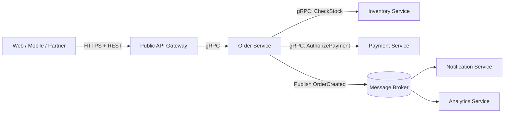

# How Do Internal Communication and Public Communication Differ?

When designing APIs for a Spring gRPC system, an important question comes up before choosing between gRPC and REST: **whom does this API serve, and at what trust boundary does it sit?** Communication between two services operated by the same organization usually has different goals, levels of control, and rates of change than an API exposed to customer applications or external partners. Those differences affect contracts, security, versioning, compatibility, networking, and operations.

In the **SPRING_GRPC** module, learners build clients/servers from Protocol Buffers contracts, generate Java code, and implement unary or streaming RPCs in the Spring ecosystem; while also handling metadata, deadlines, statuses, interceptors, TLS, integration testing, and reliability monitoring. This lesson places those techniques into the contexts of **internal communication** and **public (external/public-facing) communication**.

## 1. Distinguishing by Audience and Trust Boundary

Suppose an e-commerce platform has an Order Service, an Inventory Service, a Payment Service, and a customer web application.

- **Internal communication:** Order Service calls Inventory Service to check stock; the services are managed, deployed, and monitored by the organization.
- **Public communication:** customer applications or partner systems call the platform's APIs to browse products, place orders, or track orders.

| Aspect | Internal API | Public-Facing API |
| --- | --- | --- |
| Callers | Services, jobs, or workloads within the system | End users, customer apps, partners, or external developers |
| Control | The organization usually controls both client and server | The organization controls the server; it does not fully control clients |
| Trust boundary | Between internal workloads or security domains | Boundary with external networks, devices, and identities |
| Primary goal | Service integration, business execution, latency, and reliability across components | Ease of integration, stability, clear documentation, security, and developer experience |
| Contract changes | Rollouts can be coordinated, though compatibility across running versions is still needed | Must account for old clients, published SDKs, and partners upgrading slowly |
| Network access | Usually over private networks, service discovery, meshes, or internal gateways | Usually through an API gateway, load balancer, or public endpoint |
| Governance | By domain/team, internal policies, and service lifecycles | May require onboarding, quotas, rate limits, SLAs, support, and publishing processes |

**Internal does not mean implicitly trusted.** An internal service can still be compromised, misconfigured, or called with wrong permissions. Conversely, a public API does not have to be open to everyone; it may be an API dedicated exclusively to authenticated partners.

## 2. The Difference Is Not Just About the Protocol

A common misconception is "internal uses gRPC, public uses REST." That is a **common trend**, not a mandatory technical rule.

- gRPC can be used for backend-to-backend calls and even external partners if partners have suitable clients/tooling, contracts are published, and infrastructure supports it.
- REST can be used for internal APIs, especially when the organization already has HTTP gateways, OpenAPI, caching, or uniform integration conventions.
- Messaging typically serves asynchronous events/commands, both internally and across organizations if an appropriate broker or integration platform exists.

What must be decided first is **communication semantics, consumers, and security boundaries**. Only then do you select the right transport and format.

| Need | Option Often Worth Considering | Why |
| --- | --- | --- |
| Order calls Inventory and needs an immediate result | Unary gRPC or REST | Direct request/response with deadlines and statuses |
| Backend needs to receive multiple updates in a session | gRPC streaming, SSE, or WebSocket depending on client | Transmits multiple messages continuously |
| Browser needs to read product resources | REST/HTTP is usually convenient | Broad browser and HTTP tooling support |
| Multiple services receive order events | Messaging/pub-sub | Decouples producer from consumers and handles fan-out |
| Partners need an API with familiar HTTP docs and SDKs | REST/OpenAPI is usually convenient | Lowers integration barriers |
| Partner backend has Protobuf and gRPC tooling | Public gRPC can be suitable | Typed contracts and multi-language stubs |

## 3. Why Are Internal APIs Often a Good Fit for gRPC?

When both ends are backend services managed by the same organization, gRPC can offer concrete advantages:

**Typed contracts and code generation.** `.proto` files define services, methods, and messages. Java clients use typed stubs; servers implement corresponding handlers. Contract changes can be reviewed and compatibility-checked in team pipelines.

**Clear RPC semantics.** Unary fits calls needing a single result; server/client/bidirectional streaming fits continuous data streams. Deadlines, cancellation, and statuses give services a uniform way to handle remote calls.

**Optimized backend communication when measurable.** Binary Protobuf and HTTP/2 multiplexing can reduce overhead or utilize connections effectively in some workloads. Actual performance still requires benchmarking across payloads, concurrency, proxies, TLS, and business processing.

**Multi-language integration.** A single Protobuf contract can generate clients for Java, Go, Python, and other supported languages. Internal APIs do not have to use the same language on both ends.

Internal contract example:

```protobuf
syntax = "proto3";

package commerce.inventory.v1;

option java_package = "com.example.inventory.grpc";
option java_multiple_files = true;

service InventoryService {
  rpc CheckStock(CheckStockRequest) returns (CheckStockReply);
}

message CheckStockRequest {
  string sku = 1;
  int32 quantity = 2;
}

message CheckStockReply {
  bool available = 1;
  int32 remaining = 2;
}
```

Order Service invokes `CheckStock` with a Protobuf-generated request. Inventory Service processes the request, queries data, and returns a response. Client and server can deploy independently if the contract stays compatible with active versions.

### Yet Internal gRPC Still Needs Safeguards

- Workload authentication and per-service/method authorization.
- TLS or mTLS when encrypting and authenticating connections is required.
- Reasonable deadlines to avoid holding resources indefinitely.
- Message size, concurrency, and resource limits.
- Bounded retries, applied only when operation semantics allow.
- Metrics, logs, and distributed tracing to monitor every RPC.

Never omit authentication just because requests traverse a private network or service mesh. Network segmentation can be one layer of defense, but it does not replace service-level authentication and authorization.

## 4. Why Must Public APIs Prioritize Compatibility and Integration Experience?

For a public-facing API, the server cannot force every client to upgrade simultaneously. An older mobile app may continue calling the API for months; partners have their own release schedules; SDKs embedded in external systems may not be easy to update.

Therefore, public APIs typically require:

1. **Published contracts:** clear documentation of endpoints/methods, data, errors, auth, limits, and examples.
2. **Strategic versioning:** compatible changes are preferred; breaking changes need migration plans and deprecation windows.
3. **Authentication and authorization:** verify the client, user, or organization; grant only necessary permissions.
4. **Rate limiting and quotas:** protect resources, curb abuse, and ensure fair allocation.
5. **Stable error model:** clients can distinguish input errors, access denied, throttling, transient outages, and system errors.
6. **Observability and support:** track by client/application ID, API version, and request correlation without leaking secrets.
7. **Documentation and onboarding:** instructions for obtaining credentials, SDKs, sandboxes, migrations, and error handling.

REST/HTTP is usually convenient for browsers, everyday tooling, API gateways, caching, and OpenAPI. Still, if partners are backends with gRPC tooling, public gRPC can be reasonable. In that case, publish proto files/descriptors and clearly define versioning, TLS, authentication, quotas, and client support.

## 5. Architecture Example: Public Gateway and Internal gRPC

A common layout exposes an HTTP API at the system edge and uses gRPC for calls between backend services.



The gateway can handle external authentication, quotas, request validation, logging, and translating HTTP requests into internal calls. Order Service uses gRPC to coordinate synchronous operations requiring immediate results; once the order is recorded, it emits an event for Notification and Analytics to process independently.

This is an architectural option, not a mandate to introduce a gateway. A small system might let a public REST controller call an in-process application service directly; a partner might call a gRPC endpoint directly if requirements and infrastructure permit.

### Where Should the Public Boundary End?

Generally, you should not expose every internal service endpoint directly to the Internet. Instead, define a distinct **API boundary**:

- Public contracts expose only the operations and data that customers/partners are permitted to use.
- Internal contracts serve inter-service communication and may reflect internal deployment models.
- A gateway or adapter translates between the two contracts, enforces permissions, and restricts exposed data.

This avoids coupling public clients to internal structure such as service names, database schemas, or microservice boundaries. It also allows teams to refactor the backend without altering the public API as long as external semantics remain intact.

## 6. Versioning: Internal Can Coordinate, Public Must Support Older Clients Longer

### Internal Contracts

Teams can coordinate release timing and rolling deployments. Even so, during a rollout, a new client version may call an old server version and vice versa. Hence, compatible changes should still be preferred:

- Add new fields with unused field numbers; handle default values when old clients omit them.
- Never reuse deleted field numbers; use `reserved` where appropriate.
- Adding a new method is usually easier to manage than changing the meaning of an existing method.
- Avoid renaming packages/services/methods without a client migration plan.
- Distinguish wire-compatible changes from business-semantic changes.

### Public Contracts

Public clients may outlive a single server version by far. Therefore, consider:

- Explicit API versioning, such as `/v1` in REST or versioned packages in Protobuf.
- Published deprecation and sunset policies.
- Support windows for older versions and clear upgrade paths.
- Contract tests against representative SDKs/clients.
- Never silently changing the meaning of fields/responses that clients rely on.

A version inside a Protobuf package name like `commerce.inventory.v1` helps identify the contract. However, adding `v2` does not automatically solve migration: the server must decide how long to serve both versions, whether data converts cleanly, and how clients will upgrade.

## 7. Security: Public and Internal Have Different Policies

Public APIs must assume traffic arrives from untrusted environments. Internal APIs must also verify identity and permissions because an internal network is not an absolute trust boundary.

| Control | Internal Service-to-Service | Public-Facing API |
| --- | --- | --- |
| Authentication | Workload identity, mTLS, service credentials, or internal tokens | OAuth2/OIDC, API keys, or mechanisms suited to the client type; avoid treating an API key as user identity |
| Authorization | By service, method, tenant, or business data | By user, organization, scope, resource ownership, and tenant |
| Encryption | TLS/mTLS per threat model and infrastructure | Mandatory HTTPS/TLS for public endpoints; public gRPC also requires TLS |
| Rate limiting | Protects services and downstreams, limits concurrency | Quotas per client/user/tenant, abuse prevention, cost protection |
| Sensitive data | Least privilege between workloads, never log secrets | Control returned fields, PII, consent, and resource-level access |
| Network | Private networks, policies, meshes can add protection | Public ingress, WAF/gateway, firewalls, and DDoS protection per risk |

### Metadata Is Not a Dumping Ground for Arbitrary Secrets

In gRPC, metadata commonly carries authorization tokens, trace context, or correlation IDs. Tokens must travel over TLS and have appropriate expiration and scope; never write them to logs or metrics. Server interceptors can extract metadata to authenticate, yet **authorization must evaluate actual identity and permissions**, not merely the presence of a header.

In REST, credentials typically travel via HTTP headers. Although the transport differs, principles of credential management, rotation, scoping, and auditing remain similar.

## 8. Deadlines, Retries, and Errors: Goals Differ by Client Type

Internal services can typically coordinate deadlines across hops. For instance, if Order Service has an 800 ms budget for a request, it should not give 800 ms to both Inventory and Payment sequentially and expect the total to stay under 800 ms.

Public APIs need timeouts and error responses stable enough that external clients know whether to retry or display an error. Avoid returning sensitive internal details in error bodies or gRPC status descriptions.

### Not Every Error Should Be Retried

- `INVALID_ARGUMENT`: invalid request; the client must fix its input.
- `UNAUTHENTICATED` or `PERMISSION_DENIED`: fix credentials/permissions; do not retry blindly.
- `DEADLINE_EXCEEDED`: inspect time budgets; for write operations, the outcome may be ambiguous.
- `UNAVAILABLE`: potentially transient; retry only with backoff, caps, and idempotency.
- `INTERNAL`: investigate; do not retry indefinitely by default.

A `ReserveStock` call may have committed on the server while the response was lost. A client retrying without an idempotency key risks reserving stock twice. This risk exists both internally and publicly; public APIs especially need explicit idempotency guarantees so external clients/partners can integrate safely.

## 9. Observability and Operational Support

Internal APIs and public APIs require different telemetry views even when sharing a telemetry platform.

| Goal | Internal | Public |
| --- | --- | --- |
| Latency | Per service/method and per hop in distributed traces | Per API version, route/method, client tier, and region |
| Errors | gRPC statuses, downstream failures, saturation | HTTP/gRPC error classes, auth failures, quota rejections, client-visible errors |
| Traffic | RPC concurrency, throughput, active streams | Requests per client/tenant, quota consumption, traffic spikes |
| Health | Readiness, dependency health, channel/server state | Availability/SLA, ingress/gateway health, and regional errors |
| Investigation | Cross-service traces, logs by correlation ID | Request ID, protected client/app ID, audit trails, and support context |

Never put tokens, emails, SKUs, or high-cardinality IDs in metric labels. Public APIs need access auditing and abuse monitoring; internal APIs need to detect misbehaving services, slow dependencies, and cascading failures.

With gRPC, interceptors/instrumentation can collect RPC counts, statuses, and latency by service/method. With REST, middleware/metrics track routes and HTTP statuses. Unify trace context as requests pass through gateways into internal services.

## 10. Where Does Testing Differ?

Internal services can typically run contract/integration tests across deployed client-server versions within the organization:

- Verify Protobuf schemas and code generation.
- Invoke handlers via a gRPC test server or in-process transport.
- Verify deadlines, statuses, metadata, and interceptors.
- Test TLS, proxies, readiness, and graceful shutdown in production-like environments.
- Test old clients against new servers and vice versa when rollouts span multiple versions.

Public APIs additionally require:

- Contract tests against published SDKs or sample clients.
- Testing authentication, authorization, tenant isolation, and quotas.
- Verifying documentation, examples, error models, and versioning/deprecation behavior.
- Compatibility testing with older clients and representative partner systems.
- Abuse/rate-limit and payload-size limit testing.

A test calling a Java handler directly is not enough to prove a public endpoint is secure or that internal services communicate cleanly over real TLS/HTTP/2. Match test depth to the deployment boundary.

## 11. Public/Internal Decisions in a Spring Project

When designing a new method, answer in order:

1. **Who will call it?** Internal workloads, customer apps, partners, or arbitrary developers?
2. **Who controls the client?** Can rollouts be coordinated, or must old clients be supported long-term?
3. **What data may be exposed?** Do we need a public DTO/contract separate from internal models?
4. **Which interaction pattern is needed?** Request/response, streaming, or asynchronous events?
5. **Where is the authentication boundary?** Workload identity, user identity, organization, scopes, and resource ownership?
6. **How are versioning and support handled?** Are there deprecations, migrations, SDKs, and SLAs?
7. **How is it operated?** Deadlines, retries, quotas, metrics, tracing, auditing, and support?

### Example Matrix

| Flow | Classification | Typically Suitable Design |
| --- | --- | --- |
| Order Service → Inventory Service | Internal | Unary gRPC with Protobuf contract, deadlines, service identity, per-method metrics |
| Order Service → Payment Service | Internal | gRPC or REST; authorization, idempotency, and controlled retries |
| Browser → Product API | Public-facing | REST/HTTPS, public DTOs, suitable auth, quotas/caching if needed |
| Partner backend → Order API | Public/partner | REST/OpenAPI or gRPC if partner supports Protobuf and contract workflows |
| Order Service → Notification Service after order creation | Internal asynchronous | Event messaging with outbox, idempotent consumers, and retries/DLQ |
| Public partner needs long-lived updates | Public-facing streaming/events | Consider webhooks, SSE, WebSocket, gRPC streaming, or broker gateway based on client capabilities and retention needs |

## 12. Takeaways

**Internal and public describe audiences, trust boundaries, and API governance; they are not synonyms for gRPC and REST.** Internal APIs are typically optimized for backend coordination, cross-team contracts, and per-service/method observability. Public APIs must emphasize documentation, backward compatibility for older clients, authentication, authorization, quotas, support, and versioning.

gRPC can serve both categories when contracts, client tooling, transport, and operations align. REST is usually convenient at the web/partner edge; messaging fits temporal decoupling or broadcasting events to multiple consumers. In a Spring system, you can combine a public REST/gRPC gateway at the edge, internal gRPC between backends, and messaging for asynchronous workflows.

Before creating a gRPC service or exposing an external API, define **who may call it, which methods they can call, what data they may see, how long the contract will live, and how failures will be handled**. Those decisions shape a reliable architecture far more than picking a protocol out of habit.

### References

- [gRPC – Introduction](https://grpc.io/docs/what-is-grpc/introduction/)
- [gRPC – Core concepts, architecture and lifecycle](https://grpc.io/docs/what-is-grpc/core-concepts/)
- [gRPC – Authentication](https://grpc.io/docs/guides/auth/)
- [gRPC – Deadlines](https://grpc.io/docs/guides/deadlines/)
- [Protocol Buffers – Proto3 language guide](https://protobuf.dev/programming-guides/proto3/)
- [OpenAPI Specification](https://spec.openapis.org/oas/latest.html)
