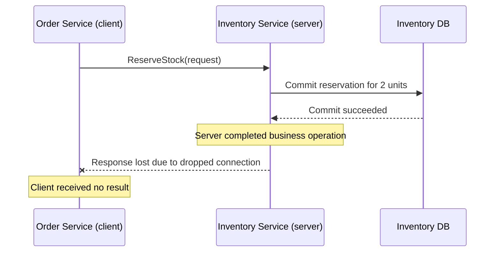

# Limitations of Treating RPC Like a Local Function Call

A gRPC call in Java can look just like an ordinary method call:

```java
CheckStockReply reply = inventoryStub.checkStock(request);
```

Yet `checkStock` does not run in the same process. The client must encode the request, send it over the network, wait for the server to receive and process it, and decode the response. The connection can be slow or drop; the server may have executed the business operation while the response is lost; transmitted data must conform to a versioned contract. **Syntax that looks like a local call does not eliminate the properties of a distributed system.**

This is crucial when developing **SPRING_GRPC**: Protocol Buffers contracts and generated Java code help both sides align on an interface; the gRPC runtime provides RPC over HTTP/2; Spring organizes beans and business logic. Still, designers must actively address latency, partial failures, deadlines, cancellation, retries, idempotency, security, concurrency, and observability.

## 1. Where Do Local Function Calls and RPCs Differ?

Suppose Order Service needs to ask Inventory Service whether two units of `SKU-123` are available.

| Property | In-Process Function Call | RPC Over gRPC |
| --- | --- | --- |
| Execution | Direct code call inside the process | Sends a request to another process over the network |
| Latency | Usually low and relatively stable | Depends on network, load, queues, server, and downstreams |
| Failure | Exceptions or local resource faults | Adds DNS, connectivity, timeouts, proxies, server crashes, and lost responses |
| Data | Passes in-memory references/objects | Serializes, transmits bytes, and parses into messages on the receiving side |
| Lifecycle | Usually shares the process lifecycle | Client and server start/stop independently |
| Concurrency | Affected by local threads and locks | Adds connection limits, streams, queues, backpressure, and remote load |
| Outcome on error | Usually clear how far the function ran in-process | May be unknown whether the server committed the business operation |
| Contract | Compiler checks interfaces within the same codebase | Both sides must maintain schema and API semantic compatibility across releases |

An RPC is a **call across a network boundary**. Every design must account for the possibility that one side may never receive confirmation of the other side's outcome.

## 2. Network Latency Is Not Function Call Duration

A local call typically does not wait for DNS, connection establishment, or data traversal across network devices. An RPC can involve:

```text
Total time observed by client
  = client-side queuing
  + serialize request
  + transmit request
  + server-side queuing
  + handler and business processing
  + database/downstream access
  + serialize response
  + transmit response
  + parse response on client
```

This is a conceptual model; some steps may overlap or be optimized. The key point is that **execution time inside the business method is only part of the latency the client observes**.

For example, `InventoryQueryService` takes 15 ms to query the database, yet the RPC takes 180 ms. The difference may stem from networking, queues, TLS, proxies, serialization, or load on the client/server. Optimizing the SQL query alone may not resolve the RPC's p95 latency.

### 2.1. Setting Deadlines Based on the End-to-End Flow Budget

Clients must not wait indefinitely. gRPC lets you attach a deadline to each RPC:

```java
CheckStockReply reply = inventoryStub
    .withDeadlineAfter(300, TimeUnit.MILLISECONDS)
    .checkStock(request);
```

The 300 ms value is an example. If Order Service's incoming HTTP request has an 800 ms budget and must call Inventory and then Payment sequentially, each downstream call gets a share of the budget, leaving room for remaining steps and returning the response.

Setting 800 ms on each sequential RPC can push the entire flow past 800 ms. Conversely, a deadline that is too tight causes timeouts even when the server is operating normally. Choose deadlines based on SLAs, observed latency percentiles, and hop counts in the request.

### 2.2. A Timeout Does Not Prove the Server Did Nothing

When a client receives `DEADLINE_EXCEEDED`, it means the client did not receive a result before the deadline. It **does not prove** the server never received the request or never executed the business logic.

The server may have:

- Not received the request yet due to slow networking.
- Been queuing or still processing it.
- Finished processing while the response was still in transit.
- Committed to the database, only for the connection to drop before the client got the response.

Therefore, never interpret a timeout as "the operation definitely did not run."

## 3. Partial Failure: One Side Can Fail While the Other Keeps Running

In a distributed system, client and server do not share memory state. One side can restart while the other continues running; proxies can fail; networks can partition; downstream databases can become overloaded.

Example:



Order Service sees a transport error or `UNAVAILABLE`, yet Inventory Service may have successfully reserved the stock. This is an **indeterminate outcome for the client**, not necessarily a failure on the server.

Partial failures make the following assumptions dangerous:

- "If the client got an error, the server did not process it."
- "If the connection is open, the server is always ready."
- "If we retry, we will definitely get the result applied once."
- "A healthy server guarantees every request succeeds."

RPC design must distinguish failures before server execution, failures during execution, and failures after the business operation commits.

## 4. Ambiguous Outcomes and the Risk of Double Execution

Compare two operations:

- `CheckStock` only reads inventory quantity at a point in time.
- `ReserveStock` or `ChargePayment` causes side effects.

If a read call times out, the client can consider retrying to obtain fresh state. But if a write operation already executed on the server and the response was lost, resending it risks applying the side effect a second time.

### 4.1. Idempotency Makes Retries Safer

An operation is **idempotent** if executing it multiple times with the same request identifier produces the same business effect as executing it once.

Suppose the client sends:

```text
ReserveStock
  request_id = "req-8f2a"
  sku        = "SKU-123"
  quantity   = 2
```

The server can persist `request_id` alongside the processed outcome. If the client resends the same `request_id`, the server returns the stored result instead of reserving stock again. The implementation must ensure checking the request ID and updating business state are atomic with respect to the database.

A proto message can include a request key:

```protobuf
message ReserveStockRequest {
  string request_id = 1;
  string sku = 2;
  int32 quantity = 3;
}
```

Merely adding a `request_id` field does not automatically create idempotency. The server must enforce deduplication rules, decide key retention duration, handle two identical requests arriving concurrently, and return an appropriate result.

### 4.2. Retries Need a Policy, Not an Unbounded Loop

A retry policy must define:

- Which statuses are retryable.
- Maximum attempt counts and backoff durations.
- Jitter to prevent multiple clients from retrying in lockstep.
- Whether sufficient deadline budget remains for the next attempt.
- Whether the method is idempotent or has deduplication safeguards.
- Whether the server is already overloaded so retries would worsen the outage.

| Scenario | Typically Appropriate Handling |
| --- | --- |
| `INVALID_ARGUMENT` | Do not retry; fix the request |
| `UNAUTHENTICATED` | Refresh or fix credentials per policy |
| `PERMISSION_DENIED` | Check permissions; do not retry blindly |
| `DEADLINE_EXCEEDED` | Assess whether the operation may have executed; query status or retry safely |
| `UNAVAILABLE` | May retry with limits if the method and state permit |
| `INTERNAL` | Investigate root cause; do not blindly retry every failure |

Not every error carries the same meaning across every method. Combine statuses with business semantics and defined retry policies.

## 5. Serialization and Contracts: Java Objects Are Not Passed Directly

When calling a local function, Java can pass an object reference. With gRPC, the client serializes a message into bytes per the Protobuf schema; the server parses those bytes into Java messages in its own process.

Contract example:

```protobuf
syntax = "proto3";

package commerce.inventory.v1;

service InventoryService {
  rpc CheckStock(CheckStockRequest) returns (CheckStockReply);
}

message CheckStockRequest {
  string sku = 1;
  int32 quantity = 2;
}

message CheckStockReply {
  bool available = 1;
  int32 remaining = 2;
}
```

Both sides do not share an object on the same heap. They only agree on a **wire contract**. This has several consequences:

1. You cannot pass a Spring bean, JDBC connection, or arbitrary Java object as a live reference usable directly on the server.
2. Data must be represented using message types understood by both sides.
3. Both sides can use different programming languages as long as they follow the contract and gRPC protocol.
4. Schema changes must be managed for compatibility, especially when client and server upgrade at different times.

### 5.1. Wire Compatibility Does Not Equal Business Compatibility

Adding a new field with an unused number usually preserves wire compatibility, yet if the new server requires that field to be populated, old clients omitting it can still trigger business errors. Likewise, changing a field's meaning while keeping its number causes two versions to interpret identical bytes differently.

When evolving schemas:

- Never reuse deleted field numbers.
- Use `reserved` when needed to prevent reusing numbers/names.
- Prefer adding fields with sensible defaults.
- Evaluate both technical and semantic compatibility.
- Test old clients against new servers and vice versa as part of the rollout strategy.

Generated stubs catch type mismatches at compile time, yet they do not guarantee running versions interpret business rules identically.

## 6. Concurrency and Resources: RPCs Have Operational Cost

A local Java method can execute on the current thread. An RPC also consumes channels, HTTP/2 streams, buffers, executors/event loops, and server-side resources. As call volume rises, these resources are finite.

### 6.1. Never Create a Channel Per Request

A `ManagedChannel` is typically a long-lived resource and should be reused. Creating a new channel per call increases initialization overhead, connection churn, and resource leak risk. In Spring, channels can be managed as beans and closed with the application lifecycle.

Stubs are generally lightweight objects using a channel. You can derive stub variants with per-RPC deadlines or call options without opening a new channel.

### 6.2. Singleton Spring Handlers Can Receive Many Concurrent RPCs

A Spring-managed handler is a singleton by default. Many RPCs can invoke the same instance concurrently. Never store request-specific state in shared mutable fields:

```java
// Unsafe if a singleton handler serves multiple RPCs:
private String currentSku;
```

Instead, keep request data in local variables or per-call context. Shared services, repositories, and caches must also be thread-safe and properly resource-bounded.

### 6.3. Streaming Requires Lifecycle Management and Flow Control

A streaming RPC can remain open for a long time and hold resources throughout its lifetime. HTTP/2 flow control regulates wire bytes, yet applications must still handle producers outpacing consumers, growing buffers, cancellation, deadlines, and reconnects.

Do not treat an unbounded stream as free. Define who closes the stream, when it stops, message/buffer limits, and whether resume/replay is needed after disconnects. If the requirement is durable persistence and replay when consumers are offline, a message broker is usually a better fit than a raw gRPC stream.

## 7. Cancellation Is Not Rollback

A client can cancel an RPC when it no longer needs the result or its deadline expires. The gRPC runtime propagates the cancellation signal to the server when possible. Server and business code must cooperate to stop work that is no longer valuable.

However:

- Cancellation may arrive after the server has already performed part of the business work.
- An active database query does not necessarily halt immediately just because the client canceled the RPC.
- If a transaction has already committed, cancellation does not automatically roll back that transaction.
- With streaming, the server must stop its emission source and release resources when the stream is canceled.

Therefore, design cancellation alongside transaction boundaries and idempotency. Do not treat it as an "undo" button for already-executed operations.

## 8. Security: Same Network Does Not Mean Same Privileges

gRPC calls cross process boundaries. Clients must authenticate to servers, and servers must verify which methods a client is authorized to invoke. An internal network does not eliminate compromised credentials, compromised workloads, or misconfigured routing.

Common protection layers:

- **TLS/mTLS:** encrypts the transport and can authenticate both endpoints.
- **Authentication:** identifies the workload or user.
- **Authorization:** determines which services/methods and resources that identity may access.
- **Metadata:** carries tokens, trace context, or correlation IDs; does not replace authorization checks.
- **Interceptors:** apply shared authentication, logging, or tracing logic to RPCs.

Never log tokens; never expose stack traces or sensitive internal details in status descriptions. Spring Security can supply authentication/authorization building blocks, yet an HTTP filter chain does not automatically protect gRPC methods without integration wired into the gRPC runtime.

## 9. Observing RPCs from a Distributed Systems Perspective

A local call is usually easy to trace via an in-process stack trace. With RPCs, you must correlate telemetry across clients, servers, and downstreams.

Useful metrics:

| Metric | Question to Answer |
| --- | --- |
| RPC count by service/method | Which methods receive the most calls? |
| p50/p95/p99 latency | How long do clients actually wait? |
| Status code distribution | Are invalid inputs, timeouts, or unavailable errors rising? |
| Active RPCs/streams | Are too many calls or long-lived streams accumulating? |
| Payload size | Are messages too large or growing abnormally? |
| Channel/connection state | Are clients experiencing connection or reconnection issues? |
| Downstream latency | Is a database or downstream service slowing down the RPC? |

Distributed tracing and correlation IDs connect a request from Order to Inventory and the database. Metrics should be tagged by service, method, and status; avoid high-cardinality labels like SKUs, tokens, or user IDs. Logs should provide enough context for diagnosis without containing secrets.

## 10. Testing Must Simulate the Network Boundary

Unit tests calling a handler directly as a Java method are useful for mapping and simple logic, yet they do not test serialization, transport, TLS, deadlines, or real connections.

An RPC test suite should cover:

- Contract and code generation: client/server generate code from compatible schemas.
- Handlers: valid requests, invalid arguments, business outcomes, and status mapping.
- Integration tests: client stubs send Protobuf requests through a gRPC test server.
- Deadlines/cancellation: slow server, client timeout, or call cancellation.
- Failure cases: unavailable server, dropped connections, lost responses.
- Retries/idempotency: resending the same request ID and verifying side effects happen only per rules.
- TLS/interceptors: credentials, metadata, authorization, and trace propagation.
- Streaming: completion, errors, cancellation, slow consumers, and shutdown.

In-process transport helps test handlers and stubs, yet it does not verify HTTP/2, TLS, proxies, or real network deployments. Those areas must be tested with the corresponding transport and environment.

## 11. Example: Designing a Safer Call

Suppose Order Service needs to reserve stock. Instead of treating this like a `reserveStock()` function guaranteed to run once, explicitly design the outcome and duplicate-request handling:

```protobuf
syntax = "proto3";

package commerce.inventory.v1;

service InventoryService {
  rpc ReserveStock(ReserveStockRequest) returns (ReserveStockReply);
}

message ReserveStockRequest {
  string request_id = 1;
  string sku = 2;
  int32 quantity = 3;
}

message ReserveStockReply {
  string reservation_id = 1;
  bool reserved = 2;
}
```

The client can call with a deadline:

```java
ReserveStockReply reply = inventoryStub
    .withDeadlineAfter(400, TimeUnit.MILLISECONDS)
    .reserveStock(ReserveStockRequest.newBuilder()
        .setRequestId(requestId)
        .setSku("SKU-123")
        .setQuantity(2)
        .build());
```

If a timeout occurs, the client **must not immediately generate a new request ID and resend**. It can query status using the same request ID or resend the exact same request ID if the server implements idempotency. The server must persist the processed outcome and guarantee two duplicate requests do not create two separate stock reservations.

This example shows why RPCs require supplemental business design to handle ambiguous outcomes. Protobuf only defines fields; gRPC supplies deadlines/statuses; Spring manages beans and transactions; **idempotency is a rule the application itself must enforce**.

## 12. Dangerous Assumptions to Avoid

| Assumption | Reality |
| --- | --- |
| "Calling a stub looks like Java, so network failures don't happen." | RPCs depend on network links and remote processes. |
| "A timeout means the server never ran the method." | The server may have already committed and only lost the response. |
| "Retries always make systems more reliable." | Retries can duplicate side effects and amplify load. |
| "Cancellation undoes the work." | Cancellation only signals the RPC is no longer needed; it does not roll back committed work. |
| "Protobuf objects are passed by reference." | Messages are serialized to bytes and parsed in another process. |
| "Compiling cleanly means client/server are business-compatible." | Schemas can be wire-compatible while semantic changes still break clients. |
| "A fresh channel per call is cleaner." | Creating many channels adds overhead and resource usage; channels should normally be reused. |
| "A Spring singleton handler only processes one request at a time." | Many RPCs can hit the same bean concurrently. |
| "Internal networks need no authentication." | Internal workloads still need identity, authorization, and transport protection per threat model. |
| "Handler unit tests prove gRPC works." | You must test stubs, transport, deadlines, TLS, and relevant failure modes. |

## 13. The Right Mindset When Designing RPCs in Spring

Before adding a method to a gRPC service, answer:

1. **What is the allowed latency?** Set deadlines according to the whole request's budget.
2. **What if the response is lost after the server commits?** Acknowledge ambiguous outcomes and provide lookup mechanisms.
3. **Does the method have side effects?** If so, design idempotency before enabling retries.
4. **Can client and server upgrade independently?** Manage schema and semantic compatibility.
5. **Are resources bounded?** Reuse channels, bound concurrency/messages/buffers, and manage streams.
6. **When the client cancels, what will the server stop?** Check cancellation and transaction boundaries.
7. **Who is allowed to call the method?** Configure TLS, authentication, authorization, and metadata safely.
8. **When failures occur, where will we look?** Attach metrics, logs, and tracing by service/method/status.

In the **SPRING_GRPC** ecosystem, Spring helps organize and manage application components; gRPC provides remote invocation mechanics; Protobuf provides data contracts. None of them turns a network into a local call. When you treat RPC as genuine distributed communication, you design timeouts, errors, retries, idempotency, security, and testing to match how the system actually behaves.

### References

- [gRPC – Core concepts, architecture and lifecycle](https://grpc.io/docs/what-is-grpc/core-concepts/)
- [gRPC – Deadlines](https://grpc.io/docs/guides/deadlines/)
- [gRPC – Cancellation](https://grpc.io/docs/guides/cancellation/)
- [gRPC – Retry](https://grpc.io/docs/guides/retry/)
- [gRPC – Status codes](https://grpc.io/docs/guides/status-codes/)
- [Protocol Buffers – Proto3 language guide](https://protobuf.dev/programming-guides/proto3/)
