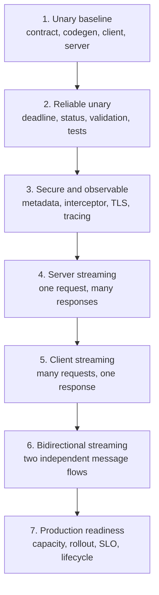
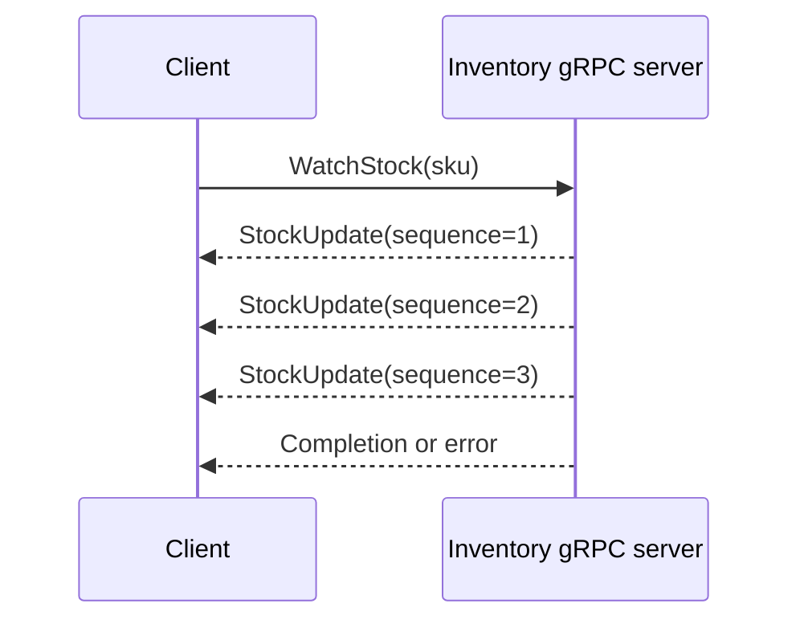
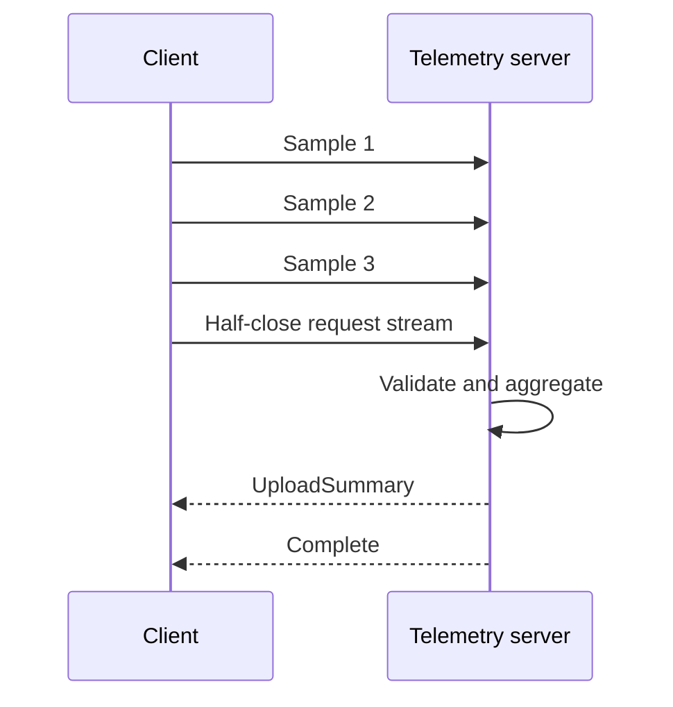
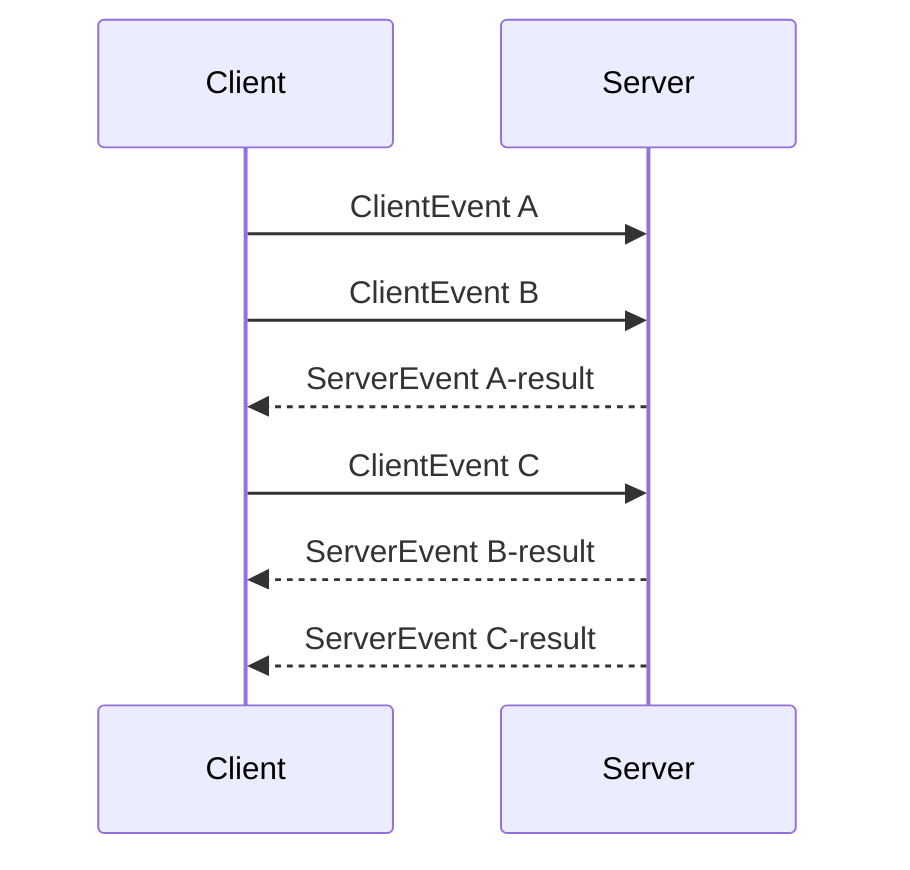

# Roadmap from Unary RPC to Streaming and Production

When getting started with gRPC in Spring, an effective learning path is to implement a **small unary RPC running from client to server**, then add reliability and security requirements, and only afterward expand to streaming and production operations. Unary teaches contracts, code generation, stubs, handlers, and statuses within a manageable scope. Streaming introduces long-lived lifecycles, multiple messages, and two-way coordination. Production requires systems to handle load, failures, rollouts, security, and shutdown intentionally.

This lesson belongs to the **Introduction** chapter of the **SPRING_GRPC** module. The module focuses on developing gRPC services in the Spring ecosystem using Protocol Buffers, Java code generation, and implementing clients/servers for unary or streaming RPCs; learners then progress to metadata, deadlines, statuses, interceptors, TLS, integration testing, and performance and reliability monitoring. The roadmap below orders capabilities by dependency and provides criteria to know when you are ready for the next step.

## 1. Roadmap Overview



This is a recommended learning order, not a requirement that every system use all four RPC types. An application that only needs unary can stop there and run well in production. Only add streaming when the business case truly needs multiple messages within a single RPC.

| Stage | Target Capability | Verifiable Outcome |
| --- | --- | --- |
| Unary baseline | Create contract, generate code, call stub, implement handler | Client calls server and receives expected response |
| Reliable unary | Validation, deadlines, statuses, errors, and integration tests | Timeouts/errors behave predictably; key cases are tested |
| Secure and observable | Metadata, interceptors, TLS, logs/metrics/traces | RPCs can be authenticated, traced, and measured |
| Server streaming | Server sends multiple messages in one RPC | Client receives stream of updates and handles completion/cancellation |
| Client streaming | Client sends multiple messages, server returns final result | Server receives, validates, and aggregates the request stream |
| Bidirectional streaming | Both sides send/receive independently in one RPC | Handles ordering, cancellation, and independent rates on both sides |
| Production readiness | Capacity, resilience, deployment, lifecycle, and SLOs | Service can be rolled out, observed, and recovered safely |

## 2. Stage 1 — Building a Small Unary RPC as the Baseline

Unary is the simplest RPC pattern: one request and one response. Pick an easy-to-verify read operation, such as Order Service asking Inventory Service how much stock remains.

### 2.1. Define the Contract First

Example `inventory.proto`:

```protobuf
syntax = "proto3";

package commerce.inventory.v1;

option java_package = "com.example.inventory.grpc";
option java_multiple_files = true;

service InventoryService {
  rpc CheckStock(CheckStockRequest) returns (CheckStockReply);
}

message CheckStockRequest {
  string sku = 1;
  int32 quantity = 2;
}

message CheckStockReply {
  bool available = 1;
  int32 remaining = 2;
}
```

Before writing Java code, agree on:

- Package, service, and method names; these are the API identifiers on the wire.
- Request/response data types and the meaning of each field.
- Input validation rules, e.g., non-blank SKU and quantity greater than 0.
- Which business outcomes are normal responses versus RPC errors.
- Compatibility rules when adding or removing fields in future versions.

Do not use arbitrary field numbers: field numbers are part of the wire format. Never reuse deleted field numbers; consider `reserved` as schemas evolve.

### 2.2. Generate Code and Verify Outputs

The build uses `protoc` to generate Java message classes and the `protoc-gen-grpc-java` plugin to generate service descriptors, client stubs, and server base classes. With Java/Spring, generated sources must belong to the source set to compile alongside Protobuf/gRPC runtime dependencies.

Expected conceptual outputs:

| Generated Code | Where Used |
| --- | --- |
| `CheckStockRequest` | Client builds request, server reads request |
| `CheckStockReply` | Server builds response, client reads response |
| `InventoryServiceGrpc` | Provides stubs and server API |
| `InventoryServiceImplBase` | Base class for implementing handlers in the corresponding gRPC Java API |

Never edit generated Java files directly. When the contract changes, update `.proto` and re-run code generation. If message classes exist without `*Grpc.java`, check the gRPC Java plugin; if sources exist but fail to compile, check generated source sets and runtime dependencies.

### 2.3. Wire the Server Handler to a Spring Business Service

The server handler receives Protobuf requests, calls business beans, and builds responses. Spring can manage the handler via bean injection; the gRPC runtime must still register the handler with the server. Exact registration mechanics depend on the starter or gRPC Java configuration in use.

Example unary handler signature:

```java
@Override
public void checkStock(
        CheckStockRequest request,
        StreamObserver<CheckStockReply> observer) {
    int remaining = inventoryQuery.remaining(request.getSku());

    CheckStockReply reply = CheckStockReply.newBuilder()
        .setAvailable(remaining >= request.getQuantity())
        .setRemaining(remaining)
        .build();

    observer.onNext(reply);
    observer.onCompleted();
}
```

This illustrates the core path; real classes need validation and error mapping. Separating `inventoryQuery` into a Spring business service lets you test business logic independently of transport. Do not assume `@Service` or `@Component` automatically exposes an RPC unless your starter is configured to register it.

### 2.4. Calling from the Client

The client uses a `ManagedChannel` and a generated stub:

```java
CheckStockReply reply = inventoryStub
    .checkStock(CheckStockRequest.newBuilder()
        .setSku("SKU-123")
        .setQuantity(2)
        .build());
```

In a Spring application, channels and stubs are normally lifecycle-managed for reuse. Never create a new channel per request. The call above assumes the stub is configured and injected; address, credentials, and transport belong to client configuration.

### Stage 1 Exit Criteria

- Contract compiles and generated message/service classes exist.
- Server handler is registered and server listens on the expected endpoint.
- Client invokes the unary method over gRPC and receives the expected response.
- Business beans have no direct dependency on transport details.
- At least one test verifies request/response mapping.

Do not add streaming before meeting these criteria. Streaming makes debugging far harder if contracts, registration, or client channels are still unstable.

## 3. Stage 2 — Making Unary Reliable

An RPC running locally is not enough for a distributed system. Before expanding communication patterns, clarify how to handle bad inputs, timeouts, server failures, and ambiguous outcomes.

### 3.1. Validation and Business Boundaries

Distinguish:

- Malformed requests or invalid values: return a status like `INVALID_ARGUMENT`.
- Missing resources: use `NOT_FOUND` if the contract models that as an error.
- Out of stock: can return `available = false` with status `OK`, because the stock check itself succeeded.
- Internal failures: map to an appropriate status without exposing stack traces or sensitive data.

Do not turn every unwanted business outcome into an RPC error. Clients need to distinguish "insufficient stock" from "unable to reach the server."

### 3.2. Deadlines and Timeout Budgets

Set a deadline per RPC based on the overall request budget:

```java
CheckStockReply reply = inventoryStub
    .withDeadlineAfter(250, TimeUnit.MILLISECONDS)
    .checkStock(request);
```

The 250 ms figure is illustrative only. If an Order Service HTTP request has a 700 ms budget and calls multiple downstreams sequentially, you cannot grant the full 700 ms to every RPC. Use p95/p99 latencies and remaining request time to allocate deadlines.

When receiving `DEADLINE_EXCEEDED`, the client only knows it did not receive a response on time. The server may still have executed the business operation. Especially for write operations, a timeout does not prove the command failed to commit.

### 3.3. Retries and Idempotency

Only retry when you know the method is safe to retry or the server supports deduplication. For stock reservation or payment commands, a stable request ID helps the server recognize duplicate submissions:

```protobuf
message ReserveStockRequest {
  string request_id = 1;
  string sku = 2;
  int32 quantity = 3;
}
```

The server must store outcomes by request ID and ensure duplicate checks and business updates are atomic against concurrency. Merely adding a field to proto does not create idempotency.

A retry policy needs max attempts, backoff, jitter, remaining deadline checks, and an allowlist of retryable statuses. Avoid aggressive retries when the server is overloaded, as that can trigger a retry storm.

### 3.4. Testing Unary Across the RPC Boundary

At minimum, test:

| Case | What to Verify |
| --- | --- |
| Valid request | Response fields match and status is `OK` |
| Invalid request | Status is `INVALID_ARGUMENT` |
| Business data missing | Mapping matches contract |
| Slow server | Client observes expected deadline behavior |
| Server unavailable | Failure is recognized without infinite retries |
| Connection lost after commit | Idempotency/status lookup avoids duplicate side effects |

In-process gRPC tests help verify handlers and stubs, yet do not fully verify HTTP/2, TLS, proxies, or deployment wiring. Add real-transport tests for those risks.

### Stage 2 Exit Criteria

- Validation and status mapping are consistent.
- Deadlines are set on clients and aligned with total request budgets.
- Retries are enabled only for methods with compatible semantics.
- Write operations have idempotency or post-timeout status lookup mechanisms.
- Tests cover success, invalid inputs, timeouts, and unavailable states.

## 4. Stage 3 — Adding Security and Observability

Before expanding to streaming, standardize how RPCs are authenticated, traced, and operated. These mechanisms apply to both unary and streaming.

### 4.1. Metadata and Interceptors

Metadata carries control data such as authorization tokens, correlation IDs, or trace context; never put tokens inside business messages. Client interceptors can attach shared metadata, while server interceptors can authenticate, log, or measure duration.

Spring can instantiate interceptor beans and inject auth/telemetry services. Still, interceptors must be attached to gRPC channels/servers or registered via your starter's mechanism. Declaring a bean alone does not guarantee execution.

### 4.2. TLS and Identity

- TLS protects data in transit and authenticates the server.
- mTLS can authenticate both client and server in workload-to-workload communication.
- Authorization must still decide which identity may call which service/method and access which resources.
- Never use plaintext on production networks; manage certificates, trust roots, rotation, and policies per environment.

TLS does not automatically grant business permissions. A client with a valid TLS connection may still lack authorization to invoke `ReserveStock`.

### 4.3. Metrics, Logs, and Tracing

Track by service/method/status:

- RPC count and error rates.
- p50/p95/p99 latency.
- Active RPCs/streams.
- Message sizes and traffic volume.
- Channel/connection state.
- Time spent in handlers, databases, and downstreams.

Trace context should propagate across hops: Order → Inventory → database. Avoid high-cardinality metric labels like SKUs, tokens, or user IDs. For streaming, also monitor open stream counts, stream lifetimes, message rates, and termination reasons.

### Stage 3 Exit Criteria

- TLS/mTLS is configured and tested over the target transport.
- Authentication/authorization is enforced on the gRPC server.
- Metadata and interceptors are verified by tests.
- Logs, metrics, and traces help pinpoint slow methods or error statuses.
- Telemetry does not leak secrets or sensitive data.

## 5. Stage 4 — Server Streaming When Multiple Responses Are Needed

Unary finishes after one response. If a client needs to subscribe and receive multiple updates from the server within one session, server streaming can fit well.

Example watching stock counts:

```protobuf
service InventoryService {
  rpc WatchStock(WatchStockRequest) returns (stream StockUpdate);
}

message WatchStockRequest {
  string sku = 1;
}

message StockUpdate {
  string sku = 1;
  int32 remaining = 2;
  int64 sequence = 3;
}
```

One request initiates one RPC; the server emits multiple `StockUpdate` messages over the same RPC. In gRPC Java, handlers typically call `observer.onNext(update)` multiple times and finish with `onCompleted()` or `onError(...)`.



### New Challenges That Appear

**Lifecycle:** streams can be long-lived; define termination conditions, deadlines, cancellation, and graceful shutdown.

**Rate:** producers may generate updates faster than clients process them. HTTP/2 flow control regulates bytes, yet applications must still cap buffers and handle slow consumers.

**Disconnects:** gRPC streams do not automatically persist or replay events while a client is offline. If resumption is needed, use sequence/cursor tokens with a catch-up API, or choose a broker with retention/replay.

**Resources:** long-lived streams hold state, buffers, and concurrency slots. Cap stream counts, message sizes, and lifetimes per policy.

### Stage 4 Exit Criteria

- Client receives multiple messages within a single RPC.
- Server terminates cleanly with completion or error.
- Client cancellation halts the emission source and releases resources.
- Slow consumers cannot grow buffers unboundedly.
- Reconnect/resume rules exist if business needs prohibit missing updates.

## 6. Stage 5 — Client Streaming When the Server Aggregates Many Requests

Client streaming fits when a client sends multiple messages within one RPC and the server returns a single final result—for instance, a client uploading measurement samples for batch statistics.

```protobuf
service TelemetryService {
  rpc UploadSamples(stream Sample) returns (UploadSummary);
}

message Sample {
  string sensor_id = 1;
  int64 timestamp_ms = 2;
  double value = 3;
}

message UploadSummary {
  int32 accepted = 1;
  int32 rejected = 2;
}
```

Conceptual flow:



On the server side, the method typically receives a response observer and returns a request observer to accept incoming messages. The server can process messages incrementally or buffer within bounds; never accumulate an unbounded batch in memory.

Decisions required:

- Caps on message count and total bytes per RPC.
- Per-message validation and handling rules for invalid messages.
- When data is persisted: per message, per batch, or upon stream completion.
- Behavior if the client disconnects mid-stream.
- Whether idempotency or sequence numbers are needed to prevent duplicate writes when a client resends a batch.

### Stage 5 Exit Criteria

- Client sends multiple requests and half-closes cleanly.
- Server returns the final summary only upon contract-defined completion.
- Batch/message limits and memory usage are bounded.
- Mid-stream disconnects have clear behavior: partial commit, rollback, or stateful tracking per design.
- Tests cover empty streams, invalid messages, and client disconnects.

## 7. Stage 6 — Bidirectional Streaming When Both Sides Exchange Independently

Bidirectional streaming allows client and server to send multiple messages within the same RPC. Both directions do not need a one-to-one lockstep; one side can send multiple messages while the other responds at its own pace.

Example state synchronization session:

```protobuf
service SyncService {
  rpc Exchange(stream ClientEvent) returns (stream ServerEvent);
}

message ClientEvent {
  string event_id = 1;
  string payload = 2;
}

message ServerEvent {
  string event_id = 1;
  string result = 2;
}
```



Both sides read and write independently. Consequently, client/server code typically uses async stubs and observers; you must explicitly design:

- Relationship between request events and response events, such as correlation IDs.
- Whether ordering is guaranteed and at what scope ordering applies.
- What happens when one side sends faster than the other.
- How one direction half-closes, how the full RPC ends, and how errors are handled.
- Cancellation, deadlines, heartbeats, reconnects, and session recovery.
- Buffer bounds and concurrent session limits.

Bidirectional streaming does not automatically turn gRPC into a message broker. When clients are offline for hours and must recover every missed event, you need application-level persistence/cursors/replay or a broker.

### Stage 6 Exit Criteria

- Both sides send and receive independently within one RPC.
- Correlation and message ordering follow explicit rules.
- Slow consumers are controlled.
- Cancellation/errors clean up resources on both sides.
- A reconnect/resume strategy aligns with data requirements.

## 8. Stage 7 — Preparing for Production

Once unary/streaming works in test environments, prepare the system for real load, rollouts, and incidents. Production readiness is not an RPC type; it is a set of requirements applying across all methods.

### 8.1. Contracts and Rollouts

- Version Protobuf packages and govern field numbers.
- Verify old-client/new-server compatibility for rolling deployments.
- Never change field or method semantics without a migration plan.
- Publish versioned contracts/generated libraries explicitly.
- Maintain deprecation processes for clients that cannot upgrade simultaneously.

### 8.2. Resource Protection and Fault Tolerance

- Bound message sizes, concurrent RPCs, active streams, and stream lifetimes.
- Configure client deadlines and downstream timeouts.
- Apply retries with backoff/jitter, caps, and only when safe.
- Design idempotency for write operations.
- Consider load balancing, health checking, and readiness.
- Prevent retry storms and cascading failures; use bulkheads/circuit breakers where architecturally appropriate.

### 8.3. Server Lifecycle and Deployment

- Start the server only after configuration/credentials are valid.
- Report readiness only when the service can genuinely accept RPCs.
- Graceful shutdown stops accepting new requests and drains active RPCs within a timeout.
- Streaming needs explicit close or drain policies.
- Client channels are reused and closed with lifecycle hooks.
- Verify HTTP/2, TLS termination, proxies, and service meshes in real deployment environments.

### 8.4. SLOs and Telemetry

Define targets for:

| Metric | Question |
| --- | --- |
| Availability | What percentage of RPCs succeed per service/method? |
| Latency | Are p95/p99 within budget? |
| Error rate | Which statuses are rising, and from client, server, or downstreams? |
| Throughput | How many RPCs/messages per second does the server handle? |
| Concurrency | How many RPCs/streams are active simultaneously? |
| Resources | Are CPU, heap, buffers, connections, and threads near limits? |
| Stream health | How long do streams live, why do they end, and what are message rates? |

Measure by service/method/status and avoid high-cardinality metric labels like tokens, SKUs, or user IDs. Use traces to separate time in client, transport, handler, and downstreams.

### 8.5. Production-Like Testing

Beyond unit and in-process tests, test over real transport for:

- TLS/mTLS and authentication/authorization.
- Proxies/load balancers/HTTP/2.
- Deadlines, cancellation, and server restarts.
- Retries/idempotency when responses are lost.
- Streaming with slow clients, disconnects, and reconnects.
- Load/concurrency, message sizes, and resource exhaustion.
- Rolling upgrades between differing client/server versions.

## 9. Not Every System Needs Bidirectional Streaming

This roadmap is an incremental capability progression, not a checklist forcing every product to implement all four cardinalities.

| Need | Typically Suitable Pattern |
| --- | --- |
| Single lookup returning one result | Unary |
| One subscription request, server pushes many updates | Server streaming |
| Client uploads a stream of data for server aggregation | Client streaming |
| Continuous two-way exchange within a session | Bidirectional streaming |
| Consumer goes offline and must catch up on missed events | Messaging with retention/replay or dedicated durable storage |
| Long-running job only needing periodic status checks | Unary status API or event notifications; no need to hold a stream forever |

Prefer the simplest RPC shape that satisfies business semantics. Streaming adds value when multiple messages belong in one session, yet it also adds flow control, cancellation, reconnect, resource management, and observability requirements.

## 10. Practice Plan with Evaluable Milestones

Use these milestones to track progress:

| Milestone | Practice Task | Pass Condition |
| --- | --- | --- |
| M1 — Unary | Build `InventoryService.CheckStock` from proto | Client calls server and gets expected response |
| M2 — Reliable unary | Add validation, deadlines, and status mapping | Tests cover invalid input, timeout, and unavailable |
| M3 — Secure unary | Add TLS, authentication, and interceptors | Valid RPCs succeed; unauthorized requests are rejected |
| M4 — Server stream | Add `WatchStock` | Client receives multiple updates and handles cancellation |
| M5 — Client stream | Add `UploadSamples` | Server receives multiple messages, bounds batching, returns summary |
| M6 — Bidi stream | Add `Exchange` | Both sides send/receive independently with correlation and clean termination |
| M7 — Production | Add readiness, graceful shutdown, metrics, traces, and load tests | SLO metrics exist and rollout/failure behaviors are verified |

Do not advance to the next milestone merely because code compiles. Every milestone requires **runnable behavior and test evidence**. For example, M4 must prove the server sends multiple responses on one RPC and cancellation releases the data source—not merely that the method contains the `stream` keyword.

## 11. Common Mistakes Along the Roadmap

| Problem-Prone Practice | Better Approach |
| --- | --- |
| Starting with bidirectional streaming before mastering unary | Build unary end-to-end first to master contracts, stubs, handlers, and statuses |
| Adding retries before understanding side effects | Define idempotency and ambiguous timeout outcomes first |
| Treating deadlines as whole-application timeouts | Allocate budgets per hop and overall request |
| Only testing direct handler method calls | Test via stub/server, then over real transport for TLS/HTTP/2 |
| Creating a new channel per RPC | Reuse channels according to lifecycle |
| Keeping unbounded streams without buffer caps | Design flow control, cancellation, timeouts, and resource limits |
| Assuming Spring beans are automatically gRPC endpoints | Verify how handlers register with the server runtime |
| Putting all business logic inside handlers | Separate gRPC adapters from Spring business services |
| Measuring only database duration | Measure end-to-end latency and per service/method/status |
| Rolling out new contracts to all clients simultaneously | Design schema compatibility and staggered version rollouts |

## 12. Checklist for Taking a gRPC Service from Learning to Production

Before shipping a service, verify:

- [ ] Contract has clear package/version, field numbers, and method semantics.
- [ ] Generated code is produced automatically by the build, never edited by hand.
- [ ] Server handlers are registered properly and Spring dependencies are injected.
- [ ] Client channels/stubs are lifecycle-managed.
- [ ] Validation, status mapping, and deadlines are defined.
- [ ] Retries apply only to safe methods; write operations have idempotency.
- [ ] TLS/mTLS, authentication, and authorization are tested.
- [ ] Metadata/interceptors do not leak secrets.
- [ ] Streaming has bounds, cancellation, completion, and reconnect policies.
- [ ] Metrics, logs, traces, and health/readiness support operations.
- [ ] Tests cover success, errors, timeouts, server restarts, and client/server version skew.
- [ ] Graceful shutdown, rollout, and rollback plans are in place.

## 13. Takeaways

A sound roadmap for **SPRING_GRPC** starts with **unary RPCs** to master Protobuf contracts, code generation, client stubs, server handlers, and Spring integration. Next, make unary reliable through validation, statuses, deadlines, controlled retries, and tests. Then add security and observability. When business requirements call for multiple messages, learn server streaming, client streaming, and bidirectional streaming in sequence. Finally, prepare for production with schema compatibility, capacity limits, graceful shutdown, SLOs, telemetry, and testing on real infrastructure.

Most importantly, **each stage adds one verifiable capability**. There is no need for streaming if unary already solves the problem cleanly; nor should an RPC go to production simply because a demo runs. Only with explicit contracts, intentional failure behavior, and operational evidence do you have the foundation to scale gRPC services in Spring safely.

### References

- [gRPC – Java basics](https://grpc.io/docs/languages/java/basics/)
- [gRPC – Core concepts, architecture and lifecycle](https://grpc.io/docs/what-is-grpc/core-concepts/)
- [gRPC – Deadlines](https://grpc.io/docs/guides/deadlines/)
- [gRPC – Cancellation](https://grpc.io/docs/guides/cancellation/)
- [gRPC – Retry](https://grpc.io/docs/guides/retry/)
- [gRPC – Performance best practices](https://grpc.io/docs/guides/performance/)
- [Protocol Buffers – Proto3 language guide](https://protobuf.dev/programming-guides/proto3/)
