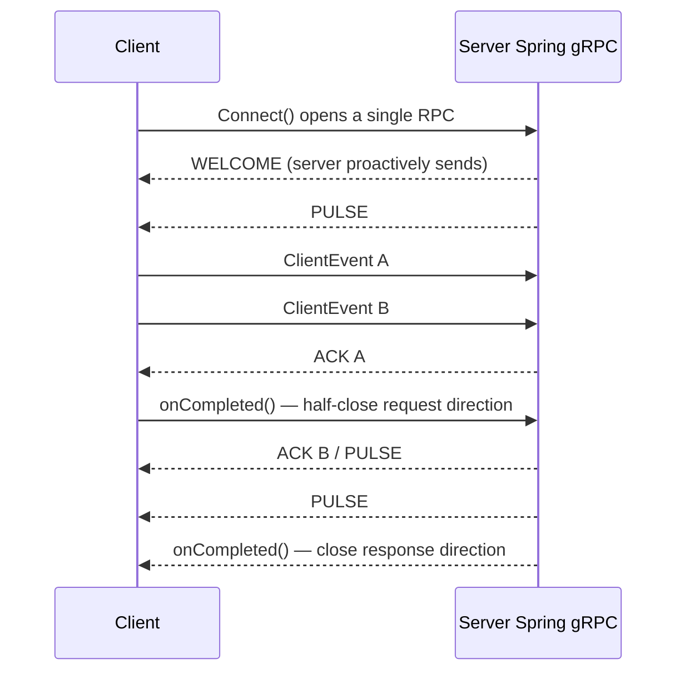

# Independent Bidirectional Streaming in a Single RPC

## 1. The Problem: One Connection, Two Independent Streams

Suppose an operations monitoring application has a dashboard connected to a Spring backend. The dashboard continuously sends user actions (marking events, changing filters); at the same time, the backend proactively pushes alerts and status update pulses. Alerts may arrive **before the user has sent any action**; an action sent out does not necessarily produce exactly one returned message either.

That is a scenario well suited for gRPC **bidirectional streaming RPC**: the client sends a sequence of requests, the server sends a sequence of responses, and both reside within **a single RPC call** over HTTP/2 using messages defined with Protocol Buffers.

After this lesson, learners will be able to:

- Declare a `stream Request` → `stream Response` method in `.proto`, generate Java types, and implement it with gRPC Java in a Spring application.
- Distinguish **independent bidirectional streaming** from pair-wise request–response and from two separate streaming RPCs.
- Control the lifecycle of `onNext`, `onCompleted`, `onError`, half-close, deadline, and cancellation without accidentally closing the other direction.
- Identify message ordering, concurrent access, and flow control issues when multiple sources emit data concurrently.
- Design appropriate testing and observability for a long-lived RPC.

## 2. The Nature of Independent Bidirectional Streaming

In bidirectional streaming, a call creates **two independently ordered message streams**:

| Direction | Sender | Receiver | Number of messages |
| --- | --- | --- | --- |
| Request stream | Client | Server | 0 to many |
| Response stream | Server | Client | 0 to many |

Each side can send whenever it has data, without waiting for the other side to send first. Receiving one request may result in one response, multiple responses, or no response at all; the server can also emit responses on its own based on a timer, system events, or data changes.

The example below illustrates **one possible schedule**, not a mandatory ordering between the two directions:



**Two guarantees to remember:** gRPC preserves message ordering **within each direction** of an RPC; it does not provide a global ordering between messages sent in two different directions. The relative timing of `ACK B` and `PULSE #2` depends on execution scheduling. If business logic needs to correlate events, add `event_id`, `correlation_id`, `sequence`, or timestamps in Protobuf and define your own processing rules.

Quick comparison of RPC types:

| RPC Type | Client sends | Server sends | Typical usage |
| --- | --- | --- | --- |
| Unary | 1 | 1 | Look up details of a single object |
| Server streaming | 1 | N | Watch progress of a task |
| Client streaming | N | 1 | Upload multiple records then aggregate |
| **Bidirectional streaming** | **N** | **N** | Live collaboration, real-time signals, parallel exchange |

Bidirectional streaming does not mean *each request has exactly one response*. If server code always returns an `ACK` after `onNext`, that is merely **a business choice**; the protocol still allows the server to push messages completely independently.

## 3. Designing the Protocol Buffers Contract

Create the `live_room.proto` contract (Protobuf source directory depends on project configuration):

```proto
syntax = "proto3";

package live.v1;

option java_multiple_files = true;
option java_package = "com.example.live.v1";

service LiveRoom {
  rpc Connect(stream ClientEvent) returns (stream ServerEvent);
}

message ClientEvent {
  string event_id = 1;
  string message = 2;
}

message ServerEvent {
  string kind = 1;       // WELCOME, ACK, PULSE, ...
  string message = 2;
  int64 sequence = 3;    // Event order in the server -> client direction
  string event_id = 4;   // References the request when kind = ACK
}
```

From this definition, the `protoc` compiler and the gRPC Java plugin generate the Java message classes and the `LiveRoomGrpc` service class. The key part of the server method signature is:

```java
StreamObserver<ClientEvent> connect(StreamObserver<ServerEvent> responseObserver)
```

`responseObserver` is the **server → client output**; the return value is a `StreamObserver<ClientEvent>` to **receive client → server requests**. The two observers have different responsibilities and may operate at different times, yet share a single RPC.

In the Spring gRPC ecosystem, the application needs compatible dependencies for Spring gRPC, gRPC Java, Protobuf, and code generation configuration. The example below assumes `LiveRoomGrpc`, `ClientEvent`, and `ServerEvent` have already been generated successfully. Spring can register an implementation of `BindableService` via a `@Service` Spring bean, then attach it to the framework-managed gRPC server.

## 4. Building the Server: Proactively Pushing Data Even Without Requests

The example uses a Spring-managed `ScheduledExecutorService` to emit three `PULSE` beats. At the same time, the server returns an `ACK` upon receiving a `ClientEvent`. This makes it easy to observe two independent emission sources. In practice, the timer can be replaced with an event stream from Kafka, application state changes, or a publish/subscribe mechanism.

Declare a shared executor and avoid creating a new thread pool per RPC:

```java
package com.example.live;

import java.util.concurrent.Executors;
import java.util.concurrent.ScheduledExecutorService;
import org.springframework.context.annotation.Bean;
import org.springframework.context.annotation.Configuration;

@Configuration
public class StreamingConfig {
    @Bean(destroyMethod = "shutdown")
    ScheduledExecutorService streamingScheduler() {
        return Executors.newScheduledThreadPool(2);
    }
}
```

Implement the service. `writeLock` ensures that callbacks arriving from the request-handling thread and the scheduler thread do not concurrently write to the **same** `responseObserver`:

```java
package com.example.live;

import com.example.live.v1.ClientEvent;
import com.example.live.v1.LiveRoomGrpc;
import com.example.live.v1.ServerEvent;
import io.grpc.stub.ServerCallStreamObserver;
import io.grpc.stub.StreamObserver;
import java.util.concurrent.ScheduledExecutorService;
import java.util.concurrent.ScheduledFuture;
import java.util.concurrent.TimeUnit;
import java.util.concurrent.atomic.AtomicBoolean;
import java.util.concurrent.atomic.AtomicInteger;
import java.util.concurrent.atomic.AtomicReference;
import org.springframework.stereotype.Service;

@Service
public class LiveRoomService extends LiveRoomGrpc.LiveRoomImplBase {
    private final ScheduledExecutorService scheduler;

    public LiveRoomService(ScheduledExecutorService scheduler) {
        this.scheduler = scheduler;
    }

    @Override
    public StreamObserver<ClientEvent> connect(
            StreamObserver<ServerEvent> responseObserver) {

        ServerCallStreamObserver<ServerEvent> output =
                (ServerCallStreamObserver<ServerEvent>) responseObserver;

        Object writeLock = new Object();
        AtomicBoolean ended = new AtomicBoolean(false);
        AtomicInteger sequence = new AtomicInteger();
        AtomicInteger pulseCount = new AtomicInteger();
        AtomicReference<ScheduledFuture<?>> timer = new AtomicReference<>();

        Runnable stop = () -> {
            ended.set(true);
            ScheduledFuture<?> job = timer.get();
            if (job != null) {
                job.cancel(false);
            }
        };

        // Must be registered before returning the request observer to gRPC.
        output.setOnCancelHandler(stop);

        synchronized (writeLock) {
            if (!output.isCancelled()) {
                responseObserver.onNext(ServerEvent.newBuilder()
                        .setKind("WELCOME")
                        .setMessage("Connected")
                        .setSequence(sequence.incrementAndGet())
                        .build());
            }
        }

        // Server's own emission source, independent of onNext(request).
        ScheduledFuture<?> job = scheduler.scheduleAtFixedRate(() -> {
            synchronized (writeLock) {
                if (ended.get() || output.isCancelled()) {
                    stop.run();
                    return;
                }

                int n = pulseCount.incrementAndGet();
                responseObserver.onNext(ServerEvent.newBuilder()
                        .setKind("PULSE")
                        .setMessage("Pulse update " + n)
                        .setSequence(sequence.incrementAndGet())
                        .build());

                if (n == 3) { // End the example after three pulses.
                    stop.run();
                    responseObserver.onCompleted();
                }
            }
        }, 1, 1, TimeUnit.SECONDS);

        timer.set(job);
        if (ended.get()) {
            job.cancel(false);
        }

        return new StreamObserver<>() {
            @Override
            public void onNext(ClientEvent event) {
                synchronized (writeLock) {
                    if (ended.get() || output.isCancelled()) {
                        return;
                    }
                    responseObserver.onNext(ServerEvent.newBuilder()
                            .setKind("ACK")
                            .setMessage("Received: " + event.getMessage())
                            .setEventId(event.getEventId())
                            .setSequence(sequence.incrementAndGet())
                            .build());
                }
            }

            @Override
            public void onError(Throwable cause) {
                // Client cancelled/disconnected: stop work for this session.
                stop.run();
            }

            @Override
            public void onCompleted() {
                // Client only closed the request sending direction (half-close).
                // Server continues emitting PULSE and finishes on its own.
            }
        };
    }
}
```

The key point lies in the **two independent callbacks**: `onNext(ClientEvent)` processes requests as they arrive, while the `scheduleAtFixedRate` task proactively sends `ServerEvent` every second. Nothing forces the server to wait for a request before sending `PULSE`.

This is an example with small data volume and finite lifetime to focus on structure. In a high-load system, you cannot rely on calling `onNext` arbitrarily: you need to control emission rate, buffering, errors in background tasks, and lifecycle on cancellation. Those points are covered in section 7.

## 5. Building the Client: Sending Requests and Receiving Responses Without Blocking

The client uses an asynchronous stub because bidirectional streaming is provided as asynchronous observers. After calling `connect(responseObserver)`, the client receives `requestObserver` to send events at any time.

```java
package com.example.live;

import com.example.live.v1.ClientEvent;
import com.example.live.v1.LiveRoomGrpc;
import com.example.live.v1.ServerEvent;
import io.grpc.ManagedChannel;
import io.grpc.ManagedChannelBuilder;
import io.grpc.stub.StreamObserver;
import java.util.concurrent.CountDownLatch;
import java.util.concurrent.TimeUnit;

public class LiveRoomClientDemo {
    public static void main(String[] args) throws InterruptedException {
        // Use plaintext only for local examples.
        ManagedChannel channel = ManagedChannelBuilder
                .forAddress("localhost", 9090)
                .usePlaintext()
                .build();

        try {
            CountDownLatch finished = new CountDownLatch(1);
            LiveRoomGrpc.LiveRoomStub stub = LiveRoomGrpc.newStub(channel)
                    .withDeadlineAfter(8, TimeUnit.SECONDS);

            StreamObserver<ServerEvent> incoming = new StreamObserver<>() {
                @Override
                public void onNext(ServerEvent event) {
                    System.out.printf("%s #%d: %s%n",
                            event.getKind(),
                            event.getSequence(),
                            event.getMessage());
                }

                @Override
                public void onError(Throwable error) {
                    System.err.println("RPC failed: " + error);
                    finished.countDown();
                }

                @Override
                public void onCompleted() {
                    System.out.println("Server finished the response stream.");
                    finished.countDown();
                }
            };

            StreamObserver<ClientEvent> outgoing = stub.connect(incoming);
            outgoing.onNext(ClientEvent.newBuilder()
                    .setEventId("evt-1").setMessage("Open dashboard").build());
            outgoing.onNext(ClientEvent.newBuilder()
                    .setEventId("evt-2").setMessage("Change filter").build());

            outgoing.onCompleted(); // Stop sending, continue receiving PULSE.

            if (!finished.await(7, TimeUnit.SECONDS)) {
                throw new IllegalStateException("Termination signal not received");
            }
        } finally {
            channel.shutdownNow().awaitTermination(2, TimeUnit.SECONDS);
        }
    }
}
```

In this example, the client can receive `WELCOME` immediately upon opening the RPC, receive `ACK` after sending events, and continue receiving `PULSE` after `outgoing.onCompleted()`. Messages on the **same response direction** are observed in the exact order the server emits them; the interleaving between `ACK` and `PULSE` may vary.

To test locally, run the Spring gRPC server on the port the client points to (for example `9090`, depending on project configuration), then run the client class. Dependency initialization, code generation plugins, and server port must match the Spring gRPC version in use; do not copy a set of library coordinates from another version without verifying.

## 6. Understanding the Exact Lifecycle of an RPC

Two independent data directions **do not mean two independent RPCs**. Deadline, authentication, metadata, final status, and call cancellation all belong to the same RPC.

| Event | What happens? | What the application should do |
| --- | --- | --- |
| Client calls `outgoing.onNext(x)` | Sends another request message | Do not assume the server must reply immediately |
| Server calls `responseObserver.onNext(y)` | Sends another response message | Do not assume the client just sent a request |
| Client calls `outgoing.onCompleted()` | Client **half-closes** the request direction | Server receives `onCompleted()` on the request observer and can still continue emitting responses |
| Server calls `responseObserver.onCompleted()` | Server completes the response with a success status | Client receives `onCompleted()`; do not send further messages on an ended RPC |
| One side calls `onError(t)` | Ends/cancels the RPC with the corresponding error | Stop emitting, release timers, subscriptions, and buffers |
| Client cancels or deadline expires | The RPC is cancelled or timed out | Server checks cancellation and stops background work |

**Common pitfall:** in `onCompleted()` of the server-side request observer, if you always immediately call `responseObserver.onCompleted()`, you have turned the client's half-close into the condition for closing the server direction. For problems that require continuing to push notifications, that behavior is incorrect.

Conversely, never assume that after the server has completed the response stream, the client always retains the right to write requests. A terminal status ends the RPC; late writes may fail or be dropped. Each observer may receive only **one terminal event** (`onCompleted` or `onError`), after which `onNext` must not be called again.

## 7. Concurrency, Flow Control, and Reliability

### 7.1. Concurrent Sends Must Be Serialized

`StreamObserver` is not thread-safe by default for multiple threads writing concurrently. In the sample service, `writeLock` protects calls to `responseObserver.onNext` and `responseObserver.onCompleted` from interleaving between the timer and the request-processing thread. In a large application with multiple data sources, a scalable option is to funnel all outbound messages into **a bounded queue**, then use a single writer per RPC to send them.

Do not use a global lock across all sessions, because that turns independent connections into a bottleneck. Keep state such as `sequence`, subscriptions, buffers, and completion flags **per RPC**.

### 7.2. Flow Control Does Not Mean `onNext` Blocks Automatically

gRPC runs over HTTP/2 with flow control, yet the application can still produce data faster than the receiver consumes it. For the outbound stream, `ServerCallStreamObserver`/`ClientCallStreamObserver` provide `isReady()` and `setOnReadyHandler(...)`. `isReady() == false` is a signal to **pause emitting more** and avoid unbounded accumulation in memory.

Practical procedure:

1. Put events to be sent into a queue with a **bounded element count or byte size**.
2. When the observer is ready, take events one by one to send in order.
3. If `isReady()` turns `false`, stop draining and wait for `onReadyHandler` to be invoked; inside the callback you must still **re-check** `isReady()`.
4. Define a policy when the queue is full: back-pressure the data source at the appropriate layer, coalesce older status messages, drop droppable messages, or terminate the session with an appropriate status.

For the **inbound** stream, when you need to control receiving, the server can call `disableAutoRequest()` on `ServerCallStreamObserver` during RPC initialization, then use `request(1)` to request the next message after finishing processing one. The client has a similar API via `ClientResponseObserver.beforeStart(...)` and `ClientCallStreamObserver`. The default automatic mode suits simple examples; enable manual flow control when the receiving pipeline is asynchronous or has a buffer prone to overload.

### 7.3. Deadline, Cancellation, and Errors

A gRPC deadline applies to the **entire RPC**, and is not refreshed per message. A long-lived stream needs an appropriate deadline, reconnect, and state recovery strategy. Upon `DEADLINE_EXCEEDED` or `CANCELLED`, do not leave timers, listeners, or in-flight work running silently.

Typical error cases:

| Scenario | Suggested gRPC code | Handling |
| --- | --- | --- |
| Invalid payload | `INVALID_ARGUMENT` | Reject the RPC or send a business error message per contract |
| Missing authentication | `UNAUTHENTICATED` | Block in an interceptor; do not emit private data |
| Insufficient permissions | `PERMISSION_DENIED` | Terminate the session appropriately |
| Server overloaded | `RESOURCE_EXHAUSTED` | Limit queues/rates; apply client-side backoff |
| Internal error | `INTERNAL` | Log with correlation ID; do not expose sensitive details |
| Timed out or cancelled | `DEADLINE_EXCEEDED`, `CANCELLED` | Stop emission sources and release resources |

An example of terminating with a standard status on the server:

```java
responseObserver.onError(
    io.grpc.Status.INVALID_ARGUMENT
        .withDescription("event_id must not be empty")
        .asRuntimeException());
```

In real flows, ensure this operation occurs **only once** and no callback emits `onNext` afterward. For background timers or subscriptions, close the emission source before reporting a terminal status and handle all asynchronous errors to avoid leaving the RPC hanging.

### 7.4. Metadata, TLS, Retry, and Recoverability

- **Metadata** such as tokens or tracing context are usually attached at **RPC initialization**, and do not automatically change per message. You can use `ClientInterceptor`/`ServerInterceptor` to propagate and validate metadata; if data changes per event, put it inside the Protobuf message.
- **TLS/mTLS** secures the channel and authenticates peers. `usePlaintext()` in the sample client is only for development testing. In production deployments, configure compatible TLS channels, certificates, and authentication policies between client and server.
- **Retry/resume** for a long-lived stream cannot safely be treated as "re-sending everything from the beginning". If there is a risk of duplicate or missed messages, use `event_id`, sequence numbers, business ACKs, cursors, or resume tokens; only replay events that satisfy idempotency rules.
- **System observability** should measure open stream count, message/byte rate per direction, latency between event and processing, queue fill level, cancellation/deadline count, reconnect count, and status distribution. Spring gRPC supports observability integration with Micrometer; always attach a consistent trace/correlation ID for the entire session.

## 8. Testing for True Independence

For integration tests, you can run the real service over a gRPC **in-process server/channel** to verify callbacks and statuses without depending on network ports. `spring-grpc-test` supports the in-process testing model in a Spring context; alternatively, use gRPC Java's `InProcessServerBuilder` and `InProcessChannelBuilder` directly. When testing timer logic, inject a controllable clock/scheduler so you do not depend on real sleep durations.

Scenarios to verify:

| Scenario | Expectation |
| --- | --- |
| Client opens `Connect` without sending `ClientEvent` | Still receives `WELCOME` and `PULSE` from the server |
| Client sends two messages consecutively | Server receives them in order; if ACKed, each `event_id` correlates to the right event |
| Client calls `onCompleted()` right after sending | Response direction stays active until the server finishes on its own |
| Client cancels mid-stream | Periodic job and subscriptions are cleaned up; no further emissions |
| Multiple concurrent sessions | Sequences, queues, and completion state are isolated per RPC |
| Slow receiver, full queue | System enforces the documented flow control policy without unbounded memory growth |
| Deadline expires or invalid data | Terminates with the expected status, with no `onNext` after the terminal event |

Because the two directions are independent, **do not write assertions requiring the entire output to interleave in exact lockstep with the input**. Verify ordering *within each direction*, ID correlation, and causal milestones actually guaranteed by the contract.

## 9. Common Mistakes

1. **Responding 1:1 and assuming that is the mandatory meaning of bidi.** The server can push proactively, and responses do not need to match the number of requests.
2. **Calling `responseObserver.onCompleted()` when the request observer receives `onCompleted()`.** This cuts off messages the server still wants to push after the client half-closes.
3. **Allowing multiple threads to call `onNext` on the same observer without coordination.** This easily causes races, out-of-order messages, or emissions after a terminal event.
4. **Using an unbounded queue assuming HTTP/2 already handles backpressure.** This can exhaust the heap when the producer is faster than the consumer.
5. **Failing to cancel timers/subscriptions when the client disconnects.** This leaks tasks and resources proportional to the number of connections.
6. **Confusing deadline with per-message timeout.** Deadline is the limit for the entire RPC call; long-lived streams need explicit configuration and reconnection mechanisms.
7. **Automatically retrying a stream without idempotency.** This causes lost or duplicated events when the connection drops.

## 10. Practice Exercise

Upgrade `LiveRoom` into a real-time notification board:

- Replace the periodic `PULSE` with a Spring event publisher. When a new alert arrives, the server broadcasts it to subscribed sessions, including sessions that have not sent any requests.
- Add `Subscribe`/`Unsubscribe` to the client message (using `oneof`), managing the list of subscribed topics per RPC.
- Use a bounded queue per session and `isReady()` to protect memory; define a policy when a client receives too slowly.
- Add `last_seen_sequence` to resume a session after reconnect; write tests for duplicate sends, missed messages, and deadline expiration.

**Completion criteria:** a client can stop sending while still receiving proactive updates from the server; two different clients do not accidentally share state; and every completed/cancelled RPC cleans up its session resources.

### References

- [Spring gRPC Reference – GRPC Server](https://docs.spring.io/spring-grpc/reference/server.html): registering `BindableService` in Spring, interceptors, in-process testing, observability, and TLS.
- [gRPC Java – StreamObserver API](https://grpc.github.io/grpc-java/javadoc/io/grpc/stub/StreamObserver.html): callback rules, terminal events, and thread-safety for concurrent access.
- [gRPC Java – Manual Flow Control](https://github.com/grpc/grpc-java/blob/master/examples/src/main/java/io/grpc/examples/manualflowcontrol/README.md): controlling inbound/outbound streams, `isReady()`, and `request(1)`.
