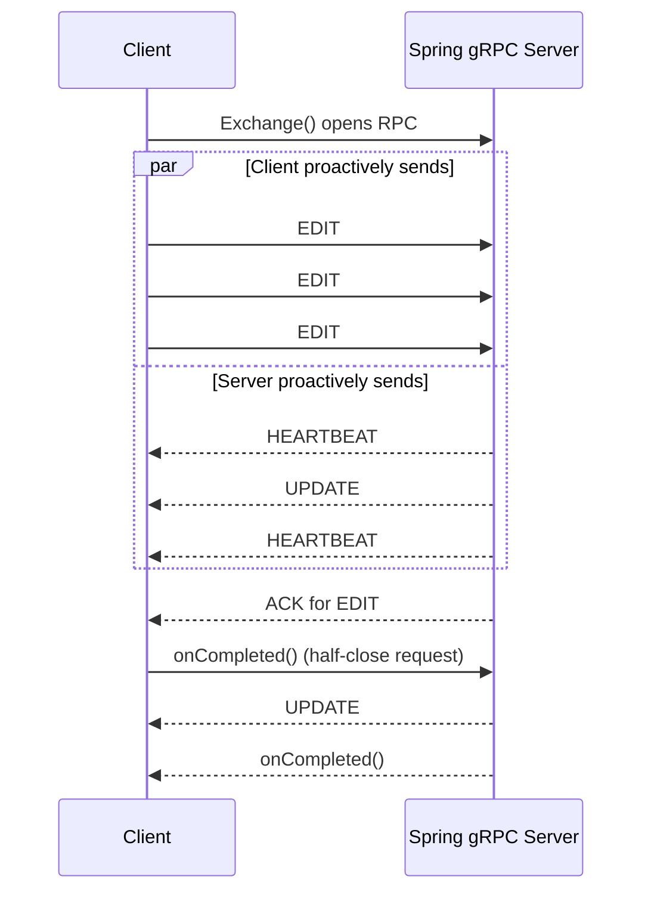
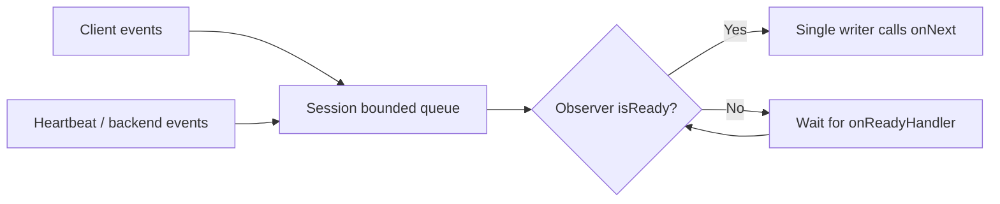

# Client and Server Sending Messages Concurrently

## 1. Lesson Objectives

A real-time collaboration application using **Spring gRPC** needs to both receive user actions from the browser and send state changes from the system. For example, a user sends `EDIT`, `PING`, or `SUBSCRIBE` commands while the server continues emitting `UPDATE` and `HEARTBEAT` notifications. If the client waits for a response before sending the next action, or the server waits for a request before pushing updates, the entire application becomes slow and can fall into a mutual waiting state.

**Bidirectional streaming** solves this problem by allowing **the client and server to send multiple messages concurrently within a single RPC**. Each side has an outbound stream and an inbound stream. Over a single HTTP/2 connection, Protobuf messages can travel in both directions without rigidly pairing each request with a response.

After this lesson, learners will be able to:

- Declare `rpc Exchange(stream ClientEvent) returns (stream ServerEvent)` and use the Java code generated by Protobuf/gRPC.
- Structure asynchronous send and receive loops on **both client and server**.
- Send periodic server notifications even while the client is sending or has paused sending.
- Serialize `onNext()` calls when multiple threads write to the **same** `StreamObserver`.
- Control `onCompleted()`, `onError()`, deadlines, cancellation, flow control, and per-RPC resources.
- Test concurrent two-way communication without relying on an arbitrary interleaving order.

## 2. What Does “Concurrently” Mean in gRPC?

In unary RPCs, the request precedes the response in a simple request–response pattern. With bidirectional streaming, **each side can proactively emit messages whenever it has data**:



The diagram shows that the two activities **can overlap in time**, rather than specifying exactly which message precedes which across the two directions. The server receives `EDIT` and the client receives `UPDATE` through two independent callbacks. They may run on different threads.

There are three key principles:

1. **Ordering within each direction is preserved.** If the client calls `onNext(A)` and then `onNext(B)` sequentially on the request stream, the server receives `A` before `B`. Likewise, the client receives responses in the order the server emits them. There is no global ordering between the request stream and the response stream.
2. **Concurrent does not mean two threads may write to the same observer simultaneously.** `StreamObserver` is not guaranteed to be thread-safe for multiple writers; the application must synchronize or coordinate through a single writer. Two **different** observers, representing the two directions, can be used concurrently.
3. **One RPC has two data directions but one shared lifecycle.** A client ending the request direction with `onCompleted()` does not force the server to stop the response direction; however, a deadline, error, or RPC cancellation can end the entire call.

A common implementation pattern is keeping the receiving flow callback-driven while the sending flow draws data from an executor, timer, or message broker. There is no need to spawn a dedicated thread just to loop calling `onNext` when there is no data.

## 3. Designing the Protobuf Contract

Consider a bidirectional event channel where the client sends actions and the server sends acknowledgments or proactive notifications:

```proto
syntax = "proto3";

package collaboration.v1;

option java_package = "com.example.collaboration.v1";
option java_multiple_files = true;

service Collaboration {
  rpc Exchange(stream ClientEvent) returns (stream ServerEvent);
}

message ClientEvent {
  string event_id = 1;    // ID to correlate ACK with the action
  string content = 2;     // Action payload
}

message ServerEvent {
  string type = 1;        // ACK or HEARTBEAT
  string content = 2;
  string reply_to = 3;    // Client's event_id, if ACK
  int64 sequence = 4;     // Order of message emitted by server
}
```

After configuring `protoc` and the `protoc-gen-grpc-java` plugin compatible with the project, the `CollaborationGrpc`, `ClientEvent`, and `ServerEvent` classes are generated automatically. The server implements:

```java
StreamObserver<ClientEvent> exchange(
        StreamObserver<ServerEvent> responseObserver)
```

`responseObserver` represents the **server → client** direction. The observer returned by `exchange(...)` receives the **client → server** direction. On the client, the async stub `CollaborationGrpc.newStub(channel)` also uses two observers:

```java
StreamObserver<ClientEvent> requestObserver =
        stub.exchange(responseObserver);
```

On both sides, `onNext(message)` on an outbound observer is the operation that **emits a message**; `onNext(message)` on an inbound observer is the callback that **handles a received message**. Clearly distinguishing these two roles avoids mixing up data directions when programming asynchronously.

## 4. Spring Server: Timer Emitting HEARTBEAT While Receiving Requests

The following example uses a Spring-managed `ScheduledExecutorService`. When a client opens `Exchange`, the server starts emitting six `HEARTBEAT` messages, roughly 300 ms apart. If the client sends a `ClientEvent` during that window, the server also emits an `ACK`. Both event sources can operate in parallel.

### 4.1. Shared Executor

```java
package com.example.collaboration;

import java.util.concurrent.Executors;
import java.util.concurrent.ScheduledExecutorService;
import org.springframework.context.annotation.Bean;
import org.springframework.context.annotation.Configuration;

@Configuration
public class CollaborationConfig {
    @Bean(destroyMethod = "shutdown")
    ScheduledExecutorService collaborationScheduler() {
        return Executors.newScheduledThreadPool(2);
    }
}
```

The executor is a bean shared across calls. Session state must still be created **per RPC**, preventing two clients from mixing up sequence numbers, completion flags, or timers.

### 4.2. Service Implementation

```java
package com.example.collaboration;

import com.example.collaboration.v1.ClientEvent;
import com.example.collaboration.v1.CollaborationGrpc;
import com.example.collaboration.v1.ServerEvent;
import io.grpc.Status;
import io.grpc.stub.ServerCallStreamObserver;
import io.grpc.stub.StreamObserver;
import java.util.concurrent.ScheduledExecutorService;
import java.util.concurrent.ScheduledFuture;
import java.util.concurrent.TimeUnit;
import org.springframework.stereotype.Service;

@Service
public class CollaborationService
        extends CollaborationGrpc.CollaborationImplBase {

    private final ScheduledExecutorService scheduler;

    public CollaborationService(ScheduledExecutorService scheduler) {
        this.scheduler = scheduler;
    }

    @Override
    public StreamObserver<ClientEvent> exchange(
            StreamObserver<ServerEvent> responseObserver) {

        ServerCallStreamObserver<ServerEvent> output =
                (ServerCallStreamObserver<ServerEvent>) responseObserver;
        Session session = new Session(output);

        // If client cancels or disconnects, cancel the background emitter.
        output.setOnCancelHandler(session::cancel);
        session.start(scheduler);

        return new StreamObserver<>() {
            @Override
            public void onNext(ClientEvent event) {
                session.acknowledge(event);
            }

            @Override
            public void onError(Throwable error) {
                session.cancel();
            }

            @Override
            public void onCompleted() {
                // Client stopped sending, but server may still be
                // emitting HEARTBEAT. Wait until conditions are met before closing response.
                session.inputCompleted();
            }
        };
    }

    private static final class Session {
        private final ServerCallStreamObserver<ServerEvent> output;
        private final Object writeLock = new Object();
        private ScheduledFuture<?> heartbeatJob;
        private long nextSequence = 0;
        private int heartbeats = 0;
        private boolean inputDone = false;
        private boolean ended = false;

        Session(ServerCallStreamObserver<ServerEvent> output) {
            this.output = output;
        }

        void start(ScheduledExecutorService scheduler) {
            synchronized (writeLock) {
                if (ended) {
                    return;
                }
                heartbeatJob = scheduler.scheduleAtFixedRate(
                        this::heartbeat, 0, 300, TimeUnit.MILLISECONDS);
            }
        }

        private void heartbeat() {
            synchronized (writeLock) {
                if (ended || output.isCancelled()) {
                    cancelLocked();
                    return;
                }
                // Send at most 6 beats for demonstration.
                if (heartbeats < 6) {
                    heartbeats++;
                    sendLocked("HEARTBEAT",
                            "Beat " + heartbeats, "");
                }
                if (heartbeats == 6) {
                    stopTimerLocked();
                    finishIfReadyLocked();
                }
            }
        }

        void acknowledge(ClientEvent event) {
            synchronized (writeLock) {
                if (ended || output.isCancelled()) {
                    cancelLocked();
                    return;
                }
                if (event.getEventId().isBlank()) {
                    failLocked(Status.INVALID_ARGUMENT
                            .withDescription("event_id is required"));
                    return;
                }
                sendLocked("ACK",
                        "Received: " + event.getContent(),
                        event.getEventId());
            }
        }

        void inputCompleted() {
            synchronized (writeLock) {
                inputDone = true;
                finishIfReadyLocked();
            }
        }

        void cancel() {
            synchronized (writeLock) {
                cancelLocked();
            }
        }

        // Call only while holding writeLock.
        private void sendLocked(String type,
                String content, String replyTo) {
            output.onNext(ServerEvent.newBuilder()
                    .setType(type)
                    .setContent(content)
                    .setReplyTo(replyTo)
                    .setSequence(++nextSequence)
                    .build());
        }

        private void finishIfReadyLocked() {
            if (!ended && inputDone && heartbeats == 6) {
                ended = true;
                stopTimerLocked();
                output.onCompleted();
            }
        }

        private void failLocked(Status status) {
            if (!ended) {
                ended = true;
                stopTimerLocked();
                output.onError(status.asRuntimeException());
            }
        }

        private void cancelLocked() {
            ended = true;
            stopTimerLocked();
        }

        private void stopTimerLocked() {
            if (heartbeatJob != null) {
                heartbeatJob.cancel(false);
            }
        }
    }
}
```

Two distinct message-sending paths coexist inside `Session`:

- `heartbeat()` runs on a **scheduler thread**, emitting `HEARTBEAT` without waiting for `ClientEvent`.
- `acknowledge()` is invoked when gRPC receives a **request message** from the client, emitting an `ACK` linked via `reply_to`.

Both methods acquire `writeLock` before calling `output.onNext()`. This lock protects the outbound observer and ensures `sequence` accurately reflects the emission order, even when the timer and request callback are ready at the same time. Server-side synchronization **does not block the client from continuing to send requests**; it only serializes writes on the same response direction.

The example intentionally waits for both `inputDone` and `heartbeats == 6` before calling `output.onCompleted()`. Thus, the client can finish its send direction before the server finishes emitting. If the server emits all six beats first, it waits for the client to half-close; in a real application there should be a deadline or explicit session termination mechanism so streams are not kept open indefinitely.

> **Sample scope:** the snippet above illustrates concurrent communication with low message volume. For production, add exception handling for publishers/timers, bounded queues, `isReady()`, and terminal-event protection when sending fails. You should not let an unbounded producer push directly into `output.onNext()` as in this example.

## 5. Java Client: Sending from an Executor, Receiving in gRPC Callbacks

The client uses the asynchronous stub; sending is offloaded to an executor while responses are handled by the `StreamObserver<ServerEvent>` callback. As a result, sending does not block receiving.

```java
package com.example.collaboration;

import com.example.collaboration.v1.ClientEvent;
import com.example.collaboration.v1.CollaborationGrpc;
import com.example.collaboration.v1.ServerEvent;
import io.grpc.ManagedChannel;
import io.grpc.ManagedChannelBuilder;
import io.grpc.stub.StreamObserver;
import java.util.concurrent.CountDownLatch;
import java.util.concurrent.ExecutorService;
import java.util.concurrent.Executors;
import java.util.concurrent.Future;
import java.util.concurrent.TimeUnit;

public class CollaborationClientDemo {
    public static void main(String[] args) throws Exception {
        ManagedChannel channel = ManagedChannelBuilder
                .forAddress("localhost", 9090)
                .usePlaintext() // Use only for local testing.
                .build();

        ExecutorService sender = Executors.newSingleThreadExecutor();
        CountDownLatch responseEnded = new CountDownLatch(1);

        try {
            CollaborationGrpc.CollaborationStub stub =
                    CollaborationGrpc.newStub(channel)
                            .withDeadlineAfter(10, TimeUnit.SECONDS);

            StreamObserver<ServerEvent> incoming =
                    new StreamObserver<>() {
                @Override
                public void onNext(ServerEvent event) {
                    System.out.printf(
                            "[RECV] type=%s seq=%d replyTo=%s content=%s%n",
                            event.getType(),
                            event.getSequence(),
                            event.getReplyTo(),
                            event.getContent());
                }

                @Override
                public void onError(Throwable error) {
                    System.err.println("[RECV] error: " + error);
                    responseEnded.countDown();
                }

                @Override
                public void onCompleted() {
                    System.out.println("[RECV] server completed");
                    responseEnded.countDown();
                }
            };

            StreamObserver<ClientEvent> outgoing =
                    stub.exchange(incoming);

            Future<?> sendTask = sender.submit(() -> {
                try {
                    for (int i = 1; i <= 4; i++) {
                        String id = "edit-" + i;
                        outgoing.onNext(ClientEvent.newBuilder()
                                .setEventId(id)
                                .setContent("Change " + i)
                                .build());
                        System.out.println("[SEND] " + id);
                        TimeUnit.MILLISECONDS.sleep(220);
                    }
                    outgoing.onCompleted(); // Close request direction only.
                } catch (InterruptedException interrupted) {
                    Thread.currentThread().interrupt();
                    // When stopping producer before half-close, cancel RPC.
                    outgoing.onError(
                            io.grpc.Status.CANCELLED
                                    .withDescription("Producer stopped")
                                    .asRuntimeException());
                }
            });

            // Still receives HEARTBEAT/ACK while sendTask is running.
            if (!responseEnded.await(9, TimeUnit.SECONDS)) {
                throw new IllegalStateException("RPC did not finish in time");
            }
            sendTask.get(); // Surface any error from the request-sending task.
        } finally {
            sender.shutdownNow();
            channel.shutdownNow()
                    .awaitTermination(2, TimeUnit.SECONDS);
        }
    }
}
```

The example runs against a gRPC server configured at `localhost:9090`; the actual port and dependencies depend on the project's Spring gRPC configuration. The client emits four events sequentially, 220 ms apart; the server periodically sends a heartbeat every 300 ms. Because the two intervals are **different**, the log will interleave without a fixed order:

```text
[SEND] edit-1
[RECV] type=HEARTBEAT seq=1 ...
[RECV] type=ACK seq=2 replyTo=edit-1 ...
[SEND] edit-2
[RECV] type=HEARTBEAT seq=3 ...
[SEND] edit-3
[RECV] type=ACK seq=4 replyTo=edit-2 ...
...
[RECV] server completed
```

This is only an illustrative output; do not use this log sequence as a strict ordering assertion. In practice, an `ACK` may appear before or after a nearby heartbeat depending on scheduling. Data must be matched back to its request using `reply_to`, not by the message's position in the log.

**Producer note:** there is exactly **one** thread calling `outgoing.onNext()` in the sample client. If a UI thread, timer, and message broker all emit onto `outgoing`, funnel messages into a bounded queue and use a single writer, or protect writes with the same synchronization mechanism. Having gRPC invoke `incoming.onNext()` concurrently with the sending thread is valid, because those are **two different observers**.

## 6. Key Concurrency Concerns

### 6.1. Do Not Block Receiving Callbacks Waiting for the Sender

An anti-pattern that easily causes deadlock is having the server process requests only after receiving a `READY`, while the client waits for `READY_ACK` before sending `READY`. If both sides perform a blocking wait on a condition neither triggers, the entire RPC stalls even though the transport is healthy.

In gRPC Java, `onNext()` callbacks should complete quickly, avoiding `Thread.sleep()`, slow queries, or waiting on a condition tied to another callback on the same executor. For heavy work, offload to a dedicated executor and emit results safely on the response observer. Consider business ordering if multiple tasks complete out of arrival order.

### 6.2. Thread-Safety *Per* Observer

Consider the following operations:

| Operation | Can run in parallel? | Condition |
| --- | --- | --- |
| Client calls `outgoing.onNext(A)` while callback `incoming.onNext(B)` runs | **Yes** | Two different observers |
| Two client threads concurrently call `outgoing.onNext(...)` | **Unsafe without coordination** | Use a single writer or synchronization |
| Server timer and request callback both call `output.onNext(...)` | **Needs protection** | Per-RPC lock/queue such as `writeLock` |
| One thread calls `output.onNext(...)`, another calls `output.onCompleted()` | **Needs protection** | Ensure no `onNext` after terminal event |

There must be only **one terminal event** per observer: either `onCompleted()` or `onError(Throwable)`. After a terminal event, no further `onNext()` may be sent. An `ended` flag guarded by the same write lock coordinates timers, callbacks, cancellation, and normal completion.

### 6.3. Ordering Correctness and Business Correlation

The transport guarantees receive ordering **on a stream in each direction**; it does not guarantee which `HEARTBEAT` precedes which `ACK` across producers. When multiple server emission sources are merged via a lock, the actual server order is the order in which they acquire the lock and call `onNext`. Do not confuse that with the chronological order in which business events *occurred*.

If stateful conversation or duplicate detection is required, add:

- `event_id` to identify the request.
- `reply_to` so the client knows which request an ACK belongs to.
- `sequence` incremented by the server per RPC or per event channel.
- Idempotency key, version, or cursor when replay after disconnect is needed.

In a multi-server system, a per-RPC `sequence` is **not** a global sequence number across all clients; global ordering requires a dedicated sequence source and event merging strategy.

## 7. Flow Control and System Protection Under Fast Sending

Because both client and server can emit many messages simultaneously, either side risks producing data faster than the peer can read it. HTTP/2 has **flow control**, yet `onNext()` does not necessarily block the application until the peer finishes processing. Generating messages and buffering them without bounds can still exhaust memory.

In gRPC Java:

- `ServerCallStreamObserver<ServerEvent>` on the server and `ClientCallStreamObserver<ClientEvent>` on the client expose `isReady()` and `setOnReadyHandler(...)`. When `isReady()` is `false`, stop draining the queue and wait for the callback; the callback must re-check readiness.
- When using **manual inbound flow control**, the server can call `disableAutoRequest()` and then `request(n)` on `ServerCallStreamObserver`. The client can control the response stream via `ClientResponseObserver.beforeStart(...)` and `ClientCallStreamObserver`.
- Each RPC's queue should have an explicit bound; when full, choose to block the producer at the appropriate layer, coalesce replaceable status messages, drop non-essential messages, or terminate the RPC with an appropriate status.

A bounded outbound writer model:



Avoid calling `onNext()` directly inside multiple producer callbacks once you adopt a queue model. All writes should pass through a single write path to guarantee ordering, memory bounds, and consistency with terminal events.

## 8. Lifecycle, Deadlines, and Errors in a Full-Duplex Call

| Event | Behavior to understand | Handling |
| --- | --- | --- |
| `outgoing.onCompleted()` on client | Client **half-closes request stream** | Server can still send responses |
| `onCompleted()` on server request observer | No more incoming requests | Mark `inputDone`; only close response when business logic completes |
| `responseObserver.onCompleted()` on server | Successfully ends response stream and RPC | Client receives terminal callback; release emission sources |
| `onError(t)` | Error terminates the stream/RPC | Stop timers, queues, subscriptions; record status |
| `CANCELLED` / `DEADLINE_EXCEEDED` | Client cancelled or RPC timed out | Do not let background jobs keep emitting |

A deadline applies to the **entire RPC**, and is not automatically extended by heartbeats. In the example, the client sets a 10-second deadline to avoid hanging indefinitely. For applications with streams living for hours, define explicit deadline, reconnection, and event recovery policies; never rely on a connection staying alive forever.

In Spring gRPC, metadata and interceptors can attach authentication, tracing, or correlation IDs for the **call**; per-message data belongs in Protobuf. Use TLS/mTLS in real deployments; `usePlaintext()` is only suitable when learning on localhost. Appropriate error codes include `INVALID_ARGUMENT`, `UNAUTHENTICATED`, `PERMISSION_DENIED`, `RESOURCE_EXHAUSTED`, or `INTERNAL` depending on the cause.

**Asynchronous errors must be caught in the right place:** an exception inside a scheduler task can cause the task to stop repeating while the RPC remains open. In production implementations, wrap emitters in `try/catch`, coordinate a single terminal signal under the same lock, report `onError(Status...)` when possible, and always cancel session resources. Also handle response-wait timeouts and client producer cancellation consistently.

## 9. Testing Concurrent Sending and Receiving

You can use a gRPC in-process server/channel to run integration tests without TCP ports; in a Spring application, start a Spring context containing the service and replace the scheduler with a controllable test scheduler. Do not test by waiting with arbitrary `Thread.sleep()` calls and asserting an exact interleaving order between the two directions.

| Test scenario | Expected evidence |
| --- | --- |
| Client opens RPC without sending a request | Server can still emit `HEARTBEAT` |
| Client sends four consecutive events while server emits heartbeats | Receives all ACKs linked to `event_id` and heartbeats per contract |
| Two threads invoke the same response observer on the server | No lost/duplicated events; `sequence` increases monotonically thanks to coordination |
| Client half-closes early | Server continues emitting and completes when its work finishes |
| Timer finishes before client half-closes | Response does not close until the designed completion condition is met |
| Client cancels mid-way | Timer stops, no new messages are emitted, resources are cleaned up |
| Slow receiver and full queue | Memory bound is respected, backpressure policy is applied |
| Deadline expires or invalid payload | Receives the right status, no `onNext` appears after terminal event |

To test concurrency reproducibly, use `CountDownLatch`/`CyclicBarrier` in tests to trigger the producer and callbacks around the same time, then verify message sets and sequences by ID. Do not treat the interleaving position between `ACK` and `HEARTBEAT` as part of the contract unless the contract promises it.

Useful operational metrics include active RPC count, messages/bytes per direction, queue size, send wait time, `CANCELLED`/`DEADLINE_EXCEEDED` rate, streams still open after producers stop, and latency from event creation to peer receipt/acknowledgment.

## 10. Practice Exercise

Extend the `Collaboration` service into a room-based collaboration channel:

1. Client sends `JOIN(room_id)`, `EDIT(event_id, payload)`, and `LEAVE` over the same request stream (using `oneof` in Protobuf).
2. Server pushes `USER_JOINED`, `DOCUMENT_UPDATED`, and `USER_LEFT` to clients in the same room, including those not sending requests at the time of the update.
3. Keep a single writer and a bounded queue per RPC; explicitly define how slow-receiving clients are handled.
4. Write a test with two clients sending `EDIT` concurrently: each client receives updates, no concurrent `onNext` calls hit the same observer, and every cancelled stream removes its subscription.
5. Add `event_id` along with a sequence number or cursor to detect duplicate messages on reconnect.

**Completion criteria:** both client and server can send while the other side is busy sending or temporarily paused; the application preserves ordering within each direction, distinguishes ACKs by ID, terminates RPCs consistently, and leaves no background tasks running after cancellation.

### References

- [gRPC Core concepts: Bidirectional streaming RPC](https://grpc.io/docs/what-is-grpc/core-concepts/): independent reading/writing and ordering within each stream.
- [gRPC Java StreamObserver API](https://grpc.github.io/grpc-java/javadoc/io/grpc/stub/StreamObserver.html): callbacks, terminal events, and thread-safety constraints.
- [gRPC Java ServerCallStreamObserver API](https://grpc.github.io/grpc-java/javadoc/io/grpc/stub/ServerCallStreamObserver.html): RPC cancellation and flow control.
- [Spring gRPC Reference](https://docs.spring.io/spring-grpc/reference/): registering gRPC services with Spring and related integrations.
