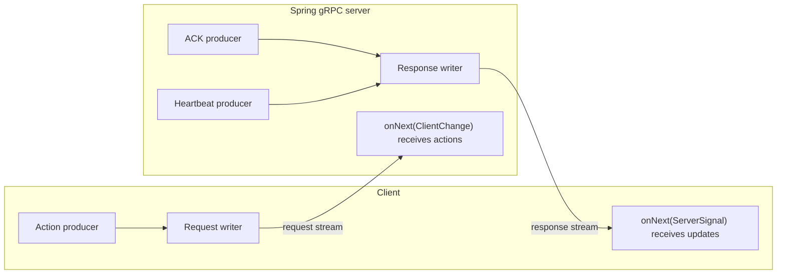
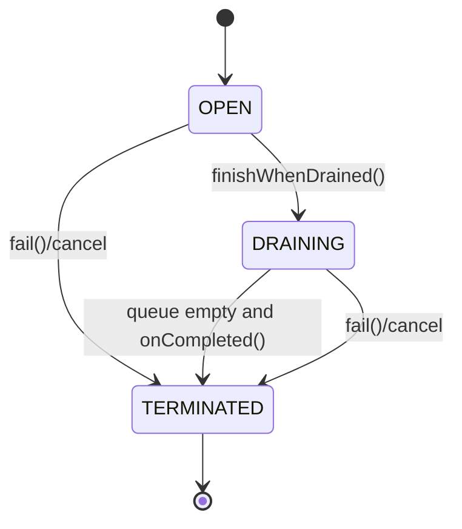

# Coordinating onNext on Both Sides

## 1. Why Coordination Is Needed When Both Client and Server Have `onNext`

In a **Spring gRPC** service, a Protocol Buffers contract can declare a bidirectional RPC so the client sends events while the server proactively pushes updates. For example, a document-editing application has many `CHANGE` actions from users, while the server sends `ACK`, alerts, or periodic notifications. Both directions operate within **a single bidirectional streaming RPC**.

A common point of confusion is that the method name `onNext` appears on both the sending and receiving sides:

- When calling `outgoing.onNext(message)`, the application **sends** a message to the other side.
- When gRPC invokes the `incoming.onNext(message)` callback, the application **receives** a message from the other side.
- Client and server **can** send at the same time; however, if two producers both write to the **same outbound observer**, the application must coordinate them to avoid concurrent access and ensure no writes occur after the stream terminates.

Therefore, "coordinating `onNext`" consists of three things: identifying the right data direction, funneling multiple emission sources into one safe write path, and synchronizing stream completion with pending messages.

**Learning objectives:** after this lesson, learners will be able to distinguish send/receive observers on each side, build a bounded sender that respects `isReady()`, coordinate multiple producers with a per-RPC lock/queue, use `ClientResponseObserver.beforeStart()`, handle half-close, errors, deadlines, and cancellation, and test typical race conditions.

## 2. Four `onNext` Positions in a Bidirectional RPC

Given the contract `rpc Sync(stream ClientChange) returns (stream ServerSignal)`:

| Position | Statement or callback | Role | Who supplies the message? |
| --- | --- | --- | --- |
| Client, outbound | `requestObserver.onNext(ClientChange)` | **Send** request | Client logic |
| Server, inbound | `requestObserver.onNext(ClientChange)` | **Receive** request | gRPC invokes service callback |
| Server, outbound | `responseObserver.onNext(ServerSignal)` | **Send** response | Server logic |
| Client, inbound | `responseObserver.onNext(ServerSignal)` | **Receive** response | gRPC invokes client callback |

The names `requestObserver` and `responseObserver` may look similar across snippets, but **their objects and responsibilities differ**. On the server, `responseObserver` is an output parameter; the server returns a `StreamObserver<ClientChange>` to receive requests. On the client, the async stub returns a `StreamObserver<ClientChange>` to send requests; the client provides a `StreamObserver<ServerSignal>` to receive responses.



The arrows show data flow paths, **not** a fixed schedule. Each direction has its own order determined by serialized `onNext` calls; there is no global order between the two directions.

## 3. Protobuf Contract for the Example

Define `collaboration.proto`:

```proto
syntax = "proto3";

package collaboration.v1;

option java_multiple_files = true;
option java_package = "com.example.collaboration.v1";

service Collaboration {
  rpc Sync(stream ClientChange) returns (stream ServerSignal);
}

message ClientChange {
  string change_id = 1;
  string content = 2;
}

message ServerSignal {
  string kind = 1;       // ACK or HEARTBEAT
  string reply_to = 2;   // change_id corresponding to ACK
  string content = 3;
}
```

The `protoc` and `protoc-gen-grpc-java` plugins generate `ClientChange`, `ServerSignal`, and `CollaborationGrpc`. The Java examples below assume the Spring application already has gRPC Java, Spring gRPC dependencies, and a code generation step compatible with the project version.

## 4. Safety Rules Before Writing Code

### 4.1. One Outbound Observer Should Have One Write Path

gRPC Java's `StreamObserver` is **not guaranteed to be thread-safe when multiple threads invoke methods on the same object concurrently**. On the server, these two producers can run at the same time:

```java
// Request-processing thread:
responseObserver.onNext(ack);

// Scheduler thread:
responseObserver.onNext(heartbeat);
```

Do not let those two calls happen concurrently without coordination. There are two approaches:

1. **Per-RPC lock:** guard all `onNext`, `onCompleted`, `onError`, and state flags with the same lock. Suitable for small cases.
2. **Queue + single writer:** all producers push messages into a queue; a writer dequeues and calls `onNext` sequentially. Can enforce a queue capacity limit and pause when `isReady() == false`. Better suited for multiple emission sources and slow receivers.

This lesson uses the second approach, with a **mailbox** funneling outbound messages. The mailbox uses a short lock to protect the queue and write operations; each RPC session has its own mailbox, avoiding a shared lock across all clients.

### 4.2. Closing the Stream Must Go Through the Same Coordination Mechanism

If thread A emits `onNext` while thread B calls `onCompleted`, relying on a plain `boolean` flag alone is not enough. You could end up calling `onNext` after a terminal event, or emitting two terminal events.

The mailbox maintains these states:



- `OPEN`: accepts new messages into the queue and attempts to send them.
- `DRAINING`: rejects new messages, but waits to finish sending already-accepted messages before `onCompleted()`.
- `TERMINATED`: no more `onNext()`; all producers must stop or ignore late results.

**Note:** the `DRAINING` state is purely an application coordination model, not a new state in the gRPC protocol.

## 5. Writing a Shared `OutboundMailbox` to Coordinate `onNext`

The following class accepts `CallStreamObserver<T>`, the base class of `ServerCallStreamObserver<T>` and `ClientCallStreamObserver<T>`. This allows using **the same pattern on both client and server**.

```java
package com.example.collaboration;

import io.grpc.Status;
import io.grpc.stub.CallStreamObserver;
import java.util.ArrayDeque;
import java.util.Deque;
import java.util.Objects;

public final class OutboundMailbox<T> {
    private final CallStreamObserver<T> stream;
    private final Deque<T> queue = new ArrayDeque<>();
    private final int capacity;
    private boolean accepting = true;
    private boolean terminated = false;

    public OutboundMailbox(CallStreamObserver<T> stream, int capacity) {
        this.stream = Objects.requireNonNull(stream);
        if (capacity <= 0) {
            throw new IllegalArgumentException("capacity must be > 0");
        }
        this.capacity = capacity;
    }

    // Any producer calls here instead of calling stream.onNext directly.
    public synchronized boolean offer(T message) {
        if (!accepting || terminated) {
            return false;
        }
        if (queue.size() >= capacity) {
            failLocked(Status.RESOURCE_EXHAUSTED
                    .withDescription("Outbound send queue is full")
                    .asRuntimeException());
            return false;
        }
        queue.addLast(Objects.requireNonNull(message));
        drainLocked();
        return !terminated;
    }

    // Register this callback via stream.setOnReadyHandler(...).
    public synchronized void onReady() {
        drainLocked();
    }

    // Emission source finished; wait for queue to drain then half-close outbound.
    public synchronized void finishWhenDrained() {
        if (terminated) {
            return;
        }
        accepting = false;
        drainLocked();
    }

    // Error termination: disallow further sends.
    public synchronized void fail(Throwable cause) {
        failLocked(cause);
    }

    // Peer cancelled/completed the RPC: stop emitting, do not signal terminal again.
    public synchronized void abandon() {
        accepting = false;
        terminated = true;
        queue.clear();
    }

    private void failLocked(Throwable cause) {
        if (terminated) {
            return;
        }
        accepting = false;
        terminated = true;
        queue.clear();
        stream.onError(cause);
    }

    private void drainLocked() {
        if (terminated) {
            return;
        }
        while (!queue.isEmpty() && stream.isReady()) {
            T next = queue.removeFirst();
            try {
                stream.onNext(next);
            } catch (RuntimeException ex) {
                failLocked(Status.INTERNAL
                        .withDescription("Failed to send message")
                        .withCause(ex)
                        .asRuntimeException());
                return;
            }
        }
        if (!accepting && queue.isEmpty() && !terminated) {
            terminated = true;
            stream.onCompleted();
        }
    }
}
```

Key observations:

- All calls to `stream.onNext()`, `stream.onError()`, and `stream.onCompleted()` happen inside **`synchronized` methods of the same mailbox**. When another producer arrives, it waits its turn to write.
- `offer()` only adds data while the mailbox is `OPEN`; a full queue terminates the RPC with `RESOURCE_EXHAUSTED`. This is a clear illustrative policy; production systems may choose to coalesce status events or apply upstream backpressure.
- `isReady()` is checked on **every drain iteration**. When the transport is not ready, data stays in the bounded queue; `onReady()` retries draining after gRPC signals writability.
- `finishWhenDrained()` preserves already-accepted messages, then emits **one** `onCompleted()`. `abandon()` is used only when the RPC has already been cancelled/ended by the other side, avoiding a second terminal signal.

This pattern primarily illustrates coordination and fits small messages. `onNext()` usually returns quickly but does not mean the peer has processed the message; when high throughput is required, consider a dedicated session writer executor/actor so receiving callbacks do not perform draining directly. If even the transport's `onError()` throws an exception, log and tear down at the RPC-owning layer without attempting a second terminal call.

## 6. Server Side: ACK and HEARTBEAT Sharing One Writer

The server below has two emission sources: the `ClientChange` receive callback generating `ACK`, and a scheduler generating `HEARTBEAT`. Both push messages into a single `OutboundMailbox<ServerSignal>`.

### 6.1. Spring-Managed Scheduler

```java
package com.example.collaboration;

import java.util.concurrent.Executors;
import java.util.concurrent.ScheduledExecutorService;
import org.springframework.context.annotation.Bean;
import org.springframework.context.annotation.Configuration;

@Configuration
public class StreamingConfig {
    @Bean(destroyMethod = "shutdown")
    ScheduledExecutorService streamingScheduler() {
        return Executors.newScheduledThreadPool(2);
    }
}
```

### 6.2. Service Implementation

```java
package com.example.collaboration;

import com.example.collaboration.v1.ClientChange;
import com.example.collaboration.v1.CollaborationGrpc;
import com.example.collaboration.v1.ServerSignal;
import io.grpc.Status;
import io.grpc.stub.ServerCallStreamObserver;
import io.grpc.stub.StreamObserver;
import java.util.concurrent.ScheduledExecutorService;
import java.util.concurrent.ScheduledFuture;
import java.util.concurrent.TimeUnit;
import java.util.concurrent.atomic.AtomicBoolean;
import java.util.concurrent.atomic.AtomicInteger;
import java.util.concurrent.atomic.AtomicReference;
import org.springframework.stereotype.Service;

@Service
public class CollaborationService
        extends CollaborationGrpc.CollaborationImplBase {

    private final ScheduledExecutorService scheduler;

    public CollaborationService(ScheduledExecutorService scheduler) {
        this.scheduler = scheduler;
    }

    @Override
    public StreamObserver<ClientChange> sync(
            StreamObserver<ServerSignal> responseObserver) {
        ServerCallStreamObserver<ServerSignal> transport =
                (ServerCallStreamObserver<ServerSignal>) responseObserver;
        OutboundMailbox<ServerSignal> outgoing =
                new OutboundMailbox<>(transport, 32);

        AtomicBoolean cancelled = new AtomicBoolean();
        AtomicBoolean inputDone = new AtomicBoolean();
        AtomicBoolean pulsesDone = new AtomicBoolean();
        AtomicInteger pulseCount = new AtomicInteger();
        AtomicReference<ScheduledFuture<?>> job = new AtomicReference<>();

        Runnable stopTimer = () -> {
            ScheduledFuture<?> future = job.get();
            if (future != null) {
                future.cancel(false);
            }
        };
        Runnable cancelSession = () -> {
            cancelled.set(true);
            stopTimer.run();
            outgoing.abandon();
        };
        Runnable finishIfReady = () -> {
            if (!cancelled.get() && inputDone.get() && pulsesDone.get()) {
                outgoing.finishWhenDrained();
            }
        };

        // Register handlers before returning request observer to gRPC.
        transport.setOnReadyHandler(outgoing::onReady);
        transport.setOnCancelHandler(cancelSession);

        ScheduledFuture<?> future = scheduler.scheduleAtFixedRate(() -> {
            if (cancelled.get() || transport.isCancelled()) {
                cancelSession.run();
                return;
            }
            int n = pulseCount.incrementAndGet();
            if (!outgoing.offer(ServerSignal.newBuilder()
                    .setKind("HEARTBEAT")
                    .setContent("Beat " + n)
                    .build())) {
                cancelSession.run();
                return;
            }
            if (n == 5) {
                pulsesDone.set(true);
                stopTimer.run();
                finishIfReady.run();
            }
        }, 100, 250, TimeUnit.MILLISECONDS);

        job.set(future);
        if (cancelled.get() || pulsesDone.get()) {
            future.cancel(false);
        }

        return new StreamObserver<>() {
            @Override
            public void onNext(ClientChange change) {
                if (cancelled.get()) {
                    return;
                }
                if (change.getChangeId().isBlank()) {
                    cancelled.set(true);
                    stopTimer.run();
                    outgoing.fail(Status.INVALID_ARGUMENT
                            .withDescription("change_id is required")
                            .asRuntimeException());
                    return;
                }
                boolean accepted = outgoing.offer(ServerSignal.newBuilder()
                        .setKind("ACK")
                        .setReplyTo(change.getChangeId())
                        .setContent("Received " + change.getContent())
                        .build());
                if (!accepted) {
                    cancelSession.run();
                }
            }

            @Override
            public void onError(Throwable cause) {
                // RPC from client failed: cancel session tasks.
                cancelSession.run();
            }

            @Override
            public void onCompleted() {
                // Client half-closed request direction; do not force server to stop yet.
                inputDone.set(true);
                finishIfReady.run();
            }
        };
    }
}
```

Why is this example safer than calling `responseObserver.onNext()` from two threads?

1. The server's `onNext(ClientChange)` only **receives** the request and puts an ACK into the mailbox.
2. The scheduler only puts HEARTBEAT into the **same mailbox**; it never touches `transport.onNext()` directly.
3. The mailbox serializes writes, and `onReadyHandler` resumes draining if the transport temporarily paused accepting data.
4. The server closes the response only when **the client has half-closed** and **five heartbeats have been emitted**, once the queue has drained.
5. When the client cancels, `setOnCancelHandler` stops the timer and clears the queue, preventing producers from continuing to emit onto a dead RPC.

ACK and HEARTBEAT messages may interleave differently on each run. To track which ACK belongs to which action, the client uses `reply_to` instead of relying on message position.

## 7. Client Side: Coordinating `onNext` and Registering `onReady` at the Right Time

In gRPC Java, `ClientResponseObserver<Request, Response>` gives access to `ClientCallStreamObserver<Request>` inside `beforeStart()`. This is the right place to register `setOnReadyHandler` and configure flow control before starting to send requests.

```java
package com.example.collaboration;

import com.example.collaboration.v1.ClientChange;
import com.example.collaboration.v1.CollaborationGrpc;
import com.example.collaboration.v1.ServerSignal;
import io.grpc.ManagedChannel;
import io.grpc.ManagedChannelBuilder;
import io.grpc.Status;
import io.grpc.stub.ClientCallStreamObserver;
import io.grpc.stub.ClientResponseObserver;
import java.util.concurrent.CountDownLatch;
import java.util.concurrent.ExecutorService;
import java.util.concurrent.Executors;
import java.util.concurrent.Future;
import java.util.concurrent.TimeUnit;
import java.util.concurrent.atomic.AtomicReference;

public class CollaborationClientDemo {
    public static void main(String[] args) throws Exception {
        ManagedChannel channel = ManagedChannelBuilder
                .forAddress("localhost", 9090)
                .usePlaintext() // Use only on development machines.
                .build();
        ExecutorService producerExecutor =
                Executors.newSingleThreadExecutor();
        CountDownLatch responseFinished = new CountDownLatch(1);
        AtomicReference<OutboundMailbox<ClientChange>> writerRef =
                new AtomicReference<>();

        try {
            CollaborationGrpc.CollaborationStub stub =
                    CollaborationGrpc.newStub(channel)
                            .withDeadlineAfter(6, TimeUnit.SECONDS);

            ClientResponseObserver<ClientChange, ServerSignal> incoming =
                    new ClientResponseObserver<>() {
                @Override
                public void beforeStart(
                        ClientCallStreamObserver<ClientChange> requestStream) {
                    OutboundMailbox<ClientChange> writer =
                            new OutboundMailbox<>(requestStream, 16);
                    requestStream.setOnReadyHandler(writer::onReady);
                    writerRef.set(writer);
                }

                @Override
                public void onNext(ServerSignal response) {
                    System.out.printf("[RECV] %s ref=%s %s%n",
                            response.getKind(),
                            response.getReplyTo(),
                            response.getContent());
                }

                @Override
                public void onError(Throwable error) {
                    System.err.println("[RECV] RPC error: " + error);
                    OutboundMailbox<ClientChange> writer = writerRef.get();
                    if (writer != null) {
                        writer.abandon();
                    }
                    responseFinished.countDown();
                }

                @Override
                public void onCompleted() {
                    System.out.println("[RECV] server completed");
                    OutboundMailbox<ClientChange> writer = writerRef.get();
                    if (writer != null) {
                        writer.abandon();
                    }
                    responseFinished.countDown();
                }
            };

            // beforeStart() sets up writer before the call returns.
            stub.sync(incoming);
            OutboundMailbox<ClientChange> writer = writerRef.get();
            if (writer == null) {
                throw new IllegalStateException("Writer was not initialized");
            }

            Future<?> producer = producerExecutor.submit(() -> {
                try {
                    for (int i = 1; i <= 5; i++) {
                        boolean accepted = writer.offer(ClientChange
                                .newBuilder()
                                .setChangeId("change-" + i)
                                .setContent("Edit #" + i)
                                .build());
                        if (!accepted) {
                            return; // RPC closed or queue is full.
                        }
                        TimeUnit.MILLISECONDS.sleep(180);
                    }
                    writer.finishWhenDrained();
                } catch (InterruptedException interrupted) {
                    Thread.currentThread().interrupt();
                    writer.fail(Status.CANCELLED
                            .withDescription("Producer stopped")
                            .asRuntimeException());
                }
            });

            // Main thread waits for terminal callback; producer thread keeps sending.
            if (!responseFinished.await(5, TimeUnit.SECONDS)) {
                throw new IllegalStateException("RPC has not finished");
            }
            producer.get(1, TimeUnit.SECONDS);
        } finally {
            producerExecutor.shutdownNow();
            channel.shutdownNow()
                    .awaitTermination(2, TimeUnit.SECONDS);
        }
    }
}
```

On the client, the producer thread calls `writer.offer(ClientChange)`, while gRPC calls `incoming.onNext(ServerSignal)` when responses arrive. **Both operations can run concurrently**, because they involve two distinct observers. If additional action sources such as UI, timers, or a Kafka consumer are added later, all of them send through `writer.offer()` instead of calling `ClientCallStreamObserver.onNext()` directly.

The example server emits five HEARTBEATs roughly every 250 ms; the client emits five requests roughly every 180 ms. The receive log for ACK and HEARTBEAT may interleave, so do not write tests expecting a specific interleaving schedule.

## 8. Ordering, Flow Control, and Performance

### 8.1. Where Is Ordering Determined?

Suppose producer A creates an ACK earlier in wall-clock time, but producer B acquires the mailbox lock first and enqueues a HEARTBEAT. **The send order on the response stream** is the order in which the mailbox invokes `stream.onNext()`, not necessarily the instant the business events were created.

If strict business ordering is required, assign the `sequence` number inside the **same coordination boundary** where enqueuing or writing occurs; do not assign sequence numbers across independent producers and assume they reflect transmission order. If replay after reconnect is needed, also define `event_id`, `cursor`, deduplication, and idempotency rules.

### 8.2. `isReady()` Does Not Replace a Bounded Queue

`isReady()` reflects gRPC's ability to accept more data into its buffer at the moment of checking; it **does not confirm that the peer has processed the message**. Readiness can change at any time. Therefore, inside `onReadyHandler`, re-check `isReady()` before each send; if the queue fills up, enforce an explicit policy.

| Requirement | Mechanism | Points to watch |
| --- | --- | --- |
| Mandatory messages, zero loss | Bound queue, propagate backpressure to producer | Do not block transport callbacks indefinitely |
| Newer status messages supersede older ones | Coalesce/update unsent messages | Do not apply to audit-critical events |
| Client too slow to keep up | Terminate with `RESOURCE_EXHAUSTED` | Client needs proper backoff and reconnect |
| Asynchronous inbound processing pipeline | Manual inbound flow control | Only call `request(n)` when ready to process |

On the server side, `ServerCallStreamObserver` provides `disableAutoRequest()` and `request(n)` to regulate **messages entering the server**. On the client side, the equivalent setup is usually placed in `ClientResponseObserver.beforeStart()` via `ClientCallStreamObserver`. Keep the two mechanisms distinct: `isReady()` regulates **outbound**, whereas `request(n)` regulates **inbound**.

### 8.3. Do Not Wait on Each Other Inside Callbacks

Never hold the mailbox lock while waiting on network I/O, `Future.get()`, or waiting for the peer to send a message. Heavy work such as database writes or complex business validation should be offloaded to an appropriate executor. When the task finishes, it pushes its result into the mailbox. This avoids occupying gRPC callback threads for too long while still preserving send ordering.

## 9. Terminal Events, Deadlines, Metadata, and TLS

In a bidirectional RPC, `onCompleted()` on the **client sending requests** creates a half-close of the request stream; the server can keep sending messages. Conversely, when the server calls `onCompleted()` on the response stream, the RPC ends successfully. Errors or cancellations can cut short both directions.

| Scenario | Required reaction |
| --- | --- |
| Client calls `finishWhenDrained()` | Drain pending requests, then send `onCompleted()`; continue receiving responses |
| Server receives request `onCompleted()` | Record that client finished sending; do not necessarily close response right away |
| Client cancels or deadline expires | Server stops producers/timers; mailbox drops queue and stops emitting |
| Invalid request value | Server emits a single `onError(Status.INVALID_ARGUMENT...)` and stops |
| Queue is full | Apply the chosen policy, e.g., `RESOURCE_EXHAUSTED` |
| Server already sent terminal event | Discard late-completing results; no `onNext` or second terminal event |

gRPC deadlines apply to the **entire RPC**, and are not refreshed by `onNext()` calls. In services with long-lived streams, design explicit timeouts, reconnects, resume tokens, and monitoring. With Spring gRPC, metadata/credentials, interceptors, and tracing attach to the call; per-event data belongs inside the Protobuf message. Production channels require TLS/mTLS per security policy, while `usePlaintext()` in examples is only for local learning environments.

For operations, measure open RPCs, messages per direction, queue wait time, queue-full events, `isReady() == false` frequency, `CANCELLED`/`DEADLINE_EXCEEDED` rate, producers still active after cancellation, and error statuses from the server. These metrics help distinguish transport errors from errors caused by the application sending too fast.

## 10. Testing Coordination Behavior

Use a gRPC in-process server/channel for integration tests and a controllable scheduler to test race conditions reliably. With multiple producers, `CountDownLatch` or `CyclicBarrier` can make them emit nearly simultaneously and then verify the outcomes.

| Scenario | Passing criteria |
| --- | --- |
| Client has sent nothing yet | Server can still send HEARTBEAT; client callback receives the messages |
| ACK and HEARTBEAT emitted concurrently | No concurrent `onNext` on the same response observer; all accepted messages are present |
| Two client producers send concurrently | Mailbox serializes requests; server does not see corrupted/interleaved writes |
| Client half-closes before final heartbeat | Server continues responses and ends once conditions are met |
| `isReady()` flips `false` then `true` | Mailbox buffers within bounds and resumes draining after `onReady` |
| Slow receiver fills queue | RPC gets the expected status/overload policy; memory does not grow unbounded |
| `onCompleted()` and producer arrive simultaneously | No `onNext` after terminal, no duplicate terminal events |
| RPC cancelled or deadline expires | Timer/subscriptions stop, no further sends, no resource leaks |
| Multiple concurrent clients | Each RPC has independent queue, lock, and state |

Example assertion criteria: compare the **set of `change_id`s that received ACKs**, verify the expected number of heartbeats per contract, and verify ordering within **each** direction; do not require `ACK` to always precede `HEARTBEAT` if both events come from independent producers.

## 11. Practice Exercise

Extend `Collaboration.Sync` to serve collaborative groups:

1. Allow clients to send `EDIT`, `JOIN`, `LEAVE`, and `PING` over a single request stream (using `oneof` in Protobuf).
2. Have the server emit `ACK`, `REMOTE_EDIT`, and `HEARTBEAT` from multiple sources, ensuring **only one writer** is allowed to write to each session's response stream.
3. Replace the immediate `RESOURCE_EXHAUSTED` policy with a bounded queue and an option to coalesce stale `HEARTBEAT` messages; never coalesce or drop `EDIT`.
4. Add a `sequence` assigned at the mailbox, `reply_to` for ACKs, and a cursor for resuming after reconnect.
5. Write race tests among `offer()`, `finishWhenDrained()`, `abandon()`, and `onReady()`.

**Completion criteria:** both client and server send and receive messages in parallel; all producers on one side go through the same coordination mechanism, messages preserve send order, no `onNext` occurs after a terminal event, and resources are cleaned up when the RPC ends.

### References

- [gRPC Core concepts – Bidirectional streaming](https://grpc.io/docs/what-is-grpc/core-concepts/): two message streams and per-direction ordering.
- [gRPC Java – StreamObserver](https://grpc.github.io/grpc-java/javadoc/io/grpc/stub/StreamObserver.html): callbacks, terminal events, and concurrency requirements.
- [gRPC Java – CallStreamObserver](https://grpc.github.io/grpc-java/javadoc/io/grpc/stub/CallStreamObserver.html): `isReady()`, `onReadyHandler`, inbound flow control.
- [gRPC Java – ClientResponseObserver](https://grpc.github.io/grpc-java/javadoc/io/grpc/stub/ClientResponseObserver.html): configuring the request observer in `beforeStart()`.
- [Spring gRPC Reference](https://docs.spring.io/spring-grpc/reference/): integrating services, clients, TLS, and observability in Spring.
