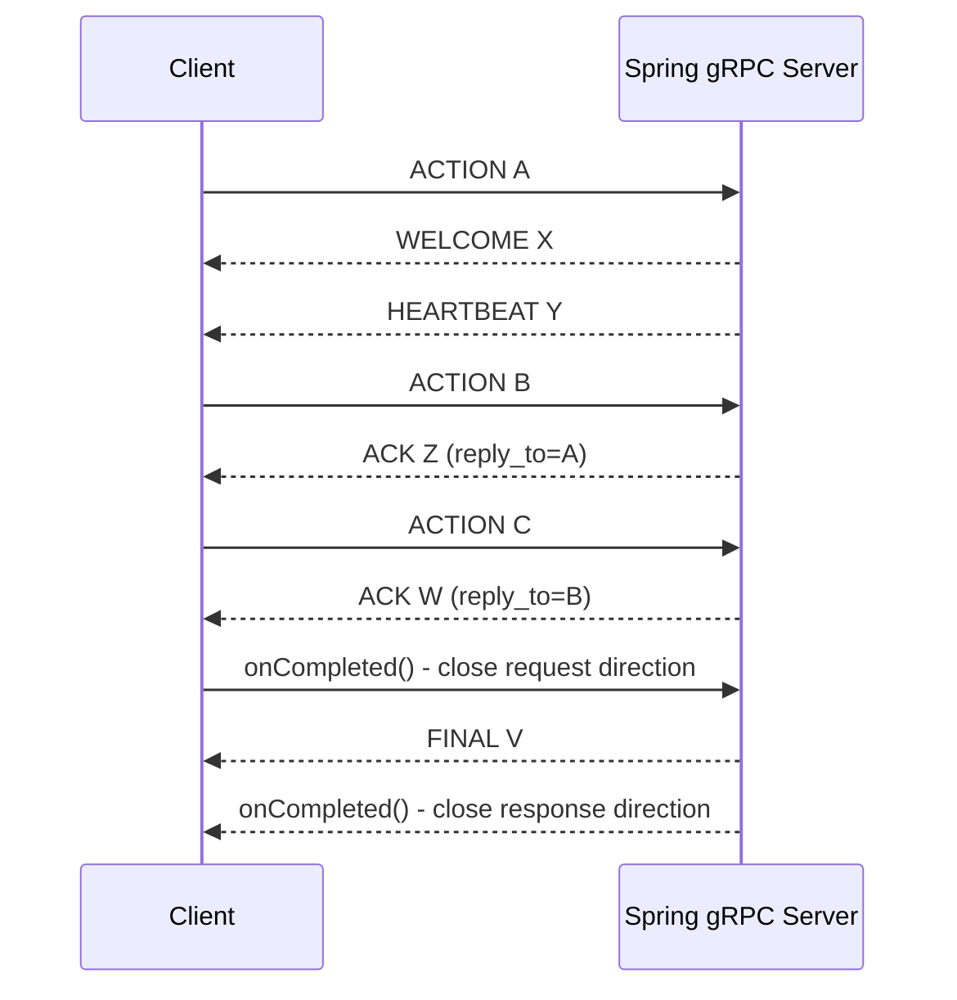
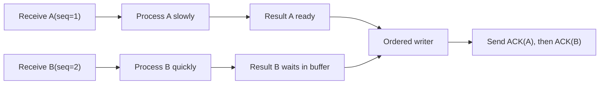

# Per-Direction Message Ordering

## 1. The Problem: What Does Sending in Order Mean?

A collaborative application using **Spring gRPC** allows clients to send edits to the server while the server continuously emits acknowledgments and status notifications. The client sends `CHANGE #1`, `CHANGE #2`, and then `CHANGE #3`; simultaneously, the server may emit `WELCOME`, `ACK`, and `HEARTBEAT`. When inspecting logs, lines from the two sides interleave in various ways. Does that break message ordering?

The answer depends on the **direction of the stream**:

- Within a bidirectional streaming RPC, gRPC preserves **the order of messages sent in each direction**. If the client sequentially sends A then B on the request stream, the server receives A then B, provided both are delivered successfully.
- Similarly, if the server sequentially sends X then Y on the response stream, the client receives X then Y.
- **There is no global order between A, B and X, Y.** Client and server send independently; you cannot rely on log timestamps on two machines to conclude which side sent first.

This is foundational when developing gRPC services in the Spring ecosystem with Protocol Buffers and Java async stubs. After this lesson, learners will be able to pinpoint the exact scope of ordering guarantees, design messages with IDs/sequences, distinguish transport ordering from business processing ordering, write safe servers/clients, and test out-of-order cases caused by asynchronous processing.

## 2. One RPC, Two Independent Orders

A full-duplex contract takes the form:

```proto
rpc Exchange(stream ClientAction) returns (stream ServerEvent);
```

One `Exchange` call creates two message streams:

| Direction | Who calls `onNext` to send? | Who receives the `onNext` callback? | Order preserved by gRPC |
| --- | --- | --- | --- |
| Request | Client calls `requestObserver.onNext(action)` | Server receives `onNext(ClientAction)` | Order of requests **within that RPC** |
| Response | Server calls `responseObserver.onNext(event)` | Client receives `onNext(ServerEvent)` | Order of responses **within that RPC** |

Example of a valid transmission schedule:



In the diagram, the server receives `A → B → C`; the client receives `X → Y → Z → W → V`. These relationships hold per direction independently. You must not infer that `Y` happened *before* `B` on a global clock, or that `Z` is a direct response to the client's most recent message.

### 2.1. What Does the Protocol Guarantee and What Does It Not?

| Assumption | True or false? | Explanation |
| --- | --- | --- |
| Client sequentially emits A then B on the **same request stream**, server receives B before A | **False** if both A and B are delivered successfully | Order of messages in the same direction is preserved |
| Server sequentially emits X then Y on the **same response stream**, client receives Y before X | **False** if both are delivered successfully | The protocol does not reorder messages emitted in order |
| Client sends A then B, so server is guaranteed to finish business processing A before B | **False** | The server may dispatch A and B to two asynchronous tasks |
| Client sends A then B, so server must return ACK(A) then ACK(B) | **False** | The response stream has the *server's send order*; the server can emit ACK(B) first |
| Server can send X before client has sent A | **True** | Both directions operate independently |
| Two separate RPCs on the same `ManagedChannel` always receive messages in a global order | **False** | HTTP/2 multiplexes streams; each RPC has its own sequence |
| `onNext` returning means the peer has finished processing the message | **False** | `onNext` is not a business acknowledgment mechanism |

**Important condition:** ordering guarantees apply to messages **that are successfully delivered**. If the RPC is cancelled, the deadline expires, the network drops, or the sender fails, do not assume every message passed to `onNext` reached the receiver. To confirm persistence or application of data, use an application-level ACK.

### 2.2. Forwarding Order Differs from Completion Order

Distinguish three milestones:

1. **Write order on the request stream:** client calls `onNext(A)`, then `onNext(B)`.
2. **Callback receive order:** server receives `onNext(A)`, then `onNext(B)`.
3. **Task completion order:** processing A takes 300 ms, processing B takes 20 ms; B's result may finish before A's.

If the server sends each result immediately as its task completes, the response stream may contain `ACK(B)` before `ACK(A)`. The client still receives responses in the **exact order the server emitted them**. Thus, there is no contradiction with gRPC's guarantees.

## 3. Designing Protobuf to Observe Ordering

Create the `timeline.proto` contract:

```proto
syntax = "proto3";

package timeline.v1;

option java_multiple_files = true;
option java_package = "com.example.timeline.v1";

service Timeline {
  rpc Exchange(stream ClientAction) returns (stream ServerEvent);
}

message ClientAction {
  string action_id = 1;       // Unique identifier for the action
  int64 client_sequence = 2;  // 1, 2, 3, ... within the same session
  string content = 3;
}

message ServerEvent {
  string kind = 1;            // WELCOME, ACK, HEARTBEAT
  int64 server_sequence = 2;  // 1, 2, 3, ... within the same session
  string reply_to = 3;        // action_id corresponding to ACK
  string content = 4;
}
```

After code generation via `protoc` and the gRPC Java plugin, the application gets `TimelineGrpc`, `ClientAction`, and `ServerEvent`. The two sequence fields serve different purposes:

- `client_sequence` is assigned monotonically by the **client** for requests; the server checks whether the application contract is violated.
- `server_sequence` is assigned by the **server** when actually emitting a response; the client uses it to verify ordering and detect gaps or duplicates in the business protocol.
- `action_id` and `reply_to` link an ACK back to its original action even when responses are interleaved with `HEARTBEAT` or processing results arrive out of request order.

**Sequence is an application convention.** gRPC already preserves per-direction ordering and does not require a sequence field. However, sequences assist monitoring, test construction, deduplication, and recovery after reconnect. The example below assigns sequences **per RPC**; it is not a global counter across all sessions.

## 4. Spring Server: Preserving Send Order from Multiple Sources

Suppose the server has two response sources:

- `ACK` created when receiving a `ClientAction` request.
- `HEARTBEAT` created from a scheduler, regardless of whether the client sends requests.

Both sources must write to **a single response observer**. `StreamObserver` is not guaranteed to be thread-safe when multiple threads invoke methods on the same object, so the server must **serialize write calls**. A **per-RPC** lock is an easy-to-verify approach for a small example.

### 4.1. Registering the Executor in Spring

```java
package com.example.timeline;

import java.util.concurrent.Executors;
import java.util.concurrent.ScheduledExecutorService;
import org.springframework.context.annotation.Bean;
import org.springframework.context.annotation.Configuration;

@Configuration
public class TimelineConfiguration {
    @Bean(destroyMethod = "shutdown")
    ScheduledExecutorService timelineScheduler() {
        return Executors.newScheduledThreadPool(2);
    }
}
```

### 4.2. Implementing the gRPC Service

```java
package com.example.timeline;

import com.example.timeline.v1.ClientAction;
import com.example.timeline.v1.ServerEvent;
import com.example.timeline.v1.TimelineGrpc;
import io.grpc.Status;
import io.grpc.stub.ServerCallStreamObserver;
import io.grpc.stub.StreamObserver;
import java.util.concurrent.ScheduledExecutorService;
import java.util.concurrent.ScheduledFuture;
import java.util.concurrent.TimeUnit;
import org.springframework.stereotype.Service;

@Service
public class TimelineService extends TimelineGrpc.TimelineImplBase {
    private final ScheduledExecutorService scheduler;

    public TimelineService(ScheduledExecutorService scheduler) {
        this.scheduler = scheduler;
    }

    @Override
    public StreamObserver<ClientAction> exchange(
            StreamObserver<ServerEvent> responseObserver) {
        ServerCallStreamObserver<ServerEvent> output =
                (ServerCallStreamObserver<ServerEvent>) responseObserver;
        Session session = new Session(output);
        output.setOnCancelHandler(session::cancel);

        // Server can send before the client sends its first request.
        session.welcome();
        ScheduledFuture<?> timer = scheduler.scheduleAtFixedRate(
                session::heartbeat, 300, 300, TimeUnit.MILLISECONDS);
        session.attachTimer(timer);

        return new StreamObserver<>() {
            @Override
            public void onNext(ClientAction action) {
                session.handle(action);
            }

            @Override
            public void onError(Throwable error) {
                session.cancel();
            }

            @Override
            public void onCompleted() {
                // Only the request stream has half-closed.
                session.requestCompleted();
            }
        };
    }

    // One session, one ordering state, and one write lock.
    private static final class Session {
        private final ServerCallStreamObserver<ServerEvent> output;
        private long expectedClientSequence = 1;
        private long nextServerSequence = 1;
        private int heartbeats = 0;
        private boolean requestDone = false;
        private boolean terminated = false;
        private ScheduledFuture<?> timer;

        Session(ServerCallStreamObserver<ServerEvent> output) {
            this.output = output;
        }

        synchronized void attachTimer(ScheduledFuture<?> future) {
            timer = future;
            if (terminated || heartbeats == 3) {
                future.cancel(false);
            }
        }

        synchronized void welcome() {
            if (!terminated && !output.isCancelled()) {
                send("WELCOME", "", "Connection opened");
            }
        }

        synchronized void handle(ClientAction action) {
            if (terminated || output.isCancelled()) {
                cancel();
                return;
            }
            if (action.getActionId().isBlank()) {
                fail(Status.INVALID_ARGUMENT
                        .withDescription("action_id is required"));
                return;
            }
            if (action.getClientSequence() != expectedClientSequence) {
                fail(Status.FAILED_PRECONDITION
                        .withDescription("client_sequence is not contiguous"));
                return;
            }

            // Increment only after validating the inbound message.
            expectedClientSequence++;
            send("ACK", action.getActionId(),
                    "Received: " + action.getContent());
        }

        synchronized void heartbeat() {
            if (terminated || output.isCancelled()) {
                cancel();
                return;
            }
            if (heartbeats >= 3) {
                stopTimer();
                return;
            }
            heartbeats++;
            send("HEARTBEAT", "", "Beat " + heartbeats);
            if (heartbeats == 3) {
                stopTimer();
                finishIfReady();
            }
        }

        synchronized void requestCompleted() {
            requestDone = true;
            finishIfReady();
        }

        synchronized void cancel() {
            terminated = true;
            stopTimer();
        }

        // Call only from within Session's synchronized blocks.
        private void send(String kind, String replyTo, String content) {
            output.onNext(ServerEvent.newBuilder()
                    .setKind(kind)
                    .setServerSequence(nextServerSequence++)
                    .setReplyTo(replyTo)
                    .setContent(content)
                    .build());
        }

        private void finishIfReady() {
            if (!terminated && requestDone && heartbeats == 3) {
                terminated = true;
                stopTimer();
                output.onCompleted();
            }
        }

        private void fail(Status status) {
            if (!terminated) {
                terminated = true;
                stopTimer();
                output.onError(status.asRuntimeException());
            }
        }

        private void stopTimer() {
            if (timer != null) {
                timer.cancel(false);
            }
        }
    }
}
```

Here, all `send(...)` calls execute while holding the lock on **the same `Session` object**. The `server_sequence` counter increments right before `output.onNext`, so the order observed by the client matches the order the server actually emitted, even as ACK and HEARTBEAT contend for scheduling.

Having `Session.handle()` process sequentially inside the receive callback also causes ACKs to be produced directly in request arrival order in **this example**. That is an implementation choice, not an automatic guarantee of every gRPC service. If processing moves to multiple asynchronous tasks, ACK ordering must be reconsidered.

The client can call `onCompleted()` after its actions; the server **does not close the response immediately**, waiting instead until three HEARTBEATs are emitted. The server may also emit all three beats before the client half-closes, in which case it waits for the request direction to complete. Production systems need a deadline or session termination policy to avoid keeping streams open indefinitely.

> This sample service focuses on ordering and lifecycle for a small number of messages. In production, you must add exception handling for scheduler tasks and send calls, flow control protection, bounded queues, and resource cleanup when the RPC is cancelled or its deadline expires. Never let an unbounded emitter call `onNext` without checking writability.

## 5. Client: A Single Writer Preserving Request Order

With the async stub, the client receives a `StreamObserver<ClientAction>` to emit requests and provides a separate callback to receive responses. To prevent multiple UI components from writing concurrently to the same observer, a simple approach is using a **single-thread executor** as the session writer.

```java
package com.example.timeline;

import com.example.timeline.v1.ClientAction;
import com.example.timeline.v1.ServerEvent;
import com.example.timeline.v1.TimelineGrpc;
import io.grpc.ManagedChannel;
import io.grpc.ManagedChannelBuilder;
import io.grpc.stub.StreamObserver;
import java.util.concurrent.CountDownLatch;
import java.util.concurrent.ExecutorService;
import java.util.concurrent.Executors;
import java.util.concurrent.Future;
import java.util.concurrent.TimeUnit;
import java.util.concurrent.atomic.AtomicLong;

public class TimelineClientDemo {
    public static void main(String[] args) throws Exception {
        ManagedChannel channel = ManagedChannelBuilder
                .forAddress("localhost", 9090)
                .usePlaintext()   // Use only for local testing.
                .build();
        ExecutorService writer = Executors.newSingleThreadExecutor();
        CountDownLatch responseDone = new CountDownLatch(1);
        AtomicLong expectedServerSequence = new AtomicLong(1);

        try {
            TimelineGrpc.TimelineStub stub = TimelineGrpc
                    .newStub(channel)
                    .withDeadlineAfter(8, TimeUnit.SECONDS);

            StreamObserver<ServerEvent> responses = new StreamObserver<>() {
                @Override
                public void onNext(ServerEvent event) {
                    long expected = expectedServerSequence.getAndIncrement();
                    if (event.getServerSequence() != expected) {
                        System.err.printf(
                                "Sequence mismatch: received %d, expected %d%n",
                                event.getServerSequence(), expected);
                    }
                    System.out.printf("%d %s reply_to=%s %s%n",
                            event.getServerSequence(),
                            event.getKind(),
                            event.getReplyTo(),
                            event.getContent());
                }

                @Override
                public void onError(Throwable error) {
                    System.err.println("RPC error: " + error);
                    responseDone.countDown();
                }

                @Override
                public void onCompleted() {
                    System.out.println("Response stream ended");
                    responseDone.countDown();
                }
            };

            StreamObserver<ClientAction> requests = stub.exchange(responses);
            Future<?> sending = writer.submit(() -> {
                try {
                    for (long seq = 1; seq <= 3; seq++) {
                        requests.onNext(ClientAction.newBuilder()
                                .setActionId("action-" + seq)
                                .setClientSequence(seq)
                                .setContent("Edit " + seq)
                                .build());
                        TimeUnit.MILLISECONDS.sleep(180);
                    }
                    requests.onCompleted(); // Close send direction only.
                } catch (InterruptedException interrupted) {
                    Thread.currentThread().interrupt();
                    requests.onError(interrupted);
                }
            });

            // Still receives WELCOME, ACK, HEARTBEAT while writer is sending.
            if (!responseDone.await(7, TimeUnit.SECONDS)) {
                throw new IllegalStateException("Terminal callback not seen");
            }
            sending.get(); // Surface any error from the request-sending task.
        } finally {
            writer.shutdownNow();
            channel.shutdownNow().awaitTermination(2, TimeUnit.SECONDS);
        }
    }
}
```

In this sample, the three `requests.onNext` calls run **sequentially** on one thread, so the server sees `client_sequence = 1, 2, 3` if those requests are delivered successfully. Simultaneously, the `responses.onNext` callback receives server events, even while the client is still sending. These are two distinct observers; no shared lock is needed just to let them operate in both directions.

When an application has multiple producers wanting to send requests, funnel them into **a bounded queue** and have a single writer drain messages. Assign `client_sequence` only when the writer determines the send order; otherwise two producers might assign 1 and 2 while message 2 enters the queue before message 1.

A valid log might look like:

```text
1 WELCOME reply_to= ...
2 ACK reply_to=action-1 ...
3 HEARTBEAT reply_to= ...
4 ACK reply_to=action-2 ...
5 HEARTBEAT reply_to= ...
6 ACK reply_to=action-3 ...
7 HEARTBEAT reply_to= ...
Response stream ended
```

However, ACK and HEARTBEAT **may interleave differently** across runs. What the application should verify is that the server-side sequence increments monotonically in **response receive order**, rather than an absolute interleaving schedule with requests.

## 6. Why Can ACKs Arrive Out of Request Order?

Consider a server processing requests asynchronously:

```java
// Illustrative idea: tasks are dispatched but may finish out of order.
executor.execute(() -> processAndPublishAck(actionA)); // Takes 300 ms
executor.execute(() -> processAndPublishAck(actionB)); // Takes 20 ms
```

The server still receives A before B; yet if `processAndPublishAck` completes faster for B, ACK(B) may be sent before ACK(A). Only once the server **has written** ACK(B) then ACK(A) does gRPC preserve the ACK(B) → ACK(A) order on the response stream.

To avoid confusion, use `reply_to` to correlate messages:

| Server receives | Hypothetical processing time | Server sends after processing | Client receives |
| --- | --- | --- | --- |
| A, `action_id=a` | 300 ms | `ACK(a)` later | In the order the server actually sends |
| B, `action_id=b` | 20 ms | `ACK(b)` first | `ACK(b)` may arrive before `ACK(a)` |

### 6.1. When Business Logic Requires ACKs in Request Order

If the contract mandates returning `ACK(A)` before `ACK(B)`, the server needs a **result reorderer**:

1. Tag each request with a `client_sequence` upon receipt.
2. Run processing concurrently, storing completed results in a staging map `sequence → result`.
3. Maintain `nextAckSequence`. Only emit the result whose sequence equals this value.
4. After sending, increment `nextAckSequence` and emit any consecutive ready results that follow.
5. Bound the number of tasks and pending results; if A stalls, B cannot be emitted ahead of it under this rule.



The cost of this requirement is **head-of-line blocking**: B must wait for A even though B is already done. If business logic only needs to know which action an ACK corresponds to, `action_id`/`reply_to` is usually sufficient; there is no need to force all results to complete in the same order.

### 6.2. Avoiding Errors When Multiple Threads Call `onNext`

The following snippet is unsafe if two threads share the same observer:

```java
// Two separate workers may run concurrently:
worker1.execute(() -> responseObserver.onNext(eventA));
worker2.execute(() -> responseObserver.onNext(eventB));
```

Use one of two mechanisms:

- A per-RPC lock guarding all `onNext`, `onCompleted`, `onError`, and sequence counters.
- A per-RPC queue with a single writer performing all `onNext` calls. This approach fits when there are multiple producers and backpressure is required.

The final order is the order at the **serialization point** (the lock or writer), not inherently the order in which threads created events. If ordering by business event timestamp is required, design sequence assignment or event recording at a single authoritative source.

## 7. Flow Control Affects Timing, Not Order

gRPC uses HTTP/2 flow control. When a receiver is slow, the library may delay transporting messages, yet that never allows a later message to overtake an earlier one in the **same direction of the same RPC**. However, `StreamObserver.onNext` does not necessarily block until the peer finishes processing, so if the application keeps emitting data without bounds, memory can still grow.

In gRPC Java, `ServerCallStreamObserver` and `ClientCallStreamObserver` expose `isReady()`/`setOnReadyHandler(...)` for the send direction. A proper writer:

1. Accepts events from producers into a **bounded** queue.
2. When the observer is ready, takes the head of the queue and calls `onNext` in FIFO order.
3. When `isReady()` is `false`, stops draining. `onReadyHandler` wakes the writer, and the writer **re-checks** `isReady()` before sending.
4. When the queue is full, applies an explicit policy: slow down producers, coalesce replaceable status messages, or return `RESOURCE_EXHAUSTED`.

`isReady() == true` only reflects gRPC's ability to accept more outbound data at that instant, **not a business ACK**. If you need to control incoming messages, `disableAutoRequest()` and `request(n)` are for **inbound manual flow control**; do not confuse them with the outbound readiness mechanism.

In a queue-based model, assign sequence numbers where **the writer determines the final order**, rather than incrementing sequences across multiple producers before entering the queue. A FIFO queue does not guarantee a global order across producer threads unless there is a defined way to establish input order.

## 8. Half-Close, Errors, and Scope Limits of Ordering

In bidirectional streaming, the client calls `requestObserver.onCompleted()` to **half-close the request direction**. The server receives the `onCompleted()` callback after the requests successfully received on that stream. The server can still send more responses and finish on its own via `responseObserver.onCompleted()`.

| Scenario | What you can rely on | What you must not assume |
| --- | --- | --- |
| Client sends A, B then `onCompleted()` and RPC completes normally | Server receives requests in order A, B then ends request direction | Server must send exactly two responses |
| Server sends WELCOME, ACK, HEARTBEAT then completes successfully | Client receives responses in the exact order emitted by server | ACK is necessarily the closest response to the just-sent request |
| RPC is cancelled or deadline expires | Delivered messages are still not reordered in that direction | All `onNext` calls before cancel were delivered successfully |
| Client reconnects and creates a new RPC | Each new RPC has its own per-direction delivery order | Server automatically stitches ordering between old and new RPCs |
| Multiple RPCs on the same channel | Each RPC has its own message sequence | A global order across all RPCs |

Deadlines apply to the **entire call**, and are not extended each time a message is sent. With Spring gRPC, metadata and interceptors can carry tokens, correlation IDs, and tracing context for the call; data that varies per event belongs inside the Protobuf message. In deployed environments, use TLS/mTLS as required; `usePlaintext()` in the sample client is only for localhost.

### 8.1. Ordering Across Reconnects

If the network drops after the client calls `onNext(A)` but before receiving an ACK, the client does not know whether the server applied A. Reconnecting and resending A could create a **duplicate**; not resending could cause a **lost event**. Relying on stream sequences alone is insufficient.

A recoverable contract needs:

- A unique `action_id`/idempotency key so the server recognizes retried events.
- `last_applied_sequence` or a cursor durably stored by the server if replay in business order is required.
- ACKs that confirm a concrete *business milestone*, such as persisted to storage, rather than merely confirming callback receipt.
- Explicit replay and deduplication rules; already-confirmed messages are not applied twice.

When deploying multiple server instances, specify a **global** sequence source if business logic requires it. `server_sequence` incremented within one RPC only helps observe that specific stream.

## 9. Testing Exact Per-Direction Ordering

Integration tests can use gRPC Java's `InProcessServerBuilder` and `InProcessChannelBuilder`, or the corresponding in-process configuration in Spring gRPC. Use a controllable scheduler/clock when testing heartbeats to avoid depending on unintended `sleep` timings.

| Scenario | Recommended assertion |
| --- | --- |
| Client emits three requests A, B, C from one writer | Server records exact receive sequence `A → B → C` |
| Server emits three responses X, Y, Z from one writer | Client records exact receive sequence `X → Y → Z` |
| Heartbeat and ACK contend to send | `server_sequence` is contiguous; no fixed interleaving order required |
| A processes slowly, B processes quickly on server | ACK(B) may arrive before ACK(A) if server sends in completion order; still correlates `reply_to` properly |
| Server enables ordered ACK | ACKs emit in `client_sequence` order even when tasks finish out of order |
| Two producers write responses concurrently | No concurrent writes to one observer; output matches writer serialization order |
| Client half-closes while server still has heartbeats | Server continues emitting responses and finishes normally |
| Cancel mid-send | Do not assume full delivery; no `onNext` after terminal, timer/subscriptions stopped |
| Two RPCs on the same `ManagedChannel` | Each RPC has its own sequence; test does not compare ordering across the two RPCs |

To test race conditions, `CountDownLatch` or `CyclicBarrier` can trigger multiple producers nearly simultaneously and then inspect received messages. Assert **IDs, sequences, completeness, and business invariants**, rather than comparing literal interleaved logs of both directions.

In operations, useful metrics include open stream count, messages/bytes per direction, request processing time, queue length, writer readiness stalls, `CANCELLED` and `DEADLINE_EXCEEDED` rates, late processing results, duplicate messages, and gaps in business sequences.

## 10. Common Mistakes

1. **Inferring a single combined order for both requests and responses.** The two directions are independent; there is no single interleaving position mandated by the protocol.
2. **Confusing callback receive order with processing completion order.** When offloading work to an executor, completion results can swap positions.
3. **Assuming the N-th response belongs to the N-th request.** Bidi allows proactive server pushes and multiple responses per request; use `reply_to`.
4. **Letting multiple threads call `onNext` on the same observer.** Use a lock or a single writer to serialize writes and coordinate terminal events.
5. **Incrementing sequence numbers before pushing onto a multi-producer queue.** Sequence numbers may diverge from actual send order; assign them at the serialization point.
6. **Assuming a successful `onNext` means the message is saved on the other side.** Use a business ACK if you need confirmation that an action was applied.
7. **Reusing sequences in a new RPC as if they were system-wide history.** Design cursors, idempotency, and durable state for reconnects.

## 11. Practice Exercise

Extend the `Timeline.Exchange` service into an editing channel with two response types: `ACK` and `REMOTE_CHANGE`.

1. Have two clients simultaneously send actions with `action_id` and `client_sequence`; each client uses a single writer to preserve its own request order.
2. Have the server add a `REMOTE_CHANGE` source from other sessions; all responses for a session must pass through a shared writer/queue before calling `onNext`.
3. Use `reply_to` to correlate ACKs; write a test where B finishes processing before A. Then add an option to emit ACKs in request order and observe the latency trade-off.
4. Assign `server_sequence` at the send point and verify a contiguous sequence on the client; do not require a global order between the two RPCs.
5. Add durable ACKs, idempotency keys, and a recovery cursor after network disconnect, and test resending an `action_id` without applying the action twice.

**Completion criteria:** both requests and responses preserve order **within each direction of an RPC**; asynchronous processing is not mistaken for a business ordering guarantee; responses correlate via IDs; and the program safely stops emitting when the stream ends or is cancelled.

### References

- [gRPC Core concepts](https://grpc.io/docs/what-is-grpc/core-concepts/): bidirectional streaming, message ordering, and RPC lifecycle.
- [gRPC Java StreamObserver API](https://grpc.github.io/grpc-java/javadoc/io/grpc/stub/StreamObserver.html): callbacks and thread-safety constraints.
- [gRPC Java CallStreamObserver API](https://grpc.github.io/grpc-java/javadoc/io/grpc/stub/CallStreamObserver.html): `isReady()`, `onReadyHandler`, and flow control.
- [Spring gRPC Reference](https://docs.spring.io/spring-grpc/reference/): service, client, testing, security, and observability integration.
