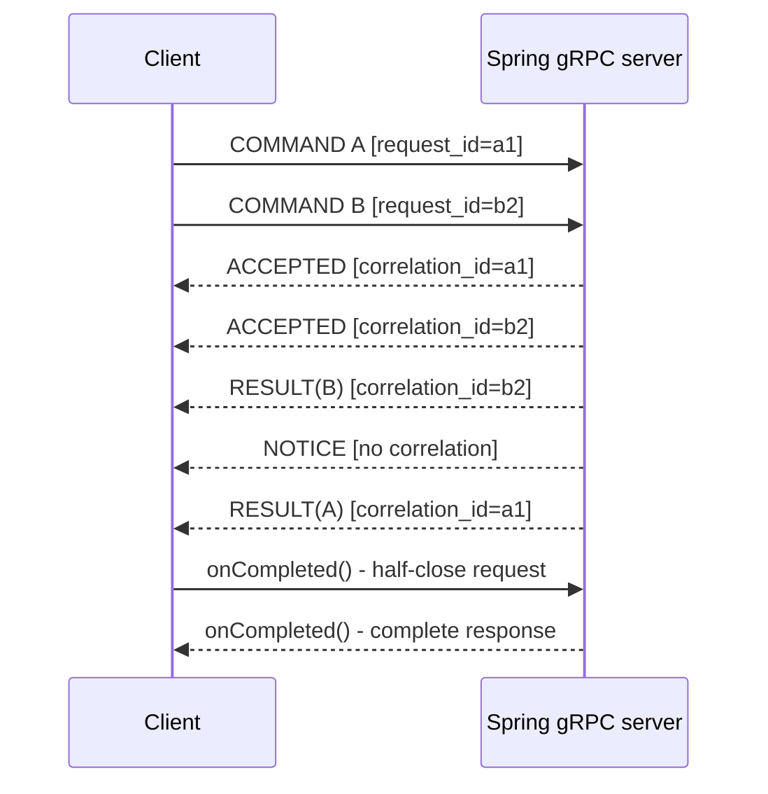

# Correlation Between Requests and Responses

## 1. Why Bidirectional Streaming Needs Correlation

In a unary RPC, the client sends one request and receives one response, so the relationship between them is clear from the call itself. With gRPC **bidirectional streaming**, the client can send multiple requests back-to-back while the server proactively emits multiple responses. The count and emission timing of both sides are independent; a response is not necessarily the answer to the most recently sent request.

Consider a customer support application running on **Spring gRPC**:

- The client sends lookup command `A` and update command `B` without waiting for `A`'s result.
- The server emits `ACCEPTED(A)` and `ACCEPTED(B)` to confirm receipt.
- Task `B` processes quickly, so `RESULT(B)` arrives before `RESULT(A)`.
- Between results, the server sends a maintenance `NOTICE`; this message **belongs to no** command.

If the client pairs the first response with the first request and the second response with the second request, results will be misattributed. The solution is to place a **request identifier** into the message and require every related response to carry that identifier back.

After this lesson, learners will be able to:

1. Distinguish `request_id`, `correlation_id`, `trace_id`, and message sequence numbers.
2. Design Protocol Buffers contracts for one-to-many responses, out-of-order results, and independent server pushes.
3. Implement a Spring gRPC server returning ACKs and asynchronous processing results alongside proactive notifications.
4. Implement a Java client using a `request_id → pending task` map to route responses accurately.
5. Handle duplicate requests, requests without responses, RPC cancellation, deadlines, and reconnects.
6. Test correlation based on IDs and state rather than message position.

## 2. Correlation Is a Business Relationship, Not Transport Order

gRPC preserves **per-direction message ordering** within an RPC if messages are delivered successfully. This does not mean processing results must follow request order. The server receives `A` then `B`, processes both concurrently, and may emit `RESULT(B)` before `RESULT(A)`. The client still receives responses in the exact order the server **actually emitted them**.



| Relationship | Automatically determined by gRPC? | What must be done? |
| --- | --- | --- |
| Request order A before B on the same stream | Yes, for delivered messages | Send sequentially through a single writer |
| Order of responses emitted by the server | Yes, within the same response stream | Serialize `onNext` on the server |
| `RESULT(B)` belongs to request B | **No** | Use `correlation_id=b2` |
| Whether a request has one or multiple responses | **No** | Define the business contract |
| Which request a proactive NOTICE belongs to | May belong to none | Distinguish pushed messages from correlated messages |
| Whether the request executed successfully | **No** from order/transport ACK alone | Include business result status |

In this example, **correlation** is the client matching an incoming related message back to its original logical request. A request may receive zero, one, or multiple responses depending on the contract; correlation must never be inferred from stream arrival index.

### 2.1. Distinguishing Identifier Types

| Field | Scope and purpose | Recommendation |
| --- | --- | --- |
| `request_id` | Identifies a logical client-initiated operation | UUID/ULID; unique within the scope needing reconciliation |
| `correlation_id` | Carried in related responses, pointing back to `request_id` | Keep identical, even when results arrive late |
| `trace_id` | Connects spans for distributed tracing | Usually obtained from RPC tracing context/metadata |
| Business `stream_id` or `session_id` | Identifies a session, room, or connection instance | Use when the application manages per-session state |
| `sequence` | Determines emission order or event order | Does not replace request identifiers |
| `idempotency_key` | Recognizes retried operations to avoid double execution | May share `request_id` if the contract specifies it |

Do not confuse `correlation_id` with an HTTP-level request ID or an internal HTTP/2 stream ID. A gRPC RPC has **call-level** metadata/tracing, whereas `request_id` in this lesson is data inside **each Protobuf message**. Auth tokens and RPC-bound metadata generally do not vary per message.

## 3. Designing the Protocol Buffers Contract

Example `support_session.proto` for a full-duplex gRPC session:

```proto
syntax = "proto3";

package support.v1;

option java_multiple_files = true;
option java_package = "com.example.support.v1";

service SupportSession {
  rpc Converse(stream ClientCommand) returns (stream ServerMessage);
}

message ClientCommand {
  string request_id = 1;  // Client-assigned for a logical operation
  string payload = 2;
}

message ServerMessage {
  // Left empty only for proactive NOTICE messages.
  string correlation_id = 1;

  oneof body {
    Accepted accepted = 2;
    Result result = 3;
    Notice notice = 4;
  }
}

message Accepted {
  string note = 1;        // Accepted; does not guarantee processing is done
}

message Result {
  bool success = 1;
  string data = 2;
  string error_code = 3;  // Business error code when success=false
}

message Notice {
  string text = 1;        // Server push, not linked to a request
}
```

After running `protoc` and `protoc-gen-grpc-java` code generation matching the project's Spring gRPC configuration, Java gets `SupportSessionGrpc`, `ClientCommand`, `ServerMessage`, `Accepted`, `Result`, and `Notice`.

Rules of this contract:

- Every `ClientCommand` **must** have a non-empty `request_id`. One ID identifies one logical operation; the same ID must not be reused for two different operations.
- Every `Accepted` and `Result` must carry `correlation_id` equal to the original `request_id`. The client does not need to guess by order.
- `Accepted` only means the server received the message in this example, **not** that data has been durably persisted.
- `Result` is the final outcome of the operation. One request may receive `Accepted` and then `Result`; an extended contract can add multiple `Progress` messages with the same correlation ID.
- `Notice` is an independent notification; under the current contract `correlation_id` is empty. The client must branch on `oneof body`, not just inspect the ID.
- A business error for **one operation** can be carried in `Result(success=false, error_code=...)`, allowing other operations to continue. `onError(Status...)` terminates the **entire RPC**, and should be used deliberately.

### 3.1. Why Use `oneof`?

If a message has `ACK`, `NOTICE`, and `RESULT` as independent fields, the client must guess which combinations are valid. `oneof` makes explicit that each `ServerMessage` carries **one kind of body**. Java generates `getBodyCase()` with branches `ACCEPTED`, `RESULT`, `NOTICE`, and `BODY_NOT_SET`; the client uses it to handle each kind.

In a production schema, the `error_code` string can be replaced by an enum with backward-compatibility rules; add timestamps, tenant IDs, or cursors when the application actually needs them. Do not put sensitive data such as access tokens in `request_id` since IDs often appear in logs.

## 4. Implementing a Spring gRPC Server with Out-of-Order Results

The server example below:

1. Receives a `ClientCommand` and sends `Accepted` with the matching `request_id`.
2. Schedules operation completion on an executor; operations prefixed with `slow:` take longer than `fast:`.
3. Sends `Result` as each operation finishes, still carrying the same correlation ID.
4. Proactively sends a `Notice` while tasks are pending.
5. Closes the response only when the client has half-closed the request stream **and** all pending tasks as well as the proactive notice have finished.

The goal is to prove that `Result` messages can arrive out of request order while the client still correlates them accurately.

### 4.1. Spring-Managed Executor

```java
package com.example.support;

import java.util.concurrent.Executors;
import java.util.concurrent.ScheduledExecutorService;
import org.springframework.context.annotation.Bean;
import org.springframework.context.annotation.Configuration;

@Configuration
public class SupportStreamingConfig {
    @Bean(destroyMethod = "shutdown")
    ScheduledExecutorService supportScheduler() {
        return Executors.newScheduledThreadPool(4);
    }
}
```

### 4.2. Service: Preserving Correlation Across Asynchronous Processing

```java
package com.example.support;

import com.example.support.v1.Accepted;
import com.example.support.v1.ClientCommand;
import com.example.support.v1.Notice;
import com.example.support.v1.Result;
import com.example.support.v1.ServerMessage;
import com.example.support.v1.SupportSessionGrpc;
import io.grpc.Status;
import io.grpc.stub.ServerCallStreamObserver;
import io.grpc.stub.StreamObserver;
import java.util.ArrayList;
import java.util.HashSet;
import java.util.List;
import java.util.Set;
import java.util.concurrent.RejectedExecutionException;
import java.util.concurrent.ScheduledExecutorService;
import java.util.concurrent.ScheduledFuture;
import java.util.concurrent.TimeUnit;
import org.springframework.stereotype.Service;

@Service
public class SupportSessionService
        extends SupportSessionGrpc.SupportSessionImplBase {

    private final ScheduledExecutorService scheduler;

    public SupportSessionService(ScheduledExecutorService scheduler) {
        this.scheduler = scheduler;
    }

    @Override
    public StreamObserver<ClientCommand> converse(
            StreamObserver<ServerMessage> responseObserver) {

        ServerCallStreamObserver<ServerMessage> output =
                (ServerCallStreamObserver<ServerMessage>) responseObserver;
        Session session = new Session(output, scheduler);
        output.setOnCancelHandler(session::cancel);
        session.start();

        return new StreamObserver<>() {
            @Override
            public void onNext(ClientCommand command) {
                session.accept(command);
            }

            @Override
            public void onError(Throwable cause) {
                // Client cancelled/disconnected: stop incomplete tasks.
                session.cancel();
            }

            @Override
            public void onCompleted() {
                // Client only closed the request sending direction.
                session.inputCompleted();
            }
        };
    }

    private static final class Session {
        private final Object writeLock = new Object();
        private final ServerCallStreamObserver<ServerMessage> output;
        private final ScheduledExecutorService scheduler;
        private final Set<String> seenIds = new HashSet<>();
        private final List<ScheduledFuture<?>> jobs = new ArrayList<>();

        private boolean stopped;
        private boolean inputDone;
        private boolean noticeDone;
        private int pendingResults;

        Session(ServerCallStreamObserver<ServerMessage> output,
                ScheduledExecutorService scheduler) {
            this.output = output;
            this.scheduler = scheduler;
        }

        void start() {
            synchronized (writeLock) {
                try {
                    jobs.add(scheduler.schedule(
                            this::sendNotice, 200, TimeUnit.MILLISECONDS));
                } catch (RejectedExecutionException ex) {
                    failLocked(Status.UNAVAILABLE
                            .withDescription("Scheduler rejected task")
                            .withCause(ex));
                }
            }
        }

        void accept(ClientCommand command) {
            synchronized (writeLock) {
                if (stopped || output.isCancelled()) {
                    cancelLocked();
                    return;
                }

                String requestId = command.getRequestId();
                if (requestId.isBlank()) {
                    failLocked(Status.INVALID_ARGUMENT
                            .withDescription("request_id must not be empty"));
                    return;
                }
                if (!seenIds.add(requestId)) {
                    failLocked(Status.ALREADY_EXISTS
                            .withDescription("Duplicate request_id in session"));
                    return;
                }

                boolean sent = emitLocked(ServerMessage.newBuilder()
                        .setCorrelationId(requestId)
                        .setAccepted(Accepted.newBuilder()
                                .setNote("Accepted")
                                .build())
                        .build());
                if (!sent) {
                    return;
                }

                // Illustrate two requests that can complete out of order.
                long delayMillis = command.getPayload().startsWith("slow:")
                        ? 500 : 100;
                pendingResults++;
                try {
                    ScheduledFuture<?> job = scheduler.schedule(
                            () -> complete(requestId, command.getPayload()),
                            delayMillis, TimeUnit.MILLISECONDS);
                    jobs.add(job);
                } catch (RejectedExecutionException ex) {
                    pendingResults--;
                    failLocked(Status.UNAVAILABLE
                            .withDescription("Unable to schedule processing")
                            .withCause(ex));
                }
            }
        }

        private void complete(String requestId, String payload) {
            synchronized (writeLock) {
                if (stopped || output.isCancelled()) {
                    cancelLocked();
                    return;
                }
                boolean sent = emitLocked(ServerMessage.newBuilder()
                        .setCorrelationId(requestId)
                        .setResult(Result.newBuilder()
                                .setSuccess(true)
                                .setData("Completed: " + payload)
                                .build())
                        .build());
                if (!sent) {
                    return;
                }
                pendingResults--;
                finishIfReadyLocked();
            }
        }

        private void sendNotice() {
            synchronized (writeLock) {
                if (stopped || output.isCancelled()) {
                    cancelLocked();
                    return;
                }
                boolean sent = emitLocked(ServerMessage.newBuilder()
                        // Do not set correlation_id for independent notifications.
                        .setNotice(Notice.newBuilder()
                                .setText("System is still running")
                                .build())
                        .build());
                if (!sent) {
                    return;
                }
                noticeDone = true;
                finishIfReadyLocked();
            }
        }

        void inputCompleted() {
            synchronized (writeLock) {
                inputDone = true;
                finishIfReadyLocked();
            }
        }

        void cancel() {
            synchronized (writeLock) {
                cancelLocked();
            }
        }

        // All response writes are serialized under the same writeLock.
        private boolean emitLocked(ServerMessage message) {
            if (stopped) {
                return false;
            }
            try {
                output.onNext(message);
                return true;
            } catch (RuntimeException ex) {
                // Observer is no longer usable; stop writing.
                cancelLocked();
                return false;
            }
        }

        private void finishIfReadyLocked() {
            if (!stopped && inputDone && noticeDone
                    && pendingResults == 0) {
                stopped = true;
                cancelJobsLocked();
                output.onCompleted();
            }
        }

        private void failLocked(Status status) {
            if (!stopped) {
                stopped = true;
                cancelJobsLocked();
                output.onError(status.asRuntimeException());
            }
        }

        private void cancelLocked() {
            stopped = true;
            cancelJobsLocked();
        }

        private void cancelJobsLocked() {
            for (ScheduledFuture<?> job : jobs) {
                job.cancel(false);
            }
        }
    }
}
```

**Note on retaining the ID:** `requestId` is extracted from the inbound message and captured in that task's own lambda. Even when a fast task finishes before a slow task, its response still carries the right `correlation_id`. Never use a shared mutable field like `lastRequestId`, because it can be overwritten by the next request.

`writeLock` prevents `output.onNext()`, `output.onCompleted()`, and `output.onError()` from running concurrently within a session. There is no global lock across all RPCs. Under high load, replace direct writes with a **bounded queue + single writer**, using `isReady()`/`setOnReadyHandler(...)` to manage backpressure. This is a finite example to demonstrate correlation clearly, not an optimal implementation for many connections and continuous producers.

The `seenIds` check only detects duplicate IDs **within a single live RPC**. It does not provide idempotency across reconnects, failovers, or other Spring instances. That requires durable processed-state storage at the business layer, typically with a retention TTL and an appropriate composite key.

## 5. Client: Routing Responses to the Right Pending Operation

The client uses the asynchronous stub and a `request_id → CompletableFuture` map. When sending a message, the client registers the map entry **before calling `onNext`**, because the server may reply very quickly. The response callback reads `correlation_id` and completes the corresponding future upon `Result`. `Notice` messages are handled separately without pulling an arbitrary entry from the map.

```java
package com.example.support;

import com.example.support.v1.ClientCommand;
import com.example.support.v1.ServerMessage;
import com.example.support.v1.SupportSessionGrpc;
import io.grpc.ManagedChannel;
import io.grpc.ManagedChannelBuilder;
import io.grpc.stub.StreamObserver;
import java.util.Map;
import java.util.UUID;
import java.util.concurrent.CompletableFuture;
import java.util.concurrent.ConcurrentHashMap;
import java.util.concurrent.CountDownLatch;
import java.util.concurrent.TimeUnit;
import java.util.concurrent.atomic.AtomicReference;

public class SupportSessionClientDemo {
    public static void main(String[] args) throws Exception {
        ManagedChannel channel = ManagedChannelBuilder
                .forAddress("localhost", 9090)
                .usePlaintext() // Only for testing on localhost.
                .build();

        Map<String, CompletableFuture<String>> pending =
                new ConcurrentHashMap<>();
        CountDownLatch finished = new CountDownLatch(1);
        AtomicReference<Throwable> rpcError = new AtomicReference<>();

        try {
            SupportSessionGrpc.SupportSessionStub stub =
                    SupportSessionGrpc.newStub(channel)
                            .withDeadlineAfter(5, TimeUnit.SECONDS);

            StreamObserver<ServerMessage> incoming = new StreamObserver<>() {
                @Override
                public void onNext(ServerMessage message) {
                    switch (message.getBodyCase()) {
                        case ACCEPTED -> {
                            System.out.println("ACCEPTED for: "
                                    + message.getCorrelationId());
                        }
                        case RESULT -> {
                            String id = message.getCorrelationId();
                            System.out.println("RESULT for: " + id);
                            CompletableFuture<String> future = pending.get(id);
                            if (future == null) {
                                System.err.println("Unmatched response: " + id);
                                return;
                            }
                            if (message.getResult().getSuccess()) {
                                future.complete(message.getResult().getData());
                            } else {
                                future.completeExceptionally(
                                        new IllegalStateException(
                                                message.getResult()
                                                        .getErrorCode()));
                            }
                        }
                        case NOTICE -> System.out.println("NOTICE: "
                                + message.getNotice().getText());
                        case BODY_NOT_SET ->
                                System.err.println("Message has no body");
                    }
                }

                @Override
                public void onError(Throwable cause) {
                    rpcError.set(cause);
                    pending.values().forEach(
                            future -> future.completeExceptionally(cause));
                    finished.countDown();
                }

                @Override
                public void onCompleted() {
                    pending.forEach((id, future) -> {
                        if (!future.isDone()) {
                            future.completeExceptionally(
                                    new IllegalStateException(
                                            "Missing Result for request_id=" + id));
                        }
                    });
                    finished.countDown();
                }
            };

            StreamObserver<ClientCommand> outgoing = stub.converse(incoming);

            String slowId = UUID.randomUUID().toString();
            String fastId = UUID.randomUUID().toString();
            pending.put(slowId, new CompletableFuture<>());
            pending.put(fastId, new CompletableFuture<>());

            outgoing.onNext(ClientCommand.newBuilder()
                    .setRequestId(slowId)
                    .setPayload("slow: load report")
                    .build());
            outgoing.onNext(ClientCommand.newBuilder()
                    .setRequestId(fastId)
                    .setPayload("fast: check status")
                    .build());

            outgoing.onCompleted(); // Half-close request direction only.

            if (!finished.await(4, TimeUnit.SECONDS)) {
                throw new IllegalStateException("RPC did not finish on time");
            }
            if (rpcError.get() != null) {
                throw new IllegalStateException("RPC failed", rpcError.get());
            }

            // Look up results by request_id, not by response order.
            System.out.println("slow => "
                    + pending.get(slowId).get(1, TimeUnit.SECONDS));
            System.out.println("fast => "
                    + pending.get(fastId).get(1, TimeUnit.SECONDS));
        } finally {
            channel.shutdownNow().awaitTermination(2, TimeUnit.SECONDS);
        }
    }
}
```

The example uses Java syntax supporting `switch ->` and `String.isBlank()`. With a gRPC server configured at `localhost:9090`, a **possible** observed sequence is:

```text
ACCEPTED for: <slowId>
ACCEPTED for: <fastId>
RESULT for: <fastId>
NOTICE: System is still running
RESULT for: <slowId>
slow => Completed: slow: load report
fast => Completed: fast: check status
```

`<slowId>` and `<fastId>` denote UUIDs generated at runtime; the position of `NOTICE` may vary with execution scheduling. What remains invariant is that the client completes **the exact future bound to each ID**, regardless of arrival order. If the client wants to track whether a request is *accepted* or *completed*, maintain explicit state (for example `SENT → ACCEPTED → SUCCEEDED/FAILED`) per ID.

**Lifecycle note for `pending`:** in real applications, remove entries once consumers retrieve the result or store them in a bounded/expiring structure. If callers wait a long time, enforce per-operation timeouts/cancellations. When the RPC completes normally while a request still lacks a `Result`, the client must not leave the future hanging forever; complete it with a protocol/incomplete-response error and log the correlation ID.

## 6. Common Correlation Edge Cases

### 6.1. Multiple Responses for One Request

A report-generation command may emit `Accepted(id)`, several `Progress(id)` messages, and then `Result(id)`. If the client removes `pending[id]` immediately upon `Accepted`, subsequent updates become "unrecognized" messages. Clearly define which message types are **intermediate** and which represent **logical completion** of the request.

| Response type | `correlation_id` | Completes the request? |
| --- | --- | --- |
| `Accepted` | Request ID | No |
| `Progress` (if schema extended) | Request ID | No |
| `Result(success=true)` | Request ID | Yes |
| `Result(success=false)` | Request ID | Yes, with a business error outcome |
| Proactive `Notice` | Empty per this contract | Belongs to no request |

### 6.2. Responses Arriving Out of Request Order

Asynchronous processing results can finish out of request arrival order. Never assume "the N-th response corresponds to the N-th request". Use an ID-keyed map, optionally enriched with state, per-operation deadlines, and logic to detect duplicate responses or results arriving after a request timed out.

### 6.3. A Request Receiving Zero Responses or Sent Once, Received Multiple Times

An RPC may be cancelled before a result is generated; a server might also intentionally send only `Accepted` if the contract allows it. Document the exact count and types of messages the application must emit per command. If `Result` is mandatory, closing the RPC with OK status while requests remain incomplete is an **application contract** bug, not evidence that gRPC reordered messages.

Clients should distinguish three `pending` states:

1. **Pending:** no final result yet; ACK/progress may have been received.
2. **Completed:** `Result` received; retain/evict entry per result-retention policy.
3. **Cancelled/Expired:** stopped waiting; if a late response arrives, ignore or log it per explicit rules.

### 6.4. Duplicate IDs and Responses Missing an ID

If the client reuses the same `request_id` for two **different** operations, the map can overwrite a future and return results to the wrong caller. Use UUID/ULID or an ID generator with suitable uniqueness guarantees. When the server receives a duplicate request ID within the **same stream**, it can reject with `ALREADY_EXISTS` as in the example. When the client receives a correlated response whose ID is missing from the map, treat it as a protocol issue or a late/evicted arrival; never bind it to the latest request by default.

Independent notifications **must not borrow the correlation ID of the most recent request**. If the server emits session-wide notifications, the schema can distinguish `Notice` via `oneof` and leave `correlation_id` unset; a notification can carry its own ID for deduplication if needed.

## 7. Correlation Across Reconnects, Retries, and Idempotency

Suppose the client sends request `id=K`, the server processes it successfully, and the network drops before `Result(K)` reaches the client. Upon reconnect, there are two risks:

- **Resending K:** the server may execute it twice if durable idempotency checks are absent.
- **Not resending K:** the client does not know the operation's final outcome.

Correlation lets you match messages; it **does not automatically guarantee exactly-once processing**. To execute safely across retries:

1. Generate a stable `request_id` for **one logical operation**. Keep the same ID when retrying that operation; issue a new ID for a new operation.
2. Server persists `request_id` alongside its status/output in a store with appropriate consistency (database, idempotency table, or event log).
3. For an already-completed ID, the server returns the stored result; for an in-flight ID, returns an appropriate status or attaches a subscriber; for a matching ID with a different payload, reports a conflict.
4. Define a retention TTL for the ID table and scope keys properly, e.g., `tenant_id + request_id` to prevent cross-tenant collisions.
5. If multiple results must be replayed, add a cursor or business sequence number; correlation ID alone is not enough to know which messages the client already received.

An in-memory `Set` of IDs inside the example's `Session` lives only as long as the RPC, so it does not support deduplication across two connections. Do not rely on gRPC's built-in retry to assume a stream can resume from a prior message; a new bidi call requires an application-defined resume and idempotency protocol.

## 8. Errors, Deadlines, Cancellation, and Security

In bidirectional streaming, both directions share **one RPC**. The client can call `outgoing.onCompleted()` to half-close the request stream while the server still sends `Result` and `Notice`. Conversely, `responseObserver.onError(Status...)` ends the entire call with a gRPC error; all pending requests must be resolved according to the failure/cancellation policy.

| Scenario | Correlation handling |
| --- | --- |
| `Result(success=false)` for one ID | Complete **only** the corresponding operation with a business error; keep stream open if contract allows |
| Call-wide `INVALID_ARGUMENT` or `UNAUTHENTICATED` | End stream; all unresolved pending requests must fail with error |
| Client half-closes while server still has tasks | Server continues returning correlated messages, then completes response |
| Deadline expires | Record unresolved IDs; stop producers/queues; verify state before retrying |
| Client cancels | Server cancels timers and pending tasks; no `onNext` after terminal |
| Response missing `correlation_id` in Result branch | Treat as contract violation; do not attach to another request |
| Notice with independent payload | Handle in a dedicated push flow; do not complete any request future |

A gRPC deadline applies to the **entire RPC**, and is not refreshed after each message. An individual request with its own timeout may expire before the RPC does; in that case, the client marks that future expired without assuming the remaining messages in the session must fail.

With Spring gRPC, interceptors and metadata are typically used for authentication, authorization, tracing, and **call-level** parameters. If an ID needs to be carried **per message**, put it in Protobuf rather than trying to mutate metadata mid-stream. Use TLS/mTLS in production deployments; `usePlaintext()` in the example is strictly for local development.

When logging, include `rpc_method`, `session_id` (if the application has one), `request_id`, `correlation_id`, `event_type`, `status`, and `duration`. Do not use IDs containing tokens or secrets. Distributed tracing provides visibility across the whole call, yet message-level IDs remain necessary to link multiple operations within the same RPC.

## 9. Testing Correlation Systematically

You can use a gRPC in-process server/channel together with a test scheduler to verify the service without depending on TCP ports. Control task completion timings deliberately to produce out-of-order results instead of relying on `Thread.sleep()` and assuming a fixed execution schedule.

| Scenario | Key assertion |
| --- | --- |
| Client sends A, B; B finishes first | `Result(B).correlation_id == B.request_id` and likewise for A |
| One request receives Accepted then Result | Both carry the same ID; Accepted does not complete the future |
| Server sends Notice between two Results | Notice takes the `NOTICE` branch and is not bound to A or B |
| Multiple concurrent requests | Each result routes to the right future by ID |
| Two requests with duplicate ID in the same session | Server enforces the declared duplicate policy |
| Server returns Result with missing/unmatched ID | Client detects a protocol error rather than matching by position |
| Client half-closes early | Still receives results from remaining in-flight tasks |
| Cancel mid-session | Pending futures receive error/cancellation; no leaked executors, timers, or subscriptions |
| RPC ends while pending entries remain | Client resolves incomplete futures instead of waiting forever |
| Retry across reconnect with the same ID | Server uses durable idempotency store to prevent duplicate execution |

In every `onNext(ServerMessage)` callback, tests should verify **message type, correlation ID, pending state**, and business payload. Never write assertions like "response #1 must belong to request #1"; that is precisely the design flaw correlation avoids.

Useful operational metrics include pending requests per RPC, time from send to `Accepted`, time from send to `Result`, unmatched response count, duplicate ID count, processing latency, request timeouts, reconnects, and gRPC status code distribution. When multiple requests share one RPC, measuring latency **per operation** is far more informative than measuring stream lifetime alone.

## 10. Practice Exercise

Upgrade `SupportSession.Converse` into a task-processing channel with progress updates:

1. Add `Progress` to `oneof body`, with `percent` and `correlation_id` fields; specify that multiple `Progress` messages may precede a single final result per request.
2. Send three requests on the same RPC and make the second finish faster than the first. The client must display results by ID rather than response FIFO order.
3. Build a `RequestTracker` managing `NEW`, `ACCEPTED`, `RUNNING`, `SUCCEEDED`, `FAILED`, and `TIMED_OUT`, cleaning up state at the right time.
4. Add an independent server `Notice`; verify that it does not alter any pending request.
5. Simulate a network interruption after the server completes an operation but before the client receives `Result`. Add an idempotency store and test retrying with the same `request_id`.
6. Configure deadlines, TLS in an appropriate environment, and tracing; measure unmatched responses and send-to-result latency.

**Completion criteria:** one request can receive multiple responses; out-of-order results are still handled accurately; `Notice` messages are never misattributed; all pending requests are cleaned up when the RPC completes, errors, or cancels; and retries do not re-execute already-applied operations.

### References

- [gRPC Core concepts](https://grpc.io/docs/what-is-grpc/core-concepts/): bidirectional streaming, lifecycle, and message ordering.
- [gRPC Java StreamObserver](https://grpc.github.io/grpc-java/javadoc/io/grpc/stub/StreamObserver.html): send/receive callbacks and terminal statuses.
- [gRPC Java ServerCallStreamObserver](https://grpc.github.io/grpc-java/javadoc/io/grpc/stub/ServerCallStreamObserver.html): cancel handlers and flow control.
- [Spring gRPC Reference](https://docs.spring.io/spring-grpc/reference/): gRPC server/client, interceptors, testing, and security in Spring.
