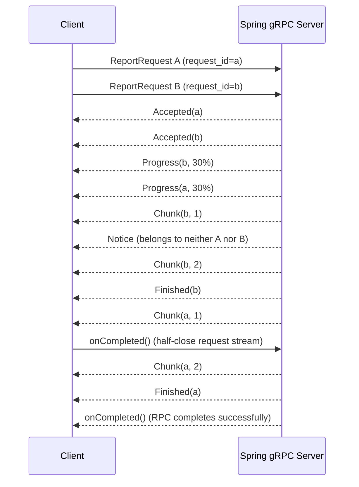
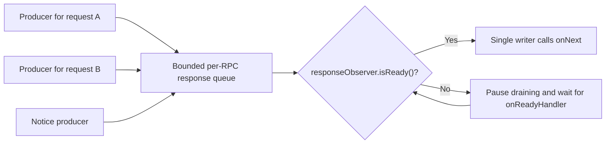

# Multiple Responses for a Single Request

## 1. A Single Request Can Produce an Entire Stream of Responses

In the **Spring gRPC** ecosystem, a report-processing service may take several seconds to aggregate data. If the client only receives a single final response, the user cannot easily tell whether the server has accepted the operation or how far processing has progressed. With a **bidirectional streaming RPC**, the client can send one `ReportRequest` while the server sequentially emits `Accepted`, `Progress` updates, multiple `Chunk` result fragments, and then `Finished`, all tied to the original request. Meanwhile, the client can still send other requests and the server can still emit proactive notifications.

This is the **one logical request → many logical responses** pattern inside a bidirectional RPC. Each `requestObserver.onNext(request)` call is not automatically paired by gRPC with a single `responseObserver.onNext(response)` call; the application must define the message types and their relationships.

After this lesson, learners will be able to:

- Distinguish **server streaming** (one initial request message, many responses) from **bidirectional streaming** (many requests, each capable of producing many responses).
- Design Protocol Buffers contracts with `request_id`, `oneof` for response variants, and a completion message for **each task**.
- Implement a Spring gRPC server that emits progress and partial results from concurrently running tasks.
- Implement a Java client that gathers all responses sharing a `request_id` into the right task, even when responses are interleaved.
- Distinguish a request's `Finished` message from `StreamObserver.onCompleted()` for the entire RPC.
- Handle chunk ordering, backpressure, per-request errors, cancellation, deadlines, and testing multiple responses.

## 2. Two Lifecycle Layers: Logical Request and RPC

A bidirectional streaming RPC contains **one request stream and one response stream**. The protocol preserves the order of successfully delivered messages *within each direction*, yet does not specify how many responses a request must have.

Suppose the client sends two requests `A` and `B`, where `B` processes faster:



The diagram shows just **one valid interleaving order**. Distinguish two termination levels:

| Event | Scope | Consequence |
| --- | --- | --- |
| `Finished(request_id=b)` | **One** task B | B has reached its final state; A and other messages can continue |
| `Finished(request_id=a)` | **One** task A | A has logically ended; the RPC may still remain open |
| Client calls `requestObserver.onCompleted()` | **Client → server** direction | Client sends no more requests; server can still emit responses |
| Server calls `responseObserver.onCompleted()` | Entire **RPC succeeds** | Client receives `onCompleted()` callback; no further responses |
| One side signals RPC error/cancel/deadline | Entire **RPC** | Incomplete tasks must be cleaned up and handled per application policy |

The `Finished` message is an **ordinary business message**, not a gRPC terminal callback. A server can emit `Finished(A)`, `Finished(B)`, and `Notice` before `onCompleted()` terminates the RPC.

### 2.1. How Does Bidirectional Streaming Differ from Server Streaming?

| Characteristic | Server streaming | Bidirectional streaming |
| --- | --- | --- |
| Number of request messages in one RPC | One | Zero to many |
| Number of response messages | Zero to many | Zero to many |
| Client sends another request while receiving responses | Requires another RPC | Can send on the same RPC |
| Multiple logical tasks coexisting in one RPC | Not the default pattern | Can be defined using `request_id` |
| Matching responses to requests | Usually clear from the initial RPC | Must design per-message **correlation** |

If the client only invokes one operation and wants multiple results back, server streaming may suffice. Bidirectional streaming is especially useful when the client needs to **submit additional work, control the session, or interact** while receiving progress and data from earlier requests.

## 3. Protobuf Contract: Status, Progress, and Multiple Chunks

Create `report_pipeline.proto`:

```proto
syntax = "proto3";

package report.v1;

option java_multiple_files = true;
option java_package = "com.example.report.v1";

service ReportPipeline {
  rpc Process(stream ReportRequest) returns (stream ReportEvent);
}

message ReportRequest {
  string request_id = 1;
  string query = 2;
}

message ReportEvent {
  // Empty only when body = notice.
  string request_id = 1;

  oneof body {
    Accepted accepted = 2;
    Progress progress = 3;
    ResultChunk chunk = 4;
    Finished finished = 5;
    Notice notice = 6;
  }
}

message Accepted {
  string detail = 1;
}

message Progress {
  int32 percent = 1;       // 0..100, application convention
  string phase = 2;
}

message ResultChunk {
  int32 index = 1;         // Starts at 1, contiguous per request
  string content = 2;
}

message Finished {
  bool success = 1;
  int32 total_chunks = 2;  // Number of chunks emitted for the request
  string error_code = 3;   // Populated when success=false
}

message Notice {
  string text = 1;         // Server push, not tied to request_id
}
```

After code generation via `protoc` and `protoc-gen-grpc-java`, Java receives `ReportPipelineGrpc`, `ReportRequest`, `ReportEvent`, `Progress`, `ResultChunk`, `Finished`, and the related message types. The examples below assume the application is configured with compatible Spring gRPC, Java dependencies, and code generation plugins.

**Business contract for the example:**

1. Every `ReportRequest` must have a non-empty `request_id` unique within the RPC session. Each ID is used for a single logical task.
2. The server may emit one `Accepted`, zero or more `Progress` messages, zero or more `ResultChunk` messages, and then **exactly one `Finished`** for each validly accepted request unless the RPC fails beforehand.
3. All responses belonging to a request carry **the same `request_id`**. Responses for A and B may interleave; ordering only needs to hold *per request* as defined by the contract.
4. `ResultChunk.index` starts at 1 and increments contiguously **independently per request**. `Finished.total_chunks` confirms the task's chunk count.
5. `Notice` belongs to no request and has an empty `request_id`. The client must not treat it as progress for the latest request.
6. `Finished(success=false)` terminates **one task** with a business error. A gRPC error such as `INVALID_ARGUMENT`, `UNAVAILABLE`, or `CANCELLED` may terminate the **entire RPC**.

Putting message types inside `oneof` lets the client branch via `getBodyCase()`, instead of guessing the payload type from a free-form string field. In production systems, you can add event timestamps, cursors, status enums, or detailed error codes; only add them once the contract explicitly defines their meaning and version compatibility.

### 3.1. Do Not Use Whole-Stream Order to Assemble Results

If the server processes A and B on two independent tasks, `Chunk(B,1)` may appear before `Chunk(A,1)`. This is valid: gRPC preserves the order of **actual sends on the response stream**, without forcing the server to return all of A's results before starting B.

The client should maintain a state table:

| `request_id` | Status | Received chunks | Latest progress |
| --- | --- | --- | --- |
| `a` | `RUNNING` | `1` | `70%` |
| `b` | `FINISHED` | `1, 2` | `100%` |

Each time the client receives a `ReportEvent`, it looks up the right state by `request_id`; never keep a single session-wide `currentRequest` variable, because the next request can overwrite it.

## 4. Spring gRPC Server: One Request Emitting Multiple Responses

Let us build a server that simulates report processing in four ticks: `Progress(25%)`, `Chunk(1)`, `Progress(80%) + Chunk(2)`, then `Finished`. Tasks can finish at different times. The server also emits an independent `Notice`.

### 4.1. Shared Executor in Spring

```java
package com.example.report;

import java.util.concurrent.Executors;
import java.util.concurrent.ScheduledExecutorService;
import org.springframework.context.annotation.Bean;
import org.springframework.context.annotation.Configuration;

@Configuration
public class ReportStreamingConfig {
    @Bean(destroyMethod = "shutdown")
    ScheduledExecutorService reportScheduler() {
        return Executors.newScheduledThreadPool(4);
    }
}
```

Do not create a thread pool per RPC. The executor is shared, whereas state, futures, and the write lock belong to each session.

### 4.2. Service and Per-RPC State

```java
package com.example.report;

import com.example.report.v1.Accepted;
import com.example.report.v1.Finished;
import com.example.report.v1.Notice;
import com.example.report.v1.Progress;
import com.example.report.v1.ReportEvent;
import com.example.report.v1.ReportPipelineGrpc;
import com.example.report.v1.ReportRequest;
import com.example.report.v1.ResultChunk;
import io.grpc.Status;
import io.grpc.stub.ServerCallStreamObserver;
import io.grpc.stub.StreamObserver;
import java.util.ArrayList;
import java.util.HashSet;
import java.util.List;
import java.util.Set;
import java.util.concurrent.RejectedExecutionException;
import java.util.concurrent.ScheduledExecutorService;
import java.util.concurrent.ScheduledFuture;
import java.util.concurrent.TimeUnit;
import org.springframework.stereotype.Service;

@Service
public class ReportPipelineService
        extends ReportPipelineGrpc.ReportPipelineImplBase {

    private final ScheduledExecutorService scheduler;

    public ReportPipelineService(ScheduledExecutorService scheduler) {
        this.scheduler = scheduler;
    }

    @Override
    public StreamObserver<ReportRequest> process(
            StreamObserver<ReportEvent> responseObserver) {
        ServerCallStreamObserver<ReportEvent> output =
                (ServerCallStreamObserver<ReportEvent>) responseObserver;
        Session session = new Session(output, scheduler);
        output.setOnCancelHandler(session::cancel);
        session.start();

        return new StreamObserver<>() {
            @Override
            public void onNext(ReportRequest request) {
                session.accept(request);
            }

            @Override
            public void onError(Throwable error) {
                session.cancel();
            }

            @Override
            public void onCompleted() {
                // Client half-closed; in-flight results continue emitting.
                session.inputCompleted();
            }
        };
    }

    private static final class Session {
        private final ServerCallStreamObserver<ReportEvent> output;
        private final ScheduledExecutorService scheduler;
        private final Set<String> seenIds = new HashSet<>();
        private final List<ScheduledFuture<?>> jobs = new ArrayList<>();

        private int activeJobs;
        private boolean inputDone;
        private boolean noticeDone;
        private boolean terminated;

        Session(ServerCallStreamObserver<ReportEvent> output,
                ScheduledExecutorService scheduler) {
            this.output = output;
            this.scheduler = scheduler;
        }

        synchronized void start() {
            try {
                jobs.add(scheduler.schedule(
                        this::notice, 150, TimeUnit.MILLISECONDS));
            } catch (RejectedExecutionException ex) {
                fail(Status.UNAVAILABLE.withDescription(
                        "Unable to schedule notice"));
            }
        }

        synchronized void accept(ReportRequest request) {
            if (terminated || output.isCancelled()) {
                cancel();
                return;
            }
            String id = request.getRequestId();
            if (id.isBlank() || request.getQuery().isBlank()) {
                fail(Status.INVALID_ARGUMENT.withDescription(
                        "request_id and query must not be empty"));
                return;
            }
            if (!seenIds.add(id)) {
                fail(Status.ALREADY_EXISTS.withDescription(
                        "Duplicate request_id in the same session"));
                return;
            }
            if (activeJobs >= 32) {
                fail(Status.RESOURCE_EXHAUSTED.withDescription(
                        "Too many active tasks"));
                return;
            }

            if (!emit(ReportEvent.newBuilder()
                    .setRequestId(id)
                    .setAccepted(Accepted.newBuilder()
                            .setDetail("Accepted").build())
                    .build())) {
                return;
            }

            // "slow:" runs slower than "fast:" to observe interleaving.
            long period = request.getQuery().startsWith("slow:") ? 350 : 160;
            Job task = new Job(id, request.getQuery());
            activeJobs++;
            try {
                task.future = scheduler.scheduleAtFixedRate(
                        () -> tick(task), period, period,
                        TimeUnit.MILLISECONDS);
                jobs.add(task.future);
            } catch (RejectedExecutionException ex) {
                activeJobs--;
                fail(Status.UNAVAILABLE.withDescription(
                        "Unable to schedule task"));
            }
        }

        synchronized void tick(Job task) {
            if (terminated || output.isCancelled()) {
                cancel();
                return;
            }
            boolean sent;
            switch (task.step) {
                case 0 -> sent = emit(ReportEvent.newBuilder()
                        .setRequestId(task.id)
                        .setProgress(Progress.newBuilder()
                                .setPercent(25).setPhase("Reading data")
                                .build())
                        .build());
                case 1 -> sent = emit(chunk(task, 1, "Part one: "));
                case 2 -> {
                    sent = emit(ReportEvent.newBuilder()
                            .setRequestId(task.id)
                            .setProgress(Progress.newBuilder()
                                    .setPercent(80)
                                    .setPhase("Aggregating")
                                    .build())
                            .build());
                    if (sent) {
                        sent = emit(chunk(task, 2, "Part two: "));
                    }
                }
                case 3 -> {
                    sent = emit(ReportEvent.newBuilder()
                            .setRequestId(task.id)
                            .setFinished(Finished.newBuilder()
                                    .setSuccess(true)
                                    .setTotalChunks(2).build())
                            .build());
                    if (sent) {
                        task.future.cancel(false);
                        activeJobs--;
                        tryComplete();
                    }
                }
                default -> {
                    return;
                }
            }
            if (sent) {
                task.step++;
            }
        }

        private ReportEvent chunk(Job task, int index, String prefix) {
            return ReportEvent.newBuilder()
                    .setRequestId(task.id)
                    .setChunk(ResultChunk.newBuilder()
                            .setIndex(index)
                            .setContent(prefix + task.query)
                            .build())
                    .build();
        }

        synchronized void notice() {
            if (terminated || output.isCancelled()) {
                cancel();
                return;
            }
            if (emit(ReportEvent.newBuilder()
                    // Notice has no request_id.
                    .setNotice(Notice.newBuilder()
                            .setText("System is still running").build())
                    .build())) {
                noticeDone = true;
                tryComplete();
            }
        }

        synchronized void inputCompleted() {
            inputDone = true;
            tryComplete();
        }

        synchronized void cancel() {
            terminated = true;
            cancelJobs();
        }

        // Session writes to one observer inside synchronized methods.
        private boolean emit(ReportEvent event) {
            if (terminated) {
                return false;
            }
            try {
                output.onNext(event);
                return true;
            } catch (RuntimeException ex) {
                cancel();
                return false;
            }
        }

        private void tryComplete() {
            if (!terminated && inputDone && noticeDone && activeJobs == 0) {
                terminated = true;
                cancelJobs();
                output.onCompleted();
            }
        }

        private void fail(Status status) {
            if (!terminated) {
                terminated = true;
                cancelJobs();
                output.onError(status.asRuntimeException());
            }
        }

        private void cancelJobs() {
            for (ScheduledFuture<?> job : jobs) {
                job.cancel(false);
            }
        }
    }

    private static final class Job {
        final String id;
        final String query;
        int step;
        ScheduledFuture<?> future;

        Job(String id, String query) {
            this.id = id;
            this.query = query;
        }
    }
}
```

**How to read the code:**

- `accept()` calls `output.onNext(Accepted)` before scheduling the remaining responses, without waiting for the next request. One accepted request can produce **multiple** `output.onNext()` calls.
- `tick(Job)` creates `Progress`, two `Chunk`s, and `Finished` with **the same ID**. Jobs for A and B run at different intervals so their events can interleave.
- Every server send method executes within a `synchronized` block on the same `Session`. Thus two workers never write concurrently to the same `StreamObserver`; messages sent on the response stream have a well-defined order.
- `Finished(A)` only decrements `activeJobs` for A. The server calls `output.onCompleted()` when **the client has half-closed**, active jobs reach 0, and the proactive notice has been sent.
- When the client cancels, `setOnCancelHandler` invokes `cancel()` to cancel the session's futures. Another session has its own state and jobs.

This is a **finite simulation** for learning the multiple-response pattern: fixed chunk count of two, small messages, and no long I/O. Production applications need scheduler exception handling, bounded queues, `isReady()` awareness, slow-receiver policies, and explicit shutdown. Do not use `scheduleAtFixedRate` to simulate all real workloads; in real systems, progress should reflect actual processing milestones.

## 5. Java Client: Gathering Multiple Responses per Request

On the client, a `RequestState` manages progress, chunks, and completion status for each `request_id`. A `ConcurrentHashMap<String, RequestState>` allows asynchronous callbacks to route responses to the right request. Crucially, insert the state into the map **before sending** the request; the server may emit `Accepted` very quickly.

```java
package com.example.report;

import com.example.report.v1.ReportEvent;
import com.example.report.v1.ReportPipelineGrpc;
import com.example.report.v1.ReportRequest;
import io.grpc.ManagedChannel;
import io.grpc.ManagedChannelBuilder;
import io.grpc.stub.StreamObserver;
import java.util.Map;
import java.util.UUID;
import java.util.concurrent.CompletableFuture;
import java.util.concurrent.ConcurrentHashMap;
import java.util.concurrent.CountDownLatch;
import java.util.concurrent.TimeUnit;
import java.util.concurrent.atomic.AtomicReference;

public class ReportPipelineClientDemo {
    public static void main(String[] args) throws Exception {
        ManagedChannel channel = ManagedChannelBuilder
                .forAddress("localhost", 9090)
                .usePlaintext() // Use only for local testing.
                .build();
        Map<String, RequestState> states = new ConcurrentHashMap<>();
        CountDownLatch rpcDone = new CountDownLatch(1);
        AtomicReference<Throwable> rpcError = new AtomicReference<>();

        try {
            ReportPipelineGrpc.ReportPipelineStub stub =
                    ReportPipelineGrpc.newStub(channel)
                            .withDeadlineAfter(6, TimeUnit.SECONDS);

            StreamObserver<ReportEvent> incoming = new StreamObserver<>() {
                @Override
                public void onNext(ReportEvent event) {
                    if (event.getBodyCase()
                            == ReportEvent.BodyCase.NOTICE) {
                        System.out.println("NOTICE: "
                                + event.getNotice().getText());
                        return;
                    }

                    RequestState state = states.get(event.getRequestId());
                    if (state == null) {
                        System.err.println("Unmatched request_id: "
                                + event.getRequestId());
                        return;
                    }

                    switch (event.getBodyCase()) {
                        case ACCEPTED -> state.accepted();
                        case PROGRESS -> state.progress(
                                event.getProgress().getPercent(),
                                event.getProgress().getPhase());
                        case CHUNK -> state.chunk(
                                event.getChunk().getIndex(),
                                event.getChunk().getContent());
                        case FINISHED -> state.finished(
                                event.getFinished().getSuccess(),
                                event.getFinished().getTotalChunks(),
                                event.getFinished().getErrorCode());
                        case NOTICE, BODY_NOT_SET ->
                                state.fail("Event missing valid body");
                    }
                }

                @Override
                public void onError(Throwable error) {
                    rpcError.set(error);
                    states.values().forEach(state -> state.fail(
                            "RPC failed: " + error.getMessage()));
                    rpcDone.countDown();
                }

                @Override
                public void onCompleted() {
                    // RPC success does not guarantee every request received Finished.
                    states.values().forEach(RequestState::failIfPending);
                    rpcDone.countDown();
                }
            };

            StreamObserver<ReportRequest> outgoing = stub.process(incoming);
            String slowId = UUID.randomUUID().toString();
            String fastId = UUID.randomUUID().toString();
            RequestState slow = new RequestState(slowId);
            RequestState fast = new RequestState(fastId);
            states.put(slowId, slow);
            states.put(fastId, fast);

            outgoing.onNext(ReportRequest.newBuilder()
                    .setRequestId(slowId)
                    .setQuery("slow: quarterly revenue")
                    .build());
            outgoing.onNext(ReportRequest.newBuilder()
                    .setRequestId(fastId)
                    .setQuery("fast: order count")
                    .build());
            outgoing.onCompleted(); // Half-close request direction only.

            if (!rpcDone.await(5, TimeUnit.SECONDS)) {
                throw new IllegalStateException("RPC did not finish");
            }
            if (rpcError.get() != null) {
                throw new IllegalStateException(
                        "RPC ended with error", rpcError.get());
            }
            System.out.println("SLOW: "
                    + slow.result().get(1, TimeUnit.SECONDS));
            System.out.println("FAST: "
                    + fast.result().get(1, TimeUnit.SECONDS));
        } finally {
            channel.shutdownNow()
                    .awaitTermination(2, TimeUnit.SECONDS);
        }
    }

    private static final class RequestState {
        private final String id;
        private final StringBuilder resultText = new StringBuilder();
        private final CompletableFuture<String> result =
                new CompletableFuture<>();
        private int nextChunkIndex = 1;
        private int lastProgress = 0;
        private boolean wasAccepted;

        RequestState(String id) {
            this.id = id;
        }

        synchronized void accepted() {
            if (result.isDone()) {
                return;
            }
            wasAccepted = true;
            System.out.println(id + " ACCEPTED");
        }

        synchronized void progress(int percent, String phase) {
            if (result.isDone()) {
                return;
            }
            if (!wasAccepted || percent < lastProgress || percent > 100) {
                fail("Invalid progress");
                return;
            }
            lastProgress = percent;
            System.out.println(id + " PROGRESS " + percent + "% " + phase);
        }

        synchronized void chunk(int index, String text) {
            if (result.isDone()) {
                return;
            }
            if (!wasAccepted || index != nextChunkIndex) {
                fail("Missing or out-of-order chunk: " + index);
                return;
            }
            nextChunkIndex++;
            resultText.append(text);
            System.out.println(id + " CHUNK #" + index);
        }

        synchronized void finished(
                boolean success, int totalChunks, String errorCode) {
            if (result.isDone()) {
                return;
            }
            if (!wasAccepted || totalChunks != nextChunkIndex - 1) {
                fail("Finished chunk count mismatch");
                return;
            }
            if (success) {
                result.complete(resultText.toString());
            } else {
                fail("Business error: " + errorCode);
            }
            System.out.println(id + " FINISHED");
        }

        synchronized void failIfPending() {
            if (!result.isDone()) {
                fail("RPC closed while missing Finished for " + id);
            }
        }

        synchronized void fail(String reason) {
            result.completeExceptionally(
                    new IllegalStateException(reason));
        }

        CompletableFuture<String> result() {
            return result;
        }
    }
}
```

With Java supporting `switch ->` and `String.isBlank()`, run the server on the port matching your Spring gRPC configuration (for example `localhost:9090`) and then run the client. The client's `onNext(ReportEvent)` calls arrive on **a single response stream**, yet each callback is dispatched to its state by `request_id`.

A **possible** observed log:

```text
<slowId> ACCEPTED
<fastId> ACCEPTED
NOTICE: System is still running
<fastId> PROGRESS 25% Reading data
<fastId> CHUNK #1
<slowId> PROGRESS 25% Reading data
<fastId> PROGRESS 80% Aggregating
<fastId> CHUNK #2
<fastId> FINISHED
<slowId> CHUNK #1
<slowId> PROGRESS 80% Aggregating
<slowId> CHUNK #2
<slowId> FINISHED
SLOW: Part one: slow: quarterly revenuePart two: slow: quarterly revenue
FAST: Part one: fast: order countPart two: fast: order count
```

`<slowId>`/`<fastId>` are runtime-generated UUIDs. The log is an illustration, **not an interleaving order guaranteed by the protocol**. Final results stay accurate because `Chunk`s of the same request are accumulated in `index` order. To prevent unbounded memory retention, real applications must bound byte size, chunk count, and the lifetime of `RequestState`.

## 6. Three Common Pitfalls with Multiple Responses

### 6.1. `Accepted` Is Not Equivalent to `Finished`

`Accepted` only means the server received and accepted the request per the example rules. It does not prove the task has finished or data has been durably saved. `Progress(100%)` does not terminate the request either if the contract designates `Finished` alone as the final result.

| Message type | How many times per request? | Terminates the request? |
| --- | --- | --- |
| `Accepted` | Per example: once | No |
| `Progress` | Zero to many | No |
| `ResultChunk` | Zero to many | No |
| `Finished` | Once if the request finishes and the RPC is still alive | **Yes** |
| `Notice` | Belongs to no request | No |

The client only completes the `CompletableFuture` upon `Finished`; completing on `Accepted` would make subsequent updates look orphaned. In designs supporting per-task errors, `Finished(success=false)` can fail one request while other requests continue on the same RPC.

### 6.2. One Request Receiving Multiple Chunks with Their Own Ordering

If one request produces 100 result fragments, the client should not blindly call `StringBuilder.append()` without checking type and order. Each `Chunk` carries an `index` and requires one of two policies:

- **Sequential emission:** the server emits `Chunk(1)`, `Chunk(2)`, ... on the same response observer. The client verifies contiguous indices and concatenates directly.
- **Parallel processing, controlled emission:** the server may process chunks concurrently, yet must **reorder before emitting** if the contract requires contiguous indices in receive order. If the contract allows chunks to arrive in any order, the client needs an index-keyed buffer, missing-chunk detection rules, and memory limits.

The server example above applies the first policy per request; two different requests can still interleave across the response stream. A session-wide `sequence` field lets you observe actual send order, whereas `chunk.index` governs content order **within a single request**; they cannot replace one another.

### 6.3. A Task's `Finished` Must Not Close the Stream

Common mistake:

```java
// Wrong if another request is still running on the same RPC.
responseObserver.onNext(finishedForA);
responseObserver.onCompleted();
```

After `onCompleted()`, the server cannot send `Progress(B)` or `Finished(B)`. Instead, track active request count, client half-close state, and server push sources. Close the response stream only when the **entire RPC's termination condition is met**.

## 7. Flow Control, Resource Limits, and Per-Request Errors

Multiple responses per request can cause the server to emit data **faster than the client consumes it**. gRPC Java uses HTTP/2 flow control, yet `onNext()` does not block until the peer finishes processing. If a report emits thousands of large chunks into an unbounded buffer, the application can still run out of memory.

In high-load deployments, a suitable design is:



Key principles:

1. Maintain a **single writer** or per-RPC lock for `onNext`/`onCompleted`/`onError`. `StreamObserver` is not guaranteed thread-safe if multiple threads write to the same object.
2. With `ServerCallStreamObserver` and `ClientCallStreamObserver`, check `isReady()`, register `setOnReadyHandler(...)`, and **re-check readiness** inside the callback before sending more.
3. The queue must be **bounded by count and/or bytes**; apply upstream backpressure, write large payloads to storage, or return `RESOURCE_EXHAUSTED` when necessary.
4. Bound concurrent requests per RPC, total chunk size, and retention time of unconsumed results. Use cursors or object storage references when results are too large.
5. When the client processes inbound events asynchronously, use manual inbound flow control (`disableAutoRequest()` and `request(n)` on the appropriate API) so it does not ask for more messages than it can handle.
6. If one **request** has invalid data while other requests remain valid, consider emitting `Finished(success=false)` for that ID; only use `responseObserver.onError(Status...)` when intentionally terminating the **entire RPC**.

In the sample code, the server uses a lock and a few small messages for clarity. Queue-full policies, send failures, producer exceptions, and asynchronous cancellation must be added before going to production.

## 8. Deadlines, Cancellation, Metadata, TLS, and Reconnects

**Deadlines** apply to the **entire RPC**. After emitting `Accepted`, the server must not assume the request's deadline was renewed. If the stream fails with `DEADLINE_EXCEEDED` or `CANCELLED`, all requests that have not received `Finished` must be marked indeterminate or failed per business rules; the server must stop producers, timers, and subscriptions.

Some applications need to **cancel a single task** while keeping the RPC alive for other tasks. That is a business behavior that must be declared via a dedicated command, for example:

```proto
// Contract extension option; do not drop directly into the schema above without updating the oneof.
message CancelJob {
  string target_request_id = 1;
}
```

If `CancelJob` is added to the request `oneof`, the server must verify cancellation permission, mark the target task, and emit `Finished(success=false, error_code="CANCELLED_BY_USER")` for the **original request**. That differs from calling `requestObserver.onError()` or cancelling the call, which ends the whole session.

Spring gRPC **metadata** and interceptors typically attach to the **call** (authentication, authorization, trace context). A per-task `request_id` belongs inside the **Protobuf message**. Do not embed tokens or sensitive data in request IDs. In production deployments, use TLS/mTLS per system requirements; `usePlaintext()` in client code is strictly for localhost testing.

On reconnect, a `request_id` may already have completed on the server before the client received `Finished`. Resending the request can duplicate the task; **correlation alone does not guarantee exactly-once**. You need stable idempotency keys, durable task state storage, and cursor/chunk-index resume rules:

- If the ID already completed, the server returns the stored result or an appropriate lookup status.
- If the ID is still running, the client resumes tracking per the contract.
- If chunks must be replayed, use stable identifiers and cursors, ensuring chunks are not appended twice.
- Separate the new `session_id`/RPC from the logical operation's `request_id` for tracking across reconnects.

## 9. Testing Multiple Responses in Spring gRPC

You can use gRPC Java's in-process server/channel or Spring gRPC's corresponding test setup, combined with a controllable scheduler to reproduce different execution schedules. Tests should verify the **set of responses per ID**, chunk counts, completion events, and ordering **within each request**, rather than hardcoding the global interleaving of all responses.

| Scenario | Passing criteria |
| --- | --- |
| One request emits Accepted, Progress, two Chunks, Finished | All messages carry the same ID, indices 1 then 2, `Finished.total_chunks=2` |
| Two requests A/B, B finishes first | Client assembles chunks and completes each ID's state accurately |
| Notice appears between responses | `Notice` does not alter the state of A or B |
| Client half-closes right after sending two requests | Server still emits all remaining responses before calling `onCompleted()` |
| One request emits `Finished` | RPC stays open while the other request is still running |
| Server skips chunk #2 yet sends `Finished.total_chunks=2` | Client detects the missing chunk and does not report a complete result |
| Two `Finished` events for the same ID | Client detects a duplicate/contract violation and does not complete twice |
| Slow receiver/full queue | No unbounded memory growth; backpressure or overload status is applied |
| Deadline expires/RPC cancelled mid-way | Background tasks stop; all pending states are resolved |
| Reconnect and resend a completed ID | Server enforces idempotency policy and does not duplicate the task |

Important operational metrics include **messages/bytes per direction**, average responses per request, active requests per RPC, queue size, latency from `Accepted` to `Finished`, chunk rate, requests missing results, cancellations/deadlines, and reconnect counts. Measuring RPC lifetime alone is insufficient because one RPC can host multiple independent tasks with varying completion times.

## 10. Common Mistakes and How to Avoid Them

1. **Pairing the N-th response with the N-th request.** One request can produce many messages; use `request_id` and response type.
2. **Removing state upon `Accepted` or `Progress(100%)`.** Only `Finished` is a request's terminal event under this contract.
3. **Calling `responseObserver.onCompleted()` after finishing the first task.** Wait for the whole-RPC completion condition.
4. **Accumulating chunks in a single session-wide `StringBuilder`.** Keep per-ID state/buffers and check `chunk.index`.
5. **Letting multiple threads send directly on the same response observer.** Serialize via a single writer/queue or per-RPC lock.
6. **Allowing unbounded response counts and buffer sizes.** Use quotas, bounded queues, flow control, and externalized storage for large results.
7. **Assuming `onNext()` succeeding means the peer processed the chunk.** Require application-level acknowledgment if durable delivery is needed.
8. **Retrying a new stream without idempotency/resume.** This can replay chunks or duplicate tasks.

## 11. Practice Exercise

Extend `ReportPipeline.Process` into a realistic report-export service:

1. Add `progress.phase` for reading data, aggregating, exporting file, and writing result; each task can emit `Progress` multiple times.
2. Have the client send three requests on the same RPC; one produces 0 chunks and ends with a business error, while the other two produce different chunk counts and finish normally.
3. Implement `ReportRequestTracker` keyed by ID, detecting unknown IDs, duplicate/missing chunks, duplicate `Finished`, and still-pending requests when the RPC ends.
4. Add a bounded queue and `onReadyHandler` to the server; measure memory usage when the client intentionally reads slowly.
5. Add a command to cancel **one** task while keeping the stream and other tasks running; verify the final event of the targeted request.
6. Simulate a reconnect between chunk #2 and #3, designing a cursor/idempotency scheme so the client can finish assembling the result without duplicating data.

**Completion criteria:** each request receives a valid response sequence per contract, the client assembles by ID and index, `Finished` ends only its own task, and the RPC closes only when all session work is resolved or on an RPC-level error/cancellation.

### References

- [gRPC Core concepts](https://grpc.io/docs/what-is-grpc/core-concepts/): streaming types, message ordering, and RPC lifecycle.
- [gRPC Java StreamObserver API](https://grpc.github.io/grpc-java/javadoc/io/grpc/stub/StreamObserver.html): `onNext`, `onError`, `onCompleted`, and thread safety.
- [gRPC Java ServerCallStreamObserver API](https://grpc.github.io/grpc-java/javadoc/io/grpc/stub/ServerCallStreamObserver.html): cancellation and flow control.
- [Spring gRPC Reference](https://docs.spring.io/spring-grpc/reference/): gRPC services in Spring, client integration, security, and testing.
