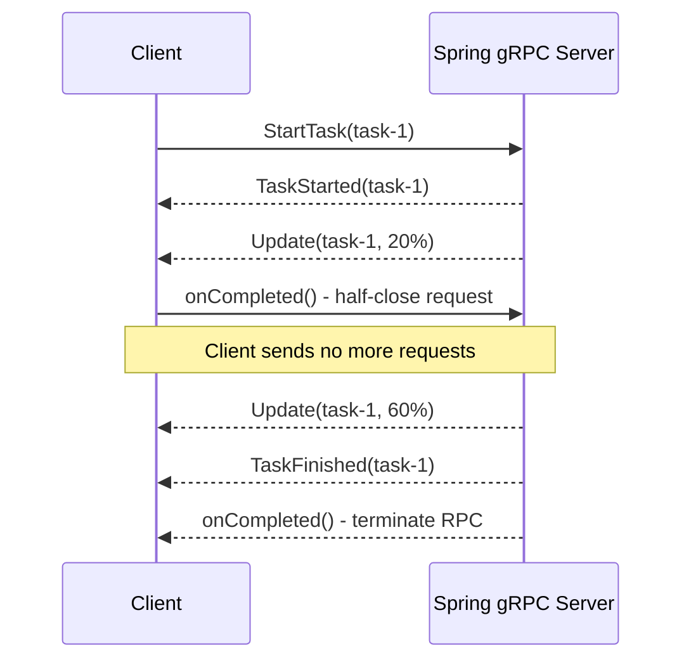

# One-Sided Cancellation and Stream Termination

## 1. Distinguishing Half-Close, Task Cancellation, and RPC Cancellation

In **bidirectional streaming** with Spring gRPC, the client can stop sending requests while continuing to receive responses. This is a *half-close* of the client → server direction. It differs from cancelling a business task and is completely different from cancelling the entire RPC.

Imagine a dashboard monitoring a report-processing job:

- The client sends a command to start tracking.
- The server emits progress updates multiple times.
- The user can request to stop the report task while keeping the connection open to send other commands.
- The user can also stop sending new commands while continuing to receive progress for the running task.
- When the user closes the screen completely, the client can cancel the RPC; the server must stop timers and background work for the session.

The three actions above have different scopes:

| Action | Scope | Is the RPC still active? |
| --- | --- | --- |
| Client calls `requestObserver.onCompleted()` | Closes the client → server request direction (half-close) | **Yes**; server may still send responses |
| Client sends `CancelTask` command | Cancels one task per application rules | **Yes**; other tasks and commands can continue |
| Client calls `ClientCallStreamObserver.cancel(...)` | Cancels the entire RPC | **No**; both directions terminate |
| Server calls `responseObserver.onCompleted()` | Successfully finishes the response stream | **No**; the RPC ends |
| One side terminates via `onError(...)` | Terminates the RPC with an error | **No** |

Key point: gRPC provides no transport operation for the server to merely "half-close the response" and keep receiving requests on the same RPC. When the server calls `responseObserver.onCompleted()`, the entire RPC finishes. If you need to stop one specific workflow while keeping the RPC open, define an **application-level task-cancellation command**.

After this lesson, learners will be able to:

- Distinguish half-close, task cancellation, and full-RPC cancellation.
- Properly handle `onCompleted()`, `onError()`, `cancel()`, and `setOnCancelHandler()` in gRPC Java.
- Write a Spring gRPC service that stops publishers/timers when a task is cancelled or a client disconnects.
- Allow a client to half-close the request stream while continuing to receive responses until the server finishes.
- Test that resources are released when an RPC is cancelled or its deadline expires.

## 2. Two-Way Lifecycle Within One RPC

A bidi RPC has two independent message streams that share **one RPC lifecycle**:



In this scenario, the client closed its send direction yet still received two responses afterward. The server only calls `onCompleted()` for the response when the task completes and there is no more work to emit.

If the client calls `cancel()` instead of `onCompleted()`, that is a different action:

```mermaid
sequenceDiagram
    participant C as Client
    participant S as Spring gRPC Server
    C->>S: StartTask(task-1)
    S-->>C: TaskStarted(task-1)
    S-->>C: Update(task-1, 20%)
    C-xS: ClientCallStreamObserver.cancel()
    Note over S: setOnCancelHandler is triggered
    Note over S: Cancel session timer and work
    Note over C: RPC terminates; do not wait for TaskFinished
```

Once the RPC is cancelled, you cannot expect the server to send `TaskFinished` over that same RPC. If the client needs a reliable cancellation acknowledgment, send a task-cancellation command while the RPC is still alive and receive `TaskCancelled`; only then half-close or continue using the session.

## 3. Protobuf Contract: Separating Task Cancellation Commands from RPC Cancellation

Example `task_control.proto`:

```proto
syntax = "proto3";

package task.v1;

option java_multiple_files = true;
option java_package = "com.example.task.v1";

service TaskControl {
  rpc Watch(stream ClientCommand) returns (stream ServerEvent);
}

message ClientCommand {
  string task_id = 1;
  oneof command {
    StartTask start = 2;
    CancelTask cancel_task = 3;
  }
}

message StartTask {
  string description = 1;
}

message CancelTask {
  string reason = 1;
}

message ServerEvent {
  string task_id = 1;
  oneof event {
    TaskStarted started = 2;
    TaskUpdate update = 3;
    TaskCancelled cancelled = 4;
    TaskFinished finished = 5;
  }
}

message TaskStarted {
  string detail = 1;
}

message TaskUpdate {
  int32 percent = 1;
  string detail = 2;
}

message TaskCancelled {
  bool was_running = 1;
  string reason = 2;
}

message TaskFinished {
  bool success = 1;
  string detail = 2;
}
```

After generating code with `protoc` and the gRPC Java plugin, the service extends `TaskControlGrpc.TaskControlImplBase`. The contract specifies:

- `StartTask` starts a task with `task_id`.
- `CancelTask` stops **the task with that `task_id`**, if it is still running; the server emits `TaskCancelled` on the response stream.
- `TaskFinished` is the final outcome of a single task, and does not terminate the RPC.
- The client calls `onCompleted()` to stop sending new commands. The server continues emitting updates for running tasks.
- The client uses the call's cancellation API to cancel the entire RPC when it no longer needs to receive or send data.

The example keeps one running task at a time per RPC to highlight the lifecycle clearly. Systems with multiple concurrent tasks can expand to a `task_id → TaskState` map; the rules for half-close and RPC cancellation remain identical.

## 4. Spring gRPC Server: Stopping Tasks, Half-Close, and Cleanup

The server must handle three distinct termination paths:

1. Receiving `CancelTask`: stop the task's publisher, emit `TaskCancelled`, and keep the RPC open if the request stream has not half-closed.
2. Receiving `onCompleted()` on the request observer: mark that the client stopped sending; if a task is still running, keep emitting updates.
3. Receiving RPC cancellation: stop all tasks and timers, and do not attempt to send further responses.

### 4.1. Shared Executor

```java
package com.example.task;

import java.util.concurrent.Executors;
import java.util.concurrent.ScheduledExecutorService;
import org.springframework.context.annotation.Bean;
import org.springframework.context.annotation.Configuration;

@Configuration
public class TaskStreamingConfig {
    @Bean(destroyMethod = "shutdown")
    ScheduledExecutorService taskScheduler() {
        return Executors.newScheduledThreadPool(2);
    }
}
```

### 4.2. Service and Per-RPC State

```java
package com.example.task;

import com.example.task.v1.ClientCommand;
import com.example.task.v1.ServerEvent;
import com.example.task.v1.TaskCancelled;
import com.example.task.v1.TaskControlGrpc;
import com.example.task.v1.TaskFinished;
import com.example.task.v1.TaskStarted;
import com.example.task.v1.TaskUpdate;
import io.grpc.Status;
import io.grpc.stub.ServerCallStreamObserver;
import io.grpc.stub.StreamObserver;
import java.util.concurrent.ScheduledExecutorService;
import java.util.concurrent.ScheduledFuture;
import java.util.concurrent.TimeUnit;
import org.springframework.stereotype.Service;

@Service
public class TaskControlService extends TaskControlGrpc.TaskControlImplBase {
    private final ScheduledExecutorService scheduler;

    public TaskControlService(ScheduledExecutorService scheduler) {
        this.scheduler = scheduler;
    }

    @Override
    public StreamObserver<ClientCommand> watch(
            StreamObserver<ServerEvent> responseObserver) {
        ServerCallStreamObserver<ServerEvent> output =
                (ServerCallStreamObserver<ServerEvent>) responseObserver;
        Session session = new Session(output, scheduler);

        // This handler signals that the entire RPC was cancelled.
        output.setOnCancelHandler(session::rpcCancelled);

        return new StreamObserver<>() {
            @Override
            public void onNext(ClientCommand command) {
                session.handle(command);
            }

            @Override
            public void onError(Throwable error) {
                // Inbound error/cancellation must also clean up session state.
                session.rpcCancelled();
            }

            @Override
            public void onCompleted() {
                // Half-close request stream only; response can continue.
                session.requestHalfClosed();
            }
        };
    }

    private static final class Session {
        private final ServerCallStreamObserver<ServerEvent> output;
        private final ScheduledExecutorService scheduler;
        private String taskId;
        private String taskDescription;
        private ScheduledFuture<?> publisher;
        private int updates;
        private boolean taskRunning;
        private boolean requestDone;
        private boolean rpcEnded;

        Session(ServerCallStreamObserver<ServerEvent> output,
                ScheduledExecutorService scheduler) {
            this.output = output;
            this.scheduler = scheduler;
        }

        synchronized void handle(ClientCommand command) {
            if (rpcEnded || output.isCancelled()) {
                cleanupAfterCancellation();
                return;
            }
            switch (command.getCommandCase()) {
                case START -> startTask(command.getTaskId(),
                        command.getStart().getDescription());
                case CANCEL_TASK -> cancelTask(command.getTaskId(),
                        command.getCancelTask().getReason());
                case COMMAND_NOT_SET -> fail(Status.INVALID_ARGUMENT
                        .withDescription("Command is not set"));
            }
        }

        private void startTask(String id, String description) {
            if (id.isBlank()) {
                fail(Status.INVALID_ARGUMENT
                        .withDescription("task_id must not be empty"));
                return;
            }
            if (requestDone) {
                fail(Status.FAILED_PRECONDITION
                        .withDescription("Request stream already half-closed"));
                return;
            }
            if (taskRunning) {
                fail(Status.ALREADY_EXISTS
                        .withDescription("Session already has a running task"));
                return;
            }

            taskId = id;
            taskDescription = description;
            updates = 0;
            taskRunning = true;
            if (!emit(ServerEvent.newBuilder()
                    .setTaskId(taskId)
                    .setStarted(TaskStarted.newBuilder()
                            .setDetail("Started: " + description)
                            .build())
                    .build())) {
                return;
            }

            try {
                // Non-zero delay ensures publisher is assigned before first tick.
                publisher = scheduler.scheduleAtFixedRate(
                        this::publishUpdate, 500, 500, TimeUnit.MILLISECONDS);
            } catch (RuntimeException error) {
                taskRunning = false;
                fail(Status.UNAVAILABLE
                        .withDescription("Unable to start publisher")
                        .withCause(error));
            }
        }

        private synchronized void publishUpdate() {
            if (rpcEnded || output.isCancelled()) {
                cleanupAfterCancellation();
                return;
            }
            if (!taskRunning) {
                return;
            }

            updates++;
            if (!emit(ServerEvent.newBuilder()
                    .setTaskId(taskId)
                    .setUpdate(TaskUpdate.newBuilder()
                            .setPercent(updates * 30)
                            .setDetail("Processing " + taskDescription)
                            .build())
                    .build())) {
                return;
            }

            if (updates == 3) {
                taskRunning = false;
                stopPublisher();
                emit(ServerEvent.newBuilder()
                        .setTaskId(taskId)
                        .setFinished(TaskFinished.newBuilder()
                                .setSuccess(true)
                                .setDetail("Task completed")
                                .build())
                        .build());
                finishRpcIfReady();
            }
        }

        private void cancelTask(String requestedId, String reason) {
            boolean matched = taskRunning && taskId.equals(requestedId);
            if (matched) {
                taskRunning = false;
                stopPublisher();
            }
            emit(ServerEvent.newBuilder()
                    .setTaskId(requestedId)
                    .setCancelled(TaskCancelled.newBuilder()
                            .setWasRunning(matched)
                            .setReason(matched
                                    ? reason : "Task is no longer running")
                            .build())
                    .build());
            finishRpcIfReady();
        }

        synchronized void requestHalfClosed() {
            requestDone = true;
            finishRpcIfReady();
        }

        synchronized void rpcCancelled() {
            cleanupAfterCancellation();
        }

        private void finishRpcIfReady() {
            if (!rpcEnded && requestDone && !taskRunning) {
                rpcEnded = true;
                stopPublisher();
                output.onCompleted();
            }
        }

        private boolean emit(ServerEvent event) {
            if (rpcEnded || output.isCancelled()) {
                cleanupAfterCancellation();
                return false;
            }
            try {
                output.onNext(event);
                return true;
            } catch (RuntimeException error) {
                cleanupAfterCancellation();
                return false;
            }
        }

        private void fail(Status status) {
            if (!rpcEnded) {
                rpcEnded = true;
                taskRunning = false;
                stopPublisher();
                output.onError(status.asRuntimeException());
            }
        }

        private void cleanupAfterCancellation() {
            if (!rpcEnded) {
                rpcEnded = true;
                taskRunning = false;
                stopPublisher();
            }
        }

        private void stopPublisher() {
            if (publisher != null) {
                publisher.cancel(false);
                publisher = null;
            }
        }
    }
}
```

Key observations:

- `requestHalfClosed()` only sets `requestDone = true`. If `taskRunning` is still true, the server **does not** call `output.onCompleted()`; the publisher keeps emitting updates.
- `cancelTask()` stops the publisher and emits `TaskCancelled`. This cancels **a single task**, not the RPC.
- `rpcCancelled()` is invoked by `setOnCancelHandler`; it stops the publisher and marks the session ended. Do not attempt to call `output.onCompleted()` after the peer has cancelled.
- `finishRpcIfReady()` completes the response only when the client has half-closed **and** no task is still running.
- Methods coordinating state and writing responses are synchronized per `Session`; never use a single global lock across all clients.

The sample above illustrates one periodic publisher and one running task per session. Production applications need bounded queues, `isReady()`/`setOnReadyHandler(...)`, scheduler exception handling, session quotas, and task state persistence if recovery across reconnects is needed.

## 5. Client: Half-Close, Task Cancellation, and Full-RPC Cancellation

The client uses `ClientResponseObserver` to obtain `ClientCallStreamObserver` inside `beforeStart()`. That object provides `cancel(message, cause)` to cancel **the entire call**. The observer returned by the async stub is still used to emit commands; calling `onCompleted()` on that observer only half-closes the request direction.

### 5.1. Cancelling a Task and Then Half-Closing Requests

```java
package com.example.task;

import com.example.task.v1.ClientCommand;
import com.example.task.v1.ServerEvent;
import com.example.task.v1.TaskControlGrpc;
import io.grpc.ManagedChannel;
import io.grpc.ManagedChannelBuilder;
import io.grpc.stub.ClientCallStreamObserver;
import io.grpc.stub.ClientResponseObserver;
import io.grpc.stub.StreamObserver;
import java.util.concurrent.CountDownLatch;
import java.util.concurrent.TimeUnit;
import java.util.concurrent.atomic.AtomicReference;

public class TaskControlClientDemo {
    public static void main(String[] args) throws Exception {
        ManagedChannel channel = ManagedChannelBuilder
                .forAddress("localhost", 9090)
                .usePlaintext() // Use only for localhost examples.
                .build();
        AtomicReference<ClientCallStreamObserver<ClientCommand>> callRef =
                new AtomicReference<>();
        CountDownLatch rpcFinished = new CountDownLatch(1);

        try {
            TaskControlGrpc.TaskControlStub stub =
                    TaskControlGrpc.newStub(channel)
                            .withDeadlineAfter(5, TimeUnit.SECONDS);

            ClientResponseObserver<ClientCommand, ServerEvent> incoming =
                    new ClientResponseObserver<>() {
                @Override
                public void beforeStart(
                        ClientCallStreamObserver<ClientCommand> requestStream) {
                    callRef.set(requestStream);
                }

                @Override
                public void onNext(ServerEvent event) {
                    System.out.println("Received event for " + event.getTaskId()
                            + ": " + event.getEventCase());
                }

                @Override
                public void onError(Throwable error) {
                    System.err.println("RPC error/cancelled: " + error);
                    rpcFinished.countDown();
                }

                @Override
                public void onCompleted() {
                    System.out.println("Server completed response stream");
                    rpcFinished.countDown();
                }
            };

            StreamObserver<ClientCommand> outgoing = stub.watch(incoming);

            outgoing.onNext(ClientCommand.newBuilder()
                    .setTaskId("report-42")
                    .setStart(com.example.task.v1.StartTask.newBuilder()
                            .setDescription("Export report")
                            .build())
                    .build());

            // Illustration: let task run briefly then request application-level cancellation.
            TimeUnit.MILLISECONDS.sleep(650);
            outgoing.onNext(ClientCommand.newBuilder()
                    .setTaskId("report-42")
                    .setCancelTask(com.example.task.v1.CancelTask.newBuilder()
                            .setReason("User stopped report")
                            .build())
                    .build());

            // Stop sending new commands; still receive TaskCancelled and terminal callback.
            outgoing.onCompleted();

            if (!rpcFinished.await(4, TimeUnit.SECONDS)) {
                throw new IllegalStateException("RPC did not finish in time");
            }
        } finally {
            channel.shutdownNow().awaitTermination(2, TimeUnit.SECONDS);
        }
    }

    // Call this method to cancel the entire RPC, e.g., when closing the screen.
    static void cancelWholeRpc(
            AtomicReference<ClientCallStreamObserver<ClientCommand>> callRef) {
        ClientCallStreamObserver<ClientCommand> call = callRef.get();
        if (call != null) {
            call.cancel("User left session", null);
        }
    }
}
```

The example above proceeds in order: send `StartTask`, wait briefly, send `CancelTask`, and call `outgoing.onCompleted()`. The server stops the publisher, emits `TaskCancelled`, sees that the request stream is half-closed with no remaining tasks, and completes the response successfully.

The `sleep` interval is purely to illustrate interaction; the number of updates received depends on scheduler timing and is not a test assertion. In real applications, cancellation is triggered by UI events or system commands without waiting via `sleep`.

### 5.2. Cancelling the Entire RPC

When the user closes the screen and no longer needs any responses, the client calls:

```java
ClientCallStreamObserver<ClientCommand> call = callRef.get();
if (call != null) {
    call.cancel("User closed screen", null);
}
```

This is **transport cancellation**. The client's `onError` callback typically receives status `CANCELLED`; the server receives the cancellation signal via `setOnCancelHandler` or checks `isCancelled()`, then stops the publisher. Do not send `CancelTask` before cancelling the whole call if the goal is to terminate the entire session immediately without needing a business confirmation.

## 6. Termination Cases and Proper Handling

| Scenario | Client | Server |
| --- | --- | --- |
| Client calls `outgoing.onCompleted()` | Sends no new commands; continues receiving responses | Receives `onCompleted()` on request observer; continues running task |
| Client sends `CancelTask` | Keeps RPC open, awaits `TaskCancelled` | Stops matching task, emits cancellation event, continues receiving commands if input is open |
| Client calls `call.cancel(...)` | Call terminates; terminal callback runs | Stops timers/tasks/subscriptions; emits no more responses |
| Server calls `output.onCompleted()` | Receives `onCompleted()`; receives no new responses | RPC completes successfully; receives no new requests |
| Server calls `output.onError(...)` | Receives terminal error and status | RPC ends with error; stops all tasks |
| Deadline expires | Call ends with `DEADLINE_EXCEEDED` or corresponding status | Cleans up like a cancellation; do not expect a final result to be sent |

**Do not confuse `onError` with a task-cancellation command.** Calling `onError` on the inbound or outbound observer is a terminal RPC event. If you want to cancel a single task while other tasks keep running, express it via a Protobuf message such as `CancelTask` with an ID and confirmation event.

## 7. Deadlines, Cancellation, and Background Resources

A gRPC deadline applies to the **entire RPC**, not individually per task, and is not automatically renewed after each update. If an RPC hosts multiple tasks, deadline expiration affects all tasks in the session. If business logic requires independent per-task timeouts, store each task's start/expiration timestamp in its task state and emit `TaskFinished` with a timeout status per contract.

When an RPC is cancelled, the server must stop all activities created for that RPC:

- `ScheduledFuture.cancel(false)` to prevent subsequent periodic executions.
- Close subscriptions to event buses, message brokers, or publishers.
- Cancel background tasks if a cancellation API exists; if a task cannot be cancelled immediately, mark the session ended and discard late completions.
- Release session queues, buffers, and state once no callback can access them.
- Never call `onNext`, `onCompleted`, or `onError` again after a terminal event.

In production code, use a synchronized terminal flag or atomic state machine to ensure only one termination path wins. Cancellation can race with a task tick or client half-close; all paths must coordinate on the same per-RPC state.

## 8. Testing Half-Close and Cancellation

You can use a gRPC in-process server/channel or the corresponding Spring gRPC test configuration. Inject a controllable scheduler so tests do not rely on `Thread.sleep()`.

| Scenario | Verification outcome |
| --- | --- |
| Client sends Start then half-closes | Server still emits updates and TaskFinished before response completes |
| Client half-closes while task is running | Server does not call response `onCompleted()` prematurely |
| Client sends CancelTask while request stream is open | Only matching task stops; TaskCancelled received; RPC remains usable |
| Client sends CancelTask then half-closes | Server emits TaskCancelled, then completes response successfully |
| Client cancels whole call while task is running | Server cancellation handler stops publisher; no new updates after cancel |
| Deadline expires while task is running | Server frees resources; client does not wait forever for TaskFinished |
| Server errors while handling command | RPC ends with expected status; background tasks cleaned up |
| CancelTask does not match current task | Server returns appropriate business outcome; does not accidentally stop another task |
| Cancel and task completion run concurrently | Only one terminal outcome for the task/RPC is emitted per state machine |

In tests, assert terminal callback counts, tick counts after cancellation, and that futures/timers have been cancelled. Do not merely check that the client received a `TaskCancelled` message; verify that the producer actually stopped and resources do not keep running after the RPC ends.

## 9. Common Mistakes

1. **Calling `outgoing.onCompleted()` and thinking the RPC ended.** That only half-closes the request direction; responses can still continue.
2. **Calling `responseObserver.onCompleted()` to stop only the response direction.** That terminates the entire RPC; you cannot continue receiving requests on the same call.
3. **Using `call.cancel()` to cancel a single task.** It cancels the entire RPC; use a `CancelTask` command if the session must stay open.
4. **Forgetting to register `setOnCancelHandler`.** Timers and subscriptions may keep running after the client leaves.
5. **Treating `TaskCancelled` as a gRPC terminal callback.** It is a business message; the RPC remains open until the whole-session termination condition is met.
6. **Failing to synchronize cancellation with task ticks.** Updates might be emitted after cancellation was signaled; use per-session state and locking.
7. **Failing to distinguish RPC deadlines from task timeouts.** If each task has its own deadline, the application must manage those deadlines itself.

## 10. Practice Exercise

Extend `TaskControl.Watch` into a multi-task monitoring session:

1. Replace single-task state with a `task_id → TaskState` map allowing multiple tasks to start within the same RPC.
2. Send `CancelTask(task_id)` for one task; the remaining tasks continue emitting updates.
3. Add application-level `PauseTask`/`ResumeTask` commands and define valid per-task state transitions.
4. Test client half-close while multiple tasks are running; the server closes the RPC only after all tasks finish or are cancelled.
5. Simulate client full-RPC cancellation; verify all publishers/subscriptions across all tasks are stopped.
6. Add per-task timeouts and contrast them with the whole-RPC deadline.

**Completion criteria:** learners can stop one task while keeping the RPC open, half-close the request direction while still receiving responses, and cancel the entire RPC with full cleanup when the session is no longer needed.

### References

- [gRPC Core concepts](https://grpc.io/docs/what-is-grpc/core-concepts/): RPC lifecycle, client/server streaming, and message ordering.
- [gRPC Java ClientCallStreamObserver API](https://grpc.github.io/grpc-java/javadoc/io/grpc/stub/ClientCallStreamObserver.html): cancellation and request stream control.
- [gRPC Java ServerCallStreamObserver API](https://grpc.github.io/grpc-java/javadoc/io/grpc/stub/ServerCallStreamObserver.html): checking cancellation and registering cancel handlers.
- [gRPC Java StreamObserver API](https://grpc.github.io/grpc-java/javadoc/io/grpc/stub/StreamObserver.html): `onNext`, `onError`, and `onCompleted` callbacks.
- [Spring gRPC Reference](https://docs.spring.io/spring-grpc/reference/): service registration and gRPC integration in Spring.
