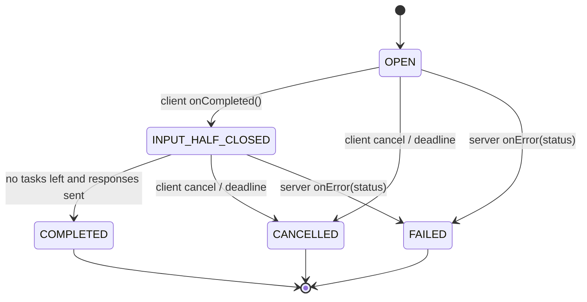

# How an Error in One Direction Affects the Other

## 1. Two Independent Transmission Directions, One Shared RPC

In bidirectional streaming, the client sends request messages and the server sends response messages over two separate data streams. The client can continue sending while receiving responses; the server can also proactively emit data before receiving new requests. However, both directions belong to **a single RPC**. Therefore, distinguish:

- **A business error on one message or task:** the application can report the error for that specific request using a response message, then continue processing other messages.
- **An RPC-terminating error:** an error status, cancellation, deadline, or transport error terminates the call; neither direction can continue exchanging messages on that RPC.

For example, a dashboard sends update commands while the server emits progress. If one command contains invalid data, the server can return `CommandRejected(request_id)` and continue emitting progress for other commands. If the server calls `responseObserver.onError(...)`, the RPC ends; the client cannot keep sending commands on that same stream.

After this lesson, learners will be able to distinguish message errors from RPC errors, determine the impact of client/server errors, design error responses with correlation IDs, handle terminal callbacks, and clean up resources properly in Spring gRPC.

## 2. Blast Radius of Each Error Type

| Event | Impact on request direction | Impact on response direction |
| --- | --- | --- |
| Client calls `onCompleted()` on request observer | Normally closes client → server direction (half-close) | Server can still continue sending responses |
| Server rejects one request with `CommandRejected` response | Client can still send other requests | Server continues sending responses for remaining requests |
| Server reports a task error with `TaskFailed` | Request stream remains active | Response stream remains active; this is a business error |
| Client cancels entire RPC or deadline expires | No further sending/receiving on that call | No further sending/receiving on that call |
| Server calls `responseObserver.onError(status)` | RPC terminates; client cannot send more requests on the call | Response stream ends with error status |
| Transport/HTTP/2 error fails the call | RPC can no longer continue | RPC can no longer continue |

Key takeaway: **the two directions are independent for sending, receiving, and half-closing, not independent for the RPC's terminal status**. gRPC does not provide two separate terminal statuses so that one direction fails terminally while the other stays alive on the same call.

## 3. Distinguishing Message Errors from RPC Errors

The application contract should model recoverable errors as data. Example:

```proto
syntax = "proto3";

package task.v1;

option java_multiple_files = true;
option java_package = "com.example.task.v1";

service TaskStream {
  rpc Exchange(stream ClientCommand) returns (stream ServerEvent);
}

message ClientCommand {
  string request_id = 1;
  oneof command {
    SubmitTask submit = 2;
    CancelTask cancel = 3;
  }
}

message SubmitTask {
  string payload = 1;
}

message CancelTask {
  string reason = 1;
}

message ServerEvent {
  string request_id = 1;
  oneof event {
    Accepted accepted = 2;
    Progress progress = 3;
    CommandRejected rejected = 4;
    TaskFailed failed = 5;
    TaskFinished finished = 6;
    Notice notice = 7;
  }
}

message Accepted { string detail = 1; }
message Progress { int32 percent = 1; }
message CommandRejected {
  string code = 1;
  string detail = 2;
}
message TaskFailed {
  string code = 1;
  string detail = 2;
}
message TaskFinished { string result = 1; }
message Notice { string text = 1; }
```

Contract rules:

- `CommandRejected` carries the same `request_id` as the invalid command. The server rejects that command without having to close the RPC.
- `TaskFailed` terminates **one accepted task**. Other tasks in the same RPC can keep running.
- `Notice` is a proactive message not bound to a specific request.
- gRPC statuses such as `INVALID_ARGUMENT`, `UNAUTHENTICATED`, `INTERNAL`, or `UNAVAILABLE` are reserved for errors that prevent the entire RPC from continuing or require termination per contract.

Avoid calling `responseObserver.onError()` for every validation failure. Doing so turns a single bad command into a terminal error, causing valid in-flight commands to lose their communication session too.

## 4. Errors on the Client Side

The client can encounter errors in two different places:

1. **Request-producing source fails:** e.g., the UI cannot read data for one command. If only that command is invalid, the client can still send another command or a cancel command per contract. When the producer finishes normally, call `requestObserver.onCompleted()` to half-close.
2. **Unrecoverable local session error:** e.g., client state is corrupted or the user leaves the screen. The client can cancel the entire call via `ClientCallStreamObserver.cancel(...)`. This is RPC cancellation, not half-close.

When the client receives responses, the `onNext` callback should catch local processing exceptions. Do not let UI or file-writing exceptions escape the callback unexpectedly. If an error message relates to a single request, fail only that request; if a response severely violates the protocol and the client cannot continue decoding safely, cancel the RPC and record the cause.

Example of handling per-request error responses:

```java
void handleEvent(ServerEvent event) {
    String requestId = event.getRequestId();
    switch (event.getEventCase()) {
        case REJECTED -> pending.fail(
                requestId, event.getRejected().getCode());
        case FAILED -> pending.fail(
                requestId, event.getFailed().getCode());
        case FINISHED -> pending.complete(
                requestId, event.getFinished().getResult());
        case PROGRESS -> pending.updateProgress(
                requestId, event.getProgress().getPercent());
        case ACCEPTED -> pending.markAccepted(requestId);
        case NOTICE -> showNotice(event.getNotice().getText());
        case EVENT_NOT_SET -> recordProtocolError(requestId);
    }
}
```

The `pending` methods here represent a state registry keyed by `request_id`. When the callback receives a terminal `onError(Throwable)`, the client must resolve all remaining pending requests with an error or indeterminate state; never leave them hanging forever.

## 5. Errors on the Server Side

The server receives requests via the observer returned by the service. An error in processing a request is not necessarily a transport error:

- **Validation failure:** send `CommandRejected` for that request.
- **Accepted task fails during processing:** send `TaskFailed` for that request.
- **Session-wide unrecoverable error:** terminate with `responseObserver.onError(Status...)`.
- **Client cancels or deadline expires:** stop background tasks and free resources; do not try to send more responses.

Example core handling in the service:

```java
private void handleSubmit(ClientCommand command) {
    String id = command.getRequestId();
    if (id.isBlank() || command.getSubmit().getPayload().isBlank()) {
        emit(ServerEvent.newBuilder()
                .setRequestId(id)
                .setRejected(CommandRejected.newBuilder()
                        .setCode("INVALID_COMMAND")
                        .setDetail("request_id and payload are required")
                        .build())
                .build());
        return; // Drop only this command; RPC continues.
    }

    try {
        startTask(id, command.getSubmit().getPayload());
    } catch (TaskCapacityException ex) {
        emit(ServerEvent.newBuilder()
                .setRequestId(id)
                .setRejected(CommandRejected.newBuilder()
                        .setCode("CAPACITY_REACHED")
                        .setDetail("Server currently has too many tasks")
                        .build())
                .build());
    }
}

private void onTaskFailure(String requestId, Throwable cause) {
    emit(ServerEvent.newBuilder()
            .setRequestId(requestId)
            .setFailed(TaskFailed.newBuilder()
                    .setCode("PROCESSING_FAILED")
                    .setDetail("Unable to complete task")
                    .build())
            .build());
}
```

`emit` and `startTask` are service integration points; in a real implementation, `emit` must serialize writes to the same response observer, check terminal state, and enforce flow control. Never expose internal exception details or sensitive information to the client; log stack traces with correlation IDs on the server.

### 5.1. When Should the Server Terminate the Entire RPC?

Cases that typically call for a terminal status:

| Scenario | Suggested status | Reason |
| --- | --- | --- |
| Contract/protocol cannot be safely interpreted | `INVALID_ARGUMENT` or `FAILED_PRECONDITION` | Cannot continue processing the stream validly |
| Missing valid authentication | `UNAUTHENTICATED` | Session is not permitted to continue |
| Identity authenticated but lacks permission | `PERMISSION_DENIED` | Entire session is unauthorized |
| System overloaded, unable to accept more | `RESOURCE_EXHAUSTED` | Resource protection policy requires termination |
| Internal error corrupts session state | `INTERNAL` | Cannot guarantee correctness going forward |
| Client cancels or deadline expires | `CANCELLED` / `DEADLINE_EXCEEDED` | RPC has been cancelled/expired |

The exact status depends on the contract and cause. If only one request has a bad payload, prefer a message-level error; if shared session state is no longer trustworthy, terminate the RPC.

## 6. Terminal Lifecycle and Cleanup

An RPC has only one terminal outcome. After `onCompleted()` or `onError()`, `onNext()` must not be called again. The server must coordinate request callbacks, timers, task completions, and cancellation using per-session state.



Implementation principles:

- Use `ServerCallStreamObserver.setOnCancelHandler(...)` to stop timers, subscriptions, and running tasks when the RPC is cancelled.
- `onCompleted()` on the request observer only marks client half-close. The server can still emit responses for already-received tasks.
- Only call `responseObserver.onCompleted()` when all session work is resolved and no responses remain to be sent.
- Use a synchronized terminal flag or state machine to ensure only one termination path wins.
- If a background task finishes after cancellation, discard the late result; do not call `onNext()` on an ended observer.
- When `onError(status)` terminates the RPC, cancel all tasks in the session, not just the failing task.

A gRPC deadline applies to the **entire RPC**, and does not reset per message. If each task needs its own time limit, the application must manage per-`request_id` timeouts; when the whole-RPC deadline expires, all session tasks must stop or transition to a pre-designed independent handling path.

## 7. Flow Control and Slow-Receiver Failures

An error in one direction might not be an exception. For instance, the server keeps producing valid responses while the client fails to read fast enough; the server's queue grows and may eventually exhaust memory. gRPC Java provides `isReady()` and `setOnReadyHandler(...)` on sending observers to throttle output. Use a bounded queue and drain only when the observer is ready.

When the queue is full:

- Slow down or reject producers at the application layer.
- Coalesce stale status messages if newer ones supersede older ones.
- Never coalesce data chunks or mandatory events if doing so breaks integrity.
- Terminate the RPC with `RESOURCE_EXHAUSTED` if there is no safe way to keep the session alive.

Inbound flow control is a separate mechanism: manual inbound flow control lets the application request more messages only after finishing prior ones. Do not confuse `request(n)` with `isReady()`: one regulates **receiving**, the other regulates **sending**.

## 8. Testing Cross-Direction Error Impact

Integration tests should use an in-process server/channel or the corresponding Spring gRPC test environment. Core scenarios:

| Scenario | What to verify |
| --- | --- |
| Client sends one invalid command followed by a valid command | Server emits `CommandRejected` for the bad ID and still processes the valid command |
| One task fails while another is running | Only the failing task gets `TaskFailed`; the other keeps emitting progress |
| Client half-closes while server still has tasks | Server continues responses until tasks finish |
| Server calls `onError(Status.INTERNAL)` | Client receives terminal `onError`; no further sends/receives on the RPC |
| Client cancels whole call | Server cancel handler stops timers/tasks; no late responses |
| Deadline expires with multiple tasks | Entire session terminates and all session resources are cleaned up |
| Outbound queue fills up | Defined overload policy is applied; no unbounded memory growth |
| Two termination callbacks fire nearly concurrently | Only one terminal event; no `onNext` after terminal |

Do not check only the final message. Tests must verify **which** task was affected, which tasks stayed active, and whether resources actually stopped. Use latches or mock schedulers to control error and cancellation timing; avoid relying on `Thread.sleep()` in assertions.

## 9. Common Mistakes

1. **Calling `responseObserver.onError()` for a single request's error.** This terminates the entire RPC and drops other requests.
2. **Assuming an error in the request direction always allows responses to continue.** Only business errors modeled as messages can be isolated; terminal call errors/cancellations affect both directions.
3. **Confusing half-close with cancel.** `onCompleted()` on the request observer closes sending normally; `cancel()` aborts the entire call.
4. **Failing to clean up publishers when the RPC is cancelled.** Timers can keep running and emitting onto an ended observer.
5. **Letting exceptions escape the `onNext` callback.** Catch and classify errors at the right layer; do not let local handling errors accidentally terminate the call.
6. **Continuing to send after a terminal event.** Every producer must check session state before enqueueing or emitting.

## 10. Practice Exercise

Extend `TaskStream.Exchange` so one RPC handles multiple tasks:

1. Client sends two valid commands and one command with an invalid payload.
2. Server returns `CommandRejected` for the invalid command while still emitting `Progress` and `TaskFinished` for the two valid tasks.
3. Make one task raise a business failure; the remaining task still completes.
4. Add a critical system-error path where the server terminates the RPC with `INTERNAL`; verify all remaining tasks are stopped.
5. Separately test half-close, a single-task cancel command, and full-RPC cancellation; observe which callbacks run on each side.

**Completion criteria:** learners can explain why business errors can be isolated per message while terminal statuses/cancellations affect the entire RPC, implement both handling modes, and prove cleanup via tests.

### References

- [gRPC Core concepts](https://grpc.io/docs/what-is-grpc/core-concepts/): RPC lifecycle, streaming, and call termination.
- [gRPC Java StreamObserver API](https://grpc.github.io/grpc-java/javadoc/io/grpc/stub/StreamObserver.html): callbacks and terminal events.
- [gRPC Java ServerCallStreamObserver API](https://grpc.github.io/grpc-java/javadoc/io/grpc/stub/ServerCallStreamObserver.html): server-side cancellation and flow control.
- [gRPC Status codes](https://grpc.io/docs/guides/status-codes/): meaning of status codes when terminating an RPC.
- [Spring gRPC Reference](https://docs.spring.io/spring-grpc/reference/): server/client integration and testing in Spring.
