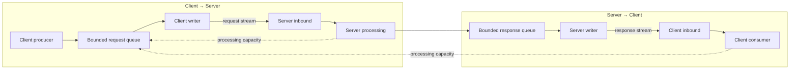

# Backpressure in a Bidi Stream

## 1. Why Does a Bidirectional Stream Need Backpressure?

In a **Spring gRPC** bidirectional streaming RPC, the client sends request messages while the server simultaneously emits response messages. Each direction has its own producer and consumer. If the client generates requests faster than the server processes them, or the server emits data faster than the client reads it, data can accumulate inside application buffers and queues.

**Backpressure** is the mechanism for regulating producer speed to match consumer capacity. In a bidi stream, both directions must be managed independently:

- **Client → server:** limit the number of in-flight/pending requests; the server requests additional messages only when it has processing capacity.
- **Server → client:** the server pauses emitting responses when the transport is not ready; it resumes when gRPC signals writability.

HTTP/2 flow control helps regulate data on the wire, yet it does not automatically bound queues created by the application. If a producer keeps pushing messages onto an unbounded queue, the application can still run out of memory even though gRPC runs over HTTP/2.

After this lesson, learners will be able to use `isReady()` and `setOnReadyHandler()` to regulate the send direction, apply manual inbound flow control when needed, design bounded queues, and choose appropriate policies for slow consumers.

## 2. Two Directions Have Two Independent Backpressure Points

An RPC can experience congestion in one direction while the other direction can still make progress. For example, the server may be processing requests slowly so the client needs to slow down sending; meanwhile the server can still emit heartbeats or results for already-completed requests. However, if the response queue also fills up or the RPC is cancelled/times out, the whole call can still terminate.

| Mechanism | Direction regulated | Typical API |
| --- | --- | --- |
| Outbound readiness | Local side **sending** messages | `isReady()`, `setOnReadyHandler()` |
| Manual inbound flow control | Local side **receiving** messages | `disableAutoRequest()`, `request(n)` |
| Application queue limit | Application-owned buffer | Item/byte cap, pause/resume producer |
| RPC lifecycle | Entire call | deadline, cancellation, `onError`, `onCompleted` |

## 3. Regulating the Send Direction with `isReady()`

gRPC Java provides `isReady()` on `CallStreamObserver` and its subclasses:

- The server checks `ServerCallStreamObserver<ServerEvent>.isReady()` before emitting responses.
- The client obtains `ClientCallStreamObserver<ClientRequest>` inside `ClientResponseObserver.beforeStart()` to check readiness of the request stream.
- `setOnReadyHandler(...)` registers a callback for when writability becomes ready. The callback must re-check `isReady()` before draining the queue.

`isReady() == true` **does not mean the peer has read or finished processing the message**. It only indicates that gRPC can currently accept more outbound data without the application piling more into its own buffer. If you need confirmation that the consumer applied the data, the contract must include a business ACK.

### 3.1. A Single Writer with a Bounded Queue

When multiple producers emit onto one observer, funnel messages into a queue and use a single writer to serialize `onNext()` calls. The class below works cleanly for outbound observers on either client or server:

~~~java
import io.grpc.stub.CallStreamObserver;
import java.util.ArrayDeque;
import java.util.Deque;

final class ReadyWriter<T> {
    enum Offer { ACCEPTED, FULL, CLOSED }

    private final CallStreamObserver<T> stream;
    private final Deque<T> queue = new ArrayDeque<>();
    private final int capacity;
    private boolean accepting = true;
    private boolean terminated;

    ReadyWriter(CallStreamObserver<T> stream, int capacity) {
        if (capacity <= 0) {
            throw new IllegalArgumentException("capacity must be > 0");
        }
        this.stream = stream;
        this.capacity = capacity;
        stream.setOnReadyHandler(this::drain);
    }

    synchronized Offer offer(T message) {
        if (!accepting || terminated) {
            return Offer.CLOSED;
        }
        if (queue.size() >= capacity) {
            return Offer.FULL;
        }
        queue.addLast(message);
        drainLocked();
        return Offer.ACCEPTED;
    }

    synchronized boolean hasCapacity() {
        return accepting && !terminated && queue.size() < capacity;
    }

    // Call once producers have finished creating all messages.
    synchronized void finishWhenDrained() {
        accepting = false;
        drainLocked();
    }

    // Use only when the call was cancelled externally.
    synchronized void abandon() {
        accepting = false;
        terminated = true;
        queue.clear();
    }

    private void drain() {
        synchronized (this) {
            drainLocked();
        }
    }

    private void drainLocked() {
        while (!terminated && stream.isReady() && !queue.isEmpty()) {
            stream.onNext(queue.removeFirst());
        }
        if (!accepting && queue.isEmpty() && !terminated) {
            terminated = true;
            stream.onCompleted();
        }
    }
}
~~~

This pattern illustrates three principles:

1. The queue is bounded; `offer()` returns `FULL` so the producer can decide to pause, perform bounded retries, coalesce data, or report overload.
2. Only the writer calls `stream.onNext()`; the `onReady` callback resumes draining when gRPC becomes ready.
3. `finishWhenDrained()` stops accepting new messages and calls `onCompleted()` only after the queue has been fully drained.

Production code must add write exception handling, error terminal states, byte quotas, and teardown on cancellation. `abandon()` only clears the queue when the RPC has already ended externally; do not use it in place of a normal terminal status.

### 3.2. Using the Writer on the Server

The server obtains `ServerCallStreamObserver` from the response observer and attaches the writer:

~~~java
ServerCallStreamObserver<ServerEvent> call =
        (ServerCallStreamObserver<ServerEvent>) responseObserver;
ReadyWriter<ServerEvent> writer = new ReadyWriter<>(call, 128);

call.setOnCancelHandler(() -> {
    writer.abandon();
    stopTaskPublishers();
});

// From a request handler or task publisher:
ReadyWriter.Offer result = writer.offer(event);
if (result == ReadyWriter.Offer.FULL) {
    pauseUpstreamProducer();
} else if (result == ReadyWriter.Offer.CLOSED) {
    stopUpstreamProducer();
}

// Call only once all session emitters have completed:
writer.finishWhenDrained();
~~~

`stopTaskPublishers()` and `pauseUpstreamProducer()` represent application mechanisms such as cancelling subscriptions or pausing a message broker consumer. Never ignore a `FULL` result; if the producer keeps generating data, the queue will remain full.

### 3.3. Using the Writer on the Client

The client registers the writer inside `ClientResponseObserver.beforeStart()`, before starting to send requests:

~~~java
AtomicReference<ReadyWriter<ClientRequest>> writerRef =
        new AtomicReference<>();

ClientResponseObserver<ClientRequest, ServerEvent> responseObserver =
        new ClientResponseObserver<>() {
    @Override
    public void beforeStart(
            ClientCallStreamObserver<ClientRequest> requestStream) {
        writerRef.set(new ReadyWriter<>(requestStream, 64));
    }

    @Override
    public void onNext(ServerEvent event) {
        handleResponse(event);
    }

    @Override
    public void onError(Throwable error) {
        ReadyWriter<ClientRequest> writer = writerRef.get();
        if (writer != null) writer.abandon();
    }

    @Override
    public void onCompleted() {
        ReadyWriter<ClientRequest> writer = writerRef.get();
        if (writer != null) writer.abandon();
    }
};
~~~

Producers such as UI, timers, or event listeners call `writerRef.get().offer(request)`. If the result is `FULL`, the client must slow down the emitter or display an overload status; do not place a second unbounded queue in front of the writer.

## 4. Regulating the Receive Direction with Manual Inbound Flow Control

`isReady()` regulates **outbound messages**. If the problem is that the application receives messages faster than it can process them, use manual inbound flow control:

- The server calls `disableAutoRequest()` on `ServerCallStreamObserver` before returning the request observer to gRPC, then calls `request(n)` when ready to receive more client requests.
- The client implements `ClientResponseObserver.beforeStart()`, calls `disableAutoRequest()` on `ClientCallStreamObserver`, and calls `request(n)` to allow receiving responses from the server.

Server-side example allowing only one new request at a time:

~~~java
ServerCallStreamObserver<ServerEvent> call =
        (ServerCallStreamObserver<ServerEvent>) responseObserver;
call.disableAutoRequest();
call.request(1); // Allow receiving the first message.

return new StreamObserver<ClientRequest>() {
    @Override
    public void onNext(ClientRequest request) {
        processAsync(request).whenComplete((result, error) -> {
            if (error != null) {
                failSession(error);
                return;
            }
            ReadyWriter.Offer accepted = responseWriter.offer(result);
            if (accepted == ReadyWriter.Offer.ACCEPTED
                    && responseWriter.hasCapacity()) {
                // Only request the next message once processing finishes and space remains for its result.
                call.request(1);
            }
        });
    }
    // onError and onCompleted handle session lifecycle.
};
~~~

`hasCapacity()` here is a remaining-capacity check that a real writer implementation needs to expose. If the queue is full, do not call `request(1)`; wait until the writer drains or apply the overload policy before requesting the next message. The goal is to avoid accepting more requests when the application lacks room to hold their results.

With multiple producers or when the queue may fill between checking and callback execution, the writer should emit an `onCapacityAvailable` signal when draining frees space; that callback then calls `request(1)`. Avoid polling or holding the writer lock while waiting for processing capacity.

On the client side, `ClientResponseObserver.beforeStart()` can configure manual demand for responses:

~~~java
ClientResponseObserver<ClientRequest, ServerEvent> observer =
        new ClientResponseObserver<>() {
    private ClientCallStreamObserver<ClientRequest> call;

    @Override
    public void beforeStart(
            ClientCallStreamObserver<ClientRequest> requestStream) {
        call = requestStream;
        call.disableAutoRequest();
        call.request(1); // Allow receiving one response.
    }

    @Override
    public void onNext(ServerEvent event) {
        consumeAsync(event).whenComplete((ignored, error) -> {
            if (error != null) {
                call.cancel("Unable to process response", error);
            } else {
                call.request(1); // Finished processing, request the next response.
            }
        });
    }

    @Override public void onError(Throwable error) { cleanup(); }
    @Override public void onCompleted() { cleanup(); }
};
~~~

This is a conceptual pattern; in real code, ensure the call reference is still valid, completion callbacks do not call `request(1)` after a terminal event, and consumer exceptions are handled. If processing multiple responses in parallel, request only as many messages as **actual free capacity** allows.

## 5. Combining Both Directions Without Deadlock

In a bidi stream, inbound demand and outbound readiness must coordinate without blocking each other:

1. The server requests more client requests only when it has processing capacity and space to hold results to be emitted.
2. The server drains the response queue only when `responseObserver.isReady()`.
3. The client requests more server responses only when the consumer has processed prior ones and buffer space remains.
4. The client drains the request queue only when the request observer's `isReady()` is true.
5. Never call `request(n)` or wait on network I/O inside a lock needed by the writer to emit messages.

Avoid a design where the client reads responses only after finishing all requests while the server stops accepting requests when the response queue is full. Both sides can end up waiting for each other. A bidi client should keep its **receive loop independent** of its send loop, and the server must still process requests even while the response writer is temporarily paused.

## 6. Policies When the Queue Is Full

No single policy fits every message type. Choose based on data semantics:

| Data type | Appropriate policy |
| --- | --- |
| Mandatory business commands | Pause producer or explicitly reject; never drop silently |
| Current state that supersedes older state | Coalesce, keeping only the latest state |
| Non-critical telemetry | Sample/drop according to documented rules |
| Result chunks requiring full reassembly | Preserve order, bound size; offload large payloads to object storage if needed |
| Heartbeats | Drop stale heartbeat when a newer one supersedes it |
| Persistently slow consumer | Terminate RPC with `RESOURCE_EXHAUSTED` and ask client to reconnect/backoff |

Bound both **message count and total bytes**. A 100-item queue can still consume large amounts of memory if each message carries a large payload. Track queue-full counts, wait times, queued bytes, and writer unready durations to tune capacity using operational data.

## 7. Half-Close, Cancellation, and Errors

- The client calls `requestObserver.onCompleted()` to half-close the request direction. The server can keep emitting generated responses; the response queue completes only when server-side producers finish.
- The server calls `responseObserver.onCompleted()` when the response queue has drained and no emission work remains. This ends the RPC successfully.
- If the client cancels the whole call or the deadline expires, the server must stop producers, clear queues, and cancel subscriptions via `setOnCancelHandler()`.
- A full queue can be handled via application-level backpressure; only use `onError(Status.RESOURCE_EXHAUSTED)` when the policy is to terminate the RPC.
- Never call `onNext()` after `onCompleted()` or `onError()`. Every send path must pass through the same writer/state to coordinate terminal events.

Deadlines apply to the entire RPC, and are not refreshed per sent message. If each task needs its own timeout, the application must track deadlines per request ID. With Spring gRPC, metadata/interceptors handle call-level authentication and tracing; per-message data belongs in Protobuf. Use TLS/mTLS in deployed environments; do not use plaintext outside local testing.

## 8. Testing Backpressure

Integration tests can use an in-process server/channel and a simulated slow consumer. Key scenarios:

| Scenario | Verification outcome |
| --- | --- |
| Client sends faster than server processes | Inbound demand throttles receive rate; queue does not grow unbounded |
| Server emits faster than client reads | `isReady()` turns false, writer pauses draining and resumes via onReady |
| Client sends and receives concurrently | Send loop does not block receive loop; no deadlock |
| Queue hits capacity | Producer is paused/rejected/coalesced per policy |
| Large payloads | Byte limit is enforced, not just item count limit |
| Client half-closes while responses remain pending | Server continues draining responses then closes at the right time |
| Client cancels while queue still holds messages | Queue is cleared, producers/subscriptions stop, no emissions after terminal |
| Deadline expires while writer awaits readiness | RPC terminates and resources are released |

Do not inspect only the final message. Measure maximum queue depth, total buffered bytes, pause/resume counts, writer unready duration, and requested-but-unprocessed request counts. Use latches or a controllable scheduler to reproduce a slow consumer deterministically; avoid relying on `Thread.sleep()` in assertions.

## 9. Common Mistakes

1. **Assuming HTTP/2 flow control automatically bounds application queues.** Every application-created queue must have an explicit capacity.
2. **Calling `onNext()` continuously without checking `isReady()`.** This can bloat buffers and memory.
3. **Treating `isReady()` as a consumer ACK.** It is solely a local writability signal.
4. **Confusing outbound readiness with inbound demand.** `isReady()` regulates sending; `request(n)` regulates receiving.
5. **Requesting more inbound messages without space to process their results.** This shifts transport congestion into application memory exhaustion.
6. **Sharing a single writer or queue across multiple RPCs.** State and capacity must be managed per session so one slow client does not block others.
7. **Silently dropping mandatory messages when the queue is full.** Explicitly define pause, reject, persist, coalesce, or fail behavior.

## 10. Practice Exercise

Upgrade a bidi service that sends commands and status updates:

1. Implement separate `ReadyWriter` instances for the request direction and response direction, each with a configurable capacity.
2. Enable manual inbound flow control on both server and client; call `request(1)` only after the previous message is processed and buffer space remains.
3. Build a slow response-consuming client and observe `isReady()` and server queue depth.
4. Test three queue-full policies: pause, state coalescing, and terminating with `RESOURCE_EXHAUSTED`.
5. Half-close requests while the server still has pending responses; then test full-RPC cancellation and verify both writers are cleaned up.

**Completion criteria:** both directions have proper throttling mechanisms, queues are bounded by count/size, producers react when consumers are slow, and ending the RPC leaves no background tasks behind.

### References

- [gRPC Flow Control](https://grpc.io/docs/guides/flow-control/): flow control in streaming RPCs and preventing producers from outpacing consumers.
- [gRPC Java CallStreamObserver API](https://grpc.github.io/grpc-java/javadoc/io/grpc/stub/CallStreamObserver.html): `isReady()`, `setOnReadyHandler()`, `disableAutoRequest()`, and `request(n)`.
- [gRPC Java ClientResponseObserver API](https://grpc.github.io/grpc-java/javadoc/io/grpc/stub/ClientResponseObserver.html): configuring client calls in `beforeStart()`.
- [Spring gRPC Reference](https://docs.spring.io/spring-grpc/reference/): Spring gRPC server/client integration and observability.
