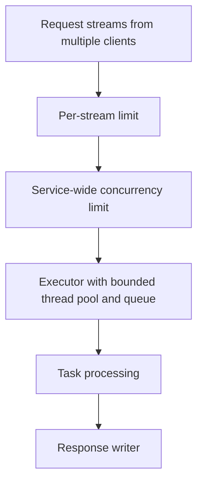

# Limiting Stream Concurrency

## 1. Why Concurrency Limits Are Needed

A bidirectional streaming RPC can receive many requests while the server simultaneously sends responses. If every request spawns an asynchronous task, one client can send thousands of commands in a short burst and force the server to create too many tasks, retain too much data, or exhaust the thread pool. When multiple clients do this, one session can impact the entire service.

**Concurrency limiting** is a rule governing how many units of work are allowed to run concurrently within a given scope. In Spring gRPC, distinguish at least three limits:

- **Per stream:** number of in-flight tasks within a single RPC, preventing one client from monopolizing resources.
- **Service-wide:** number of in-flight tasks across all RPCs, protecting the server's overall capacity.
- **Executor/queue:** number of threads and queued tasks accepted, preventing internal queues from growing without bound.

These limits complement flow control. `isReady()` regulates outbound message writability; manual inbound flow control regulates how many messages are requested for receipt; semaphores and executors limit the actual work the application runs.

After this lesson, learners will be able to design per-stream and service-wide limits, reject or throttle requests under overload, release permits across every branch, and write tests proving one stream cannot consume all processing capacity.

## 2. Three Layers of Limits



| Layer | Question to answer | Typical mechanism |
| --- | --- | --- |
| Per stream | How many tasks at most can one RPC run? | Per-session `Semaphore` or counter |
| Service-wide | How many tasks at most can all RPCs run? | Shared semaphore or bulkhead |
| Executor | How many tasks are running and waiting? | `ThreadPoolExecutor` with a bounded queue |

Example limit configuration:

- Per RPC: at most **4** concurrent tasks.
- Service-wide: at most **96** tasks admitted to the executor, comprising at most 32 running tasks and 64 queued tasks.
- When a limit is reached, the server returns a `TaskRejected` response tied to `request_id` so the client knows that request was not accepted for processing.

These numbers are examples only. Real values should be based on processing time, memory per task, CPU count, payload size, and expected concurrent load.

## 3. Distinguishing Concurrency Limits from Flow Control

| Mechanism | What does it limit? | What it does not solve on its own |
| --- | --- | --- |
| `isReady()` and `setOnReadyHandler()` | Outbound message writability | Number of running business tasks |
| `disableAutoRequest()` and `request(n)` | Number of inbound gRPC messages requested for delivery | Total executor resource bounds |
| Per-stream semaphore | Concurrent tasks within one RPC | Overall service capacity |
| Service-wide semaphore | Total admitted tasks across all RPCs | Executor queue sizing if mismatched |
| Bounded executor queue | Tasks waiting for a worker thread | Fairness across streams |

A server can receive messages in a controlled manner yet still spawn many tasks inside each callback. Conversely, limiting task count while leaving the response queue unbounded can still cause memory growth. Apply limits at the exact layer where resources are allocated.

## 4. Protobuf Contract for Overload Responses

Example `work_stream.proto`:

```proto
syntax = "proto3";

package work.v1;

option java_multiple_files = true;
option java_package = "com.example.work.v1";

service WorkStream {
  rpc Execute(stream WorkRequest) returns (stream WorkEvent);
}

message WorkRequest {
  string request_id = 1;
  string payload = 2;
}

message WorkEvent {
  string request_id = 1;
  oneof event {
    Accepted accepted = 2;
    Result result = 3;
    TaskRejected rejected = 4;
    TaskFailed failed = 5;
  }
}

message Accepted { string detail = 1; }
message Result { string value = 1; }
message TaskRejected {
  string reason = 1;
  int32 retry_after_ms = 2;
}
message TaskFailed {
  string reason = 1;
}
```

When capacity runs out, the server can send `TaskRejected` for that specific request and keep the RPC alive. This is **task-level rejection**, as opposed to calling `responseObserver.onError(Status.RESOURCE_EXHAUSTED)` which ends the entire RPC.

Contract clarifications:

- `Accepted` is emitted only after the server has reserved resources and taken responsibility for processing.
- `TaskRejected` means the request was not accepted for processing; the client can retry following a backoff policy.
- `TaskFailed` means the request was accepted but processing failed; the client must not interpret it as a pre-admission rejection.
- `retry_after_ms` is a hint, not a guarantee that the server will definitely have capacity after that exact interval.
- `request_id` must be unique within the session; if retrying the same operation, the application needs explicit idempotency rules.

## 5. Configuring a Bounded Executor in Spring

Do not use an executor with an unbounded queue for tasks spawned from a stream. A straightforward configuration:

```java
package com.example.work;

import java.util.concurrent.ArrayBlockingQueue;
import java.util.concurrent.ThreadPoolExecutor;
import java.util.concurrent.TimeUnit;
import org.springframework.context.annotation.Bean;
import org.springframework.context.annotation.Configuration;

@Configuration
public class WorkExecutorConfig {
    @Bean(destroyMethod = "shutdown")
    ThreadPoolExecutor workExecutor() {
        return new ThreadPoolExecutor(
                8,                  // core threads
                32,                 // maximum threads
                30, TimeUnit.SECONDS,
                new ArrayBlockingQueue<>(64),
                new ThreadPoolExecutor.AbortPolicy());
    }
}
```

This executor allows at most 32 worker threads and 64 queued tasks. When no capacity remains, `execute()` throws `RejectedExecutionException`; the service must handle that branch and release all acquired permits. Do not blindly use `CallerRunsPolicy` inside gRPC callbacks: it can execute heavy work directly on the callback thread, stalling message reception and creating backpressure stalls.

If using a service-wide semaphore aligned with this configuration, you can set at most **96** permits (32 running + 64 queued). Whenever thread count or queue capacity changes, adjust the total permit limit accordingly. A semaphore does not replace a bounded queue; both must be configured together.

The `globalSlots` semaphore in the example is a limit for **one Spring process**. When running multiple replicas, each replica has its own quota; a cluster-wide limit requires quotas at the gateway layer, a shared coordinator, or distributed admission control.

## 6. Per-Stream and Service-Wide Limits on the Server

The example below shows how to receive a request, acquire permits in order, send `Accepted`, and submit work to the executor. Rejecting one request due to overload does not terminate the RPC.

```java
package com.example.work;

import com.example.work.v1.Accepted;
import com.example.work.v1.Result;
import com.example.work.v1.TaskFailed;
import com.example.work.v1.TaskRejected;
import com.example.work.v1.WorkEvent;
import com.example.work.v1.WorkRequest;
import com.example.work.v1.WorkStreamGrpc;
import io.grpc.stub.ServerCallStreamObserver;
import io.grpc.stub.StreamObserver;
import java.util.HashSet;
import java.util.Set;
import java.util.concurrent.Semaphore;
import java.util.concurrent.ThreadPoolExecutor;
import java.util.concurrent.RejectedExecutionException;
import org.springframework.stereotype.Service;

@Service
public class WorkStreamService extends WorkStreamGrpc.WorkStreamImplBase {
    private static final int PER_STREAM_LIMIT = 4;

    private final ThreadPoolExecutor executor;
    // One semaphore shared across all RPCs of the singleton service.
    private final Semaphore globalSlots = new Semaphore(96);

    public WorkStreamService(ThreadPoolExecutor executor) {
        this.executor = executor;
    }

    @Override
    public StreamObserver<WorkRequest> execute(
            StreamObserver<WorkEvent> responseObserver) {
        ServerCallStreamObserver<WorkEvent> output =
                (ServerCallStreamObserver<WorkEvent>) responseObserver;
        Session session = new Session(output, executor, globalSlots);
        output.setOnCancelHandler(session::cancel);

        return new StreamObserver<>() {
            @Override
            public void onNext(WorkRequest request) {
                session.accept(request);
            }

            @Override
            public void onError(Throwable error) {
                session.cancel();
            }

            @Override
            public void onCompleted() {
                session.inputCompleted();
            }
        };
    }

    private static final class Session {
        private final Object writeLock = new Object();
        private final ServerCallStreamObserver<WorkEvent> output;
        private final ThreadPoolExecutor executor;
        private final Semaphore globalSlots;
        private final Semaphore streamSlots =
                new Semaphore(PER_STREAM_LIMIT);
        private final Set<String> activeIds = new HashSet<>();

        private int active;
        private boolean inputDone;
        private boolean terminated;

        Session(ServerCallStreamObserver<WorkEvent> output,
                ThreadPoolExecutor executor, Semaphore globalSlots) {
            this.output = output;
            this.executor = executor;
            this.globalSlots = globalSlots;
        }

        void accept(WorkRequest request) {
            synchronized (writeLock) {
                if (terminated || output.isCancelled()) {
                    cancelLocked();
                    return;
                }

                String id = request.getRequestId();
                if (id.isBlank()) {
                    rejectLocked(id, "INVALID_REQUEST", 0);
                    return;
                }
                if (activeIds.contains(id)) {
                    rejectLocked(id, "REQUEST_ALREADY_ACTIVE", 0);
                    return;
                }

                // Do not block waiting for a permit inside the request callback.
                if (!streamSlots.tryAcquire()) {
                    rejectLocked(id, "STREAM_LIMIT_REACHED", 500);
                    return;
                }
                if (!globalSlots.tryAcquire()) {
                    streamSlots.release();
                    rejectLocked(id, "SERVICE_LIMIT_REACHED", 1000);
                    return;
                }

                activeIds.add(id);
                active++;
                if (!emitLocked(WorkEvent.newBuilder()
                        .setRequestId(id)
                        .setAccepted(Accepted.newBuilder()
                                .setDetail("Accepted for processing").build())
                        .build())) {
                    active--;
                    activeIds.remove(id);
                    streamSlots.release();
                    globalSlots.release();
                    return;
                }

                try {
                    executor.execute(() -> runTask(id, request.getPayload()));
                } catch (RejectedExecutionException rejected) {
                    // Request was already Accepted; dispatch failure is TaskFailed.
                    active--;
                    activeIds.remove(id);
                    streamSlots.release();
                    globalSlots.release();
                    emitLocked(WorkEvent.newBuilder()
                            .setRequestId(id)
                            .setFailed(TaskFailed.newBuilder()
                                    .setReason("EXECUTOR_UNAVAILABLE")
                                    .build())
                            .build());
                    finishIfReadyLocked();
                }
            }
        }

        private void runTask(String id, String payload) {
            try {
                if (isTerminated()) {
                    return;
                }
                // Replace with business processing with proper timeout/cancellation.
                String value = processPayload(payload);
                emit(WorkEvent.newBuilder()
                        .setRequestId(id)
                        .setResult(Result.newBuilder()
                                .setValue(value).build())
                        .build());
            } catch (RuntimeException error) {
                // Business error on one request does not automatically end the RPC.
                emit(WorkEvent.newBuilder()
                        .setRequestId(id)
                        .setFailed(TaskFailed.newBuilder()
                                .setReason("TASK_FAILED")
                                .build())
                        .build());
            } finally {
                synchronized (writeLock) {
                    active--;
                    activeIds.remove(id);
                    streamSlots.release();
                    globalSlots.release();
                    finishIfReadyLocked();
                }
            }
        }

        private String processPayload(String payload) {
            return "processed:" + payload;
        }

        private boolean isTerminated() {
            synchronized (writeLock) {
                return terminated || output.isCancelled();
            }
        }

        private boolean emit(WorkEvent event) {
            synchronized (writeLock) {
                return emitLocked(event);
            }
        }

        private boolean emitLocked(WorkEvent event) {
            if (terminated || output.isCancelled()) {
                cancelLocked();
                return false;
            }
            try {
                output.onNext(event);
                return true;
            } catch (RuntimeException error) {
                cancelLocked();
                return false;
            }
        }

        private void rejectLocked(String id, String reason, int retryMs) {
            emitLocked(WorkEvent.newBuilder()
                    .setRequestId(id)
                    .setRejected(TaskRejected.newBuilder()
                            .setReason(reason)
                            .setRetryAfterMs(retryMs)
                            .build())
                    .build());
        }

        void inputCompleted() {
            synchronized (writeLock) {
                inputDone = true;
                finishIfReadyLocked();
            }
        }

        void cancel() {
            synchronized (writeLock) {
                cancelLocked();
            }
        }

        private void cancelLocked() {
            terminated = true;
            // Running tasks hold permits until finally completes.
            // Do not release permits early while a worker is still executing.
        }

        private void finishIfReadyLocked() {
            if (!terminated && inputDone && active == 0) {
                terminated = true;
                output.onCompleted();
            }
        }
    }
}
```

**Key highlights of the example:**

- `streamSlots` lives inside `Session`, giving each RPC its own limit. `globalSlots` lives in the singleton Spring service, so all sessions share a total limit.
- Use `tryAcquire()` instead of `acquire()` in the request callback so gRPC threads are never blocked. When no permit is available, the server returns `TaskRejected` for that request.
- Emit `Accepted` only after acquiring permits. If the executor rejects due to a full queue, the server emits a task failure event, decrements `active`, and releases both permits.
- Permits are released inside `finally`, covering both success and thrown exceptions. Never release permits immediately upon RPC cancellation while the worker is still running; otherwise the limit no longer reflects actual active work.
- When the client half-closes, the server waits until `active == 0` before completing the response. When the RPC is cancelled, the session stops emitting; any still-running workers finish and release permits in `finally`.

The example keeps IDs in `activeIds` while tasks are running to prevent two concurrent copies of the same task. Requests rejected before acquiring permits are not added to this set, so the client can retry the same ID per backoff policy. Once a task completes, its ID is removed from the active set; if you need duplicate protection after completion or across reconnects, use an idempotency store with a TTL/size cap. If the executor rejects after `Accepted` has already been sent, the server emits `TaskFailed(EXECUTOR_UNAVAILABLE)` because the request was admitted but could not be dispatched.

When the RPC is cancelled, this sample marks the session terminated without automatically interrupting a blocking business call. The worker holds its permits until it exits `processPayload()` and runs `finally`. In production, configure I/O timeouts, pass cancellation tokens, or track `Future`s to interrupt tasks if supported; **release permits only once work has genuinely stopped**, avoiding admitting new tasks while old workers still consume resources.

This example focuses on concurrency, not a full task framework. Real systems need a bounded response queue/writer, flow control with `isReady()`, payload/byte limits, send exception handling, and coordinated business cancellation. If processing can hang, put timeouts on I/O and ensure workers cannot hold permits forever.

## 7. When Exceeding Limits: Reject, Wait, or Throttle?

Three common strategies:

| Strategy | Behavior | Best when |
| --- | --- | --- |
| **Fail fast (Reject)** | Return `TaskRejected` when no permit is available | Client can retry/backoff or notify the user |
| **Inbound backpressure** | Temporarily withhold `request(n)` so gRPC stops delivering more requests | You want to pace intake rather than reject |
| **Bounded wait queue** | Accept a bounded number of queued tasks, then reject when full | Work is short and queue wait latency is predictable |

Never block the `onNext()` callback waiting on a semaphore. Doing so stalls callback executor threads, blocks handling of other messages, and complicates cancellation. If you choose to queue, represent waiting via a bounded queue or inbound flow control.

The semaphore check in the example runs **after gRPC has delivered the request to the callback**. It limits admitted tasks, yet does not by itself limit inbound messages arriving over the transport. To throttle upstream earlier, enable manual inbound flow control on `ServerCallStreamObserver` via `disableAutoRequest()`, then call `request(n)` when the application has capacity. Still keep `tryAcquire()` upon message receipt because service-wide capacity can change due to other RPCs.

Upon rejection, clients should use exponential backoff with jitter, cap retry attempts, and keep idempotency keys stable. Never retry blindly on `retry_after_ms` without jitter, as many clients could retry in lockstep and trigger a new overload spike.

## 8. Choosing Limits and Avoiding Starvation

Limits set too low hurt throughput; limits set too high increase context switching, memory usage, and latency. Start from measured load, then tune based on:

- CPU time and I/O wait time per task.
- Average/peak memory per task and payload size.
- Concurrent active RPCs and maximum tasks per RPC.
- Queue size and acceptable wait time.
- Latency targets, rejection rate, and horizontal scaling capabilities.

A service-wide semaphore with `tryAcquire()` does not guarantee strict fairness: one stream can repeatedly grab permits ahead of another. Per-stream limits reduce this risk but do not replace a fairness policy. If you must prevent tenants from starving one another, add per-tenant quotas, weighted fair queues, or a permit-distributing scheduler.

Layer limits consistently without contradictory configurations. For instance, a global semaphore allowing 200 tasks paired with a 32-thread executor and an unbounded queue causes many requests to receive `Accepted` and then sit waiting for a long time. Total permits should align with `workers + queue`, and timeouts must include queue wait time.

## 9. Testing Concurrency Limits

Integration tests should control task completion timing using latches or mock executors. Key assertions:

| Scenario | Verification outcome |
| --- | --- |
| One stream sends 5 requests with limit 4 | At most 4 tasks are admitted concurrently; the 5th is rejected or queued per policy |
| Two streams send many requests concurrently | Total active tasks never exceed the global limit |
| Executor queue fills up | Requests are rejected properly; no permits leak |
| Worker throws an exception | Permits are released in `finally`; stream keeps handling other requests if policy allows |
| Client half-closes while tasks remain | Response completes only after active tasks reach 0 |
| Client cancels while tasks are running | No new responses emitted; permits released only when workers actually exit |
| Duplicate request ID sent while active | Same request does not run twice concurrently in the session |
| One stream continuously floods requests | Other streams still get permits per quota/fairness policy |

Monitor these metrics:

- Active tasks per stream and service-wide.
- Available permits at each layer.
- Executor active threads, queue depth, and rejection count.
- Time from request receipt to execution start.
- Processing duration, timeout rate, cancellations, and business errors.
- Rejection rate due to per-stream limits versus service-wide limits.

If active task count is low yet latency is high, the bottleneck may be I/O or a downstream queue. If the executor queue keeps growing, increasing concurrency alone may not help; locate the real bottleneck.

## 10. Common Mistakes

1. **Limiting only service-wide.** One RPC can consume most permits; add per-stream or per-tenant quotas.
2. **Limiting only per-stream.** Many concurrent clients can still overload the entire service.
3. **Using an unbounded queue.** Requests are admitted yet pile up indefinitely when processing falls behind arrival rate.
4. **Calling blocking `acquire()` inside callbacks.** This stalls gRPC processing threads; prefer fast rejection or inbound flow control.
5. **Forgetting to release permits on exception/rejection paths.** Causes permit leaks and permanent rejections even after load drops.
6. **Releasing permits immediately on cancel while workers still run.** Actual active work exceeds limits because permits are reissued too early.
7. **Unintentionally using `CallerRunsPolicy`.** Heavy tasks run on callback threads, degrading request intake.
8. **Misaligning semaphore and executor settings.** Many requests get `Accepted` only to stall in queues or immediately fail executor dispatch.

## 11. Practice Exercise

Extend `WorkStream.Execute`:

1. Set a per-stream limit of 3 and a global limit of 24; send requests from multiple RPCs concurrently.
2. Try two overload policies: fast rejection with `TaskRejected`, and manual inbound flow control so new messages are requested only when permits are available.
3. Generate payloads with varying processing durations and measure active tasks and queue depth.
4. Simulate executor rejections and task exceptions; verify each permit is released exactly once.
5. Cancel an RPC while tasks are still running; prove tasks emit no responses after cancel and permits are released only when workers exit.
6. Test skewed load between two tenants and add per-tenant quotas/fairness if one tenant starves the other.

**Completion criteria:** concurrent tasks never exceed per-stream or service-wide limits; queues remain bounded; all permits are released at the right time; and overload is handled via an explicit, observable policy.

### References

- [gRPC Flow Control](https://grpc.io/docs/guides/flow-control/): throttling send/receive rates in streaming RPCs.
- [gRPC Java CallStreamObserver API](https://grpc.github.io/grpc-java/javadoc/io/grpc/stub/CallStreamObserver.html): readiness and manual inbound flow control.
- [Java ThreadPoolExecutor](https://docs.oracle.com/en/java/javase/21/docs/api/java.base/java/util/concurrent/ThreadPoolExecutor.html): worker bounds, queues, and rejection policies.
- [Java Semaphore](https://docs.oracle.com/en/java/javase/21/docs/api/java.base/java/util/concurrent/Semaphore.html): managing permits for concurrent work.
- [Spring gRPC Reference](https://docs.spring.io/spring-grpc/reference/): integrating gRPC services in Spring.
